# 30天入门YouTube美元项目：一份面向新手的AI工具与自动化实践指南


大家好，我是越越。

我曾发布过多篇龙哥盟精华内容，也获得过“资深传术师”的称号。不过，我并不是程序员，没有计算机科班经历，也没有编程基础。

今年，我想做的事情很简单：把适合新手的项目拆开讲清楚，让没有技术背景的人也能按照步骤完成实践。

本次内容围绕“10款YouTube应用与AI辅助工具”展开，涵盖设备准备、浏览器配置、自动化账号维护、资料整理、飞书数据管理，以及直播评论处理等环节。

全文结合图片、文字和视频说明，建议使用电脑查看。

需要提前说明两点：

1. 文中工具均借助AI完成开发；
2. 成品工具、源码及相关教程都会同步提供。

## 一、先把运行环境准备好

本节不要求你一次性完成全部设置。后面实际用到哪款工具，再针对性配置即可。

例如，进入影刀RPA环节时，再安装对应软件；需要云端电脑时，再完成云电脑设置。这样更省时间，也不容易把准备工作做得过于复杂。

### 1. 设备要求

建议使用Windows 10或更高版本的电脑。

如果使用Mac，推荐通过云电脑运行Windows环境，流程如下：

1. 在浏览器访问 https://www.qingjiaocloud.com/download/ ；
2. 获取适用于Mac的客户端并完成安装；
3. 注册、登录后，开启Windows游戏主机或办公主机；
4. 后续按照普通Windows电脑的方式操作；
5. 不使用时及时关机，否则可能产生持续费用。

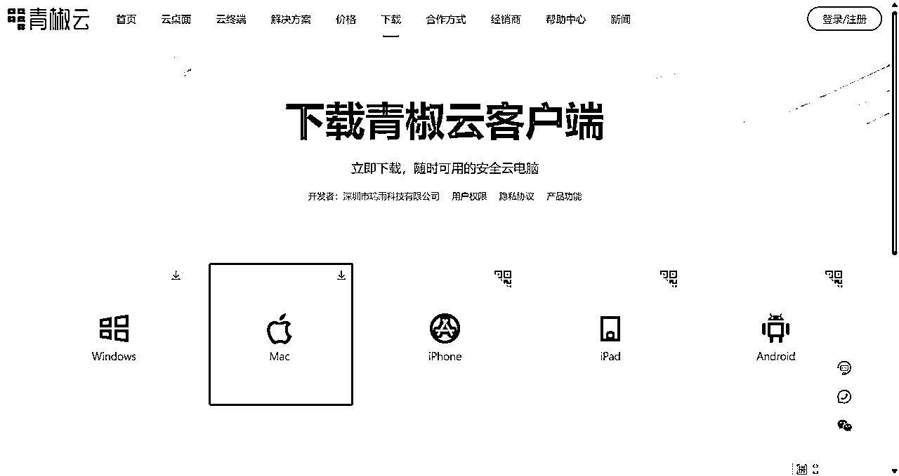

### 2. 软件与浏览器

以下配置并非全部强制安装，请根据实际任务选择。

建议统一采用Chrome完成相关流程，因为兼容性相对更好。YouTube和Viewstats页面尽量保持英文原貌，不要开启网页翻译。进行数据采集时，将浏览器窗口铺满屏幕。遇到异常时，保留完整界面和错误提示，方便排查。

#### Chrome安装与插件加载

可以先借助Edge获取Chrome安装程序：

https://www.google.cn/intl/zh-CN_ALL/chrome/fallback/

安装后，在地址栏输入：

```text
chrome://extensions/
```

进入扩展管理页面，打开开发者选项。若需要安装插件，先解压插件文件，再选择“加载已解压的扩展程序”完成导入。


#### 影刀RPA

影刀是一款偏低代码的自动化工具，对没有开发经验的人比较友好。

第一步，访问：

https://www.yingdao.com/client-download/

下载Windows版本并完成安装。

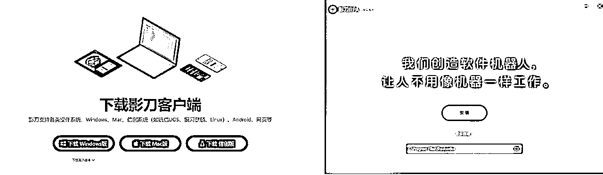

第二步，可以在闲鱼搜索“影刀创业版账号”，购买后先进行基础测试。

第三步，退出Chrome，启动影刀，点击右上角头像，依次进入“工具”“自动化插件”，找到“Google Chrome自动化”并安装。

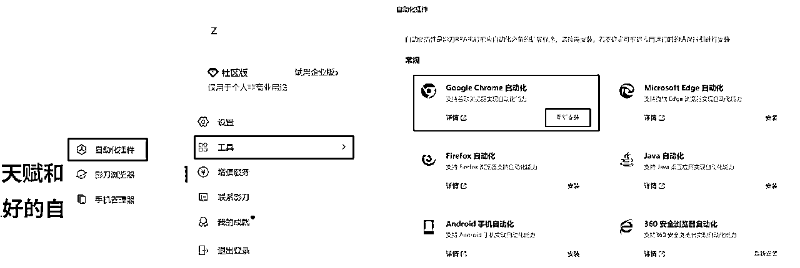

建议开启错误录屏。程序发生异常时，将对应录屏发送出来，更方便定位问题。

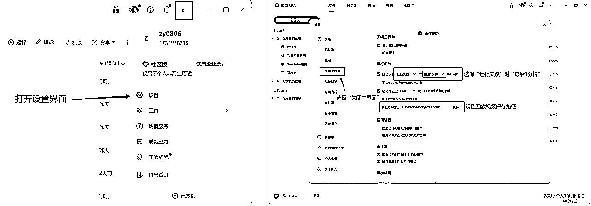

### 3. 配置飞书多维表格

先访问：

https://open.feishu.cn/app?lang=zh-CN

登录飞书账号，并创建一个新的企业应用。

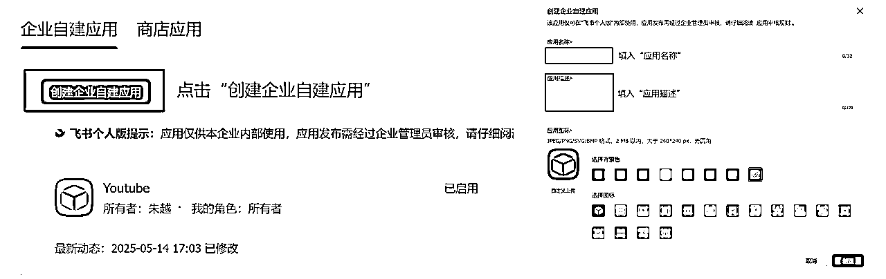

打开左侧权限管理，进入权限开通页面，搜索“多维表格”，勾选所需权限后提交确认。


随后进入“凭证与基础信息”，取得App ID及App Secret，并将它们妥善保存。

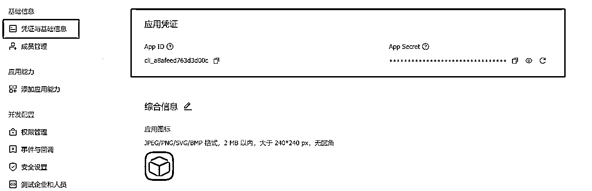

文档中附有配套视频。接下来打开多维表格模板链接，选择“使用该模板”。模板复制完成后，进入“文档应用”，填写应用名称并确认。

注意：副本名称可以调整，但子表名称不要改动，否则可能影响后续程序调用。

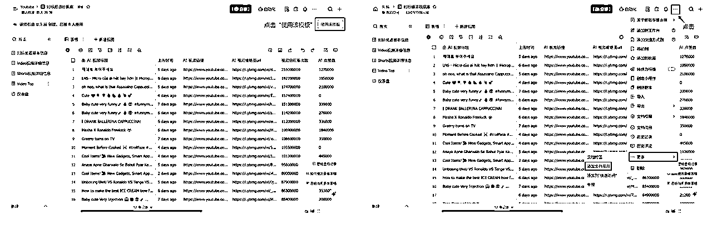


完成模板配置后，打开多维表格分享入口，复制分享地址。


例如链接格式如下：

```text
https://txt6wm3b04b.feishu.cn/base/*************?from=from_copylink
```

需要提取的是`base/`与`?from`之间的字符，这部分就是多维表格ID。

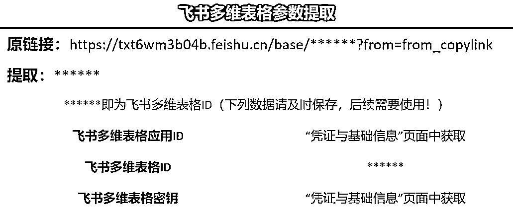

最后，将App ID、App Secret、多维表格ID等信息集中整理，避免后续反复查找。

若遇到飞书权限问题，可访问：

https://open.feishu.cn/

如需处理节点转换问题，可查看：

https://open.feishu.cn/document/server-docs/docs/wiki-v2/space-node/get_node?appId=cli_a784f92850bfd00b

### 4. 配置比特浏览器

下载地址：

https://www.bitbrowser.cn/download/

安装完成后，新建浏览器窗口，并记下对应窗口ID。

基本流程：

1. 进入“创建窗口”；
2. 按项目需求填写参数，必要时点击“换一换”；
3. 按照官方说明设置IP代理；
4. 在各个窗口中登录YouTube账号；
5. 将账号、密码和窗口ID集中记录到飞书表格。

代理配置说明：

https://doc2.bitbrowser.cn/help1.html


## 二、建立清晰的资料管理体系

YouTube项目往往会产生大量图片、视频、音频和账号资料。如果没有统一的归档方式，后期制作、查找和复用都会变得低效。

做好整理，主要有三方面价值：

- 查资料更快；
- 更容易看到项目推进成果；
- 方便复盘经验和调整流程。

我制作纪录片时，会把原始资料同步到飞书，确保本机与云端各有一份。同时，合格和淘汰素材都会保留，后续仍可能用于二次剪辑或重新组合。


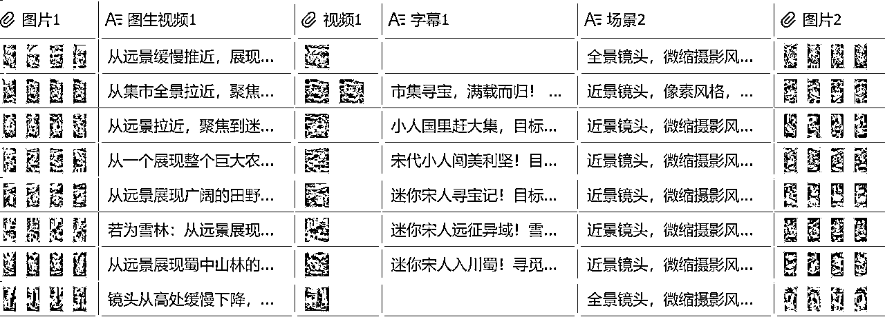

### 1. 规划项目目录

以下是我常用的项目文件架构：


如果暂时没有合适的目录方案，可以让DeepSeek根据项目需求生成。先描述你的工作流程，再通过多轮对话不断调整，直到结构符合实际。

```
我作为youtube小白，我该怎样去文件管理?
{推荐输入你的个人情况}
我需要归纳整理账号、素材、对标等等，但是我不清楚该怎样设置文件的目录结构，
请你帮我生成适合的文件目录架构（请直接使用markdown语言输出）。
```

之后，把生成的目录文本交给“YouTube项目文件夹结构生成器”，即可批量创建对应文件夹。


文件夹建立后，根据项目进度分别放置脚本、成片、素材和备份文件。

### 2. 管理账号矩阵

以账号矩阵为例，我会在飞书多维表格中记录账号状态、登录信息和其他基础资料。

账号管理工具：

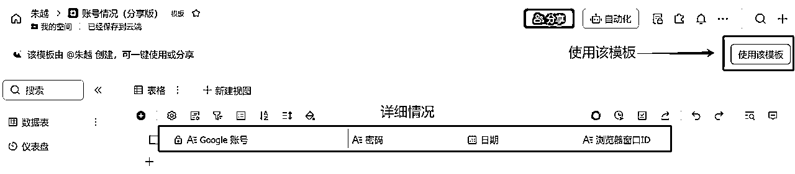

### 3. 按场景整理素材

每个场景单独建立素材区域，并按用途划分目录。

第一步，围绕视频主题建立总文件夹。

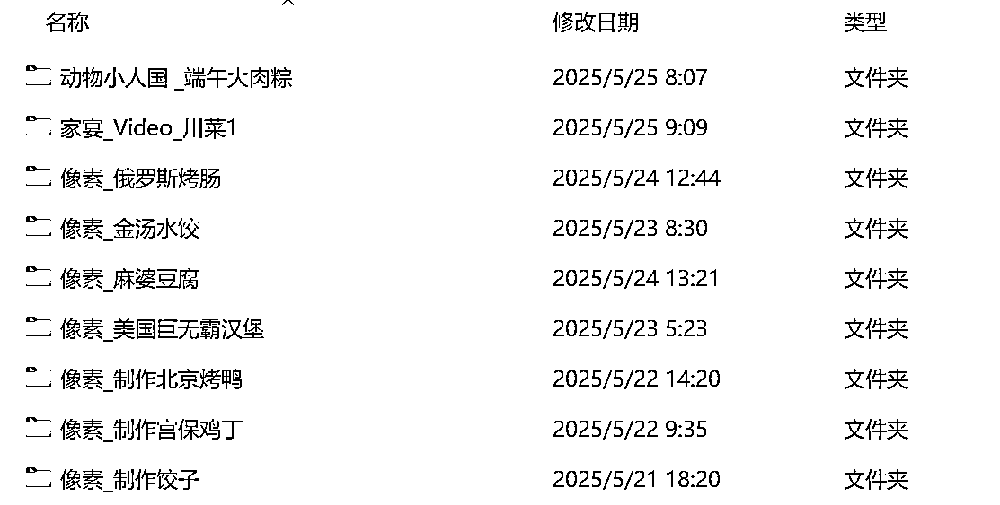

第二步，在主题目录中继续划分成品、视频、图片等子目录，也可以根据实际需求增加音频、字幕、工程文件等分类。

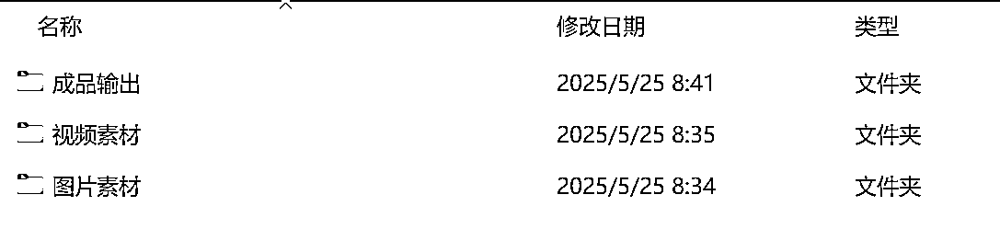

第三步，将不同镜头对应的素材放入相应位置。

通常一组提示词会生成4张图片，我会采用“镜头编号_图片编号.jpg”的命名方式。例如`1_4.jpg`，表示第1个镜头下的第4张候选图。

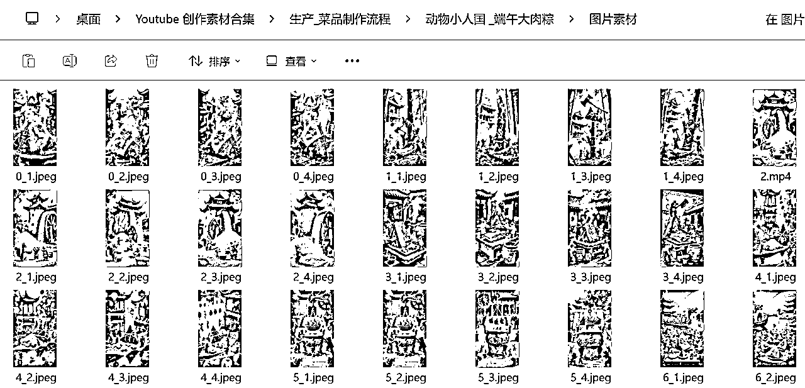

即使图片或视频效果不理想，也建议先保留，后续可能用于二次处理。为了便于自动化识别，所有文件都应按照统一规则命名。


## 三、统一保存位置与备份方式

### 1. 设置浏览器下载位置

在Chrome地址栏输入：

```text
chrome://settings/downloads
```

建议开启“下载前询问每个文件的保存位置”，这样每次保存时都能手动确认归档目录。

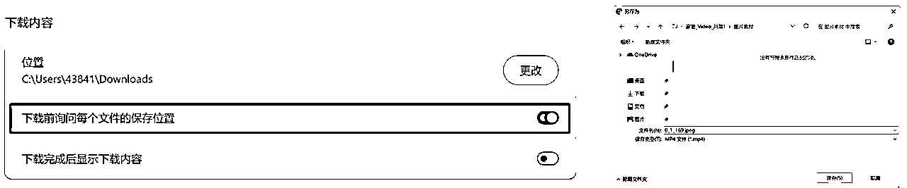

### 2. 调整剪映工程路径

安装剪映时，可以提前规划软件位置和数据文件位置。

剪映中的草稿、模板、素材通常分别存放。将它们调整到项目目录后，后续调用模板、迁移工程和整理草稿都会更方便。

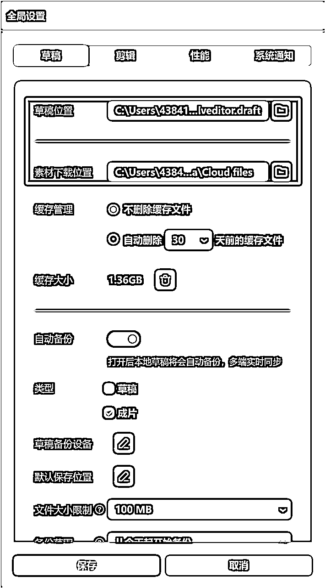

### 3. 做好版本备份

YouTube项目生成文件多、修改频繁，首次产出的内容不要急着清理。建议重点保留：

- 9:16、16:9等不同比例的图片版本；
- 5秒、10秒等不同时长的视频版本；
- 参考视频中使用的声音素材，尤其是音效文件。

备份目录可以沿用前面的文件夹生成方案。


日常备份可选择百度云盘。准备删除的资料，先放到“待删除”目录，观察一段时间后再清理。重要视频最好额外存储在非系统盘中，降低单盘损坏带来的风险。

## 四、Shorts账号维护自动化

### 1. 程序可以完成什么

通过自动化工具，可以批量执行Shorts账号的基础维护任务，主要功能包括：

- 手动录入多个比特浏览器窗口ID；
- 查看运行日志和执行状态；
- 自定义互动参数，也能直接套用预设方案；
- 根据显示器尺寸调整窗口布局；
- 使用固定评论或随机评论；
- 查看播放与互动反馈。

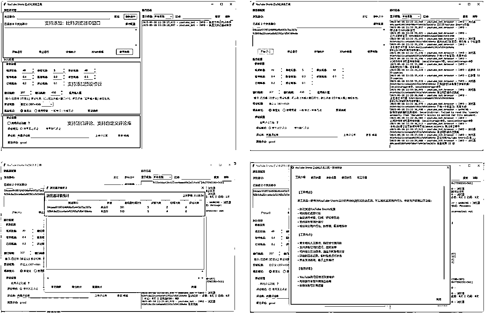

这套程序部分思路参考了@钱塘江鲤的开源工作，我在界面呈现、参数管理、评论配置和多线程执行等方面进行了改进。

成品程序与源码会一并提供。

### 2. 基本操作流程

第一步，启动比特浏览器，将程序下载并解压到指定目录。运行“Youtube自动养号（shorts版）.exe”，输入窗口ID后点击“添加”。保存过的窗口，下次启动时无需再次录入。

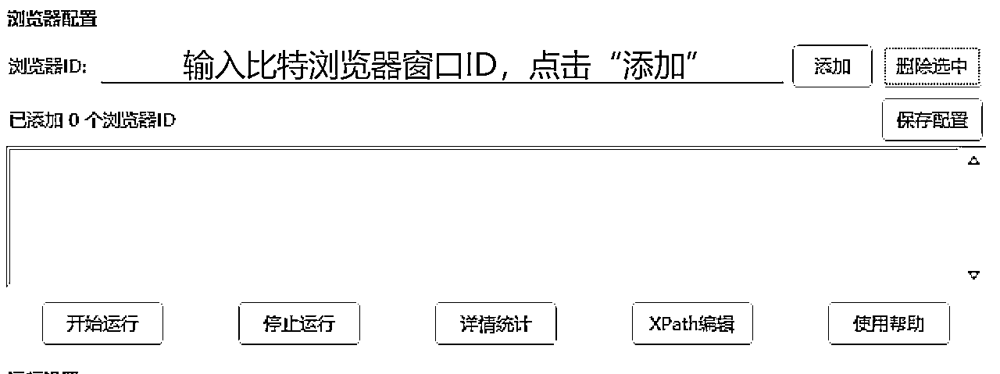

第二步，配置互动方案。可以直接选择“使用预设”，也可以查看“预设说明”，了解各项参数后自行调整。

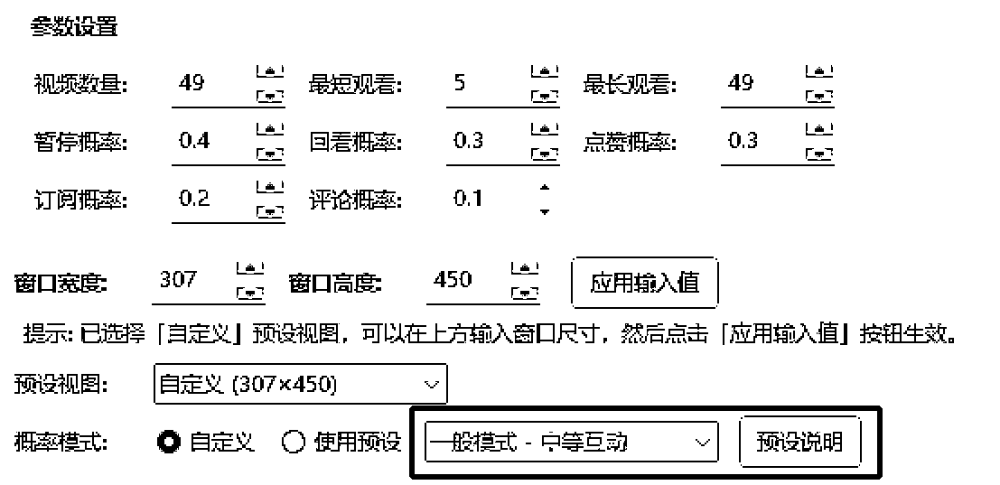

第三步，按需开启评论功能：

- 固定评论：每次发布相同内容；
- 随机评论：从评论库中抽取不同内容。


第四步，点击启动按钮。程序会先展示配置确认信息，确认后再依次打开对应浏览器窗口。

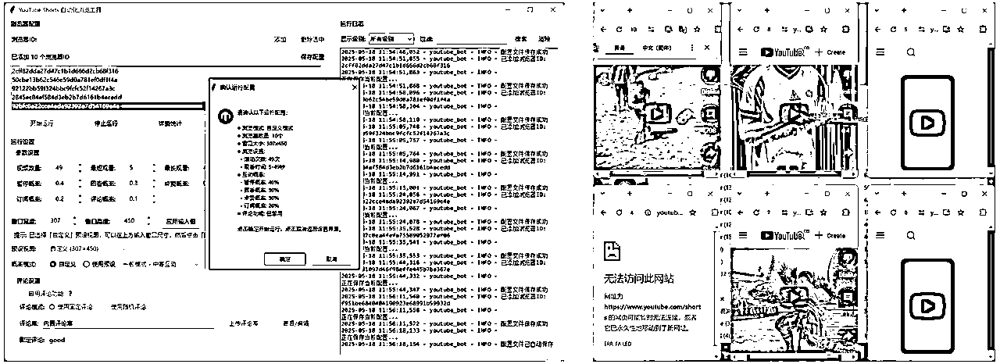

运行前请确认：

1. 比特浏览器已经启动并完成登录；
2. 每个子窗口都配置好了代理与Google账号；
3. 任务执行期间可以暂停或继续，但操作后可能需要等待片刻。

## 五、直播评论互动的实现思路

本节不提供现成程序和源码，主要讲解实现逻辑。

打开目标YouTube直播页后，可以按照以下顺序设计：

1. 建立评论监测模块；
2. 定位聊天iframe，并判断评论区主要语言；
3. 持续捕捉新出现的留言；
4. 读取评论者名称、文本和表情等信息；
5. 对内容进行积极、消极或中性判断；
6. 根据判断结果，用相应语言生成回复；
7. 按一定概率决定是否发送；
8. 将评论及分析结果写入Excel；
9. 对评论进行关键词归纳，寻找观众真正关心的问题。

详细流程可配合文档中的视频学习。

## 六、用影刀“魔法指令”辅助开发

影刀内置的“魔法指令”可以帮助我们快速搭建网页自动化流程。

操作步骤如下：

第一步，新建魔法指令，并点击输入框下方的“获取元素”。


第二步，在直播页面中选取评论区域。


第三步，在指令输入框描述希望实现的功能。

```
{获取的评论区元素}实时监控采集评论区评论，并进行情感倾向判断，同时使用评论区内容的主要语言进行回复，{评论输入框元素}使用回车键发送，请模拟人类行为。
```

第四步，先点击“优化指令”，再发送执行。后续可以继续通过对话修改需求。


如果希望进行更深度的开发，可以打开“编辑源码”，将生成的代码复制到Cursor中继续修改、调试，甚至打包为独立应用。

这类程序可以用于：

- 抓取不同网页中的公开信息；
- 执行网页点击、输入等交互动作。

影刀官方说明：

https://www.yingdao.com/yddoc/rpa/711624635438841856


源代码示例如下：

这份指南的重点，不是单纯堆工具，而是把设备、软件、账号、素材、文件和自动化流程串成一套可复用的工作系统。

如果你是刚接触YouTube项目的新手，可以先从环境配置和文件整理开始，再逐步尝试账号维护、直播评论分析等模块。工具、成品和源码都已经准备好，真正决定结果的，还是持续执行、记录和优化。

有时候，最吊人胃口的，不是一句惊天动地的话，而是一个没头没尾的开始。

就像现在，摆在我面前的“素材”，干净得像一张白纸，只留下一个孤零零的记号——```
# pip install pandas
# pip install openpyxl
# pip install textblob

import pandas as pd
import time
import random
import re
import datetime
from textblob import TextBlob
import keyboard
import os

from typing import *
try:
    from xbot.app.logging import trace as print
except:
    from xbot import print

def monitor_youtube_chat(browser, comments_container, reply_input, wait_min=30, wait_max=120, max_cycles=100, excel_path="chat_monitoring.xlsx"):
    """
    title: YouTube聊天监控与回复
    description: 监控YouTube直播评论区，进行情感分析，保存评论到Excel，并自动回复

    inputs:
        - browser (WebBrowser): 目标网页
        - comments_container (Selector): `评论区`，uuid: sgu23ylq
        - reply_input (Selector): `回复输入框`，uuid: sgwweqlj
        - wait_min (int-textbox): 随机等待最小时间(秒)，eg: 30
        - wait_max (int-textbox): 随机等待最大时间(秒)，eg: 120
        - max_cycles (int-textbox): 最大监控循环次数，eg: 100
        - excel_path (str-file): Excel文件保存路径，eg: "youtube_comments.xlsx"

    outputs:
        - None
    """

    # 确保Excel文件存在，如果不存在则创建
    _init_excel_file(excel_path)

    print("1.初始化YouTube聊天监控")
    print(f"  a.将监控评论区并保存到 {excel_path}")
    print(f"  b.每次监控后等待 {wait_min}-{wait_max} 秒")
    print(f"  c.计划执行 {max_cycles} 次监控循环")

    # 记录已处理的评论ID
    processed_comments = set()

    # 主监控循环
    for cycle in range(1, max_cycles + 1):
        print(f"\n2.开始第 {cycle}/{max_cycles} 轮监控")

        # 切换到聊天iframe
        _switch_to_chat_iframe(browser)

        # 获取评论
        print("  a.获取新评论")
        comments = _get_new_comments(browser, comments_container, processed_comments)

        if not comments:
            print("    未发现新评论")
        else:
            print(f"    发现 {len(comments)} 条新评论")

            # 处理每条评论
            for idx, comment_data in enumerate(comments):
                print(f"  b.处理评论 {idx+1}/{len(comments)}")

                # 进行情感分析
                sentiment = _analyze_sentiment(comment_data['text'])
                comment_data['sentiment'] = sentiment['label']
                comment_data['sentiment_score'] = sentiment['score']

                # 生成回复
                reply_text = _generate_reply(comment_data)

                # 保存到Excel
                _save_to_excel(excel_path, comment_data)

                # 回复评论
                if reply_text:
                    print(f"    回复 {comment_data['username']}: {reply_text}")
                    _reply_to_comment(browser, reply_input, reply_text)

                # 添加到已处理集合
                processed_comments.add(comment_data['id'])

        # 随机等待一段时间
        wait_time = random.randint(wait_min, wait_max)
        print(f"3.等待 {wait_time} 秒后进行下一轮监控...")
        time.sleep(wait_time)

    print("\n4.监控完成")
    print(f"  共处理了 {len(processed_comments)} 条评论")
    print(f"  结果已保存到 {excel_path}")

def _init_excel_file(excel_path):
    """初始化Excel文件，如果不存在则创建"""
    if not os.path.exists(excel_path):
        df = pd.DataFrame(columns=[
            'timestamp', 'id', 'username', 'text', 
            'sentiment', 'sentiment_score', 'reply'
        ])
        df.to_excel(excel_path, index=False)
        print(f"创建新的Excel文件: {excel_path}")

def _switch_to_chat_iframe(browser):
    """切换到聊天iframe"""
    try:
        # 执行JavaScript获取iframe并切换
        browser.execute_javascript("""
        function(element, args) {
            const iframe = document.querySelector('iframe#chatframe');
            if (iframe) {
                return "success";
            }
            return "iframe not found";
        }
        """)
    except Exception as e:
        print(f"切换到iframe时出错: {str(e)}")

def _get_new_comments(browser, comments_container, processed_comments):
    """获取新的评论"""
    comments = []

    try:
        # 找到评论容器
        container_elements = browser.find_all_by_xpath(comments_container, timeout=3)
        if not container_elements:
            return comments

        container = container_elements[0]

        # 获取所有评论
        comment_elements = container.find_all_by_xpath(".//yt-live-chat-text-message-renderer", timeout=3)

        for comment_element in comment_elements:
            # 获取评论ID
            comment_id = comment_element.get_attribute("id")

            # 如果已处理过，跳过
            if comment_id in processed_comments:
                continue

            # 获取用户名
            username_element = comment_element.find_all_by_xpath(".//span[@id='author-name']", timeout=3)
            username = username_element[0].get_text() if username_element else "Unknown User"

            # 获取评论内容
            message_element = comment_element.find_all_by_xpath(".//span[@id='message']", timeout=3)
            message = message_element[0].get_text() if message_element else ""

            # 添加到结果列表
            comments.append({
                'id': comment_id,
                'username': username,
                'text': message,
                'timestamp': datetime.datetime.now().strftime("%Y-%m-%d %H:%M:%S")
            })

    except Exception as e:
        print(f"获取评论时出错: {str(e)}")

    return comments

def _analyze_sentiment(text):
    """对评论文本进行情感分析"""
    try:
        # 使用TextBlob进行情感分析
        analysis = TextBlob(text)
        polarity = analysis.sentiment.polarity

        # 确定情感标签
        if polarity > 0.1:
            return {'label': 'positive', 'score': polarity}
        elif polarity < -0.1:
            return {'label': 'negative', 'score': polarity}
        else:
            return {'label': 'neutral', 'score': polarity}

    except Exception as e:
        print(f"情感分析出错: {str(e)}")
        return {'label': 'neutral', 'score': 0}

def _generate_reply(comment_data):
    """根据评论和情感生成回复"""
    username = comment_data['username']
    text = comment_data['text']
    sentiment = comment_data['sentiment']

    # 检测语言 (简单判断，如果包含拉丁字母以外的字符则可能是非葡萄牙语/西班牙语)
    is_latin_based = all(c.isascii() or c.isspace() or c in "áàâãéèêíìîóòôõúùûçÁÀÂÃÉÈÊÍÌÎÓÒÔÕÚÙÛÇ,.!?;:-_()[]{}\"'/" for c in text)

    # 根据情感和内容选择回复模板
    replies = {
        'positive': [
            f"Valeu {username}! 👍",
            f"Concordo com você, {username}!",
            f"Boa observação, {username}!",
            "Muito obrigado pelo comentário positivo!",
            "É isso aí! 🔥"
        ],
        'negative': [
            f"Entendo seu ponto, {username}.",
            "Obrigado por compartilhar sua opinião!",
            "Interessante perspectiva...",
            "Vamos pensar sobre isso.",
            "Respeito sua opinião! 👍"
        ],
        'neutral': [
            f"Olá {username}, obrigado pelo comentário!",
            "Valeu por participar do chat!",
            "Legal! 👍",
            "Obrigado por estar aqui!",
            "Entendi! 👀"
        ],
        'command': [
            "Comando registrado! 👍",
            "Anotado!",
            "👌"
        ]
    }

    # 检查是否是命令(!开头)
    if text and text[0] == '!':
        return random.choice(replies['command'])

    # 对于空消息或特殊情况，不回复
    if not text or len(text) < 2:
        return ""

    # 根据情感选择回复
    return random.choice(replies[sentiment])

def _save_to_excel(excel_path, comment_data):
    """保存评论数据到Excel"""
    try:
        # 读取现有Excel
        if os.path.exists(excel_path):
            df = pd.read_excel(excel_path)
        else:
            df = pd.DataFrame(columns=[
                'timestamp', 'id', 'username', 'text', 
                'sentiment', 'sentiment_score', 'reply'
            ])

        # 添加新行
        new_row = {
            'timestamp': comment_data['timestamp'],
            'id': comment_data['id'],
            'username': comment_data['username'],
            'text': comment_data['text'],
            'sentiment': comment_data['sentiment'],
            'sentiment_score': comment_data['sentiment_score'],
            'reply': comment_data.get('reply', '')
        }

        df = pd.concat([df, pd.DataFrame([new_row])], ignore_index=True)

        # 保存回Excel
        df.to_excel(excel_path, index=False)
        print(f"    评论已保存到Excel")

    except Exception as e:
        print(f"保存到Excel时出错: {str(e)}")

def _reply_to_comment(browser, reply_input, reply_text):
    """在输入框中回复评论"""
    try:
        # 找到回复输入框
        input_elements = browser.find_all_by_xpath(reply_input, timeout=3)
        if not input_elements:
            print("    未找到回复输入框")
            return

        input_container = input_elements[0]

        # 找到可编辑的div
        editable_div = input_container.find_all_by_xpath(".//div[@contenteditable]", timeout=3)
        if not editable_div:
            print("    未找到可编辑div")
            return

        # 清空现有内容并输入新回复
        editable_div[0].click(delay_after=0.3)

        # 清空内容 (使用键盘组合键Ctrl+A和Delete)
        browser.execute_javascript("""
        function(element, args) {
            const div = document.querySelector('div[contenteditable]');
            if (div) {
                div.textContent = '';
                return "cleared";
            }
            return "div not found";
        }
        """)

        # 输入回复
        editable_div[0].input(reply_text, delay_after=0.3)

        # 按回车发送
        keyboard.press_and_release('enter')
        time.sleep(1)  # 等待消息发送

    except Exception as e:
        print(f"回复评论时出错: {str(e)}")

```。

别小看这个记号，它其实是给文案开了一扇门：门后面，什么都有可能发生。可能是金句，可能是数据，也可能是一段戳心故事。真正聪明的文案，从不急着把话说满，而是先铺好轨道，让情绪顺着一个节点自然生长。

老话说得好，留白才是最高的表达。与其堆砌辞藻，不如用一个抓手，把所有注意力都收拢到一个点上。

现在，这枚钩子已经就位。

它就是：```
# pip install pandas
# pip install openpyxl
# pip install textblob

import pandas as pd
import time
import random
import re
import datetime
from textblob import TextBlob
import keyboard
import os

from typing import *
try:
    from xbot.app.logging import trace as print
except:
    from xbot import print

def monitor_youtube_chat(browser, comments_container, reply_input, wait_min=30, wait_max=120, max_cycles=100, excel_path="chat_monitoring.xlsx"):
    """
    title: YouTube聊天监控与回复
    description: 监控YouTube直播评论区，进行情感分析，保存评论到Excel，并自动回复

    inputs:
        - browser (WebBrowser): 目标网页
        - comments_container (Selector): `评论区`，uuid: sgu23ylq
        - reply_input (Selector): `回复输入框`，uuid: sgwweqlj
        - wait_min (int-textbox): 随机等待最小时间(秒)，eg: 30
        - wait_max (int-textbox): 随机等待最大时间(秒)，eg: 120
        - max_cycles (int-textbox): 最大监控循环次数，eg: 100
        - excel_path (str-file): Excel文件保存路径，eg: "youtube_comments.xlsx"

    outputs:
        - None
    """

    # 确保Excel文件存在，如果不存在则创建
    _init_excel_file(excel_path)

    print("1.初始化YouTube聊天监控")
    print(f"  a.将监控评论区并保存到 {excel_path}")
    print(f"  b.每次监控后等待 {wait_min}-{wait_max} 秒")
    print(f"  c.计划执行 {max_cycles} 次监控循环")

    # 记录已处理的评论ID
    processed_comments = set()

    # 主监控循环
    for cycle in range(1, max_cycles + 1):
        print(f"\n2.开始第 {cycle}/{max_cycles} 轮监控")

        # 切换到聊天iframe
        _switch_to_chat_iframe(browser)

        # 获取评论
        print("  a.获取新评论")
        comments = _get_new_comments(browser, comments_container, processed_comments)

        if not comments:
            print("    未发现新评论")
        else:
            print(f"    发现 {len(comments)} 条新评论")

            # 处理每条评论
            for idx, comment_data in enumerate(comments):
                print(f"  b.处理评论 {idx+1}/{len(comments)}")

                # 进行情感分析
                sentiment = _analyze_sentiment(comment_data['text'])
                comment_data['sentiment'] = sentiment['label']
                comment_data['sentiment_score'] = sentiment['score']

                # 生成回复
                reply_text = _generate_reply(comment_data)

                # 保存到Excel
                _save_to_excel(excel_path, comment_data)

                # 回复评论
                if reply_text:
                    print(f"    回复 {comment_data['username']}: {reply_text}")
                    _reply_to_comment(browser, reply_input, reply_text)

                # 添加到已处理集合
                processed_comments.add(comment_data['id'])

        # 随机等待一段时间
        wait_time = random.randint(wait_min, wait_max)
        print(f"3.等待 {wait_time} 秒后进行下一轮监控...")
        time.sleep(wait_time)

    print("\n4.监控完成")
    print(f"  共处理了 {len(processed_comments)} 条评论")
    print(f"  结果已保存到 {excel_path}")

def _init_excel_file(excel_path):
    """初始化Excel文件，如果不存在则创建"""
    if not os.path.exists(excel_path):
        df = pd.DataFrame(columns=[
            'timestamp', 'id', 'username', 'text', 
            'sentiment', 'sentiment_score', 'reply'
        ])
        df.to_excel(excel_path, index=False)
        print(f"创建新的Excel文件: {excel_path}")

def _switch_to_chat_iframe(browser):
    """切换到聊天iframe"""
    try:
        # 执行JavaScript获取iframe并切换
        browser.execute_javascript("""
        function(element, args) {
            const iframe = document.querySelector('iframe#chatframe');
            if (iframe) {
                return "success";
            }
            return "iframe not found";
        }
        """)
    except Exception as e:
        print(f"切换到iframe时出错: {str(e)}")

def _get_new_comments(browser, comments_container, processed_comments):
    """获取新的评论"""
    comments = []

    try:
        # 找到评论容器
        container_elements = browser.find_all_by_xpath(comments_container, timeout=3)
        if not container_elements:
            return comments

        container = container_elements[0]

        # 获取所有评论
        comment_elements = container.find_all_by_xpath(".//yt-live-chat-text-message-renderer", timeout=3)

        for comment_element in comment_elements:
            # 获取评论ID
            comment_id = comment_element.get_attribute("id")

            # 如果已处理过，跳过
            if comment_id in processed_comments:
                continue

            # 获取用户名
            username_element = comment_element.find_all_by_xpath(".//span[@id='author-name']", timeout=3)
            username = username_element[0].get_text() if username_element else "Unknown User"

            # 获取评论内容
            message_element = comment_element.find_all_by_xpath(".//span[@id='message']", timeout=3)
            message = message_element[0].get_text() if message_element else ""

            # 添加到结果列表
            comments.append({
                'id': comment_id,
                'username': username,
                'text': message,
                'timestamp': datetime.datetime.now().strftime("%Y-%m-%d %H:%M:%S")
            })

    except Exception as e:
        print(f"获取评论时出错: {str(e)}")

    return comments

def _analyze_sentiment(text):
    """对评论文本进行情感分析"""
    try:
        # 使用TextBlob进行情感分析
        analysis = TextBlob(text)
        polarity = analysis.sentiment.polarity

        # 确定情感标签
        if polarity > 0.1:
            return {'label': 'positive', 'score': polarity}
        elif polarity < -0.1:
            return {'label': 'negative', 'score': polarity}
        else:
            return {'label': 'neutral', 'score': polarity}

    except Exception as e:
        print(f"情感分析出错: {str(e)}")
        return {'label': 'neutral', 'score': 0}

def _generate_reply(comment_data):
    """根据评论和情感生成回复"""
    username = comment_data['username']
    text = comment_data['text']
    sentiment = comment_data['sentiment']

    # 检测语言 (简单判断，如果包含拉丁字母以外的字符则可能是非葡萄牙语/西班牙语)
    is_latin_based = all(c.isascii() or c.isspace() or c in "áàâãéèêíìîóòôõúùûçÁÀÂÃÉÈÊÍÌÎÓÒÔÕÚÙÛÇ,.!?;:-_()[]{}\"'/" for c in text)

    # 根据情感和内容选择回复模板
    replies = {
        'positive': [
            f"Valeu {username}! 👍",
            f"Concordo com você, {username}!",
            f"Boa observação, {username}!",
            "Muito obrigado pelo comentário positivo!",
            "É isso aí! 🔥"
        ],
        'negative': [
            f"Entendo seu ponto, {username}.",
            "Obrigado por compartilhar sua opinião!",
            "Interessante perspectiva...",
            "Vamos pensar sobre isso.",
            "Respeito sua opinião! 👍"
        ],
        'neutral': [
            f"Olá {username}, obrigado pelo comentário!",
            "Valeu por participar do chat!",
            "Legal! 👍",
            "Obrigado por estar aqui!",
            "Entendi! 👀"
        ],
        'command': [
            "Comando registrado! 👍",
            "Anotado!",
            "👌"
        ]
    }

    # 检查是否是命令(!开头)
    if text and text[0] == '!':
        return random.choice(replies['command'])

    # 对于空消息或特殊情况，不回复
    if not text or len(text) < 2:
        return ""

    # 根据情感选择回复
    return random.choice(replies[sentiment])

def _save_to_excel(excel_path, comment_data):
    """保存评论数据到Excel"""
    try:
        # 读取现有Excel
        if os.path.exists(excel_path):
            df = pd.read_excel(excel_path)
        else:
            df = pd.DataFrame(columns=[
                'timestamp', 'id', 'username', 'text', 
                'sentiment', 'sentiment_score', 'reply'
            ])

        # 添加新行
        new_row = {
            'timestamp': comment_data['timestamp'],
            'id': comment_data['id'],
            'username': comment_data['username'],
            'text': comment_data['text'],
            'sentiment': comment_data['sentiment'],
            'sentiment_score': comment_data['sentiment_score'],
            'reply': comment_data.get('reply', '')
        }

        df = pd.concat([df, pd.DataFrame([new_row])], ignore_index=True)

        # 保存回Excel
        df.to_excel(excel_path, index=False)
        print(f"    评论已保存到Excel")

    except Exception as e:
        print(f"保存到Excel时出错: {str(e)}")

def _reply_to_comment(browser, reply_input, reply_text):
    """在输入框中回复评论"""
    try:
        # 找到回复输入框
        input_elements = browser.find_all_by_xpath(reply_input, timeout=3)
        if not input_elements:
            print("    未找到回复输入框")
            return

        input_container = input_elements[0]

        # 找到可编辑的div
        editable_div = input_container.find_all_by_xpath(".//div[@contenteditable]", timeout=3)
        if not editable_div:
            print("    未找到可编辑div")
            return

        # 清空现有内容并输入新回复
        editable_div[0].click(delay_after=0.3)

        # 清空内容 (使用键盘组合键Ctrl+A和Delete)
        browser.execute_javascript("""
        function(element, args) {
            const div = document.querySelector('div[contenteditable]');
            if (div) {
                div.textContent = '';
                return "cleared";
            }
            return "div not found";
        }
        """)

        # 输入回复
        editable_div[0].input(reply_text, delay_after=0.3)

        # 按回车发送
        keyboard.press_and_release('enter')
        time.sleep(1)  # 等待消息发送

    except Exception as e:
        print(f"回复评论时出错: {str(e)}")

```。

接下来要做的，就是接住它，然后，把故事讲下去。

做YouTube频道，拆解对标是绕不开的环节。今天这篇就把我常用的完整流程拆开讲，从数据平台、采集工具，到AI分析，一步不落。

**一、先认识viewstats这个平台**

打开浏览器，访问 https://www.viewstats.com/ ，就能进入这个YouTube热门数据检索站。

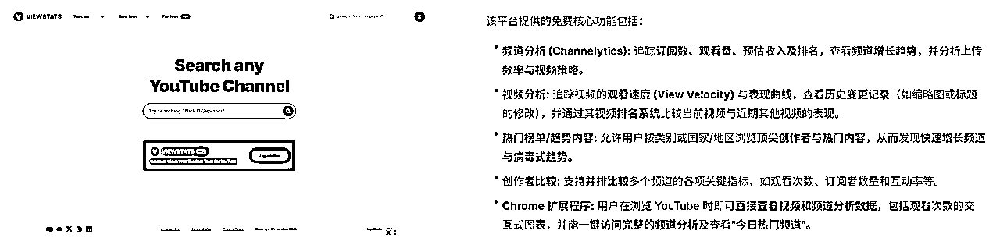

用它能拿到两类关键榜单：一类是指定时间段内，数据表现异常突出的Top100频道；另一类是同期Top100视频。

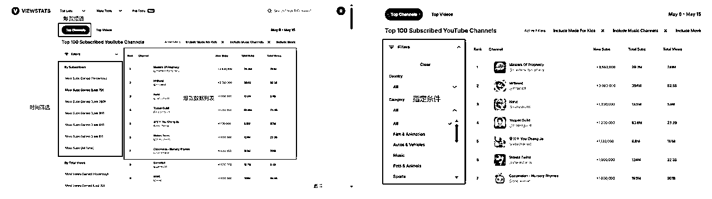

榜单之外，它还能提供更细的频道数据、视频数据，以及YPP收益预估。不过要提醒一句：YPP收益数据只能当参考，别当成精确数值。

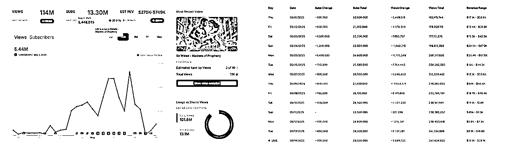

你还可以直接指定某个频道进行定向检索。

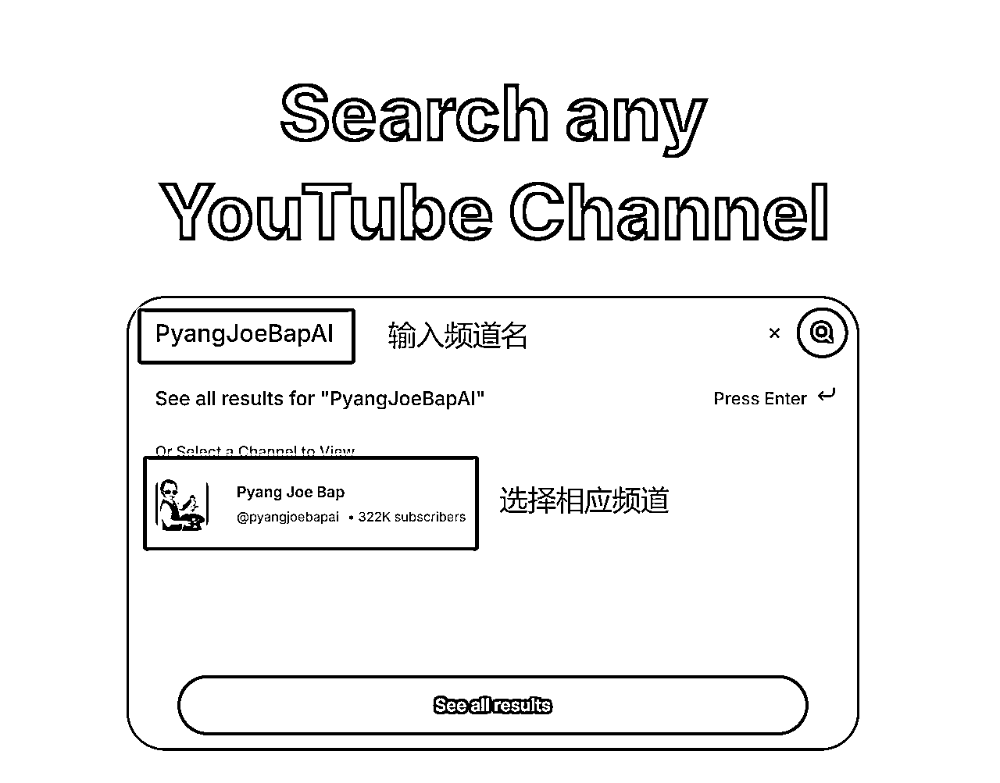

**二、用影刀RPA采集viewstats数据**

采集之前，先设置两个筛选条件：视频发布Country，以及视频类别Category。设置完让页面保持不动。记得先登录网站，同时把页面保持在英文状态，千万不要翻译成中文。


接下来去拿采集程序。这里提供两个版本：本地Excel版走这个链接：https://api.winrobot360.com/redirect/robot/share?inviteKey=df93f45a5a3638a5 ；飞书多维表格版走这个链接：https://api.winrobot360.com/redirect/robot/share?inviteKey=da083b1445b60e69 。你按自己的使用习惯选一个就行。


拿到程序后，打开影刀RPA，在左侧功能栏点击“我获取的应用”，运行程序。

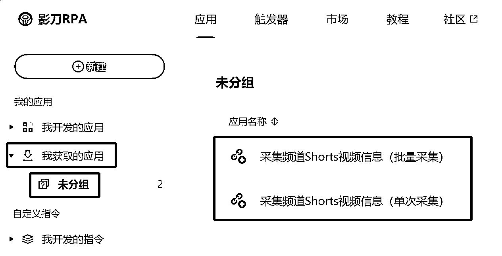

程序会涉及飞书数据相关操作，权限配置请参考“设置飞书权限”。另外注意，输入的一定得是筛选完成后的网址。


下面的演示以本地Excel版为例。


采集得到的是Top100 Videos文件，字段包括：视频标题、上传时间、视频链接、视频缩略图url、视频总观看次数、点赞数、评论数、每小时观看次数、预计收入、订阅者数量、总观看次数、频道视频总数。尤其亮眼的，是还有互动率和综合评分。这两个值，可以作为筛选榜单视频的核心参考依据。


你还可以在影刀里设置定时执行任务，让采集自动跑。

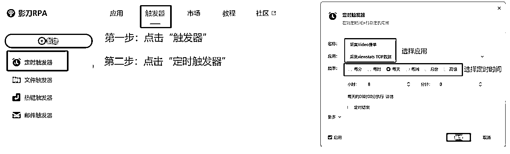

**三、分析viewstats数据**

视频榜单是重点分析对象。把Top榜单里的数据拆解清楚，再往外拓展延伸，然后补充采集相关数据。


根据数据筛出“潜在的对标视频”，回到viewstats查看对应数据，再用AI做可视化解读。

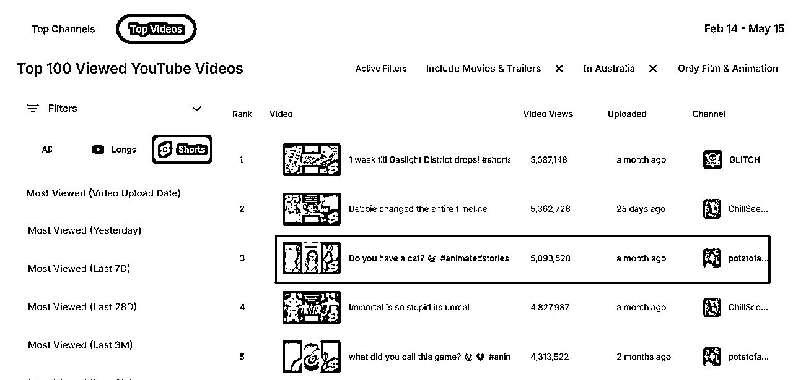

具体做法：点击视频链接，进入数据详情页，把相关区域截图并整理好。

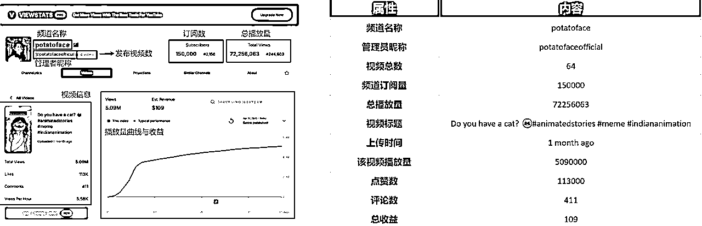

然后把截图发给Gemini，配上合适的提示词，让AI结合截图里的数据，给出初步分析报告。

```
请基于上传的YouTube频道的ViewStats截图数据，执行以下任务：

生成一份单页HTML《[频道名称]视频数据分析报告》。

**报告基本要求：**

* **报告语言**： 中文。
* **整体风格**： 专业、数据驱动、分析性强。
* **数据来源**： 严格基于所提供的截图数据进行分析，不涉及内容主题分析。

**报告核心内容：**

1\.  **频道概览**：
    * 清晰展示总订阅数、总观看次数、视频总数等核心整体数据。

2\.  **近期表现（例如过去28天）**：
    * 详细列出并分析近期的观看次数（及其与上一周期的对比，如“+100%”）。
    * 详细列出并分析订阅数变化（包括净增长和与上一周期的对比，如“较上个周期新增订阅减少XX”）。
    * 展示预估收入。
    * 分析不同内容格式（如Shorts vs 长视频）的观看表现。

3\.  **数据趋势可视化**：
    * 使用条形图展示每日观看次数变化（基于截图中的每日数据）。
    * 使用折线图展示每日订阅总数变化趋势。
    * 使用条形图展示每日新增订阅数。
    * **图表布局与样式补充要求：**
        * **响应式布局**：在小屏幕（如手机）上，图表应单列堆叠显示。在中等屏幕（如平板电脑）及更大屏幕（如桌面电脑）上，图表应以**两列网格**的形式展示，每行最多容纳两个图表。
        * **图表高宽比**：为避免图表显得过高或过窄，请确保图表的**宽度约为其高度的2至2.5倍**。可以参考 `image_6c4264.png` 中图表的视觉比例。
        * **图表容器**：每个图表应放置在一个带有浅灰色边框和圆角的容器内，容器内部应有适当的内边距。
    * 确保所有图表清晰易懂，包含标题、坐标轴标签，并且图表内的文字（如图例、坐标轴数值）也为纯黑色。

4\.  **核心指标分析**：
    * 计算并解读“平均每视频观看次数”，并指出可能的影响因素（如爆款Shorts）。
    * 计算并解读“观看-订阅转化效率”（例如，每多少次观看带来一个新订阅），并评估其效率。
    * 分析“内容格式表现”，明确指出哪种格式是主要流量来源。
    * 解读“近期增长趋势”，包括观看次数和订阅数的增长势头，并点出任何增长速率的变化或潜在波动。
    * 分析“最新视频表现”（如果数据中包含此类信息，如“近期10个视频中的排名”）。

5\.  **对标建议（数据角度）**：
    * 提供选择对标频道时应考虑的具体数据维度，例如：相似的订阅者规模范围、总观看量级范围、视频数量范围、主要内容格式（强调Shorts对标的重要性）、以及相似的增长率指标。

6\.  **总结与数据驱动的建议**：
    * 对频道当前数据状况进行简明扼要的总结。
    * 提出具体、可操作的数据驱动建议，例如：如何根据数据优化Shorts策略、如何应对订阅增长波动、是否以及如何谨慎探索其他内容格式（如长视频）、如何监控和应对每日数据波动、如何提升新视频表现稳定性等。

**报告格式与功能：**

* **单页HTML**：所有内容整合在一个HTML文件中。
* **纯黑色字体**：报告中的所有主要文本内容（标题、段落、列表项等）均使用纯黑色字体。允许使用语义化颜色（如绿色表示增长，红色表示下降）来突出显示特定数据点。
* **重点内容加粗**：报告中的关键数据、核心发现、重要结论和建议等，请使用粗体进行强调。
* **下载功能**：在页面显著位置提供一个“下载报告 (PNG)”的按钮，点击后可以将整个报告内容（包括图表）下载为一张PNG图片。
* **响应式设计**：确保报告在桌面和移动设备上均有良好的阅读体验。
* **CSS框架**：优先使用Tailwind CSS进行样式设计。
* **图表库**：使用Chart.js生成图表。
* **图片下载库**：使用html2canvas.js实现下载报告为PNG的功能。
```

**四、获取对标频道的数据**

先看Videos数据怎么采。按照影刀RPA获取应用的教程，先把这个应用拿到手：https://api.winrobot360.com/redirect/robot/share?inviteKey=c685d34b806c6929

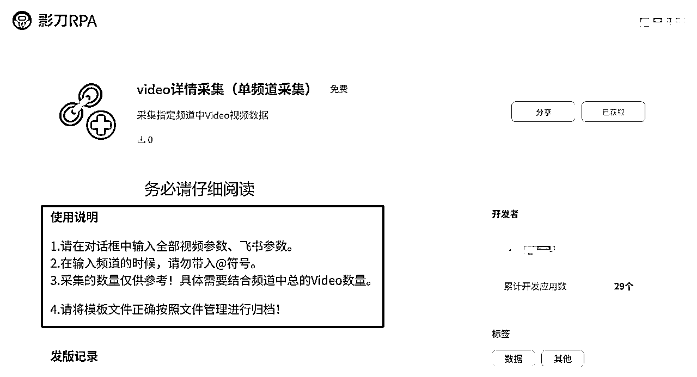

然后把数据模板文件下载到指定文件夹。通过飞书链接拿飞书模板文件。这里有个细节：如果你改了子表格名称，应用里也要同步修改。

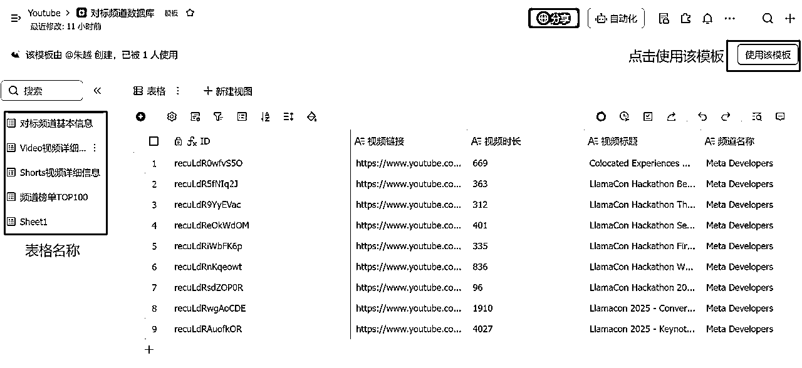

右键点击程序，运行“video详情采集（单频道采集）”。


正式运行前，有几个点必须确认：
1. 飞书多维表格权限要设置好；
2. 两张数据表的名称，要和多维表格里的名称能对上；
3. 采集数量默认50条，没特殊情况不要乱改；
4. 成果会分别存为本地Excel文件和飞书多维表格；
5. 尽量选“记住内容”，这样下次不用重复输入参数；
6. 飞书模板文件只需要获取一次。

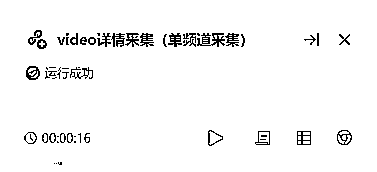

运行后等数据采集完毕。等待期间别碰键盘和鼠标。如果报错，可以先重试三次；三次后依然报错，把报错信息发出来，我来帮你优化。

完成后，你会拿到一个本地Excel文件，和一个飞书多维表格文件。

再来看Shorts数据的采集。先打开浏览器获取RPA程序：https://api.winrobot360.com/redirect/robot/share?inviteKey=94f85f5445d22b3b


点击运行程序，输入相关参数。批量采集版本要上传需要采集的“批量频道号”。可以先建一个Excel，从A2单元格开始在A列输入频道号（不包含表头）并保存。

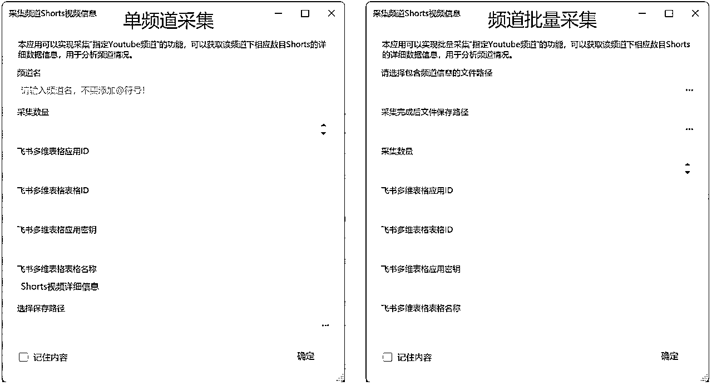

这里也有两个注意事项：批量采集尽量控制在5个频道以内，别频繁操作，免得触发风控；飞书多维表格参数要输入正确，批量采集和单频道采集会保存到同一个飞书多维表格里，靠频道名来区分。

**五、分析对标频道数据**

先说标题。YouTube里标题一般会出现在三个位置：首页展示、搜索页展示、详情页展示。做标题的目的有两个：一是让系统给视频打上识别标签，从而获得对应推流；二是满足用户搜索需求。因此，核心关键词要足够明显，让人一眼看懂。

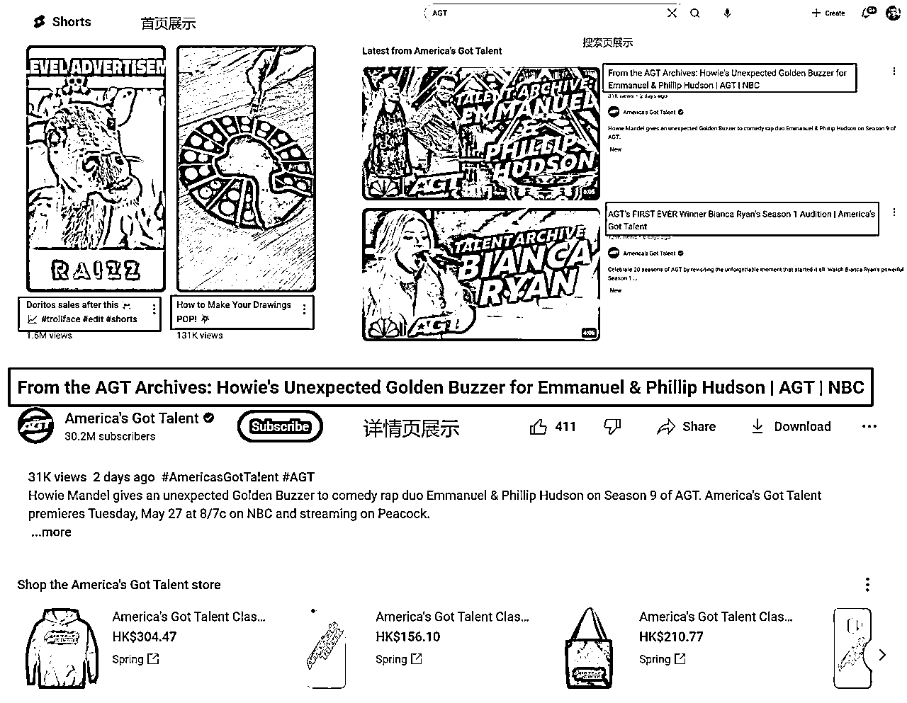

可以用AI来分析标题，把提示词发给Gemini、Deepseek等工具。

```
请分析YouTube视频标题-“视频标题”中存在的核心关键词，同时输出五个可拓展的二级核心关键词。
```

用之前提到的案例来演示。

```
请分析YouTube视频标题-“Do you have a cat? 🥹 #animatedstories #meme #indiananimation"”中存在的核心关键词，请输出五个可拓展的二级核心关键词。
```

Gemini给出的答复是：综合来看，最能概括视频内容和形式的关键词是：猫(Cat)、动画(Animation)、模因/梗(Meme)。通常会选一个最主要的，而标题以“猫”为直接切入点，所以核心关键词定成“猫(Cat)”。但为了描述更全面，结合形式的关键词也很重要。

以“猫”为圆心，再把动画故事、模因、印度动画，以及潜在的可爱/情感/搞笑内容这些信息点都装进来，就能延伸出下面五个二级关键词：
1. 猫咪动画(Cat Animation)，可拓展为“可爱猫咪动画”“搞笑猫咪动画”等；
2. 猫咪模因(Cat Meme)，可拓展为“最新猫咪模因”“超火猫咪梗图视频”等；
3. 宠物动画(Pet Animation)，可拓展为“宠物搞笑动画”“可爱宠物动画故事”等；
4. 动物动画故事(Animal Animated Stories)，可拓展为“短篇动物动画故事”“有趣的动物动画”等；
5. 可爱动画(Cute Animation)，可拓展为“超萌动画”“治愈系动画”等。

下一个是描述。我看了几十万条对标视频，最大的感受是：一个好的描述，能让我更快看懂这个视频，从而赢得好感。


左侧那块截图是简版，右侧则是详细版。通常，一条优秀视频只靠描述前三行，就能让观众留下来、让主题清晰起来。所以拆解描述时，优先看最前面的几句话。

然后，把分析提示词交给Gemini、Deepseek等AI工具即可。

```
请分析YouTube视频描述中“描述部分"”中开头存在的核心关键词，请输出五个可拓展的二级核心关键词。
```

在YouTube上传视频的界面里，输入“描述”内容时，只要打#标签，系统会自动弹出推荐标签提示。


再来看标签。YouTube里的标签通常以#开头，比如“#animatedstories #meme #indiananimation”，#后面的词就是标签。简单理解，标签就是一种聚集了特定条件视频的归类方式，和关键词很像，作用很重要。标签一般会出现在标题、描述中，还能直接用标签在YouTube搜索栏里搜索。摆放时，最重要、最符合的标签要放前面，后面依次递减。


另外，在飞书多维表格模板里，AI也会自动提取描述和标题中的标签。

字幕也不能忽略，它在YouTube平台上的作用同样重要。

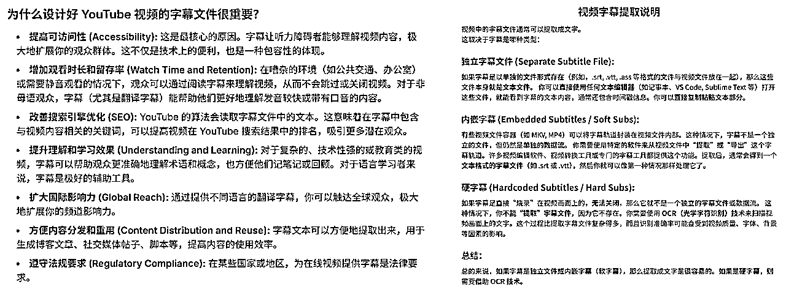

今天重点说一件事：怎么下载视频里的字幕文件。提取字幕通常要和下载视频文件一起做。工具链接：https://yt.savetube.me/zh/29-youtube-video-downloader-5djdh6

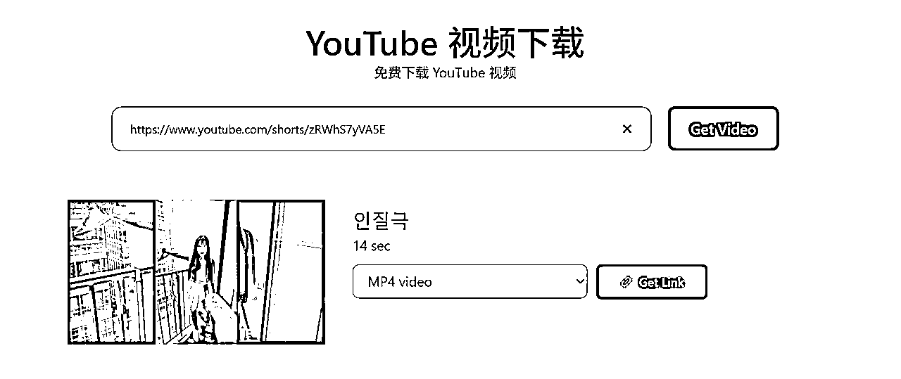

字幕文件提出来之后，还要继续做“爆款因子”提取。也就是对字幕文本内容做进一步分析，找出潜在爆款因子。


把这段提示词发给Gemini、Deepseek等AI工具。

```
任务目标
请根据提供的YouTube视频字幕文本（含时间戳），分析并识别潜在的「爆款因子」，输出结构化洞察报告。
输入数据
字幕文本（含时间戳，若可用）
（可选）视频表现数据（观看量、互动量等）
分析步骤
1\. 关键词与主题提取
统计高频词/短语，按频率排序
关联当前流行趋势，标注潜在热门话题
（多视频对比时）区分爆款与非爆款的关键词差异
用NLP提取核心主题（1-3个）
2\. 情感与表达分析
判断整体情感倾向（积极/消极/中立）
标注显著情感片段（幽默、争议性、激动等）
识别促互动的表达特征（如口头禅、反问句）
（可选）结合时间戳分析语速与内容吸引力关联
3\. 内容结构解析
划分内容模块（引言/论点/案例/结论）
标注提升留存的结构特征（如悬念设置、节奏变化）
4\. 数据关联与因子提炼
（若有表现数据）计算字幕特征与观看/互动量的相关性
归纳高关联性「爆款因子」（如：特定关键词+幽默表达+悬念结构）
输出要求
关键词清单：Top 10高频词+频率
核心主题：简明概括（不超过3个）
情感分析：倾向比例+典型片段示例
结构特点：模块分布+亮点设计
爆款因子：按优先级列出，附具体解释

[请输入字幕文本内容]
```

最后是评论。在评论区里，如果看到很多网友针对视频里的某个细节激烈讨论，说明这条视频已经激发了观众的情绪。一旦有情绪，视频就很可能成为爆款。平时可以多从直播间，以及Shorts、Videos的评论中，去感知观众的真实需求。


把相应的提示词发送给Gemini、Deepseek等AI即可。

以上就是完整的拆解对标流程，希望对你有用。

```
请对一个 YouTube 视频的评论区进行深度分析，目标是识别出促成该视频成为“爆款”的核心因子。分析应侧重于观众的直接反应、互动模式和社群讨论，并结合视频本身的表现数据。请按照以下步骤进行分析：

评论中的高频词和话题识别：
1.识别评论区中出现频率最高的词语、短语和讨论主题。
2.分析这些高频内容是否与视频的特定片段、内容高潮（“爆点”）或核心话题紧密相关。
3.探讨这些高频词和话题如何反映观众对视频内容的关注点和兴趣点。

情感和情绪分析：
1.分析评论的整体情感倾向（例如，积极、消极、中立）。
2.特别关注表达强烈情感（如惊喜、愤怒、欢乐）的评论，以及其中使用的网络流行语或感叹词。
3.评估观众的集体情绪如何影响评论区的氛围和互动。

互动模式分析：
1.分析评论的点赞量、回复数量以及由此形成的讨论串。
2.识别高互动率的评论或讨论串，分析其内容为何能引发大量互动。
3.观察观众之间的互动模式（例如，是观点交流、提问解答还是情绪表达）。

评论量和增长速度分析：
1.关注视频发布后评论数量的增长趋势，特别是是否存在评论量快速增长或出现峰值的时段。
2.分析评论量异常增长是否与视频发布、内容特点或外部事件有关。
3.讨论高评论量本身作为“爆款”因子的意义。

问题和反馈收集：
1.从评论中收集观众提出的问题、针对视频内容的正面赞美以及建设性的批评意见。
2.分析这些问题和反馈反映了观众的哪些需求、困惑或对视频的认可点/改进建议。
3.评估这些直接反馈如何体现观众的参与度和对视频质量的评价。

结合视频表现数据进行综合分析：
1.将以上评论分析的结果与该视频的其他表现数据（如观看时长、观看量、分享量、点赞/点踩比例、观众留存率等）相结合。
2.探讨评论分析的结果如何印证或补充视频表现数据所揭示的信息。
3.综合所有分析维度，最终提炼出该视频之所以成为“爆款”的核心评论区因子和观众互动模式。
4.请生成可视化的单网页的数据报告。

[请输入采集到的数据文件]
```

做YouTube短视频，最怕你只会埋头拍摄，却不抬头看路。视频能不能火，内容质量和赛道选择是根基。说白了，观众是否买单，从封面到内容，每个环节都有规律可循。今天就给你一套爆款拆解法，核心就三块：封面、关键帧、脚本。

先从封面下手。想拿到视频封面，最简单粗暴的方式就是直接截图。把截图丢给支持图像识别的AI，例如Gemini，让它帮你“体检”。具体的提示词长这样：```
请分析这个youtube的封面图，重点分析： 
 1.请描述图片中的内容。 
 2.请分析图片中的爆款因素。 
 3.请输出能够复刻这个封面图的提示词（中英文）。
```

Gemini拿到图后会给你反馈：

举个例子，之前我上传过一张猫咪视角的封面，它的分析是这样的：画面是卡通插画，主角是穿紫色纱丽的女性，眼神无奈，背景有模糊绿植，顶部文字写着“POV life of a cat in a desi house”。它认为爆款点在于：POV视角很有代入感，养猫人群容易共鸣，加上“desi house”的文化标签，再配合夸张表情，抓眼球能力很强。最后它还会提供一段可复刻的封面提示词，方便你直接生成同风格图片。

第二步，拆关键帧。这里要用到一个抽帧工具，支持单独和批量提取。工具提供了Exe成品版和源代码版，下载后解压到文件夹，记得不要删除或移动里面的任何文件。运行“批量提取视频关键帧.exe”，按需选择模式，还能自定义文件命名模板。

关键帧导出来后，挑一张最有代表性的图继续让AI分析。通常用Gemini、豆包、GPT4、Midjourney这些工具来做提示词反推。图生文部分的提示词见这里：```
请你根据上传的图片，进行“图生文”，反推文生提示词，
重点关注关键元素、构图、材质、风格，适合使用Ai图像重新创建。
输出格式要求：每次输出三组提示词。 
 1.每组包含中文和英文。 
 2.提示词需简洁，符合文生图规则，能生成高质量图像。 
 3.英文提示词使用 txt 代码块。 
 4.中文提示词也使用 txt 代码块。
```

第三步，拆脚本。打开Google AI Studio（链接：https://aistudio.google.com/prompts/new_chat ），上传YouTube视频链接。然后输入脚本分析提示词，```
任务目标 (Task Goal): 根据提供的视频内容，生成一份详细的拉片笔记。

输入 (Input): 请提供视频的内容信息。这可以是：
详细的镜头列表或脚本。
对视频内容的逐个镜头的详细描述。
输出格式 (Output Format): 输出将是一个包含以下列的表格，语言为中文：
| 镜头组 (Shot Group) | 镜号 (Shot Number) | 文生图描述词 (Text-to-Image Description) | 图转视频描述词 (Image-to-Video Description) | 剪辑建议 (Editing Suggestions) |

生成规则 (Generation Rules):
镜头组编织原则 (Shot Grouping Principles):
短镜头时长不超过 5 秒。
长镜头时长不超过 10 秒。
一个短镜头组包含不超过 2 个分镜。
一个长镜头组包含不超过 5 个分镜。
请在表格的“镜头组”列中标记镜头所属的组别。

文生图描述词原则 (Text-to-Image Description Principles):
画面内容: 使用连贯自然的语言描述画面核心内容（主体、行为、环境、道具等）。
画面美学: 使用简洁的短词语描述画面美学特征（风格、色彩、光影、构图等）。
关键帧: 描述该镜头起始关键帧（或最代表性帧）的主要画面元素。
示例: (一只白色的大胖猫，在躺椅上戴着墨镜，手拿酒杯躺着晒太阳，身上盖着浴巾，背景是大海。) (夏日，悠闲，趣味，特写)

图转视频描述词原则 (Image-to-Video Description Principles):
包含以下要素：时长、景别、运镜、画面动态或关键描述。
景别: 使用标准术语，如：远景、全景、中景、近景、特写、大特写等。
运镜: 使用标准术语，如：推、拉、摇、移、跟拍、升、降、旋转等。
示例: (3s，中景，人物缓慢向右移动，镜头平移跟拍，画面充满动感) 或 (5s，特写，镜头缓慢向前推进，展现紧张气氛，景深变化)

剪辑建议原则 (Editing Suggestions Principles):
识别和描述该镜头或镜头组中主要的背景音乐 (BGM)。
识别和描述重要的音效 (Sound Effects)。
可以包含转场建议、节奏建议等。

示例 (Examples):
文生图描述词示例: (一只白色的大胖猫，在躺椅上戴着墨镜，手拿酒杯躺着晒太阳，身上盖着浴巾，背景是大海。) (夏日，悠闲，趣味，特写)
图转视频描述词示例 (或镜头分镜描述示例): (3s，夜晚，云雾笼罩的古寺前，黑衣侠客与白衣侠客面对面抱拳站立，背后破损的屋檐挂着晃动的铜铃。镜头缓慢向前推进，展现紧张气氛。)
单镜头详细描述示例 (可用于填充 文生图/图转视频 描述):
镜头1 (5s)：面部特写，展现男子深邃的眼神和自信微笑。暖光打在脸部轮廓上，背景虚化。画面具有艺术感。 (结合了文生图和图转视频的要素)
镜头2 (2s)：聚焦镜头缓慢推进男子抬起的手腕。手表在光影中闪耀，细节清晰展现成功人士品味。
镜头3 (2s)：侧面拍摄，光影在脸上和背景墙上形成鲜明对比。人物轮廓分明，充满高级感和张力。
```这里用这个链接做演示：https://www.youtube.com/shorts/hSNT_dZoWiA 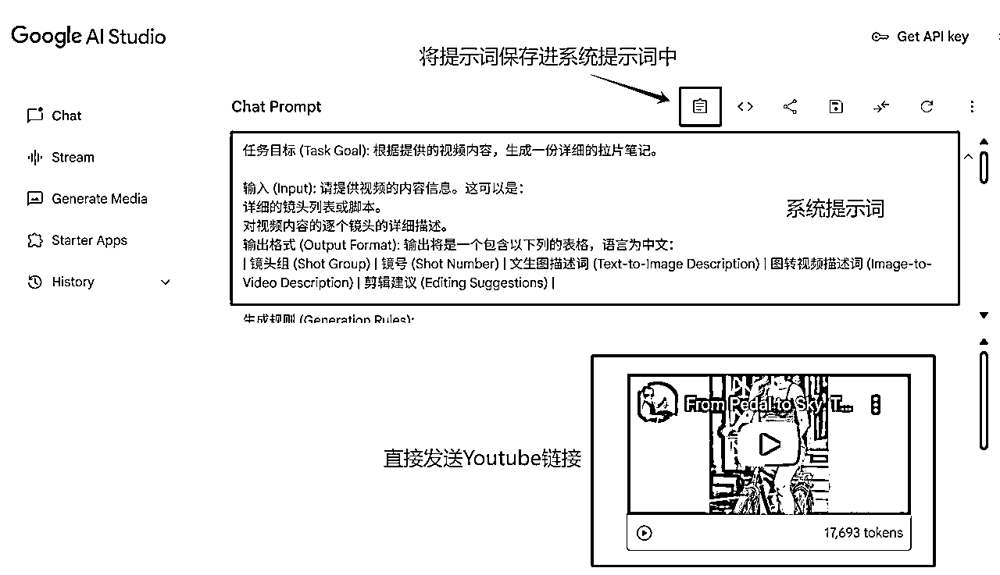等Gemini思考完毕，它给出的脚本拆解结果会长这样：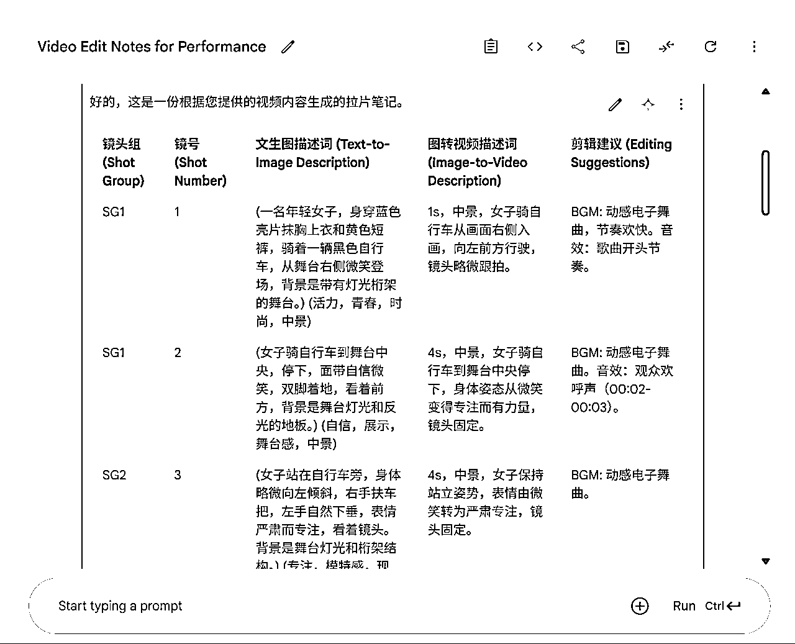

方法论讲完，咱们来一次实战演练，看看怎么拆解一个对标账号。

先看频道整体数据。打开@PyangJoeBapAI的主页，重点刷一遍Video和Shorts区域，留意一下：封面风格是否统一？整体色调是什么感觉？封面传递出的情绪是什么样的？有没有故事感？封面文字用得多不多？这些信息请相信你的第一感觉。

接着，打开Viewstats平台，搜索“PyangJoeBapAI”，进入频道查看核心数据以及Shorts的表现数据。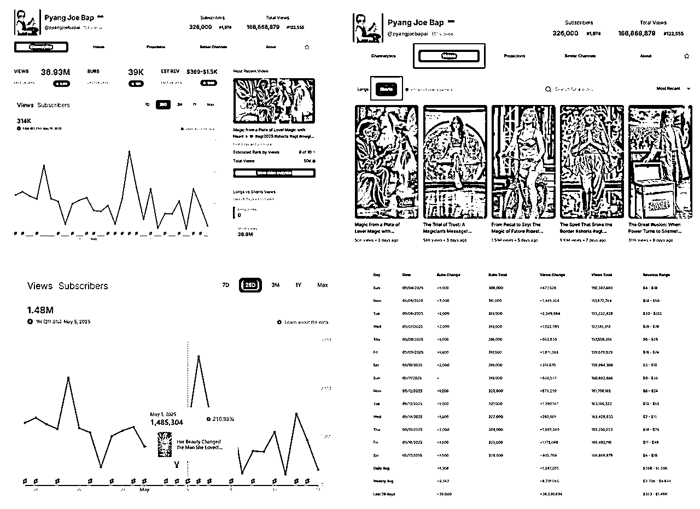

然后，把包含频道数据的截图丢给Gemini，如果你只关心某一个视频，也可以单独截那个视频的数据。注意要开启额外的Canvas功能，这样得到的数据分析会更全面（仅供参考）。```
请基于上传的YouTube频道的ViewStats截图数据，执行以下任务：

生成一份单页HTML《[频道名称]视频数据分析报告》。

**报告基本要求：**

* **报告语言**： 中文。
* **整体风格**： 专业、数据驱动、分析性强。
* **数据来源**： 严格基于所提供的截图数据进行分析，不涉及内容主题分析。

**报告核心内容：**

1\.  **频道概览**：
    * 清晰展示总订阅数、总观看次数、视频总数等核心整体数据。

2\.  **近期表现（例如过去28天）**：
    * 详细列出并分析近期的观看次数（及其与上一周期的对比，如“+100%”）。
    * 详细列出并分析订阅数变化（包括净增长和与上一周期的对比，如“较上个周期新增订阅减少XX”）。
    * 展示预估收入。
    * 分析不同内容格式（如Shorts vs 长视频）的观看表现。

3\.  **数据趋势可视化**：
    * 使用条形图展示每日观看次数变化（基于截图中的每日数据）。
    * 使用折线图展示每日订阅总数变化趋势。
    * 使用条形图展示每日新增订阅数。
    * **图表布局与样式补充要求：**
        * **响应式布局**：在小屏幕（如手机）上，图表应单列堆叠显示。在中等屏幕（如平板电脑）及更大屏幕（如桌面电脑）上，图表应以**两列网格**的形式展示，每行最多容纳两个图表。
        * **图表高宽比**：为避免图表显得过高或过窄，请确保图表的**宽度约为其高度的2至2.5倍**。可以参考 `image_6c4264.png` 中图表的视觉比例。
        * **图表容器**：每个图表应放置在一个带有浅灰色边框和圆角的容器内，容器内部应有适当的内边距。
    * 确保所有图表清晰易懂，包含标题、坐标轴标签，并且图表内的文字（如图例、坐标轴数值）也为纯黑色。

4\.  **核心指标分析**：
    * 计算并解读“平均每视频观看次数”，并指出可能的影响因素（如爆款Shorts）。
    * 计算并解读“观看-订阅转化效率”（例如，每多少次观看带来一个新订阅），并评估其效率。
    * 分析“内容格式表现”，明确指出哪种格式是主要流量来源。
    * 解读“近期增长趋势”，包括观看次数和订阅数的增长势头，并点出任何增长速率的变化或潜在波动。
    * 分析“最新视频表现”（如果数据中包含此类信息，如“近期10个视频中的排名”）。

5\.  **对标建议（数据角度）**：
    * 提供选择对标频道时应考虑的具体数据维度，例如：相似的订阅者规模范围、总观看量级范围、视频数量范围、主要内容格式（强调Shorts对标的重要性）、以及相似的增长率指标。

6\.  **总结与数据驱动的建议**：
    * 对频道当前数据状况进行简明扼要的总结。
    * 提出具体、可操作的数据驱动建议，例如：如何根据数据优化Shorts策略、如何应对订阅增长波动、是否以及如何谨慎探索其他内容格式（如长视频）、如何监控和应对每日数据波动、如何提升新视频表现稳定性等。

**报告格式与功能：**

* **单页HTML**：所有内容整合在一个HTML文件中。
* **纯黑色字体**：报告中的所有主要文本内容（标题、段落、列表项等）均使用纯黑色字体。允许使用语义化颜色（如绿色表示增长，红色表示下降）来突出显示特定数据点。
* **重点内容加粗**：报告中的关键数据、核心发现、重要结论和建议等，请使用粗体进行强调。
* **下载功能**：在页面显著位置提供一个“下载报告 (PNG)”的按钮，点击后可以将整个报告内容（包括图表）下载为一张PNG图片。
* **响应式设计**：确保报告在桌面和移动设备上均有良好的阅读体验。
* **CSS框架**：优先使用Tailwind CSS进行样式设计。
* **图表库**：使用Chart.js生成图表。
* **图片下载库**：使用html2canvas.js实现下载报告为PNG的功能。
```从它给的成果里，你能找到不少参考信息。

再来看视频数据。可以用影刀RPA来采集Shorts视频的基本信息，比如标题、描述、评论区内容。运行“采集频道Shorts视频信息（单次采集）”这个应用，然后去飞书文档查看更新。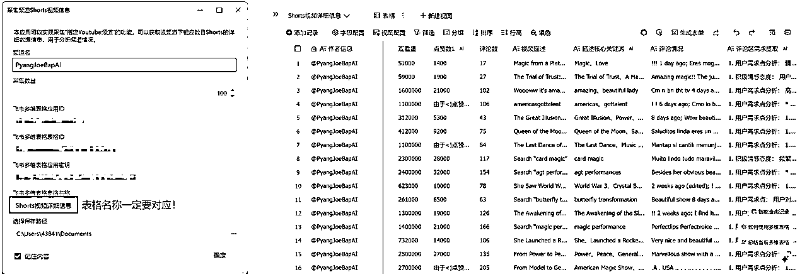

然后从飞书多维表格中导出CSV文件，这个文件既可以投喂给其他AI做内容分析，也可以直接在多维表格里浏览。普通版的操作，就是把CSV文件投给AI，指令在```
我给你提供视频标题中的关键词、描述中的关键词、评论区中的需求、视频标签，请帮我分析，输出对标建议。
```进阶版（使用Cursor3.7分析）：

```
将数据excel表格投喂给cursor：

角色： 数据分析师与可视化报告生成器
任务：
 基于提供的 YouTube Shorts CSV 数据文件进行深入分析，生成数据洞察报告，提出优化建议以提升流量。将报告以美观、响应式的单网页形式呈现，支持 PNG 下载。
预处理与数据清洗：
 在分析前对CSV数据进行专业的数据清洗：
处理编码问题，尤其是中文和特殊字符；
处理缺失值、异常值和重复数据；
统一数据格式（数字、日期、文本等）；
规范化文本字段，如标签和关键词；
创建派生变量（如互动率 = 点赞数/观看量）；
记录清洗过程和结果。
输入数据：
数据源： CSV 文件，单位为“次”；
CSV 字段：
作者信息
数据采集时间
视频标题
视频标签 (核心分析字段)
标题中的核心关键词 (核心分析字段)
频道类型
频道链接
点赞数 (互动数据)
观看量 (观看量数据)
评论数 (互动数据)
视频描述
描述核心关键词 (核心分析字段)
评论情况
评论区需求提取 (核心分析字段)
核心分析要求：
数据关联分析：
分析 视频标签 与 观看量、点赞数、评论数 之间的关系，识别高效和低效标签；
分析 标题中的核心关键词 与 观看量、点赞数、评论数 之间的关系；
分析 描述核心关键词 与 观看量、点赞数、评论数 之间的关系；
分析 评论区需求提取 与观看量和互动数据的潜在关联。
模式识别：
找出高表现视频的共同特征，特别是在标签、标题和描述字段中的关联；
识别低表现视频中的缺陷或问题，并与高表现视频进行对比。
量化分析框架：
关键词效能量化：
关键词效能指数(KEI) = (平均观看量 × 0.6) + (平均点赞数 × 0.3) + (平均评论数 × 0.1)；
关键词位置影响系数(KPI) = 标题前10字符出现时的平均观看量 ÷ 标题后半部分出现时的平均观看量；
关键词组合效应(KCE) = 关键词组合出现时的平均观看量 ÷ 关键词单独出现时的平均观看量；
提供TOP 20高效关键词及其KEI值。
标签效果量化：
标签效能指数(TEI) = (平均观看量 × 0.5) + (平均互动率 × 0.5)，其中互动率 = (点赞数 + 评论数) ÷ 观看量；
标签组合效应(TCE) = 特定标签组合的平均观看量 ÷ 整体平均观看量；
标签饱和度影响(TSI) = 不同标签数量的视频观看量对比；
提供TOP 15高效标签及其TEI值。
标题结构效果评估：
标题结构指数(TSI) = 按结构类型分类的平均观看量；
标题长度影响(TLI) = 不同标题长度区间的观看量与完播率对比；
表情符号影响系数(ESI) = 含表情符号标题的平均观看量 ÷ 不含表情符号标题的平均观看量；
列出TOP 5最佳标题结构模板。
描述结构效果评估：
描述结构效能(DSE) = 按描述模式分类的平均互动率；
描述-标题一致性(DTI) = 描述与标题关键词一致性高的视频的观看量 ÷ 一致性低的视频的观看量；
描述长度影响(DLI) = 不同描述长度的互动率对比；
提供TOP 3最佳描述结构模板。
受众群体分析：
内容类型偏好指数(CPI) = 特定内容类型的平均观看量 ÷ 整体平均观看量；
受众互动倾向(AEP) = 特定内容类型的互动率 ÷ 平均互动率；
受众忠诚度指标(ALI) = 频道多个视频的观看量一致性；
提供TOP 5受众最喜爱内容类型。
综合效果评分系统：
视频综合效能分数(VEPS) = (观看量得分 × 0.4) + (互动率得分 × 0.3) + (完播率得分 × 0.3)；
所有得分均使用0-100标准化计分，100代表最大值；
提供视频效能分级：S级(90-100)、A级(75-89)、B级(60-74)、C级(40-59)、D级(<40)。
对标建议：
基于量化分析，提供优化建议：
推荐高效 视频标签 组合；
提供吸引流量的 视频标题 关键词策略和结构模板；
优化 视频描述；
根据 评论区需求提取 调整内容方向。
输出要求 (内容版报告)：
洞察总结：
 总结关键发现，提供具体数据支持每个结论。
对标建议：
 列出优化建议，明确数据支持和操作步骤。
数据支撑：
 报告中的每个结论和建议需有明确的数据支持。
输出要求 (可视化单网页)：
技术栈： HTML, CSS, JavaScript；
布局设计：
两列对齐布局，最多每行两个图表；
确保图表与表格对齐，并支持单列自适应布局；
内容呈现：
直观展示标签、关键词与观看量/互动数据关系；
展示关键量化指标的排名和对比图表；
UI/UX设计：
响应式设计，兼容桌面、平板、手机；
界面简洁、专业、美观，突出重点内容；
功能性：
提供PNG下载按钮。
示例强调样式：
"cute"关键词KEI值为87.3，使用可提升观看量42%
标签组合"#shorts + #funny + #cute"的TCE值为2.4，预期推荐量提升140%
超过8个标签的视频TSI值降低0.76，推荐量减少18%
最终交付：
 包含上述可视化报告的HTML文件代码，并提供可操作的建议。

```
从当前拿到的结果片段可以看到，标签已经提取得很规范，全部都是合格项。


下一环，先把数据分析结果过一遍，筛出值得拆解的片子，再做脚本拆解。

进入 Google AI Studio 的新对话页（aistudio 点 google 点 com 斜杠 prompts 斜杠 new_chat），把目标 YouTube 链接粘贴进去即可。

特别提醒：同一会话窗口只支持解析单个视频地址。


用下面这段 Prompt 来拆解脚本：

```
任务目标 (Task Goal): 根据提供的视频内容详细描述，生成一份结构化的拉片笔记。
核心要求 (Core Requirements):
输入质量: 输出的详细程度和准确性直接取决于输入描述的质量。请确保提供的逐镜头描述包含足够的视觉、听觉和动态信息。
输出语言: 表格中的“文生图描述词”和“图转视频描述词”列需要提供中英文双语内容。其他所有列（镜头组、镜号、剪辑建议）及表格外的说明均为中文。
输入 (Input): 请提供对视频内容的逐个镜头的详细文字描述。每个镜头的描述应包含但不限于：
视觉元素: 核心主体、人物行为、表情、服装、道具、环境、背景、光影、色彩、构图等。
动态信息: 镜头的起止画面，主体或摄像机的显著运动方式。
时长信息: 每个镜头的预估或实际时长（秒）。
(可选) 音频线索: 对话、主要背景音乐风格、关键音效（如果已知并重要）。
输出格式 (Output Format): 输出将是一个包含以下列的表格。AI将为每个镜头顺序编号填入“镜号”列 (例如: S001, S002)。
镜头组 (Shot Group)镜号 (Shot No.)文生图描述词 (Text-to-Image Descriptors)图转视频描述词 (Image-to-Video Descriptors)剪辑建议 (Editing Suggestions)
Export to Sheets
生成规则 (Generation Rules):
镜头组编织原则 (Shot Grouping Principles):
镜头将按顺序分组。AI将根据镜头的数量和一定的逻辑连贯性（如果可从输入中推断）进行分组。
短镜头组 (Short Shot Group): 通常包含 1-2 个连续分镜。
长镜头组 (Long Shot Group): 通常包含 3-5 个连续分镜。
AI将在“镜头组”列中标注组号 (例如: G1, G2) 和组类型及包含的镜数 (例如: 短镜头组-2镜, 长镜头组-4镜)。
单个分镜的时长参考：短镜头 (Short Shot) ≤ 5秒；长镜头 (Long Shot) ≤ 10秒。此为参考，分组优先考虑镜数。
文生图描述词原则 (Text-to-Image Descriptors):
目标: 描述该镜头**起始关键帧（或最具代表性的一帧）**的静态画面。
内容要求: 提供中文和对应的英文翻译。
画面内容 (Visual Content): 使用连贯自然的语言描述画面的核心内容（主体、行为、环境、道具等）。
画面美学 (Visual Aesthetics): 使用简洁的短词语/标签描述画面的美学特征（如：视觉风格、色彩基调、光影特点、构图方式等）。
中英文示例:
中文 (Chinese): 
画面内容: 一只白色的大胖猫，在躺椅上戴着墨镜，手拿酒杯躺着晒太阳，身上盖着浴巾，背景是大海。
画面美学: 夏日，悠闲，趣味，明亮色彩，特写构图。
英文 (English): 
Visual Content: A large, fat white cat, wearing sunglasses and holding a wine glass, is sunbathing on a lounge chair, covered with a bath towel, with the sea in the background.
Visual Aesthetics: Summer, Leisurely, Fun, Bright Colors, Close-up Composition.
图转视频描述词原则 (Image-to-Video Descriptors):
目标: 描述整个镜头的动态特征。
内容要求: 提供中文和对应的英文翻译。包含以下要素，并确保每个要素都有中英文对照： 
时长 (Duration): 镜头的秒数。中文示例: 3秒；英文示例: 3s。
景别 (Shot Size): 标准术语。 
中文: 远景, 全景, 中景, 近景, 特写, 大特写。
英文: Extreme Long Shot (ELS), Long Shot (LS), Medium Shot (MS), Medium Close-up (MCU), Close-up (CU), Extreme Close-up (ECU).
运镜 (Camera Movement): 标准术语。 
中文: 推, 拉, 摇 (左右), 移 (左右/横移), 跟拍, 升, 降, 旋转, 晃动, 固定镜头。
英文: Push In, Pull Out, Pan (Left/Right), Tilt (Up/Down), Dolly/Track (Left/Right/Horizontal), Follow Shot, Crane Up/Jib Up, Crane Down/Jib Down, Rotate, Shaky Cam, Static Shot.
画面动态或关键描述 (Visual Dynamics or Key Description): 描述画面中的主要运动或变化，或整体给人的动态感受。
中英文示例:
中文 (Chinese): (3秒，中景，人物缓慢向右移动，镜头平移跟拍，画面充满动感)
英文 (English): (3s, Medium Shot (MS), character moves slowly to the right, camera pans to follow, dynamic scene)
或者:
中文 (Chinese): (5秒，特写，镜头缓慢向前推进至眼部，展现紧张气氛，景深由深变浅)
英文 (English): (5s, Close-up (CU), camera slowly pushes in to the eyes, creating a tense atmosphere, depth of field changes from deep to shallow)
剪辑建议原则 (Editing Suggestions Principles):
内容要求: 中文。
识别和描述该镜头或镜头组中主要的**背景音乐 (BGM)**风格或具体曲目（如果信息充分）。
识别和描述重要的音效 (Sound Effects)。
可以包含转场建议 (例如：淡入淡出、切割、叠化)、节奏建议 (例如：此处节奏加快、配合音乐鼓点剪辑)等。
输入内容示例 (Illustrative Input for a Single Shot):
"镜头1：时长约4秒。画面开始是一个戴着兜帽的神秘男子在雨夜小巷的远景，他低着头快步向前走。镜头缓慢向前推进，同时轻微向上抬升，逐渐变成男子的中近景，可以看见他坚毅的下巴和紧抿的嘴唇，雨水打湿了他的兜帽边缘。背景音乐是低沉的弦乐，有持续的雨声音效和远处模糊的警笛声。"
(AI将基于此类输入，填充表格中的一行)
修改说明:
强调输入质量: 开头补充了对输入信息详细度的要求。
明确双语范围: 清晰指出“文生图描述词”和“图转视频描述词”需要中英双语，其他部分为中文。
输入内容指导: 更具体地列出了输入描述应包含的元素。
镜号生成: 明确AI会自动生成镜号。
镜头组逻辑细化: 稍微调整了分组原则的描述，使其更侧重于镜头的数量，并将时长作为参考。增加了组类型和镜数的标注。
文生图描述词双语示例: 提供了完整的画面内容和画面美学的中英文对照。
图转视频描述词双语示例和术语: 提供了更详细的中英文术语对照表（景别、运镜），并确保示例中每个元素都有中英对应。
剪辑建议语言: 明确为中文。
输入示例: 提供了一个更符合要求的输入镜头描述示例，以帮助理解AI所需的信息。

任务目标 (Task Goal): 根据提供的视频内容，生成一份详细的拉片笔记。

输入 (Input): 请提供视频的内容信息。这可以是：
详细的镜头列表或脚本。
对视频内容的逐个镜头的详细描述。
输出格式 (Output Format): 输出将是一个包含以下列的表格，描述词为中英文，其他语言为中文：
| 镜头组| 镜号| 文生图描述词| 图转视频描述词  | 剪辑建议|

生成规则 (Generation Rules):
镜头组编织原则 (Shot Grouping Principles):
短镜头时长不超过 5 秒。
长镜头时长不超过 10 秒。
一个短镜头组包含不超过 2 个分镜。
一个长镜头组包含不超过 5 个分镜。
请在表格的“镜头组”列中标记镜头所属的组别。

文生图描述词原则 (Text-to-Image Description Principles):
画面内容: 使用连贯自然的语言描述画面核心内容（主体、行为、环境、道具等）。
画面美学: 使用简洁的短词语描述画面美学特征（风格、色彩、光影、构图等）。
关键帧: 描述该镜头起始关键帧（或最代表性帧）的主要画面元素。
示例: (一只白色的大胖猫，在躺椅上戴着墨镜，手拿酒杯躺着晒太阳，身上盖着浴巾，背景是大海。) (夏日，悠闲，趣味，特写)

图转视频描述词原则 (Image-to-Video Description Principles):
包含以下要素：时长、景别、运镜、画面动态或关键描述。
景别: 使用标准术语，如：远景、全景、中景、近景、特写、大特写等。
运镜: 使用标准术语，如：推、拉、摇、移、跟拍、升、降、旋转等。
示例: (3s，中景，人物缓慢向右移动，镜头平移跟拍，画面充满动感) 或 (5s，特写，镜头缓慢向前推进，展现紧张气氛，景深变化)

剪辑建议原则 (Editing Suggestions Principles):
识别和描述该镜头或镜头组中主要的背景音乐 (BGM)。
识别和描述重要的音效 (Sound Effects)。
可以包含转场建议、节奏建议等。

示例 (Examples):
文生图描述词示例: (一只白色的大胖猫，在躺椅上戴着墨镜，手拿酒杯躺着晒太阳，身上盖着浴巾，背景是大海。) (夏日，悠闲，趣味，特写)
图转视频描述词示例 (或镜头分镜描述示例): (3s，夜晚，云雾笼罩的古寺前，黑衣侠客与白衣侠客面对面抱拳站立，背后破损的屋檐挂着晃动的铜铃。镜头缓慢向前推进，展现紧张气氛。)
单镜头详细描述示例 (可用于填充 文生图/图转视频 描述):
镜头1 (5s)：面部特写，展现男子深邃的眼神和自信微笑。暖光打在脸部轮廓上，背景虚化。画面具有艺术感。 (结合了文生图和图转视频的要素)
镜头2 (2s)：聚焦镜头缓慢推进男子抬起的手腕。手表在光影中闪耀，细节清晰展现成功人士品味。
镜头3 (2s)：侧面拍摄，光影在脸上和背景墙上形成鲜明对比。人物轮廓分明，充满高级感和张力。
```
### 画面素材准备
先用在线下载工具把视频保存到本地（yt 点 savetube 点 me 斜杠 zh），再对素材进行抽帧。抽帧的时候，优先保留封面和转场明显的画面。

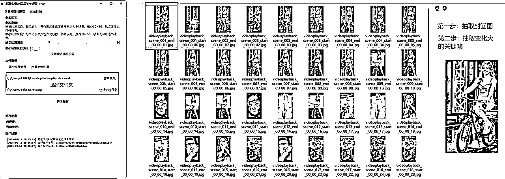
以下就是抽帧得到的封面和场景切换画面示例：


把图片发给 Gemini 做反向描述，比如让它按下面的格式反推画面信息：

```
请你根据上传的图片，进行“图生文”，反推文生提示词，
重点关注关键元素、构图、材质、风格，适合使用Ai图像重新创建。
输出格式要求：每次输出三组提示词。 
 1.每组包含中文和英文。 
 2.提示词需简洁，符合文生图规则，能生成高质量图像。 
 3.英文提示词使用 txt 代码块。 
 4.中文提示词也使用 txt 代码块。
```
### 标签池扩充
我对“对标”的理解是：先吸收爆款的骨架，再做出自己的增量，争取“学其形，超其神”。

前面已经能轻松拿到该频道在视频、封面、正文里使用的标签词。接下来要做的是，把这些标签词继续往外扩，找出更大的流量空间。

比如用 funny 作为入口，去采集更多同标签内容：


先打开 YT 的单标签抓取工具（api 点 winrobot360 点 com 斜杠 redirect 斜杠 robot 斜杠 share，邀请码 091f8553acd05054）。运行后输入想抓的标签，再启动程序。跑完后，系统会返回这些字段：片名、作品 ID、链接、题材类型、片长（秒）、所属频道、频道主页、播放量、投稿时间、简介、点赞量、评论量、BGM 和推荐检索词。

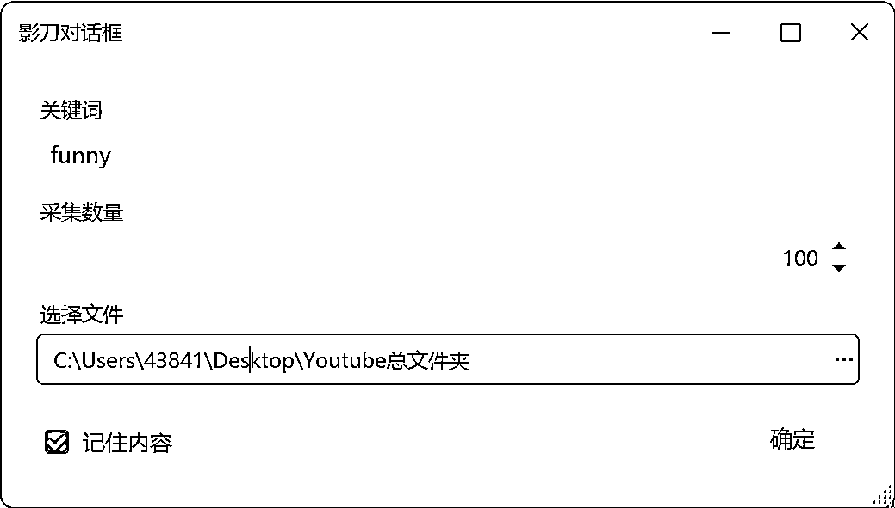
此外，YouTube 自带的推荐检索词也能直接扩展成新标签，省去自己造词的步骤。

做AI短视频，最怕的不是不会用工具，而是没有思路。今天直接把我自己的完整复刻流程摊开讲：从抓关键词、拆对标视频，到文生图、图生视频、配乐、剪合成，再到从其他平台找灵感，一条龙全说清楚。

先用这个采集拓展关键词的链接下载安装包：https://api.winrobot360.com/redirect/robot/share?inviteKey=501436fc6d6651cc  
装好之后，把关键词所在的词库文件路径填进去，一般是从A2单元格开始，按顺序逐行往下保存。  
上面这套关键词采集+拓展的准备动作，核心目的就是帮我们把关键词思路彻底打开。

下面用我之前研究过的对标频道 @PyangJoeBapAI（来源：@困困教练）来示范完整流程。

## 一、文生图

先用Google Studio拆解脚本。以这条视频为例：https://www.youtube.com/shorts/hSNT_dZoWiA  
把视频链接投进去，就能得到一份拉片笔记：

笔记里能看到：BGM基本是快节奏电子舞曲，穿插了大量人声采样，比如“Open the screen”“1, 2, 3, let's go!”“Clap your hands”“Get funky with it”“Let's go to work”“DJ Pongs in the mix”，中段还出现了女声“Look at me baby”；SFX则涵盖了自行车轻微声响、火焰燃烧、魔法变身、摩托车引擎与行驶、烟雾喷射、无人机螺旋桨、观众欢呼惊叹等；整体节奏很快，靠快速剪辑和特效持续制造惊喜和反转。

接下来，我就用第一个镜头来整理提示词，做一次文生图演示。```
Visual Content: A young woman, wearing a blue sequined camisole top and yellow shorts, with white sneakers, smiling as she rides a black bicycle onto the stage from the right, with a brightly lit studio and reflective floor in the background.Visual Aesthetics: Stage Performance, Energetic, Youthful Fashion, Bright Lighting, Symmetrical Composition.
```

### 方法一：即梦AI
1. 选即梦3.0模型；
2. 图片比例选9:16；
3. 清晰度按自己账号的情况来选。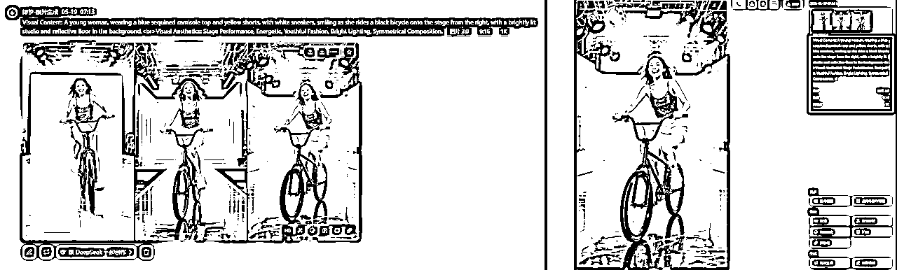

即梦无水印下载的小技巧：打开缩略图，点右上角“红色电话”图标，就能直接下载无水印图。

### 方法二：豆包
1. 风格选择“人物摄影”；
2. 图片比例同样选9:16。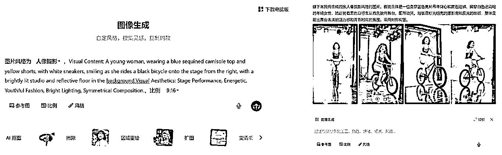

### 方法三：Midjourney官网
1. 模型推荐用7.0；
2. 模型6.1支持角色控制和环境参考。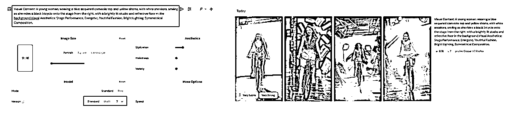

把即梦3.0、豆包3.0、Midjourney 7.0放一起对比，前两个生成的角色更偏向亚洲面孔，第三个则更偏欧美。选哪个，取决于对标账号的粉丝画像：欧美地区的粉丝，就用欧美人物；亚非拉地区的粉丝，就用亚洲人物。

我选的 @PyangJoeBapAI 是欧美频道，看评论语言也能发现粉丝大多用英语交流，所以我要的是“欧美人物”形象。在Midjourney里挑最合适的一张，我的判断标准是：动作与对标接近、背景与对标接近、风格也与对标接近。挑好后，再用深度编辑功能微调基本参数、角色和背景。

要做可控视频，通常需要首尾帧。所以还需要再生成一张风格、人物、动作都差不多的尾帧。```
Visual Content: The young woman stops her bicycle in the center of the stage, angles it towards the audience, one foot on the ground, her expression changes from smiling to serious, looking directly at the camera.
Visual Aesthetics: Stage Freeze, Focused, Fashionable, Central Composition.
```

在即梦里按以下参数来设置，控制首尾帧的一致性。注意，AI生成的图只能当参考，想基本满足条件，往往得反复修改很多次。

两次生成的结果放一起看（左边是首帧，右边是尾帧），问题很明显：
1. 角色脸部颜色前后不一致；
2. 自行车上的车铃前后不一致。

这时候就用即梦的“局部重绘”功能，把这两个差异点单独修掉。

修完再看重绘后的效果，首尾帧差距明显缩小，基本就能拿去生成视频了。

特别提醒：这个环节一定要重视文件命名和分类，别随便删源文件。真要清理，也先把需要删除的源文件放进“待删除”文件夹里。

## 二、图生视频

继续用Google Studio拆对标脚本，生成对应的图转视频提示词。以前面第一个镜头为例：```
中文: (3秒，中景，固定镜头，但主体从右向左移动，女子骑自行车进入画面中央，面带笑容)
English: (3s, Medium Shot (MS), static camera but subject moves from right to left, woman rides bicycle into the center of the frame, smiling)
```

方法一：用即梦的图生视频功能，导入关键帧，输入提示词。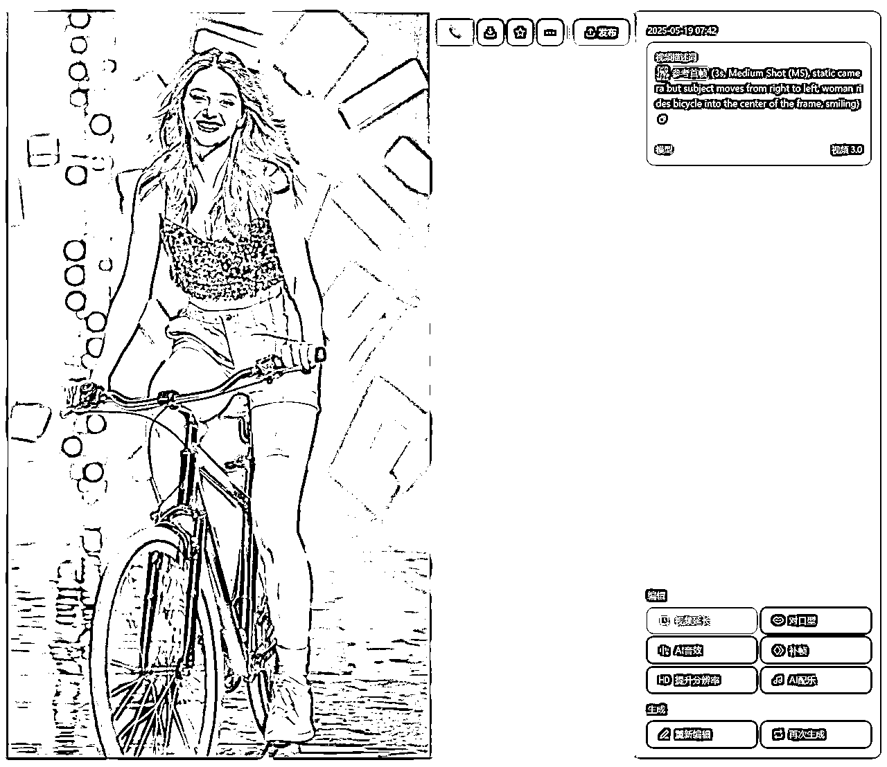

方法二：用可灵AI生成首尾帧，导入首尾帧之后输入提示词。建议优先用付费模型平台，效果更稳。

## 三、音乐复刻

把下载好的对标视频扔进剪映，直接提取音频。导出成MP3到本地对应文件夹里。可以直接用这段音频，但记得改一下片段；也可以去Suno重新创作：https://suno.com/create 

## 四、截取片段

提前准备好一个“达人秀评委”相关页面文件夹，直接存进剪映草稿箱也行。把达人秀视频导入后，使用智能镜头分割，再右键片段选择“另存为预设”。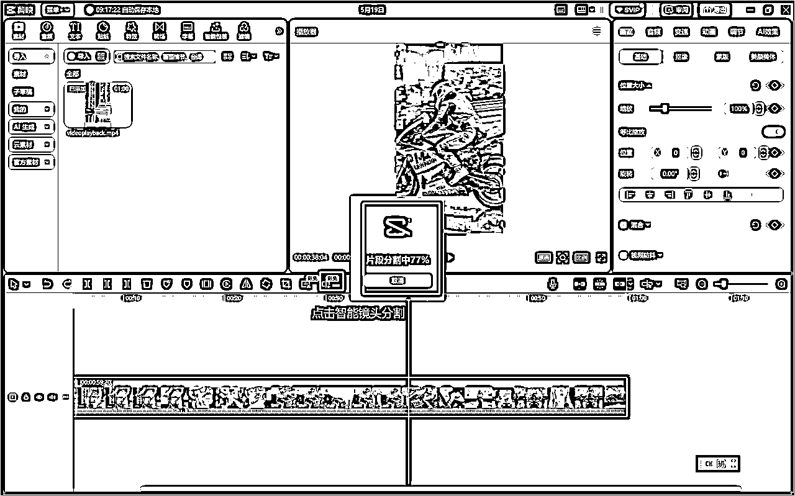

## 五、合成视频

分别把生成的视频片段和达人秀片段拖入剪映，再把音乐也插进去。导出时至少满足这几个要求：
- MP4视频格式；
- H.264编码；
- 60帧帧率。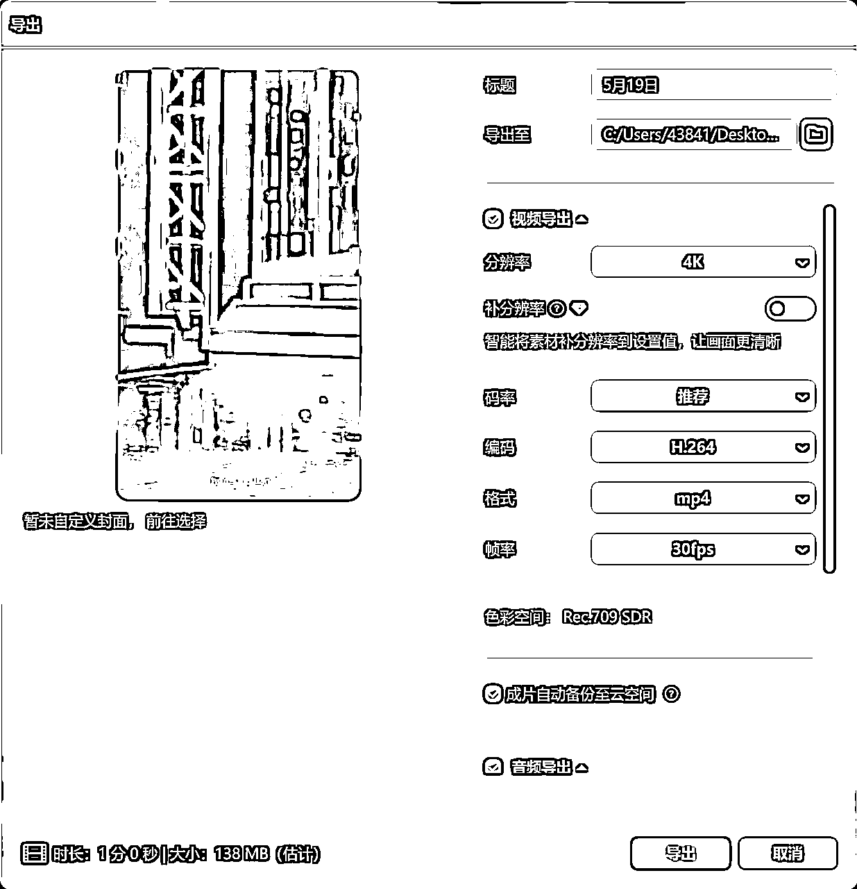

## 六、从其他平台获取灵感

做项目时要养成好习惯：原始文件和修改后的成品都留着，方便后面查数据、找素材。我的对标库一般用飞书多维表格的知识库来搭。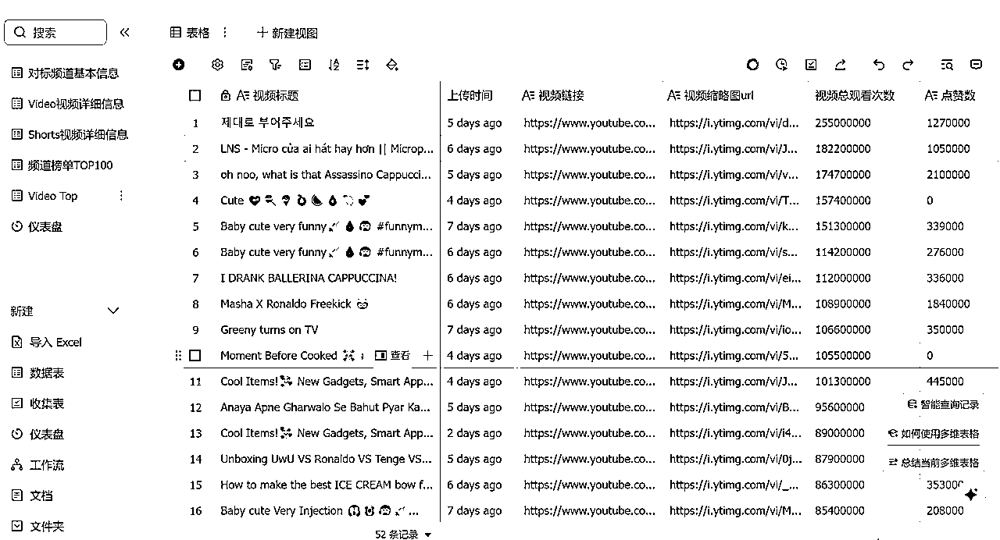

除了YouTube，其他平台也很值得采集。比如小红书，作为国内优质种草平台，那些数据表现亮眼、用户爱看的笔记，往往藏着爆款密码。

小红书RPA采集工具：https://api.winrobot360.com/redirect/robot/share?inviteKey=77fe2ae4a196672c 

建议优先采集和YouTube相关的内容，比如“YouTube关键词”“AI视频关键词”之类，也可以用前面拓展出来的关键词去采。我以“AI婴儿播客”为例子演示一下：

第一步：点击运行程序，按下图要求选择适合的内容类别。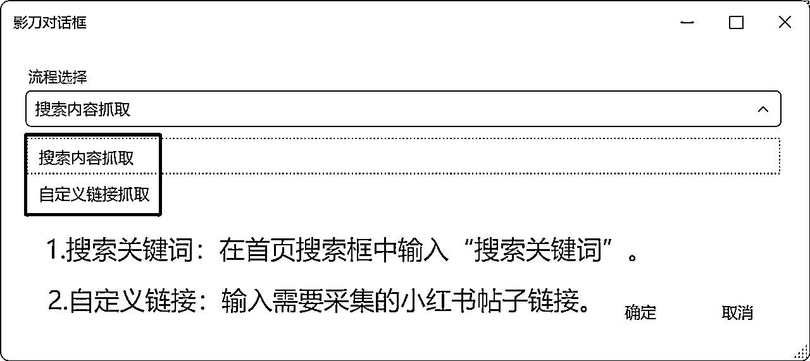

第二步：根据不同的类别设置对应的参数。

第三步：打开小红书首页 https://www.xiaohongshu.com/explore 并完成登录，设置好后点“确定”开始采集。拿到数据后就可以用表格筛选了。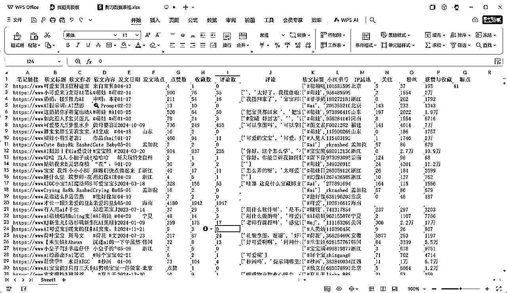

即梦本身也是一个巨大的素材库，活动专区里有很多优质参赛作品值得学习：https://jimeng.jianying.com/ai-tool/activity  
每期活动的主题都是很好的思路参考。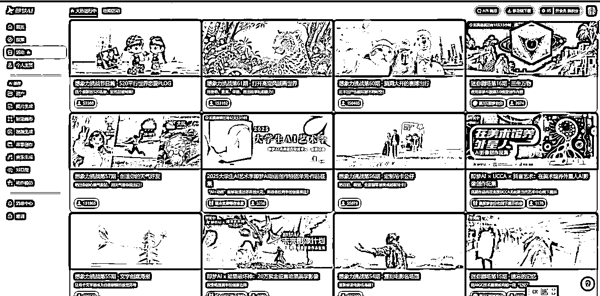

可以通过“使用数”和“喜欢数”筛选出优质作品，点开作品链接，把提示词存进自己的素材库。

Midjourney官网的探索页也能找灵感：https://www.midjourney.com/explore?tab=random  
毕竟是国外产品，审美更贴合海外用户的偏好。  


最后再分享一个影刀RPA程序：https://api.winrobot360.com/redirect/robot/share?inviteKey=6a505903fbc317b9  
使用前记得先打开对应的页面。