# 10个AI开源应用，1个月跑通YouTube海外收益：不靠代码的实操路线图

嘿，我是越越。先交代下背景：我在生财发过多篇深度拆解，得过“资深传术师”的名号；另外，我没读过计算机专业，完完全全没编程底子。今年我的重心就是“把项目做成新手能照着交作业的精细教程”。这篇要聊的主题，是AI怎么帮YouTube加速：我准备了10个开源工具，用图文加讲解录屏串起来，建议打开电脑看。

两个前提说明：这些小工具全部靠AI来辅助写代码完成；每个工具的成品和源码我都会放出来。配套的完整讲解视频在文末。

## 先别急着装环境

这一章不是开局就要照做的清单，而是给后续环节做铺垫。你完全可以直接跳到“对标方法拆解”那部分，等真用到某个工具，再回头补对应环境即可。比如后面走到影刀RPA环节，你就按“安装影刀RPA自动化软件”的内容准备环境。

### 硬件要求

跑这套工具，电脑系统尽量满足：Windows10或更高版本优先；Mac用户请用云端Windows主机绕过。Mac的处理流程如下：

先点开 https://www.qingjiaocloud.com/download/ ，取Mac安装包；接着注册并登录云桌面账号，拉起一台Windows游戏主机或办公主机；后面就按普通Windows电脑的习惯操作就行。

特别提醒一句：用完记得把云主机停掉，不然会一直扣费。


## 软件环境

这一部分属于通用安装说明，未必每个项目都要全用上。使用中记住几个原则：浏览器统一用Chrome（兼容性最稳）；所有YouTube和Viewstats页面都保持英文，不要开中英翻译；用Chrome采集数据时窗口拉到最大；任何环节报错，都要把完整报错文字和整个界面截图留证。

### 装好Chrome

用系统自带的Microsoft Edge就能下载Chrome：打开 https://www.google.cn/intl/zh-CN_ALL/chrome/fallback/ ，拿到安装包。装完后在地址栏输 chrome://extensions/ 进入扩展程序页，把开发者模式打开。之后需要装插件时，先将压缩包解压，再点左上角的“加载已解压的扩展程序”导入。

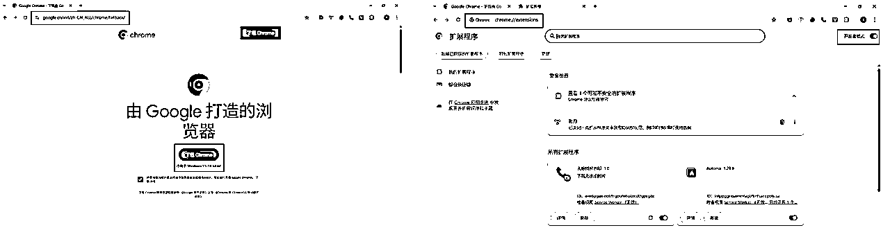

### 影刀RPA

影刀是一个不需要写多少代码的自动化平台，非技术背景也能上手。先到 https://www.yingdao.com/client-download/ 拿Windows版并安装。


之后通过闲鱼搜“影刀创业版账号”，买一个来测试。接着关闭Chrome，打开影刀客户端，点击右上角头像，依次进入“工具”→“自动化插件”→“Google Chrome自动化”，执行“安装”。


另外还要开启影刀里的报错视频录制功能，这样出错时可以把录屏发来排查。


### 给飞书多维表格开权限

操作流程如下：先访问 https://open.feishu.cn/app?lang=zh-CN ，登录飞书，创建一个新的“企业应用”。


接着进入左侧的“权限管理”，选“开通权限”，搜索“多维表格”，把相关权限全部勾上并确认开通。

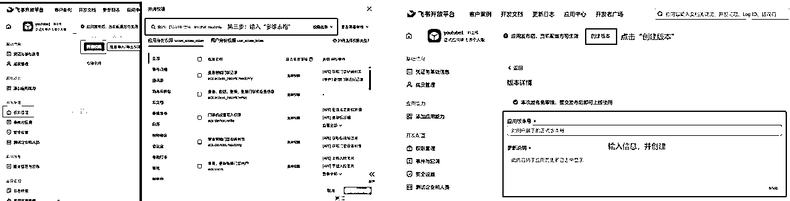

再到“凭证与基础信息”里复制App ID和App Secret，存好备用。


这里有段设置教学视频（见文末对应链接）。

然后点击我分享的多维表格模板链接，在打开页面中点“使用该模板”，这样会创建一份副本。拿到副本后，进“文档应用”，填一个应用名称并确认。再次强调：根表格的名字可以随便改，但里面子表格的每个名字都不要动。


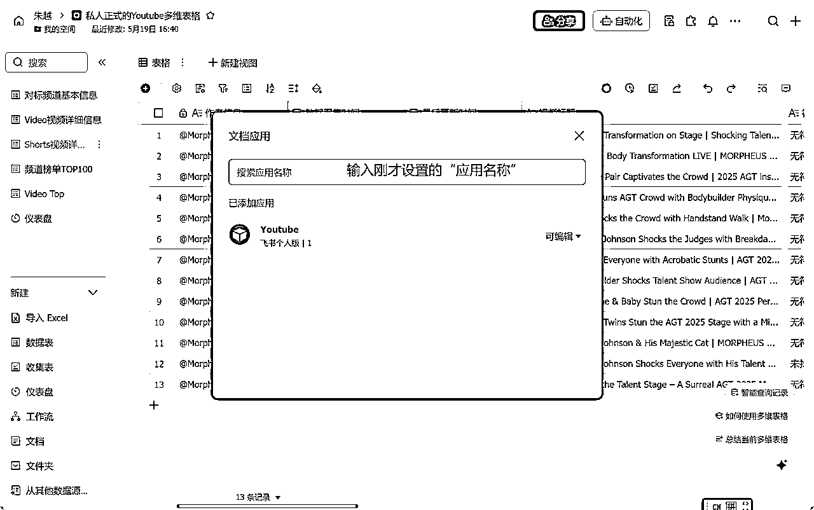

再点表格右上方的“分享”，复制链接。链接形如 https://txt6wm3b04b.feishu.cn/base/*************?from=from_copylink ，你需要取base/之后、/?from之前那一段，保存成“多维表格ID”。

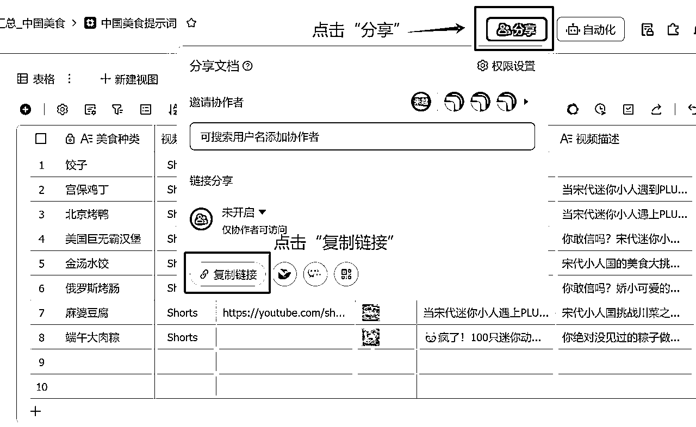

最后把之前攒下的所有参数（App ID、App Secret、多维表格ID、模板链接等）归拢到一处。


若碰到飞书权限报错，查 https://open.feishu.cn/ ；若是节点转换问题，走 https://open.feishu.cn/document/server-docs/docs/wiki-v2/space-node/get_node?appId=cli_a784f92850bfd00b 。

### 配置比特浏览器

从 https://www.bitbrowser.cn/download/ 下载并装好比特浏览器。打开后先新建一个窗口，把这个窗口的编号记下来。点“创建窗口”之后，按自己的需求调参数，“换一换”可以随机生成不同的指纹配置。

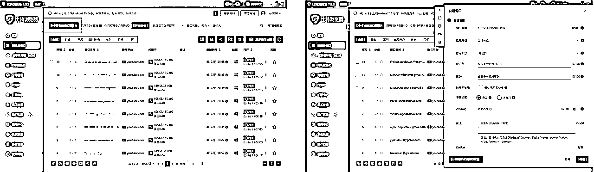

代理IP的设置参考官方文档： https://doc2.bitbrowser.cn/help1.html 。每个窗口分别登录YouTube账号，然后把对应的账号密码与窗口编号统一录到前面的飞书多维表格里。

（这里有一段视频操作演示）

## 文件规划：让每个素材有家可归

把文件归置好，效率会明显提升：查找资料省时间，项目推进时能看到正反馈，复盘思路也更清楚。下面这张图是我做纪录片时的目录结构，同时原始文件会上传到飞书，本地和云端留双份。另外，不管最后用没用上的素材我都会存着，方便以后重新组合，等于给自己建素材库。


### 目录结构

这是我日常在用的项目文件架构：

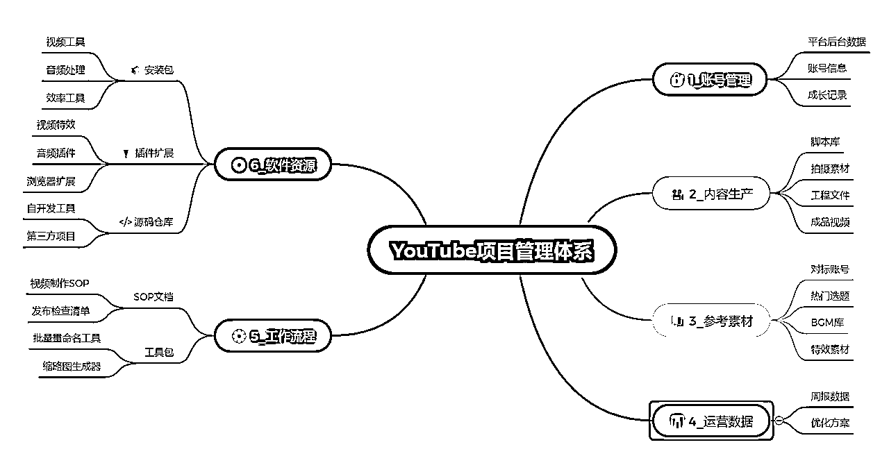

不确定自己适合什么结构的话，可以请DeepSeek帮你生成一套。给它一段提示词，它会输出一份目录骨架；你觉得不满意，就继续对话微调。

```
我作为youtube小白，我该怎样去文件管理?
{推荐输入你的个人情况}
我需要归纳整理账号、素材、对标等等，但是我不清楚该怎样设置文件的目录结构，
请你帮我生成适合的文件目录架构（请直接使用markdown语言输出）。
```

把最终版目录粘贴进“YouTube项目文件夹结构生成器”（下方有成品文件），它会按你的目录自动建好所有文件夹。

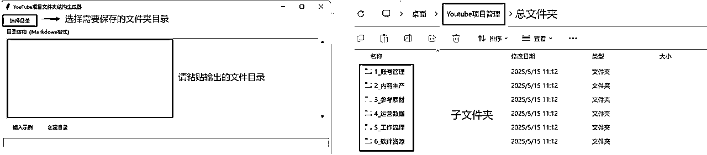

建好后按项目实际情况往里面放对应文件即可。

矩阵式账号管理方面，我会把每个账号的基本信息放进飞书多维表格，比如平台、笔记、状态等。


素材会按用途拆开存放：先按视频主题建一个总文件夹；


再在总文件夹里建立“成品输出”“视频素材”“图片素材”等子目录，有需要还可以加别的，比如“音频”“文档”等。


素材文件夹内部按镜头保存。我习惯让一组提示词产出4张候选图，文件命名采用“镜头号_图片序号.jpg”的格式。拿1_4.jpg举例，它表示第一个镜头的首帧一共生成了4张图，这是第4张。


不合用的图或视频也不要丢，先放进素材文件夹，日后可能还有二次加工的价值。为了方便后续自动化流程，所有文件的命名规则建议保持一致，下图为参考规范。

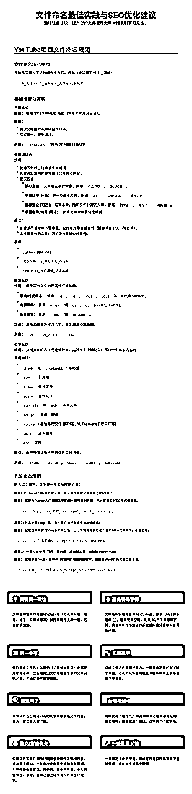

### 保存路径

预先设置好下载路径，找素材会顺手很多，将来接自动化流程也有余地。具体做法：在Chrome地址栏输入 chrome://settings/downloads ，将下载目录设成你惯用的位置，并勾选“下载前询问下载路径”。


剪映这类软件也要提前调整数据目录。安装前就把默认安装路径和素材、草稿、模板等文件夹指到你的项目目录里。剪映的草稿、模板、素材都有对应文件夹，改路径后更容易调用和备份。


### 多留个后手

YouTube项目涉及的文件品类多、数量大，想稳定产出高质量视频，就必须对初次生成的内容做好备份。需要留底的主要有：不同尺寸的抽卡图片（9:16与16:9都留）；不同时长的视频版本（5秒、10秒）；对标视频中用到的音源，尤其是那些特效音。备份结构可参考上面的“生成目录结构”。

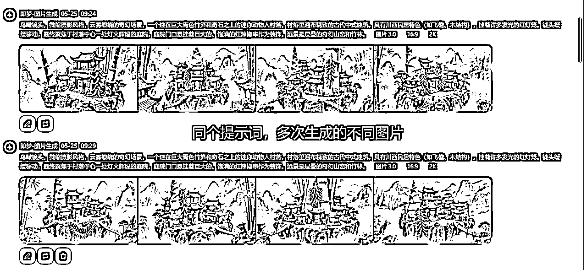

日常备份工具我推荐：百度云盘做在线备份；准备删除前先把文件挪进“待删除”，而不是直接清空；重要成片单独存到非系统盘，避免系统故障丢数据。

## 批量照料账号

### Shorts版自动养号工具

养号也可以交给自动化脚本。只要把这套工具跑起来，它就能自动管理多个浏览器窗口，支持：手动添加比特窗口的编号（蓝字部分可直接跳到比特浏览器设置）；带完整运行日志的直观界面；自定义参数同时内置几套预设模板；让比特窗口匹配当前屏幕尺寸；可开随机评论，也能用你自定义的评论文案库；实时反馈播放与互动数据。

**运行效果界面**


说明一下：这个工具的部分源码思路来自@钱塘江鲤，我在他基础上重写了可视化和多线程部分，并将参数和评论设置做得更容易上手。

工具成品与源码都放出来了，见文末。

**怎么用**

先启动比特浏览器，把下载的压缩包解压到指定目录，双击“YouTube自动养号（shorts版）.exe”。填入窗口编号后点“添加”，之后就无需再次输入了。


接着调互动参数。你可以直接套用“预设”，软件会一键填入对应数值；想了解预设含义，可以点“预设说明”。


“启用评论功能”是可选项：固定评论表示每次发同一句话；随机评论则是从你自己的评论库中抽取内容。

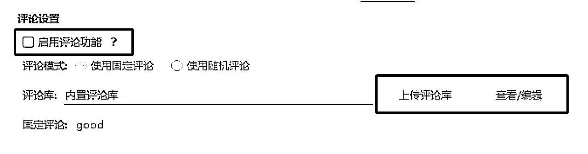

最后点“开始运行”，在弹窗里核对参数、点确定，比特各个窗口会依次打开。左边是参数确认页，右边是运行过程中的比特界面。


运行前提：比特浏览器要先登录并保持打开状态；每个子窗口都要配置好代理和谷歌账号；运行中支持暂停/恢复，但切换需要等待一小会儿才能生效。

### 直播互动养号思路

这节不提供封装好的工具或源码，只讲思路，你可以拿去做成自己的程序。

目标是打开某个YouTube直播间，然后自动做这几件事：启动评论监控；切进聊天iframe判断主流语言；持续捕捉新评论；每来一条新消息，就提取发言者昵称、内容、表情等信息，做一次情绪倾向判断（正面/负面/中性），再按判断结果生成对应语言的回复，最后随机决定是否真的发出去。所有数据与情绪分析结果都存在Excel文件。另外，对收集到的评论要做关键词挖掘，定位观众真正关心的点。完整的实现流程视频在文末。

这个流程可以用影刀的“魔法指令”快速搭出来：

新建一个“魔法指令”，先点对话框下方的“获取元素”。

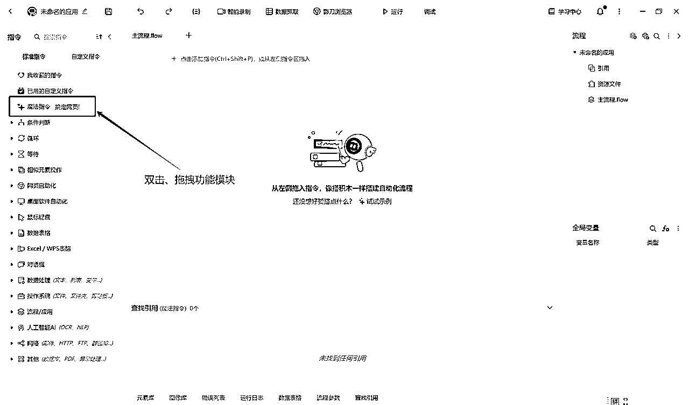

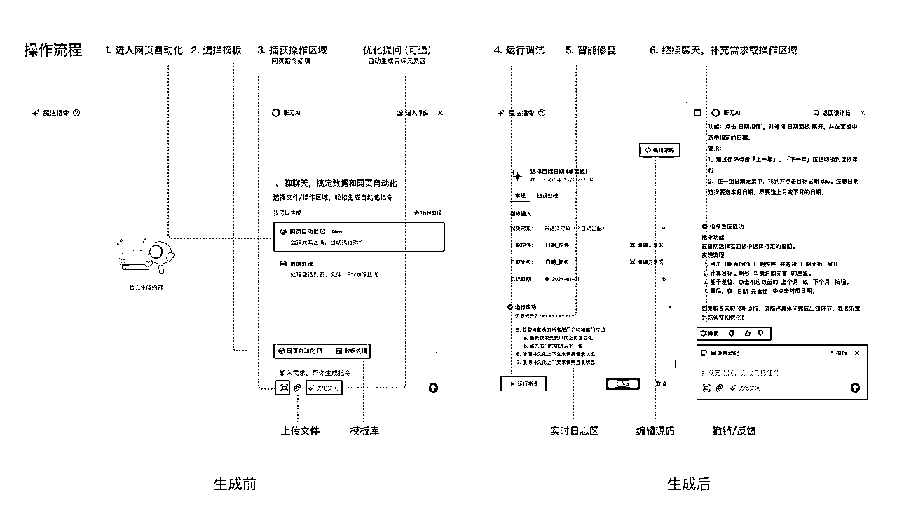

接着把直播评论区输入框选为捕获对象。

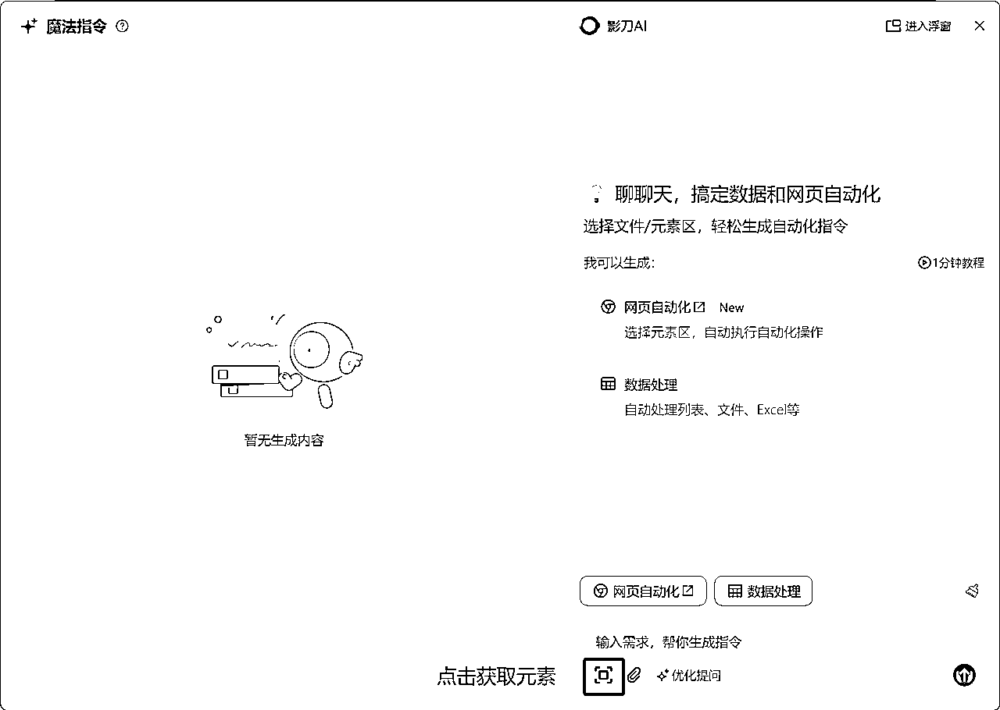

然后在对话框里把需求讲清楚。

```
{获取的评论区元素}实时监控采集评论区评论，并进行情感倾向判断，同时使用评论区内容的主要语言进行回复，{评论输入框元素}使用回车键发送，请模拟人类行为。
```

再点“优化指令”让系统帮你打磨描述，确认后发出，之后还能直接聊天式修改。小技巧：点“编辑源码”，把生成的源码贴到Cursor里二次开发，或者干脆编译成独立应用。

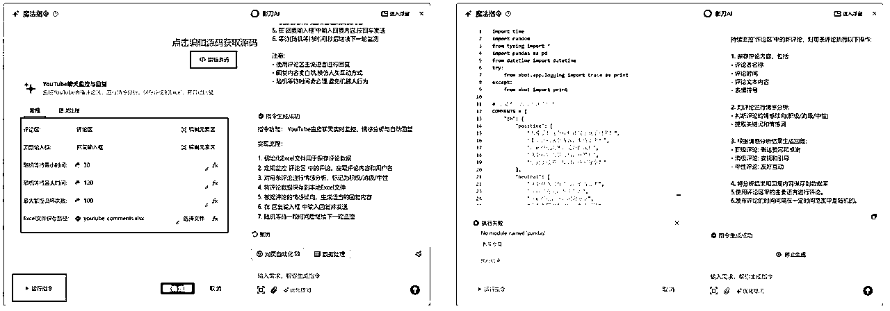

从魔法指令里复制的源代码，能在Cursor环境下继续编辑、调试、运行，也能打包成本地软件。它能处理网页数据读取、网页自动化操作等需求。

魔法指令官方文档： https://www.yingdao.com/yddoc/rpa/711624635438841856

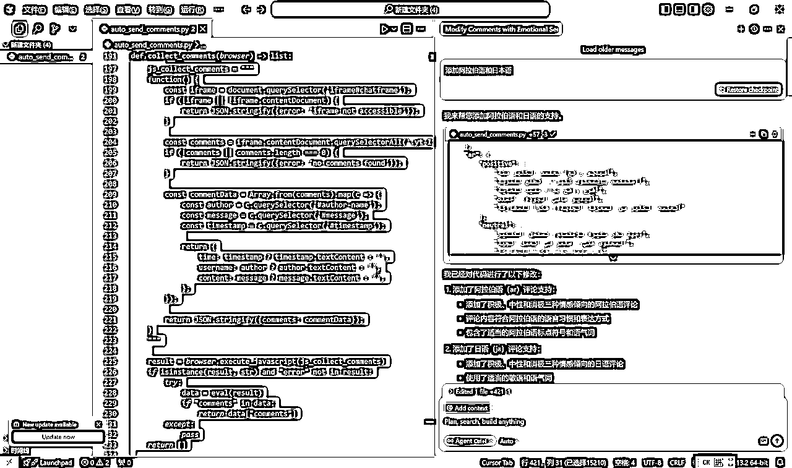

一个源码示例见下方：

（示例代码）

有时候，最吊人胃口的，不是一句惊天动地的话，而是一个没头没尾的开始。

就像现在，摆在我面前的“素材”，干净得像一张白纸，只留下一个孤零零的记号——```
# pip install pandas
# pip install openpyxl
# pip install textblob

import pandas as pd
import time
import random
import re
import datetime
from textblob import TextBlob
import keyboard
import os

from typing import *
try:
    from xbot.app.logging import trace as print
except:
    from xbot import print

def monitor_youtube_chat(browser, comments_container, reply_input, wait_min=30, wait_max=120, max_cycles=100, excel_path="chat_monitoring.xlsx"):
    """
    title: YouTube聊天监控与回复
    description: 监控YouTube直播评论区，进行情感分析，保存评论到Excel，并自动回复

    inputs:
        - browser (WebBrowser): 目标网页
        - comments_container (Selector): `评论区`，uuid: sgu23ylq
        - reply_input (Selector): `回复输入框`，uuid: sgwweqlj
        - wait_min (int-textbox): 随机等待最小时间(秒)，eg: 30
        - wait_max (int-textbox): 随机等待最大时间(秒)，eg: 120
        - max_cycles (int-textbox): 最大监控循环次数，eg: 100
        - excel_path (str-file): Excel文件保存路径，eg: "youtube_comments.xlsx"

    outputs:
        - None
    """

    # 确保Excel文件存在，如果不存在则创建
    _init_excel_file(excel_path)

    print("1.初始化YouTube聊天监控")
    print(f"  a.将监控评论区并保存到 {excel_path}")
    print(f"  b.每次监控后等待 {wait_min}-{wait_max} 秒")
    print(f"  c.计划执行 {max_cycles} 次监控循环")

    # 记录已处理的评论ID
    processed_comments = set()

    # 主监控循环
    for cycle in range(1, max_cycles + 1):
        print(f"\n2.开始第 {cycle}/{max_cycles} 轮监控")

        # 切换到聊天iframe
        _switch_to_chat_iframe(browser)

        # 获取评论
        print("  a.获取新评论")
        comments = _get_new_comments(browser, comments_container, processed_comments)

        if not comments:
            print("    未发现新评论")
        else:
            print(f"    发现 {len(comments)} 条新评论")

            # 处理每条评论
            for idx, comment_data in enumerate(comments):
                print(f"  b.处理评论 {idx+1}/{len(comments)}")

                # 进行情感分析
                sentiment = _analyze_sentiment(comment_data['text'])
                comment_data['sentiment'] = sentiment['label']
                comment_data['sentiment_score'] = sentiment['score']

                # 生成回复
                reply_text = _generate_reply(comment_data)

                # 保存到Excel
                _save_to_excel(excel_path, comment_data)

                # 回复评论
                if reply_text:
                    print(f"    回复 {comment_data['username']}: {reply_text}")
                    _reply_to_comment(browser, reply_input, reply_text)

                # 添加到已处理集合
                processed_comments.add(comment_data['id'])

        # 随机等待一段时间
        wait_time = random.randint(wait_min, wait_max)
        print(f"3.等待 {wait_time} 秒后进行下一轮监控...")
        time.sleep(wait_time)

    print("\n4.监控完成")
    print(f"  共处理了 {len(processed_comments)} 条评论")
    print(f"  结果已保存到 {excel_path}")

def _init_excel_file(excel_path):
    """初始化Excel文件，如果不存在则创建"""
    if not os.path.exists(excel_path):
        df = pd.DataFrame(columns=[
            'timestamp', 'id', 'username', 'text', 
            'sentiment', 'sentiment_score', 'reply'
        ])
        df.to_excel(excel_path, index=False)
        print(f"创建新的Excel文件: {excel_path}")

def _switch_to_chat_iframe(browser):
    """切换到聊天iframe"""
    try:
        # 执行JavaScript获取iframe并切换
        browser.execute_javascript("""
        function(element, args) {
            const iframe = document.querySelector('iframe#chatframe');
            if (iframe) {
                return "success";
            }
            return "iframe not found";
        }
        """)
    except Exception as e:
        print(f"切换到iframe时出错: {str(e)}")

def _get_new_comments(browser, comments_container, processed_comments):
    """获取新的评论"""
    comments = []

    try:
        # 找到评论容器
        container_elements = browser.find_all_by_xpath(comments_container, timeout=3)
        if not container_elements:
            return comments

        container = container_elements[0]

        # 获取所有评论
        comment_elements = container.find_all_by_xpath(".//yt-live-chat-text-message-renderer", timeout=3)

        for comment_element in comment_elements:
            # 获取评论ID
            comment_id = comment_element.get_attribute("id")

            # 如果已处理过，跳过
            if comment_id in processed_comments:
                continue

            # 获取用户名
            username_element = comment_element.find_all_by_xpath(".//span[@id='author-name']", timeout=3)
            username = username_element[0].get_text() if username_element else "Unknown User"

            # 获取评论内容
            message_element = comment_element.find_all_by_xpath(".//span[@id='message']", timeout=3)
            message = message_element[0].get_text() if message_element else ""

            # 添加到结果列表
            comments.append({
                'id': comment_id,
                'username': username,
                'text': message,
                'timestamp': datetime.datetime.now().strftime("%Y-%m-%d %H:%M:%S")
            })

    except Exception as e:
        print(f"获取评论时出错: {str(e)}")

    return comments

def _analyze_sentiment(text):
    """对评论文本进行情感分析"""
    try:
        # 使用TextBlob进行情感分析
        analysis = TextBlob(text)
        polarity = analysis.sentiment.polarity

        # 确定情感标签
        if polarity > 0.1:
            return {'label': 'positive', 'score': polarity}
        elif polarity < -0.1:
            return {'label': 'negative', 'score': polarity}
        else:
            return {'label': 'neutral', 'score': polarity}

    except Exception as e:
        print(f"情感分析出错: {str(e)}")
        return {'label': 'neutral', 'score': 0}

def _generate_reply(comment_data):
    """根据评论和情感生成回复"""
    username = comment_data['username']
    text = comment_data['text']
    sentiment = comment_data['sentiment']

    # 检测语言 (简单判断，如果包含拉丁字母以外的字符则可能是非葡萄牙语/西班牙语)
    is_latin_based = all(c.isascii() or c.isspace() or c in "áàâãéèêíìîóòôõúùûçÁÀÂÃÉÈÊÍÌÎÓÒÔÕÚÙÛÇ,.!?;:-_()[]{}\"'/" for c in text)

    # 根据情感和内容选择回复模板
    replies = {
        'positive': [
            f"Valeu {username}! 👍",
            f"Concordo com você, {username}!",
            f"Boa observação, {username}!",
            "Muito obrigado pelo comentário positivo!",
            "É isso aí! 🔥"
        ],
        'negative': [
            f"Entendo seu ponto, {username}.",
            "Obrigado por compartilhar sua opinião!",
            "Interessante perspectiva...",
            "Vamos pensar sobre isso.",
            "Respeito sua opinião! 👍"
        ],
        'neutral': [
            f"Olá {username}, obrigado pelo comentário!",
            "Valeu por participar do chat!",
            "Legal! 👍",
            "Obrigado por estar aqui!",
            "Entendi! 👀"
        ],
        'command': [
            "Comando registrado! 👍",
            "Anotado!",
            "👌"
        ]
    }

    # 检查是否是命令(!开头)
    if text and text[0] == '!':
        return random.choice(replies['command'])

    # 对于空消息或特殊情况，不回复
    if not text or len(text) < 2:
        return ""

    # 根据情感选择回复
    return random.choice(replies[sentiment])

def _save_to_excel(excel_path, comment_data):
    """保存评论数据到Excel"""
    try:
        # 读取现有Excel
        if os.path.exists(excel_path):
            df = pd.read_excel(excel_path)
        else:
            df = pd.DataFrame(columns=[
                'timestamp', 'id', 'username', 'text', 
                'sentiment', 'sentiment_score', 'reply'
            ])

        # 添加新行
        new_row = {
            'timestamp': comment_data['timestamp'],
            'id': comment_data['id'],
            'username': comment_data['username'],
            'text': comment_data['text'],
            'sentiment': comment_data['sentiment'],
            'sentiment_score': comment_data['sentiment_score'],
            'reply': comment_data.get('reply', '')
        }

        df = pd.concat([df, pd.DataFrame([new_row])], ignore_index=True)

        # 保存回Excel
        df.to_excel(excel_path, index=False)
        print(f"    评论已保存到Excel")

    except Exception as e:
        print(f"保存到Excel时出错: {str(e)}")

def _reply_to_comment(browser, reply_input, reply_text):
    """在输入框中回复评论"""
    try:
        # 找到回复输入框
        input_elements = browser.find_all_by_xpath(reply_input, timeout=3)
        if not input_elements:
            print("    未找到回复输入框")
            return

        input_container = input_elements[0]

        # 找到可编辑的div
        editable_div = input_container.find_all_by_xpath(".//div[@contenteditable]", timeout=3)
        if not editable_div:
            print("    未找到可编辑div")
            return

        # 清空现有内容并输入新回复
        editable_div[0].click(delay_after=0.3)

        # 清空内容 (使用键盘组合键Ctrl+A和Delete)
        browser.execute_javascript("""
        function(element, args) {
            const div = document.querySelector('div[contenteditable]');
            if (div) {
                div.textContent = '';
                return "cleared";
            }
            return "div not found";
        }
        """)

        # 输入回复
        editable_div[0].input(reply_text, delay_after=0.3)

        # 按回车发送
        keyboard.press_and_release('enter')
        time.sleep(1)  # 等待消息发送

    except Exception as e:
        print(f"回复评论时出错: {str(e)}")

```。

别小看这个记号，它其实是给文案开了一扇门：门后面，什么都有可能发生。可能是金句，可能是数据，也可能是一段戳心故事。真正聪明的文案，从不急着把话说满，而是先铺好轨道，让情绪顺着一个节点自然生长。

老话说得好，留白才是最高的表达。与其堆砌辞藻，不如用一个抓手，把所有注意力都收拢到一个点上。

现在，这枚钩子已经就位。

它就是：```
# pip install pandas
# pip install openpyxl
# pip install textblob

import pandas as pd
import time
import random
import re
import datetime
from textblob import TextBlob
import keyboard
import os

from typing import *
try:
    from xbot.app.logging import trace as print
except:
    from xbot import print

def monitor_youtube_chat(browser, comments_container, reply_input, wait_min=30, wait_max=120, max_cycles=100, excel_path="chat_monitoring.xlsx"):
    """
    title: YouTube聊天监控与回复
    description: 监控YouTube直播评论区，进行情感分析，保存评论到Excel，并自动回复

    inputs:
        - browser (WebBrowser): 目标网页
        - comments_container (Selector): `评论区`，uuid: sgu23ylq
        - reply_input (Selector): `回复输入框`，uuid: sgwweqlj
        - wait_min (int-textbox): 随机等待最小时间(秒)，eg: 30
        - wait_max (int-textbox): 随机等待最大时间(秒)，eg: 120
        - max_cycles (int-textbox): 最大监控循环次数，eg: 100
        - excel_path (str-file): Excel文件保存路径，eg: "youtube_comments.xlsx"

    outputs:
        - None
    """

    # 确保Excel文件存在，如果不存在则创建
    _init_excel_file(excel_path)

    print("1.初始化YouTube聊天监控")
    print(f"  a.将监控评论区并保存到 {excel_path}")
    print(f"  b.每次监控后等待 {wait_min}-{wait_max} 秒")
    print(f"  c.计划执行 {max_cycles} 次监控循环")

    # 记录已处理的评论ID
    processed_comments = set()

    # 主监控循环
    for cycle in range(1, max_cycles + 1):
        print(f"\n2.开始第 {cycle}/{max_cycles} 轮监控")

        # 切换到聊天iframe
        _switch_to_chat_iframe(browser)

        # 获取评论
        print("  a.获取新评论")
        comments = _get_new_comments(browser, comments_container, processed_comments)

        if not comments:
            print("    未发现新评论")
        else:
            print(f"    发现 {len(comments)} 条新评论")

            # 处理每条评论
            for idx, comment_data in enumerate(comments):
                print(f"  b.处理评论 {idx+1}/{len(comments)}")

                # 进行情感分析
                sentiment = _analyze_sentiment(comment_data['text'])
                comment_data['sentiment'] = sentiment['label']
                comment_data['sentiment_score'] = sentiment['score']

                # 生成回复
                reply_text = _generate_reply(comment_data)

                # 保存到Excel
                _save_to_excel(excel_path, comment_data)

                # 回复评论
                if reply_text:
                    print(f"    回复 {comment_data['username']}: {reply_text}")
                    _reply_to_comment(browser, reply_input, reply_text)

                # 添加到已处理集合
                processed_comments.add(comment_data['id'])

        # 随机等待一段时间
        wait_time = random.randint(wait_min, wait_max)
        print(f"3.等待 {wait_time} 秒后进行下一轮监控...")
        time.sleep(wait_time)

    print("\n4.监控完成")
    print(f"  共处理了 {len(processed_comments)} 条评论")
    print(f"  结果已保存到 {excel_path}")

def _init_excel_file(excel_path):
    """初始化Excel文件，如果不存在则创建"""
    if not os.path.exists(excel_path):
        df = pd.DataFrame(columns=[
            'timestamp', 'id', 'username', 'text', 
            'sentiment', 'sentiment_score', 'reply'
        ])
        df.to_excel(excel_path, index=False)
        print(f"创建新的Excel文件: {excel_path}")

def _switch_to_chat_iframe(browser):
    """切换到聊天iframe"""
    try:
        # 执行JavaScript获取iframe并切换
        browser.execute_javascript("""
        function(element, args) {
            const iframe = document.querySelector('iframe#chatframe');
            if (iframe) {
                return "success";
            }
            return "iframe not found";
        }
        """)
    except Exception as e:
        print(f"切换到iframe时出错: {str(e)}")

def _get_new_comments(browser, comments_container, processed_comments):
    """获取新的评论"""
    comments = []

    try:
        # 找到评论容器
        container_elements = browser.find_all_by_xpath(comments_container, timeout=3)
        if not container_elements:
            return comments

        container = container_elements[0]

        # 获取所有评论
        comment_elements = container.find_all_by_xpath(".//yt-live-chat-text-message-renderer", timeout=3)

        for comment_element in comment_elements:
            # 获取评论ID
            comment_id = comment_element.get_attribute("id")

            # 如果已处理过，跳过
            if comment_id in processed_comments:
                continue

            # 获取用户名
            username_element = comment_element.find_all_by_xpath(".//span[@id='author-name']", timeout=3)
            username = username_element[0].get_text() if username_element else "Unknown User"

            # 获取评论内容
            message_element = comment_element.find_all_by_xpath(".//span[@id='message']", timeout=3)
            message = message_element[0].get_text() if message_element else ""

            # 添加到结果列表
            comments.append({
                'id': comment_id,
                'username': username,
                'text': message,
                'timestamp': datetime.datetime.now().strftime("%Y-%m-%d %H:%M:%S")
            })

    except Exception as e:
        print(f"获取评论时出错: {str(e)}")

    return comments

def _analyze_sentiment(text):
    """对评论文本进行情感分析"""
    try:
        # 使用TextBlob进行情感分析
        analysis = TextBlob(text)
        polarity = analysis.sentiment.polarity

        # 确定情感标签
        if polarity > 0.1:
            return {'label': 'positive', 'score': polarity}
        elif polarity < -0.1:
            return {'label': 'negative', 'score': polarity}
        else:
            return {'label': 'neutral', 'score': polarity}

    except Exception as e:
        print(f"情感分析出错: {str(e)}")
        return {'label': 'neutral', 'score': 0}

def _generate_reply(comment_data):
    """根据评论和情感生成回复"""
    username = comment_data['username']
    text = comment_data['text']
    sentiment = comment_data['sentiment']

    # 检测语言 (简单判断，如果包含拉丁字母以外的字符则可能是非葡萄牙语/西班牙语)
    is_latin_based = all(c.isascii() or c.isspace() or c in "áàâãéèêíìîóòôõúùûçÁÀÂÃÉÈÊÍÌÎÓÒÔÕÚÙÛÇ,.!?;:-_()[]{}\"'/" for c in text)

    # 根据情感和内容选择回复模板
    replies = {
        'positive': [
            f"Valeu {username}! 👍",
            f"Concordo com você, {username}!",
            f"Boa observação, {username}!",
            "Muito obrigado pelo comentário positivo!",
            "É isso aí! 🔥"
        ],
        'negative': [
            f"Entendo seu ponto, {username}.",
            "Obrigado por compartilhar sua opinião!",
            "Interessante perspectiva...",
            "Vamos pensar sobre isso.",
            "Respeito sua opinião! 👍"
        ],
        'neutral': [
            f"Olá {username}, obrigado pelo comentário!",
            "Valeu por participar do chat!",
            "Legal! 👍",
            "Obrigado por estar aqui!",
            "Entendi! 👀"
        ],
        'command': [
            "Comando registrado! 👍",
            "Anotado!",
            "👌"
        ]
    }

    # 检查是否是命令(!开头)
    if text and text[0] == '!':
        return random.choice(replies['command'])

    # 对于空消息或特殊情况，不回复
    if not text or len(text) < 2:
        return ""

    # 根据情感选择回复
    return random.choice(replies[sentiment])

def _save_to_excel(excel_path, comment_data):
    """保存评论数据到Excel"""
    try:
        # 读取现有Excel
        if os.path.exists(excel_path):
            df = pd.read_excel(excel_path)
        else:
            df = pd.DataFrame(columns=[
                'timestamp', 'id', 'username', 'text', 
                'sentiment', 'sentiment_score', 'reply'
            ])

        # 添加新行
        new_row = {
            'timestamp': comment_data['timestamp'],
            'id': comment_data['id'],
            'username': comment_data['username'],
            'text': comment_data['text'],
            'sentiment': comment_data['sentiment'],
            'sentiment_score': comment_data['sentiment_score'],
            'reply': comment_data.get('reply', '')
        }

        df = pd.concat([df, pd.DataFrame([new_row])], ignore_index=True)

        # 保存回Excel
        df.to_excel(excel_path, index=False)
        print(f"    评论已保存到Excel")

    except Exception as e:
        print(f"保存到Excel时出错: {str(e)}")

def _reply_to_comment(browser, reply_input, reply_text):
    """在输入框中回复评论"""
    try:
        # 找到回复输入框
        input_elements = browser.find_all_by_xpath(reply_input, timeout=3)
        if not input_elements:
            print("    未找到回复输入框")
            return

        input_container = input_elements[0]

        # 找到可编辑的div
        editable_div = input_container.find_all_by_xpath(".//div[@contenteditable]", timeout=3)
        if not editable_div:
            print("    未找到可编辑div")
            return

        # 清空现有内容并输入新回复
        editable_div[0].click(delay_after=0.3)

        # 清空内容 (使用键盘组合键Ctrl+A和Delete)
        browser.execute_javascript("""
        function(element, args) {
            const div = document.querySelector('div[contenteditable]');
            if (div) {
                div.textContent = '';
                return "cleared";
            }
            return "div not found";
        }
        """)

        # 输入回复
        editable_div[0].input(reply_text, delay_after=0.3)

        # 按回车发送
        keyboard.press_and_release('enter')
        time.sleep(1)  # 等待消息发送

    except Exception as e:
        print(f"回复评论时出错: {str(e)}")

```。

接下来要做的，就是接住它，然后，把故事讲下去。

# 拆解对标实战：用Viewstats+自动化做YouTube内容复盘

做YouTube内容，核心不是瞎做，而是看懂别人怎么起量的。今天这套方法，围绕公开数据站Viewstats展开，结合RPA自动化采集以及AI解读，帮助你把对标从拍脑袋变成可复用的流程。

## 如何读懂Viewstats平台

直接打开网页版热门榜单：https://www.viewstats.com/。


在该站能拿到：

* 指定周期内增长异常的Top100频道排行；
* 指定周期内增长异常的Top100视频排行；


站内还能查询：

* 频道的精细指标；
* 视频的精细指标；
* YPP收益预估。

特别提醒：YPP收益仅作参考。


该站支持对单个频道进行定向检索。


### 把Viewstats数据拿下来

利用影刀RPA，可以对满足条件的Viewstats信息做批量抓取、处理与二次使用。

筛选维度包含：

* 视频发布国家；
* 视频分类Category；

操作思路如下：

先按下图指引设定过滤条件，设置完毕后保持页面不变。

特别注意：需先登录，且页面保持英文呈现，不要切成中文。

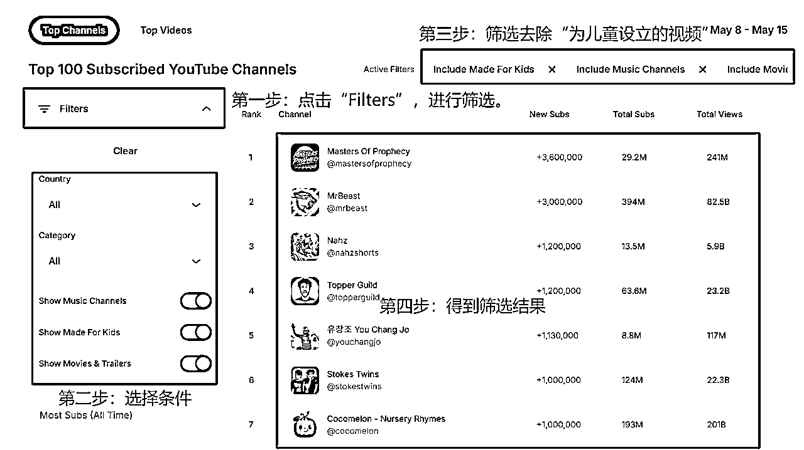

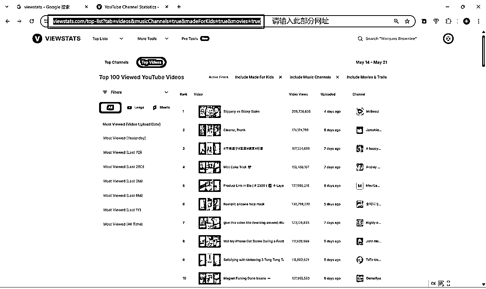

第二步获取RPA程序：

本地Excel版：https://api.winrobot360.com/redirect/robot/share?inviteKey=df93f45a5a3638a5

飞书多维版：https://api.winrobot360.com/redirect/robot/share?inviteKey=da083b1445b60e69

按个人需求挑选。

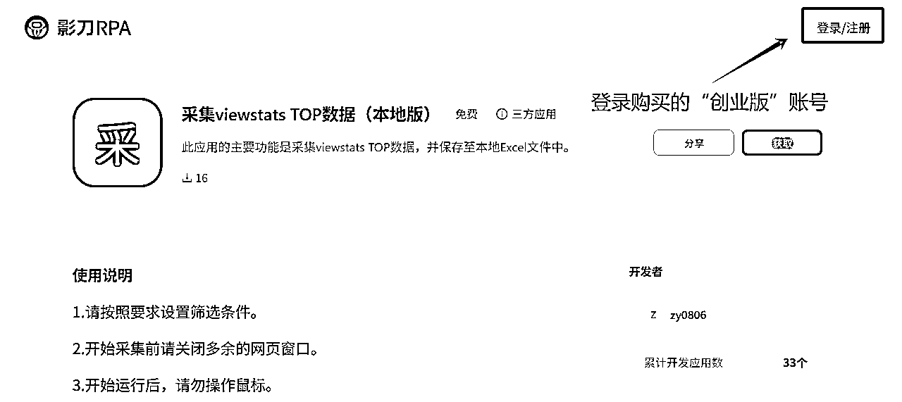

打开影刀RPA左侧菜单，找到“我获取的应用”，启动程序。


程序内涉及的飞书数据请参考飞书权限配置。

注意：必须粘贴筛选完成后页面的完整链接。

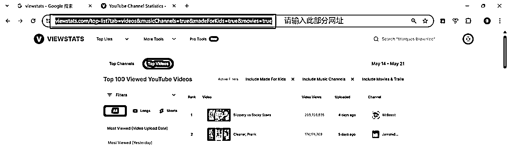

下面以本地Excel版为例展示。

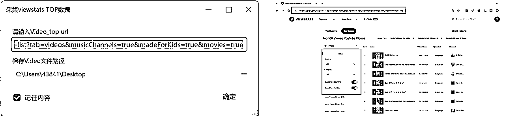

TOP100 Videos结果表：

字段包含视频名称、发布时刻、链接、封面地址、累计播放、点赞、评论、每小时播放增速、预估收入、订阅者数、频道视频总量，以及互动率、综合打分。

互动率与综合打分可作为筛选榜单素材的重要参考。

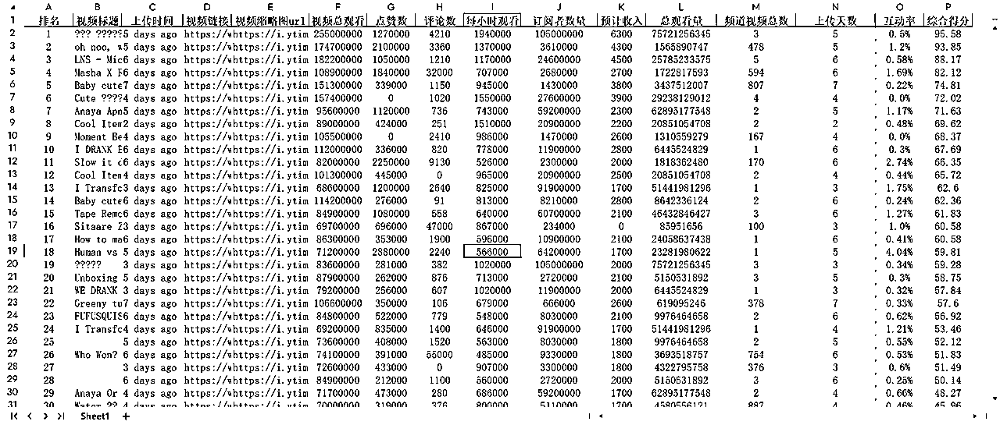

可在影刀内设置定时任务。


### 对Viewstats数据的解读

重点落在Video榜单上，先将Top榜单信息拆解再延展，最后再回溯抓取。

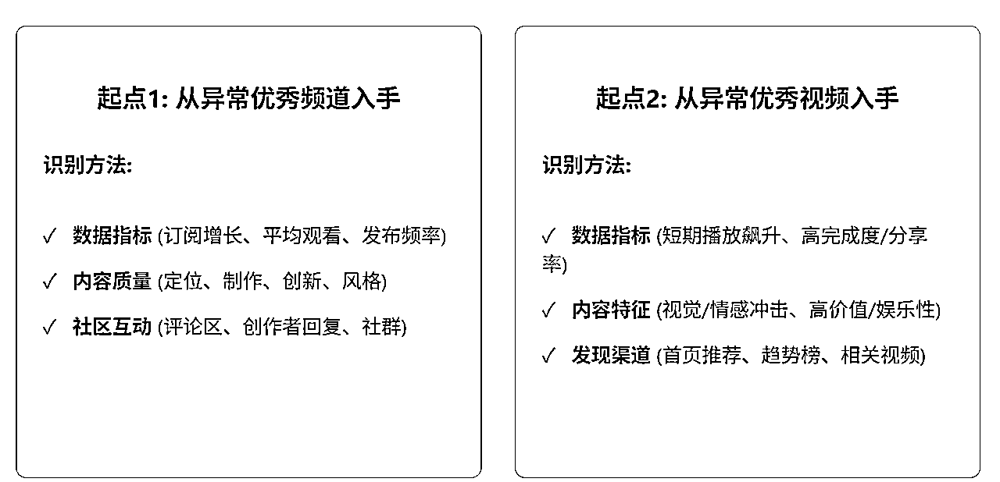

通过数据初筛出“可对标的视频”，进入Viewstats查看明细，并交由AI做可视化解读。


其一：点进对应视频链接进入详情页，截取整理关键区域数据。


其二：将详情页截图喂给Gemini，基于提示词与截图数据输出初步洞察。

```
请基于上传的YouTube频道的ViewStats截图数据，执行以下任务：

生成一份单页HTML《[频道名称]视频数据分析报告》。

**报告基本要求：**

* **报告语言**： 中文。
* **整体风格**： 专业、数据驱动、分析性强。
* **数据来源**： 严格基于所提供的截图数据进行分析，不涉及内容主题分析。

**报告核心内容：**

1\.  **频道概览**：
    * 清晰展示总订阅数、总观看次数、视频总数等核心整体数据。

2\.  **近期表现（例如过去28天）**：
    * 详细列出并分析近期的观看次数（及其与上一周期的对比，如“+100%”）。
    * 详细列出并分析订阅数变化（包括净增长和与上一周期的对比，如“较上个周期新增订阅减少XX”）。
    * 展示预估收入。
    * 分析不同内容格式（如Shorts vs 长视频）的观看表现。

3\.  **数据趋势可视化**：
    * 使用条形图展示每日观看次数变化（基于截图中的每日数据）。
    * 使用折线图展示每日订阅总数变化趋势。
    * 使用条形图展示每日新增订阅数。
    * **图表布局与样式补充要求：**
        * **响应式布局**：在小屏幕（如手机）上，图表应单列堆叠显示。在中等屏幕（如平板电脑）及更大屏幕（如桌面电脑）上，图表应以**两列网格**的形式展示，每行最多容纳两个图表。
        * **图表高宽比**：为避免图表显得过高或过窄，请确保图表的**宽度约为其高度的2至2.5倍**。可以参考 `image_6c4264.png` 中图表的视觉比例。
        * **图表容器**：每个图表应放置在一个带有浅灰色边框和圆角的容器内，容器内部应有适当的内边距。
    * 确保所有图表清晰易懂，包含标题、坐标轴标签，并且图表内的文字（如图例、坐标轴数值）也为纯黑色。

4\.  **核心指标分析**：
    * 计算并解读“平均每视频观看次数”，并指出可能的影响因素（如爆款Shorts）。
    * 计算并解读“观看-订阅转化效率”（例如，每多少次观看带来一个新订阅），并评估其效率。
    * 分析“内容格式表现”，明确指出哪种格式是主要流量来源。
    * 解读“近期增长趋势”，包括观看次数和订阅数的增长势头，并点出任何增长速率的变化或潜在波动。
    * 分析“最新视频表现”（如果数据中包含此类信息，如“近期10个视频中的排名”）。

5\.  **对标建议（数据角度）**：
    * 提供选择对标频道时应考虑的具体数据维度，例如：相似的订阅者规模范围、总观看量级范围、视频数量范围、主要内容格式（强调Shorts对标的重要性）、以及相似的增长率指标。

6\.  **总结与数据驱动的建议**：
    * 对频道当前数据状况进行简明扼要的总结。
    * 提出具体、可操作的数据驱动建议，例如：如何根据数据优化Shorts策略、如何应对订阅增长波动、是否以及如何谨慎探索其他内容格式（如长视频）、如何监控和应对每日数据波动、如何提升新视频表现稳定性等。

**报告格式与功能：**

* **单页HTML**：所有内容整合在一个HTML文件中。
* **纯黑色字体**：报告中的所有主要文本内容（标题、段落、列表项等）均使用纯黑色字体。允许使用语义化颜色（如绿色表示增长，红色表示下降）来突出显示特定数据点。
* **重点内容加粗**：报告中的关键数据、核心发现、重要结论和建议等，请使用粗体进行强调。
* **下载功能**：在页面显著位置提供一个“下载报告 (PNG)”的按钮，点击后可以将整个报告内容（包括图表）下载为一张PNG图片。
* **响应式设计**：确保报告在桌面和移动设备上均有良好的阅读体验。
* **CSS框架**：优先使用Tailwind CSS进行样式设计。
* **图表库**：使用Chart.js生成图表。
* **图片下载库**：使用html2canvas.js实现下载报告为PNG的功能。
```

## 获取对标频道全量素材

### 视频清单抓取

参考影刀RPA获取教程，获取以下应用。

其一：浏览器打开 https://api.winrobot360.com/redirect/robot/share?inviteKey=c685d34b806c6929


其二：把下方模板文件下载到指定目录。

点击飞书链接获取飞书模板文件。

飞书模板文件：

Excel模板文件：

特别提示：若要改子表名称，需在应用里同步修改。


其三：右键程序，点击“运行采集程序”，程序名为：video详情采集（单频道采集）

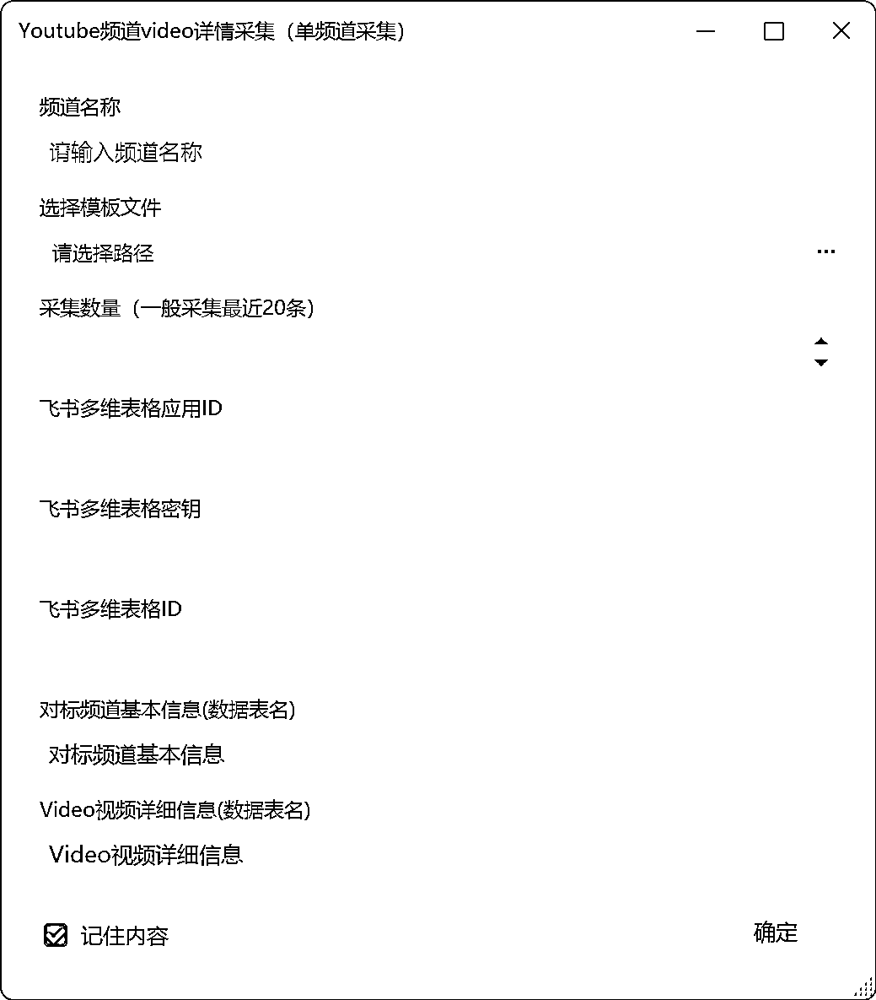

特别提示：

1.正式运行前务必完成飞书多维表格权限设置。
2.核对两张数据表名称是否与多维表格内名称一致，上图已展示表名。
3.采集条数建议默认50条，控制量级。
4.产出包括本地Excel存档与飞书多维表格供AI分析。
5.建议勾选“记住内容”，下次无需重复输入参数。
6.飞书模板只需获取一次。

其四：等待采集完成，采集期间请勿操作键盘鼠标。若报错会在对应区域展示，请重试三次，仍报错请把报错信息发给我优化。


其五：最终得到本地Excel与飞书多维表格。

### Shorts清单抓取

其一：打开浏览器获取RPA程序：https://api.winrobot360.com/redirect/robot/share?inviteKey=94f85f5445d22b3b

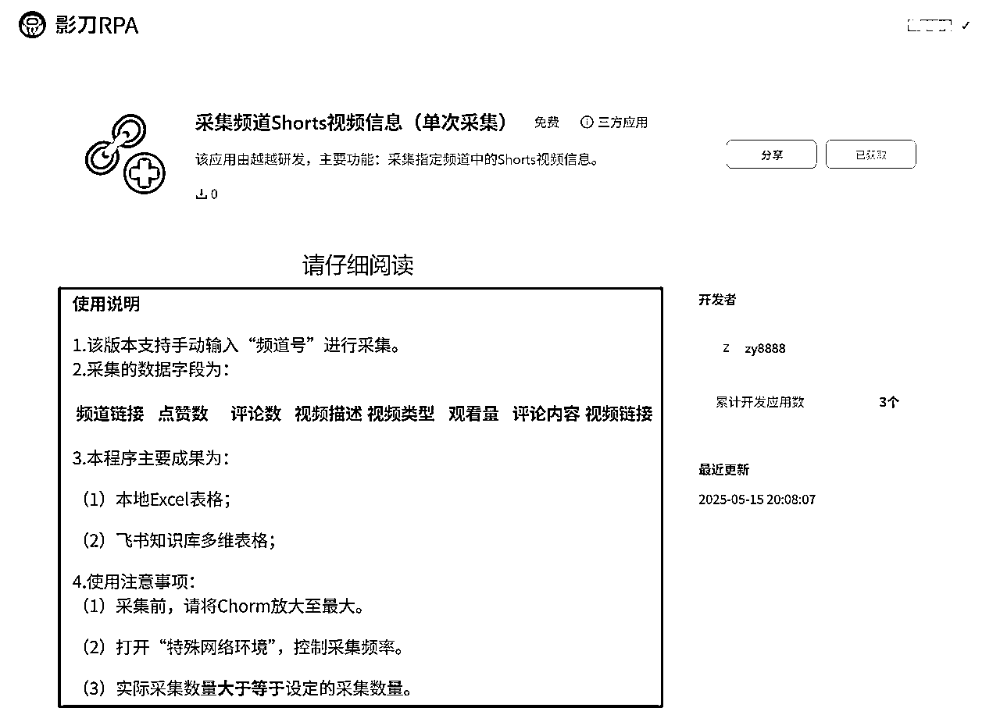

其二：点击运行，输入参数。批量版需上传需抓取的“批量频道号”，自建Excel，从A2单元格起在A列填写频道号并保存。


特别提示：

1.批量抓取建议控制在5个频道以内，避免频繁操作触发风控。
2.飞书参数需正确填写，批量与单频道采集都写入同一飞书多维表格，以频道名区分。

## 对标频道数据分析维度

### 标题

YouTube标题在不同场景的呈现方式大致有三种：

* 首页呈现；
* 搜索页呈现；
* 详情页呈现；

标题设计目的：

1.让系统打上识别标签，实现精准分发；
2.满足用户搜索意图；

因此核心词需要直观易懂。


AI辅助标题分析：

可提示Gemini、Deepseek等工具：

```
请分析YouTube视频标题-“视频标题”中存在的核心关键词，同时输出五个可拓展的二级核心关键词。
```

以文中案例演示：

```
请分析YouTube视频标题-“Do you have a cat? 🥹 #animatedstories #meme #indiananimation"”中存在的核心关键词，请输出五个可拓展的二级核心关键词。
```

Gemini输出示例：

综合来看，最能概括视频内容与形式的词是：

* 猫 Cat
* 动画 Animation
* 模因/梗 Meme

考虑到标题以“猫”作为切入点，可把猫作为核心。结合形式词做更全面描述。

核心词：

* 猫 Cat

可延展二级词：

1. 猫咪动画 Cat Animation：结合核心词与形式，常见搜索表达。可延展为“可爱猫咪动画”“搞笑猫咪动画”。
2. 猫咪模因 Cat Meme：契合视频类型。可延展为“最新猫咪模因”“热门猫咪梗视频”。
3. 宠物动画 Pet Animation：将范围扩大到宠物。标题提问“Do you have a cat?”指向宠物主。可延展为“宠物搞笑动画”“可爱宠物故事”。
4. 动物动画故事 Animal Animated Stories：细化#animatedstories。可延展为“短篇动物动画”“有趣动物动画”。
5. 可爱动画 Cute Animation：标题表情🥹暗示可爱或感人。可延展为“超萌动画”“治愈系动画”。

### 描述

我浏览了大量对标视频，好的描述能在开头快速传递信息，赢得好感。

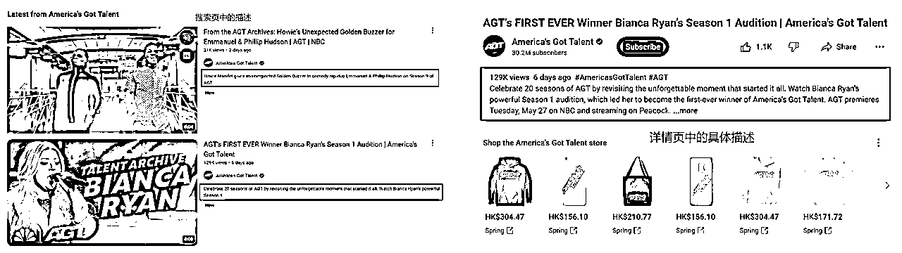

左图为简版描述，右图为详版描述。

多数优质视频前三行即可实现留人并点题。

拆解描述时应聚焦开头的几句用词。

可提示AI工具：

```
请分析YouTube视频描述中“描述部分"”中开头存在的核心关键词，请输出五个可拓展的二级核心关键词。
```

YouTube上传界面支持填写“描述”，输入#标签时会弹出推荐。

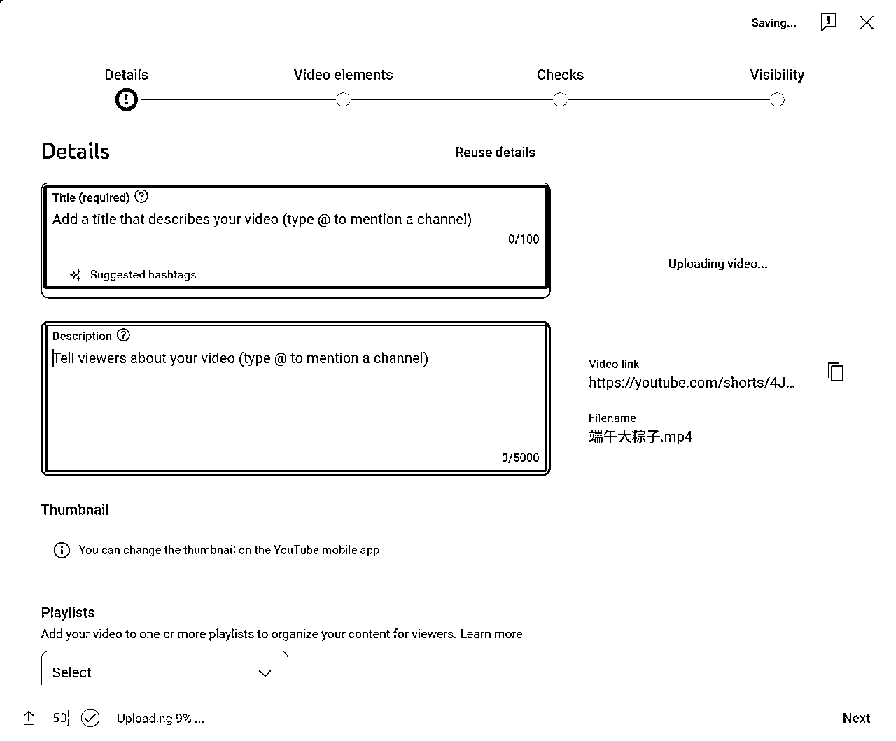

### 标签

YouTube标签通常以“#”开头，如“#animatedstories #meme #indiananimation”，“#”后为标签。可理解为符合条件的视频类别，与关键词相近，作用关键。

标签多出现在标题与描述中，也可直接在搜索栏使用标签检索。

重要且匹配度高的标签放前，按重要性递减排列。

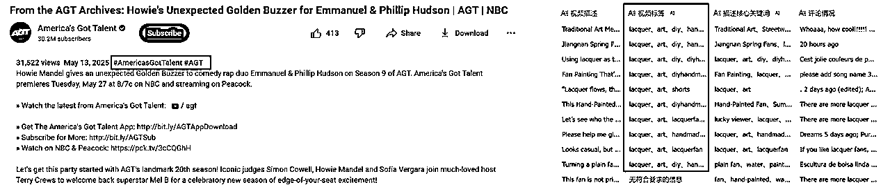

右图中，飞书多维表格模板里AI会自动提取描述与标题中的标签。

### 字幕

字幕功能对内容创作同样关键！


重点讲解——如何下载视频字幕文件？

提取字幕通常需与下载视频结合。

工具链接：https://yt.savetube.me/zh/29-youtube-video-downloader-5djdh6


提取字幕后，需对文本做爆款因子提炼。

从字幕中找出潜在爆款因子，需进一步分析文本。

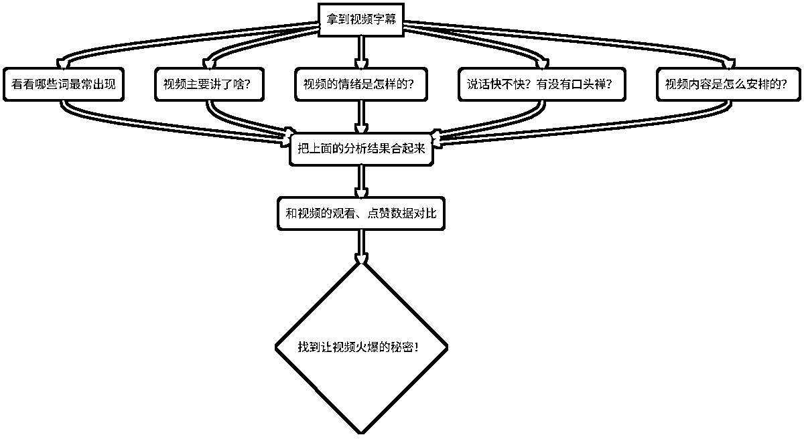

可告知Gemini、Deepseek以下提示词：

```
任务目标
请根据提供的YouTube视频字幕文本（含时间戳），分析并识别潜在的「爆款因子」，输出结构化洞察报告。
输入数据
字幕文本（含时间戳，若可用）
（可选）视频表现数据（观看量、互动量等）
分析步骤
1\. 关键词与主题提取
统计高频词/短语，按频率排序
关联当前流行趋势，标注潜在热门话题
（多视频对比时）区分爆款与非爆款的关键词差异
用NLP提取核心主题（1-3个）
2\. 情感与表达分析
判断整体情感倾向（积极/消极/中立）
标注显著情感片段（幽默、争议性、激动等）
识别促互动的表达特征（如口头禅、反问句）
（可选）结合时间戳分析语速与内容吸引力关联
3\. 内容结构解析
划分内容模块（引言/论点/案例/结论）
标注提升留存的结构特征（如悬念设置、节奏变化）
4\. 数据关联与因子提炼
（若有表现数据）计算字幕特征与观看/互动量的相关性
归纳高关联性「爆款因子」（如：特定关键词+幽默表达+悬念结构）
输出要求
关键词清单：Top 10高频词+频率
核心主题：简明概括（不超过3个）
情感分析：倾向比例+典型片段示例
结构特点：模块分布+亮点设计
爆款因子：按优先级列出，附具体解释

[请输入字幕文本内容]
```

### 评论

评论区常能看到网友围绕视频细节展开激烈讨论，说明视频触发了情绪，有情绪才有爆款可能。

通常从直播、Shorts、Videos的评论中感知真实需求。

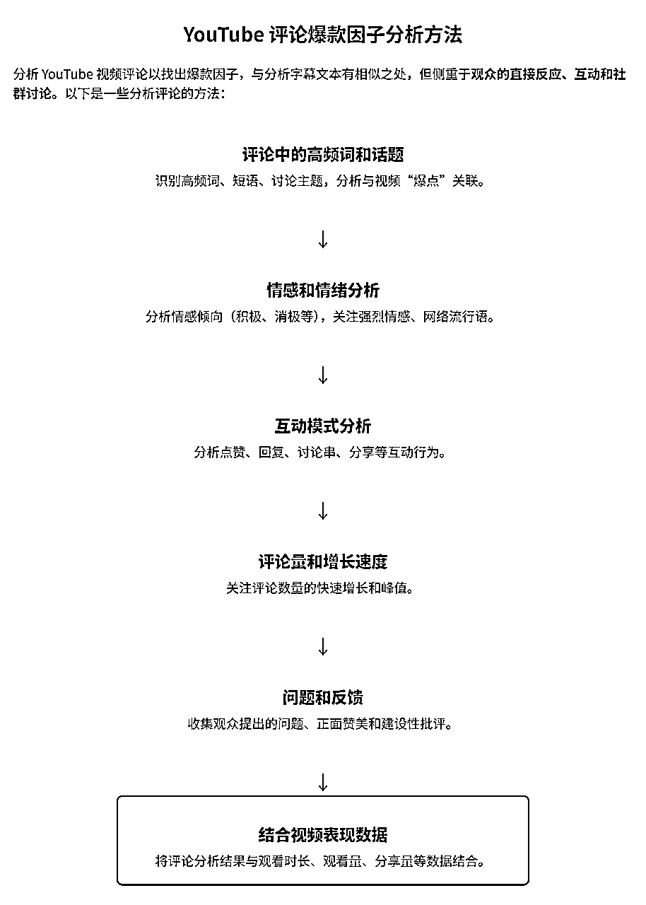

可将提示词发送给Gemini、Deepseek：

```
请对一个 YouTube 视频的评论区进行深度分析，目标是识别出促成该视频成为“爆款”的核心因子。分析应侧重于观众的直接反应、互动模式和社群讨论，并结合视频本身的表现数据。请按照以下步骤进行分析：

评论中的高频词和话题识别：
1.识别评论区中出现频率最高的词语、短语和讨论主题。
2.分析这些高频内容是否与视频的特定片段、内容高潮（“爆点”）或核心话题紧密相关。
3.探讨这些高频词和话题如何反映观众对视频内容的关注点和兴趣点。

情感和情绪分析：
1.分析评论的整体情感倾向（例如，积极、消极、中立）。
2.特别关注表达强烈情感（如惊喜、愤怒、欢乐）的评论，以及其中使用的网络流行语或感叹词。
3.评估观众的集体情绪如何影响评论区的氛围和互动。

互动模式分析：
1.分析评论的点赞量、回复数量以及由此形成的讨论串。
2.识别高互动率的评论或讨论串，分析其内容为何能引发大量互动。
3.观察观众之间的互动模式（例如，是观点交流、提问解答还是情绪表达）。

评论量和增长速度分析：
1.关注视频发布后评论数量的增长趋势，特别是是否存在评论量快速增长或出现峰值的时段。
2.分析评论量异常增长是否与视频发布、内容特点或外部事件有关。
3.讨论高评论量本身作为“爆款”因子的意义。

问题和反馈收集：
1.从评论中收集观众提出的问题、针对视频内容的正面赞美以及建设性的批评意见。
2.分析这些问题和反馈反映了观众的哪些需求、困惑或对视频的认可点/改进建议。
3.评估这些直接反馈如何体现观众的参与度和对视频质量的评价。

结合视频表现数据进行综合分析：
1.将以上评论分析的结果与该视频的其他表现数据（如观看时长、观看量、分享量、点赞/点踩比例、观众留存率等）相结合。
2.探讨评论分析的结果如何印证或补充视频表现数据所揭示的信息。
3.综合所有分析维度，最终提炼出该视频之所以成为“爆款”的核心评论区因子和观众互动模式。
4.请生成可视化的单网页的数据报告。

[请输入采集到的数据文件]
```

做 YouTube 账号，内容选品只是起点，真正拉开差距的是“观众点进来的理由”。与其凭感觉猜，不如用 AI 从三个层面把视频拆开：缩略图、抽帧画面、脚本结构。

### 一、先拆缩略图

缩略图决定了视频在信息流里的点击率。操作流程很简单：截下视频封面，发给能用视觉识别的 AI（Gemini 或同类多模态模型都行），让它从构图、人物情绪、文字信息、文化符号四个维度做体检。如果不想自己组织语言，可以直接复制下面的对话指令：

```
请分析这个youtube的封面图，重点分析： 
 1.请描述图片中的内容。 
 2.请分析图片中的爆款因素。 
 3.请输出能够复刻这个封面图的提示词（中英文）。
```

AI 的回复一般会给三层信息：图片要素清单、走红原因推测、以及可反向生成同款图的 prompt。下面这个案例就是一次典型的输出流程：

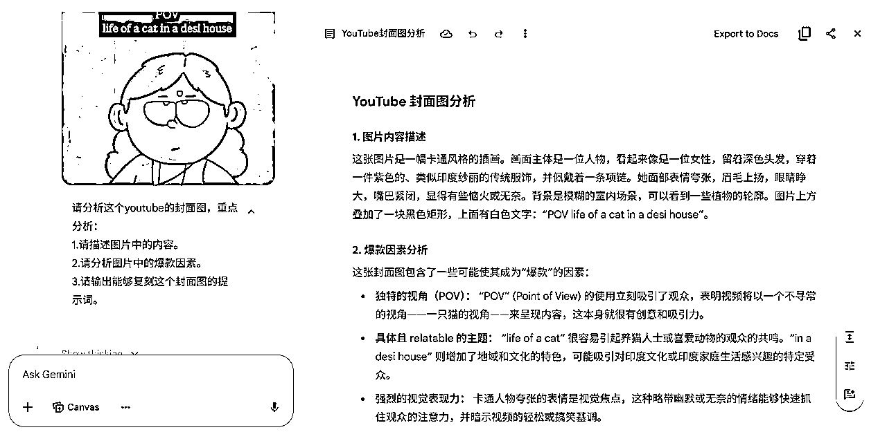

以一张实际缩略图为例：画面上是一位深色头发的女性，穿紫色纱丽，戴着一件项饰，眉梢高挑、嘴唇紧抿，整个人透着一股不耐烦；背景是虚化的绿植和室内光线，顶部还有一句英文标题，大意是“一只猫在南亚裔家庭里的日常视角”。AI 会提炼出这些爆款逻辑：

- 视角新颖：从猫咪的视角切入，天然勾起好奇心。
- 人群精确：宠物爱好者和对异国文化有兴趣的观众都会被吸引。
- 情绪表达直接：夸张的表情降低理解门槛，让人一眼知道内容基调。
- 构图干净：主体突出、文字简短，没有过多干扰。

如果需要复现同类缩略图，可以用一句接近下面意思的英文 prompt 交给图像生成模型：“Create a comic-style portrait of a dark-haired woman in a violet sari and a pendant. She has an exaggerated impatient look: big eyes, arched brows, pressed lips. The background is a soft-focus room with potted plants. Use bold black outlines, bright clean colors, and a playful tone.”

### 二、再拆抽帧画面

抽帧画面是视频的节奏切片。把它们批量抽出来，能快速判断一支视频的镜头是否丰富、信息密度是否合理。操作上，可以下载专用小工具，解压到本地文件夹后，千万不要移动或删除任何文件；直接双击运行，按需要选择抽取模式，也可以用统一命名规则整理输出文件。

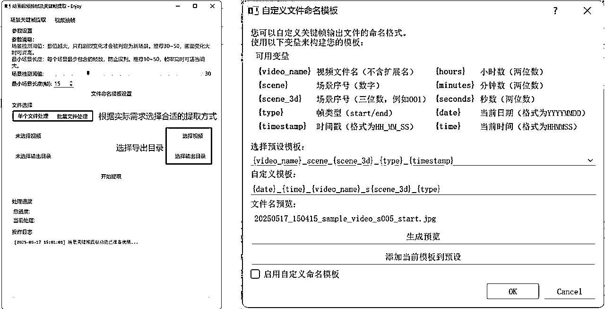

抽完帧之后，挑出最有代表性的 3~5 张，继续丢给 AI 看。

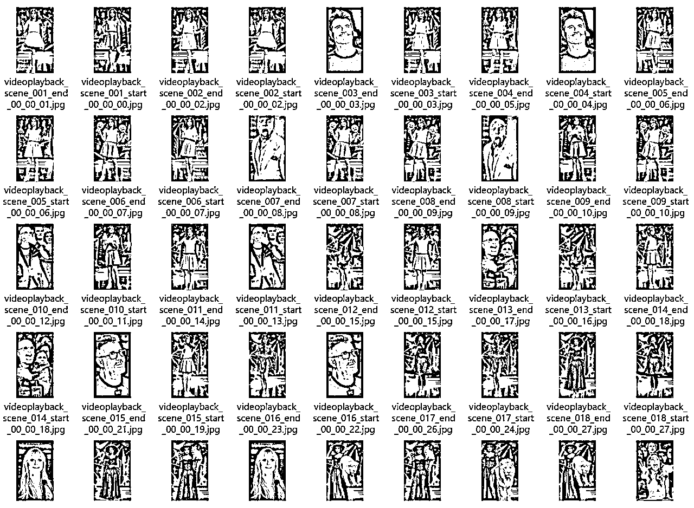

比较推荐使用 Gemini、豆包、GPT-4o 或 Midjourney 这类多模态工具，让它们做一次“镜头反推”，把画面语言翻译成文字描述。

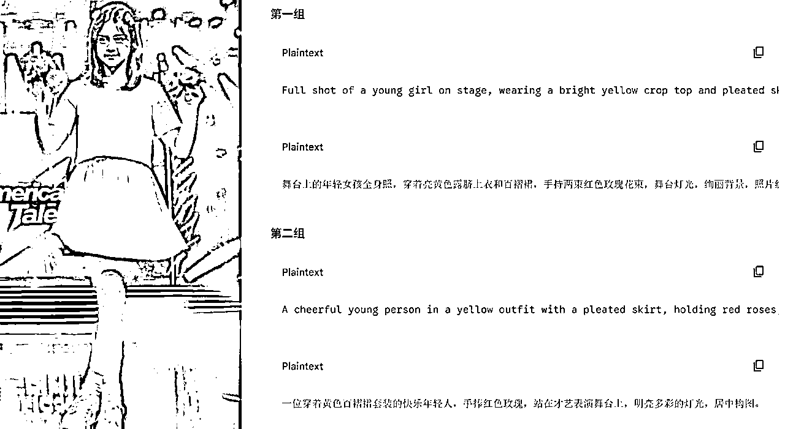

把图喂进去后，指令可以写成：

```
请你根据上传的图片，进行“图生文”，反推文生提示词，
重点关注关键元素、构图、材质、风格，适合使用Ai图像重新创建。
输出格式要求：每次输出三组提示词。 
 1.每组包含中文和英文。 
 2.提示词需简洁，符合文生图规则，能生成高质量图像。 
 3.英文提示词使用 txt 代码块。 
 4.中文提示词也使用 txt 代码块。
```

这样得到的文字描述，能直接用来复盘视频的运镜、转场、字幕排版和视觉风格。

### 三、最后看脚本结构

脚本决定了观众能不能看到最后。把视频地址贴进 Google AI Studio 的新建对话页，AI 会帮你拆出开场钩子、情绪节奏、反转点等信息。


可以优先让它做结构分析，下面这条指令可以直接参考：

```
任务目标 (Task Goal): 根据提供的视频内容，生成一份详细的拉片笔记。

输入 (Input): 请提供视频的内容信息。这可以是：
详细的镜头列表或脚本。
对视频内容的逐个镜头的详细描述。
输出格式 (Output Format): 输出将是一个包含以下列的表格，语言为中文：
| 镜头组 (Shot Group) | 镜号 (Shot Number) | 文生图描述词 (Text-to-Image Description) | 图转视频描述词 (Image-to-Video Description) | 剪辑建议 (Editing Suggestions) |

生成规则 (Generation Rules):
镜头组编织原则 (Shot Grouping Principles):
短镜头时长不超过 5 秒。
长镜头时长不超过 10 秒。
一个短镜头组包含不超过 2 个分镜。
一个长镜头组包含不超过 5 个分镜。
请在表格的“镜头组”列中标记镜头所属的组别。

文生图描述词原则 (Text-to-Image Description Principles):
画面内容: 使用连贯自然的语言描述画面核心内容（主体、行为、环境、道具等）。
画面美学: 使用简洁的短词语描述画面美学特征（风格、色彩、光影、构图等）。
关键帧: 描述该镜头起始关键帧（或最代表性帧）的主要画面元素。
示例: (一只白色的大胖猫，在躺椅上戴着墨镜，手拿酒杯躺着晒太阳，身上盖着浴巾，背景是大海。) (夏日，悠闲，趣味，特写)

图转视频描述词原则 (Image-to-Video Description Principles):
包含以下要素：时长、景别、运镜、画面动态或关键描述。
景别: 使用标准术语，如：远景、全景、中景、近景、特写、大特写等。
运镜: 使用标准术语，如：推、拉、摇、移、跟拍、升、降、旋转等。
示例: (3s，中景，人物缓慢向右移动，镜头平移跟拍，画面充满动感) 或 (5s，特写，镜头缓慢向前推进，展现紧张气氛，景深变化)

剪辑建议原则 (Editing Suggestions Principles):
识别和描述该镜头或镜头组中主要的背景音乐 (BGM)。
识别和描述重要的音效 (Sound Effects)。
可以包含转场建议、节奏建议等。

示例 (Examples):
文生图描述词示例: (一只白色的大胖猫，在躺椅上戴着墨镜，手拿酒杯躺着晒太阳，身上盖着浴巾，背景是大海。) (夏日，悠闲，趣味，特写)
图转视频描述词示例 (或镜头分镜描述示例): (3s，夜晚，云雾笼罩的古寺前，黑衣侠客与白衣侠客面对面抱拳站立，背后破损的屋檐挂着晃动的铜铃。镜头缓慢向前推进，展现紧张气氛。)
单镜头详细描述示例 (可用于填充 文生图/图转视频 描述):
镜头1 (5s)：面部特写，展现男子深邃的眼神和自信微笑。暖光打在脸部轮廓上，背景虚化。画面具有艺术感。 (结合了文生图和图转视频的要素)
镜头2 (2s)：聚焦镜头缓慢推进男子抬起的手腕。手表在光影中闪耀，细节清晰展现成功人士品味。
镜头3 (2s)：侧面拍摄，光影在脸上和背景墙上形成鲜明对比。人物轮廓分明，充满高级感和张力。
```

我用一条 Shorts 做测试，把素材里那条经典视频地址粘贴进去之后：


Gemini 会生成一份包含“开头—冲突—反转—引导关注”的脚本拆解，方便你对照学习：


---

### 实战：拿一个频道练手

光看不练很难转化成手感。下面用某个垂直频道做完整拆解。

**先看频道整体**

进入频道后，先把 Video 和 Shorts 两个 Tab 都刷一遍，重点不是数据，而是“第一眼感受”。可以按这些问题观察：

- 缩略图有没有统一视觉风格？
- 色调偏暖还是偏冷？
- 情绪是夸张、平静，还是悬念？
- 每张图有没有“故事未完”的感觉？
- 文字是辅助还是累赘？

记得用直觉判断，不要反复纠结。

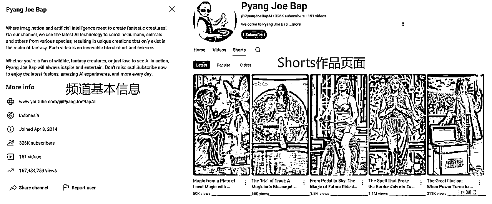

**再看第三方数据**

到 Viewstats 这类数据站，输入频道名，就能看到播放趋势、互动率、热门视频分布等关键指标。


把频道总览截图和单条视频的曲线图都交给 Gemini，打开 Canvas 画布模式后，AI 会结合图表做更细致的解读，比如哪个区间的流失最明显、哪类标题风格更抓人。

```
请基于上传的YouTube频道的ViewStats截图数据，执行以下任务：

生成一份单页HTML《[频道名称]视频数据分析报告》。

**报告基本要求：**

* **报告语言**： 中文。
* **整体风格**： 专业、数据驱动、分析性强。
* **数据来源**： 严格基于所提供的截图数据进行分析，不涉及内容主题分析。

**报告核心内容：**

1\.  **频道概览**：
    * 清晰展示总订阅数、总观看次数、视频总数等核心整体数据。

2\.  **近期表现（例如过去28天）**：
    * 详细列出并分析近期的观看次数（及其与上一周期的对比，如“+100%”）。
    * 详细列出并分析订阅数变化（包括净增长和与上一周期的对比，如“较上个周期新增订阅减少XX”）。
    * 展示预估收入。
    * 分析不同内容格式（如Shorts vs 长视频）的观看表现。

3\.  **数据趋势可视化**：
    * 使用条形图展示每日观看次数变化（基于截图中的每日数据）。
    * 使用折线图展示每日订阅总数变化趋势。
    * 使用条形图展示每日新增订阅数。
    * **图表布局与样式补充要求：**
        * **响应式布局**：在小屏幕（如手机）上，图表应单列堆叠显示。在中等屏幕（如平板电脑）及更大屏幕（如桌面电脑）上，图表应以**两列网格**的形式展示，每行最多容纳两个图表。
        * **图表高宽比**：为避免图表显得过高或过窄，请确保图表的**宽度约为其高度的2至2.5倍**。可以参考 `image_6c4264.png` 中图表的视觉比例。
        * **图表容器**：每个图表应放置在一个带有浅灰色边框和圆角的容器内，容器内部应有适当的内边距。
    * 确保所有图表清晰易懂，包含标题、坐标轴标签，并且图表内的文字（如图例、坐标轴数值）也为纯黑色。

4\.  **核心指标分析**：
    * 计算并解读“平均每视频观看次数”，并指出可能的影响因素（如爆款Shorts）。
    * 计算并解读“观看-订阅转化效率”（例如，每多少次观看带来一个新订阅），并评估其效率。
    * 分析“内容格式表现”，明确指出哪种格式是主要流量来源。
    * 解读“近期增长趋势”，包括观看次数和订阅数的增长势头，并点出任何增长速率的变化或潜在波动。
    * 分析“最新视频表现”（如果数据中包含此类信息，如“近期10个视频中的排名”）。

5\.  **对标建议（数据角度）**：
    * 提供选择对标频道时应考虑的具体数据维度，例如：相似的订阅者规模范围、总观看量级范围、视频数量范围、主要内容格式（强调Shorts对标的重要性）、以及相似的增长率指标。

6\.  **总结与数据驱动的建议**：
    * 对频道当前数据状况进行简明扼要的总结。
    * 提出具体、可操作的数据驱动建议，例如：如何根据数据优化Shorts策略、如何应对订阅增长波动、是否以及如何谨慎探索其他内容格式（如长视频）、如何监控和应对每日数据波动、如何提升新视频表现稳定性等。

**报告格式与功能：**

* **单页HTML**：所有内容整合在一个HTML文件中。
* **纯黑色字体**：报告中的所有主要文本内容（标题、段落、列表项等）均使用纯黑色字体。允许使用语义化颜色（如绿色表示增长，红色表示下降）来突出显示特定数据点。
* **重点内容加粗**：报告中的关键数据、核心发现、重要结论和建议等，请使用粗体进行强调。
* **下载功能**：在页面显著位置提供一个“下载报告 (PNG)”的按钮，点击后可以将整个报告内容（包括图表）下载为一张PNG图片。
* **响应式设计**：确保报告在桌面和移动设备上均有良好的阅读体验。
* **CSS框架**：优先使用Tailwind CSS进行样式设计。
* **图表库**：使用Chart.js生成图表。
* **图片下载库**：使用html2canvas.js实现下载报告为PNG的功能。
```

从这些分析中，可以提炼出几项明确结论，作为后续选题和优化的依据：

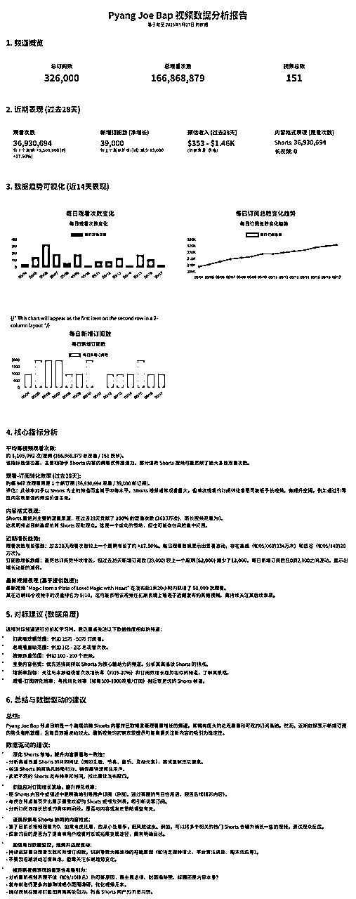

**最后拆单条视频**

如果需要精确到单条视频，可以用影刀的 RPA 流程去采集 Shorts 的标题、简介和留言区讨论内容。在客户端里运行“只跑一次”的采集任务，结果会自动同步到飞书在线表格。


后续处理有两种路线：一是把表格里的字段直接暴露给 AI，让 AI 做评论关键词归纳；二是将数据导出为 CSV 文件，在外面进一步分析。普通玩法直接调用 AI 读表：

```
我给你提供视频标题中的关键词、描述中的关键词、评论区中的需求、视频标签，请帮我分析，输出对标建议。
```

更深度的分析，可以用 Cursor 这类编程工具写脚本跑批量统计，适合需要长期跟踪竞品的人。

```
将数据excel表格投喂给cursor：

角色： 数据分析师与可视化报告生成器
任务：
 基于提供的 YouTube Shorts CSV 数据文件进行深入分析，生成数据洞察报告，提出优化建议以提升流量。将报告以美观、响应式的单网页形式呈现，支持 PNG 下载。
预处理与数据清洗：
 在分析前对CSV数据进行专业的数据清洗：
处理编码问题，尤其是中文和特殊字符；
处理缺失值、异常值和重复数据；
统一数据格式（数字、日期、文本等）；
规范化文本字段，如标签和关键词；
创建派生变量（如互动率 = 点赞数/观看量）；
记录清洗过程和结果。
输入数据：
数据源： CSV 文件，单位为“次”；
CSV 字段：
作者信息
数据采集时间
视频标题
视频标签 (核心分析字段)
标题中的核心关键词 (核心分析字段)
频道类型
频道链接
点赞数 (互动数据)
观看量 (观看量数据)
评论数 (互动数据)
视频描述
描述核心关键词 (核心分析字段)
评论情况
评论区需求提取 (核心分析字段)
核心分析要求：
数据关联分析：
分析 视频标签 与 观看量、点赞数、评论数 之间的关系，识别高效和低效标签；
分析 标题中的核心关键词 与 观看量、点赞数、评论数 之间的关系；
分析 描述核心关键词 与 观看量、点赞数、评论数 之间的关系；
分析 评论区需求提取 与观看量和互动数据的潜在关联。
模式识别：
找出高表现视频的共同特征，特别是在标签、标题和描述字段中的关联；
识别低表现视频中的缺陷或问题，并与高表现视频进行对比。
量化分析框架：
关键词效能量化：
关键词效能指数(KEI) = (平均观看量 × 0.6) + (平均点赞数 × 0.3) + (平均评论数 × 0.1)；
关键词位置影响系数(KPI) = 标题前10字符出现时的平均观看量 ÷ 标题后半部分出现时的平均观看量；
关键词组合效应(KCE) = 关键词组合出现时的平均观看量 ÷ 关键词单独出现时的平均观看量；
提供TOP 20高效关键词及其KEI值。
标签效果量化：
标签效能指数(TEI) = (平均观看量 × 0.5) + (平均互动率 × 0.5)，其中互动率 = (点赞数 + 评论数) ÷ 观看量；
标签组合效应(TCE) = 特定标签组合的平均观看量 ÷ 整体平均观看量；
标签饱和度影响(TSI) = 不同标签数量的视频观看量对比；
提供TOP 15高效标签及其TEI值。
标题结构效果评估：
标题结构指数(TSI) = 按结构类型分类的平均观看量；
标题长度影响(TLI) = 不同标题长度区间的观看量与完播率对比；
表情符号影响系数(ESI) = 含表情符号标题的平均观看量 ÷ 不含表情符号标题的平均观看量；
列出TOP 5最佳标题结构模板。
描述结构效果评估：
描述结构效能(DSE) = 按描述模式分类的平均互动率；
描述-标题一致性(DTI) = 描述与标题关键词一致性高的视频的观看量 ÷ 一致性低的视频的观看量；
描述长度影响(DLI) = 不同描述长度的互动率对比；
提供TOP 3最佳描述结构模板。
受众群体分析：
内容类型偏好指数(CPI) = 特定内容类型的平均观看量 ÷ 整体平均观看量；
受众互动倾向(AEP) = 特定内容类型的互动率 ÷ 平均互动率；
受众忠诚度指标(ALI) = 频道多个视频的观看量一致性；
提供TOP 5受众最喜爱内容类型。
综合效果评分系统：
视频综合效能分数(VEPS) = (观看量得分 × 0.4) + (互动率得分 × 0.3) + (完播率得分 × 0.3)；
所有得分均使用0-100标准化计分，100代表最大值；
提供视频效能分级：S级(90-100)、A级(75-89)、B级(60-74)、C级(40-59)、D级(<40)。
对标建议：
基于量化分析，提供优化建议：
推荐高效 视频标签 组合；
提供吸引流量的 视频标题 关键词策略和结构模板；
优化 视频描述；
根据 评论区需求提取 调整内容方向。
输出要求 (内容版报告)：
洞察总结：
 总结关键发现，提供具体数据支持每个结论。
对标建议：
 列出优化建议，明确数据支持和操作步骤。
数据支撑：
 报告中的每个结论和建议需有明确的数据支持。
输出要求 (可视化单网页)：
技术栈： HTML, CSS, JavaScript；
布局设计：
两列对齐布局，最多每行两个图表；
确保图表与表格对齐，并支持单列自适应布局；
内容呈现：
直观展示标签、关键词与观看量/互动数据关系；
展示关键量化指标的排名和对比图表；
UI/UX设计：
响应式设计，兼容桌面、平板、手机；
界面简洁、专业、美观，突出重点内容；
功能性：
提供PNG下载按钮。
示例强调样式：
"cute"关键词KEI值为87.3，使用可提升观看量42%
标签组合"#shorts + #funny + #cute"的TCE值为2.4，预期推荐量提升140%
超过8个标签的视频TSI值降低0.76，推荐量减少18%
最终交付：
 包含上述可视化报告的HTML文件代码，并提供可操作的建议。

```

上面这部分阶段性产出，已经足以说明：标签筛选的自动化流程达到了理想状态。

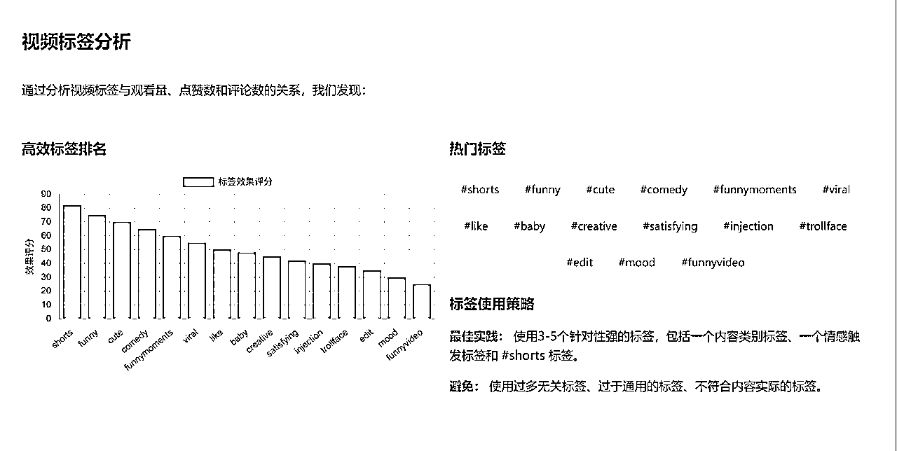

再往下走，进入第三个阶段：从信息结果里挑出值得借鉴的影片，接着拆解它的叙事结构。

前往 Google AI Studio：https://aistudio.google.com/prompts/new_chat ，将油管影片的地址粘贴进去。

务必注意：一次会话里，只能放入一条油管影片地址。

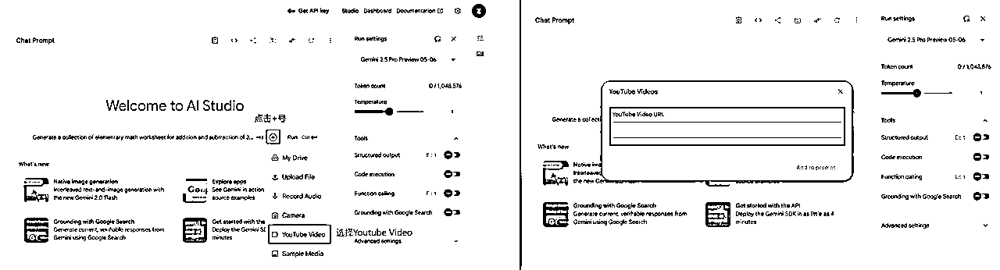

要拆解影片文案，可以把下面这段指令当作参照：

```
任务目标 (Task Goal): 根据提供的视频内容详细描述，生成一份结构化的拉片笔记。
核心要求 (Core Requirements):
输入质量: 输出的详细程度和准确性直接取决于输入描述的质量。请确保提供的逐镜头描述包含足够的视觉、听觉和动态信息。
输出语言: 表格中的“文生图描述词”和“图转视频描述词”列需要提供中英文双语内容。其他所有列（镜头组、镜号、剪辑建议）及表格外的说明均为中文。
输入 (Input): 请提供对视频内容的逐个镜头的详细文字描述。每个镜头的描述应包含但不限于：
视觉元素: 核心主体、人物行为、表情、服装、道具、环境、背景、光影、色彩、构图等。
动态信息: 镜头的起止画面，主体或摄像机的显著运动方式。
时长信息: 每个镜头的预估或实际时长（秒）。
(可选) 音频线索: 对话、主要背景音乐风格、关键音效（如果已知并重要）。
输出格式 (Output Format): 输出将是一个包含以下列的表格。AI将为每个镜头顺序编号填入“镜号”列 (例如: S001, S002)。
镜头组 (Shot Group)镜号 (Shot No.)文生图描述词 (Text-to-Image Descriptors)图转视频描述词 (Image-to-Video Descriptors)剪辑建议 (Editing Suggestions)
Export to Sheets
生成规则 (Generation Rules):
镜头组编织原则 (Shot Grouping Principles):
镜头将按顺序分组。AI将根据镜头的数量和一定的逻辑连贯性（如果可从输入中推断）进行分组。
短镜头组 (Short Shot Group): 通常包含 1-2 个连续分镜。
长镜头组 (Long Shot Group): 通常包含 3-5 个连续分镜。
AI将在“镜头组”列中标注组号 (例如: G1, G2) 和组类型及包含的镜数 (例如: 短镜头组-2镜, 长镜头组-4镜)。
单个分镜的时长参考：短镜头 (Short Shot) ≤ 5秒；长镜头 (Long Shot) ≤ 10秒。此为参考，分组优先考虑镜数。
文生图描述词原则 (Text-to-Image Descriptors):
目标: 描述该镜头**起始关键帧（或最具代表性的一帧）**的静态画面。
内容要求: 提供中文和对应的英文翻译。
画面内容 (Visual Content): 使用连贯自然的语言描述画面的核心内容（主体、行为、环境、道具等）。
画面美学 (Visual Aesthetics): 使用简洁的短词语/标签描述画面的美学特征（如：视觉风格、色彩基调、光影特点、构图方式等）。
中英文示例:
中文 (Chinese): 
画面内容: 一只白色的大胖猫，在躺椅上戴着墨镜，手拿酒杯躺着晒太阳，身上盖着浴巾，背景是大海。
画面美学: 夏日，悠闲，趣味，明亮色彩，特写构图。
英文 (English): 
Visual Content: A large, fat white cat, wearing sunglasses and holding a wine glass, is sunbathing on a lounge chair, covered with a bath towel, with the sea in the background.
Visual Aesthetics: Summer, Leisurely, Fun, Bright Colors, Close-up Composition.
图转视频描述词原则 (Image-to-Video Descriptors):
目标: 描述整个镜头的动态特征。
内容要求: 提供中文和对应的英文翻译。包含以下要素，并确保每个要素都有中英文对照： 
时长 (Duration): 镜头的秒数。中文示例: 3秒；英文示例: 3s。
景别 (Shot Size): 标准术语。 
中文: 远景, 全景, 中景, 近景, 特写, 大特写。
英文: Extreme Long Shot (ELS), Long Shot (LS), Medium Shot (MS), Medium Close-up (MCU), Close-up (CU), Extreme Close-up (ECU).
运镜 (Camera Movement): 标准术语。 
中文: 推, 拉, 摇 (左右), 移 (左右/横移), 跟拍, 升, 降, 旋转, 晃动, 固定镜头。
英文: Push In, Pull Out, Pan (Left/Right), Tilt (Up/Down), Dolly/Track (Left/Right/Horizontal), Follow Shot, Crane Up/Jib Up, Crane Down/Jib Down, Rotate, Shaky Cam, Static Shot.
画面动态或关键描述 (Visual Dynamics or Key Description): 描述画面中的主要运动或变化，或整体给人的动态感受。
中英文示例:
中文 (Chinese): (3秒，中景，人物缓慢向右移动，镜头平移跟拍，画面充满动感)
英文 (English): (3s, Medium Shot (MS), character moves slowly to the right, camera pans to follow, dynamic scene)
或者:
中文 (Chinese): (5秒，特写，镜头缓慢向前推进至眼部，展现紧张气氛，景深由深变浅)
英文 (English): (5s, Close-up (CU), camera slowly pushes in to the eyes, creating a tense atmosphere, depth of field changes from deep to shallow)
剪辑建议原则 (Editing Suggestions Principles):
内容要求: 中文。
识别和描述该镜头或镜头组中主要的**背景音乐 (BGM)**风格或具体曲目（如果信息充分）。
识别和描述重要的音效 (Sound Effects)。
可以包含转场建议 (例如：淡入淡出、切割、叠化)、节奏建议 (例如：此处节奏加快、配合音乐鼓点剪辑)等。
输入内容示例 (Illustrative Input for a Single Shot):
"镜头1：时长约4秒。画面开始是一个戴着兜帽的神秘男子在雨夜小巷的远景，他低着头快步向前走。镜头缓慢向前推进，同时轻微向上抬升，逐渐变成男子的中近景，可以看见他坚毅的下巴和紧抿的嘴唇，雨水打湿了他的兜帽边缘。背景音乐是低沉的弦乐，有持续的雨声音效和远处模糊的警笛声。"
(AI将基于此类输入，填充表格中的一行)
修改说明:
强调输入质量: 开头补充了对输入信息详细度的要求。
明确双语范围: 清晰指出“文生图描述词”和“图转视频描述词”需要中英双语，其他部分为中文。
输入内容指导: 更具体地列出了输入描述应包含的元素。
镜号生成: 明确AI会自动生成镜号。
镜头组逻辑细化: 稍微调整了分组原则的描述，使其更侧重于镜头的数量，并将时长作为参考。增加了组类型和镜数的标注。
文生图描述词双语示例: 提供了完整的画面内容和画面美学的中英文对照。
图转视频描述词双语示例和术语: 提供了更详细的中英文术语对照表（景别、运镜），并确保示例中每个元素都有中英对应。
剪辑建议语言: 明确为中文。
输入示例: 提供了一个更符合要求的输入镜头描述示例，以帮助理解AI所需的信息。

任务目标 (Task Goal): 根据提供的视频内容，生成一份详细的拉片笔记。

输入 (Input): 请提供视频的内容信息。这可以是：
详细的镜头列表或脚本。
对视频内容的逐个镜头的详细描述。
输出格式 (Output Format): 输出将是一个包含以下列的表格，描述词为中英文，其他语言为中文：
| 镜头组| 镜号| 文生图描述词| 图转视频描述词  | 剪辑建议|

生成规则 (Generation Rules):
镜头组编织原则 (Shot Grouping Principles):
短镜头时长不超过 5 秒。
长镜头时长不超过 10 秒。
一个短镜头组包含不超过 2 个分镜。
一个长镜头组包含不超过 5 个分镜。
请在表格的“镜头组”列中标记镜头所属的组别。

文生图描述词原则 (Text-to-Image Description Principles):
画面内容: 使用连贯自然的语言描述画面核心内容（主体、行为、环境、道具等）。
画面美学: 使用简洁的短词语描述画面美学特征（风格、色彩、光影、构图等）。
关键帧: 描述该镜头起始关键帧（或最代表性帧）的主要画面元素。
示例: (一只白色的大胖猫，在躺椅上戴着墨镜，手拿酒杯躺着晒太阳，身上盖着浴巾，背景是大海。) (夏日，悠闲，趣味，特写)

图转视频描述词原则 (Image-to-Video Description Principles):
包含以下要素：时长、景别、运镜、画面动态或关键描述。
景别: 使用标准术语，如：远景、全景、中景、近景、特写、大特写等。
运镜: 使用标准术语，如：推、拉、摇、移、跟拍、升、降、旋转等。
示例: (3s，中景，人物缓慢向右移动，镜头平移跟拍，画面充满动感) 或 (5s，特写，镜头缓慢向前推进，展现紧张气氛，景深变化)

剪辑建议原则 (Editing Suggestions Principles):
识别和描述该镜头或镜头组中主要的背景音乐 (BGM)。
识别和描述重要的音效 (Sound Effects)。
可以包含转场建议、节奏建议等。

示例 (Examples):
文生图描述词示例: (一只白色的大胖猫，在躺椅上戴着墨镜，手拿酒杯躺着晒太阳，身上盖着浴巾，背景是大海。) (夏日，悠闲，趣味，特写)
图转视频描述词示例 (或镜头分镜描述示例): (3s，夜晚，云雾笼罩的古寺前，黑衣侠客与白衣侠客面对面抱拳站立，背后破损的屋檐挂着晃动的铜铃。镜头缓慢向前推进，展现紧张气氛。)
单镜头详细描述示例 (可用于填充 文生图/图转视频 描述):
镜头1 (5s)：面部特写，展现男子深邃的眼神和自信微笑。暖光打在脸部轮廓上，背景虚化。画面具有艺术感。 (结合了文生图和图转视频的要素)
镜头2 (2s)：聚焦镜头缓慢推进男子抬起的手腕。手表在光影中闪耀，细节清晰展现成功人士品味。
镜头3 (2s)：侧面拍摄，光影在脸上和背景墙上形成鲜明对比。人物轮廓分明，充满高级感和张力。
```

### 画面素材获取

使用油管下载工具：https://yt.savetube.me/zh/29-youtube-video-downloader-5djdh6

将影片下载到本地后，开始抓取画面样本。

优先抓取两处：一是封面头图，二是画面切换幅度较大的瞬间。


以下是抓取到的头图与关键画面样例：


随后把这些图片投给 Gemini 做逆向解析（即让 AI 根据图片反推文字），例如用 Gemini 进行如下处理：

```
请你根据上传的图片，进行“图生文”，反推文生提示词，
重点关注关键元素、构图、材质、风格，适合使用Ai图像重新创建。
输出格式要求：每次输出三组提示词。 
 1.每组包含中文和英文。 
 2.提示词需简洁，符合文生图规则，能生成高质量图像。 
 3.英文提示词使用 txt 代码块。 
 4.中文提示词也使用 txt 代码块。
```

### 扩展标签池

在我看来，所谓“参照”，就是站在优秀作品的肩膀上继续做加法，目标永远是“模仿标杆，并尽力超越标杆”。

前面我们轻松收集到了这个账号下栏目、影片和画面各自携带的标签。现在则需要把这些标签向外发散，去寻找更广阔的爆款机会。

比如，下面展示的是以 funny 为抓取标签，来聚合同类影片的做法：


首先，进入油管单标签聚合工具：https://api.winrobot360.com/redirect/robot/share?inviteKey=091f8553acd05054

接着，启动程序，输入想抓取的标签，再按“开始执行”。

跑完之后，你能拿到这些项目：片名、影片ID、播放地址、内容类别、片长（秒）、账号名、账号主页、播放量、发布日期、内容简介、点赞量、留言数、配乐情况，以及平台自动给出的相关检索词。


除此之外，还能借助油管平台自动推荐的相关词，产出更多新标签。

做短视频项目，关键词拓展是第一步。想高效获取更多关键词，可以借助采集拓展工具来批量抓取。下载安装后，把关键词文件路径填进去就行。通常我们习惯从A2单元格开始，按顺序往下存放关键词。

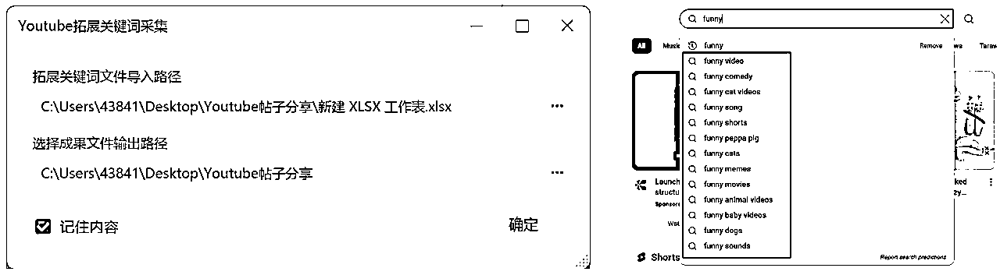

上面提到的这两个工具，核心目的都是帮我们打开关键词思路，让选题和素材搜集更省力。

# 一个完整的实操演示

接下来，我会用前面介绍的部分工具，对一个优秀对标频道@PyangJoeBapAI 进行拆解模仿。这个频道来源于@困困教练（ ），下面是我自己整理的完整工作流。

## 文生图：从脚本分析到画面生成

在上一章我们已经学会了用 Google Studio 分析视频脚本。现在以这个视频为例：https://www.youtube.com/shorts/hSNT_dZoWiA

第一步：把视频链接丢给 Google Studio，让它自动提取脚本。分析结果如下：

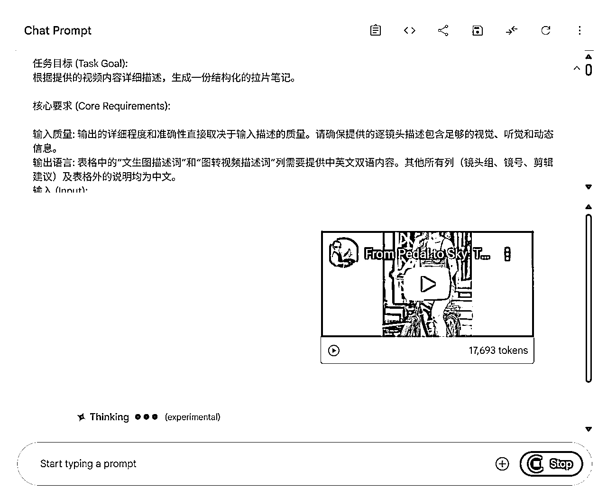

视频拉片笔记

- 背景音乐：整条视频以快节奏电子舞曲为主线，穿插人声采样，比如 “Open the screen”“1, 2, 3, let's go!”“Clap your hands”“Get funky with it”“Let's go to work”“DJ Pongs in the mix”。到了S020-S021处，音乐出现小变化，加入一段女声 “Look at me baby”。
- 音效：有自行车轻微声响（但不突出）、火焰燃烧声、魔法变身音效、摩托车引擎轰鸣、烟雾喷射声、无人机螺旋桨声，以及观众的欢呼和惊叹声。
- 整体节奏：很快，充满反转和惊喜，靠快速剪辑与特效制造视觉冲击。

第二步：拿第一个镜头举例，整理提示词，做一次“文生图”演示。

```
Visual Content: A young woman, wearing a blue sequined camisole top and yellow shorts, with white sneakers, smiling as she rides a black bicycle onto the stage from the right, with a brightly lit studio and reflective floor in the background.Visual Aesthetics: Stage Performance, Energetic, Youthful Fashion, Bright Lighting, Symmetrical Composition.
```

- 方法1：用即梦Ai生成

1. 选即梦3.0模型；
2. 图片比例设为9:16；
3. 根据自己账号情况选清晰度。


即梦无水印下载工具，安装引导：
打开即梦缩略图，点右上角的“红色电话键”，就能把无水印图片保存下来。


- 方法2：用豆包生成

1. 风格选“人物摄影”；
2. 图片比例同样设9:16。


- 方法3：用Midjourney官网生成

1. 模型推荐7.0版；
2. 6.1版支持角色控制和环境参考。


对比即梦3.0、豆包3.0、Midjourney 7.0这三个模型，前两个生成的人物更偏亚洲脸，后一个更偏欧美脸。选哪个，可以看对标账号的粉丝画像：

1. 欧美人物：适合欧美地区粉丝；
2. 亚洲人物：适合亚非拉地区粉丝。

因为我选的@PyangJoeBapAI 频道属于欧美区，从评论语言也能看出粉丝大多是英语用户。所以我的选择是“欧美人物形象”。在Midjourney生成的结果里挑最合适的一张，判断标准是：
- 动作尽量接近原视频；
- 背景尽量接近原视频；
- 风格尽量接近原视频。

然后用深度编辑功能，对基本参数、角色、背景做微调。

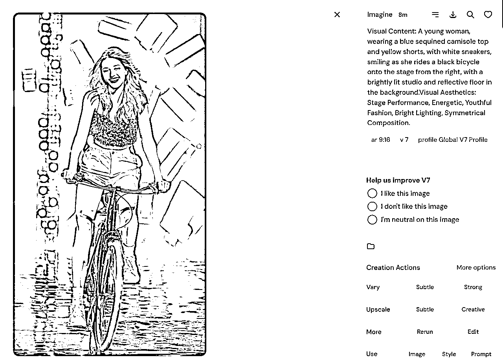

正常做可控视频时，需要首尾帧来控制画面，所以我们还要再生成一张风格、人物、动作都相近的图片作为尾帧。在本文中，我又生成了一张尾帧。

```
Visual Content: The young woman stops her bicycle in the center of the stage, angles it towards the audience, one foot on the ground, her expression changes from smiling to serious, looking directly at the camera.
Visual Aesthetics: Stage Freeze, Focused, Fashionable, Central Composition.
```

按照下面这些参数设置（即梦Ai），可以控制首尾帧的一致性：
Ai生成的图只能当参考，通常要反复改几次才基本能用。

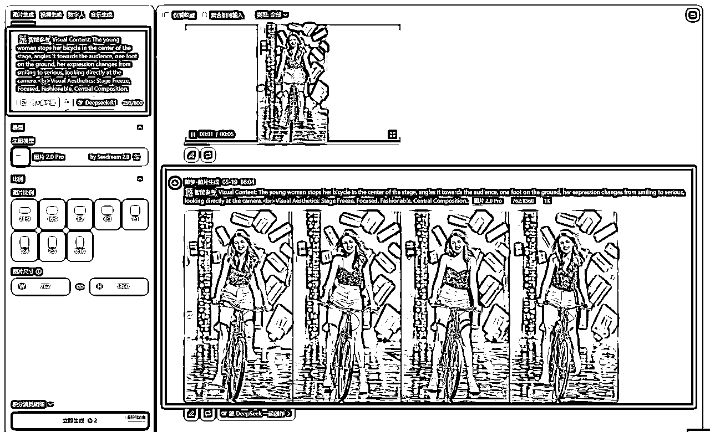

两次生成的图放在一起看，左图是首帧，右图是尾帧，能明显看出几个差异：
1. 角色脸部颜色前后不一样；
2. 自行车车铃的位置和款式前后不一致。


这时可以用即梦的“局部重绘”功能，把差异的地方单独修一下。

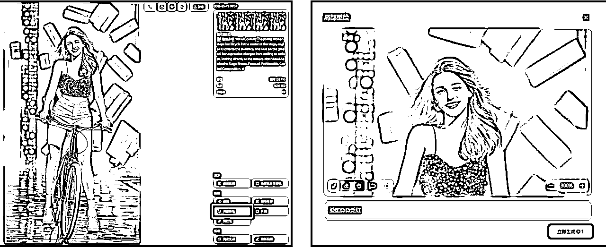

重绘完再检查一遍，看要不要继续调。

从下面这张对比图能看出来，首尾帧的差别已经小了很多，基本可以拿去做视频了。


特别注意：
1. 到这一步，文件命名和分类一定要做好，源文件别乱删。
2. 想删的源文件，先统一丢进“待删除”文件夹里。

## 图生视频：让静态图动起来

用Google Studio分析完对标视频脚本后，我们把每个镜头对应的图生视频提示词也整理好。以第一个镜头为例：

```
中文: (3秒，中景，固定镜头，但主体从右向左移动，女子骑自行车进入画面中央，面带笑容)
English: (3s, Medium Shot (MS), static camera but subject moves from right to left, woman rides bicycle into the center of the frame, smiling)
```

方法1：用即梦的“图生视频”功能，导入关键帧，输入提示词。


方法2：用可灵Ai做首尾帧生成，把首尾帧传上去，再输入提示词。

- 推荐用付费模型，效果更稳定。


## 音乐复刻：提取和再创作

把下载好的对标视频放进剪映，直接提取音频。

- 导出mp3格式，存到本地对应文件夹；
- 提取的音频可以直接用，但要注意修改片段避免照搬；
- 也可以用Suno来二次创作：https://suno.com/create

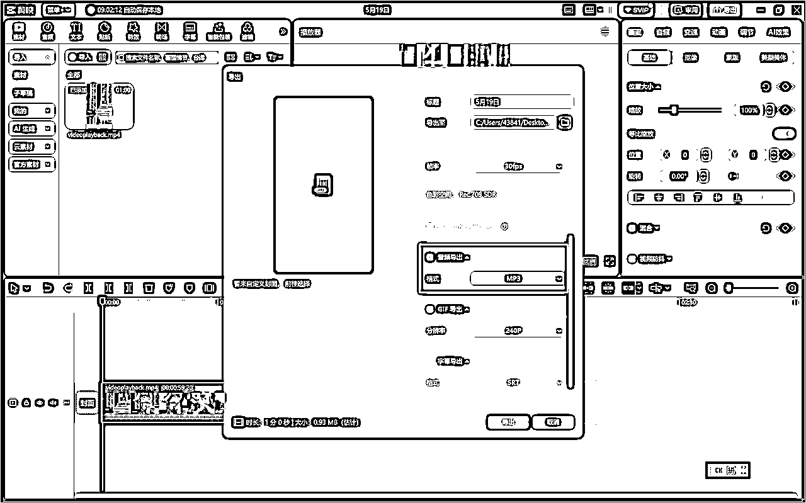

## 截取片段：达人秀素材准备

提前准备好达人秀评委相关的页面文件夹，可以放在剪映草稿箱里。

- 导入达人秀视频，用智能镜头分割功能；
- 右键片段，选“另存为预设”。


## 合成视频：最后一步

把生成好的视频片段和达人秀片段全部导入剪映，同时插入音乐。导出时格式最低要求：

- mp4视频格式；
- H.264编码；
- 帧率60帧。


# 从其他平台找灵感

做项目时，原始文件和修改后的成品都要好好保存，方便后面查数据、找素材。

我常用的对标库是飞书多维表格里的知识库形式：


除了上面提到的Youtube项目对标素材，其他平台的优质内容也可以采集起来，建立自己的素材库。

## 小红书帖子素材

小红书是国内很能种草的平台，数据表现好的内容，往往藏着用户喜欢的“爆点”。

RPA采集小红书内容：https://api.winrobot360.com/redirect/robot/share?inviteKey=77fe2ae4a196672c

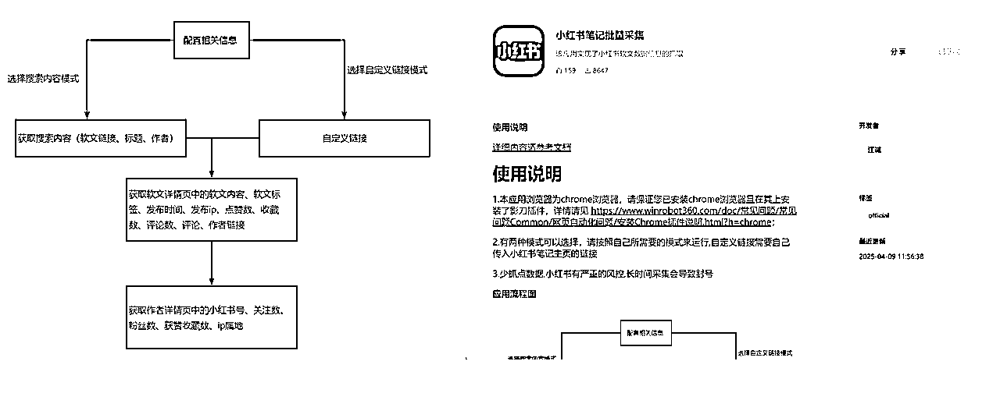

建议大家优先采集和Youtube相关的内容，比如Youtube关键词、Ai视频关键词等，也可以直接用前面拓展出来的关键词来采集。

我以“Ai婴儿播客”举例，演示一下流程：

第一步：点获取程序并运行，按下面的提示选择合适类别。


第二步：按不同类别设置对应参数。

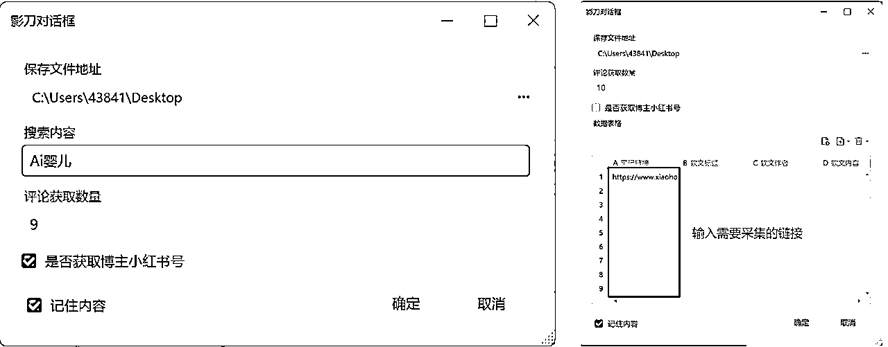

第三步：打开小红书首页https://www.xiaohongshu.com/explore，完成登录，设置好后点“确定”开始采集。采集完能看到结果，之后就可以在表格里做筛选了。


## 即梦活动素材

即梦既是我们做图的工具，也是一个现成素材库。上面有大量优质参赛作品，非常值得参考！

即梦活动网址：https://jimeng.jianying.com/ai-tool/activity

每一期活动的主题，都能帮我们打开思路。


我们可以按“使用数”和“喜欢数”筛选优质作品，点进作品详情页，把提示词保存进自己的素材库。

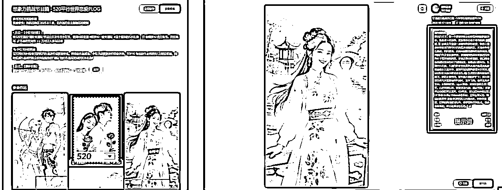

## Midjourney素材

Midjourney官网的推荐页：https://www.midjourney.com/explore?tab=random，有很多高质量作品可以看。

因为是国外产品，Midjourney上的审美更贴近海外用户口味。


影刀RPA程序：https://api.winrobot360.com/redirect/robot/share?inviteKey=6a505903fbc317b9

运行程序前，先打开下面这个页面：

