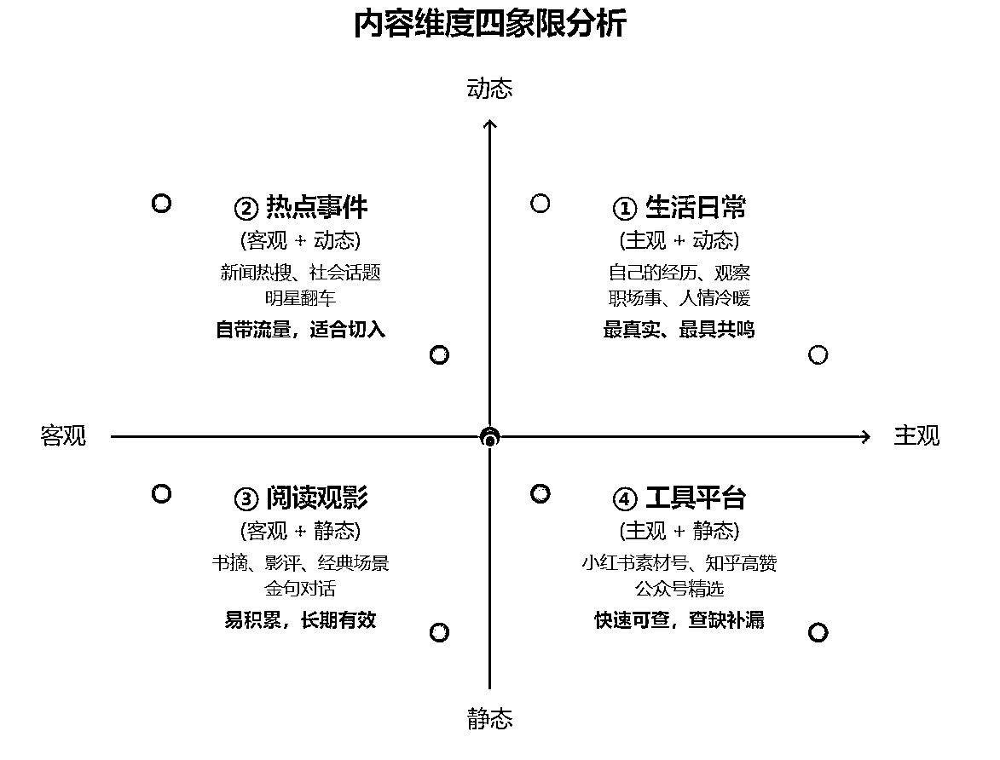

最近不少朋友在后台问我，公众号到底该怎么做？AI写作又是怎么回事？

说实话，我特别理解这种困惑。因为一年前的我，也是这样摸黑走过来的。

先简单介绍下自己：一名90后宝爸，退伍后进了国企，业余时间折腾自媒体。从零开始死磕公众号，一年的时间做到40w+的GMV。不算什么耀眼成绩，但对我这种没有背景、没有资源的普通人来说，已经很知足了。

这期间我踩过坑、走过弯路、也总结了不少经验。今天这篇文章，就想把这一年关于公众号底层逻辑和AI写作的心得，毫无保留地分享给你。

我不会讲虚的，全是实操中验证过的东西，希望能帮你少走点弯路。

说实话，公众号+AI这条路，只要愿意花心思研究，绝对值得普通人深耕。我用得最多的模型是Claude和GPT，今天的例子主要以GPT为主，因为它的上手门槛较低，很适合刚接触AI的朋友。

那咱们直接进入正题。

# 01｜选题：决定文章命运的，不是灵感，是选对了题

很多人一开始写公众号，习惯性对着电脑发呆，半天憋不出一个字。脑子里转来转去就是："今天写点啥？"

最后只能叹口气：没有灵感。

但真相是：你的问题根本不是没灵感，而是你的选题逻辑出了问题。

写文章不是自嗨，是要回答三个问题：

**写给谁看？** 是职场焦虑的35岁中年人？是刚毕业想搞副业的大学生？还是对AI好奇但又不敢上手的观望者？越精准，越好。

**你想让读者看完后有什么感觉？** 是想让他点头认同？还是想让他收藏备用？或者想让他转发到朋友圈？不同的文案，对应着不同的情绪触发点。

**你能提供什么别人讲不出的东西？** 是你的亲身经历？还是你独有的观察视角？或者对老话题的新解读？

说白了，读者愿不愿意点开你的文章，看的从来不是你写了多少字，而是这个选题能不能击中他心里的某个点。

这就引出了选题背后最深层的逻辑——三重价值模型。

## 1. 情绪价值：让读者觉得"你在说我"

人为什么会点赞转发？道理讲得对是一方面，更重要的是：被戳中了。

你写过这样的标题吗？比如：

- "不是你不努力，是你在跟生活硬刚。"
- "写了100篇文章没人看，我差点放弃。"

读者看完的第一反应是：这不就是我吗？

这种被理解、被映照的感觉，就是情绪价值。它不需要华丽的辞藻，只需要你替读者说出他心里的那句话。

## 2. 信息价值：让读者见到没见过的东西

"信息差"就是价值差。

当我第一次用GPT写公众号、做知识库、跑全托管项目的时候，很多朋友根本没听过这些玩法。新东西+可落地的操作法，天然就是吸引眼球的钩子。

你完全可以这样问自己：这篇文章里，有没有一项知识、一个操作、一种思路，是读者在其他地方见不到的？

## 3. 目标价值：帮读者解决一个具体问题

这类选题通常指向明确，特别适合垂类账号或者想变现的内容。比如：

- "公众号标题不会写？这套公式直接套用。"
- "AI小白如何用30分钟做出一条爆款短视频？"

它们的核心作用在于：带读者走一段路，从不懂到明白，从焦虑到安心，从卡住到通了。

真正厉害的选题，往往是三种价值的叠加。比如：

"35岁职场妈妈裸辞后自学AI，3个月搞出月入3万的副业。"

这个标题情绪共鸣有了（裸辞的焦虑与反转）、信息增量有了（AI技能）、实用指向也有了（副业路径）。这种立体感，才是爆款能真正打动人的原因。

# 02｜万能选题六抓手：不靠灵感的选题方法

知道好选题的标准还不够，怎么稳定地产出好选题？这是更实际的问题。

这六种方法，是我反复验证过的，可以单独用，也可以组合用：

**抓手法：真实故事+情绪张力**

故事感+代入感，是天然的吸引力。比如："她30岁离婚，带娃搬到郊区，靠一台旧电脑逆袭了人生。"

**反常识：日常话题+逆向解读**

别人都这么做、这么想，你偏偏给出另一个逻辑和视角。比如："不是你拖延，是你太想完美了。"

**强对比：明确数字+落差感**

用数字建立真实感和信任感。比如："同样是做公众号，她一个月赚3万，我坚持3个月只赚了86块。"

**借热点：热点事件+个人切口**

热点自带流量，关键是找到属于你的切入角度。比如："李佳琦翻车后，我看到的不只是塌房，而是打工人情绪的崩塌。"

**精准定位：人群+痛点**

敢于"点名道姓"，把读者的画像说出来。比如："35岁国企男：存款10W，孩子3岁，我决定搞副业。"

**场景化：具体场景+可执行的解法**

实用型内容要开门见山。比如："每天脑子很乱？我用这个方法让思维清空10分钟。"

这六种方法用熟了之后，会变成一种写作直觉：看到一个热点，你自然知道怎么切角度；翻翻生活日常，你马上能提炼出痛点；想讲个故事，你很清楚该怎样去包装结构。

## 建立自己的选题库：三个实用的找题方法

别靠灵感等选题，好选题背后是一套可复制的方法。我常用这三板斧：

**三层选题法：热点→生活→专业**

第一层，热点借势。每天刷微博热搜、小红书热榜、知乎热议，关注"翻车、离职、爆款、焦虑、00后、AI"这些关键词，找出和你领域的关联。比如："董宇辉分红400万那天，我想辞职的心更强烈了。"

第二层，生活观察。从日常的困惑、抱怨、顿悟里找素材。比如加班到十点被老板骂，就可以拆解出："成年人的倔强：被骂了还不敢辞职，是谁教我们的？"

第三层，专业输出。总结你在一件事上的方法和经验。比如我用GPT写文章一年，分享："不会提示词？试试我这套写作公式，效率提升3倍。"

**三问检验法：判断值不值得写**

有了选题灵感后，写之前先用三个问题筛一遍：

- 有人想看吗？去知乎、小红书搜一下，看有没有人在讨论类似话题。
- 我有差异化视角吗？如果只是重复别人的观点，还不如不写。
- 这选题对我的目标有用吗？能引流吗？能变现吗？能沉淀个人IP吗？

**三角透视法：让选题更有传播力**

每个好选题都至少要关照三个角色：读者需要什么（需求维度），你能给出什么（供给维度），平台生态是什么（分发维度）。

三个维度都照顾到，你的选题自然更立体。

# 03｜结构：为什么你的文章总像"一碗半生不熟的粥"？

很多初学写作的朋友有个通病：不是没内容，而是内容堆在一起。读下来像看聊天记录，信息量大，但抓不住重点。

高手写文章的逻辑，像搭积木，一块块对齐，每一块都服务于同一根主线。

一句话总结：**好文章 = 结构（骨架）× 情绪（血肉）× 节奏（节拍）**

**骨架：结构清晰，读者才不会迷路**

你的文章要始终有一条清晰的路线：开头讲什么？中间怎么推进？结尾落在哪？这个路线，可以分成三种常见形态：

- 并列式：3个平级观点一字排开，"观点+论据+场景"反复呈现。
- 递进式：是什么→为什么→怎么办，层层深入。
- 故事式：起承转合，用情节和情绪带动读者。

**血肉：情绪饱满，读者才会跟你共情**

在文章中讲真实的故事、加进自己的亲身经历、插入几句有画面感的金句。比如："我在地铁站哭了15分钟，只因为那天领导说了一句话。"

有了情绪，文章才会有温度。干巴巴的道理，永远戳不中人心。

**节拍：文章也要有呼吸感**

写文章也像写歌，节奏对了才有人继续听。试试这些方法：

- 长短句交替，不要一段话连着写好几行，没有喘气的机会。
- 段落之间有留白，读起来不累。
- 每一段的重心都要服务于主线，不要跑题。

总结来说：结构是路，情绪是路边的风景，节奏是你走路的步伐。缺一不可。

## 三种万能结构模型，写什么都套得上

写作就像盖房子，结构就是钢筋骨架。只要骨架立得好，什么内容都能往上填充。

**并列式——观点精炼、干货密集**

- 基本模型：观点1+案例1+小结，观点2+案例2+小结，观点3+案例3+小结。
- 适合：干货型内容、心得总结、方法论拆解。
- 标题示例：“公众号写作，我踩过这3个坑”“副业起步第一月，我只做了3件事”。

**递进式——逻辑严密、层层推进**

- 基本模型：是什么→为什么→怎么做。
- 适合：概念拆解、教程输出、工具使用、观点文。
- 要点：每一段的衔接要自然，多用逻辑连接词，比如“第二个问题是…”“如果我们换个角度看…”。
- 标题示例：“为什么AI文章写不爆？你可能忽略了这3点”“公众号变现指南：从0到1的3个关键阶段”。

**故事式——情感真挚、制造代入**

- 基本模型：起→承→转→合。
- 适合：个人经历、情感共鸣、IP塑造。
- 写法建议：用一个事件做开头，制造悬念；中段展开冲突和挣扎；结尾升华情绪、提炼感悟。
- 标题示例：“裸辞后的第30天，我在凌晨两点哭了”“35岁宝爸靠AI翻身，改变的不是技术，而是心态”。

三种结构各有分工：想高效输出选并列式，想讲透一个概念选递进式，想打动人选故事式。

## 一个原创公式：让文章像拼积木一样稳定输出

很多写作新手会遇到一个典型场景：开头灵感爆发，中段开始逻辑混乱，结尾仓促收场。

原因很简单：你没有一套套得上的"内容容器"，写着写着就跑偏了。

我分享一个我常用的原创结构公式：**钩子+主线+补充+收口**。

**第一步：钩子——前三句话决定文章生死**

开头不负责解释你在写什么，只需要做到：让读者停下来、产生阅读兴趣。三种好用钩子：

- 情绪钩子——"我在电梯里崩溃大哭，只因为领导说了这句话。"
- 悬念钩子——"她裸辞做副业，第1个月就收入过万，到底做对了什么？"
- 反差钩子——"同样是写公众号，他赚了3万，我却只赚了86块。"

**第二步：主线——选好结构，让内容有序展开**

前面提到的并列式、递进式、故事式，这时候就派上用场了。根据选题类型，选出对应的主体框架，所有内容都围绕这根主线展开。

**第三步：补充——用案例、数据、金句加固说服力**

好的文章不仅要有观点，更要有证据。一个真实案例、一条研究数据、一句点睛的金句，都能让文章更有质感。比如：“知乎高赞回答里有句话：副业不是让你去干点别的赚钱，而是重新认识你是谁。”

这类素材平时要注意积累。我自己就专门建了一个金句库，后期甚至可以融入到AI知识库里随时调用。

**第四步：收口——让结尾成为你留给读者的最后记忆**

别再用"所以……"这种弱收尾了。试试这三种更有力的方式：

- 金句升华："成年人最大的底气，不是稳定，而是能转身。"
- 行动号召："如果你也在原地打转，不如试试从公众号开始。"
- 情绪回收："那天凌晨，我终于明白：选择难，但不选更难。"

结尾，就是你留给读者的最后信号。它必须是"值得被记住"的。

# 04｜素材：写不下去的真问题，不是不会写，而是没储备

写作写不动，很多人会怪自己表达能力不行。

其实大多数情况下，真正的问题只有一个：你脑子里没有足够多的"料"。

我们把一篇文章看成一栋房子：选题是地基，结构是框架，素材就是一块块砖瓦。没有砖瓦，框架立起来了也只是空壳。

但素材这个东西，不是越多越好，关键是质量过关。

判断一个素材值不值得用，我一般看三条标准：

**能支撑观点**

你讲的每个观点，都要有"证据"。这个证据可以是数据、案例、故事，甚至可以是一句有力量的引用。如果没有支撑，观点就像飘在半空中，让人摸不着。

比如你说"副业不能随便做，要先评估自己的能力"，那就得配一个真实的失败案例——什么样的人，在什么条件下，因为忽视自我评估，最后栽了跟头。

**能调动情绪**

好的素材不只是冷冰冰的信息，还应当有情感的温度。

最打动人的素材，是情绪强烈且细节真实的故事。一件很小的事——一次告别、一句批评、一个失眠的深夜——都可能成为让人破防的触点。这种素材，往往比精心编造的大道理更有传播力。

**有独特视角**

一个素材，如果放在所有文章里都成立，那它就是平庸的。真正的好素材，是要能在你的文章里，提供别人没有的、属于你个人的观察和体验。

**（后文待续）**

这篇文章的信息量不小，从选题逻辑到内容结构再到素材储备，基本把我这一年的核心经验都梳理了一遍。方法是死的，关键是有人愿意去用、去尝试、去实践。

AI辅助写作当然是一条捷径，但它永远替代不了你独立思考的能力。工具再先进，也只是加速器，真正决定你能走多远的，还是你的判断力、审美力与执行力。

有句话我说过很多次：公众号+AI这条路，真的值得每个普通人尝试一次。关键是，你愿意不愿意迈出第一步。

如果今天的分享对你有用，记得点个赞，别忘了转发给那个同样想搞副业的朋友。下一篇，我会接着聊AI提示词的具体用法，想看的评论区扣个"1"。

# 稿子干巴巴？先学会“找料”

很多人一拿笔就发愁：不是没观点，是没例子。读起来像说教，不生动。怎么破？往稿子里加“料”。

## 一、料是啥？就是让读者点头的“证据”

料能制造画面。比如“加班苦”是句废话，换个场景：“凌晨一点，他坐在阳台沿儿上，望着对面还亮灯的写字楼，一声不吭。”你是不是立刻有画面了？料还能撑起专业感。你说“职场焦虑很普遍”，不如说“根据清华一份调研，95%的上班族在35岁前至少焦虑过一次。”数字一摆，读者就觉得你有备而来。缺料，稿子就是空架子；乱加料，就像一锅汤撒了十三香，没法喝。

## 二、料从哪找？四个地方随便挖

别再说自己没故事。好料不是编的，是捡的。写稿的人不是灵感多，是眼尖。

判断料，看两条线：一是看它从自己脑子里长出来的，还是从外面捡回来的；二是看它是现成的，还是需要攒的。两条线交叉，就有了四个“料仓”。



第一个：身边事。自己的困难、突然想通的瞬间、亲人的对话、同事的尴尬，都是好料。比如“我爸退休那天，我妈说了一句话，我当场泪崩”“娃放学进屋，没喊饿，先说‘妈妈，我今天没考好’。”这种料最扎心。

第二个：热点。热搜、热榜、热议，哪里人多就往哪看。那位头部主播道歉三天后，直播间照样挤满人；高考作文里最敢写的观点，其实勾着成年人的怕。但别做新闻搬运工，得有自己的态度，哪怕一句反问。

第三个：读书观影。书里的道理、电影里的镜头、播客里的金句，都能入料。比如“那部经典越狱片看透一件事：关住人的不是墙，是习惯”“反诈片里那个写代码的，就是你我的一面镜子。”平时多看多记，建一个笔记本，分门别类存好。

第四个：现成平台。知乎上的高赞回答、种草平台上的情绪文案、爆款标题库，都是随手能用的料。但别照抄，要拼一拼、改一改，装进自己的主题里。

说穿了，你不是没料，是没长一双找料的眼睛。

## 三、一条料，如何变出三篇稿？

举个例子：“我去年裸辞，在家带娃顺便学这门手艺，首月只赚176块，但之后的路宽了。”这一条料，能拆出三种完全不同的稿。

第一种，讲故事。放大冲突和细节，标题如《裸辞后带娃学新手艺，首月赚176，反而比上班舒坦》《91年，34岁，用新手艺翻盘，起初连奶粉钱都没有》。这种稿适合个人IP、情感号，让人记住你。

第二种，讲方法。把经历拆成可复制的步骤，标题如《我用三步，把带娃+新手艺做成副业》《从176到过万：这套指令模板，我靠它翻的身》。适合干货号、课程引流。

第三种，讲观点。从个人故事上升到大众情绪，标题如《副业首月赚176，大多数人第一步就放弃了》《裸辞、带娃、新手艺，我终于明白什么叫“不被看好也不认输”》。适合职场、认知号。

那怎么把一条料拆开用？五步即可：
1. 抓关键：把事件、转折、画面、情绪拎出来。
2. 换主角：把“我”改成“他”，更容易代入。
3. 升高度：从“发生了什么”变成“这说明什么”。
4. 降成步骤：把个人经历压缩成1、2、3、4步。
5. 加证据：补上数据、名言、网友的共鸣评论。

会写的人，一条料能喂饱三篇图文、两条短视频、一份小课。料不是一次性筷子，要反复用、多角度用。

## 四、好语言的标准：不端、不装、不水

很多人以为好文字就是辞藻华丽，其实在公号上，语言做到四点就够了。

1. 顺。句子要短，十五字以内；多用“我做了什么”，少用“什么被我做了”；不拽术语。像“在探索副业的路径中，我完成了自我认知的迭代”这种句子，直接扔。
2. 简。删掉“并且、然后、就是、其实”这一类无意义的词。写完自己读一遍，凡是删掉不走味的，都删。
3. 有画。少说“我很难受”，多说“我早上不想睁眼，刷牙都嫌累。”读者看得见，才会动情。
4. 有节奏。长短句搭配，段落别太长，关键句后面留白。比如：“我不是不努力。只是没学会，用巧劲努力。”

## 五、五个立马能用的改稿技

① 长句切短。超过20个字就断开。原句“我那时天天焦虑，既不知道方向，也没技能应付变化”改成：“那阵子我特焦虑。方向没有，技能没有。天天像关在黑屋子里。”
② 动词优先。写“我站在阳台上发呆”比“我很郁闷”有劲；“摔门、拉黑、关机”比“生气”有画面。多余的“着、了、的”能删就删。
③ 量化一切。别写“很多人”，写“超六成上班族”；别写“花了点钱”，写“花399报了课”；别写“有一阵子”，写“连续90天”。数字一出现，可信度就涨了。
④ 戒掉烂大街的词。“蜕变”“赋能”“底层逻辑”“内卷”“破圈”“人生只有一次”这些，读者早腻了。换成具体动作、真实人物，才有新鲜感。
⑤ 适当留白。用空行制造停顿，让读者喘口气。比如：“后来我懂了：有些人，不是你不好，是他没眼光。”

## 六、让AI当助理，而不是打字机

有人一上来就说“帮我写篇副业赚钱的稿”，结果AI吐出一堆正确的废话，根本没法用。问题不在AI，在指令。

AI最趁手的三件事：第一，产出内容——给你十个标题、三个开头、几种结构；第二，模仿语言——你先给它一段你的文字，说“照这个调子写”，或者给它立人设：“你是个35岁的副业博主，理性，不油腻”；第三，改写润色——太干就加情绪，太长就砍掉，想换角度就命令它“从新手视角重写”。

但开工前，你想清楚两件事：一是这篇稿子的目标是什么？拉粉、变现、求转发，还是立人设？二是哪些活能外包？标题、大纲、资料检索，可以交给AI；个人经历、真实感受、核心观点，必须自己来。

推荐一个指令框架：OCPR。
O（输出）：要它给什么。比如“一篇公号图文草稿，含标题、开头引子、三个主体板块、结尾升华。”
C（背景）：你是谁。比如“我是90后宝爸，主业在国企，副业做公号一年，靠AI起号，累计变现40多万，想吸引对AI写字有兴趣的人。”
P（角色）：它演谁。比如“你是个成熟公号作者，文风自然亲切，擅长用真实故事和清晰结构打动人。”
R（要求）：照什么标准。比如“内容要真实、有细节，别像机器腔，结构是开头引入+三个变化+结尾升华，字数别超1500。”

把四段拼成一句，发给它：

```
你是一个成熟的公众号写作者，擅长用真实故事+结构清晰的方式打动读者。请根据以下信息写一篇公众号文章草稿：

- 文章主题：我靠AI写公众号一年赚了多少？
- 背景：我是一个90后宝爸，主业在国企，副业做公众号一年，靠AI写作累计变现40万+。
- 风格要求：语言自然真实，不要AI味，细节具体，逻辑清晰，避免废话和套话。
- 结构要求：标题 + 开头引入（吸引点击）+ 三段主体内容（讲清楚三个转变、误区或收获）+ 结尾升华（引发思考或行动）
- 字数：1200～1500字
```

指令写得越细，它交回的东西越像你。你还可以补充“模仿某爆款的调性”“别用鸡汤词”“读者是应届生”等。记住，指令不是命令，是合作约定。

最后，人机一起干活三步走：
第一步，让AI搭框架。用OCPR要一个标题+大纲，这步能省你七成力气。
第二步，你填肉。AI写“我学这门手艺很开心，也发现了机会”，你改成：“我花399报了个班，第一周硬着头皮学。第七天晚上，我用指令整出一篇稿，居然被点了32个赞。那一刻我确定：这玩意儿不是玄学，真能改变点什么。”
第三步，重排和改腔。把段落顺序理顺，揪出水话、机器腔、套话。这么一来，最后的稿子才真正像你。

```
【标题建议】：
1\. “我靠AI写公众号一年，赚了40万，踩过3个坑”
2\. “不会写提示词，我公众号白写3个月”
3\. “从0开始副业，我是如何用AI打下第一桶金的？”

【结构草稿】：
① 开头：讲出背景+切入冲突（上班+搞副业）
② 主体1：AI让我从0快速起号（配案例）
③ 主体2：提示词决定内容上限（配方法）
④ 主体3：如何打通流量变现闭环（配策略）
⑤ 结尾：升华/感悟/引导行动
```

说到底，写稿不难。手里有料，脑中有法，身边有AI。剩下的事，就是不停写，不停磨。磨得够多，就成了。

最近有个朋友问我：“我写了小半年公众号，阅读量还是两位数，是不是该放弃了？”

我说你先别急着放弃，我问你个问题——你写完那几十篇东西，有没有想过一个问题：你写的这些东西，到底在帮谁解决什么？

很多人把“变现”想成一条突然出现的鸿沟，以为某天灵感爆棚写出一篇爆款，钱就哗哗来了。但真相是——变现从来不靠单篇爆发，它靠的是你长期给这个世界提供某种“价值”，价值够了，钱自然靠近。

我自己把公众号内容的价值拆成了五层，你对照着看看，你现在的文章卡在哪一层。

---

**第一层：情绪价值，说白了就是“陪伴感”**

读者关注你，不是因为你的文笔多好，而是因为你替他说了不敢说的话，写出了他憋在心里的那种感受。共鸣、治愈、理解、倾诉——这类内容不需要多高深，但需要你真诚地站在读者身边。

比如那句：“不是你不努力，是你一直在对抗整个生活系统。”

再比如：“我在30岁这年，才懂得不回消息不是冷漠，是没力气了。”

这种内容的力量，不在信息量，在连接感。

**第二层：知识价值，就是你的“认知货币”**

你让读者看完文章觉得“这时间花得值”，你就赚到了他大脑里的一个信任额度。帮别人省下搜集资料的时间、减少踩坑的判断成本，这就是知识价值。

干货、方法论、模型、模板——这类内容不一定要多复杂，但要有可操作、可复用的东西。正如那句话说：“别人看完没收获的文章，只是一堆字符；别人看完能动手的文章，才叫内容。”

**第三层：引导价值，也就是“行动触发器”**

很多人缺的从来不是方法，是那一下“我也可以”的瞬间。你的经历、你失败又反转的故事、你从坑里爬出来的过程，都可能成为别人按下开始键的那只手。

就像有人分享：“副业第一个月我只赚了176块，但我没放弃，第三个月翻了十倍。”

这层价值，是用你的故事点燃别人的行动欲，顺便给他指个方向。

**第四层：商业价值，这才是内容能走远的地基**

情绪陪伴很好，但光靠陪伴撑不起持续产出——你得让内容具备变现能力。内容+产品+信任，这三件事整合起来，才能形成商业闭环。

评测、推荐、课程、社群——都是这层价值的落地形式。合适的人看到合适的内容，做出合适的选择，这是双赢。

**第五层：品牌价值，也就是“你这个人的复利资产”**

当读者因为“是你写的”而关注，而不只是因为“写得好”，你的IP就慢慢起了。人设、标签、风格、观点——这些东西让文章背后有了一个活生生的人。

它没法一蹴而就，但它是唯一会随时间增值的东西。

一句话总结：情绪是入口，知识是工具，引导是桥梁，商业是闭环，品牌是护城河。每篇文章不一定要赚钱，但每篇都应该在这五层里，占住一个位置。

---

那怎么从“写一篇”变成“赚一笔”呢？我的经验是——别再用“单篇思维”做公众号，你得把账号当成一台系统来搭建。

**第一步：篇篇有指向。**公众号不是日记本，每篇写完你都要问自己：读者看完，我希望他做什么？关注？评论？加微信？买课？哪怕只是点个在看，都算一个清晰目标。最怕的是写着写着，连自己都不知道这篇图什么。

**第二步：把内容、产品、关系串成闭环。**可以拆成三层来看：

- 最外层是“流量入口”：用情绪型、经验型、方法型内容去小红书、视频号、朋友圈引流，同时用电子书、模板、清单这类“免费诱饵”吸引关注。
- 中间层是“信任沉淀”：连载你的成长记录，让人看见你在做；拆解案例，让人知道你在行；晒成绩、晒反馈，让人相信你靠谱。信任这东西，得一天一天攒。
- 最内层是“商业转化”：课程、训练营、社群、星球、代运营——在内容里软植入，不硬推；在社群中慢慢养，不催单。

关键是什么？你的每一篇文章，你得清楚它在三层里的哪一层，别一顿输出猛如虎，回头一看自己在原地转圈。

**第三步：把内容当资产，别当消耗品。**有个老师说的一句话我很认同——一篇文章是会慢慢长大的。今天写的干货，三个月后是你的电子书素材；今天的复盘，半年后是你的案例库。结构化地管理内容，给它们分类、打标签、打包，让它们可以复用、可以组合、可以二次销售。写作不是写一篇文章，是建一座资产仓库。

最后我想说：公众号本质上是一台小型赚钱机器，不是稿子生产软件。它自带产品（你的经验、服务、课程）、自带用户（你的读者）、自带渠道（微信、社群、小红书）、自带转化机制（信任带来的付费）。你要做的不是每天追爆款，而是持续用优质内容把这些零件串成闭环。

也许你暂时还不想靠写作赚钱，但当你练到“会写、能写、写得有影响力”，你手里就多了一张普通人进入信息时代最公平的入场券。而公众号，是指数级工具里最稳、最久、最适合普通人的那个。

别做三天打鱼两天晒网的人。

做那种，三年后回头看，能笑着说出这句话的人：

“幸好当初我没放弃写公众号。”