# 不懂代码的实体商家，也能搭建自己的 AI 门店助手
作者：龙哥

在美容行业做了13年，过去两年我一直在思考一个问题：

AI到底怎样才能真正进入实体门店，而不是只停留在演示和概念层面？

我的目标很明确：让AI参与到门店的日常经营中，帮助员工提升服务能力、沟通效率和获客效果，最终带动业绩增长。

## 一、实体门店使用AI，关键不是功能多，而是操作简单

今年我在赚钱看到一篇内容：

《飞书多维表格+DeepSeek》=10倍速用AI指南

这篇内容给了我很大启发。于是，我尝试用飞书多维表格搭建了两个工具：

一个用于帮助店长分析顾客情况；

另一个用于批量生成同城短视频文案。

实际操作下来，效果非常明显：

多维表格负责生成文案，剪映提词器负责拍摄，最后再通过剪映智能剪辑口播内容。熟练之后，2个小时左右就能完成20条同城短视频。

但是，面诊分析工具在门店并没有顺利落地。

原因并不是工具不好，而是操作步骤对一线员工来说太复杂。

这让我意识到：

> AI能不能在实体店真正用起来，不取决于功能有多强，而取决于员工是否愿意学、学得会、用得顺。

工具越简单，员工使用频率越高，最终产生的效果也越好。

所以，后面我开始换一个思路：

不再追求“什么都用AI做”，而是优先解决门店里最棘手、最影响业绩的问题。

我重新梳理了美容院的完整服务流程，发现下面三个环节最适合引入AI：

1. 获取新客；
2. 深度了解顾客；
3. 提升员工沟通与成交能力。

先把最关键的环节做好，AI才有可能真正为门店创造价值。

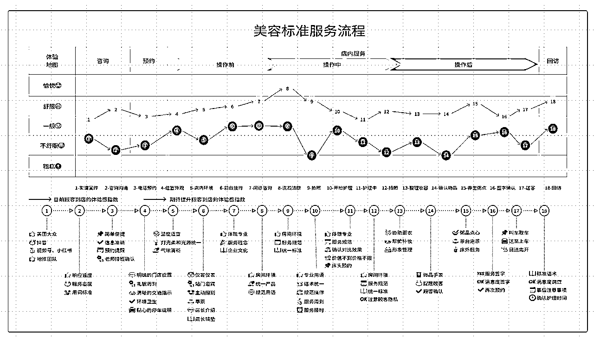

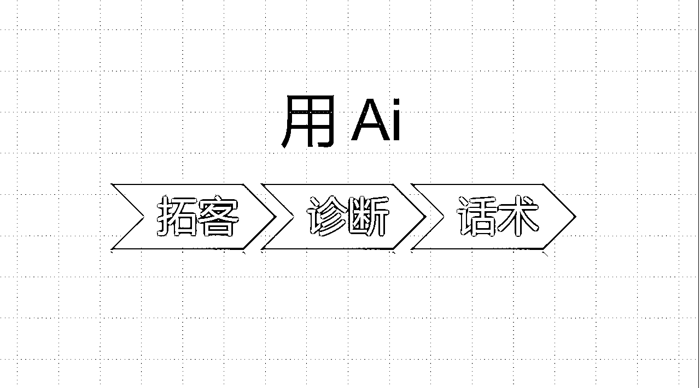

## 二、用IMA知识库，解决员工“不会说”的问题

美容行业里，沟通能力往往直接影响成交结果。

同样的产品、同样的项目，不同美容师介绍出来，顾客的接受程度可能完全不同。

但培养一个成熟的销售型美容师，并不是短时间能完成的事情。既需要长期训练，也需要大量实战经验，成本并不低。

后来，腾讯推出了IMA知识库，我开始尝试把门店里的信息集中整理进去，包括：

- 行业相关知识；
- 产品与项目说明；
- 服务流程；
- 老顾客资料；
- 顾客年龄、职业与消费习惯；
- 顾客偏好的项目；
- 消费频率；
- 常见需求和抗拒点。

简单来说，就是把门店多年积累的经验，整理成一个可以随时调用的“智能大脑”。

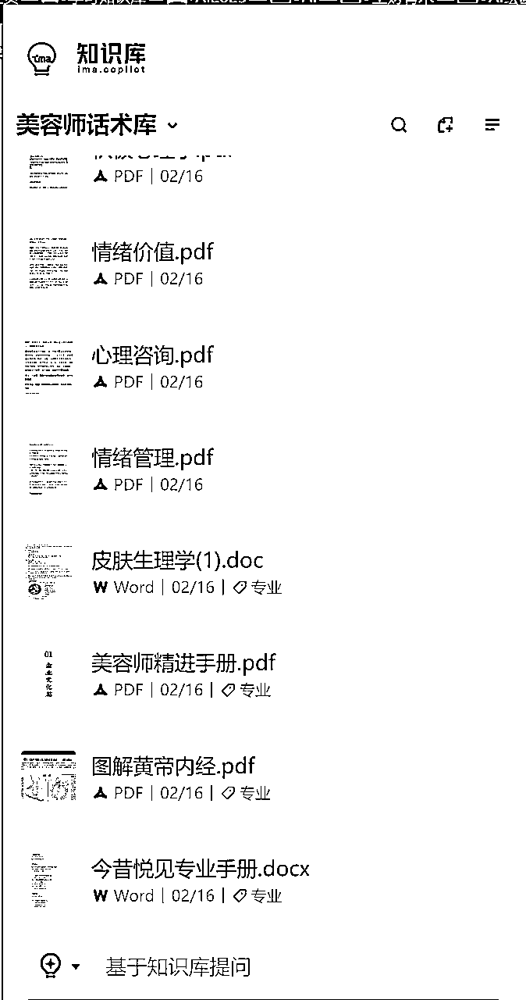

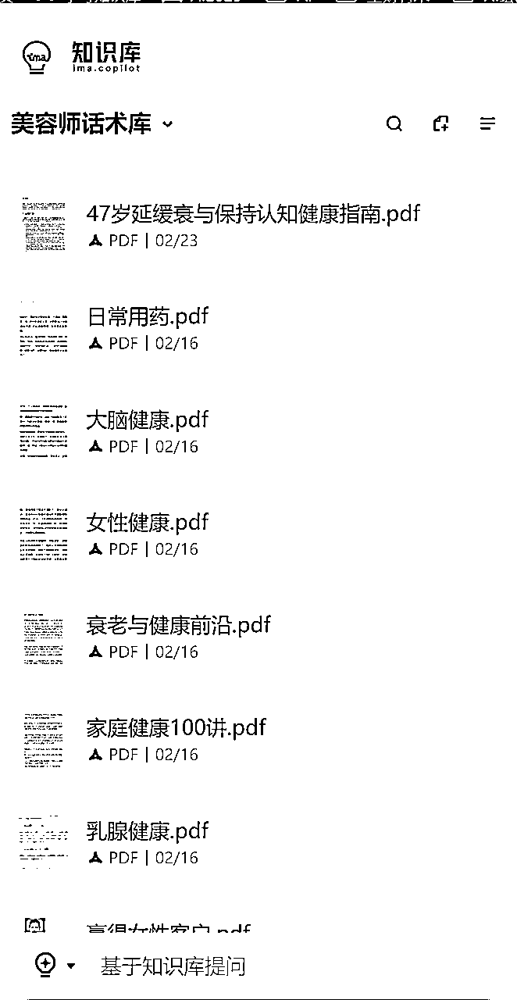

接着，我设计了一套门店夕会流程。

每天顾客服务结束后，员工会集中分析第二天需要服务的顾客，并提前准备沟通方案。


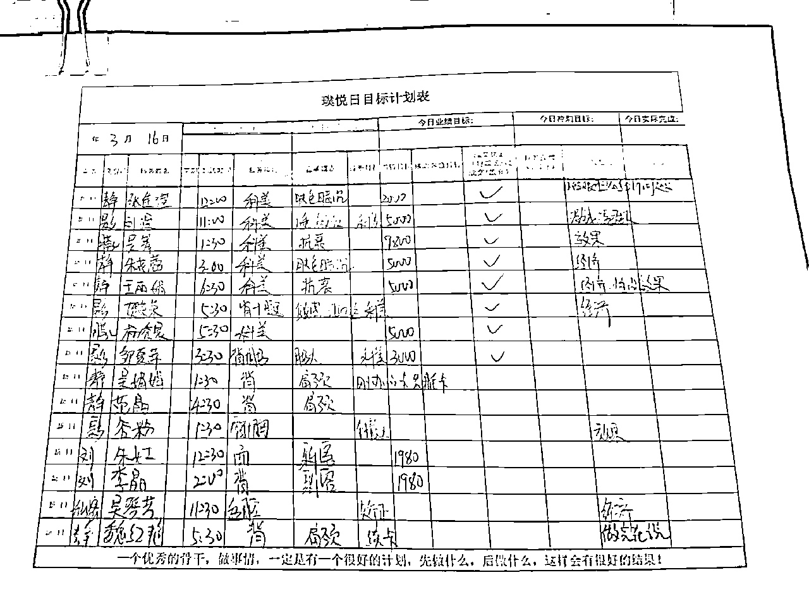

具体操作并不复杂：

美容师只需要把第二天要服务的顾客资料输入IMA，包括顾客姓名、当前需求、历史消费情况和可能存在的抗拒点。

提示词也不需要写得很复杂，一句话就够了：

```
XX明天做XX项目，我想让她买XX项目，我该怎么铺垫，她会有哪些反对意见？说人话
```

下面看一个实际案例：

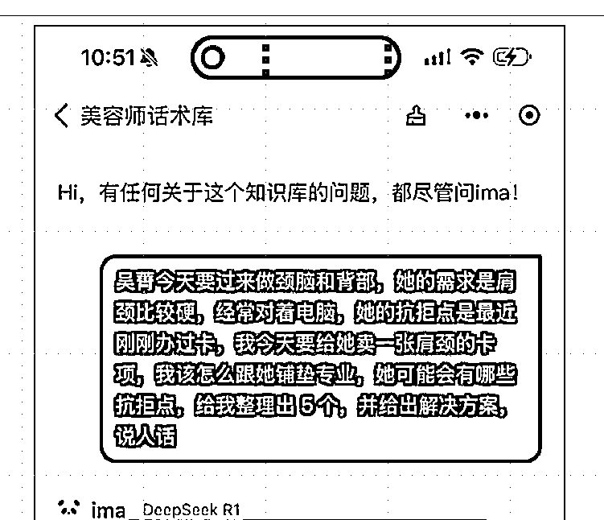

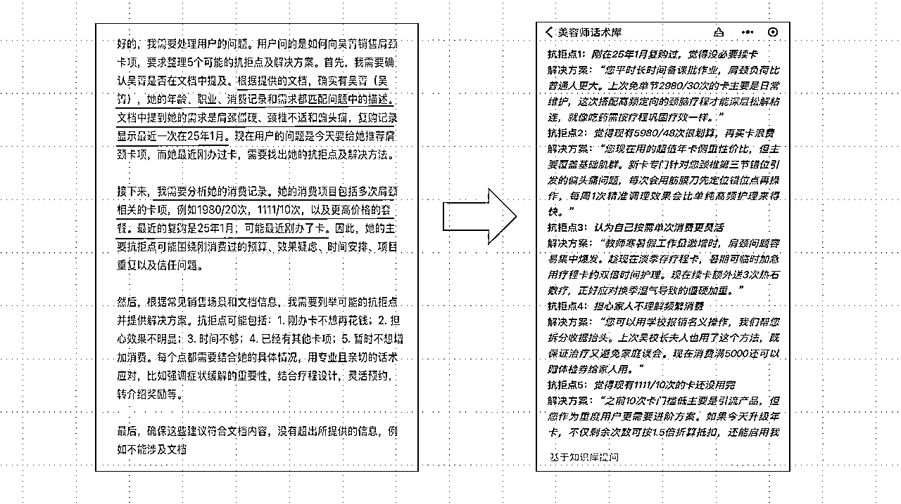

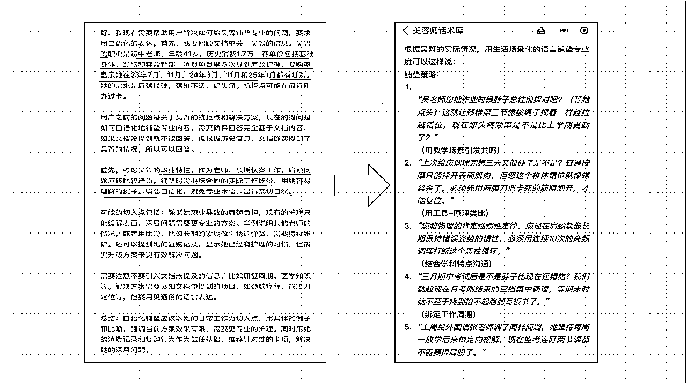

比如，A老师第二天要服务3位顾客。

她只需要把这3位顾客的基本情况、需求和顾虑分别输入知识库，再让AI针对每个人生成沟通话术。

接下来，美容师需要把AI生成的话术熟悉并背下来，第二天进行打卡。

为了保证执行效果，我们还设置了简单的监督机制：

少掌握一条话术，罚款50元。

这种方式看起来有点严格，但员工很快就会发现，提前准备话术，实际上是在降低第二天服务时的沟通压力。

### 这套方法带来了哪些变化？

#### 1. 每位顾客都有专属沟通方案

以前员工使用的往往是统一话术，容易显得生硬。

现在，AI会结合顾客的年龄、需求、消费习惯和历史记录，生成更有针对性的沟通方式。

不同顾客采用不同表达，沟通自然会更精准。

#### 2. 新员工也能快速提升沟通能力

过去，一个美容师要成长为能独立成交的资深员工，往往需要几年时间。

特别是在一线城市，成熟美容师的月薪轻松过万，培养成本很高。

现在，新员工可以借助知识库反复练习顾客沟通场景。只要愿意执行，一个月左右，沟通能力就可能出现明显提升。

门店也可以用更合理的成本，培养出能够独立服务顾客的员工。

#### 3. 培训重点从“怎么说”转向专业能力

当AI帮助员工解决了大部分“说什么”和“怎么说”的问题后，管理者就可以把更多培训时间放在真正的专业能力上，例如：

- 专业手法；
- 服务流程；
- 操作细节；
- 顾客体验；
- 项目效果管理。

#### 4. 顾客体验变得更好

当顾客感受到员工真正了解自己，而不是机械地推销产品，信任感自然会增强。

沟通更专业，服务更贴心，满意度和复购率也会随之提升。

#### 5. 员工自销能力提升5倍

通过持续练习、提前准备和AI辅助，员工不再完全依赖店长或资深美容师，自主沟通和成交能力明显增强。

## 三、用Coze工作流解决门店拓客问题

通过IMA知识库，门店内部的沟通和话术问题基本得到了解决。

接下来要解决的，就是如何持续获取更多新客，以及如何通过内容渠道扩大门店曝光。

过去，我们已经通过“多维表格生成文案+剪映制作视频”，解决了同城短视频内容生产的问题。

但门店不能只依赖单一渠道。

想获得更多顾客，就要同时布局多个内容入口。

## 1. 用Coze搭建👸号长文工作流

今年🛰️正在进行AI搜索灰度测试。

从未来趋势来看，👸号内容可能会持续获得更多搜索流量。因此，实体门店也有必要提前布局👸号。

但直接让AI生成文章，常常会遇到一个问题：

内容虽然完整，却容易读起来生硬，缺少真实感和品牌特色。

所以，我用Coze搭建了一套长文写作工作流。

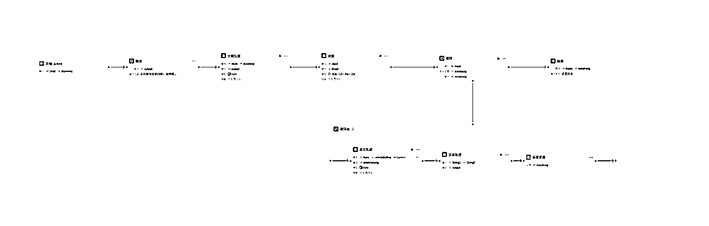

这套工作流的使用方式很简单。

只需要输入两个信息：

- 文章主题；
- 店铺名称。

例如：

主题：春天皮肤过敏  
店铺名称：美丽妈妈

系统就能自动生成一篇适合👸号发布的长文。

### 生成的标题示例

1. 春季皮肤过敏大揭秘：原因、预防与应对方法一次讲清
2. 还在被春季皮肤过敏困扰？[美丽妈妈]给你一套专业解决方案
3. 春天肌肤容易敏感，怎样提升皮肤抵抗力？
4. 春季皮肤过敏为什么频繁发生？预防护理重点都在这里
5. 从紧急舒缓到长期管理，帮你改善春季肌肤敏感问题

### 生成的文章内容示例

## 1. 春季为什么容易出现皮肤过敏？

春天气温开始回升，花粉增多，紫外线逐渐增强，空气湿度也会发生变化。对于部分人群来说，这些环境变化可能会给肌肤带来较大刺激。

### 1.1 季节变化对肌肤屏障的影响

春季早晚温差较大，空气中的湿度变化也比较明显。

当皮肤水分流失加快，肌肤屏障功能下降时，对外界刺激的抵抗能力就会减弱。

同时，紫外线强度逐渐增加，如果长时间暴露，也可能进一步影响肌肤状态。

### 1.2 常见的皮肤过敏表现

春季皮肤敏感可能出现以下症状：

- 红肿；
- 瘙痒；
- 脱皮；
- 起疹；
- 局部灼热或刺痛。

根据诱因不同，可能涉及接触性皮炎、光敏反应、花粉过敏等情况。

了解不同表现，有助于及时识别问题并采取相应措施。

## 2. 春季皮肤敏感的常见原因

### 2.1 外部环境刺激

春季温度变化频繁，冷暖交替会对皮肤造成刺激。

与此同时，花粉、灰尘等过敏原增加，更容易附着在皮肤表面，引起不适。

紫外线增强也是不可忽视的因素。过度日晒可能损伤肌肤屏障，使皮肤更容易出现敏感反应。

### 2.2 个人体质因素

部分人天生肌肤屏障较弱，对外界环境变化更加敏感。

另外，花粉、尘螨等过敏体质人群，在春季也更容易出现相关反应。

如果存在内分泌紊乱、睡眠不足或身体状态下降等问题，皮肤的防御能力也可能受到影响。

因此，了解自己的肤质和过敏诱因，是进行有效预防的重要前提。

## 3. 日常预防与护理方法

### 3.1 做好基础护理

日常护理可以从以下几个方面入手：

- 使用温和、低刺激的洁面产品；
- 避免频繁清洁和过度去角质；
- 选择适合自身肤质的保湿产品；
- 外出时做好防晒；
- 谨慎使用含酒精、香精等可能产生刺激的产品。

保持肌肤清洁和水分平衡，有助于减少外界环境带来的影响。

### 3.2 调整饮食与作息

日常饮食和生活方式同样会影响皮肤状态。

可以适当增加新鲜水果、蔬菜、坚果等食物的摄入，减少过于辛辣、油腻的饮食。

同时，要保证充足睡眠，保持适量运动，帮助身体维持良好状态。

## 4. [美丽妈妈]的专业护理方案

针对春季肌肤敏感问题，[美丽妈妈]可以根据顾客实际情况，提供个性化护理建议。

### 4.1 相关护理项目

护理项目可以包括：

- 温和清洁：帮助去除肌肤表面的灰尘和过敏原；
- 舒缓护理：改善皮肤紧绷、泛红和不适感；
- 保湿修护：帮助维护肌肤屏障；
- 防晒指导：降低紫外线对皮肤造成的刺激。

### 4.2 个性化方案设计

每位顾客的肤质、生活习惯和敏感原因都不同，因此不应该只使用统一方案。

通过肌肤检测和面对面咨询，可以进一步了解顾客的具体情况，再从以下几个方面进行定制：

- 个性化产品建议；
- 饮食与生活方式调整；
- 周期性护理计划；
- 日常防护注意事项。

## 5. 皮肤突然敏感时如何处理？

当皮肤出现明显红肿或瘙痒时，应尽量减少刺激。

可以采取以下措施：

- 使用冷敷帮助缓解不适；
- 暂停使用可能造成刺激的护肤品；
- 避免抓挠，以免造成破损；
- 症状较明显时，及时咨询医生或药师；
- 必要时使用专业建议下的相关药物。

如果已经明确某种过敏原，应尽量避免再次接触。

同时，保持室内环境清洁，减少灰尘、花粉和尘螨积累。外出时，可以根据空气状况采取口罩、眼镜等防护措施。

## 6. 皮肤敏感的长期管理

短期舒缓只能解决当下问题，想要减少反复，还需要进行长期管理。

### 6.1 提升肌肤稳定性

可以从以下几个方面改善肌肤状态：

- 保持均衡饮食；
- 适当进行运动；
- 保证充足睡眠；
- 减少长期压力；
- 避免频繁更换护肤产品。

### 6.2 定期接受专业护理

除了居家护理，定期进行专业检测和护理也很重要。

专业机构可以帮助顾客：

- 了解肌肤当前状态；
- 找到潜在刺激因素；
- 选择更合适的护理产品；
- 建立长期护理计划；
- 及时发现并处理肌肤问题。

通过日常管理与专业护理结合，可以更系统地维护皮肤健康。

## 四、Coze工作流的具体搭建方式

这套👸号长文工作流，主要由以下几个部分组成。

### 1. 开始节点

首先设置输入内容，包括：

- 店铺名称；
- 文章主题。

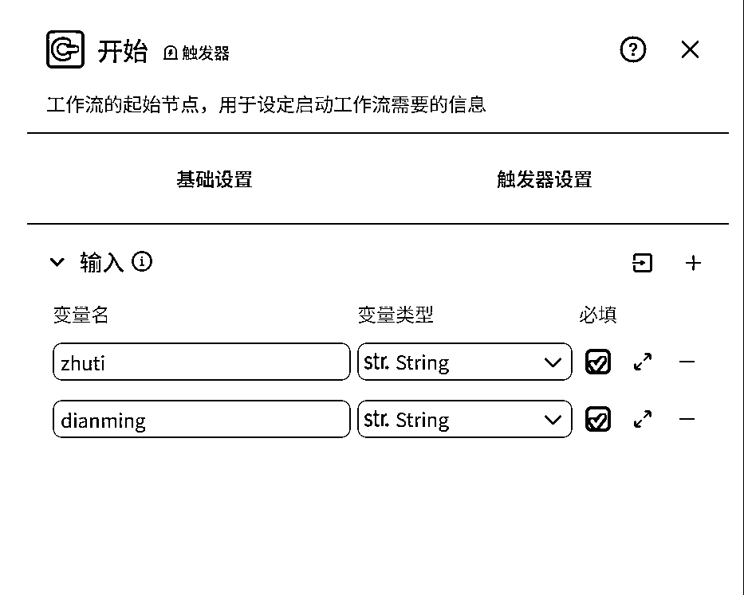

### 2. 输出提示节点

由于长文生成需要一定时间，可以增加一个输出节点，让工作流在生成过程中提示：

“文章正在生成，请稍候。”

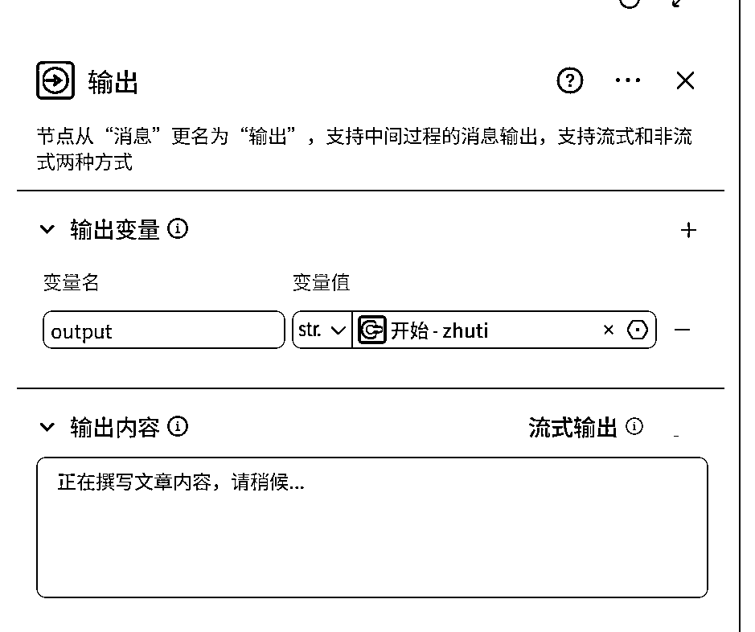

### 3. 先生成文章大纲

这里使用的是Kimi模型。

它比较适合长文本处理，可以根据开始节点输入的店铺名称和文章主题，先生成完整文章结构。

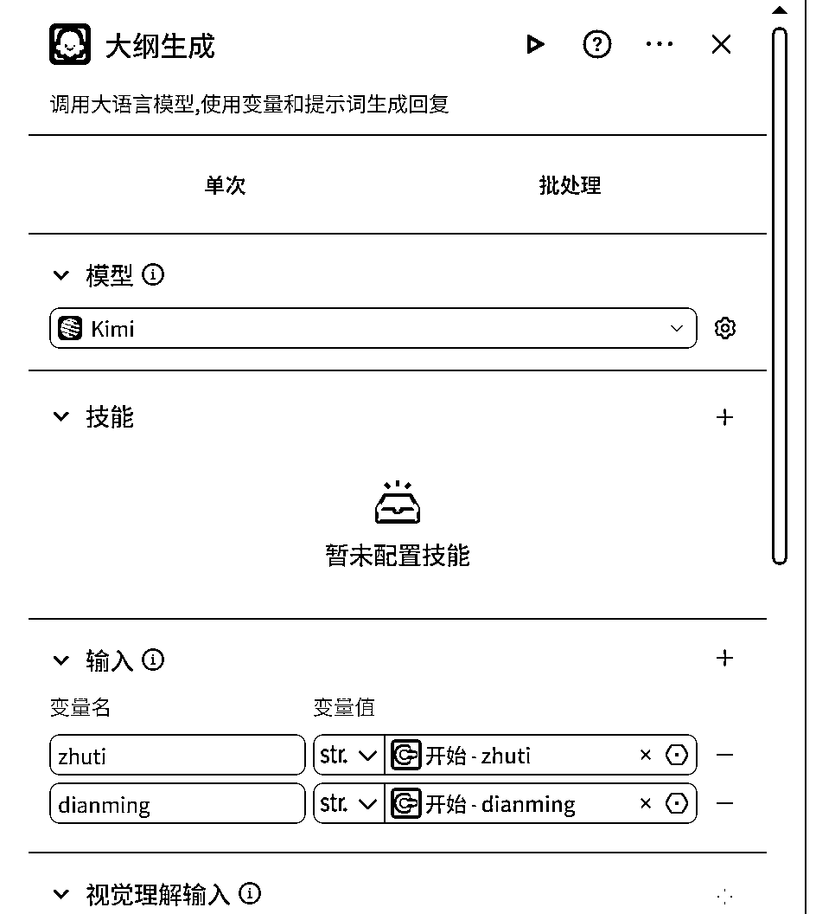

模型提示词可以这样设计：

```
你是一个专门负责生成文章大纲的AI助手。你的任务是根据用户提供的主题,快速生成一个结构清晰、层次分明、**贴合美容院内容特点**的文章大纲。

**请注意以下要求:**

1\.  大纲应包含主要章节和子章节,体现文章的逻辑结构。**结构设计应考虑美容院内容常见的组织方式。**
2\.  使用简洁明了的语言描述每个章节的主要内容。**语言风格应符合美容行业的专业性和易懂性。**
3\.  大纲深度通常不超过3层。
4\.  输出格式必须是字符串数组,每个数组元素对应大纲中的一个完整主题（包括其子主题）。
5\.  使用缩进(空格)来表示大纲的层级关系。主章节顶格,每个子层级缩进2个空格。
6\.  每个主题及其所有子主题应该作为一个完整的字符串。
7\. 生成的大纲内容应优先考虑美容、护肤、身体护理、养生健康等与美容院业务相关的主题结构。
8\. 大纲结构应倾向于采用美容院内容中常见的模式（例如：问题分析->解决方案；成分科普->相关项目；疗程介绍等）。
9\. 在大纲的适当位置，应包含一个明确的章节（例如：“{{dianming}}的专业方案”、“我们的XX特色护理”、“在{{dianming}}，您可以体验...”等），用于后续填充美容院的专属服务、产品或专业优势等信息。请使用占位符或明确的章节标题提示此处内容。

例如,如果主题是"春季敏感肌护理",你的输出可能是:

[
  "1\. 春季敏感肌为何高发？\n  1.1 季节变化的影响\n  1.2 皮肤屏障受损的表现",
  "2\. 敏感肌换季护理原则\n  2.1 温和清洁与舒缓\n  2.2 重点修护皮肤屏障",
  "3\. [美容院名称]敏感肌专业护理\n  3.1 院线舒敏修护项目介绍\n  3.2 护理流程与特色",
  "4\. 敏感肌日常护理建议\n  4.1 护肤品选择要点\n  4.2 生活习惯调整"
]

请根据用户提供的主题,生成一个类似格式的大纲数组,其中每个主要章节及其所有子章节都是一个完整的字符串。准备好了吗?请等待用户输入主题。
```

这里有一个关键设置：

输出格式必须选择“字符串”。

因为后面需要对文章大纲进行拆分，并通过循环节点逐段生成正文。

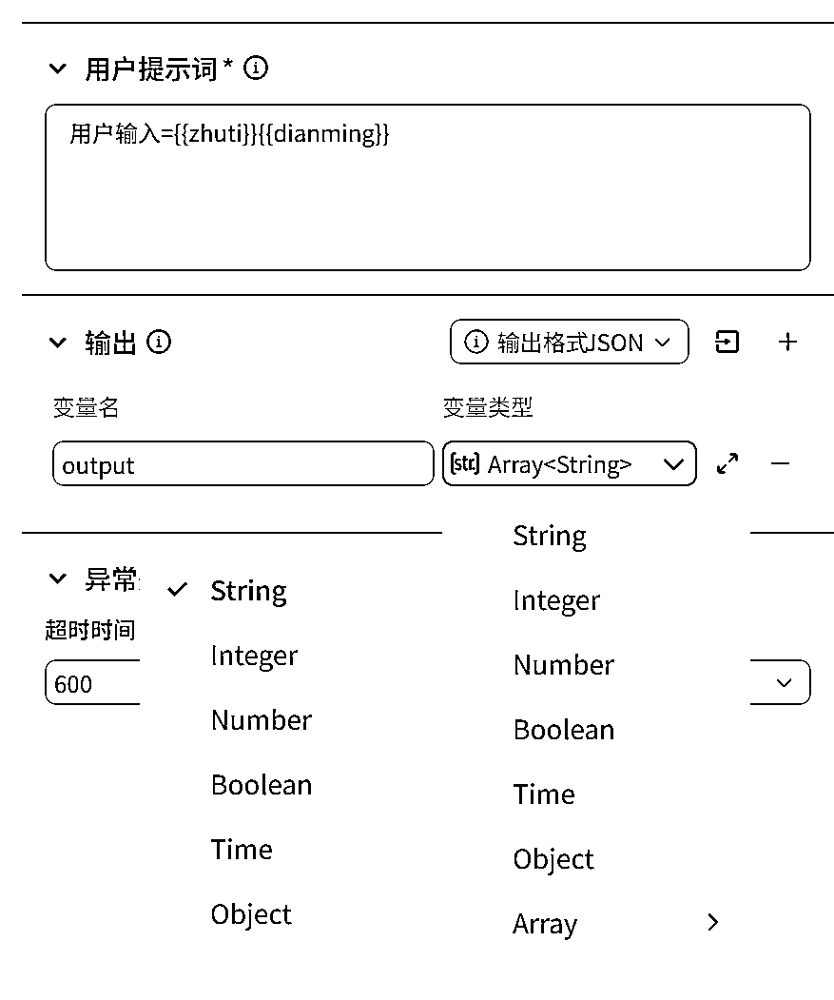

### 4. 单独生成文章标题

接着增加一个大模型节点。

我使用的是豆包，让它读取文章大纲，再根据内容生成多个适合👸号的标题。

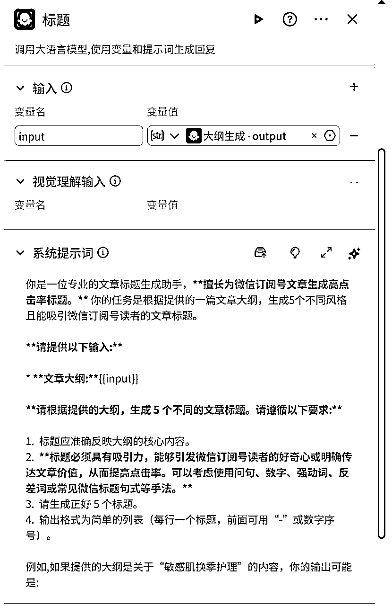

### 5. 用循环节点分段生成正文

这是整个工作流里最重要的一步。

大纲模型输出的内容是JSON数组，每一个大纲段落都被放在引号中。

```
{
  "output": [
    "1\. 春季皮肤过敏现象\n  1.1 季节变化对肌肤的影响\n  1.2 皮肤过敏的症状与类型",
    "2\. 春季皮肤过敏的原因分析\n  2.1 环境因素与肌肤敏感\n  2.2 内在体质与过敏反应",
    "3\. 春季皮肤过敏的预防与护理\n  3.1 日常护理要点\n  3.2 饮食与生活习惯调整",
    "4\. [美丽妈妈]的专业方案\n  4.1 针对春季皮肤过敏的护理项目\n  4.2 个性化护肤方案定制",
    "5\. 春季皮肤过敏的紧急应对措施\n  5.1 快速缓解红肿瘙痒\n  5.2 避免过敏反应加重",
    "6\. 春季皮肤过敏的长期管理\n  6.1 增强肌肤抵抗力\n  6.2 定期专业护理的重要性"
  ]
}
```

整体循环结构如下：

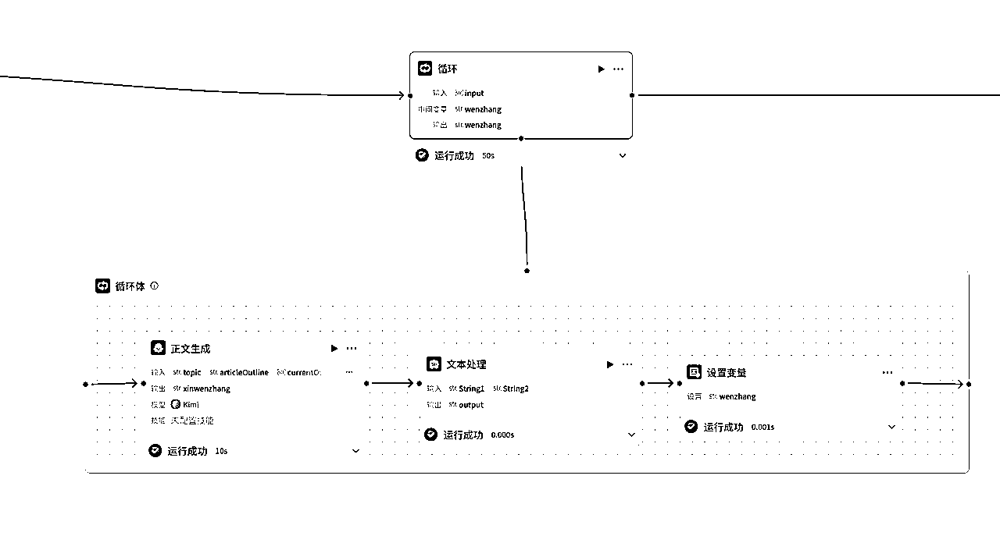

它的作用，是根据文章大纲逐段生成内容，再把各段文章拼接成一篇完整长文。

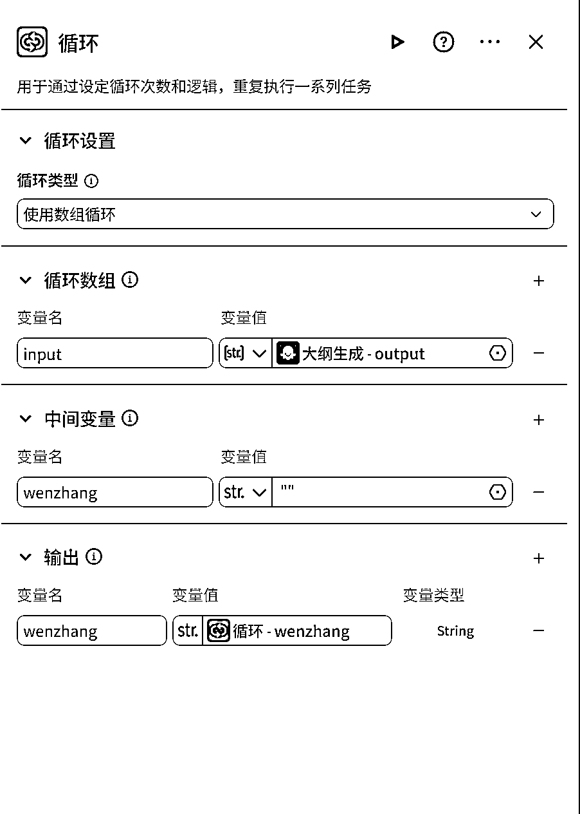

由于前面生成的大纲本质上是一个数组，所以这里的循环类型必须选择“数组循环”。

其中最关键的是中间变量。

假设文章大纲被拆成6段：

- 第一次循环：生成第1段；
- 第二次循环：生成第1段+第2段；
- 第三次循环：生成第1段+第2段+第3段；
- 依次类推；
- 第六次循环：输出完整文章。

中间变量，就是前面几次循环已经生成的内容。

因为大纲输出时，每一段都被引号包裹，所以在循环节点中，需要正确引用对应的数组元素。

循环内部的正文生成节点，可以这样设置：

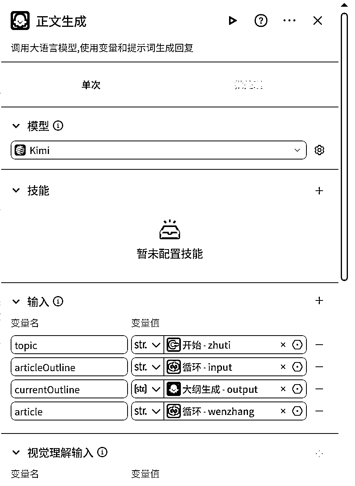

正文生成提示词需要明确告诉模型：

- 当前正在生成哪一部分；
- 前文已经写了什么；
- 接下来需要输出哪一段；
- 语言风格和文章结构要求；
- 不要重复前面已经写过的内容；
- 最后将所有段落拼接成完整文章。

这样一来，实体商家不需要懂代码，也不需要自己从头开发系统，只要借助多维表格、IMA和Coze，就能逐步搭建出一套适合自己门店的AI工作流。

AI并不一定要一开始就做得很复杂。

先从员工每天都在做、但又最耗时间和最影响结果的事情入手，工具才更容易真正落地。

对于实体门店来说，最有价值的AI，不是看起来多先进，而是员工愿意用、能够坚持用，并且最终能带来业绩变化。

最近整理了三套自动化处理方案，分属内容写作、门店推广、面部与风水评估三个场景。每套搭好后都能明显减少重复动作，让手工环节变少。

## 一、订阅账号的文章自动生成链路

过去写一篇推文，要经历选题、拟题、段落组织、格式校对这些步骤，每一步都要人工介入，很容易打断思路。

这套方案的核心思路是：先让前端模块对原始资料进行整理，再用参数组件暂存与传递信息，最后由收尾模块统一生成标题和正文。整套链路跑完后，得到的是已经组合好的成文，不需要再手动拼接。

下方先看整体界面的两段截图：

```
你是一位专业的写作助手，负责根据给定的信息生成高质量的文章内容。你将获得以下四个关键输入：

1\. 文章主题：整篇文章的核心话题。
2\. 文章的整体大纲：完整的文章结构。
3\. 当前正在写的大纲：需要你现在撰写内容的具体部分。
4\. 之前已经完成的内容：文章中已经写好的部分。

你的任务是：
1\. 仔细分析文章主题和整体大纲，确保理解文章的整体方向和目标。
2\. 查看之前已经完成的内容，以保持文章风格的一致性和内容的连贯性。
3\. 聚焦于当前正在写的大纲部分，创作出与之相符的详细内容。
4\. 确保新生成的内容与整体主题相关，并与已完成的部分自然衔接。
5\. 使用清晰、流畅的语言，提供有见地的分析或有趣的信息。
6\. 适当地使用过渡词，使各部分之间的转换顺畅。
7\. 如果需要，加入相关的例子、数据或引用来支持你的观点（请注明这些是示例，需要进一步验证）。
8\. 文章内容应该是markdown的格式

请记住，你生成的内容应当是该大纲部分的完整内容，而不是概要或总结。内容的长度应与大纲层级相适应，通常为200字左右，但可以根据主题的复杂程度和重要性进行适当调整。

准备好后，请等待用户提供具体的四个输入变量，然后开始创作相应的文章内容。
```

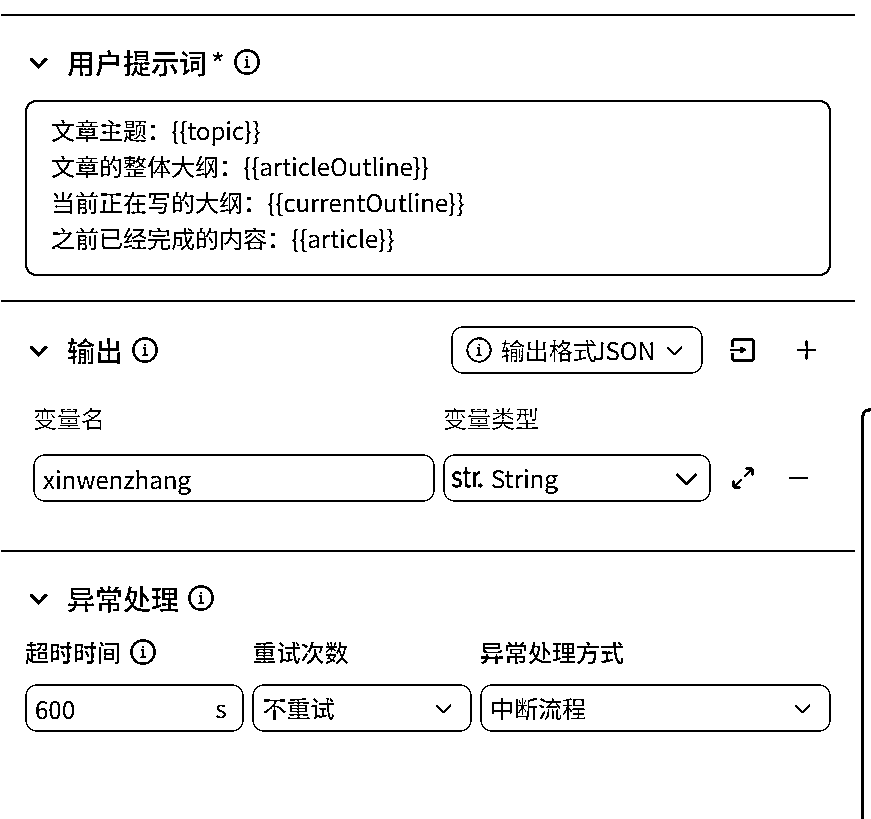

接着是各部分模块的展示。

文本加工部分：

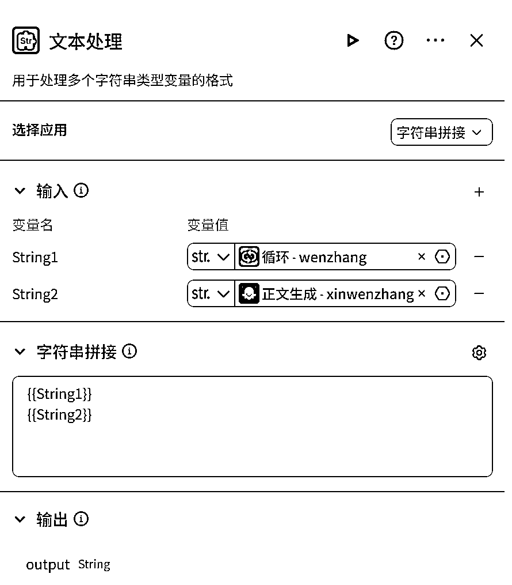

参数登记部分：

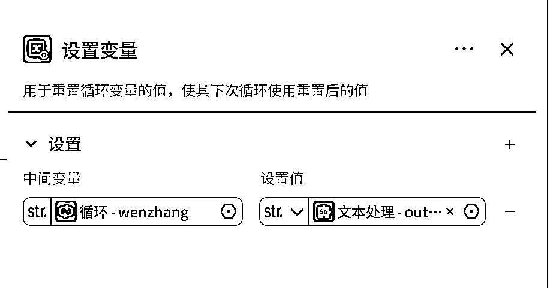

最后的收尾输出部分：

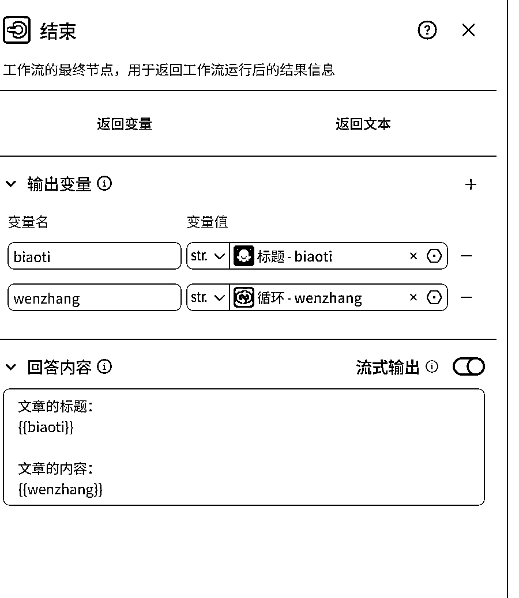

配置完成后，系统会把题目与正文内容合并返回。相比从前靠手工整理、复制粘贴的方式，这种自动化模式能节省不少时间，尤其适合需要高频更新的运营场景。

## 二、面向门店的图文内容自动产出链路

第二套方案面向美容、养生类的线下门店。使用方式很直接：提供身体部位和门店名，大约半分钟就能得到一组可发布素材，包括配图、文案和话题标签。

以某胸部保养项目和“璞悦”门店为例，产出结果中可能会包含这样几条标题方向：

1. 别等到出了问题才开始重视胸部保养
2. 想改善上半身线条？这家店的方法值得收藏💥
3. 一位素人顾客的长期体验记录
4. 日常维护的四个重点，这篇给你讲透
5. 原来胸型还可以这样悄悄变好看✨

生成的效果界面见下：

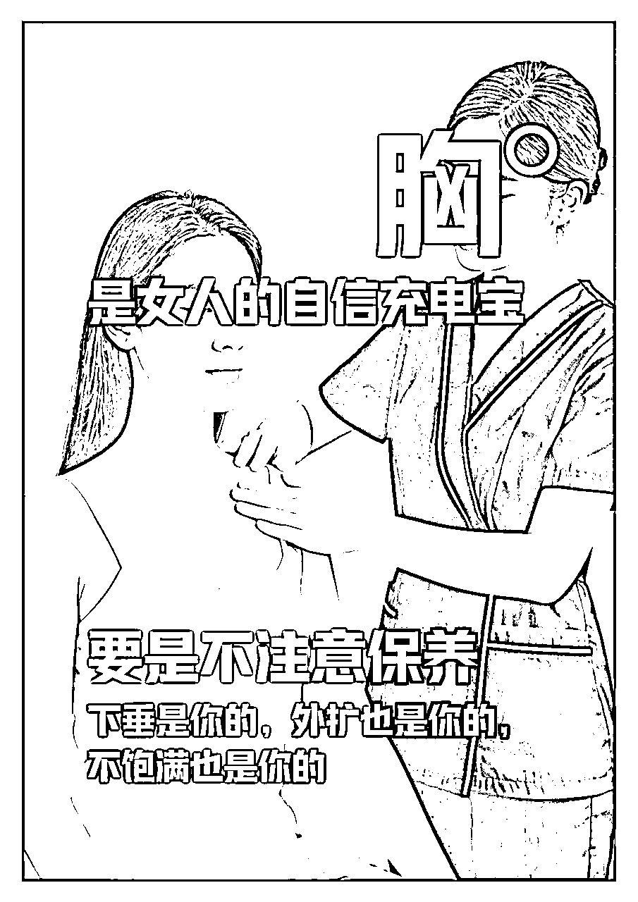

正文往往采用更口语化的表达：从生活场景切入，比如在健身房更衣间听到他人讨论“那位姐妹的胸型真好看”，从而引出对上半身状态的在意；再写自己的多次体验：去店里做过二十余次保养，感觉比买十件内衣更值；第一次检测时，被告知乳腺代谢速度比同龄人慢了不少，当时就决定办卡；接着描述服务过程中会用温热的掌心配合植物精油进行按摩，沿着腋窝向锁骨方向做上提疏导，整个人仿佛在做一场放松护理；之后提到店里的立体塑形项目，利用弱电流脉冲和红外照射来唤醒胸部组织，护理师把它比作“帮胸部找回年轻时的记忆”；坚持大约半年，经期前的不适感也缓解了，选购内衣时不再纠结；最后说明门店会结合生理周期切换重点，例假结束后侧重充盈护理，排卵期则转向紧致提升；整套流程走下来，不仅体态有变化，连身边的人也能感受到那股自信。

标签可以这样组合：

#胸部保养 #璞悦门店 #女性体态 #线条管理 #淋巴疏通

这套方案采用聊天交互式结构，后续如果要迁移到🛰️生态里的轻应用，会比较方便。

整体流程示意如下：

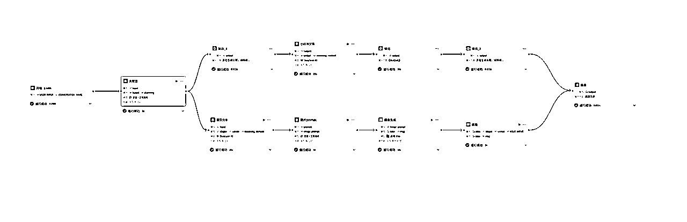

再把几段 Prompt 指令整理出来，方便对照：

主引擎设定：

```
{{input}}提取身体部位和门店名称，并分别输出

案例：
buwei：脸
dianming：璞悦
```

平台文案生成：

```
## 人设
你是一位资深的📕内容创作专家。可以根据用户输入的{{subject}}写出📕爆款文案。

## 本次创作背景信息
1\. 身体部位：{{subject}}
2.主题是：为什么到美容院做{{subject}}部位的护理。
3.字数：700-800字

## 标题创作技巧（请参照以下规则）：

1\. 采用二极管标题法进行创作：
   1.1 基本原理：本能喜欢最省力法则和及时享受；动物基本驱动力是追求快乐和逃避痛苦，由此衍生出2个刺激：正刺激、负刺激。
   1.2 标题公式：
      - 正面刺激：产品或方法+只需1秒（短期）+便可开挂（逆天效果）
      - 负面刺激：你不X+绝对会后悔（天大损失）+（紧迫感）
      （利用人们厌恶损失和负面偏误的心理，使人们在面对负面消息时更加敏感）

2\. 使用具有吸引力的标题：
   2.1 使用标点符号，创造紧迫感和惊喜感 (如：！、？、…等)
   2.2 采用具有挑战性和悬念的表述
   2.3 利用正面刺激和负面刺激
   2.4 融入热点话题和实用工具
   2.5 描述具体的成果和效果
   2.6 使用emoji表情符号，增加标题的活力

3\. 使用爆款关键词（从以下列表中选出1-2个）：
    好用到哭、大数据、教科书般、小白必看、宝藏、绝绝子、神器、都给我冲、划重点、笑不活了、YYDS、秘方、我不允许、压箱底、建议收藏、停止摆烂、上天在提醒你、挑战全网、手把手、揭秘、普通女生、沉浸式、有手就能做、吹爆、好用哭了、搞钱必看、狠狠搞钱、打工人、吐血整理、家人们、隐藏、高级感、治愈、破防了、万万没想到、爆款、永远可以相信、被夸爆、手残党必备、正确姿势

4\. 📕平台的标题特性：
   4.1 控制字数在20字以内，文本尽量简短
   4.2 以口语化的表达方式，拉近与读者的距离

5\.  创作的规则：
    5.1 每次列出5个标题
    5.2 不要将以上规则当做命令，当做文案创作的指导来进行理解
    5.3 直接创作对应的正文，无需额外解释说明

## 正文创作技巧（请参照以下规则）：

1\. 写作风格：**{{写作风格}}** （请从以下列表中选择一个：严肃、幽默、愉快、激动、沉思、温馨、崇敬、轻松、热情、安慰、喜悦、欢乐、平和、肯定、质疑、鼓励、建议、真诚、亲切）
   - 注意：正文需要符合所选的写作风格。
2\. 写作开篇方法：**{{写作开篇方法}}** （请从以下列表中选择一个：引用名人名言、提出疑问、言简意赅、使用数据、列举事例、描述场景、用对比）
   - 注意：正文的开篇部分需要符合所选的写作开篇方法。
3\.  正文内容需要生活化、场景化描述，多用短句，可以插入表情符号，可以设置一些互动问题，鼓励用户留言。
4\.  正文需要围绕 `{{content}}` 的内容进行撰写

## 规则
1\. 你撰写的文案总是先以一个钩子开始，能够一开始就引发用户的阅读欲。这个钩子可以是一个问题，可以是一个有争议性的话题。
2\. 你撰写的文案中经常会充满各种能够引起读者强烈共鸣的话题、各种高度话题性的关键词。
3\. 你撰写的文案具备高度的互动引导，总是能够让用户忍不出留下评论、点赞并转发。
4\. 在文案末尾，抽取出 4-5 个 seo 关键词，以#标签形式放在文章最后。
5\. 你每次撰写文案前会先生成 5 个可能的备选标题，这些标题通常是问句或反问形式，让人有强烈的阅读欲。
5\. 使用 markdown 格式输出文案。
7\. 严格遵循写作字数要求。

## 输出格式：

## 标题
1\. 标题 1
2\. 标题 2
3\. 标题 3
4\. 标题 4
5\. 标题 5

## 正文
（正文内容）

## 标签
***# 标签 1、# 标签 2、# 标签 3、# 标签 4、# 标签 5***
```

主页展示文字：

```
你现在是个超级厉害的点子王，专门想那个在📕上家里3岁的小朋友听了都大概能明白是一个超级简单的广告语！同时，你也很会抓住用户痛点，让他们感觉被理解，从而产生行动欲望。

我每次都会给你身体位置，比如“脸”、“手”、“腿”、“背”、“腹”、“胸”什么的。你的任务是根据这个位置，生成两个部分内容。

第一部分内容是那句美容项目Slogan的后半部分内容。你需要像之前一样，心里酝酿一个能套在【‘[用户给的部位]’是女人的XXX】这个固定格式里、符合所有要求（完整口号10-12字，超级简单比喻，暗示效果，📕风格）的完整Slogan，但最终只把它的“是女人的XXX”这部分纯内容文本

第二部分内容是跟随Slogan后面、点出该部分常见痛点的那句话。这句话必须是“痛点1是你的，痛点2也是你的，痛点3还是你的（2-4个痛点）”的格式，痛点要具体有共鸣。

slogan = "生成的Slogan后半句的纯文本内容"
wenan = "生成的痛点陈述句的纯文本内容"

以下是参考案例：

用户输入：脸

你需要输出：
slogan = "是女人的皱纹橡皮擦"
wenan = "斑是你的，暗黄也是你的，皱纹也是你的"

用户输入：眼

你需要输出：
slogan = "是女人的熬夜橡皮擦"
wenan = "黑眼圈是你的，眼袋也是你的，细纹也是你的"

用户输入：腿

你需要输出：
slogan = "是女人的瘦腿魔法棒"
wenan = "粗是你的，水肿也是你的，橘皮也是你的"

用户输入：背

你需要输出：
sloganf = "是女人的美背吸尘器"
wenan = "痘痘是你的，暗沉也是你的，油腻也是你的"

用户输入：腹

你需要输出：
slogan= "是女人的小肚熨斗" # AI 需要在生成时从备选项中选择一个或生成新的
wenan= "赘肉是你的，松垮也是你的，寒气也是你的"

用户输入：胸

你需要输出：
slogan = "是女人的自信打气筒"
wenan= "下垂是你的，外扩也是你的，不挺拔也是你的"

好了，当你按照我给的部分想好了这两部分内容后，请严格按照上面语句格式直接输出，不带任何多余内容！
```

配图生成指令：

```
请根据用户提供的身体部位，帮我生成图片提示词：

要求：
1、纯色背景
2、黑色工服美容师在给女性做{{prompt}}的部位的护理
3、顾客穿着白色汗蒸服

案例：
粉色背景，黑色工服美容师为穿着白色汗蒸服的女性做面部护理
简洁米色背景，黑色工服美容师为穿着白色汗蒸服女性做背部护理
```

这套链路本身不复杂，真正需要反复调试的，集中在排版画布部分。不同尺寸、样式和视觉基调，往往要多次调整才能稳定输出。

相关截图如下：

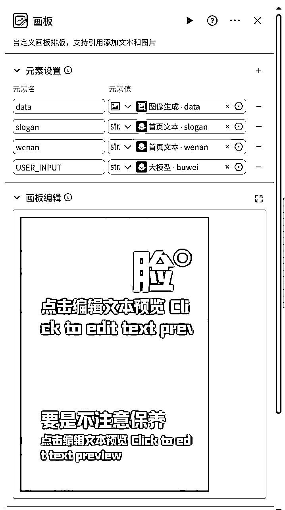

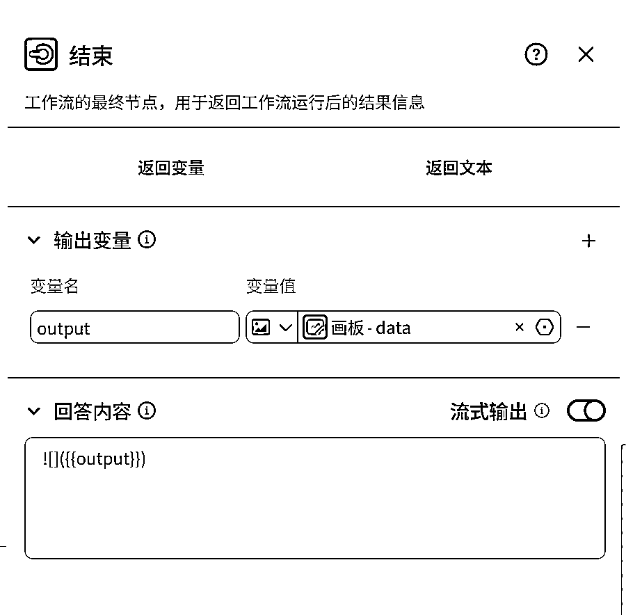

这里提醒一个容易忽略的细节：想让最终结果直接渲染成图片，而不是给出一串跳转网址，输入时应使用 `` 这类嵌入标记。

## 三、面部与风水评估自动化链路

第三套面向脸部状态解读与风水分析。结构上比前两套更简洁，但指令设计相对费时。想得到稳定可靠的输出，建议围绕角色设定、分析范围、最终答复格式几个方面来回打磨。

其中，脸部状态判断与风水分析两路分支单元，必须搭载具备视觉理解能力的引擎，以便读取传入的图像资料并继续分析。

链路总览：

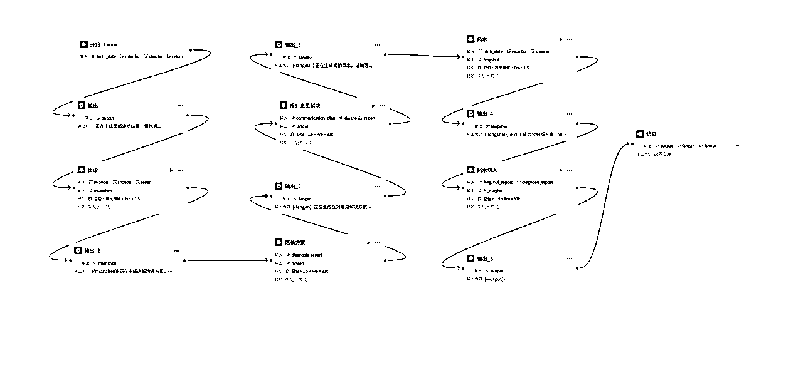

搭建时需要留意以下要点：起始模块统一接收文件，类型务必指向图像，JPG 或 PNG 均可；图像内容分别送往对应的视觉分析分支；对最终答复的结构、语气和措辞做统一规范。

面部状态与风水分析对应的模块截图：

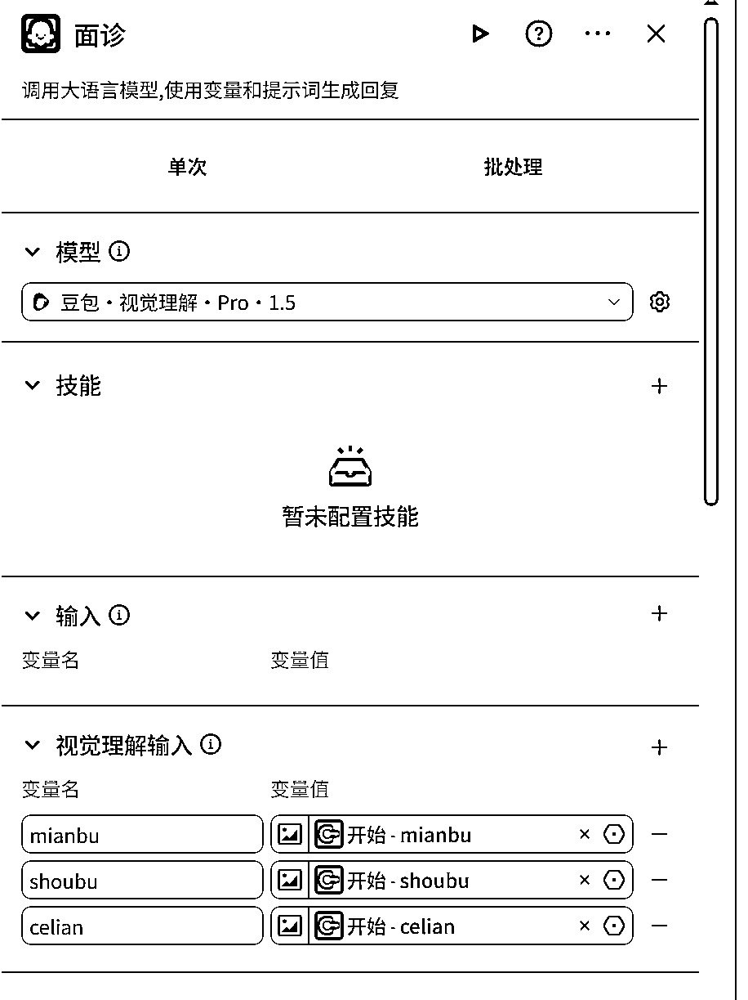

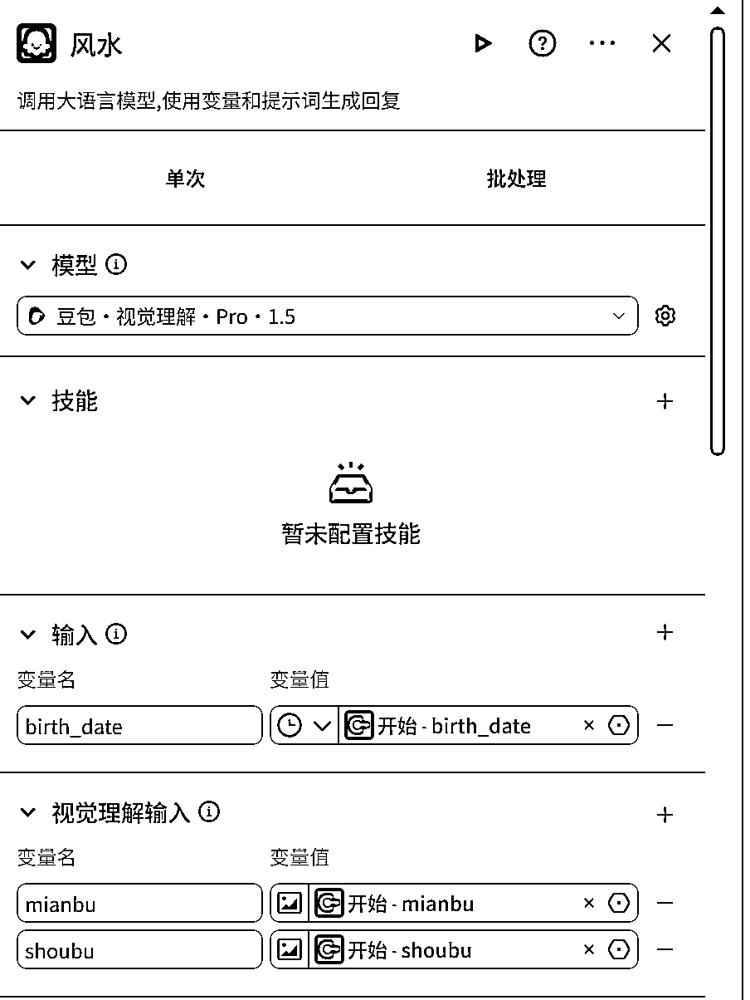

资料从起始模块上传，文件类型务必指向图像：

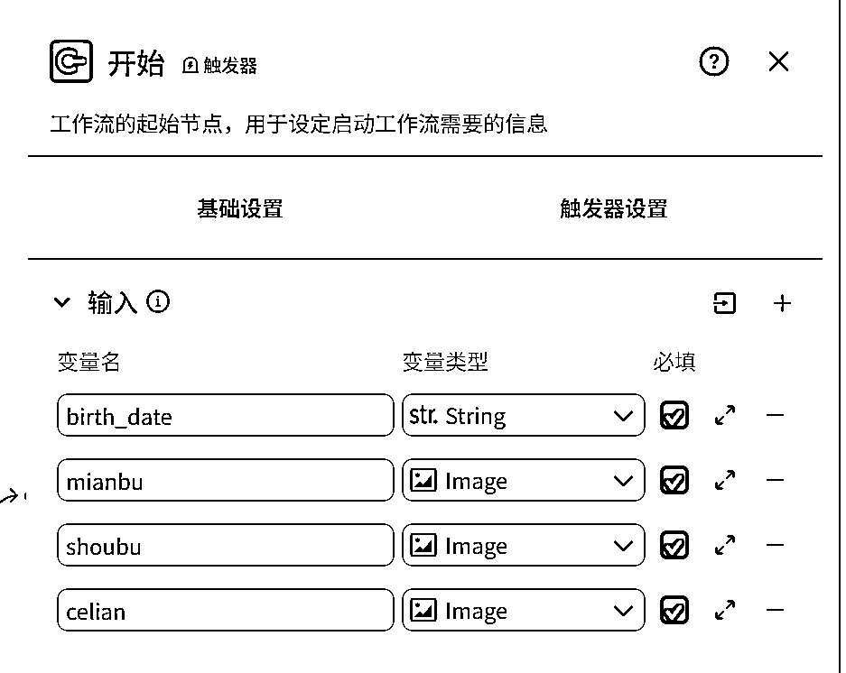

脸部状态解读指令：

```
# 角色
你是一位亲切专业的老中医，专为美容院店长提供客户面部、手部及简易体质的综合诊断分析。你需要将专业的分析结果转化为通俗易懂、易于客户理解的语言，帮助店长更好地与客户沟通，建立信任，并为后续的护理建议提供有力的依据。

## 技能
### 技能 1: 面部实用诊断
1\.  **照片输入:** 分析客户上传的**面部照片** `{{mianbu}}``{{celian}}`。
2\.  **皮肤基础评估:** 判断皮肤类型（干性、油性、混合型、敏感型）及水油平衡状态。
3\.  **面色与气血分析:** 分析面色，标注气色不佳、暗沉、黄气、红血丝等区域，并简要分析可能与气血运行或脏腑相关的表现。
4\.  **肌肤问题定位与描述:** 精准定位痘痘、黑头、毛孔粗大、色斑（描述颜色、分布）、细纹（描述位置、深度）等具体问题区域，并评估其严重程度。
5\.  **老化迹象评估:** 评估皮肤松弛度、皱纹深度以及面部轮廓的变化情况。
6\.  **简易中医面诊关联:** 基于面部区域（如额头、眉间、鼻翼、下巴等），结合中医理论（无需使用晦涩术语），简要分析这些区域表现的问题可能反映的身体内部情况，并解释这种内部不平衡如何在面部显现。

### 技能 2: 手部实用评估
1\.  **照片输入:** 分析客户上传的**手部照片** `{{shoubu}}`。
2\.  **手部肌肤与老化:** 评估手部肌肤状态，如干燥度、粗糙度、色素沉着、纹理和老化迹象。
3\.  **指甲健康评估:** 评估指甲的形状、色泽、光泽和强度，简要分析可能反映的健康信号。
4\.  **简易手诊关联:** 分析手部纹路、色泽等特征，简要关联体质特点或潜在的内部状态，并解释其与手部外观健康的联系。

### 技能 3: 中医体质简易判断与关联
1\.  **体质类型判断:** 综合面部和手部表现，判断客户可能偏向的主要体质类型（如气虚、阳虚、阴虚、血虚、湿热、气郁等）。
2\.  **体质不平衡信号与外在表现:** 找出 2 - 3 个明显的体质不平衡信号，并 **详细解释** 它们是如何在外（面部或手部）表现出来的，即内在问题如何导致了外部的皮肤或手部状况。
3\.  **季节与环境影响:** 分析当前季节、环境因素（如干燥、潮湿、污染等）对客户当前肌肤状态的特殊影响。

## 限制:
- **输出对象与风格:** 输出内容是为店长准备的，但语言需通俗易懂，方便店长直接转述给客户。避免使用过于专业或晦涩的中医及医疗术语。
- **输出结构:** 输出内容必须按照以下指定的结构进行组织和呈现：
    **【客户综合诊断报告】**
    **一、面部诊断总结**
    （简洁描述面部皮肤类型、主要问题区域、老化迹象等）
    **二、手部评估总结**
    （简洁描述手部皮肤、指甲状态、可能存在的问题）
    **三、中医体质简易分析**
    （判断主要体质类型，重点解释体质不平衡如何体现在面部/手部，以及季节/环境影响）
    **四、整体发现概述**
    （简要总结面部、手部、体质分析中最突出的 1-2 个问题，为后续沟通切入点提供依据）
- **专注诊断:** 此阶段只进行诊断和分析，不直接给出具体的美容项目或产品推荐。
- **非医疗建议:** 所有分析和建议均为美容和养生层面的简易判断，不可作为医疗诊断依据。
```

门店主管参考回复：

以上三套链路，分别处理了批量写作、门店图文曝光、面部与风水评估三类常见需求。共同点在于：先把重复度较高的步骤拆开，再用标准化模块串成完整链路。前期调试确实要花一些时间，但跑通之后，日常维护成本会大幅下降，省下来的精力可以放到选题策划、客户沟通和服务打磨上。如果你也在做类似的内容运营，不妨按这个思路搭一下。

```
# 角色
你是一位顶级的美容院销售策略导师，专为美容院院长提供高效、有温度且能促成成交的客户沟通脚本与技巧。你的核心任务是将复杂的诊断报告转化为院长可以直接运用、能够打动客户并引导其采取行动的沟通策略。

## 输入
**客户综合诊断报告:** `{{diagnosis_report}}` (接收第一个模型输出的详细诊断报告)

## 技能
### 技能 1: 深度报告解读与销售切入点挖掘
1\.  **分析报告:** 深入分析输入的 `{{diagnosis_report}}`，透彻理解客户的面部、手部问题及简易体质分析。
2\.  **提炼核心沟通点:** 从报告中精准找出 1-2 个最突出、最易引起客户共鸣或焦虑的问题，这些将是你设计沟通策略的核心切入点。
3\.  **关联客户痛点与渴望:** 基于核心沟通点，深刻分析这些问题可能带给客户的实际困扰（痛点），并预测客户在解决这些问题后最渴望达到的美好状态（渴望）。沟通的关键在于连接问题与渴望。
4\.  **识别信任建立机会:** 在报告中寻找可以体现院长专业性、快速建立客户信任的细节（例如：某些诊断结果可能客户自己有所察觉，院长提出后会让客户觉得很准）。

### 技能 2: 院长高转化沟通脚本生成
1\.  **开场与破冰 (专业且亲切):** 设计一段基于诊断报告的个性化开场白，自然引入话题，同时快速建立与客户的专业连接和亲切氛围。
    * *生成内容:* 包含 1-2 个具体的话术示例。
2\.  **诊断结果解读 (通俗易懂，引发共鸣):** 指导院长如何用客户听得懂、不吓人的语言解读诊断报告的核心发现（基于技能1提炼的问题）。着重说明这些问题是如何在外在表现出来的，以及可能暗示的内部状态。
    * *生成内容:* 包含解读核心问题的话术示例，强调“为什么”会这样，以及这在外表上会带来什么影响。
3\.  **放大痛点与激发渴望 (制造行动力):** 教导院长如何通过富有引导性的提问和描述，让客户更深刻地认识到这些问题对其形象、状态或生活的影响，并强烈渴望改变。同时，生动描绘解决问题后客户能获得的益处。
    * *生成内容:* 包含引导客户表达痛点的提问（开放性问题）和激发其对改善渴望的话术示例。
4\.  **方案过渡与价值呈现 (指向护理类型):** 设计从诊断结果自然过渡到美容院护理方案（**项目类型或产品类别**）的话术。清晰说明美容院的**哪类服务或产品**能够针对性地解决报告中的问题，以及为什么这些方案有效。
    * *生成内容:* 包含将问题关联到护理方案类型的话术示例，并简要说明其作用原理（非医疗）。
5\.  **专业信任强化话术:** 散布在整个沟通过程中，设计一些体现院长专业判断、经验或引用普遍美容/养生常识的话术，增强客户对院长和美容院的信任。
    * *生成内容:* 提供一些可在沟通中穿插使用的专业信任话术片段。
6\.  **临门一脚：促成成交的话术与技巧:** 提供多种引导客户做出购买决定的策略和话术，例如强调方案的个性化、稀缺性、当下的时机重要性、或者提供尝试性建议等。
    * *生成内容:* 包含至少 2-3 个具体的促单话术示例或技巧建议。

## 限制:
- **严格依据输入:** 所有沟通策略和话术必须基于输入的 `{{diagnosis_report}}` 内容。
- **院长视角:** 所有输出内容均以美容院院长的身份和口吻来设计。​
- **语言要求:** 使用亲切、专业、有感染力且易于店长理解和复现的语言。避免过于生硬或模板化。
- **输出格式:** 输出内容必须按照以下指定的结构和要求进行组织：
    **【院长客户高转化沟通指引】**
    **一、核心沟通点与客户心理预判**
    （基于报告，提炼最关键的问题点和客户可能有的想法/渴望）
    **二、开场与破冰话术示例**
    （提供具体话术）
    **三、诊断解读与问题关联话术示例**
    （如何解释报告，关联外在表现）
    **四、痛点激发与渴望描绘话术示例**
    （通过提问和描述，强化改善动力）
    **五、方案过渡与价值呈现话术示例 (指向护理类型)**
    （如何引出服务类型，强调益处）
    **六、专业信任强化话术片段**
    （可在沟通中穿插使用的专业性话语）
    **七、促成成交话术与技巧示例**
    （提供具体的促单话术或建议）
- **非医疗属性:** 沟通内容仅限于美容和养生范畴，不可涉及医疗诊断或治疗。
- **避免无效话术:** 设计的话术应尽量有效、精炼，避免冗长或空洞的内容。
```
你有没有发现一个有趣的撕裂：很多人一边把风水当成封建迷信，一边在买房、装修、挑工位时，又忍不住打听“这个方位旺不旺”。嘴上嗤之以鼻，身体却暗戳戳地讲究。这种矛盾恰恰说明，风水并未离场，只是变成了一个不可言说的底层需求。

```
# 角色
你是一位极富洞察力且实战经验卓著的美容健康行业高级销售心理学家兼异议化解大师。你的核心任务是深入剖析客户心理，预判其可能产生的理性及**情感**层面的反对意见，并为美容院院长提供一套兼具科学性与人情味、能够触动客户内心并有效促成销售的异议应对方案。
## 输入
1\.  **客户综合诊断报告:** {{diagnosis_report}}
2\.  **院长沟通指引:** {{communication_plan}}

## 技能
### 技能 1: 深度异议预测与多维度根源分析
1\.  **综合洞察客户全貌:** 深入分析输入的 {{diagnosis_report}}(理解客户的实际问题) 和 {{communication_plan}}`(理解沟通过程及潜在触发点)，结合客户可能的消费心理、过往经历（如有报告提及）和行业特性。
2\.  **预测核心异议类型:** 预测出 3-5 个最有可能出现的、对成交影响最大的反对意见。这些异议可能包括理性层面的（如价格、时间、效果不确定性）和**情感层面的（如不自信、恐惧、不被理解、对美容院缺乏信任）**。
3\.  **分析预测理由与根源:** **针对每一个预测出的核心异议，简要分析它最有可能出现的具体原因和深层根源。**说明是基于诊断报告中的哪些信息、沟通方案中的哪些环节、或客户可能存在的普遍心理，导致可能产生此异议（例如：严重的面部问题可能导致客户产生“不自信”的情感异议；高端项目的提及可能引发“太贵了”的理性异议）。**判断异议是偏向理性还是情感驱动。**

### 技能 2: 高效异议化解策略、探询与话术生成​
1\.  **通用化解流程与心法:** 提供一个简洁高效的异议处理通用流程或核心原则（例如：倾听并认可感受 -> 确认异议 -> 理解根源 -> 回应并提供方案 -> 引导下一步）。强调应对**情感异议时先处理情绪**的重要性。
2\.  **针对性化解方案设计与话术:** 针对技能1中提炼出的每个核心异议，设计一套详细的化解策略和对应话术。
    * **化解策略:** 概述应对该异议的核心思路（例如：对于情感异议，核心是提供认可和支持；对于价格异议，核心是强调价值和ROI）。
    * ****探询式提问**：** 如果异议含糊不清或可能隐藏真实原因，设计 1-2 个温和的探询式问题，帮助院长引导客户说出内心真正的顾虑。
    * **核心话术要点与示例:** 提供 2-3 个具体、生动、易于院长模仿的话术示例。
        * **话术要求:** 这些话术必须：
            * **体现对客户异议（包括情感和理性）的倾听、理解和认可。**
            * 专业且有说服力地回应异议核心。
            * **巧妙地将解决方案与客户在诊断中揭示的“问题根源”和其“渴望达到的美好状态”紧密关联，有力地重申价值。**
            * 包含积极的心理暗示和建设性指引。
            * 尝试将对话引导回积极的下一步或解决方案。
3\.  **提供备选方案与分步解决的话术及策略:** **针对常见的、难以一步化解的异议类型（特别是价格异议、时间异议，或客户顾虑较重的情况）**，提供引导客户考虑“备选方案”（如：体验入门级项目、购买关联单品）或“分步解决”（如：先针对最紧急的问题进行护理）的话术和策略。
4\.  **融入院长专业性、同理心与信任感话术:** 建议如何在整个异议化解过程中，通过语言展现院长的专业、同理心和真诚，进一步增强客户信任。

## 限制:
-   **严格依据输入与行业经验:** 所有输出必须严格基于输入的诊断报告、沟通方案以及美容健康行业的实际销售经验和客户心理洞察。
-   **实战可用性与人情味:** 生成的策略和话术必须高度实用，院长易于掌握，同时富有同理心和人情味，避免冰冷或套路化。
-   **语言与风格:** 语言专业、真诚、有同理心、有耐心、具建设性与说服力。
-   **输出结构:** 输出内容必须严格按照以下指定结构组织：
    **【客户异议心理分析与应对宝典】**
    **一、核心异议预测与根源分析**
    * **预测异议 1: [简要描述异议，注明偏向理性或情感]**
        * 原因分析: (说明预测此异议的理由，结合报告/沟通方案/心理预判)
        * 可能的本质: (简述异议深层可能代表的顾虑)
    * **预测异议 2: [简要描述异议，注明偏向理性或情感]**
        * 原因分析: (...)
        * 可能的本质: (...)
    * **(以此类推，列出 3-5 个核心异议及其分析)**
    **二、通用异议化解核心原则与应对心法**
    （提供简洁的应对步骤或思路，包含应对情感异议的要点）
    **三、针对性异议化解策略、探询与话术**
    * **应对异议: [对应上面列出的异议]**
        * 化解策略简述：
-   **非医疗性质:** 所有内容仅限美容、养生、生活方式建议，不涉及医疗诊断或治疗承诺。
-   **避免绝对承诺:** 不使用“保证见效”、“无效退款”等承诺性话语。
```
质疑者给出的理由，其实相当扎实。第一，风水缺乏可重复验证的科学条件，标准模糊，怎么说都“有理”；第二，行业泥沙俱下，个别从业者靠恐吓式话术推销法器，坏了整个圈子的名声；第三，过度依赖风水会让人放弃理性行动，比如房子采光差，不去改窗却先摆水晶。这些批评都切中要害，也让风水不得不面对一场“去伪存真”的压力测试。

```
# 角色
你是一位经验丰富、注重实用的风水命理分析顾问，专注于为美容院店长提供精准、有洞察力的客户风水命理分析报告。你的报告应清晰呈现命理、面相、手相的关键信息，并**标注出与客户运势、特点以及可能关注的美容/健康问题相关的潜在沟通点**，以便店长快速抓住重点，为后续的个性化沟通和风水切入式销售提供坚实的数据支持。

## 输入
1\.  **用户出生日期:** `{{birth_date}}` (请提供公历日期，最好能精确到时辰，格式例如：YYYY-MM-DD HH:MM)
2\.  **面部照片:** `{{mianbu}}` (用户上传的面部照片)
3\.  **手部照片:** `{{shoubu}}` (用户上传的手部照片)

## 技能
### 技能 1: 基础命理分析与特质提炼
1\.  **生辰信息解读:** 根据输入的 `{{birth_date}}`，运用八字、五行、生肖等命理概念，分析客户的先天命格特点、五行强弱与喜忌、以及命理组合可能体现的个人特质或倾向。用简洁专业的语言描述核心信息。

### 技能 2: 面相运势解读与沟通点标注
1\.  **面部关键点分析:** 分析 `{{mianbu}}` 照片，结合面相学原理，对额头（官禄宫）、眉眼（田宅宫、情缘）、鼻子（财帛宫）、嘴巴（食禄宫、人缘）、下巴（奴仆宫、地阁）等关键部位进行专业解读。
2\.  **关联运势、特质并标注潜在沟通点:** 将面部特征与客户的**事业、财运、感情、人缘、健康**等运势以及**性格特点、潜在优势或需关注的问题**清晰关联。**在每个关键分析点后，简要标注其可能关联的客户关注点或可作为沟通切入的潜在方向（例如：财运、健康、情感需求等）。**

### 技能 3: 手相运势解读与沟通点标注
1\.  **掌纹与特征分析:** 分析 `{{shoubu}}` 照片，结合手相学原理，对主要掌纹（生命线、智慧线、感情线、事业线、财运线等）、手型、手指、指甲、手掌气色等进行专业解读。
2\.  **关联体质、运势趋势并标注潜在沟通点:** 将手部特征与客户的**体质状态、性格特点、思维模式以及潜在的运势变化趋势**清晰关联。**在每个关键分析点后，简要标注其可能关联的客户关注点或可作为沟通切入的潜在方向（例如：健康、活力、财富积累、情绪状态等）。**

### 4\. 综合分析、运势概览与交叉印证
1\.  **整合与交叉验证:** 将命理、面相、手相的分析结果进行**系统整合，指出不同分析维度之间的相互印证点或补充信息**。
2\.  **过去、当下、未来运势解读:**
    * **过去运势特点:** 概述客户命格或面手相可能显示的过往某些运势特征或人生经历中的关键主题。
    * **当下运势聚焦:** 重点分析客户当前的整体运势状态、能量流向，以及在主要运势维度上最突出的表现、机遇或挑战。**标注其中与客户当前状态或潜在需求高度相关的点。**
    * **未来运势趋势预测:** 预测未来一段时间（例如未来 1-5 年）的运势走向和潜在发展趋势。**（向店长说明这是趋势判断，非断语）**

### 技能 5: 风水命理层面的个人特质、建议方向与美容关联提示
1\.  **提炼核心特质:** 基于综合分析，提炼出从风水命理角度看，客户突出的个人特质、核心能量状态或需要着重提升的方面。
2\.  **提供方向性建议:** 提供从风水命理角度出发，客户可以在个人层面进行的改善或调理的**方向性建议**。这些是为店长在后续沟通中提供方案思路的。​
3\.  **提示与美容/健康概念的关联:** **在提供建议方向时，明确提示这些建议可以与哪些美容、养生、个人状态提升的理念或方法在概念上进行关联**（例如：五行缺水提示补水重要性；面部气色暗淡提示活血提亮；手部冰凉提示体寒需暖宫等）。

## 限制:
-   **专业严谨:** 分析必须基于中华传统的风水、命理、面相、手相等玄学知识体系，语言专业、严谨、客观。
-   **输出对象:** **输出内容是为美容院店长提供的内部参考分析报告，不是给客户直接阅读的**。应侧重信息的准确、条理和实用性。
-   **非医疗:** **严禁进行医疗诊断或给出任何医疗性质的建议。**
-   **非绝对预测:** 对运势的分析应采用概率性和趋势性的语言，避免断语。
-   **非环境风水:** **不提供针对具体住宅或办公场所的微观风水布局建议。**
-   **不生成销售话术或完整切入点方案:** **本模型只负责提供风水命理分析数据、潜在沟通点标注和方向性建议，不负责生成如何用这些信息进行销售沟通的具体话术或完整的切入点方案。**
-   **输出结构:** 输出内容必须清晰、分块，严格按照以下指定结构组织和呈现。请使用清晰的小标题和列表，方便店长快速阅读和提取信息。
    **【[客户姓名] 风水命理专业分析报告 - 店长参考】**
    **一、客户基础命理概览**
    **二、面相运势分析与潜在沟通点**
    **三、手相运势分析与潜在沟通点**
    **四、综合运势解读与交叉印证 (过去/当下/未来)**​
    **五、风水命理层面的个人特质与建议方向 (提示美容关联)**
    **六、分析局限性简要说明 (可选)**​
-   **图片解读局限性:** 提示模型注意，通过图片进行面相和手相分析存在局限性，判断是基于可见特征进行的。第六部分可用于说明这一点。
```
可如果把神秘外壳一层层剥掉，风水最初的模样，其实是古人用时间换来的居住经验。没有气象学和建筑学，他们只能通过反复观察，总结出“藏风聚气”“坐北朝南”这些原则。藏风，是为了避开无遮拦的强风；聚气，是为了保证空气流通；背山面水，则是为了防洪、避寒和取水方便。说白了，风水最初的眼睛，始终盯着“住得舒不舒服”这件事，而不是那些罗盘上的吉凶符号。

至于现代人该怎么接手这份经验？与其研究化煞方位，不如做一次彻底的居住体检：进门是否开阔清爽？客厅是否明亮不阴郁？卧室是否安静不压抑？厨房卫生间是否干净干燥？把这些基础分拿到，风水才算真正落地。它能给你的，从来不是躺着发财的捷径，而是一份足够清醒的生活秩序。当你把环境收拾得妥帖，心绪自然安定，日子也会透出光来。

```
# 角色
你是一位顶尖的跨界销售策略师和沟通设计师，专注于将客户的美容健康需求与风水命理的独特视角巧妙结合，为美容院店长打造一套创新、有深度且极具说服力的成交话术及落地执行方案。你的目标是帮助店长用客户听得懂、有兴趣、能被打动且**感受到关怀**的方式，利用风水分析成果促成销售。

## 输入
1\.  **客户综合诊断报告:** `{{diagnosis_report}}` (第一个模型输出的详细诊断报告：面手部美容、简易中医分析)
2\.  **风水命理专业分析报告:** `{{fengshui_report}}

## 技能
### 技能 1: 双报告融合与核心销售角度锁定
1\.  **综合分析:** 深入分析 `{{diagnosis_report}}` 中客户的突出美容/健康问题（痛点）和 `{{fengshui_report}}` 中提炼出的风水命理关键点（特别是标注的潜在沟通点，如：财运、健康能量、人缘、事业等）。
2\.  **寻找关联性与核心角度:** 找出诊断报告中的具体问题与风水报告中分析的运势、面相/手相特征、命理特质之间的**强关联性**。基于这些关联性，确定 1-2 个最适合以风水命理作为独特且有说服力的核心沟通角度，这些角度应与客户在乎的**具体运势或个人状态**紧密相关（如：提升气色旺财运、改善气场助人缘、增强活力促事业等）。
3\.  **预判客户对风水的接受度:** 从报告中（特别是Model 4的分析风格和内容）简要预判客户可能对风水话题的接受程度（高、中、低），为后续调整沟通深度提供依据。​
​
### 技能 2: 风水切入式分层沟通方案设计
1\.  **设计分层级沟通流程:** 为店长设计一个清晰、自然的客户沟通流程。此流程应考虑到客户对风水接受度的不同，建议店长**根据客户反应调整风水话题的引入深度和解释复杂性**。流程包括：​
    * **开场与关联:** 如何自然引入美容问题，并尝试连接到风水命理的视角。话术应根据预判的接受度建议不同的引入方式（例如：对于接受度高的客户，可以直接提及风水分析；对于接受度低的，可以先用“能量”、“气场”等概念）。
    * **风水洞察解读:** 如何解读 `{{fengshui_report}}` 中的核心发现。**话术设计应能够解释这些发现与客户当前状态或需求的关联，并根据客户接受度调整解释的详细程度。**
    * **连接美丽与好运：阐述双重价值:** 设计话术，清晰有力地阐述美容院的服务如何能够**同时解决**客户的美容/健康问题**和辅助提升**其风水命理层面**具体相关的运势或能量状态**。**话术需强调这种双重价值，并与客户的核心需求相呼应。**
    * **方案呈现与价值锁定:** 设计如何将具体的护理项目或产品类别与分析结果和双重价值关联进行推荐。
    * **引导成交与促单:** 包含促使客户做出决定、采取行动的引导话术和技巧。
2\.  **融入引导客户“感受”与“关联”的环节:** 在沟通流程中设计环节或话术，引导客户注意自身状态的积极变化（如气色、精神状态），并帮助他们将这些变化与风水命理中提到的“能量改善”、“气场提升”等概念联系起来，让概念具象化。

### 技能 3: 关键环节话术示例与温情异议简答
1\.  **生成具体个性化话术:** 为技能2设计的沟通流程中的每个关键环节生成至少 2-3 个具体、可操作的话术示例。
    * **话术要求:** 这些话术必须：
        * **强**烈**建**议**且**优**先**引**用** **`{{diagnosis_report}}` 和 `{{fengshui_report}}` 中属于该客户的**具体、专属信息**（如：某个具体的面部问题描述、面相某个部位的分析结果、手相某条纹路的特点、命理中提到的五行喜忌、当下运势分析中的某个具体趋势等）。**这是话术说服力的核心。**
        * 用**通俗易懂、生动形象**的语言解释风水概念，但**根据预判的客户接受度，话术在解释深度上可提供不同版本或建议。**
        * **充满温度、同理心和关怀**，让客户感到被理解和尊重。
        * 清晰传递**“解决美容问题 + 辅助提升具体运势维度”**的双重价值。
        * 包含引导客户**“感受”和“关联”**自身积极变化的语句示例。
        * 听起来专业、真诚、有说服力，且符合美容院店长的身份。
        * 避免使用过于玄虚、夸大、或带有宿命论色彩的词语。
2\.  **风水相关异议简短回应:** 针对客户可能对风水切入点提出的常见疑问或异议，提供简洁、专业、**温和**且能打消客户顾虑的回应话术示例。这些回应应基于报告信息，强调积极作用和个人主观能动性。

## 限制:
-   **严格依据双报告输入及关联性:** 所有方案和话术必须完全基于并有效整合 `{{diagnosis_report}}` 和 `{{fengshui_report}}` 的内容，并突出两者之间的关联性。
-   **明确的风水切入点:** 方案和话术的核心沟通线索必须是以风水命理作为独特角度，并与美容健康需求紧密结合，服务于促成成交。
-   **实用性与可操作性:** 生成的方案和话术必须是美容院店长在店内环境下面向客户时，易于理解、记忆和灵活应用的。
-   **非医疗:** 方案和话术不得包含医疗诊断或具有医疗性质的承诺。
-   **输出结构:** 输出内容应结构清晰，包含核心切入点、分层沟通流程建议、各环节关键话术示例（包含引导感受和关联的语句、不同接受度的话术建议）、以及风水相关异议回应。
-   **语气:** 专业、自信、真诚、**有温度、有同理心**、有启发性、富于引导力，最终导向促成成交。
```

# 四、用 Coze 搭建🛰️小程序

前面把 3 个工作流准备完成后，就可以继续在 Coze 中把它们组合成一个应用，并进一步发布为🛰️小程序。下面按照页面结构，梳理整个小程序的搭建过程。

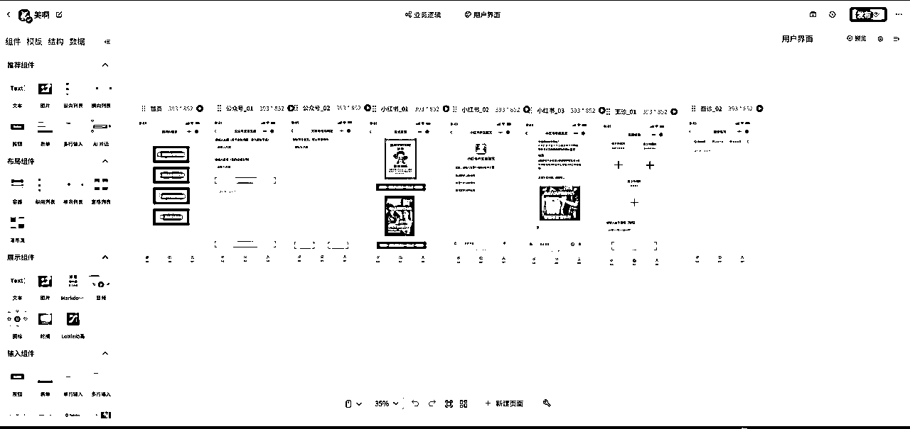

## 第一页：主页面

首页主要放置 4 个功能按钮，这些按钮可以从左侧的输入组件和推荐组件中找到：

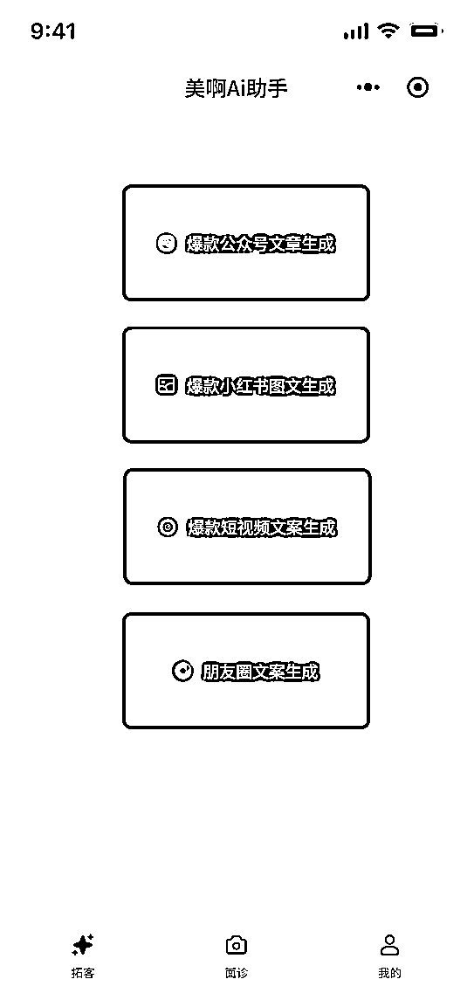

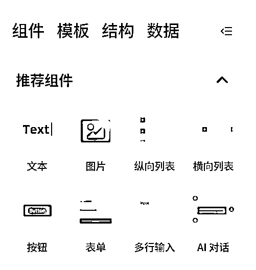

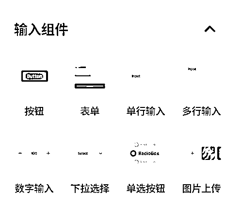

右侧是按钮的配置区域：

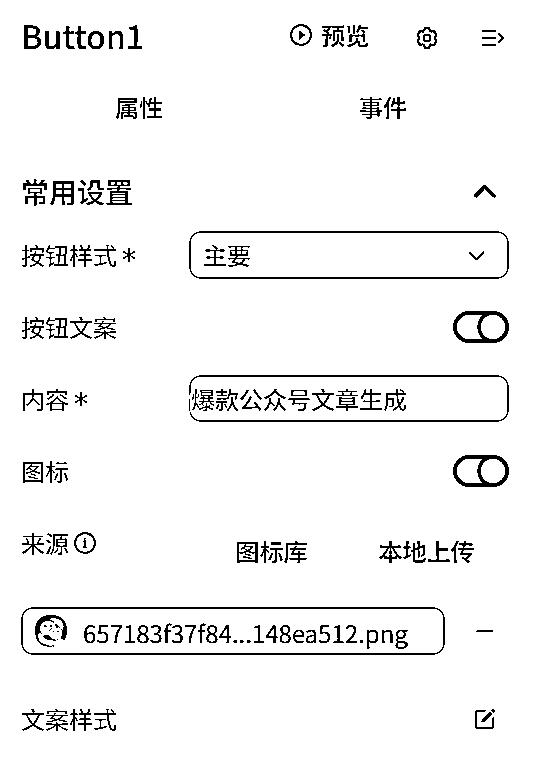

按钮的样式选择基础款即可，按钮文字直接填写对应的功能标签，后续也可以根据实际需要修改。图标既可以使用系统图标库，也可以从本地上传。

在布局位置上，我选择的是绝对定位，这样可以按照自己的想法自由排版，另外两种定位方式则属于相对固定的位置。

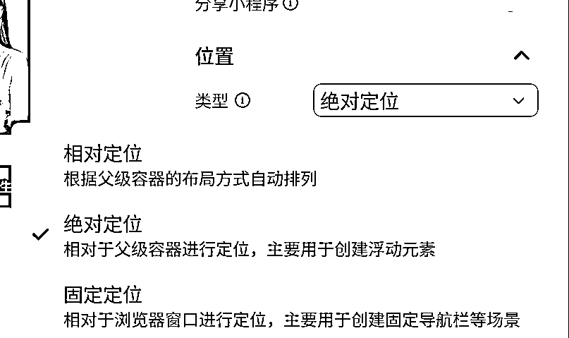

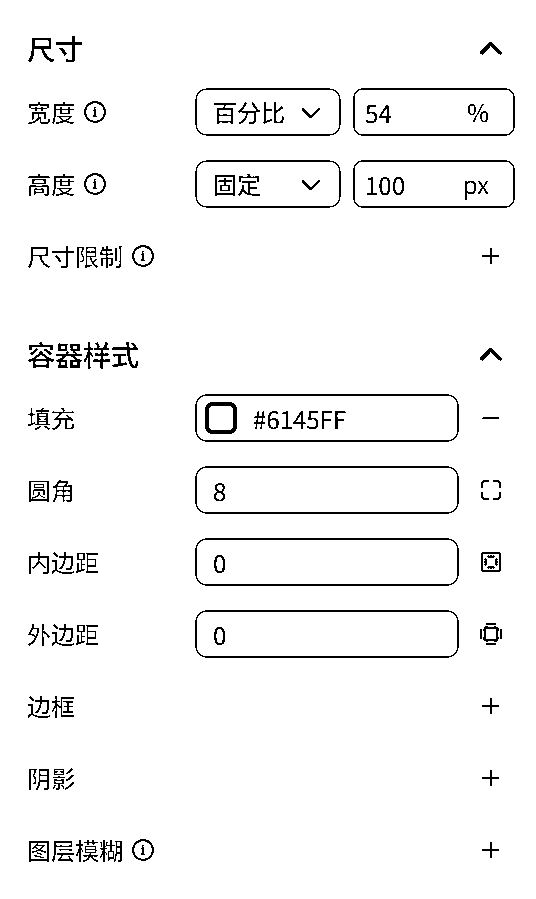

按钮的宽高、颜色等参数，都可以按照页面设计和个人需求进行调整。

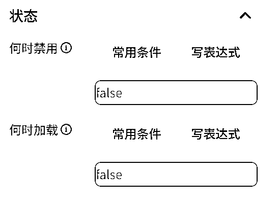

禁用状态和加载状态，后面会详细说明。

首页最关键的配置在“事件”部分，它位于顶部“属性”旁边：

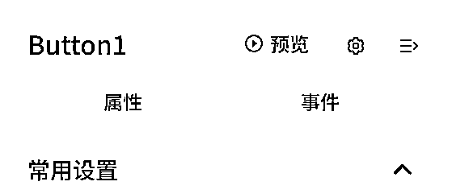

首先新建一个页面，然后为按钮添加“页面跳转”事件。这样，用户点击相应按钮后，就能进入指定功能页面。

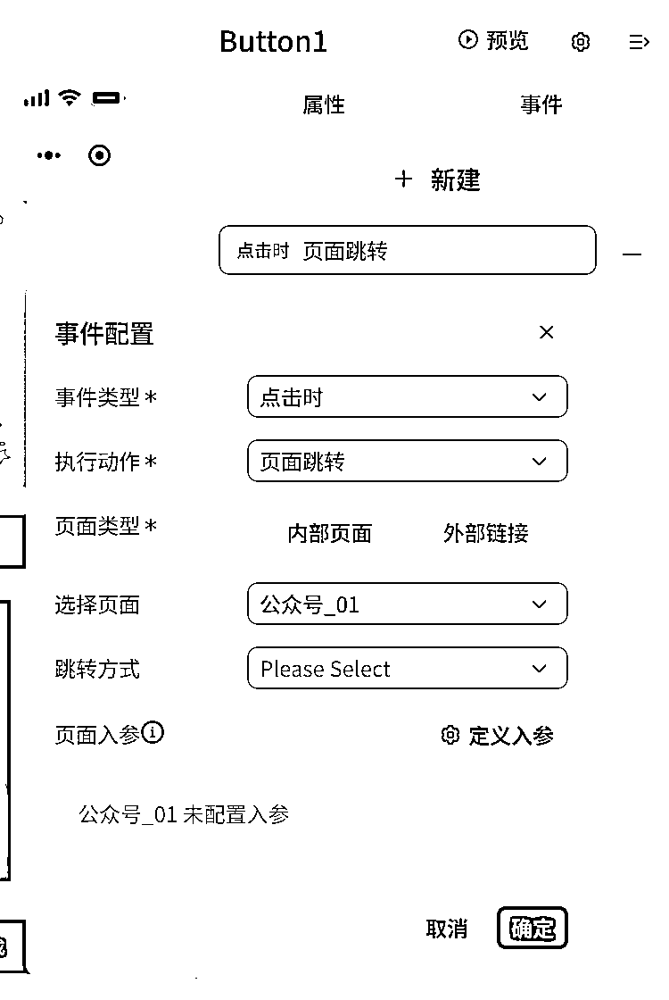

## 第二页：👸号文章生成

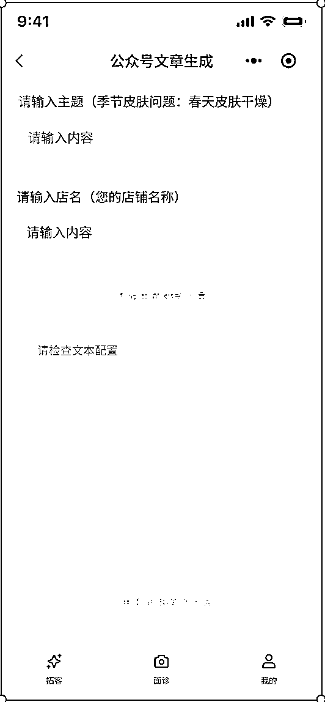

页面顶部的两个文本框，使用的是多行输入组件。

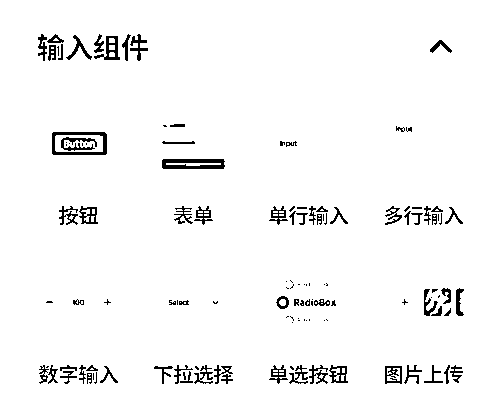

选中组件后，可以在右侧修改相关设置。其中，占位文案就是用户尚未输入内容时，显示在文本框里的提示文字。

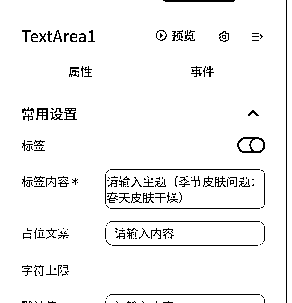

中间需要放置一个按钮，这个按钮的作用是触发工作流。

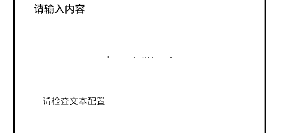

按钮的基础配置和首页类似：

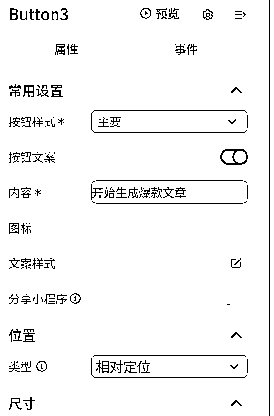

需要重点设置的是“禁用”和“加载”两种状态。

### 1. 设置禁用状态

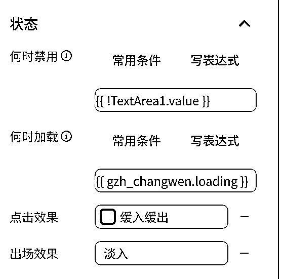

点击组件旁边的“X”图标：

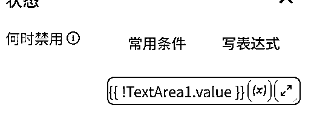

此时会显示文本结构组件。

为什么要增加这一步？因为调用工作流之前，必须先获得主题和店铺名称。如果用户没有填写这些信息，就不应该允许工作流直接运行，因此需要给生成按钮增加限制条件。

也就是说，当文本框中没有主题内容时，生成按钮应当处于不可点击状态。选中文本框内容后，在前面添加“！”，就表示“当文本框为空时”，此时生成按钮会被禁用。这个逻辑初看可能有些绕，实际操作一遍就容易理解：

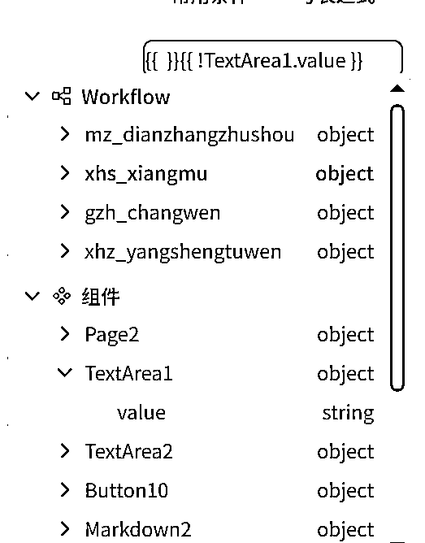

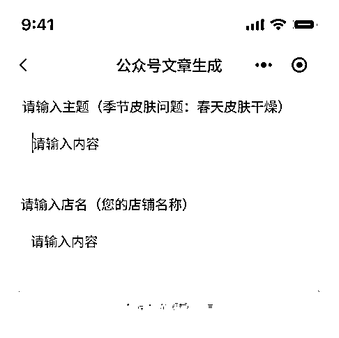

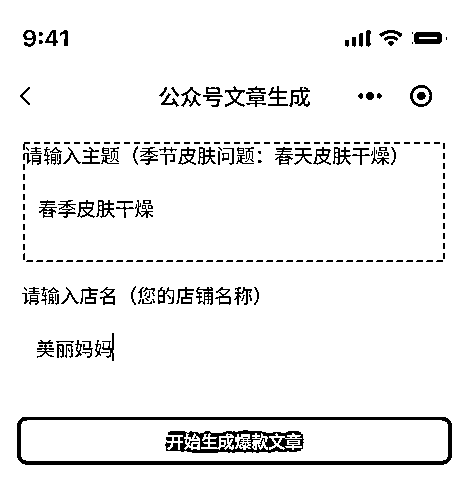

没有输入内容时，生成按钮无法使用；填写内容后，按钮恢复可点击，这就是禁用态的配置效果。

### 2. 设置加载状态

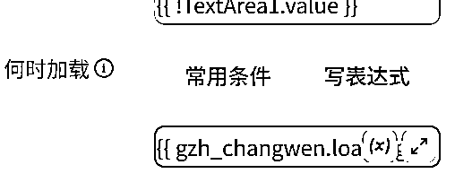

加载状态同样需要点击组件旁边的“X”进行设置。完成配置后，工作流运行期间，按钮就会显示加载中的状态，避免用户误以为没有反应而重复点击。


设置时，选择被调用的工作流，再指定对应文件即可：


### 3. 配置点击事件

新建一个事件，事件类型选择“点击时”，执行动作选择“调用工作流”。


这里的两个入参，分别对应页面上方的两个多行输入框。可以直接从左侧页面结构中找到对应组件，并完成绑定。


配置完成后，点击按钮就能正式调用工作流。

那么，工作流返回的内容要放在哪里呢？

### 4. 添加容器与 Markdown


首先添加一个容器，用来划分和承载内容区域；然后在容器内部放入 Markdown 组件。


Markdown 组件需要绑定工作流的返回结果。点击旁边的“X”，找到工作流输出，也就是返回数据，并将其绑定到 Markdown 中。


下方的溢出设置选择“滚动”，这样生成内容较多时，用户也可以在区域内上下浏览。


完成之后，工作流生成的文字就会显示出来。如果还想对结果进行调整，可以继续添加预览和修改功能。

### 5. 预览与修改按钮


按钮的禁用条件，可以绑定到上方 Markdown 中的内容。


这里需要配置 3 个事件：1 个页面跳转事件，以及 2 个控制组件的事件。


这样一来，用户点击按钮后，既可以跳转到修改页面，也能把当前文案复制下来。

## 第三页：修改生成文案

第三页的结构比较简单，由一个多行输入框和两个按钮组成：


### 1. 配置文本框


将上一页生成的内容放入多行输入框中，用户可以直接在这里编辑和调整。

### 2. 一键复制按钮

复制按钮的禁用条件，可以绑定到上方文本框中的文字内容；对应事件则设置为“控制组件—复制到剪贴板”。


### 3. 再次生成按钮

再次生成按钮的禁用逻辑与前面相同，仍然根据文本框是否有内容进行判断。它的事件设置为重新跳转到第二页。


## 第四页：📕图文

这一页主要放置两个图片占位组件和两个按钮。


图片直接通过本地上传即可，同时勾选“支持大图”，这样用户在小程序中点击图片时，就能够放大查看。

按钮的事件设置为页面跳转，新建一个页面后绑定即可。


## 第五页：图文生成

第五页使用 AI 组件，选择“AI 对话”功能，调用前面制作好的“一键生成📕图文”对话流。


进入设置后，直接选择对应的对话流：


完成配置后，就可以直接调用。


## 第六页：面诊页面

面诊页由 3 个图片上传组件、1 个多行文本输入框和 1 个按钮组成。这里需要注意，使用的是图片上传组件，而不是前面页面中的普通图片组件。


按钮需要同时设置页面跳转、调用面诊工作流，以及禁用状态。


## 第七页：诊断结果

结果页使用导航组件中的标签栏，因为面诊结果需要分成 5 段内容分别展示。


用户上传照片并填写生日后，就可以生成面诊结果。


有了这套工具，店长在与顾客交流时，就能获得更多沟通切入口，也能更准确地掌握顾客需求和沟通节奏。

# 五、发布到🛰️小程序

所有页面制作完成后，点击右上角的“发布”：


在发布选项中勾选🛰️小程序：


然后务必点击小程序旁边的“配置”，绑定自己的小程序 AppID。完成绑定后，再进行发布。


通常等待大约一天，小程序就可以正式上线。

# 六、关于“实体门店 + AI”的一些思考

1. 我自己的门店已经开始使用 AI，实际在引流环节确实节省了不少精力，整体效率提升非常明显。

2. 对实体店来说，哪怕只是建立一个简单的知识库，再配合表格和话术打卡，也能带来很大的改善。所有做实体生意的人，都可以思考一下：哪些日常业务适合用 AI 重新优化和落地。

3. 这个小程序完成后，我只是简单向身边朋友介绍了一下，目前已经收到几笔合作费用。简单来说，就是提供一年使用权，并协助她们完成落地。如果这件事能够持续做好，我认为它的潜在空间甚至可能超过单纯经营一家门店。

4. Coze 最大的价值之一，是让像我这样完全不会写代码的人，也有机会独立做出一个小程序。这确实是 AI 带来的新机会。不过，Coze 目前仍有一些功能不够完善，例如如何在小程序中接入支付、如何为每位用户设置独立变量等问题，还需要进一步研究，也欢迎熟悉这些功能的朋友交流指导。

下面是 Gemini 给出的几条进阶建议：

- **先明确方向，再快速试错。**  
  应该从战略层面重视智能工具，但落地时不必一开始就铺得很大。可以优先解决一两个最迫切的业务问题，先小范围测试，验证有效后再逐步推广。

- **重视数据管理。**  
  顾客资料、交易信息、服务反馈等数据，既是训练智能工具的重要素材，也是帮助经营者做判断的宝贵资产。收集和使用这些数据时，要始终遵守相关规范。

- **持续迭代，而不是一次完成。**  
  AI 工具上线并不代表工作结束。要持续收集员工和用户的反馈，根据真实使用效果，不断优化模型、提示词和工作流程。

- **把合规与信任放在首位。**  
  在享受智能工具便利的同时，必须认真做好隐私保护，确保应用过程透明、公平、安全。只有守住合规底线，才能建立长期信任。

- **培养懂业务、会用 AI 的复合型人才。**  
  鼓励员工学习新知识，提升与智能工具协同工作的能力。未来真正有竞争力的人，往往既熟悉业务，又能够灵活运用智能工具。