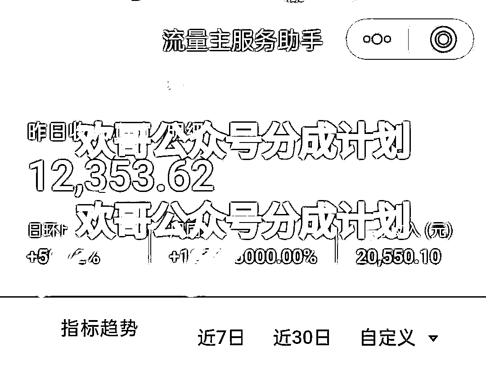
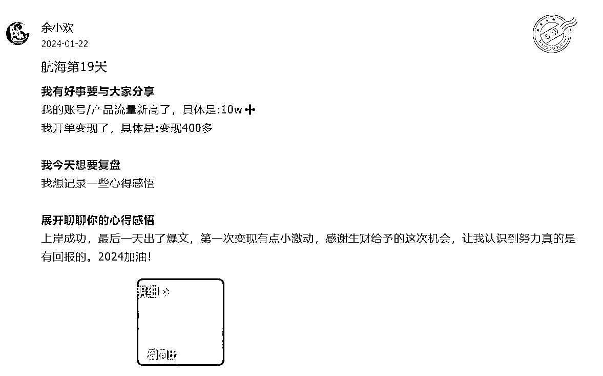
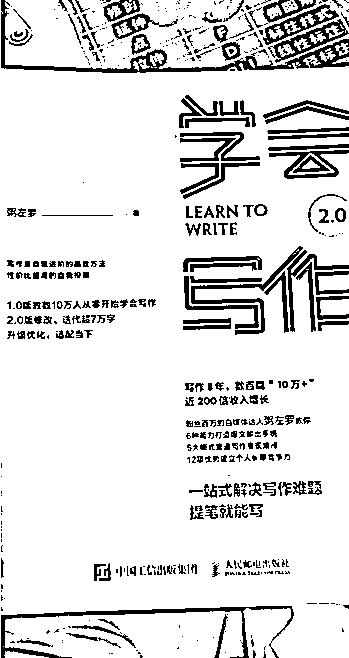
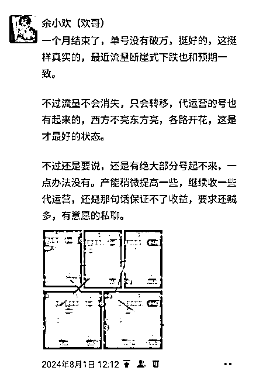
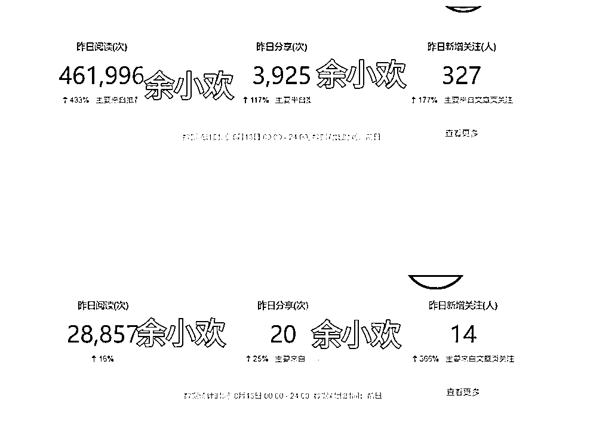
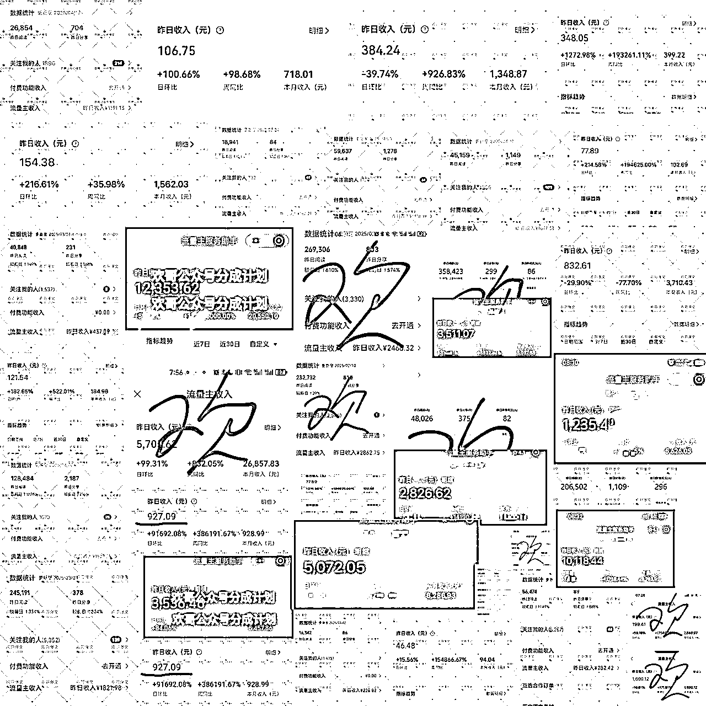

# 从0到月入5位数：我用“AI写作+👸号”走通副业之路，这是我一年的完整复盘

大家好，我是龙哥。

一个退伍军人、90后奶爸，白天的身份是国企员工，下了班就切换成自媒体人。

写这篇分享，首先想谢谢带我进门的地方。要不是当初稀里糊涂闯进赚钱，我可能到现在还是那个循规蹈矩、一眼望到头的“稳定人”。

其次，想把这一年多折腾👸号的心得，原原本本讲给你听。

我没什么炫酷的技术能炫，毕竟不是代码大佬，只能老老实实做内容。但我可以把我自己打磨出来的两套原创AI爆款提示词分享给你，咱们一起进步。

直接开始。

2023年底，我正式把👸号当成副业来做。一年多下来，累计变现GMV超过了40万。

这期间，我先后运营过400多个账号。最猛的时候，单号单日进账12353.62元，单号单月最高拿到36188.28元。

## 一、放着安稳日子不过，我为什么非要折腾副业？

2012年底退伍，换上便装的那一刻，我的人生就进入了“标准化流程”：进国企、按部就班上班、结婚、生娃。

工资准时到账，日子不咸不淡，看起来一切都“挺对”。

但有个瞬间我忽然惊醒——再这样过下去，我甚至能猜到几十年后的自己是什么样。

稳定当然是好东西，可稳定过头了，人生天花板也提前焊死了。

我开始一遍遍问自己：
我到底图什么？
除了单位和娃，我的人生还有没有别的选项？

于是我开始折腾。一边上班一边自考本科，后来又开过淘宝店、搞过饭馆，炒过币，也准备过考研。

现实很骨感，几轮折腾全都没跑通，疫情那阵子还倒贴了不少。

眼瞅着过了30岁，焦虑感一天比一天重。可那时候我既没认知也没圈子，连“外面长什么样”都看不到。

直到某天，误打误撞进了赚钱，才算推开了一扇新大门。

第一次参加航海，我选了早就感兴趣的👸号爆文项目。

研究了一圈发现：👸号门槛出奇低，投入也小，既不影响上班，也不耽误带娃。

只要学会拆选题、仿爆文，就有机会挖到第一桶金。再加上AI辅助，效率能翻好几倍。

于是我义无反顾扎了进去。

为什么是👸号？三个理由就够了：

1、几乎零门槛、零成本
不用囤货，不需要大笔投入，一部旧手机就能起号。

2、变现路径清楚，收益不差
流量主、广告主、带货、分成项目……内容能稳住，收入就不会断。

3、时间灵活，适合打工人和宝妈
孩子睡后、周末空闲，随手就能写文养号，跟主业完全错开。

这条路，是我试错无数、摔了无数跟头之后，得到的为数不多的“低成本试错、高概率突围”的机会。

第一个月做号，我最大的感受是：
爆款总是来得让人措手不及。

## 二、我的👸号0到1之路

### 1、第一脚踩下去，全是水

23年底，我开始做第一个号。

当时真的啥也不懂：
赛道不会选、选题不会找、文章不会写，“爆文”两个字只听过，没见过。

但偏偏我们活在这个时代——普通人也有翻身的机会。

AI就是那个最大的变量。

其实我以前也用AI，但总觉得那是个“玩具”，从没想过能拿来赚钱。

直到第一次用ChatGPT，我才发现，原来AI强得离谱！

接着，我照着航海手册选了一个大众娱乐赛道，先从模仿同行开始，一点点搭自己的写作流程：

每天去各大平台刷热点、挖爆文
把“低粉爆文”存档、拆解
用航海手册里的AI提示词生成初稿，再反复改

刷热点、拆爆文、改文章，成了每天的固定动作。

然而，前面20天账号一点水花也没有。阅读量长期停留在个位数，我一度怀疑自己是不是吃不了这碗饭。

可我总想起部队班长的那句话——只要还能站起来，就得继续跑。

于是我咬牙撑着，不停更、不放弃、每天复盘。

结果就在航海快结束的那天早上，我起床一看，一篇稿子爆了10w+，收益500多块！

那一刻真的激动到不行，21天的坚持没有白费。

AI帮我省下了大量时间，也让努力变得肉眼可见。

那段日子，我还总结出一套特别管用的“爆文结构五步法”：

标题：引发好奇/强情绪/数据冲击
开头：抛问题/故事引入/戳中痛点
正文：三段式——问题→过程→转变
爆点：细节+反转+情绪释放
结尾：金句回收/行动召唤/留白共鸣

这是我在自媒体赚到的第一桶金，也让我下定决心继续走。

之后两个月，我一直按“低粉爆文+五步法”来做。

2月初，一篇48w+的低粉爆文，直接帮我拿下👸号生涯单篇最高收益——7000多块。

### 2、沉下心，给自己“回炉重造”

说实话，那个7000块给我的感觉，就像中了彩票。

原来👸号真的能赚钱，而且速度比我预想快多了。

但爽完之后我也明白，光靠运气走不远。我当时对自媒体还是“半桶水”。

那阵子，我见过太多人因为没及时拿到正反馈，直接放弃。

我意识到：没有系统理解内容，只靠模仿和运气，早晚翻车。

所以我停下来了，决定系统学写作。

那段时间，我把所有精力都砸进了粥左罗的写作营和编辑营，认真学👸号写作逻辑。

这一学，就是整整4个月。

一开始我还是“盯着爆文模仿”，后来慢慢能自己拆文章、搭框架、改爆点了。

那段状态回想起来就是：
早上睁眼找素材、列提纲；
中午写初稿、晚上反复调结构；
改到怀疑人生，脑子像被榨干，但还是咬牙往前。

事实证明：人都是逼出来的。

小白和熟练工之间的距离，就看你敢不敢对自己下狠手。

等头发快熬光的时候，成果终于开始冒头：
我写出了好几篇10w+，最高的一篇直接干到170w阅读。

这4个月沉淀下来，我彻底吃透了自媒体爆款的三大核心：
选题逻辑、标题技法、内容结构。

顺便说一句，那4个月我几乎没起新号、没更新，也就没有一分钱收益。

偶尔看到别人晒收入、晒爆款，我也会焦虑。但我告诉自己：打地基的时候，急不得。

### 3、带着基本功，重新杀回来

6月底，我把学到的本事带回了👸号赛道。

这次我换了打法，不再乱选赛道，而是挑了三个高爆款领域：汽车、职场、剧评。

这些赛道受众广、话题多、AI生成内容可控性强，特别适合批量操作。

为了提效，我上了自动化工具；
为了写出爆款逻辑的文章，我开始死磕提示词。

白天跑内容，晚上调AI。我试过各种表达方式和关键词组合，也会请教行业里的朋友，拿标杆账号当参照。

几乎每天和AI死磕到凌晨两三点，第二天挂着黑眼圈去上班。

终于，我跑出了几套稳定高效的AI提示词模版，能做到“少改动、出稿快、爆文率提升”。

同时给自己定了一套标准：
选题比内容重要，开篇比正文重要，“关键词”比“热点”重要，好排版比纯文字重要。

举个例子，一篇汽车爆文，我在头条刷到某品牌的热搜，顺着这个品牌的负面消息，用高情绪词组合关键词，再配上舒服的排版，最后拿到了20w阅读。

当时整个👸号大盘刚经历半年寒潮，正在慢慢回暖。

很多账号重新爆起来，我也正好踩上这波流量，7月月收入直接过了2w。

虽然大部分账号都是一波流，活了没多久就哑火，但我发现一个规律：
爆款或许不可预测，但只要“号够多+打法正确”，均值一定能拉高。

节奏对了，持续跑内容、跑数据，就一定能从概率里赢得结果。

### 4、把盘子放大，带着别人一起赚

跑通稳定打法的第一感觉是什么？
是你再努力做爆款，也比不上那些动不动几百上千个号的大佬。

于是我开始拉着朋友一起做。

我直接跟他们说：选题、写文、研究规则，统统不用你们管。

内容我统一给，你们只负责起号和发文，其他什么都不用操心。

结果效果远远超过预期，爆文一篇接一篇地来，好几个朋友也陆续做出了10w+。

然后我正式启动了分成合作模式：

不卖课，不打鸡血，一切用实操说话。
我把部分收益让出去，和伙伴共赢。
大家一块儿成长、一块儿变现、一块儿长久干下去。

靠着这套机制，短短两个月，我们拉起了几十个账号。

我也越来越确信：比起一个人卷生卷死，带着一个持续产出的团队，确定性要强得多。

### 5、不走“量大管饱”，只走“小而精”

盘子做起来之后，焦虑也跟着来了。

身边越来越多的人开始组团队、搞批量生产。

我也心动过，可做着做着就发现：那不是我能走的路，也不是我想走的路。

所以我反着来，选了条“慢一点，但更稳”的路。

我用一套“小而精”的策略，把👸号玩穿：

只选细分赛道，不啥都发、不乱铺
每个赛道都认真打磨内容和提示词
不断测试新玩法、新模型，及时复盘迭代
就算只是小爆款，也要努力把它做成可复制的模板

这条路不快，但特别稳。

哪怕平台规则变了，我也可以快速调头，不至于一夜清零。

那段时间我还试过提示词定制、小绿书带货这些衍生项目。

比如10月份试了一把小绿书带货，用服务号+爆文玩法，半个月干出2w+ GMV。

虽然是试水，但也证明了一件事：爆款内容模型，是可以“跨平台通用”的。

### 6、终于等到爆发：单月10w+，累计40w+

朋友有句话说得特别准：“👸号就是一波一波的。”

有时候错过一波，可能低迷好几个月；但只要踩对节奏、赶上风口，日入上万真的不是梦。

这话有多真，只有经历过的人懂。

当时圈子里人人都在玩“Python起号”，可平台一查，这类玩法几乎一夜之间全废了。

我也有几个号刚养好，准备转赛道，结果直接被平台拉黑。

当时确实懵了一下。

但我没停。我继续找新号、测赛道、换玩法，顺着平台的节奏来。

终于让我抓到新的起号方法，而且实测有效。

到了2月份，流量突然大回暖，爆文遍地开花。

流量主收益一路往上蹿，当月直接突破10w变现，好几个号同时吃到了红利。

这一波爆发，不只是幸运。说白了，能爆是因为方向选对了，也因为扛住了调整。

这波结束，我的👸号项目累计GMV正式超过40w，从0到1的模型彻底跑通。

这段经历让我彻底明白一件事：
风口会变，规则会变，但只要搞懂底层逻辑、动作够快，👸号始终是条值得走的路。

## 三、关于👸号，几句大实话

做到今天，我越来越笃定：
👸号是一个靠熬、靠打磨、靠理解平台的“慢”项目。

### 1、这是“熬”出来的项目

我见过一年没收益最后爆发逆袭的号，也见过上线两周变现10w+的神话。

但更多的，是长期沉寂、没有水花、看着0阅读还在坚持的普通人。

我自己有一个号，连续88天，每天发布、每天复盘，阅读量全是0。

那阵子我总是问自己：“是不是这条路真的走不通？”

直到第89天，一篇内容突然爆了，收益瞬间回本。

这件事教给我一个很深的道理：
👸号不是适合所有人的项目，它属于那些愿意在无人喝彩时继续做事的人。

很多人起号三天没收益就撤，可爆款往往只奖励那1%能熬住的人。

### 2、规则看起来很透明，执行起来全是坎

很多人说：👸号规则这么清楚，照着做就行。

我以前也这么觉得，真正下场才发现：

会写≠会起号
会起号≠能稳定出爆款
会出爆款≠能持续变现

看懂别人的成功路径很容易，复刻自己的路却非常难。

👸号表面是“低门槛”，真正能沉下心研究策略、内容、标题、流量机制的，少之又少。

越是看着简单的东西，背后的门槛越吓人——这个门槛，叫执行力。

### 3、焦虑永远在，变革永远有

做短视频、带货的朋友，可能每个月都要适应新玩法。

👸号不一样，它的变革更慢，但也更狠。

平台规则一调：
昨天还在赚钱的号，今天收益可能断崖式下跌；
精心养了半年的号，可能直接被丢进“死亡池”；
你辛苦沉淀的经验，可能一夜就全部作废。

每次变化，都会洗掉一批人。
有人转行，有人放弃，有人适应规则、逆势爆发。

我也经历了好几轮调整。从最初的慌张焦虑，到现在的快速应对、稳定恢复。

我学会了一件事：不要和平台对抗，要学会跟规则共舞。

👸号就像一场长跑，很少是“立竿见影”，更多是“厚积薄发”。

爆文、收益、成长，都是给长期主义者的奖赏。
你不需要跑得特别快，但你得跑得足够久。

## 四、👸号，值得你走下去

这一年多，我在👸号上见过低谷，也见过高光。

我信努力，但更感恩那些在努力之外给过我信任和方向的人。

刚进自媒体圈子时，我很幸运在赚钱遇到猫哥、兔子鱼这些大佬。
他们的指引和鼓励，往往比我一个人埋头死磕更有用。

也正是因为有这些朋友的帮助，我才能一次次从坑里爬出来，继续往前走。

👸号不是暴富神话，也不是速成捷径。
它是一次次试错后的坚持，是无人喝彩时的投入，
是把“副业”当“主业”来对待的专注。

这一年，我不只跑出了40w+的成绩，更真正体会到：
只要方向对、方法对，普通人一样能在这个平台跑出结果。

未来，我还会继续在这条路上深耕。

不追风口，不盲目扩张，只专注一件事——
打造长期稳定、可复制的副业能力，带更多人一起走出来。

如果你也在找一条能看懂、能上手、有结果的副业路，
也许，👸号可以成为你的起点。

最后，送你两套原创AI提示词，它们都帮我出过好几篇10w+爆文。
第一套是律例类，第二套是历史诗词类。
两个都需要用Claude官网，并按提示词投喂。

具体使用方式：把提示词完整复制给Claude，再配合你的素材输入，就能快速生成符合爆款逻辑的初稿。

因为篇幅关系，这里先展示第一套的核心框架：提示词会设定你为一位拥有五年自媒体经验的法律类创作者，有法学背景、律所实习经验，写作目的是用案例普及法律知识；在语言风格上要求生动但不失专业，用细节和对话增强感染力；文章结构则要求从冲突开篇、案情回顾、法律分析到案件看法都按比例分配。

另一套历史诗词类也是类似的逻辑：先设定角色和写作目的，再规定语言风格和结构。

说到底，提示词只是工具，真正让你跑通0到1的，是你愿不愿意在一个方向上持续死磕。

希望我的复盘，能给你一点点开始的勇气。

也欢迎你随时留言，我们一起交流、一起成长。

真正会写的人，都在用两套“反直觉”的系统

你有没有发现一个怪现象：很多人写法律案例，要么像复述判决书，要么像编段子；写历史人物，要么端着学术腔，要么飘成架空剧。问题往往不出在文笔上，而是没搞明白——好文章背后，其实是两套不同逻辑在支撑。

先看第一套，写案例普法文的系统。

这类文章的总篇幅最好压在1200到1500字之间，但最核心的法理拆解只占四分之一，也就是300到375字。真正的重头戏是“故事”。开篇只用60到75字，像短视频的前三秒，得把一个具有冲突感的画面直接砸到读者脸上。案情部分占掉近950字，用叙述而不是汇报的语气，把前因后果讲顺，但又不能陷进无关的琐碎细节里。

到了法理部分，反而要懂得收手。不列一二三，不用小标题，只挑案子里最要紧的两三个法律问题，用两三个自然段讲透。法条不必多，一两句足矣，关键是把它翻译成家常话。比如解释“表见代理”，不如说“别人看着你就以为你能代表公司，法律在特定情况下也真这么认”——一听就懂。分析时立场要平，不站在高处点名批评，只在段落末尾留一个开放的提问，比如“如果是你在现场，你能拿得出自证清白的证据吗？”

紧接着那段“互动短评”，只有四五十个字，却承担着勾住评论区的任务。它得像朋友聊天一样松快，可以用一点反问或比喻，但绝不亮标准答案。你没打算说服谁，你要做的是让读者自己把心里那杆秤摆出来。

最后，还要用粗体写一句改编声明：案件脱胎于真实事件，所有人物均为化名。这既是对隐私的保护，也是对读者的诚实。

再看第二套，历史非虚构的“双流程切换”系统。

进入写作前，你得先戴上研究帽，把自己变成考据狂。把史料按可靠程度分等：正史明确记载的，列为A级；多种来源相互印证的，列为B级；只见于野史笔记的，标C级存疑；查无实据的传说，归入D级。随后拉出人物年表，核对事件发生时他到底多少岁，确认他说要去的地方在当时是否真的能到达，再把人际网一张张画出来。这些功夫全部用分析性语言记录，哪怕写“这句诗体现了他的失意”也没问题。

但真正动笔时，就要立刻切换成叙事模式。别再写“这首诗体现了诗人的悲愤”，而要这样写：他把酒杯重重磕在案上，低声念出那四句诗。诗句要像水一样流进动作和场景中，单独成段，前后留空，断句准确，不加一句点评。标题得做成双层：外层负责吊胃口，内层负责亮主题，就像“深夜美人入怀，他却只顾看星星？／一个心系苍穹的诗人与他的千年佳话”。正文取消小标题，用一条核心线索把所有故事串起来，人物介绍从最扎眼的特征一路写回姓名、籍贯、性格与历史定位；每一段至少包含两三个可考的信息点，用细节代替抒情；重要转折处先铺垫心理，不能生硬跳跃。结尾再绕回开头的意象，把古人的处境接到今天，让读者合上屏幕后还能琢磨一会儿。

说到底，这两套系统殊途同归。一是尊重事实：案例文要表明改编、使用化名，历史文要区分史料与推测、注明参考来源；二是克制表达：案例文克制法理篇幅，历史文克制对诗词的点评，都是为了让读者始终停留在故事里；三是把判断权交出去：分析后的提问、故事后的留白，都在邀请读者参与思考，而不是替他思考。

别再纠结好文章是不是靠天赋。守住真实，管住手，把思考的空间留给读者——你写的东西自然会发光。