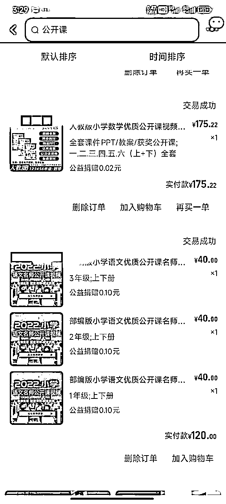
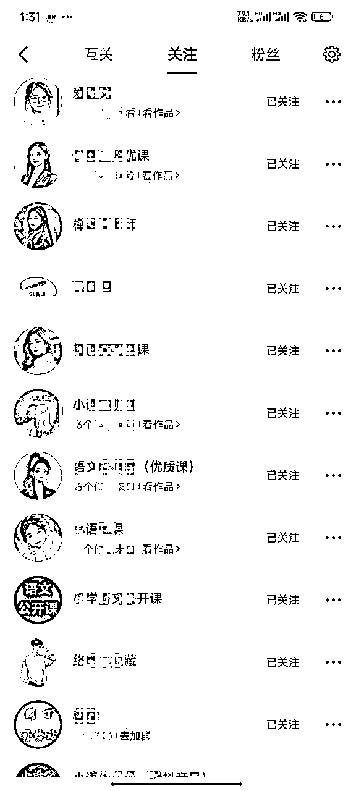
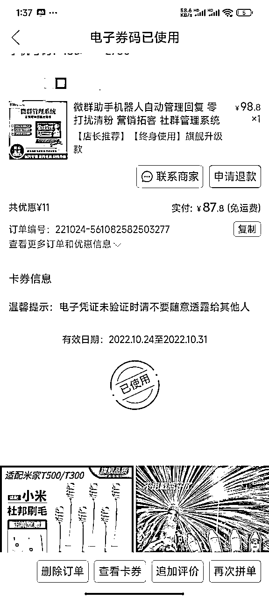

# 一个小学语文资料项目的完整复盘：从偶然发现，到3个月实现近30万收益

## 一、机会往往藏在日常需求里

这个项目的开始，并没有什么宏大的商业规划。

我的妻子是一名小学语文老师。一次，她让我帮忙在淘宝上找一些教学资料。搜索过程中，我发现一个小学语文资料包竟然卖到了300多元。

做过电商的人都知道，这类产品一旦具备标准化、可复制、交付成本低等特点，就可能拥有不错的利润空间。于是，我临时做了一条关于语文资料的视频，发布在一个刚注册不久的抖音账号上。

### 第一次成交，让我重新认识这门生意

刚开始，我并没有认真关注视频数据。那段时间我在股市里赚得比较顺，对这种小项目并不重视。

直到后来炒股亏损，手头几乎没有现金时，我偶然看到账号收到了一条🛰️好友申请。对方加上好友没多久，就直接购买了58元的资料。

这笔钱虽然不算多，却让我意识到：只要需求真实，哪怕是一个不起眼的账号，也有可能产生交易。

### 半年没成交，问题到底出在哪里？

之后，我开始研究同行的内容和运营方式。

让我困惑的是，很多同行的视频制作非常简单，甚至称不上精致，却依旧可以不断成交。而我认真做了半年，转化却几乎没有。

经过复盘，我判断核心原因可能在于账号本身。新账号缺少权重，单个账号很难获得足够曝光。

于是，我改变了策略：既然一个账号的流量有限，那就通过多个账号搭建矩阵，增加整体触达机会。

### 流量突然爆发，也带来了连续踩坑

矩阵运营之后，其中一个账号意外获得了大量曝光，咨询和成交迅速增加。

但由于当时经验不足，我担心错过潜在客户，直接把🛰️联系方式放进视频里。很快，账号被平台识别并限流，流量几乎归零。

与此同时，🛰️端由于短时间内频繁加好友、收款，也遭遇了封禁。

这次经历让我明白，流量越大，越不能忽视规则。平台运营不是只看结果，合规的获客方式同样重要。

### 第一次团队合作：人情可以启动项目，却未必能解决利益问题

最初的团队只有三个人：我、妻子以及她的姐姐。

当时的分工比较简单：

- 我负责制作和发布视频；
- 妻子负责筛选、整理资料；
- 她姐姐负责接待客户和促成成交。

因为我觉得自己投入的时间不多，所以没有参与利润分配，收益由她们两人各拿一半。

项目初期运转正常。但当账号流量突然上升后，客户咨询量迅速增加，她姐姐一个人处理不过来，妻子也不得不参与大量接待工作。

可是分配方式并没有同步调整，依旧维持原来的五五分。久而久之，心理落差和不满开始积累，团队关系也出现了裂缝。

### 从0到1的几个教训

这一阶段带来的经验非常明确：

1. 很多商业机会并不遥远，往往就藏在身边的真实需求中；
2. 低成本项目可以快速试错，但试错不能突破平台和法律边界；
3. 团队早期可以靠信任与亲情启动，但利益机制必须提前讲清楚；
4. 短期爆量不等于长期稳定，真正可持续的项目需要流程化、规范化。

---

## 二、从重新启动，到搭建完整商业闭环

经历第一次合作的问题后，第二年我彻底调整了项目打法。

这一次，我不再亲自承担大量销售工作，而是把重点转向团队搭建、运营指导和系统建设。

### 重组合作方式，先把规则讲明白

新的团队被拆分成三组：

- 我与妻子一组；
- 我的表哥一组；
- 一位朋友单独组成一组。

我主要负责提供方法和运营支持，包括：

- 抖音账号如何运营；
- 视频如何拍摄和剪辑；
- 如何进行合规引流；
- 如何提升咨询转化；
- 如何根据数据调整内容方向。

在收益分配上，我不再模糊处理，而是按照团队利润收取20%的指导费用。

每天晚上，我们都会集中复盘当天的数据、视频内容和客户反馈，再决定下一步的调整方向。

相比最初依靠关系维持合作，这种方式让职责和收益都更加清晰。

### 资料库升级，成为项目真正的核心资产

业务扩大后，最先暴露的问题就是资料不够丰富。

为了提升产品竞争力，我开始投入资金收集更全面、更系统、更新速度更快的小学语文资料，并持续对内容进行补充和整理。

资料库逐渐成为项目的重要壁垒：

- 内容更丰富，减少了同质化竞争；
- 更新更及时，增强了客户购买理由；
- 资料更专业，提高了用户满意度；
- 交付体验更好，也带动了复购和转介绍。

对这类虚拟产品来说，流量只是入口，真正决定长期价值的还是内容本身。

### 不再依赖单一平台，建立多平台流量结构

项目后来从抖音扩展到多个平台：

- **视频号**：用户信任感较强，更适合承接高客单成交；
- **📕**：通过老师形象和经验分享，强化专业背书；
- **B站**：发布更深入的内容，积累长期信任和口碑。

多平台布局之后，项目不再完全依赖抖音的单一流量来源，整体抗风险能力明显提升。

### 自动化工具，让一个人也能处理大量咨询

随着客户数量增长，人工接待很快成为瓶颈。

我们开始使用🛰️自动化工具，完成一些基础工作：

- 自动回复常见问题；
- 根据关键词发送内容；
- 提供资料预览；
- 配合云盘完成自动交付。

工具上线后，重复性工作大幅减少。高峰时期，我一个人一天接待过130位客户，单日成交金额接近1万元。

### 三组团队，各自找到了适合自己的打法

不同成员的能力和执行方式并不一样，因此我们没有强行要求所有人采用同一种模式。

**我的表哥**  
主要依靠高频发布内容，一天可以发布几十条视频，用数量换取曝光。三个月下来，收益约7万元。

**那位朋友**  
更擅长挖掘客户的深层需求，提高单个客户的价值。她的平均客户价值达到40元左右，而我们的平均水平大约在15元，最终实现了2万元以上的利润。

**我和妻子**  
主要承担运营指导、内容策划和整体统筹，负责帮助其他团队解决账号、内容、转化等问题。

虽然三组人的操作方式不同，但都跑出了适合自己的路径。由此也证明，一个项目不一定只有单一答案，关键是找到人与方法之间的匹配关系。

### 三个月近30万，项目逐渐标准化

在持续优化之后，整个团队三个月的总收益接近30万元。

与此同时，我们也完成了多项标准化建设：

- 视频模板逐步固定；
- 文案和沟通话术形成体系；
- 账号运营流程可以复制；
- 各平台都具备相对稳定的变现路径；
- 交付、培训、内容三个系统互相配合。

到这个阶段，项目已经不再是单纯“卖一套资料”，而是形成了一个由内容生产、流量获取、客户转化、自动交付和团队培训共同组成的商业闭环。

### 收益达到高点后，选择主动离场

项目发展过程中，越来越多同行开始复制类似模式。

同时，市场对资料版权的关注度不断提高。我们手中的资料规模已经超过10个T，很难逐一确认每一份内容的版权情况。

在收入达到较高水平时，我们没有继续冒险扩张，而是选择暂时退出。

原因很简单：项目可以重新寻找，但版权和合规风险一旦集中爆发，之前积累的收益很可能迅速归零。

---

## 三、这次项目带来的核心认识

### 商业层面的几个公式

这次经历让我更加确定：

**赛道选择 + 优质内容 + 平台规则理解 + 持续执行 = 项目增长的基础。**

除此之外，还有三点特别重要：

- 分工和分成必须提前明确，制度比临时讲感情更可靠；
- 工具可以提升效率，流程则能增强团队的稳定性；
- 项目越赚钱，越要重视合规和风险控制。

### 可复制的项目结构

整个项目最后沉淀出了几套可复用的能力：

1. 平台矩阵与账号矩阵；
2. 有持续更新能力的内容资料库；
3. 自动回复、预览和交付工具链；
4. 团队分组管理机制；
5. 数据复盘制度；
6. 视频、文案和运营流程标准化。

### 给想做副业的人几点建议

如果一个项目同时具备以下特征，就值得认真研究：

- 启动成本较低；
- 用户需求真实；
- 交付方式可以标准化；
- 操作流程能够复制；
- 不依赖某一个人的临场能力。

但也要记住，能赚钱并不代表可以无视规则。很多项目不是败在没有利润，而是败在扩张之后忽略了平台、版权和法律风险。

这次经历本质上是一条完整的路径：

从生活需求中发现机会，经过低成本测试找到方向，再通过团队、内容、工具和流程将项目放大，最后在风险增加之前及时止损。

项目结束了，但它留下的不只是收益，还有一套关于流量、产品、团队和合规的认知。

---

## 四、项目结束后，新的机会正在寻找答案

虽然小学语文资料项目已经告一段落，但运营过程中积累下来的资源仍然具有价值。

目前，我手里沉淀了超过1万名一线教师的🛰️联系方式，主要来自全国各地的小学语文老师。

这些老师普遍关注并持续需要：

- 教学资料；
- 教学辅助工具；
- 教辅产品；
- 教师培训课程；
- 与教育相关的增收项目。

通过这次项目，我也对教师群体的需求、沟通方式、信任建立和转化路径有了较深入的实操经验。

接下来，我正在思考如何在合规的前提下，为这些资源找到更有价值的应用场景。

可能的方向包括：

- 与教育机构合作推广课程；
- 对接教学SaaS工具；
- 推广优质教辅产品；
- 为教育类企业提供教师渠道；
- 探索教育私域运营和知识服务模式。

如果你：

- 正在从事教育相关业务；
- 希望建立与一线教师的有效连接；
- 正在寻找教育产品或课程的推广渠道；
- 想研究知识变现、教师服务或教育私域项目；

欢迎交流合作，一起寻找新的可能。

副业真正有价值的地方，不只是当下赚到多少钱，更在于你能否在过程中积累用户、资源、方法和认知。

当你持续提供有价值的服务，下一次机会往往就藏在已经积累的一切之中。