# 📕私域导流实战全解：万能公式2.0操作手册
作者：龙哥

全文约16000字，阅读需53分钟

不管你是想做副业的个人，还是想做生意的公司，公域引流都是绕不开的话题。因为没有人会真正觉得自己不缺客户。

关于《抖音📕如何导流与万能引流公式》的主题，我在前两年做过大量线下分享。那个版本是1.0，已经帮助了不少人，甚至PPT都被搬去国外售卖。

过去两年，平台规则发生了不小变化，我对引流的理解也升级了，所以才有了这次2.0版本的📕万能公式和操作手册。

大的底层逻辑没变，但执行细节变了很多。最近在北京线下分享过一次，反响依然很好。

现在把内容整理成文字版。整篇文章只聚焦一个目标：怎么安全又高效地把📕上的用户，稳定地导到你的🛰️里，把这个事说透。

涵盖的范围包括：导流的底层逻辑是什么？需要准备哪些资源？完整的工作流长什么样？什么做法合规？什么做法会被限流封号？平台禁止但安全性高的动作有哪些？流量从哪来？内容怎么生产？导流路径如何设计？如何提升转化效率？

我不会逐条罗列问题来回答，而是把整套逻辑讲清楚后，这些问题自然就有答案了。

* * *

先制造一点焦虑。

为什么近两年越来越多的人扎堆做📕？

看一组数据：

24年不到一年时间，📕电商买手增幅27倍，动效商家增长10倍，购买用户增长12倍，整体月活增长1.6倍。

日更笔记超过600万篇，23年是300万。

平台日均搜索量接近6亿次，23年是3亿，且88%的搜索是用户主动发起。

每天求链接、求购买的评论约600万条。

每天截图行为超过1.2亿次。

这是24年下半年的数据，现在只会更高。

这些数字说明什么？

一方面商家猛增，证明平台商业价值被认可，生态在完善。别人会进来找客户，你不做同行也会做。

另一方面用户行为在爆发，越来越多人在📕里主动找解决方案。消费就是解决需求的一种形式。比如想让狗狗毛发顺滑，搜完就买了宠物补给。

再一个我的体感：每年我要给几千个客户开投放账户。📕拿到的用户量比抖音少，但获客成本更低，成交率更高。

这就是第三点，流量还便宜。

能便宜多久呢？我不清楚。但按当前商家入局速度和商业化节奏，预计明年年中，📕大盘投放价就会追平抖音。

所以要做就现在做。

达成共识后开始正文。

如何在📕找到客户并加到🛰️？全文分4个半部分：

1. 万能引流公式
2. 钩子怎么找
3. 流量怎么搞
4. 如何合规导流

先提醒一下，本文主要面向有线索需求的行业和老板。纯电商老板可自取。

# 一、万能引流公式

做引流前要先搞清楚核心逻辑是什么。

设想一个场景：你在街上拦住一个人说，加我🛰️，我朋友圈会打广告，你会加吗？大概率觉得是神经病。

如果他说，加你🛰️我给你转十块钱，完成个任务，你会考虑。

例子很粗，道理很清楚。引流的本质就是利他。

让别人配合你，必须给他好处。好处可以是钱、认知、情绪价值等等。总之加了你能拿到想要的东西。利益足够大，他会主动来找你。

很多人都听说过：引流就一句话，加我领资料。

道理没错，因为资料对对方有用。

但真操作时会发现问题很多，最典型的三个问题：

1. 他怎么知道可以找你领资料？
2. 你的资料足够吸引他吗？
3. 怎么安全地把🛰️号给他，又不被平台惩罚？

这三个问题的答案，就是万能引流公式的三个要素：内容、钩子、渠道。

万能引流公式 = 内容 + 钩子 + 渠道

用钓鱼来类比更好理解。

把引流当成钓鱼，让目标客户加你，就是让鱼上钩。

先说内容。

钓鱼前要打窝，把饲料倒下去，把喜欢这种饲料的鱼都引过来。窝点鱼的密度高，钓鱼成功率就高。

回到📕，打窝就是发笔记。内容借助平台算法推送到目标人群面前，有需求的人会点进来，没需求的人会划走。

你的笔记聚集了大量目标人群。阅读量越大，窝越大，后续引流效果越好。

内容的作用是让目标人群看到你、认识你。

注意，打窝要精准。钓草鱼和钓鲈鱼的饲料不一样。内容要精准筛选人群。精准流量和泛流量的引流效率能差几十上百倍。具体做法后面细讲。

第二个是钩子，也就是“加我领资料”里的资料。

相当于鱼钩和鱼饵。鱼对饵感兴趣，才会咬钩。

钩子的作用是让人产生兴趣，觉得能拿到好处。

没钩子或饵不好的话，你的引流和姜太公钓鱼一样，全靠运气。

阅读量高但没人加，就是钩子问题。

第三个是渠道，就是用户怎么联系到你。

相当于鱼线。鱼线不结实，鱼被钓上来就跑了。你不是在钓鱼，是在帮池塘养鱼，给平台培养生态。

渠道必须稳定。

内容、钩子、渠道缺一不可。市面上很多教程只讲其中一个：要么只讲内容拿流量，要么只讲渠道发🛰️，要么只给个钩子用。链条打不通，阅读高不进粉，成本降不下来，都是这三个环节出了问题。

# 二、钩子怎么找

钩子就是资料，就是鱼饵。钩子选对了，引流效率才高。

宝妈不会为考研资料买单，但会为带娃、产后康复的内容买单。

找钩子前要明确两件事：

1. 我要服务的人群是谁
2. 这个人群的核心需求是什么

对应钓鱼就是：钓什么鱼，鱼爱吃什么。

不同鱼口味不同，不同人群需求不同。

比如男人关心工作、数码、钓鱼、前列腺；女人关心家庭、变美、护肤、金价、优惠券；老人关心陪伴、保险、保健品、领鸡蛋；老板关心行业动态、融资、员工八卦；学生关心考试、游戏、新潮文化；我们圈子里的人更关心搞钱。

人群确定后，才能找需求。

注意，引流钩子不一定是你的主营产品。

直播间有引流品和利润品，引流品用来吸人，利润品用来成交。引流和成交也可以分开。

卖母婴产品的，不一定要用母婴产品引流，用胎教资料、产后复健资料引流更高效。

所以定钩子的思路是：找到人群需求的最大公约数，从这些点下钩，基本都能钓到人。

## 2.1 常见钩子类型

第一个，行业资料。最常用最好用。

比如运营资料、考研雅思真题、创赛PPT模板、宝妈坐月子教程等。

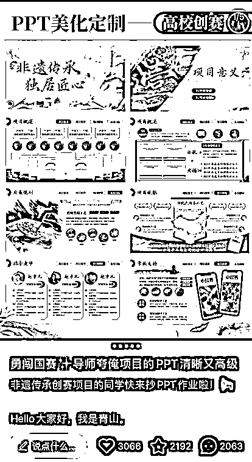

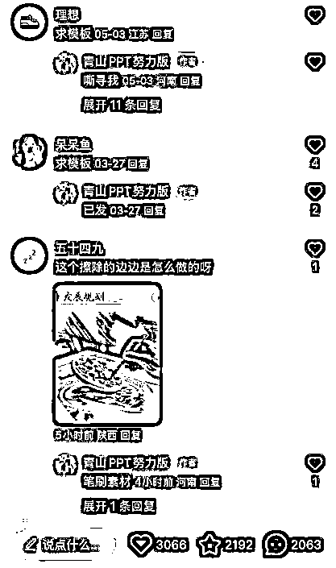

凡是资料，必定面向特定人群，引流效率高。📕虚拟资料项目火，本质就是用部分资料引流，再卖更多资料。

第二个，解决方案。家装攻略、旅游攻略、避坑指南、出国经验等。

准备好的攻略直接分享，就能吸引到有需求的人。

第三个，优惠信息。

黄金市价1000/克，你说你这边800多，🛰️会加爆，前提是不能骗人。价格自带流量，天然有引流力。

第四个，方案报价。

高客单服务用户决策前平均要看70篇笔记。他们会比价。如果直接在评论区报完价，流量就浪费了。引导加🛰️后定制方案报价，既能留住用户，也避免公域成本白花。

第五个，软件/插件。

工具类虚拟产品也能吸粉。行业数据分析工具、效率插件等。很多人不会用电脑，给一个压缩包都不会开，信息差就是机会。

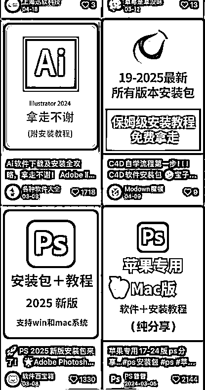

甚至可以开店铺卖。

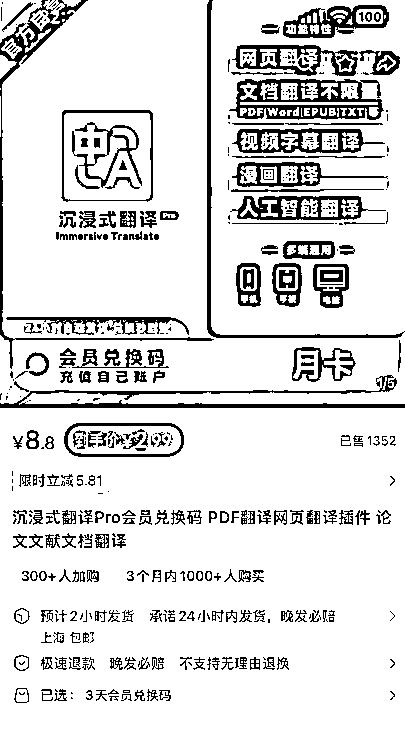

AI编程工具兴起，各种好用的工具整理成工具箱，既能吸粉也能打包出售。

第六个，泛粉利器，吃瓜热点。

🧣热搜的瓜整理成视频或52页PDF，评论区留言“我这里有，想看s我”，再引导加🛰️。粉多但精准度低，适合团购、淘客。

还有壁纸头像。这也是虚拟产品，需求量极大。不同风格对应不同人群。二次元壁纸吸二次元，写真头像吸小清新，星座星盘吸身心灵爱好者。

钩子的本质是人群需求。能给到解决方案或唤起需求，就能加到🛰️。钩子背后是人性。

钩子怎么放，后面再讲。先说流量。

# 三、流量怎么搞

先拆解📕流量结构。

有人会问，不是讲内容吗？流量和内容本质同一件事。内容就是用来拿流量的。

打窝打好，鱼多流量大；打窝失败，流量小。

流量可从两个维度拆：

来源维度：自然流量 vs 付费流量。
自然流量靠笔记被算法推荐；付费流量靠投放如聚光、薯条、乘风、蒲公英等。

内容维度：自制内容 vs 采买内容。
自制就是自己团队产出；采买就是找外包或达人代发。

按这两个维度，流量有四种玩法：

花钱找达人发笔记=报备种草。既买素材又买流量。找素人号做自然流量=素人种草，大量小号发笔记。

自己做内容+付费投放=付费投流打法。

自己做内容+免费流量=中小玩家主流打法，养号发笔记。管理强、SOP成熟的团队也能靠账号数量做大流量，比如前年的郑州帮。

再引入第三个维度：流量类型=推荐流量 vs 搜索流量。

推荐流量是首页信息流刷到的；搜索流量是用户主动搜索后找到的。

很多人做📕，总是纠结流量从哪来。其实你只要看清两种最核心的流量逻辑，就不会再盲目发力。

第一种是推荐流量。它的好处是曝光来得特别快，短期内能把数据冲得很高。但坏处也很明显——热度消散得也快。没跑出来的笔记，基本一周内就沉底了；哪怕侥幸成了爆款，持续被推荐的时间也就在一到三个月之间。想靠推荐流量吃上一年半载，几乎不可能。

第二种是搜索流量。量级上确实没法跟推荐比，可它的价值在于“准”。用户带着明确需求来搜，目的性极强，转化率自然高，而且这种流量能细水长流，甚至过了很久还源源不断。

如果把推荐、搜索、人这三个维度相互组合，再叠加官方工具和运营手段，就能玩出很多花样。

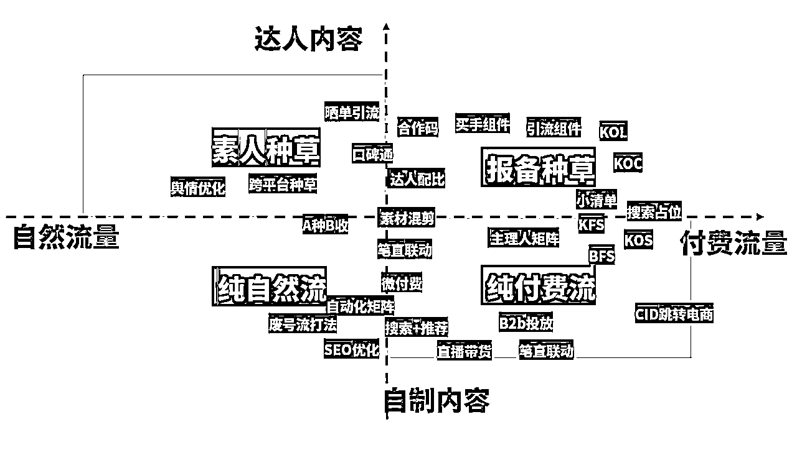

先说清楚，这张图不是今天的重点。我想让你先理解流量是怎么来的，后面要花大篇幅说的，是这三件事：

1. 能引流的爆款笔记怎么做
2. 关键词怎么占位
3. 付费投流怎么玩

至于图里其他打法和术语，以后有机会再单独聊。

## 一、爆款笔记的底层逻辑

先解决第一个问题：什么样的笔记容易爆？

网上流传一个公式：CES = 点赞数 × 1 + 收藏数 × 1 + 评论数 × 4 + 关注数 × 8

很多人说这是📕的官方推荐算法。澄清一下：这不是官方的真实算法，而是前辈们根据运营经验反推出来的估算模型。市面上还有加转发、加成交数据的版本，也都不是真的。

真实的算法复杂得多，但这套权重关系极有参考价值。

在所有用户互动里，权重高、又相对容易拿到的，就是评论。

想让笔记更容易爆、引流更高效，核心动作是把评论做上去。

我们不必追求几十万赞的爆款，反而应该去做那种“评论数超过点赞+收藏”的笔记。为什么？因为评论权重高，笔记更容易被系统推荐，也会引发更多人围观参与，形成滚雪球效应。

而且评论区的文字会被算法收录。评论内容越垂直，越容易被精准推给目标人群。

做号初期，可以用这个思路快速拉高账号权重；做号中后期，也能靠这个逻辑写出高转化的引流笔记。

### 起号阶段怎么写

刚注册账号时，先发一些天然能勾起人吐槽欲、分享欲的帖子，让笔记快速小爆，把基础权重抬起来。

比如有人发过一篇“那些年男朋友拍过的照片”，配上一堆奇葩摄影作品：

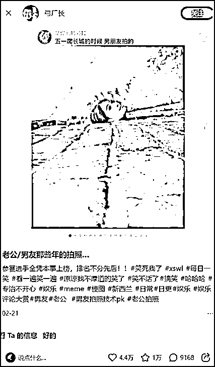

这明显是抛砖引玉，故意钓出大家的共同经历，引导评论区晒图。

每个人都需要被看见。尤其遇到同病相怜的人时，表达欲会空前暴涨。于是评论区涌进来大量晒照的，笔记一下就爆了。

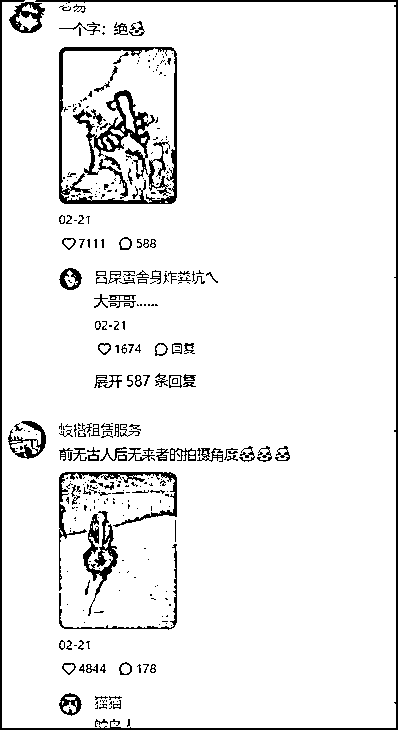

再看这类的标题：“浙江的厂二代们来聊一聊”。

标题直接做了人群筛选，顺便把爱吃瓜的路人也筛了进来。

这类笔记的共同点：筛选出一个明确的圈层，吸引同类人扎堆互动。

用一两篇这种帖子，快速给账号打上标签，把基础权重抬上去。当然，靠这种内容提升的权重有限，📕去中心化算法卡得很死，不需要追求大爆，小爆就够用了。既能拉权重，又能让自己有信心继续做下去。

还有个土办法：新号注册时，把生日设在三天后。等生日那天，平台会送一张生日流量券，可以免费获得1000次曝光。把这张券用在互动型笔记上，更容易助推出爆款。

怎么找这种高互动的话题？

第三方工具像灰豚也能查，这里不说了。重点讲📕自带的两个入口。

一是📕App的搜索筛选功能：搜行业关键词，按“近半年”或“近一周”筛高评论笔记，话题直接抄作业。

二是聚光、千帆、蒲公英后台的“内容广场”，里面能筛全渠道商业内容，也能找到大量行业高互动话题。

注意：个人店铺后台没这个功能，只有企业店铺后台才有。

做这类笔记要记住两个原则：

1. 尽量选和自己行业相关的话题。这样吸来的人群偏目标用户，后面转化才顺。
2. 千万别沉迷这种流量。

因为靠这类内容爆的笔记，吸引来的大概率是泛流量——不少吃瓜群众，真正有购买需求的比例并不高。而且笔记本身只是提供了情绪出口，没有给消费者实在的价值，所以转化率通常很低。

所以，别被虚假数据的繁荣骗了。发两篇小爆之后，就可以把它们隐藏，开始老老实实发引流内容。那些泛流量再大，对项目实际帮助也有限。真正的打法是：等账号权重起来，再发目标人群真正有需求的笔记，把人导到私域里。

### 引流笔记怎么写

现在讲引流内容和钩子怎么放，为什么要一起讲？

因为对一篇好的引流笔记来说，最简单的内容就是钩子本身。

你钓鱼用的钩子，本身就是一种内容。只要把它展示在用户面前，就够了。

比如前两年有个玩法：把一份资料打印出来，拍照晒一下，一个号一天能加一百多个🛰️。

这份资料就是钩子——加🛰️就能领。把其中几页拍成图发出去，就是一篇内容。

但今天你再用同样的玩法，流量肯定大不如前。因为版本变了，大家都在晒资料，笔记也需要迭代。

怎么迭代？

一方面，内容的广度可以换思路。前面说过，钩子本质上就是需求，而钩子也能成为内容。按数学逻辑，A等于B，B等于C，那A就等于C——需求本身，也能直接化作内容。

比如：女生小腿脂包肌减不下来怎么办？抛出这个问题让大家交流，就能精准聚拢有同样困扰的人。然后在笔记里给出你自己的成功解决方案。

再比如：去西藏旅游踩坑了怎么办？照样能吸引想去西藏玩的人。他们本来是来避坑的，点进笔记发现：这人在踩坑之后找到了合理方案。想要这份方案？先加🛰️。加过来才发现，原来对方是导游。但此时人家已经不在乎你是谁，脑子里只记着那份避坑攻略。

如果销转团队再强一点，可以先用普通消费者身份加人，然后再把另一个导游🛰️和攻略一起推过去，成交效果会更好。

也可以把这一步提前，玩得更隐蔽：笔记里抛出问题后不急着解答，而是用另一个账号在评论区装作热心路人给答案，甚至两个账号、三个账号在评论区唱双簧。

用户一旦有需求，就会去找B账号，加🛰️——殊不知，B号也是你的小号。这套玩法有个响亮的名字：A种B收。根据账号数量和托的逼真程度，还能衍生出A种B答C收、A种B问C答D收等等变体。

比如这样，A号先发一条旅游分享帖：

然后B号在下面求推荐，A号顺势把官号推过去：

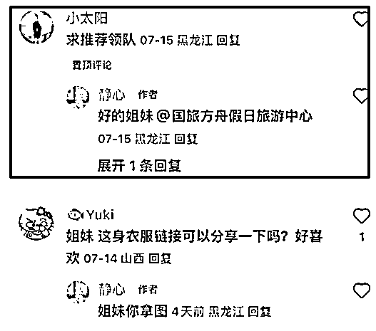

实际上点进主页就会发现，俩账号都是运营团队养的小号：

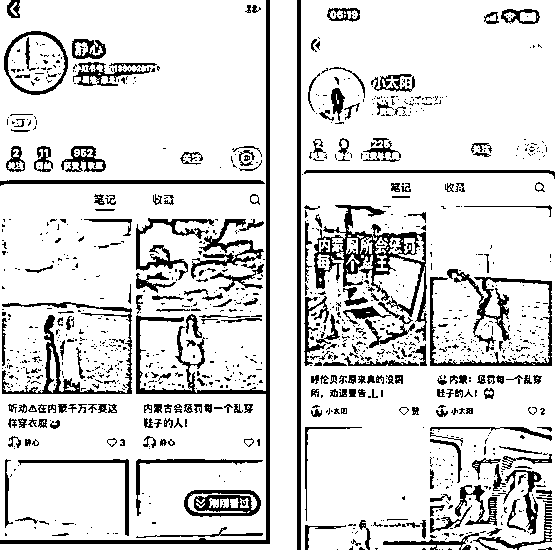

自己操作时，托的账号主页一定包装得够真实，别露馅。

除了广度迭代，还有深度迭代——这就是接下来要说的重点：

## 二、关键词占位

📕是个极度依赖搜索流量的平台，官方数据说有六成用户会在这里搜索。前文也说过，搜索流量还在快速上涨。

更重要的是，搜索过来的用户需求明确，比刷推荐的精准太多。

因此发引流帖时，除了晒需求、晒钩子，还要做的关键动作是：把精准关键词埋进笔记里。

前两年可以不埋，因为专业玩家少，赛道不够卷，打印资料拍个照就有流量。现在想这么干的人太多了，同质化严重，只有埋入相关关键词，才能提升笔记在算法里的权重，拿到更多曝光。

关键词怎么做？先普及一个知识框架：我把一个关键词拆成三层——核心关键词、相关关键词、长尾关键词（也叫长尾短语）。

* 核心关键词，就是品类词或产品词。拿考研举例，“考研”就是核心关键词。
* 相关关键词，是跟核心词能组队、有关联的词。比如“上交大考研真题”“清北考研”，里面的“上交大”“清北”就是相关关键词。再比如“考研真题”“2025考研”“考研英语”。有品牌的话，品牌词、竞品词也算相关关键词。
* 长尾关键词/短语，就是多个相关关键词组成一个能代表需求点的短句。比如“25年考研冲刺”“上交大考研历年真题”。

这三层关系是一步步递进的：越往下越细，需求越精准。“考研”这个词很大，底下能拆出几百个细分赛道，一个学校就能算一个赛道——每个学校真题不一样，高考全国统一卷，考研则各不相同。

所以做内容前，先把你所在行业的关键词和相关关键词整理好，就能把内容精准地送到最需要的用户面前。

### 怎么找关键词

1. 📕搜索下拉框，以及搜索结果页里的推荐词。这些都是平台自己筛选出的行业相关词。

2. 巨量算术（https://trendinsight.oceanengine.com），不用开户，手机号登录免费使用。输入搜索词，它会推荐一堆相关词。虽然跟📕不是一个体系，但大趋势是相通的。

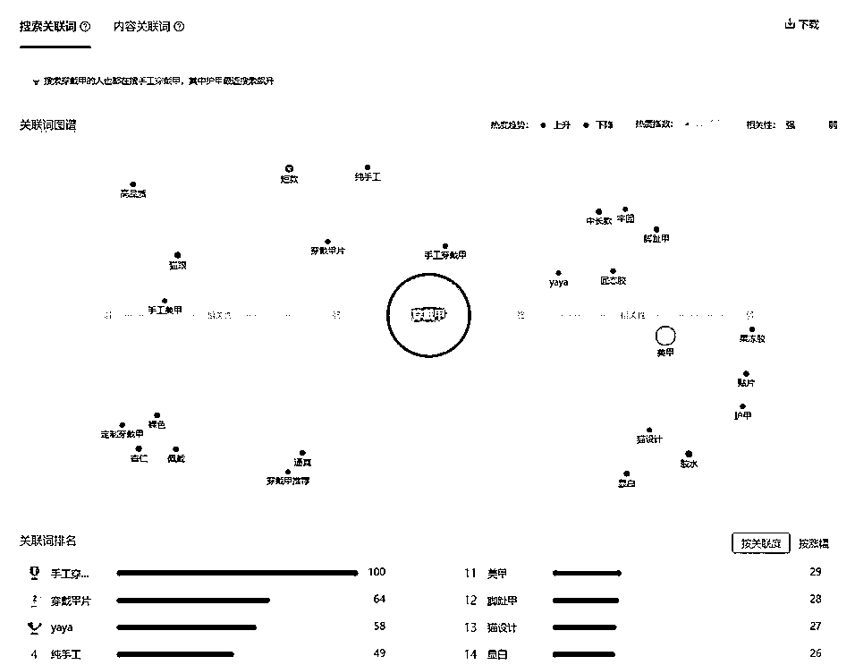

3. 5118网站（https://www.5118.com），专门做各平台专业词汇的工具。看完整数据、下载表格要会员，用得不频繁的话可以上闲鱼或淘宝拼单。

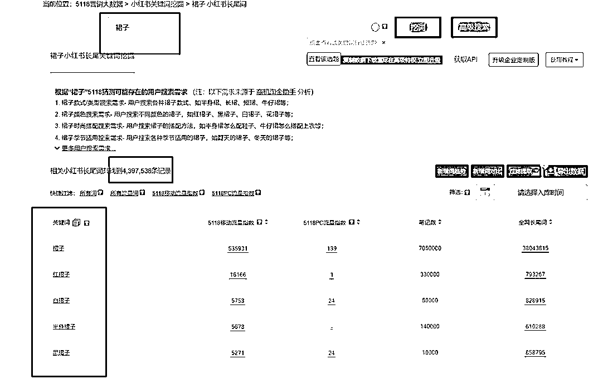

4. 聚光后台的关键词规划工具（https://ad.xiaohongshu.com）。不仅能看到搜索指数，还有市场出价、竞争指数和上下游关键词。

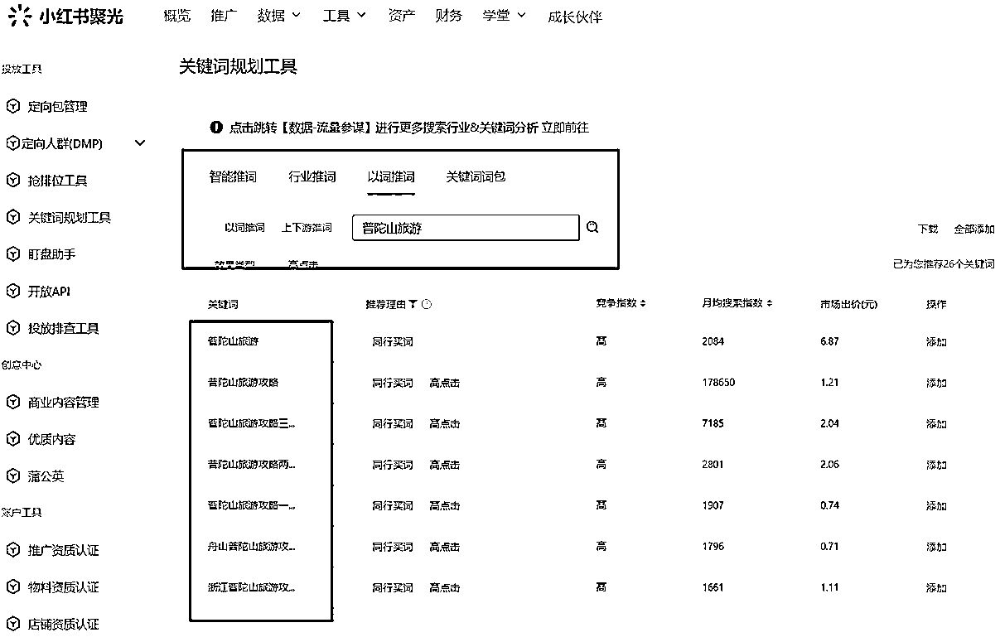

开通聚光需要先认证📕企业号，交600元认证费。

如果还没开聚光，也可以找对方要一份行业关键词表作为参考。

把关键词收集好，拉个表格存起来，后面随时调用。

接下来是怎么把它们放进内容里。

我们做的一切，都是为了找到那些对自己的产品和服务有需求的人。笔记里埋的相关关键词越多，这篇笔记在整个行业内的权重就越高。这个权重既影响用户主动搜索时的匹配结果，也影响信息流推荐时的兴趣判断。

但注意：植入关键词不是简单粗暴地重复堆砌，那样容易被判定为低质笔记，直接不给流量。关键词要植入的位置包括：标题、封面、内页、正文、话题、评论区，各有各的巧劲。

举个例子，像“云南旅游大理旅游攻略”这类笔记：

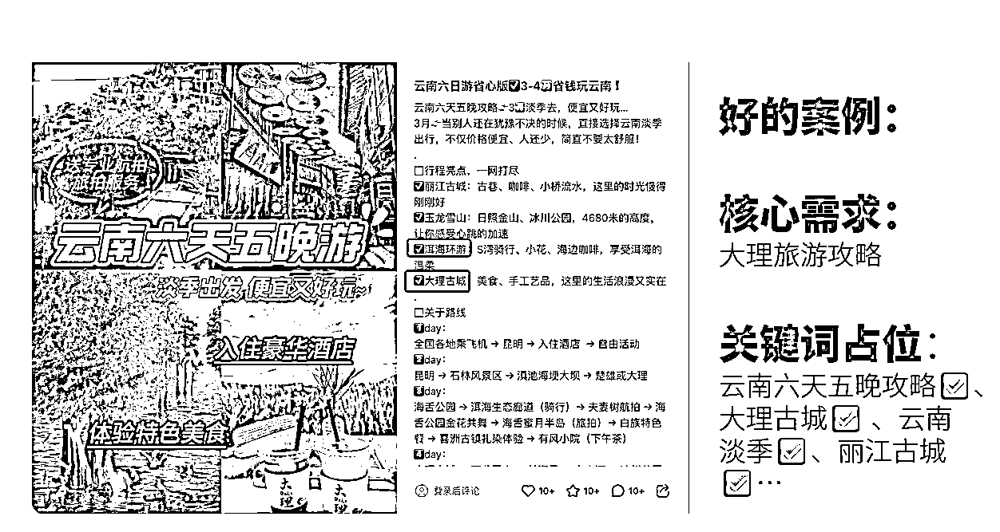

产品是“大理旅游”，消费者需求是“大理旅游攻略”。笔记标题里“云南五天六晚”“省钱玩云南”，这俩都是长尾短语。封面上“云南”“六天五晚”“豪华酒店”“航拍”“旅拍”，也都属于相关关键词。封面词一方面能被算法识别，另一方面也能提高兴趣人群的点击率。正文里“丽江古城”“洱海”“大理古城”“昆明”“日照金山”“玉龙雪山”……全都和“大理旅游攻略”这个核心需求相关联，有的甚至是上下游关系。话题部分也可以埋词，比如#云南六天五晚、#洱海环游等等，话题权重虽然低，加上去也能蹭些流量。评论区同样可以拿小号再埋几个关键词。

一篇笔记里，所有内容结构和核心需求关联的词越多，用户搜索和推荐时权重就越高，就越容易出现在真正有需求的人面前。只要他看到了，又有需求，就很可能上钩。

回过头看这类内容，最大问题就是关键词埋得太少。可以把封面做成拼图，加上关键词标题，正文里用合理逻辑把“宝宝早教”相关的关键词自然放进去。

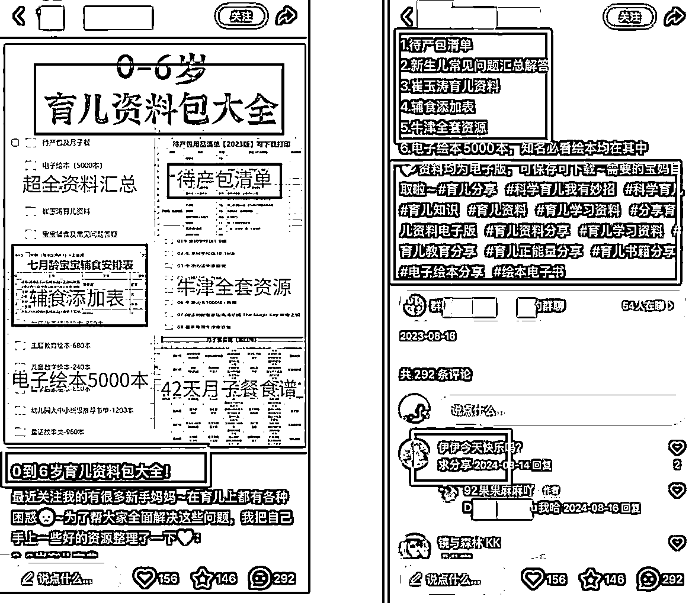

再比如别的笔记形式：不一定非要晒资料，可以从需求出发去讲行业信息，照样能大量植入相关关键词。每个词，都可能成为用户找到你的流量入口。

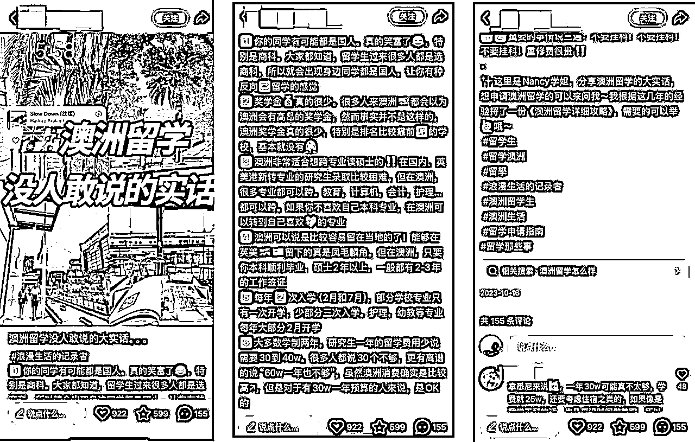

以上就是引流笔记的核心思路。

讲内容制作时，其实已经说到好几种放钩子的方式。这里汇总一下，不展开：

1. 内容本身是钩子
2. 正文尾部放钩子
3. 评论区放引导
4. 评论区放托

知道怎么写引流笔记、怎么埋钩子之后，就可以去打磨内容生产流程、提高产量、批量做账号了。这些以后有机会单独开文聊。

## 三、付费投流

讲完内容，最后说流量板块的压轴环节：付费投流。

不深入讲具体投放技巧，只做认知层面的科普。投流本身是门很深的学问。虽然我常跟客户说，投流操作本身不复杂，但真拎出来讲，光把功能讲清楚就得一两个小时。这里只做科普，帮大家把认知对齐。

为什么一定要加付费这个环节？

因为不管你身处哪个行业，只要项目跑得顺，最终都会走上投流这条路。你大概听过一句话：流量的终点是付费。

为什么会有这种说法？逻辑很简单——自媒体平台的终点，就是卖流量。

好几年前的📕和其他平台，大多数都在卖广告位。

某一个位置能放广告，就把这个位置卖给需要曝光的商家。比如你翻到这篇文章底部评论区，可能就看到一条广告，那个位置就是广告位。

这本质上和线下传统广告牌没什么区别：电梯广告、电视广告，都是“我打造一个有流量的场域，再把其中的某个位置作为广告卖给商家”。

直到抖音横空出世，把固定广告位变成了流动广告位。

平台们突然悟了：原来除了卖广告，还能直接卖流量！原来钱还能这么赚！

以前卖广告位，平台既要给商家位置，又要帮着做广告内容，还得扯营销方案、投放方案。可如果直接卖流量，商家自己搞定内容和营销策略，还要自己卷价格、卷内容。平台甚至能把同一份流量卖很多遍。它只需要递个工具，告诉商家怎么操作就行。

内容优质的、对平台有价值的，可以用更便宜的价格买到流量；出价高、让平台赚更多的，能买到更多流量；产品好、能促进成交的，也能买到便宜的流量。

对平台来说，卖流量远比卖广告赚钱得多。

既然流量可以卖，人家凭什么免费给你？这个逻辑就是如此简单。

你可能会说：我们前面讲了那么多爆款笔记技巧，做好内容发笔记，不也是拿免费流量吗？

没错。但你给平台提供了优质内容，帮平台拉活跃、留用户、促成交——这本身就是价值交换，也是一种交易。

📕从前年开始真刀真枪搞商业化，所有动作本质都是为了让流量卖得更好、更高效。

当然，现在📕的整体流量成本还比较便宜。除了旅游、留学、医美这些已经卷到死的行业外，很多类目在抖音获得一个客资要50到100块，在📕可能只要10到20块。哪怕再卷的行业，也有大量细分赛道和出价低的关键词可以操作。

还没开始做投放的话，可以用这张表了解自己行业的获客成本参考：

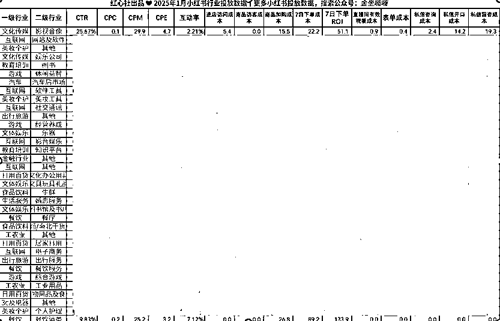

再从另一个角度看：我们在平台做引流，本质是在把📕用户往外导。平台当然不乐意看到这个。

平台最理想的状态是所有成交都发生在自己站内，这样它才能利益最大化。你一旦把粉丝导去私域，后续的成交和复购都跟它没关系了，它赚不到一分钱手续费。

所以付费投流除了拿流量，还有另一个隐藏好处：你在平台花的钱，其实是在交“保护费”，让平台默许你在这里做自然引流。

说到📕的投流，绕不开它的付费体系：

先记住这张图：

📕当前的商业政策是“号店户”一体。

“号”是企业专业号；“店”是千帆店铺；“户”是聚光账户和蒲公英账户。不管是店铺还是广告账户，都必须先有一个企业专业号才能开通。

换句话说，想在📕买商业流量，就得先花600元认证一个企业专业号。

电商是个特例：个人也能开店，也能开通乘风投流。但个人店铺无法开通聚光账户，也开不了蒲公英，更开不了代理商子账户，功能上会少一截。

还有一点必须分清：几个投流工具定位不同。

* 聚光，是📕最核心的广告营销系统，也是我们日常获客最常用的广告工具。

做📕获客，先别急着研究话术，流量性质没分清，后面的操作很容易出问题。

平台上的曝光，大致可以拆成两套体系。

第一种是内容型曝光。笔记不带广告组件、不做明显营销，经过机器检查后，只要没有触碰技术规范和公共秩序，通常就能进入推荐池。这类流量覆盖面很广，面对的是平台大多数活跃用户，规模可达上亿。薯条的作用，就是给内容增加热度、改善表层互动数据；它并不负责带来成交，也不能拿来推广广告内容。

第二种是商业型曝光。它来自聚光、乘风等付费渠道，或者来自挂载营销组件后的定向推荐。这里的人群数量没有全站那么大，但购买倾向、转化可能性和客资价值相对更高。

两种流量的审核标准也不是一套逻辑。笔记一旦进入商业投放体系，就要接受广告合规检查，广告法里的绝对化用语、敏感表达等，都应提前清理。普通内容则主要看平台基础规范。不过，普通笔记如果没有任何营销组件，却写得像一篇硬广，同样可能损失自然推荐。

聚光和乘风所对应的，都是商业流量。若目标是收集客户资料，通常优先考虑聚光。它可以覆盖图文、视频、搜索、信息流、视频流、种草、客资以及 CID 等多种投放类型。广告展示位置也会随场景变化：信息流常见于第6、16、26、36位附近，搜索结果则可能出现在第3、13、23位，之后按规律递增。

接下来进入渠道部分：怎样把用户导向🛰️，同时尽量减少账号风险？

## 一、优先走官方路径

平台逐渐商业化后，更鼓励商家通过标准化工具完成转化。目前最稳妥的方案，是使用商家名片。

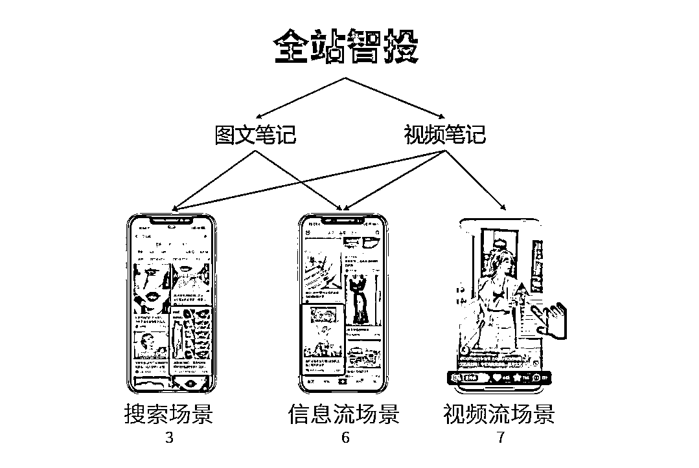

用户进入私聊界面后，可以看到你配置好的🛰️、企业🛰️、电话或钉钉信息，点击即可复制。比起乱码、谐音、拆分图片等隐蔽写法，这种方式对用户更清楚，也更符合平台规则。

商家名片既能由你在对话中发送，也能放到专业号的私信菜单、自动回复等位置，让访客自行点击获取。相关入口可以在专业号后台设置。

使用它通常要满足两项条件：

- 完成企业专业号认证；
- 近30天内，聚光账户产生过消费。

换句话说，需要准备营业执照，个体工商户或公司主体均可；同时承担600元年审费用，并向聚光充值，最低起充金额为2000元。对于有企业资质的团队，直接按流程认证并启用名片，往往是最省事的选择。

如果团队管理着多个账号，还能考虑聚光里的自定义表单。私信区域通常不能放站外地址，但聚光生成的表单链接属于平台内部链路。创建时保留姓名和联系方式等必要字段即可，再把链接配置到私信服务中。由于链接使用平台域名，通常能保持可点击状态，其他账号也能拿来承接咨询。

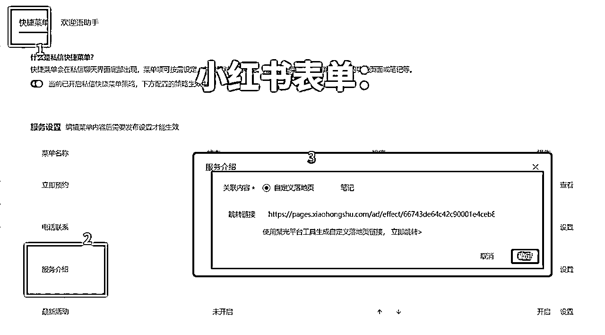

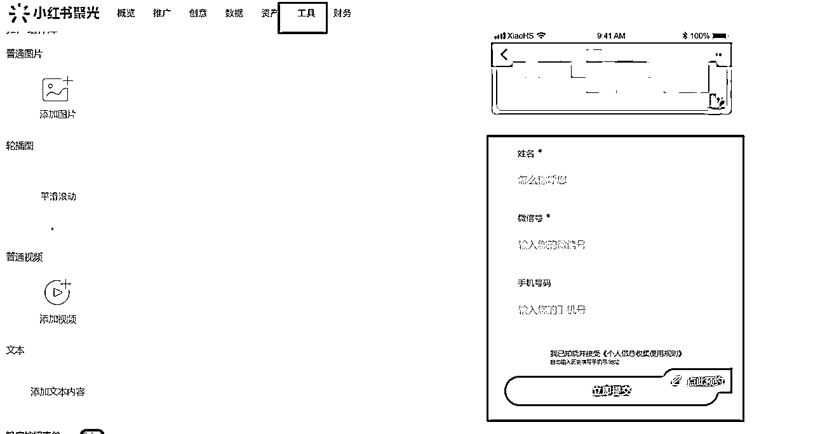

不过，这条路径的前提仍是拥有企业主体。对没有营业执照、预算有限的副业创作者来说，确实存在门槛。

## 二、关于非标准做法的风险提醒

下面这些方式并不属于平台鼓励的方案，仅用于说明常见风险场景，实际操作前务必评估账号安全和合规责任。平台会周期性治理违规导流行为，曾被点名的情形包括：

- 正文、昵称、简介中出现联系方式；
- 头像或背景素材里隐藏联系方式；
- 将账号名称改造成外部联系方式；
- 在置顶内容、合集名称、评论区或直播中导流；
- 把号码拆分、变形后发布；
- 通过私聊或群聊发送外部联系信息。

这些动作可能短期有效，但被识别、举报后，轻则提醒和减少曝光，重则限制功能甚至封禁账号。不要把“暂时能发”误认为“长期安全”。

若团队确实需要做风险隔离，常见思路是把内容运营账号与承接咨询的账号分开，再配合群聊进行管理。但这并不代表绝对安全，平台抽查或用户投诉仍可能造成处罚。

群聊中的信息呈现形式，也可能涉及平台审核风险，例如群公告、入群验证、图片素材或承接账号的公开内容。尤其是刻意隐藏、拆分、伪装联系方式的做法，不建议作为长期经营方案。

此外，群聊可能通过站内搜索或群广场获得曝光，因此它既可能承担沟通功能，也可能成为新的流量入口。群名称、主题和日常活跃度，都会影响被发现的机会。

## 三、只有单个账号时怎么办

如果手上只有一个个人账号，没有营业执照，也不打算准备额外账号，可以了解平台提供的个人身份能力：

1. 完成实名认证；
2. 申请免费的个人专业号；
3. 开设个人店铺，暂时不必上架商品。

满足这些条件后，可以使用私信服务相关功能。不过，随着审核趋严，直接填写外部联系方式可能无法通过，任何规避审核的写法都存在不确定性。

至于私信页面中的其他便捷功能，即使当前能够发送联系方式，也不代表获得了平台许可。此类功能若被用于导流，可能随规则调整而受到限制，使用时需要特别谨慎。

## 最后做个排序

- 首选：商家名片，规则清晰、风险相对最低；
- 次选：使用平台提供的表单和私信能力，按要求承接咨询；
- 不建议长期依赖：拆分、隐藏、伪装或借助非标准场景发送联系方式。

📕获客的关键，不是找到“最隐蔽”的办法，而是把内容流量、商业流量和平台允许的承接工具分清楚。先判断自己的目标，再选择合适的路径，账号才能更稳定地积累。

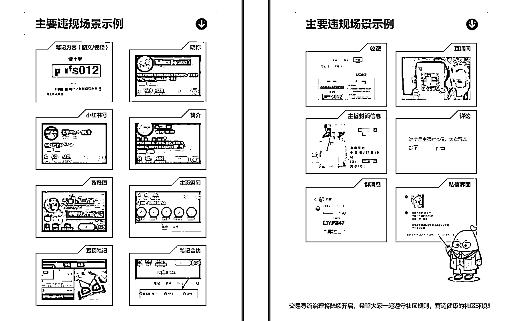

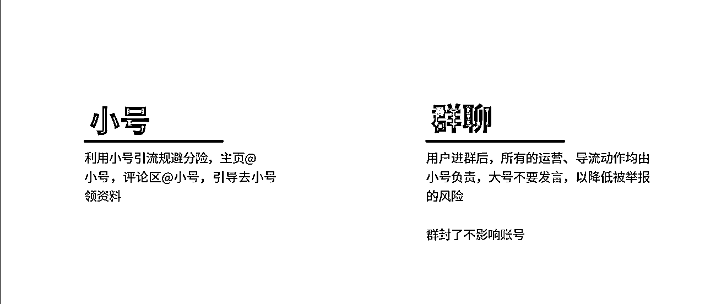

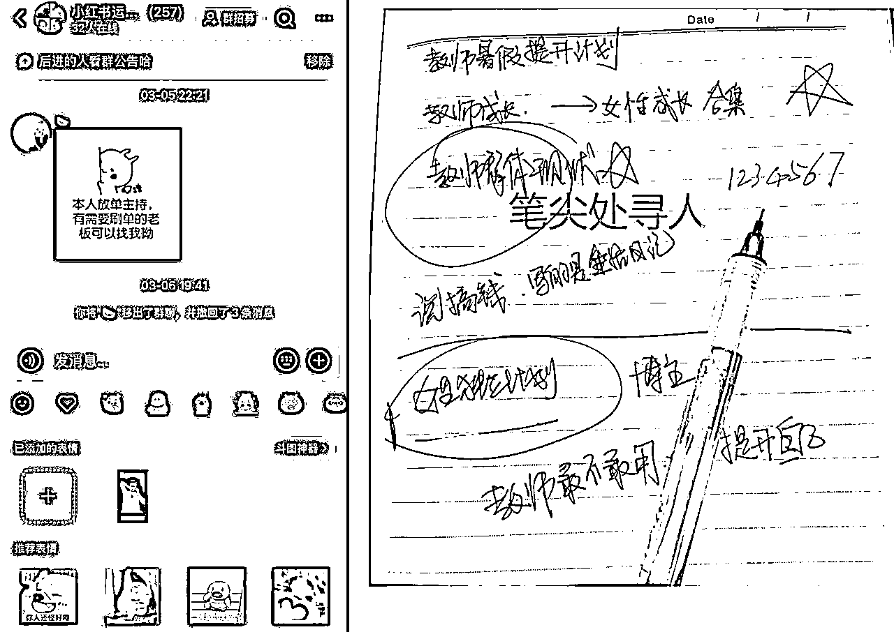

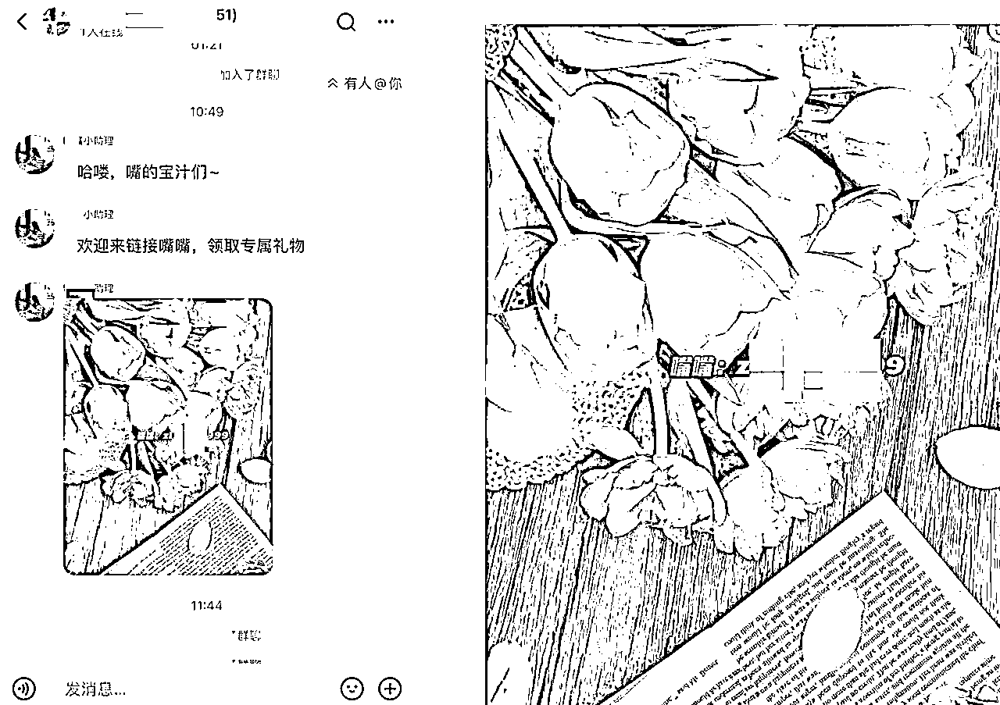

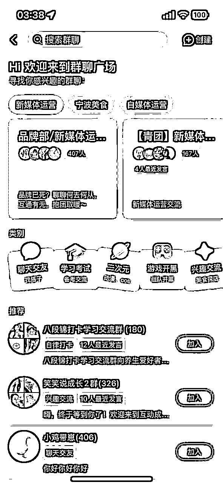

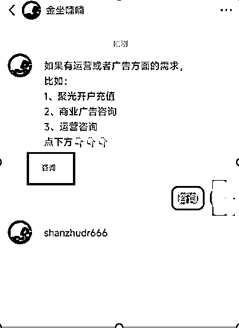

