# 小红书引流，别再只知道“发笔记”了！这篇2.0实操手册，讲透从0到1的全流程

你有没有发现，这两年身边越来越多的人，哪怕是完全不相干的行业，都在往小红书挤？

别急着划走，先看一组真实数据：

去年一年，小红书电商买手数量暴涨27倍，动销商家翻了10倍，购买用户涨了12倍，平台活跃用户也增长了1.6倍。每天有超过600万篇笔记被发出来——而前年这个数字才300万。日均搜索量接近6亿次，其中88%是用户主动搜的。每天求链接、求购买的评论接近600万条，每天截图行为超过1.2亿次。

这些数字背后什么意思？

第一，商家越来越多，说明平台商业化生态在成熟，价值被认可。你不动手，你的同行也会动手。第二，用户的需求正在大爆发，越来越多的人已经把小红书当成“解决问题”的搜索工具——想买什么、想学什么、想避什么坑，先上来搜一圈。第三，也是我自己的体感：我每年帮几千个客户开广告账户，大家普遍反馈，小红书的流量虽然不如抖音大，但价格更便宜，成交率更高。

不过，这种红利窗口还能维持多久？我不确定。但按现在商家涌入的速度，我估计到明年年中，小红书大盘流量价格就会跟抖音持平。所以，要做就趁现在。

这篇文章不聊别的，就聊一件事：怎么安全、高效地，把用户从小红书搞到你的微信里。全程无废话，全是实操。

---

## 先搞清楚一件事：别人凭什么加你？

我们想象一个场景：

你在街上走着，突然一个人凑过来说：“你好，能加个微信吗？加完我天天在朋友圈发广告，你就能看到了。”

你是不是觉得这人有点毛病？

但换一种说法：“你好，我转你10块钱，你加我好友帮我个忙，行吗？”

你是不是就愿意了？

道理就这么简单：想让别人加你，核心就俩字——**利他**。

人性如此，没好处的事，谁愿意配合？这个好处可以是知识、是情绪、是利益、是解决方案。只要对方觉得“加了你有用”，他不仅会加，甚至会主动来找你。

很多人听过一句经典口诀：“引流就是加我领资料。”话糙理不糙。

但实操起来，问题马上来了：

- 你怎么让人知道可以找你领资料？
- 你怎么保证这资料是他想要的？
- 你怎么安全地把微信号发出去，还不被平台封？

这三个问题，刚好对应一套公式：

## 万能引流公式 = 内容 + 钩子 + 渠道

我用钓鱼来打个比方。

你想想，钓鱼之前是不是得先打窝？撒一堆饵料下去，把附近的鱼都引过来。鱼多了，自然好钓。

内容就是打窝。你发笔记，平台算法帮你推给可能感兴趣的人。有需求的人点进来看，没需求的划走。你的阅读量越大，就说明窝打得越广，后面引流的成功率才越高。

但注意，打窝也得看鱼种。你想钓草鱼，撒的是鲈鱼饵，那就白搭。所以内容要精准筛选目标人群，泛流量和精准流量的引流效率，能差几十倍甚至几百倍。

钩子就是鱼钩上的那点饵。没有饵，鱼凭什么咬钩？你发了一堆内容，阅读量还不错，但就是没人加你——大概率就是没准备钩子，或钩子没吸引力。

渠道就是鱼线。线不结实，鱼咬完饵就跑了，你这不是钓鱼，是帮鱼塘主养鱼呢。所以引流的路径必须稳定，不能让用户找到你却联系不上。

内容、钩子、渠道，三者缺一不可。市面上很多引流课程，要么只讲内容怎么做，要么只讲怎么把微信加到手，要么塞给你一个资料库就算完事。但真正把这三件事串起来、把整条链路跑通的人，少之又少。

你之所以“有阅读没进粉”“流量便宜但获客贵”，大概率就是这三个环节里有一个出了问题。

---

## 钩子怎么找？先搞懂你的鱼爱吃啥

刚才说了，钩子就是“加我领资料”里的“资料”。但这资料不是随便找的。

宝妈大概率对考研资料没兴趣，但可能对“怎么让宝宝睡整觉”“产后怎么恢复”感兴趣。所以找钩子之前，先明确两件事：

1. 我的目标人群是谁？
2. 他们有什么需求？

还是拿钓鱼说：你要钓哪种鱼？这种鱼喜欢吃啥？

不同人群需求完全不同——

- 男人：工作机会、数码产品、钓鱼地点、前列腺保养
- 女人：变美护肤、家人健康、金价走势、大牌优惠券
- 老人：谁能陪我说说话、哪个保险划算、哪里领鸡蛋
- 老板：行业动态、员工八卦、融资渠道、洗脚城哪家好
- 学生：考试、热门游戏、新潮事物、亚文化
- 咱们圈子里的人：搞钱

目标人群怎么定？取决于你自己的产品和生意。你要卖什么？卖给谁？他们在什么城市、什么年龄段、收入多少、消费习惯如何、最近被什么东西种草过？

做过广告投放的朋友是不是很眼熟？这不就是后台的人群标签嘛。你对客户的理解越深，就越知道他们想要什么。

这里有个特别重要的点：**钩子不一定是你的产品。**

就像直播间有引流款和利润款一样，引流品和利润品往往是两码事。你拿利润款去引流，大概率转化率很低；拿引流款去吸客，哪怕不赚钱，先把人搞进来再说。

举个具体例子：我卖母婴产品，我不一定非要用奶粉、尿不湿引流吧？我可以用“胎教资料”“产后恢复指南”这类刚需内容当钩子，先把宝妈吸引过来。

所以钩子的本质，就是找到目标人群需求的“最大公约数”。比如我对咱们圈子里的人说：“教你无痛年入百万，百分百能做到。”你加不加？肯定加爆。至于加完之后我告诉你的方法是“往银行存6666万”，那就是后话了。

### 常见的钩子类型

**第一类：行业资料**

这是最常用、最好用的。运营资料、考研真题、雅思历年卷、大学生创赛PPT模板、坐月子食谱……只要是面向特定人群的资料，引流效率就很高。现在很火的“虚拟资料”项目，本质上就是拿部分资料当钩子，把人引过来后再卖更多资料。

**第二类：解决方案**

家装攻略、旅游避坑指南、出国签证经验、养宠手册……把自己踩过的坑、总结的经验分享出来，有需求的人自然会上钩。

**第三类：优惠信息**

比如现在市场金价一千左右一克，你说你这边只要八百多——前提是真的，你微信绝对会加爆。但要是玩套路骗人，不仅被骂，后端转化也不可能好。热门产品、品牌货，只要价格够低，本身就是流量。

**第四类：方案报价**

高单价产品/服务的生意，客户下单前会对比很多家。小红书官方给过一个数据：买高单价产品前，一个消费者平均会看70篇笔记。他会挨家挨户问价格。如果你直接就在评论区或私信里把价报完了，他大概率不会再联系你。但如果你说“加我微信，我给你定制一套方案和报价”，他多半愿意加——加了你也不一定买，但把用户拽到私域，你后续触达他的成本就变成零了。在公域报了价，这波流量就白白浪费了。

**第五类：软件/插件**

本质上也是虚拟产品。行业专用的分析工具、特别好用的网络插件，都能引流。很多人搜商差、不会用电脑，连压缩包都不会解压，这就是巨大的信息差。整理一批好用的AI工具做成“工具箱”，吸粉导流效率很高。

**第六类：吃瓜热点**

适合做泛粉。某个大瓜爆了，你整理小视频、52页PDF，跑到热门笔记底下留言：“我这里有，想看私我。”等对方私信你，再想办法把他引到微信，发资料时顺手塞个二维码，让他帮你转发裂变。这种粉丝产值不高，适合团购、淘宝客，不适合精准导流。

**第七类：壁纸头像**

这也是虚拟产品，但单拎出来说，是因为需求巨大。二次元壁纸吸引二次元人群，照片头像吸引小清新、文青，星盘吸引身心灵爱好者，MBTI吸引命理爱好者……不同风格，圈住不同的人。

当然，还有更多类型。欢迎评论区补充。

**钩子的本质，就是人群的需求。你能解决TA的需求，或者能唤起TA的需求，你就能加到TA的微信。钩子背后是人性，抓住人性，就抓住了用户。**

---

## 流量怎么搞？先看透小红书的流量结构

很多人问：“你不是讲内容吗？怎么扯到流量了？”

很简单，内容就是拿来换流量的。打窝成功，你的鱼就多，流量就大。

我把小红书的流量结构拆成几个维度，这套拆法你在别的地方大概率没见过：

**第一个维度：流量来源**

- 自然流量：自己发笔记，平台按算法免费推给你的流量。
- 付费流量：花钱买的，包括聚光、薯条、乘风、蒲公英等。

**第二个维度：内容来源**

- 自制内容：自己或团队做笔记。
- 采买内容：找外包、找达人拍的素材和笔记。

很多人没意识到：在小红书找博主的本质，其实是花钱买素材，顺带买流量。因为达人账号的流量本身也有不确定性，有时候粉丝多的博主，笔记权重反而不如粉丝少的。但专业博主的内容生产能力，通常远超普通素人。

**第三个维度：流量类型**

- 推荐流量：App主页往下刷，信息流里看到的笔记，是算法推给你的。
- 搜索流量：用户有需求，主动搜索关键词，在搜索结果里点到你的笔记。

把这三个维度交叉，就能得到4种基本玩法：

1. **花钱找达人 + 报备种草** → 走蒲公英平台合作，买达人的曝光，也买达人的素材。
2. **找达人号做内容 + 走自然流量** → 素人种草，大量小号发笔记；或者素人代发，把你做好的笔记放到他们的号上发。
3. **自己内容团队 + 付费投放** → 每天更新素材，花钱买流量精准触达目标用户。
4. **自制内容 + 免费流量** → 大部分中小玩家的打法：多搞几个号，哼哧哼哧发笔记，靠数量和技巧堆出流量。有些团队管理强、内容成本低、SOP做得好，靠这一招也能做出很大的流量，比如前几年很出名的“郑州帮”。

---

## 怎么合规导流？这部分是重点

（以下涉及具体路径，建议结合平台最新规则执行。本文只讲逻辑和思路。）

导流的核心逻辑，是让用户“主动”想加你，而不是你“硬塞”给他。所以合规的关键在于：

- 你的账号本身要有信任背书。头像、昵称、简介、置顶笔记，都要让人觉得“这是个真人，靠谱”。
- 钩子要放在内容里自然带出。比如在笔记中讲一个案例，顺带说“我把完整版整理成了PDF，想要的朋友私我”。
- 不要直接在笔记正文、评论区、私信里发微信号。否则平台机器审核基本秒封。
- 可以用一些“暗号”方式，比如“s我”“dd”“领资料”，然后在私信中引导关注瞬间、或者用谐音、图片等方式传递联系方式。但一定要控制频率，不要每条私信都发链接，不要批量操作。
- 更稳妥的方式：用企业号挂载蒲公英组件、私信组件，或通过店铺客服自动回复，把用户引导到微信。但每种方式都有门槛和要求，建议提前在后台熟悉规则。
- 千万不要用“我微信是xxx”这种直白方式，不要用二维码图片直接发在评论区，不要买“假粉”来刷互动。这些都是高危动作。

一句话总结合规思路：**让用户来找你，而不是你去找用户。让你是被“求”的那个人，而不是“塞”的那个人。**

---

## 最后，把整个流程顺一遍

- 第一步：定人群。你的客户是谁？他的标签是什么？
- 第二步：找钩子。从人群的需求出发，准备资料、方案、优惠、工具等至少3个钩子，测试哪个转化率最高。
- 第三步：做内容。围绕你的业务和人群，持续生产笔记。可以自己发，也可以找素人/达人发。内容要精准筛选人群，不追求泛流量。
- 第四步：引流量。自然流量和付费流量结合，推荐流量和搜索流量兼顾。小红书搜索占大头，标题和正文里一定要埋关键词。
- 第五步：导流。用合规方式，把用户从评论区、私信引导到微信。整个路径要短、要顺、要有备份。
- 第六步：做承接。加到微信后，第一时间给用户他想要的钩子，然后把他引导到你的朋友圈、社群、直播间里去建立信任，完成转化。

这套流程，其实不只能用在知乎、抖音、B站，逻辑都是一样的。

现在小红书正处于“用户需求爆发+商业生态初成+流量还便宜”的窗口期。按这个趋势，窗口不会留太久。想做的，现在就动手。

如果你觉得这篇内容有帮助，点个赞让更多人看到；如果你有更好的钩子或引流思路，欢迎评论区聊聊。

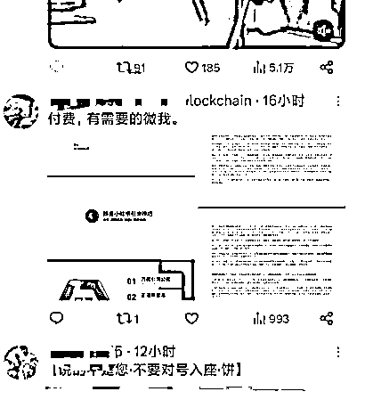

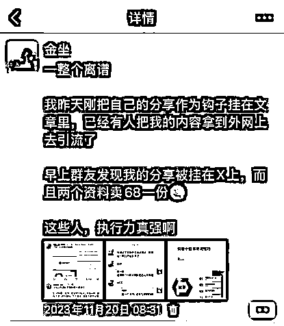

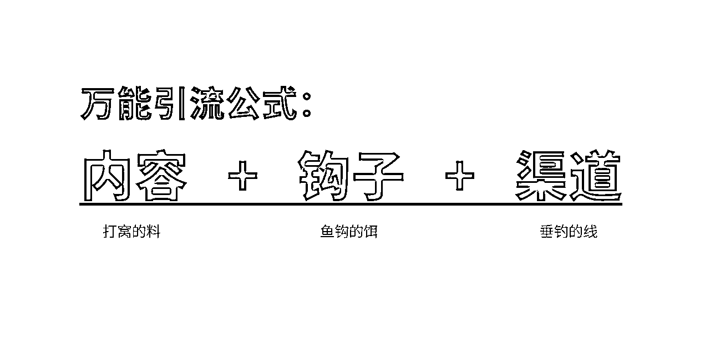

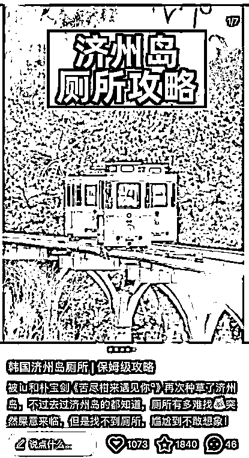

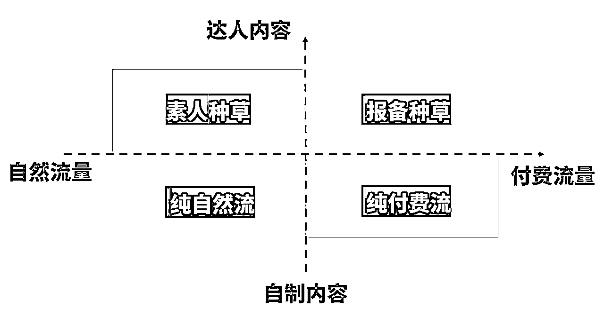

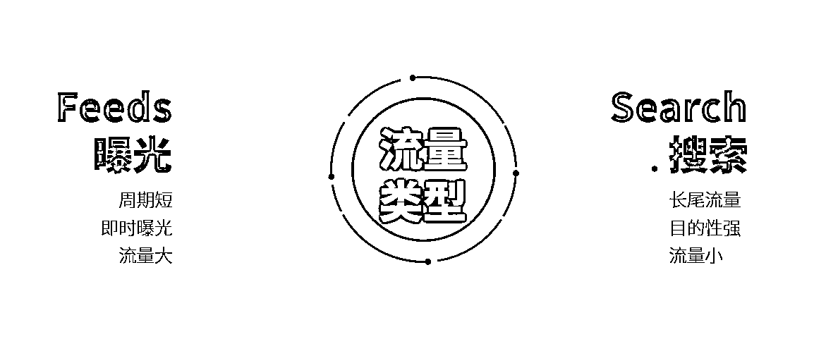

推荐流量来得快、曝光也直接，短时间内可能冲出很大的声量，但它的生命周期通常不长。普通笔记的推荐热度，大多维持不到一周；真正表现突出的内容，推荐周期也通常只有一到三个月，能连续多年获得推荐的情况并不多。

搜索流量的规模可能没有推荐流量那么大，但用户往往带着明确目的主动查找，因此人群更精准、转化表现更好，而且内容能够持续被搜索到，流量也更稳定。

如果把不同流量来源交叉运用，再结合平台功能和运营方法，就能延伸出不少玩法：

这张图今天不是重点。我想先把流量的来源说明白，接下来主要聊三个方面：

1. 如何打造能够引流的爆款笔记
2. 如何布局关键词
3. 如何通过付费投流获取流量

至于其他操作方法和关键词策略，之后有机会再单独展开。

## 1 爆款笔记

先说爆款笔记。怎样的笔记更容易获得推荐？

CES 常见的一个经验公式是：

CES = 点赞数（1分）+ 收藏数（1分）+ 评论数（4分）+ 关注数（8分）

不少人都听说过这个公式，也有人把它当成小红书官方的推荐算法。但需要说明的是，它并非平台公布的真实算法，而是运营者根据过往经验推测出的参考模型。网上还有其他版本，会把转发、成交等数据纳入其中，这些同样不是官方算法。

真实的推荐机制远比公式复杂，不过，互动行为的权重差异仍然值得关注。各种互动中，评论的权重相对高，而且相较于关注等行为，也比较容易促成。

因此，想提升笔记的爆发机会和引流效率，可以把重点放在评论互动上。我们不一定要追求点赞几十万的内容，更实际的目标，是让评论数超过点赞和收藏数。

评论活跃通常意味着笔记具备较好的互动权重，也更容易带动后来者加入讨论，形成持续的互动累积。评论区里的文字内容也可能成为算法判断和分发的参考，让笔记更有机会被推荐给相关人群。

在新账号阶段，这个思路可以帮助账号更快积累初始互动；账号运营到后期，也能用来制作转化效果更好的引流内容。

### 起号笔记怎么写

账号刚开始运营时，可以先发布容易引起讨论的话题，借助互动把笔记推起来，帮助账号建立基础权重。

例如下面这篇笔记：

它提出了一个很容易让人参与的话题：男朋友曾经给自己拍过哪些照片，并展示了一批让人哭笑不得的照片。

这类内容的目的，就是用自己的经历引出更多人的分享。人都有表达和被关注的需求，特别是发现别人也经历过类似的事情时，往往更愿意讲出自己的故事。于是大家纷纷在评论区晒照片，互动越积越多，笔记也就火了起来。

再看另一个例子：“浙江的厂二代们，来聊聊。”

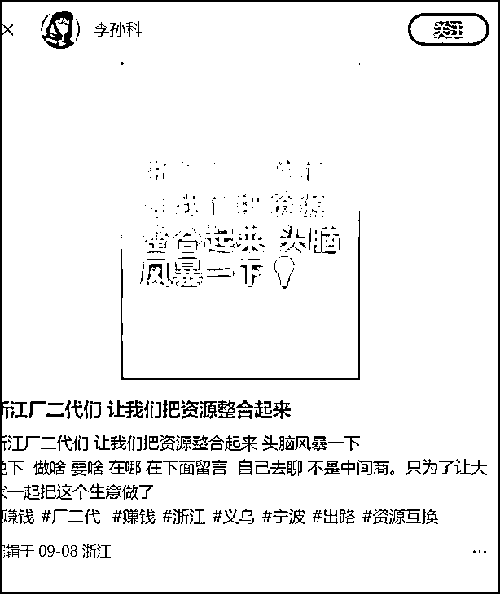

标题直接点明了目标人群，当然，也会吸引一部分围观讨论的人。

这类笔记的共同点，是先把某个群体筛选出来，再让同类用户产生共鸣并参与互动。新账号前期如果能做出一两篇表现不错的内容，就有机会更快建立账号标签、提升基础权重。

不过，不必期待新号因此获得特别大的流量优势。小红书的分发机制相对去中心化，起步阶段能争取到一次小爆发就已经有价值：既能积累互动，也能增强持续运营的信心。

还有一个小技巧：新号可以多留意平台活动，并善用官方提供的流量券。比如注册账号时把生日设置在三天后，生日当天可能领取一张生日流量券，可增加约1000次曝光。把它用于互动型笔记，往往能进一步放大效果。

那么，怎么找到适合做高互动笔记的话题？

第三方工具如灰豚等可以用来检索，这里先不展开，重点说两个平台自带的入口。

第一种，是小红书 App 的搜索筛选功能。搜索行业相关词，再筛选近一周或近半年的高评论笔记，就能观察到一些适合参考的话题。

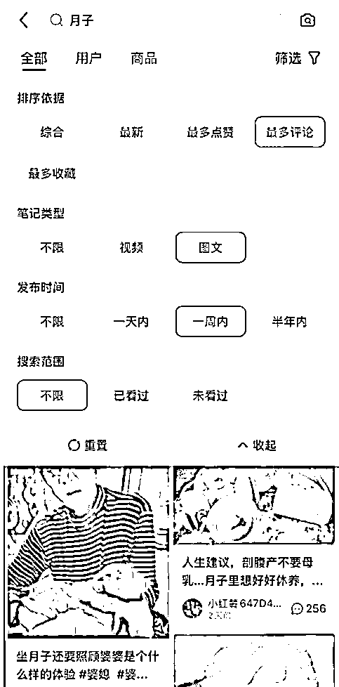

第二种，是聚光、千帆、蒲公英后台里的“内容广场”。这里可以筛选各类商业内容，找到不少与你所在行业相关、互动表现较好的选题。

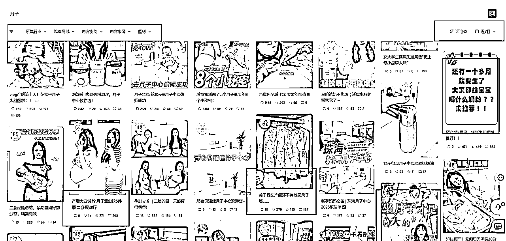

需要注意，这项功能个人店铺后台没有，通常要在企业店铺后台才能使用。

做互动话题时，有两点要记住：

1. 优先选择与你的行业有关的内容，这样吸引来的人才更可能接近目标客群。
2. 不要把泛流量当成最终目标。

这类内容吸引来的用户往往比较宽泛，其中一部分是潜在客户，也会有不少人只是来看热闹。并且，笔记本身可能只提供了情绪表达的出口，没有真正解决消费者的问题，因此转化率通常不高。

不要被一时好看的数据迷住。可以先发一两篇互动型笔记，获得一些初始表现后再考虑隐藏，随后把重点转向真正面向目标用户的内容。流量再大，如果无法帮助项目获客，也很难产生实际价值。

最终仍要利用已经建立起来的账号基础，持续发布目标人群确实需要的内容，把有需求的用户沉淀下来。

### 引流笔记怎么写

接下来讲引流内容和钩子设计。之所以把这两件事放在一起，是因为一篇有效的引流笔记，最直接的内容往往就是钩子本身。

钩子并非只能藏在内容里，它本身就可以成为内容。要做的，是用合适的方式把它展示给需要的人。

比如两年前，有人把一份资料打印出来，拍照发布，一个账号一天就能加到一百多人。

资料就是钩子，用户添加后即可领取。把其中几页展示出来，就能成为一篇可以发布在小红书上的内容。

但如今照搬这种方式，效果多半不如从前。因为越来越多人采用类似做法，平台环境和竞争都变了，内容也要随之升级。

可以先从内容覆盖面上调整。前面说过，钩子的本质是满足需求，而钩子本身能够成为内容。顺着这个关系再往前推，需求本身也可以直接作为内容呈现。

例如，提出“女生小腿脂包肌怎么减都减不下来，该怎么办？”这个问题，就能吸引有相同困扰的人。接着在笔记里分享自己实践有效的方法，就能让内容既回应需求，也承载引流钩子。

又比如“去西藏旅游踩坑了怎么办？”这类话题，会吸引准备前往西藏的用户。用户原本是来找避坑建议，点进笔记后发现作者提供了一个可行的解决办法。若想拿到完整攻略，可以引导对方进一步联系。

用户添加后才知道你是导游，也未必会影响结果，因为此时他最关心的，仍然是自己想要的那份旅行攻略。

如果后续的转化团队配合得好，也可以先以消费者身份建立联系，再由另一个导游账号提供攻略和服务，成交表现可能更好。

还可以把用户之间的互动设计在前面：笔记提出问题后，不急着给出完整答案，而是让另一个账号到评论区补充解答，由两个或多个账号配合互动。这种做法常被称为“A种B收”。

根据账号数量和互动设计，也会衍生出“A种B答C收”“A种B问C答D收”等形式。

例如，A账号先发布一篇旅游分享：

之后B账号在评论区询问推荐，A账号再把官方账号推荐给对方：

点开主页会发现，这两个账号其实都是运营团队在管理的小号：

如果自己采用类似的互动方式，要注意把作为互动方的账号主页经营得自然、可信。

除了拓宽内容的表达方式，还可以在深度上做升级，这就涉及下一个重点。

## 2 关键词占位

小红书是一个搜索属性很强的平台，据统计，约有60%的用户有在小红书搜索的习惯。文章开头也提到，平台搜索量仍在增长。更重要的是，主动搜索的用户通常需求更明确，因此精准度也更高。

所以，发布引流笔记时，除了呈现需求和钩子，还要尽量把准确的关键词自然地融入内容。

前些年，内容竞争没有如今激烈，很多赛道的专业运营者也比较少。那时只要把资料打印出来展示，就可能获得不错的流量。现在同类内容越来越多，如果还想从大量相似笔记里脱颖而出，就要重视关键词布局，让笔记更容易被算法识别和匹配，从而增加获得流量的机会。

关键词怎么安排？可以先把它们分成三类：核心关键词、相关关键词，以及长尾关键词，也可以称作长尾词组。

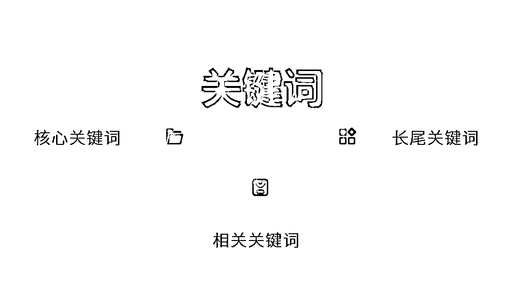

- **核心关键词**：通常是品类名称或产品名称。比如做考研内容，“考研”就是核心词。
- **相关关键词**：与核心词有关、能够组合使用的词。以考研为例，“上交大”“清北”可以和考研组合；“考研真题”“2025考研”“考研英语”也属于相关词。品牌词和竞品词也可以纳入这一类。
- **长尾关键词或长尾短语**：由多个相关词组合而成，能够更具体地说明用户需求。例如“25年考研冲刺”“上交大考研历年真题”。

这三类关键词从宽泛到具体逐层细化，越具体，用户的需求通常越清晰。以“考研”为例，它覆盖的范围很大，往下可以细分出许多小赛道。不同学校的考试内容各不相同，仅学校这一项就能形成不同的细分需求。

因此，动笔前最好先整理好所属行业的核心词和相关词。这样在创作时，才更容易把内容对应到明确的人群和具体需求。

### 怎么找关键词

可以从以下几处收集：

1. **小红书搜索框和搜索结果页的推荐词**  
   输入行业词后出现的联想词和推荐词，往往就是用户关注的相关需求。

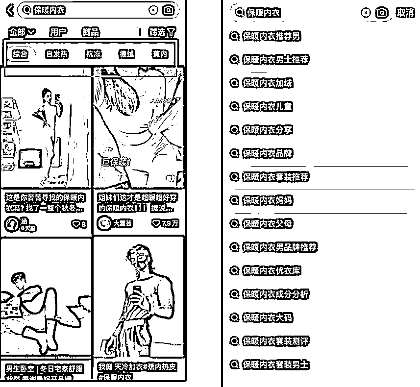

2. **巨量算数**  
   网址：https://trendinsight.oceanengine.com  
   无需开户，用手机号登录即可免费使用。输入搜索词后，系统会推荐相关词汇。虽然它不属于小红书，但整体趋势有一定参考价值。

3. **5118网站**  
   网址：https://www.5118.com  
   这是一个整理各平台词汇数据的网站。查看完整数据或下载表格通常需要会员；如果使用不频繁，可以考虑通过闲鱼或淘宝拼单。

4. **聚光后台的关键词规划工具**  
   网址：https://ad.xiaohongshu.com  
   除了查看关键词搜索指数，还能了解市场出价、竞争程度以及相关的上下游词。

开通聚光需要先认证小红书企业号，认证费用为600元。

如果暂时没有开通聚光，也可以找我要一份对应行业的关键词表。

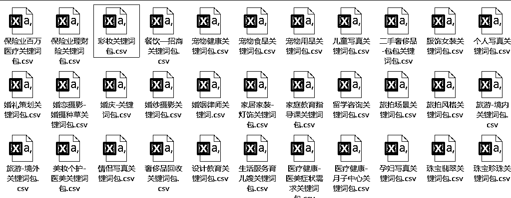

整理好词库后，建议统一放进表格，方便后续创作时查找和使用。

接下来要做的，是把这些关键词自然地融入内容。我们的目标，是让真正对产品或服务有需求的人找到自己。笔记里与产品相关的词汇越丰富，内容就越有机会在对应行业和需求场景中获得更好的匹配。

这里所说的权重，既包括用户搜索时的内容匹配，也包括用户浏览信息流时的兴趣推荐。

不过，植入关键词不等于机械地重复堆词。生硬地反复塞入关键词，容易让笔记显得低质，反而影响推荐。关键词可以分布在标题、封面、内页、正文、话题和评论区等位置。

以一篇云南旅行笔记为例：

假设核心产品是“大理旅游”，对应的需求是“大理旅游攻略”。标题中的“云南五天六晚”“省钱玩云南”属于长尾短语；封面上出现的“云南”“六天五晚”“豪华酒店”“航拍”“旅拍”等词，则是相关关键词。

这些词不仅有助于算法理解内容，也能让对相关主题感兴趣的用户更容易点击。正文中还可以自然提到“丽江古城”“洱海”“大理古城”“昆明”“日照金山”“玉龙雪山”等内容。这些词都与“大理旅游攻略”有关，有些还存在上下游关系。

话题标签也可以补充关键词，例如 #云南六天五晚、#洱海环游。虽然话题标签的权重相对有限，但仍可能带来额外曝光。评论区也可以通过小号补充几个相关词。

当标题、封面、正文、话题和评论区都围绕同一个核心需求展开，笔记就更容易在搜索和推荐中匹配到相关用户。只要对方有相应需求，看到内容后就有机会进一步产生行动。

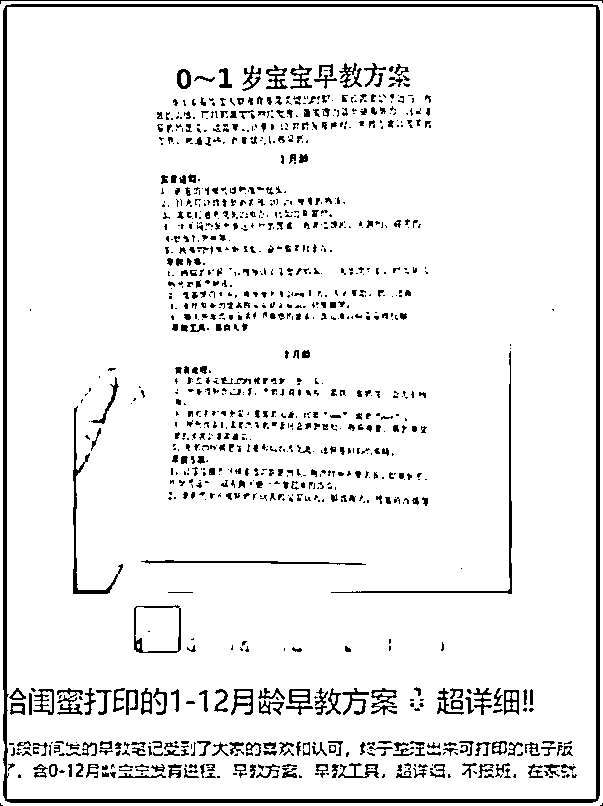

回头看这类内容，常见问题是关键词太少。可以把封面改成拼图形式，并加上清晰的关键词标题；正文则围绕“宝宝早教”合理展开，补充一些与早教相关的词汇。

其他类型的内容也一样，不一定要直接晒资料。可以从具体需求出发，分享行业知识和实用信息，同时自然覆盖相关关键词。每一个合适的词，都可能成为用户找到你的入口。

以上就是引流笔记的基本思路。

前面已经提到几种钩子放置方式，这里归纳一下：

1. 让内容本身成为钩子
2. 在正文结尾设置钩子
3. 在评论区进行引导
4. 在评论区安排互动账号

掌握引流笔记的写法和钩子布局后，还可以进一步完善内容制作流程，提高产出效率，逐步扩展账号。相关细节以后再单独讨论。

## 3 付费投流

内容怎么做说完了，最后聊聊付费投流。这里不深入讲具体操作技巧，先把基本认知说明白。

投流本身是一门专业度很高的事情。虽然实际操作未必像想象中那么困难，但若要把每个功能都讲清楚，单是介绍系统就可能需要一两个小时。因此，这里先做基础科普。

为什么投流迟早会成为重要环节？

不论身处哪个行业，只要项目逐渐跑通，最终大概率都会接触付费推广。有人说“流量的尽头是付费”，原因就在于平台的商业模式，本质上是出售流量。

早期的自媒体平台，包括几年前的小红书，主要通过出售广告位获利。

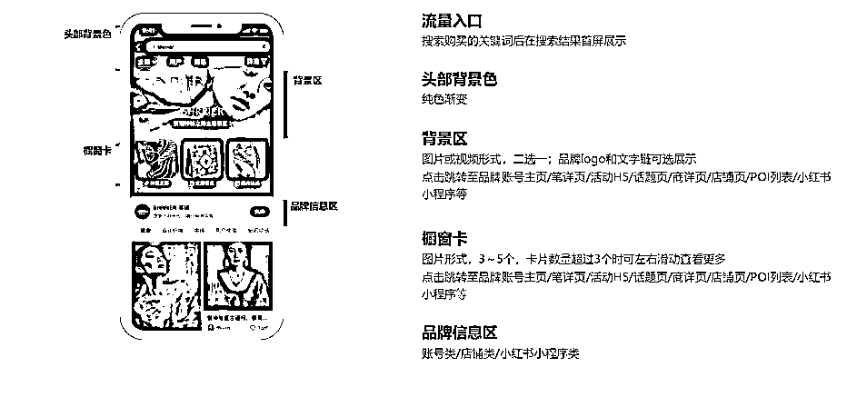

比如，在页面的某个固定位置展示广告，再把这个位置卖给希望获得曝光的商家。文章底部或评论区里的广告，就是一种广告位。它与电梯广告、电视广告的逻辑相似：平台先聚集受众，再把其中一块展示空间卖给广告主。

后来，抖音出现并改变了这种模式：广告不再只出现在固定位置，平台开始把流量本身作为商品出售。平台不必替商家制作广告内容、设计营销方案，而是提供投放工具，让商家自己制作内容、参与竞价。平台还能把流量分配给多个商家。

对平台来说，内容质量好、对用户体验有帮助的广告，可能以更低成本获得流量；愿意出更高价格的商家，有机会拿到更多曝光；更容易带来成交的商品，也可能获得更有利的流量价格。相比单纯卖广告位，直接卖流量的商业空间更大。

既然流量可以出售，平台为什么还要免费给创作者推荐？

道理并不复杂。创作者持续产出优质内容，能够帮平台增加活跃度、留住用户、促成交易。这同样是一种价值交换。免费推荐并不意味着平台没有收益，而是内容为平台提供了价值。

小红书从前几年开始加速商业化，相关动作的核心方向，就是让流量变得更容易交易、更有效率。

目前，小红书整体获客成本仍相对可控。除旅游、留学、医美等竞争已经非常激烈的行业外，很多领域的客资成本，在抖音可能达到50至100元，在小红书有时只需要10至20元。即便是竞争激烈的行业，也可能存在细分赛道和出价相对较低的关键词。

如果还没有开始投放，可以先用这张表了解自己行业的获客成本：

从另一个角度看，在平台发布内容并把用户引导到站外，本质上是在把平台流量带走。平台当然更希望交易在站内完成，因为这样才能获得更多收益。

用户一旦进入私域，后续的成交和复购就不一定再经过平台，平台也就无法从交易中获得相应的服务费用。因此，付费投流除了获取曝光，也可以理解为一种商业成本：通过在平台消费，让账号在平台内经营和引流时拥有更多空间。

说到小红书投放，还需要了解它的账户体系：

记住这张图：

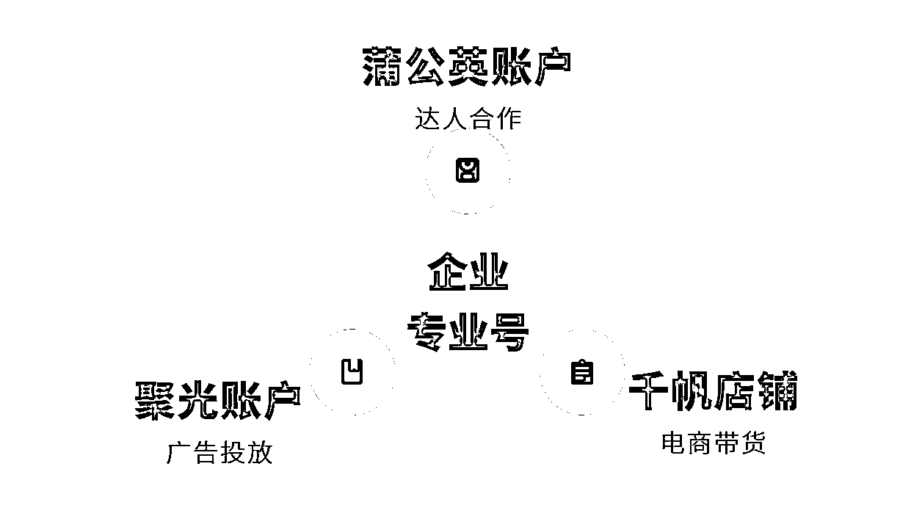

小红书的体系可以概括为“号、店、户一体”：

- **号**：企业专业号
- **店**：千帆店铺
- **户**：聚光和蒲公英账户

无论开店还是开广告账户，通常都要先有企业专业号。也就是说，如果要在小红书购买商业流量，一般需要先花600元认证企业专业号。

电商是一个例外：个人也可以开店，也能使用乘风投流。但个人店铺不能开通聚光账户、蒲公英账户，也无法开设代理子账户，因此可使用的功能会少一些。

最后，还要区分不同投流工具的用途：

- **聚光**：小红书的主要广告营销系统，也是常见的获客投放工具。

想在小红书玩明白，先得把付费工具的门道摸清楚。乘风这玩意儿跟店铺死死绑在一起，是电商卖货专用的投流利器；薯条就温和多了，它只管给内容添把火、刷点浅层互动，营销广告碰不得，最后能不能成交它一概不背锅。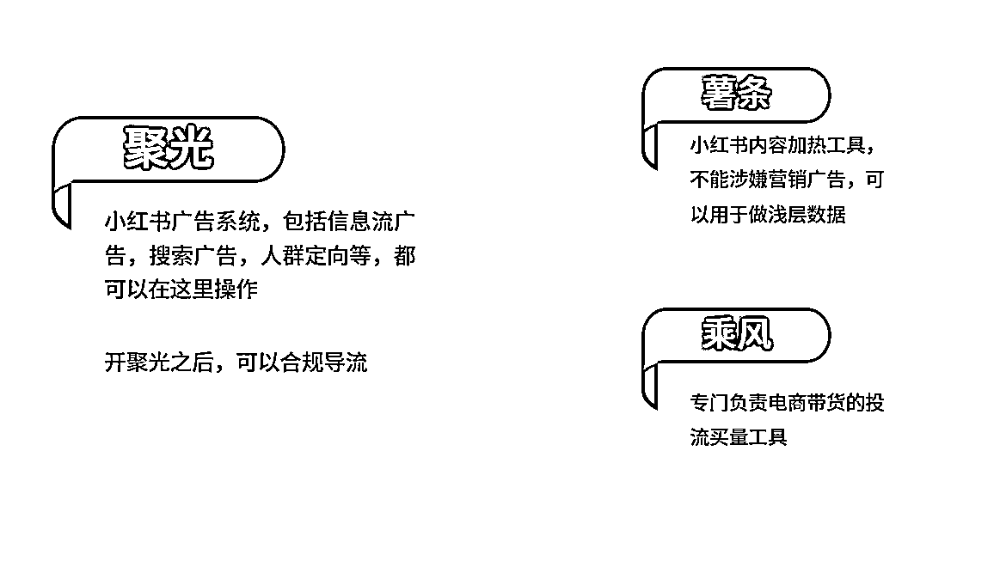

再聊个关键分野：内容流量VS商业流量。你平时随手发的笔记，只要没带营销钩子、没挂客资入口，过关机器初审且不踩红线——不违技术规范、不犯公序良俗、不搞擦边推销——就能顺利见天日、分到曝光，这就是内容流量，咱前面说的那些引流型笔记多半在此列。这种笔记一般只过机审，除非曝光飙高了、或是投了流、被人点了举报之类的外力杀进来，才会惊动机审之上的人审。它的分发逻辑跟CES推荐模型很像。内容流量的盘子就是全体日活，足足一个多亿；薯条能撬动的正是这块蛋糕。商业流量呢，是花钱能买来、或挂了营销钩子后才推给你的那批更精贵的流量，里头的人下单欲望、消费冲动都明显更旺。它只占日活的一部分，不是谁都能被划进来。笔记一旦挂上营销钩子，审核路子就彻底换了——得过一道广告审核、得守广告法。咱常念叨的敏感词、极限词，根子就在广告法和平台广告规矩上：搁商业笔记里，必须抠干净；搁普通笔记里，大多无伤大雅，限流不找上门。反倒有种情况要当心——笔记明明没用小黄车、蒲公英报备、聚光投流这些正经工具，字里行间却赤裸裸搞推销，那自然流量反而要被掐。聚光、乘风买来的都算商业流量。你要靠投流捞客资，开聚光就对了；开通后图文、视频笔记随便投，搜索广告、信息流广告、视频流广告、种草广告、客资广告、CID广告等等都能玩。下图是笔记投出去后可能露脸的广告位，搜索、信息流、视频流三大场景全包圆。图里数字代表该场景下广告可能现身的位置，且是递增排布——信息流爱蹲6、16、26、36……搜索流则盯3、13、23……

# 四、怎么合规引流

千呼万唤，渠道这块总算来了。咋样才能既稳妥又丝滑地把人往微信上领，还不惹小红书限流封号？我打算先摆官方正路，再聊那些不太上台面、可偏偏一堆人嗷嗷待哺的野路子。

## 4.1 官方正规引流

前面说过，平台一旦商业化，每个毛孔都冲着"把流量卖得更溜"去使劲。小红书引流规矩经过近一年连环调整，眼下已是明明白白，答案就仨字：商家名片。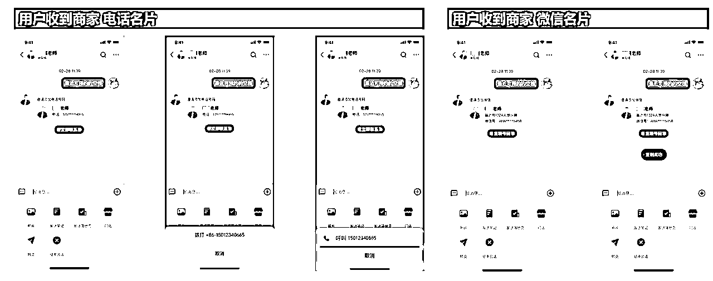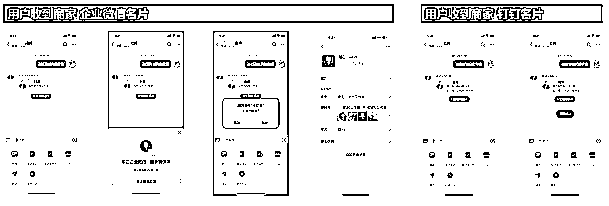用户戳开私信那一刻，咱就能把微信、企微、电话或钉钉直接甩过去，对方一点即复制、顺手就加上，何苦整那些花里胡哨的乱码和欲盖弥彰的图片——平台读不懂、用户也抓瞎，纯属白费劲。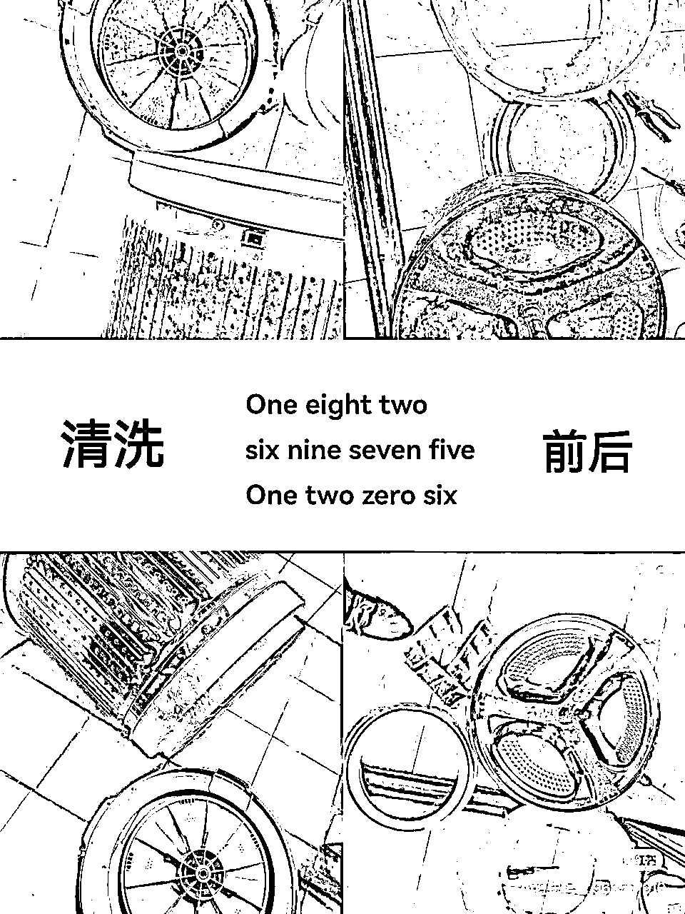就目前看，商家名片是官方盖章的唯一正规引流口子。名片既能咱主动塞给用户，也能搁在专业号底部菜单栏等着用户自己触发。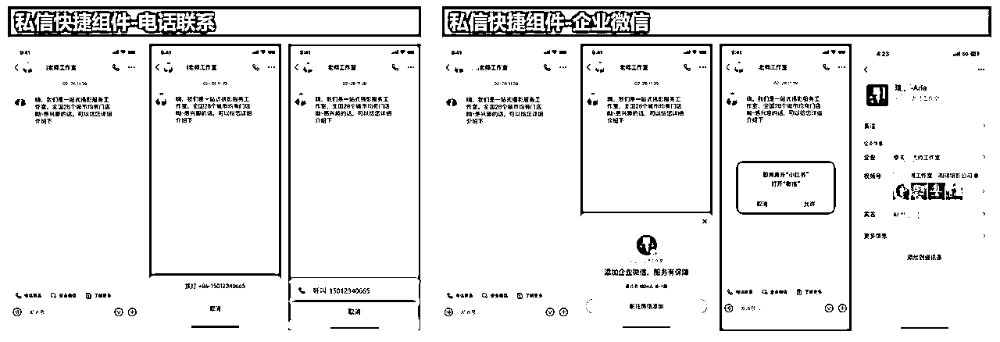聊天框底部的菜单栏、用户点进私信列表后蹦出的自动回复，全是专业号独有的私信服务组件，后台就能配置。把名片嵌进去，用户有需求点一下，微信号到手。商家名片有俩硬门槛：一是企业专业号；二是30天内聚光消耗得大于0。翻译过来就是——你得有张执照（个体户、企业皆可），掏600块年审费，再充至少2000块（起步价）的聚光余额。企业玩家不用折腾别的，认证专业号、开商家名片，齐活。要是团队手握一把个人号、搭着个别企业专业号在跑，还有个神器：小红书表单。私信服务组件不许塞外链，但聚光平台生成的自定义表单页是例外。拿一个号开企业专业号并开通聚光，去聚光后台建个表单，图省事就留联系方式和昵称两栏。接着把链接抠出来，塞进专业号私信组件，或者丢给个人号私信时发。因着是小红书自家域名，它保得住超链接形态，屏蔽、限流都绕道走。以上俩法子都得至少一张企业专业号傍身。对副业党来说门槛仍不低——先甭提起充金额，不少人连执照影子都没有。所以下面奉上些不太正确、但安全系数尚可的野路子。

## 4.2 偏门引流

开聊前必须敲黑板：能这么干，但你得门儿清——这在平台眼里就是违规。小红书隔一两个月就来波大规模清剿，违规引流号成片倒下。官方还晒过一堆违规场景标本：正文塞联系方式、昵称藏联系方式、简介摆手机号、小红书号改成微信号、背景图暗搓搓埋微信号、微信号拆段藏进瞬间、置顶笔记搁微信、笔记合集或收藏合集名改成微信号、直播间里莽着引、手机号换同音字丢评论区、私信页发微信号、群聊里甩带联系方式的文案……名义上是违规警示，细品倒像野路子引流大全。那这些招还能使吗？能。可既然被官方拎出来示众，说明命中率极高，稍不留神号就没了。野路子的精髓不在招式多炫，而在两件保命道具：小号、群聊。俩道具使命一致——扛风险。咱哼哧哼哧做流量、攒粉丝，账号刚有起色，总不能因引流违规啪一下被封吧？号虽说不金贵，真封了也够肉疼半天。用小号搭群聊玩风险隔离——单使一样能挡七八成风险，俩叠一块基本保得住做流量的主号无恙。注意是"基本"，不是铁板钉钉；用户举报或平台抽检逮着，警告、限流甚至封号照样招呼。百分百稳妥的，有且仅有商家名片。小号加群聊咋耍？底层逻辑：主号专心做流量，在主页或评论区把用户往小号主页、小号建的群里引，再由小号在群里抛联系方式。平台若在群里嗅到违规，先封群、再封小号，烧不到做流量的主号身上。群里怎么发联系方式才相对稳？可用的招有：群置顶、进群验证、表情包、小号主页笔记。群置顶跟微信群一个套路。小号主页笔记更省事，微信主页截张图甩出去，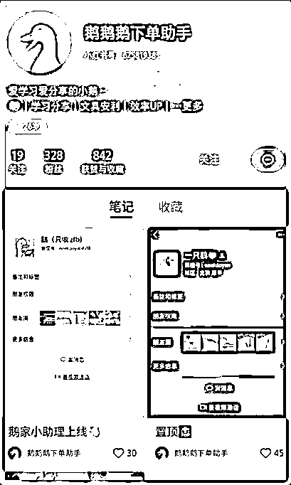小号本就是引流工具、不指望它做流量，笔记没人看也无妨，纯当展示牌用。进群验证更有意思：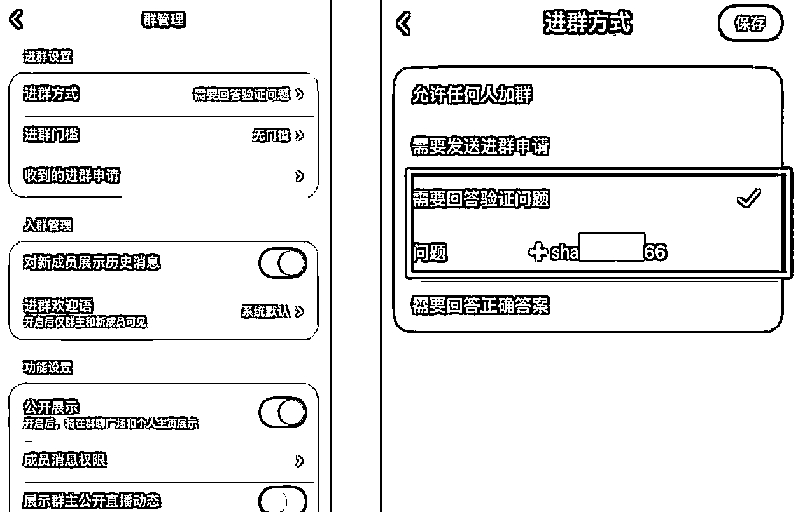用户点群聊组件，先撞上进群验证问题，答案里就猫着你的联系方式。安不安全您自个掂量。表情包功能跟微信像得很，能DIY。那些脑洞清奇、藏着微信号的图，正好派上用场：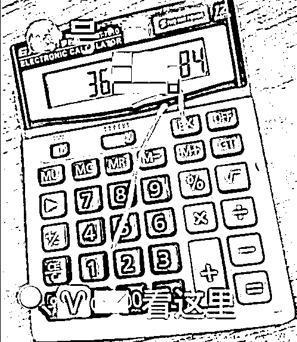原理不复杂——表情包只在创建时过审，一旦放行就基本不再招惹审核。把这些招归拢归拢，核心就一句：拿小号和群聊当炮灰去引流，替主号挡枪。小号万一被封，注销重开或再养一个便是。只要主号安然，流量不断，买卖照转。群聊还藏着一手：小红书群聊跟QQ群似的自带自然流量，别人能靠关键词搜到，也能在群聊广场刷见。只要群名起得巧、群活跃度撑得住，群聊不光接流量，本身还是流量入口。

## 4.3 单个账号引流

估摸着有人要问：上面那些野路子也得有多个号才玩得转。我要是孤号一个、执照也没有，还能不能安安稳稳引个流？兄弟，有的，有的。个人号照样能调私信服务组件，但得迈三道坎：账号实名、认证个人专业号（白嫖）、开通个人店铺（不用上架）。三样都不难。成了之后，哪怕是个人号，也能全自动把微信号递到用户手上。不过眼下规矩收紧了，私信服务组件里直愣愣写微信号，不行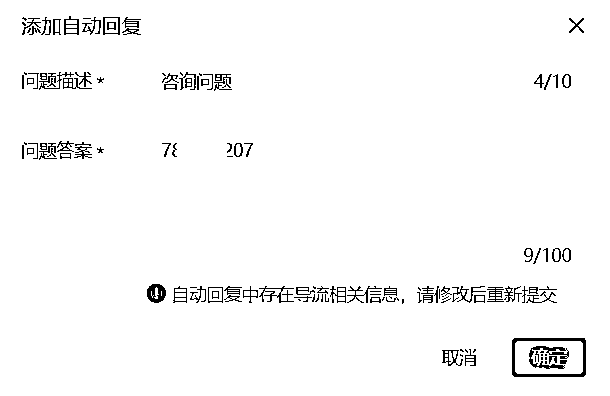；写绕一点、拐个弯，就能蒙混过关。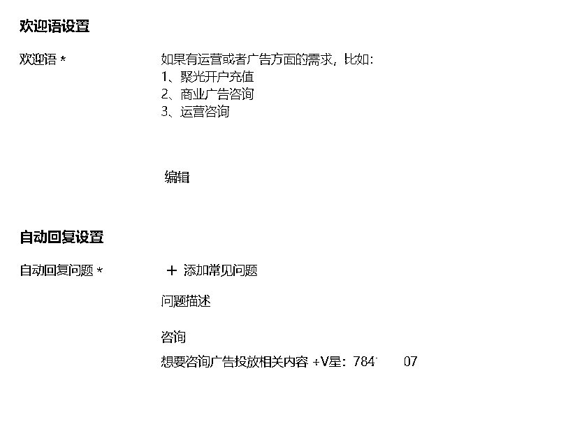保不齐还有人追问：我实名号已封，就剩一根独苗没法实名，执照更别提，还能安全引流不？兄弟，照样有招。把小红书App更到最新版，私信页右上角的便利贴功能，直接写微信发过去就成。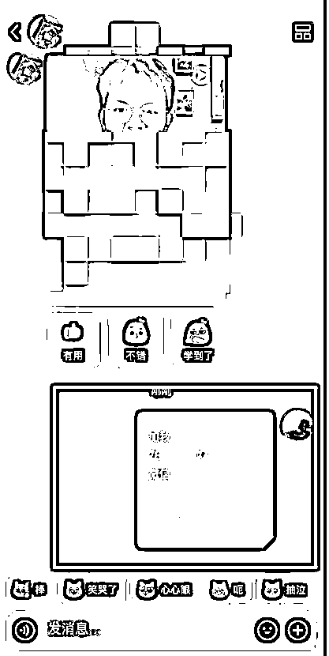这功能门槛低到尘埃——不实名、不要企业号，只要双方互关即可。但丑话再说一遍：这属于日常功能挪作违规用途，眼下能引，保不齐哪天就荣登官方违规示例新榜单。

收个尾：全部引流渠道里，我最推、也最稳的，当属商家名片；退而求其次是小号＋群聊这套组合拳；再往后是私信服务组件里藏联系方式。以上就是小红书引流万能公式加实操全流程。干货有点密，建议先收藏、得空多翻几遍。看完若还有引流方面的疙瘩，评论区见。