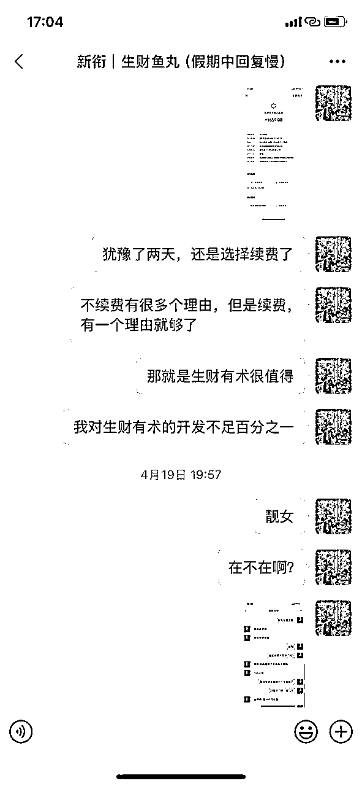

# 第一次做「生财有术」分销，我是如何从0做到王牌种草官的

## 写在前面

大家好，我是吴泽承，第9期「生财有术」王牌种草官。

在4月20日之前，我其实没有任何拉新经验。甚至直到4月19日晚上，我才完成「生财有术」续费。

从产生分销想法，到真正开始执行，再到6天完成18万营业额、单日最高成交9.6万，并且实现零退费，这段经历对我而言，既是一次挑战，也是一次非常重要的验证。

也正因为这次实践，我决定把「生财有术」分销当作一个长期项目持续做下去。

我相信，很多圈友本身认可「生财有术」的价值，也愿意把这个社群推荐给真正有需要的人。所以，我把这次从0到1的完整过程整理出来，覆盖引流、转化、交付三个阶段，希望能给正在尝试分销的朋友提供一些参考。

具体执行细节，我会通过飞书文档展开，方便大家点击查看每个环节的实际操作。

如果你也认同这个社群的价值，欢迎一起行动，把它推荐给更多适合的人，在帮助他人的同时，也让自己获得成长。

# 一、引流：先找到真正有需求的人

分销的起点，不是盲目发广告，而是找到那些确实对社群感兴趣、并且有成长或变现需求的人。

这次我主要用了三类渠道：

1. 运营自己的朋友圈；
2. 在其他社群中进行价值分享；
3. 借助「生财有术」提供的3天免费体验卡，进行全渠道曝光，并配合付费推广。

下面分别说说我的实践方式。

## 1. 社群分享：先提供价值，再建立兴趣

在别人的社群里做推广时，有两个原则非常重要。

### 第一，销售目的要说清楚

不要让别人猜测你到底想做什么。你可以直接说明自己正在推荐哪个社群、适合哪些人、加入后能获得什么。

意图越清晰，后续沟通越高效，也能减少无效交流。

### 第二，案例一定要真实、具体

单纯讲理念、趋势和方法论，往往很难让人产生行动。

相比之下，一个流程清楚、普通人也能理解的真实项目，更容易让潜在用户感受到社群的价值。

这次，我在其他社群分享了一个心理咨询细分领域——抑郁症相关项目。通过具体案例，让大家直观看到项目如何落地，以及加入社群后能够接触到什么样的内容。

## 2. 朋友圈激活：让别人看到“加入之后的可能性”

朋友圈不是简单地发布一条优惠信息，而是要持续激活潜在用户的兴趣。

我主要围绕两方面展开：

### 释放明确的福利信息

把价格、优惠和赠送内容讲明白，让用户知道现在行动能够获得什么，为什么值得现在加入。

### 分享自己的真实成长

除了介绍社群本身，也要让别人看到你在社群里的变化，比如学到了什么、做成了什么、认识了哪些人，以及这些经历给你带来了哪些收获。

当用户看到一个真实的人因为加入而发生改变，就更容易产生代入感，也会开始思考：如果我加入，是不是也能获得类似的机会？

## 3. 体验卡引流：扩大触达面，再筛选精准用户

3天免费体验卡的价值，不只是“免费”两个字，更重要的是降低体验门槛，让更多潜在用户有机会接触「生财有术」。

我的做法是：

- 通过多个渠道分发体验卡；
- 让更多目标用户看到社群内容；
- 配合付费投放扩大曝光；
- 再从体验用户中筛选出真正有兴趣的人。

这样做，可以在增加品牌触达的同时，积累更多有效线索，为后续转化创造条件。

# 二、转化：如何把兴趣变成加入行动

当用户已经对社群产生兴趣，下一步就不是继续群发信息，而是进入更深入的沟通阶段。

## 1. 根据不同人群做1对1沟通

我没有对所有人使用同一套话术，而是先判断对方属于哪一类用户，再根据他的需求、状态和顾虑进行针对性沟通。

不同的人，关注点完全不同：

- 有人想寻找副业机会；
- 有人希望提升能力；
- 有人更在意社群资源和圈层；
- 也有人只是想先确认加入后是否真的有结果。

因此，转化的关键不是“把话说得多漂亮”，而是把社群价值和对方当前的需求连接起来。

在沟通过程中，我主要做了三件事：

1. 结合对方的实际情况，解释社群能解决什么问题；
2. 展示「生财有术」本身的内容和平台实力；
3. 分享自己的真实经历和结果，增加信任感。

具体的人群分类、沟通方式，以及提升成交率的细节，我已经整理在文档里，大家可以点击查看。

## 2. 专注和热情，本身也是一种影响力

除了话术，转化过程中还有一个容易被忽视的因素：你的状态。

用户关注的不只是你介绍的项目，也会观察你这个人是否认真、是否投入、是否真的相信自己推荐的东西。

曾经有朋友问我：

“你在农村，怎么还能保持这么强的行动力？拉新也太猛了。我回村一个多月，整个人都快变得佛系了。”

我认为，热情不是凭空出现的，而是在不断沟通、不断行动、不断获得反馈的过程中被维持下来的。

在执行期间，我也总结了一些让自己保持专注和战斗状态的小方法，供大家参考。

## 3. 有结果之后，要主动“报喜”

当你取得成绩后，不要默默把结果藏起来。

适当地同步进展、分享成果、复盘过程，既是对自己的鼓励，也可能成为别人行动的起点。

官方为分销成功的种草官建立了专属俱乐部。我经常在群里分享自己的进展，其中一位群友正是因为看到了我的“报喜”，受到鼓舞，拉新人数从十几人提升到了26人。

所以，如果你已经成功分销「生财有术」，可以联系官方加入种草官俱乐部，在里面和其他种草官交流方法、互相激励。

# 三、交付：成交之后，才是真正服务的开始

我的理解是：成交不是终点，而是交付的起点。

所有通过我加入的新圈友，我都会邀请他们进入专属的「生财」陪伴群。

在这个群里，我会持续组织活动、邀请优秀圈友分享经验，为新成员提供一个有内容、有反馈、有人陪伴的成长环境。

后来，也有群友因为群内分享找到了项目机会，实现变现，并进一步完成复盘分享。这种正向循环，也是我继续做这件事的重要动力。

## 1. 用活动提升群成员参与感

一个社群能不能活跃，不能只靠管理员单方面输出，还需要让成员真正参与进来。

因此，我会在群内设计一些轻量活动，降低大家的参与门槛，同时让成员更快融入社群。

例如“送龙珠碎片”活动，就是通过奖励机制，鼓励大家参与航海实战，让原本只是旁观的新成员逐渐开始行动。

## 2. 邀请有结果的人做分享

为了让群里的信息持续更新，我会邀请已经取得成绩的圈友分享自己的项目经验。

分享内容不一定要多复杂，重点是：

- 先帮助新人建立基础认知；
- 优先选择反馈周期较短、容易看到结果的项目；
- 让群友尽快获得第一次正反馈；
- 通过真实结果增强行动信心。

期间做过的分享包括：

- 生财5期随心：如何选择做项目用的手机  
  https://sqtgjk175rz.feishu.cn/wiki/P2SuwpO6Gi1lfAk5pfIc8hrQnQg

- 吴泽承「生财」陪伴群：京东一号店会员权益如何最大化  
  https://sqtgjk175rz.feishu.cn/wiki/F9AqwI4xbiz6rrkOc0ucVyKMnyf

- 吴泽承一对一文字答疑：发作品，就是发广告  
  https://sqtgjk175rz.feishu.cn/wiki/Kq60wW14gibCkzkiSXiczMw9nnd

- 生财3期渊杰：如何免费乘坐高铁并进入高铁贵宾室  
  https://sqtgjk175rz.feishu.cn/wiki/M9lswr92qiNHS8kjjhycmNcFnCc

- 生财3期渊杰：纪念币抢购与转让  
  https://sqtgjk175rz.feishu.cn/wiki/NMumwEYw2iJIMpkAGiGcxlbznyb

- 生财8期哆元：基础AI应用分享  
  https://sqtgjk175rz.feishu.cn/wiki/UUmewHKdyiLUnWkPvpOcjgI7n8g

- 吴泽承「生财」陪伴群：坚持的故事  
  https://sqtgjk175rz.feishu.cn/wiki/UYWWwjeZqicMmTk2fP3c5uK6nNx

此外，还有：

- 生财航海教练荷包蛋糕：AI写作实操教学；
- 生财5期谢无敌：小红书关键词SEO布局与流量获取；
- 生财6期董文杰：“瞎学、瞎花、瞎忙”如何阻碍赚钱与成长；
- 生财8期孙太太：从羊毛党到月入过万的互联网摆摊经历；
- 生财7期Sky陈天：打工人如何通过AIP副业实现10w+；
- 生财7期海盐：普通人拍照出片的实用方法；
- 生财航海教练拾一：新人做项目的方法论与虚拟资料避坑；
- 生财航海教练荷包蛋糕：AI短篇小说写作项目全流程；
- 生财超级术作者晴子：用AI制作个人表情包；
- 生财深海圈总教练方波妮：AI视频与海外YouTube流量收益。

## 3. 用机制营造持续正反馈

除了分享和活动，群氛围也需要通过明确的激励机制来维护。

我主要设置了几类鼓励方式：

1. 群友提到的优秀圈友，尽量邀请进群交流；
2. 对愿意做群分享的人给予奖励；
3. 对成功变现的成员进行鼓励和展示；
4. 对在星球发布风向标并中标的成员给予奖励；
5. 对已经取得成果、愿意发布精华帖的成员进行鼓励。

例如，群友提到珍妮子后，我邀请她进入群内分享“小红书高客单”相关经验：

https://sqtgjk175rz.feishu.cn/wiki/HN6vw1oghivnMYk4U3tcTi9knnc

群友提到张集慧“慧姐”后，我也邀请她分享公众号爆文经验：

https://sqtgjk175rz.feishu.cn/wiki/CNVwwajeSizdERkw3dJcu9aInHg

还有群友因为参与分享成功变现，并完成了复盘：

- 生财9期陈泽梅：一天从一号店回本并实现盈利  
  https://sqtgjk175rz.feishu.cn/wiki/M0LMwQniKiO4jWkQWozcnTNpnQr

- 吴泽承「生财」陪伴群：群友成功变现记录，其中两位执行力较强的成员已经赚回门票  
  https://sqtgjk175rz.feishu.cn/wiki/X6hCw0NoKiO8nLk1Lg4c81Ryn1f

- 生财9期深潜：如何在撸货与票务行业快速建立信任  
  https://sqtgjk175rz.feishu.cn/wiki/K3eswK5v2iTTNBk105rcewNMnzb

- 吴泽承「生财」陪伴群：迎接新同学的群氛围记录  
  https://sqtgjk175rz.feishu.cn/wiki/OVN7wZp8hi1CV4kOe8BcmHM3nyg

# 致谢

这次参与「生财有术」9期拉新，对我来说同样是一次边做边摸索的过程。能够取得这样的结果，离不开很多人的鼓励、建议和支持。

首先，感谢@黄小鱼@千城@哆元@吴佳文@码叔@随心。

是你们不断给我加油，我才有了持续推进的动力。

你们说过的话，我一直记得：

- @黄小鱼：“向50人继续冲，事情都是做出来的。”
- @吴佳文：“我在航海家俱乐部等你，估计拉新奖励就够加入了。”
- @随心：“最后一天再推一把，很多人都会赶在截止前行动，说不定今天就到50个。”
- @哆元：“这怎么已经39了？完全是冲50的节奏，太强了。”
- @码叔：“再加把劲，争取突破50。”
- @千城：“别只满足于10个，直接向50个发起挑战。”

也感谢@陈雪@谢无敌@七天可爱多@飞掌柜@@超级无敌孙太太@杨涛@旺小哥@白杨seo@紫菜同学@沧海大表哥@判官@小马宋。

我的拉新流程能够持续优化，成交率能够逐步提升，很大程度上是因为参考了你们的分享，并把其中有效的方法融入了自己的实践。

感谢@随心@珍妮子@张集慧@渊杰@哆元，愿意来到我的小群里做分享，为群友带来新的经验和启发。

也要感谢所有信任我、认可我、愿意通过我加入的朋友：

@大海里浪@米莱@小明是个梦想家@A cup of tea@崆崆向阳@脆波波@夏@luck@carmen@yang@董@冒菜@Reborn@沨@匪气书生@shirley@与世无争@ZzzzQingLiii@Mo@雨飞龙@Aimee@沄汐@雪通@Mer@17@yezi@秋雨@Lim@陈泽梅@shelley@王香闺@willchen@深潜~1998@娴@纸豪@黎黎@xychen@迷路@彭小浅@F-叁金@Summer Xia @停杯@三各女予@HILAC@黄先森@庚壬子（启发）@心的空间@@米米@W@Y@NI*le@开心@官柒柒@C.H.E.Nlulu@赵佳-芜湖-HR@Aeiherumuh@方糖@柠栀@See you@总会有晨曦@莫名@雾灯@Evan@=w=@绵绵@泉@乔欢。

最后，感谢@梁梦吟，以及技术团队在整个过程中的支持。

尤其要郑重感谢超级无敌阳光美少女@黄小鱼。

在我拉新的过程中，她一直耐心帮我答疑解惑。哪怕自己发着烧、嗓子几乎说不出话，也依然愿意和我通电话，一点点解决我遇到的问题。

这份支持和帮助，我一直记在心里。