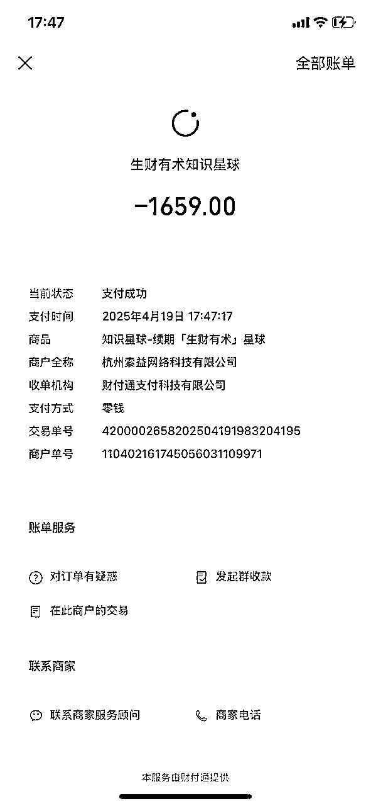

# 新手做社群推广，6天跑出18万GMV，我的完整复盘
作者：龙哥

我是「赚钱圈」第九期官方认证的种草人，先交个底：4月19日晚上我才刚完成续费，4月20日之前对获客几乎一无所知。从冒出想法，到动手执行，再到最终拿下累计18万GMV、单日峰值9.6万、零退款，前后只用了6天。

这段经历让我确信，社群推广值得当成长期项目来做。如果你也认可该社群的价值，想把好资源介绍给更多人，这篇复盘应该能给你一些参考。

我把整件事拆成获客、成交、服务三个板块，每个环节的截图、话术和操作细节都沉淀在飞书文档里，需要时可以对照查阅。

# 一、获客：精准找到认同社群价值的人

起步时别急着推销，先锁定真正可能感兴趣的人。我这次试了三条路：
- 在个人号动态里持续释放价值；
- 借别人的社群做干货分享；
- 用官方3天免费体验资格做推广，同时搭配商业投放放大触达。

## 借场分享：把来意说清楚，把案例讲具体

在别人的群里做分享，我有两个原则。

第一，意图前置。开场就直接说明我是做什么的、这次分享和最终推荐之间的关系，省去猜来猜去的成本。

第二，案例扎实。不讲空泛的思维，而是给一个流程简单、能立刻看懂的赚钱实例。我分享过心理健康服务行业里一个垂直方向——面向情绪困境人群的服务项目，听完的人能直观感受到价值。

## 个人号动态：给行动理由，也给想象空间

我会在动态里把价格、赠品、福利政策一次讲透，让看到的人知道现在加入能得到什么；也会分享自己在该社群里学到的东西、拿到的小结果，让大家产生代入感，觉得“我也可以在这里成长”。

## 免费体验资格：扩大开口，让更多人先靠近

3天免费体验资格是很好的引流钩子。我把它放到多个平台，让更多人领到；同时配合商业投放，把内容推给可能感兴趣的人。这套组合拳的目的很简单：先把盘子做大，再从中筛出真正想深入了解的人。

# 二、成交：把兴趣变成行动

当用户愿意和我聊了，我就开始做私聊沟通。我会先给用户分层，大致分成三类，再针对每一类准备不同的沟通重点；同时结合社群本身的资源和我自己的真实成绩，帮对方减少顾虑。具体话术和提效技巧我都写进了飞书文档，这里不展开。

## 状态本身也是说服力

除了话术，我还会特别注意自己的状态。聊项目时保持专注、热情，这种能量是能传递的。有人问我：“我在村里待了一个月，整个人都提不起劲，你是怎么保持这种战斗感的？”关于这一点，我也有一些心得，放在了文档里。

## 有了结果，要主动同步

我很相信一句话：经常庆祝，成功概率会变大。拿到阶段性成绩后，我会在官方的分销者社群里同步进展。有位伙伴告诉我，他看到我持续更新成绩，自己也受到了带动，获客人数从十几个做到了26个。

如果你也做出了推广成绩，记得联系官方加入分销者社群，和大家一起交流方法、互相鼓励。

# 三、服务：让新人留下来，也能拿到结果

我一直觉得，成交不是结束，而是服务的开始。所有经我加入的新人，我都会拉进专属服务群。群里会定期组织活动，也会邀请有结果的嘉宾来做分享，尽量让每个人都感受到该社群有温度。后来有伙伴在群里复盘自己变现的经历，这对我而言是很大的鼓励。

## 用活动保持温度

社群不能冷场。我做过一个送虚拟道具的激励活动，鼓励大家参与实战项目。规则简单，参与感强，群里的气氛一下子就不一样了。

## 用分享帮新人扫盲

我也会邀请已经做出成绩的圈友来群里做主题分享，内容包括设备选择、会员权益使用、出行福利、转售项目、内容创作工具、搜索流量优化、爆款图文、短视频运营等，核心是帮新人扫清信息差，并在容易拿到反馈的项目里先做出小成绩。

## 维护群文化，我坚持五件事

1. 群里有人提到某位厉害的前辈，就想办法邀请对方来开讲；
2. 对主动分享的人给予奖励，鼓励互助；
3. 对做出变现成绩的人给予奖励，鼓励实战；
4. 对在星球发优质信号帖并中标的人给予奖励，鼓励输出；
5. 对写出深度好帖的人给予奖励，鼓励有结果的人留下经验。

# 最后，想说声谢谢

这次能拿到结果，不是我一个人的事：感谢最初一直推着我往前走的几位朋友；感谢那些愿意把打法讲透、让我的流程不断迭代的分享者；感谢所有来过我社群开讲的嘉宾；更感谢每一位选择信任我、通过我加入的新伙伴。特别是一位叫小鱼的朋友，自己身体不适，声音都哑了，还在电话里一点点帮我理清问题，这份感动我一直记得。

希望这篇复盘能给你带来一点启发。如果你也想尝试，欢迎和我一起，把优秀社群推荐给更多真正需要它的人。