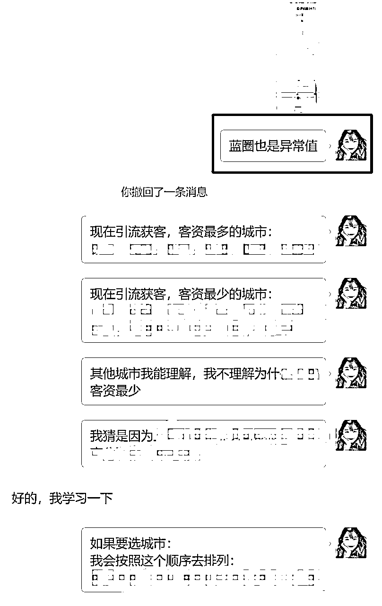
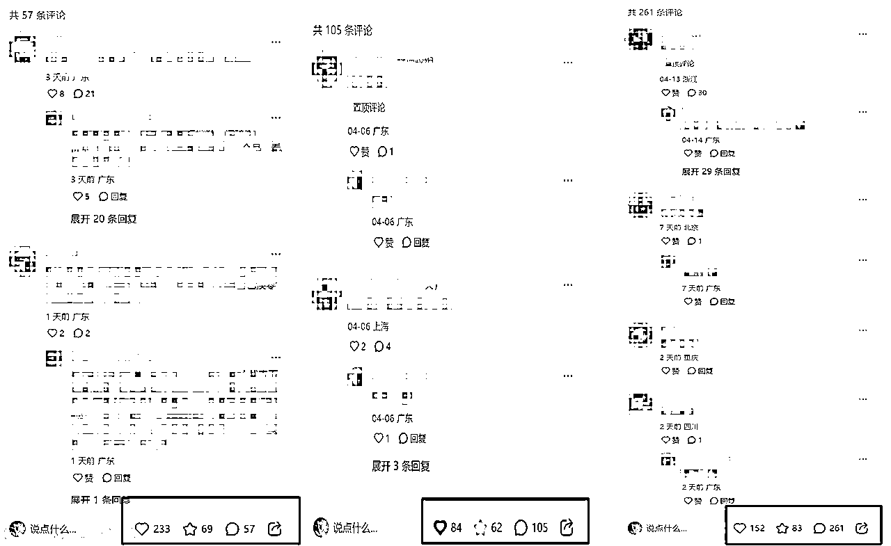

# 2025年小红书操盘手还能活下去的4个生意方向

> 来源：[https://ncn18orsgwl2.feishu.cn/docx/M8AtdyvtCoTcvGxNCqDc3Wq1nte](https://ncn18orsgwl2.feishu.cn/docx/M8AtdyvtCoTcvGxNCqDc3Wq1nte)

大家好，我是珍妮子。过去这几年，我从留学起步，轮转过房产单边经纪，又接手过旅游、教育、法律、医美等多个高客单赛道。跑通代运营后，越来越多的企业主主动找上门，我把这些项目分给付费学员自己实操，我在后面把关点评。

做着做着，我就从单纯的运营执行者，慢慢变成带几十人团队做高客单IP商业操盘的负责人，帮助头部IP实现真正的增长。今天就把我这几年摸出来的路子，拆成两部分讲清楚。

第一部分，小红书操盘手现在正集体掉进的坑。
第二部分，怎么选生意来自救。

## 第一部分，小红书操盘手现在遇到的共同困境

这个困境迟早会来，只不过有些赛道还没卷到这个阶段。

我在教育领域认识的操盘手就跟我抱怨过：每天把线索往机构里推，像讨债一样等着结钱。签单了还要等佣金到账。现在教育获客成本变高，他又去给AI赛道送线索，因为那边获客快、佣金结算爽快。哪边好捡哪边去，完全看风向。

这让我想起自己的起点。珍妮就是留学赛道出来的。
2021年到2023年上半年，是小红书起号最舒服的窗口期，聚光投放大概是23年下半年才大规模启动，最先被波及的就是留学。那个阶段做小红书，粉丝几万是基本操作。

分水岭也正是从2021-2023年开始的。
如果你那几年就开始做个人IP，一直让粉丝真切受益，2025年你大概率还活得不错。
如果你那几年只靠平台东风做无IP矩阵号，靠爆款封面和标题吸粉，我估计有90%的人现在还在问：去哪里找一个引流不卷、成交率高、佣金高的项目？

前者有复利，后者没有。
后者的典型结局是：号死了注销重开，没人记得你是谁，你只是平台的流量寄生虫，不断换赛道、啃下一个米袋子，想继续过“无IP也能躺着收大风钱”的日子。

我自己也吃过这波大风的红利。留学赛道两年自营加代运营营收2700万，自营靠两个更新很少的账号做了260万，利润率55-65%，是实打实的净利润。代运营更是大风送钱，获客简单，后端转化强，一个月几十万佣金很常见。

吃过这种钱的人，很难再回去赚要靠耕耘的辛苦钱。
好在那两年我没有松懈，搭团队、带交付、亲手改稿，把小红书的运营逻辑彻底摸透，才在风停后顺利转向。否则我现在也没方向。

因为大风期，20分的引流能力就能赚120分的钱，很容易迷失。

综合下来，操盘手的困境有这几个：

1. 只会引流，不懂销售交付。只会做爆款封面标题，一旦赛道内卷，写不出有深度的内容，线索拿不到，钱也赚不到，就算开100个矩阵号也不划算。
2. 获客一难就换赛道。靠送线索拿佣金，等赛道卷了再跑，永远没有根基。
3. 想独立创业却不会成交。找了交付团队，自己没有转化能力，也不会做私域话术，线索来了也留不住。
4. 只追平台规则，没有个人IP。号没了就重来，全盘推倒。
5. 和客户零粘性。线索卖给商家就结束，客户跟你没关系，你只能赚一次钱。
6. 平台焦虑。万一用户离开小红书怎么办？又要从零研究新平台规则，用无IP矩阵号再起步吗？

解决这些问题，已经不是单纯选赛道的问题，而是要重新定商业模式。

## 第二部分，自我拯救指南：怎么选生意

生意本质分两类，一类是围绕行业做，一类是围绕客群做。这个思路是我很久以前看雕爷书里学到的。

IBM的例子很有意思。它从磅秤到大型机、小型机再到个人电脑，从硬件到软件一直在变，它不是紧盯行业，而是紧盯客群。它服务的不是普通个人或中小企业，而是世界500强、政府、银行这类超大组织。所以它能活到现在。

现在的小红书操盘手在服务谁？大多只是服务“需要别人给自己送线索的企业”，尤其是中小企业。在他们眼里，你只是一个可随时替换的线索采集机器。

想长久赚钱，就必须解决企业更核心的痛点：线索来了怎么成交？私域话术怎么搭？交付跟不上的时候怎么办？增长飞轮怎么设计？

只有能做全案的操盘手，才值钱。只会送线索，只能伸手要饭。

### 一、围绕行业做生意

**1. 操盘符合趋势的生意**

趋势大致可以从几个维度判断：专精特新、数智经济、国产替代、硬核科技、自主可控、乡村振兴等。这些方向里有很多政策托底的项目，普通人很难直接进入。

更落地的趋势信号有：

年龄结构：银发经济。川藏线318的客群很多是有钱有闲的老年人，上门护理、适老服务都在增长。
科技创新：AI、人形机器人。不是去做研发，而是做应用。帮企业用AI做图文视频素材生产、智能客服。也有人用笔记工具扒行业直播逐字稿，生成选题规律卖给老板。人形机器人出租给酒店餐厅做迎宾送餐，按时长收费也是个新业态。
收入变化：消费降级。比如护肤品从大牌转向小样，育儿从请保姆转向社区小饭桌。
场景迁移：麻辣烫从学校门口到便利店再到旋转小火锅，场景一变，业态就重来。
政策引导：现在很鼓励AI+文化传承。谢校长这类IP能火，就是踩中了人工智能普及和中华文化弘扬两个点。未来做旅游的，国内面向外国人的内容会越来越有机会。

作为只做引流的人，很难快速读懂一个行业门道。这时候可以换个打法。

面向正在崛起的新个体，帮他们放大势能。这些人工作多年很有口碑，缺的是把影响力放大的方法。可以帮他们做小红书种草和IP塑造，以签单后分成绑定利益。比如我最近服务的川藏线IP，他填素材库能细到客人真实感受、行程保障、产品对比、好评截图、对话记录等，这是多年沉淀才有的东西。能填出来的人，才值得深度服务。

面向已经跑通0-1的超级个体，帮他们突破天花板。比如律师赛道，要么做到年入500-800万的头部，要么卡在50-200万的中产带。想往上走的，都很愿意花钱做IP放大。

面向大公司，优化产品、获客和私域转化。很多上市公司创始人年纪偏大，不懂小红书，但有资源。我接过一个项目，学员一个月拉的线索量超过行业老店4个月，随后签了一年合同，按季度调服务费，还顺势拿下另外两家上市公司洽谈。

这类公司普遍有几类痛点：

想上小红书却找不到能对齐信息的人；
长期靠渠道获客，从没做过C端，怕得罪渠道；
产品很强但面向B端，疫情后B端萎缩，想转C端却不会改产品；
私域交给了月薪几千的运营，只会群发广告和优惠券，导致品牌势能下降。

从这些项目里，我总结出三个关键：

只有能参与产品优化的操盘手才值钱。我一个贵人朋友先做市场调研报告拿信任，再主导产品改造，利润分成很大。参与调研时我们发现，某款产品引流很简单但极易违规，于是安排大学生扮演真实客户去收集同城商家的价格、位置、转化话术等数据，摸清市场底数。

只有能优化私域转化话术的操盘手才值钱。只会引流拿不到签单佣金。真正的高手加上微信立刻打标签、设计转化节奏，会研究用户喜欢什么时间活跃、痛点是什么、什么时候会买单、7天内和28天内分别做什么动作。沟通像人，不像客服机器人。

只有能优化商业模式的操盘手才赚钱。某个线下门店行业，全年平均线索量很有限，我们一个月就做到行业老店4个月的量，这套打法完全可以复制到全国濒临倒闭的门店。

### 二、围绕客群做生意

**1. 把别人的利润品当成引流品来做**
**2. 能为自己积累客户和人脉的生意**

核心是别只赚一次线索钱。要把客户变成自己的资产。能帮客户成交、能帮客户复购、能让客户记住你的生意，才是能走过周期的生意。

小红书早已不是单纯的引流工具了。它是检验你能不能做全案、能不能绑定利益、能不能为客户积累长期价值的试金石。

这篇文章跟你聊点实在的：为什么有人能把生意做得风声水起，而有人却始终在原地打转？

先说一个反常识的现象。我们这套玩法落地后，客户能在自己所在的城市快速打开局面。凭什么？因为我们把整个赛道的赚钱逻辑重构了一遍。同行都在靠产品A获取利润的时候，我们靠产品B创造收益；别人还在给客户提供C服务，我们给出的已经是D、E、F的组合方案。这个产品直击行业用户的深层痛点，推向市场后迅速点燃了用户的热情。

这背后真正的分水岭，在于——只有吃透运营底层规律、具备真正影响力的操盘手，才能赚到钱。

珍妮接手一个新项目时，贵人第一时间就把之前的代运营团队撤换掉了。但这并不是草率的决定。在让对方出局之前，贵人不光通过珍妮带队打出的实际战绩来检验她，还用一连串的提问去测试她——看她是否具备长期合作的潜质。那些小红书运营的底层逻辑问题，很多人根本答不上来，或者换个问法就懵了。

那天，珍妮把自己从2024年3月1日开始、每周更新六次的各赛道打法分析递给贵人过目，又把自己整理的系列资料发送过去。贵人看完，当场给了这个赛道最高的佣金比例。

后来，当业绩足够证明实力，在解除上一个代运营团队的合约那天，贵人发了一条朋友圈：

“运营圈有个误区：人们追随的是拥有底层逻辑的牧师，而不是吃了红利的传教士。平台红利和老板认知盲区之间的信息差，不等于运营能力。能选对行业赛道，又能找到平台弱监管的流量洼地，这才是底层运营能力。”

他问过珍妮：为什么能帮老板控制运营成本？
珍妮的回答很直接：“因为我有影响力。我已经通过付费社群，让更多人低成本掌握了小红书运营。这些学员想要落地实操，拿佣金、挣服务费。只要你能给我一个转化率够高、佣金安全的赛道，我就能持续带人来帮你输送客资。与此同时，我还能写运营SOP，让我的付费学员把方法论教给十八线小县城的宝妈们。我的学员赚钱，宝妈也赚钱。”

她把“高客单IP-我-学员-宝妈/大学生”这几类人串联起来，形成一个各方都有钱赚的闭环。

以她的一个实操项目为例：她拉了116人入群围观打法和细节，最终筛出6人组成一个小型获客小队深度参与，为项目持续输送客户。目前项目方交付压力大，还没放开放量。一旦放量，她又可以从中筛选出操盘手，付费请他们去进一步培训学员，让更多人参与送客。而这些筛选出的操盘手，还能从其他人送的客资里拿到签单提成。所有人利益深度绑定，一起赚钱。

再来看生意门槛这件事。

未来的趋势很明确：所有依赖信息差、认知差作为核心竞争力的模式，都会逐渐崩塌。这个世界最终会奖励那些踏实做事、把更多价值交付给更多客户的人。

反观那些没有门槛、纯靠信息差和认知差赚钱的生意，那叫风口，不叫事业，注定没法长期赚钱。很多人去做这种无门槛的事情，本质是因为他们本来就没打算长久做，要么有一搭没一搭地赚点钱，要么打一枪换一个地方。

但对于一个真正想长期做下去的小红书操盘手来说，必须要做有门槛的生意。

什么是有门槛的生意？竞争对手做不到、不想做、懒得做、不敢做，而我们能做成的生意。

比如珍妮为什么会选择去做房产单边代理？因为房产行业本身就有门槛，单边代理更是难上加难。一个新人对房地产可以说一无所知，但当她遇到一位行业深耕的资深人士，对方把观点和素材交给她，她就能围绕这些做运营获客。

她还能去找那些已经跑通1-10阶段的房产IP，和他们利益绑定，把对方的势能放大。

有人可能会问：人家都跑到10了，凭什么跟你绑？跑通10到100不是理所当然吗？

错了。跑通10，真的就能跑到100吗？有多少人跑通10之后，就被自己的时间绑架、动弹不得？

一个颠扑不破的真相是：越有钱的人，越愿意花钱雇人干活；越没钱的人，越习惯亲力亲为。

所以，做有门槛的生意，和对方长期绑定利益，才是操盘手真正的破局之道。

再说说定位这件事。

如果你做生意还在死守定位，那你的路可能会越走越窄。你看看那些能长期做下去的人，有谁是死咬着一个定位不变的？他们其实都在围着一群固定的客户做文章。

其中一招很有杀伤力：把别人的利润品，做成自己的引流品。

同样的产品，别人卖上千块，你通过优化让性能更好、价格更低。你等于把别人的利润空间全让给了客户，你自己靠其他附加服务赚钱。那这个产品推出市场，当然能瞬间引爆。

珍妮接手过一个项目。最初跟甲方谈的时候，她心里还犯嘀咕：这也有人买？这赛道能赚到钱？

甲方直接甩出数据，给她看他们在小红书发的笔记。她一看愣住了：这赛道这么好打？

然后甲方给她讲了赛道现状，她才发现：原来这赛道本来不好打。只是他们把别人的利润品做了优化——价格压到同行的一半甚至四分之一，服务还更好，获客自然轻松。

更关键的是，整个赛道目标用户有一个共同的痛点，市面上解决这个痛点的成本起码要一两千。而甲方这个服务，定价只有竞品的四分之一到一半，因为甲方压根不靠这个产品赚钱，真正的利润点在靠供应链优势带出的到店服务上。

这个产品一上线，优势碾压所有对手。甚至有外地客户专门坐飞机到他们所在城市来买服务，还有在新加坡的人，趁着到香港出差的机会专程过来。买完引流品，顺带把其他服务也一起下单了。

这是当时的获客数据，纯自然流量，零广告投放。

还有一类生意要警惕：送一个客资过去，如果换不来自己的客户或人脉积累，那就是ROI极低的生意，别做。

珍妮做房产这些年，接触了很多项目和贵人，反复听他们讲一个理念：老板永远要把精力投到ROI最高的动作上。

她接过一个代运营项目。通常她是非常挑剔的，毕竟精力有限，即便她把研究和迭代获客打法交给学员执行，她也要为整体交付质量负责，所以大多数项目她都推掉了。

但这个项目不一样。贵人告诉她：这些客资，背后不只是A类客户群的需求，同时可能还有B、C、D、E等各种兴趣点。围绕兴趣点B，可以对接另一家公司，收一笔费用帮他们输送客资、优化转化。围绕兴趣点C，又能对接第三家。同一个客资反复用，反复产生收益。

这就意味着她和学员都能长期从这个项目受益。好项目的标准，就应该是这样的。

再比如前文提到的“帮助有势能的IP放大势能”，同样是个好项目。因为这世界上最珍贵的是人，是人才。

那些跑通0-1或1-10的IP，被自己的业务完全困住，时间被切割殆尽，他们愿意花钱找人干活。只要你能帮他们在商业模式和势能放大上破局，就可以和IP深度捆绑，拿到签单后的分成。这类IP本身已经在自己的领域打出了实绩。

帮别人锦上添花的生意，永远好过给人家雪中送炭。锦上添花、长期利益绑定，就是操盘手持续积累客户和人脉的最佳路径。

说到这里，有些朋友可能听过一个理论——“不要做需要教育市场的生意”。这句话分场景。

珍妮认识一位贵人姐姐，无论她带什么货、卖什么服务，都能卖得掉。她根本不需要教育市场，只要把产品往粉丝群一发，粉丝直接闭眼入，商品直接售罄。

只要一个人有IP，并且愿意长期让客户占便宜，那他带什么货都能卖出去。哪怕需要教育市场的产品，他也能丝滑地卖出去。

从这里就看得出，和一个IP建立长期利益绑定，是多么有价值的生意。

最后聊聊珍妮的心里话。

她经常说：我转行是因为在生财遇到了贵人。

这句话，含水量为0%。

没有生财，就没有今天的珍妮。

她在留学行业曾经赚到过大钱，但当留学和英语赛道因为信息差消失而走向衰落时，她也迷茫过。她甚至做好了最坏的打算：转行失败，就线下打工，从头再来。

因为她没办法接受：自己的人生就只是赚个几百万就结束。留学赛道的成绩不能是她一生的高光时刻。她热爱的是克服困难、为别人创造价值的成就感，她喜欢的是那个一点点变强的自己。

恰好，在生财，她实现了无痛转行，和强者并肩，走在共同变强的路上。

贵人跟她说过这样一句话：“珍妮，你是幸运的。你在合适的年纪做出了业绩，有了自己的基本盘，吸引了我们这些愿意帮你的人。我在你这个年纪的时候，走了很多弯路。”

她听懂了，这是有人愿意拉她一把的讯号。

要想继续和强者同行，她就必须为强者们提供他们真正需要的价值，日拱一卒，让别人看见她的贡献，让更多人因为认识她而获益。只有这样，她才能持续吸引更多的强者与她并肩，才能在这段关系里走得更长远。

感谢生财有术，感谢所有同行的伙伴，感谢那些愿意给她机会的贵人，感谢大家。