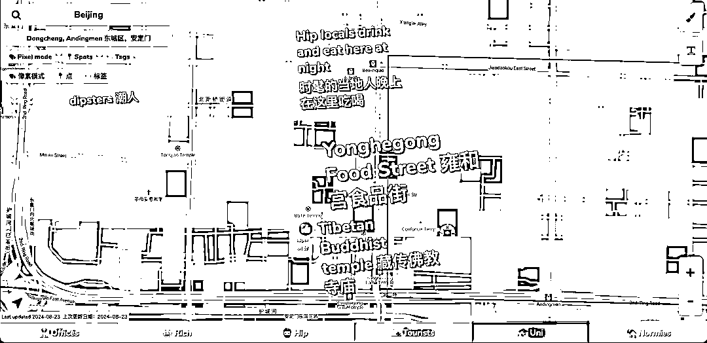
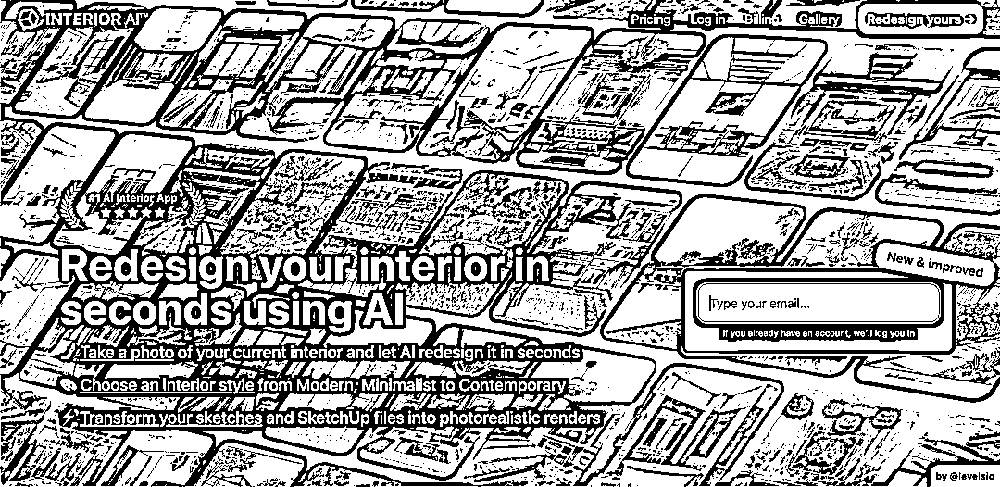
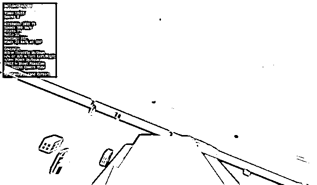

他用AI“打辅助”，从0基础做到月入百万，连马斯克看完都直呼太酷了！

一个人，一台电脑，再加一个AI“助手”，花上短短几小时，能折腾出什么？答案是：一个能开的3D飞行游戏。它上线刚满10天，就赚了近4万美元（约28万人民币），之后每月还能稳定进账8.7万美元。消息传开后，连马斯克都蹲不住了，专门跑来留言：这太酷了，AI游戏以后一定会非常火！

这还只是冰山一角。他手里另一个项目PhotoAI，靠AI给人生成写真，每个月照样吸金12.3万美元。故事的主角，是独立开发者圈里的传奇人物Pieter Levels。

这人没有名校光环，也没在大厂待过，更算不上什么技术大牛。他就是靠自学摸进了编程的大门，然后一条道走到黑，把“一人公司”的理念贯彻到底。设计、写代码、做推广，全是自己上。这些年他满世界地跑，足迹踏过40多个国家、150多座城市，经常在酒店房间里穿着短裤，用各种别扭的姿势敲代码，结果愣是把自己炼成了年入数百万美元的“超级个体户”。

一、他为何能一直赢？靠的是“不停发射”和“不怕出丑”

早年的Levels是个音乐人，还在YouTube上搞过一个叫Panda Mix Show的电音频道。大学毕业后，他眼看周围朋友一个个按部就班去上班，心里却怎么都不愿意进入那种人生。27岁那年，他陷入了一场被称为“土星回归”的人生低谷，又迷茫又沮丧，索性收拾行李，带着电脑去了亚洲，想过上靠网络谋生的日子。

可数字游民的开局远没想象中美好：赚得越来越少，孤独感却越来越重。他爸劝他，人一旦感到沮丧，就更不能坐着发呆，得赶紧找点事情做。正巧，他看到了Jennifer Dewalt的疯狂挑战——180天做180个网站，于是他有样学样，把标准往上拉了一截：12个月里做出12个创业项目。

这挑战看似自虐，其实是在对抗创意人身上最常见的一种病：想要完美、又害怕失败。Levels自己中过招，也看太多人栽在这上面。他见过太多人，点子很好、力气也下了，偏偏在快完成的时候停手，或者压根不敢发布，怕被群嘲。正是这种完美主义和恐惧，埋没了无数好创意。

所以他的铁律就是：做完，然后发出去。项目再小也认了，不指望第一个产品就颠覆世界。“多发、快改”才是硬道理。据他本人透露，前前后后做过70多个项目，真正成的只有4个。但5%的成功率对他来说已经足够了——多试几次，总有一颗子弹能中靶心。

二、三大底层招式：透明开发、极简技术、死磕真实需求

“透明”是他的招牌动作。Levels喜欢在X（原推特）上直播创业过程，连失败的坑也一起晒。这一晒，晒出了粉丝、晒出了反馈，也晒出了资源。技术卡壳时，社群会来帮忙；新品想推广，粉丝会主动转发。甚至去找AI服务商（比如Replicate）谈合作时，对方也因他的开放态度而更愿意让步。

在技术选型上，他简直像个“复古派”。用的还是HTML、jQuery、PHP、SQLite这些老朋友。在他看来，创业早期最关键的指标是“想法能否被市场接受”，而不是“技术是否够新潮”。他没时间研究Node、React，干脆用最顺手的工具，跑通流程、快速上线。实用主义，才是他最大的效率引擎。

他的很多灵感，都来自自己身上那些“小疙瘩”。比如当年他和朋友喜欢用邮件互发YouTube链接，收件箱很快就乱了套，于是他就做了个叫Play My Inbox的小工具，能登录Gmail自动提取链接并生成播放列表。这小玩意虽然没赚到钱，却带来了媒体报道和几万用户，让他信心大增。后来他又发现游客总爱扎堆去千篇一律的景点，于是花了4天搞出Hoodmaps——一张众包地图，让大家用颜色标出“游客区”“富人区”“文艺区”，一眼就知道本地人爱钻哪儿。这个项目上线后同样在Reddit炸了，服务器一度差点被挤爆。虽然最后因为地图API的成本太贵没能盈利，但足以证明他快速上线、引爆社区的本事。

三、从Nomad List到AI游戏，赚钱的故事一个比一个精彩

Nomad List也是被“自己的需求”逼出来的。当年他游走世界各地，特别想知道每个城市的生活成本、网速、安不安全，于是先整了个谷歌共享表格，让大家一起填。没想到这张表格迅速吸引了大量数字游民，后来升级成功能完整的网站，提供城市数据、社区互动、远程工作信息，每年给他带来上百万美元稳定收入，直接撑起了他的财务基石。

2022年AI大爆发，Levels当然不会错过。他注意到Stable Diffusion画房子、画室内设计都挺厉害，于是做了this housedoesnotexist.org和InteriorAI.com。上传一张房间照片，AI就能生成好几种改造方案，InteriorAI上线第一周就赚了一两万美元，到现在每月还有四五万美元入账。

尝到甜头后，他又把AI图像生成用到人像上，搞出AvatarAI.me（后来整合进PhotoAI.com）。用户上传自拍，AI就能帮你生成风格化头像或逼真写真。这个项目最火爆时，一周进了15万美元；现在虽然有大厂Lensa来抢市场，PhotoAI靠“在线虚拟照相馆”的定位，每月依然能赚12.3万美元。鲜为人知的是，早期PhotoAI没有自动化流程，前几百个订单都是他亲手处理：收照片、训练模型、再发回去。累归累，却逼着他加速迭代，把流程一点点跑顺。他还很聪明地拿用户产生的大量图片做A/B测试，等于是让用户帮自己打磨产品。

不过最惊艳的，还是那款AI飞行模拟器。这哥们儿给编程工具Cursor下了句指令：“做一个带摩天大楼的3D飞行游戏。”AI就自动生成了绝大部分客户端代码（HTML+JavaScript）。后端多人联机功能，则是他问了马斯克家的Grok-3，生成了一套Python WebSockets代码。整个项目从想法到雏形只用了30分钟，3小时左右就能玩了。上线10天，1.6万玩家涌进来，给他赚了3.8万美元，马斯克还点了赞。Levels因此感慨：“AI把开发变成了聊天，你只要告诉它要什么，它就能把代码写出来。”

四、他的赚钱观念，也很反常识

Levels在商业上的做法，跟多数创业狂人不太一样：

他坚持“一上来就收费”，不让用户先薅羊毛再慢慢转化。他觉得愿意掏钱的人，才是真正看重产品的用户，这些人的反馈也更有分量。他几乎不雇人，运营成本低得惊人，利润率自然很漂亮；同时还会主动找AI服务商砍价，争取更优惠的价格。他不买广告，就靠着在X、Reddit、TikTok上发优质内容和产品动态，让流量自然生长。面对收购邀约，他也统统拒绝：除非报价高到惊人，否则自己做老板的掌控感和长期收益，远比一次性套现更划算。Nomad List在他眼里更像亲儿子，承载着情怀与价值。

五、普通人能从他身上抄到哪些作业？

在AI时代，Levels的故事就是一本“一个人如何单挑世界”的参考书：

第一，别等完美，先发出去。他最常喊的就是“Just ship it！”。先做最小可行版本，让市场给你答案，再一点点改进。想成为什么人，就得全力以赴，半吊子成不了事。

第二，要解决真实问题，最好是你自己的痛点。自己就是用户，你才知道需求有多痛，产品做出来才接地气。

第三，赶紧拥抱AI，边做边学。他并不是AI专家，但他敢试、愿学，天天刷X上那些顶着动漫头像、分享AI进展的大神，逮住Cursor、Grok、ChatGPT、Stable Diffusion这些工具就用。不会就学，学不会就问AI“该怎么做”。

第四，把你的过程晒到网上。公开自己的思考、进展、失败，不仅能得到反馈，还能吸引一群同路人。互联网时代，透明本身就是品牌。

第五，别被主流带跑。他用PHP不用新框架，一个人单干也不搞团队，他有自己的节奏。他还公开质疑，那些融资几亿美元的框架背后，是不是有过度包装的味道。所谓“最佳实践”，未必适合你；找到最高效的方式，就够了。

第六，从小处起步，允许自己丑。Nomad List最初只是个表格，PhotoAI早期还得靠手动。先解决小问题，再根据反馈迭代。产品再丑没关系，核心价值对了，用户就会买单。

第七，认真听意见，但也要学会过滤。他会在Hoodmaps里采纳用户指出的数据问题，改进产品；但对无意义的骂声，直接屏蔽，保持自己的节奏。

第八，勇敢定价，控制成本。有价值的东西就该卖钱，别不好意思收费。同时也要敢谈价、懂取舍，保证自己的劳动获得应有的回报。

第九，找到你的“第三空间”。咖啡馆曾孕育了欧洲启蒙运动，也承载过硅谷一代代梦想家的热烈讨论。找一个能让你专注和放松的环境，可能是咖啡馆，也可能是线上社区，它会持续为你的创造力充电。

Pieter Levels的成功或许很难复制，但他提供的路径足够清楚：在AI的加持下，一个人的力量，真的可以撬动一个时代。