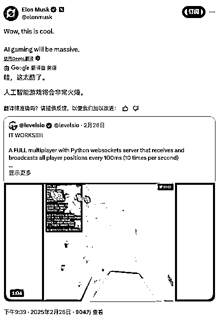

# 把AI当副驾，月入百万美元还被马斯克点赞？独立开发者Pieter Levels是怎么玩转“钞能力”的

有人把AI当成搭档，几小时就造出一个可在浏览器里飞行的3D小游戏。发布十天吸金近4万美元，折合人民币约28万，之后单月净收入稳定在8.7万美元。马斯克亲自在评论区夸赞：“太酷了，AI游戏一定会大火！” 另外一个AI项目PhotoAI，每月营收也达12.3万美元。这位低调闷声发财的，就是在开发者圈子里名声在外的个人创业者Pieter Levels。

图片

他并不是出自硅谷名校，也不是科班出身。Levels是自学成才，坚守一人公司模式，自己负责产品设计、工程实现和推广。他多年以数字游民身份漂泊，走过四十多个国家、一百五十多个城市，经常在酒店房间里穿着短裤、摆着奇怪的姿势敲代码，把自己打造成了一位年入数百万美元的个体户典范。

他究竟厉害在什么地方？对想在AI时代搞点副业的普通人，有哪些可以借鉴的思路？

## 一、“非典型”独立开发者的成长期

Levels的强项不在于技术有多前沿，而在于“想做就开干、快速迭代、敢于犯错”的执行力，以及对时代风向极其敏感的嗅觉。

### 从音乐人到12个月做12个产品的实验

最早Levels做的是音乐，在YouTube运营Panda Mix Show频道制作电音混音。大学毕业后，看着同龄人走上求职道路，他并不认同。27岁经历“土星回归”低谷期，他带上电脑去了亚洲，开启数字游民生活。

起初游民生活并不理想，收入下滑，孤独感加重。父亲一句“难受就别坐着，起来做事”点醒了他。受Jennifer Dewalt“180天做180个网站”启发的他，给自己立下更激进的目标：一年内上线12家初创项目。

图片

这个自设挑战，本质是对创作者通病的一次反制：害怕收尾、怕被批评。Levels发现很多想法都卡在“差一点就完工”，要么搁置，要么因怕嘲讽而从未公开。他认为完美主义和恐惧扼杀了大量好点子。

“一年十二个项目”的核心就是强迫自己交付并上线。他不纠结项目体量，也不追求立刻改变世界。信奉“多做多发”的哲学——敢试敢错、快速进化。他做过七十多个项目，仅有四个成功，但5%的中奖率让他确信：试的次数够多，就一定会中。

### 公开造物：透明换来信任和流量

Levels另一大标签是Build in Public。创业的成败得失，他都会在X等社交平台上摊开来讲。这种坦诚为他积累了大量关注，也带来了持续的建议和帮助。遇到技术瓶颈或需要曝光时，他的粉丝社群会主动伸手。口碑透明也让他在与AI服务商如Replicate谈判时，更容易获得信任与更优条件。

### 朴素的技术选择与务实逻辑

与追求新潮栈的开发者不同，Levels的技术组合很“老派”：HTML、jQuery、PHP、SQLite。他认为早期创业，技术不关键，关键是用最快路径验证假设，跑通产品，看市场是否买账。他没时间去学Node.js、React之类的新框架，核心理念是“拿手上的工具，迅速把事办了”。

## 二、赚钱逻辑：从自己的痛点到AI浪潮

Levels的商业路径，是从解决自身痒点出发，再捕捉技术趋势，最后用清晰的变现策略放大收益。

### 从小需求开始：Play My Inbox与Hoodmaps

首个挑战项目Play My Inbox源于他和朋友用邮件互发YouTube链接，链接堆积后难以整理。于是他写了个小工具，登录Gmail、抓取YouTube链接、自动生成播放列表。虽然没盈利，却获得媒体报道和数万用户，让他建立信心。

另一个早期作品Hoodmaps来自旅行观察。游客总是走固定路线，错过城市真实面貌。他做了个众包地图，让用户用不同颜色标注“游客集中区”“富人区”“文艺区”。开发只用四天，上线后在Reddit引爆，服务器一度被挤爆。虽然后来因地图API成本高而难以为继，但它证明了Levels快速做产品、迅速点燃社区的能力。

图片

### Nomad List：为数字游民打造的生存指南

Nomad List同样源于个人需求。他需要了解各城市的生活费用、上网速度、安全程度，最初做了一个公开的Google表格供大家共建。表格迅速聚集大量数字游民，后续演进为Nomadlist.com网站，提供城市数据库、社区交流和远程工作信息。它精准命中数字游民刚需，每年为Levels带来数百万美元可预期收入，成为财务自由的根基。

### 全面拥抱AI：图像到游戏的爆发

2022年AI浪潮到来，嗅觉敏锐的Levels立即入场。

*   Photo AI与Interior AI：图像生成的商业化探路
他注意到Stable Diffusion在建筑与室内效果的生成上表现突出，于是推出this housedoesnotexist.org和InteriorAI.com。InteriorAI允许用户上传房间照片，AI给出多种改造方案，上线首周就产生一万多美元收入，至今月收入保持在四五万美元。

*   紧接着他把人像生成作为新增量，推出AvatarAI.me，后整合为PhotoAI.com。用户上传自拍，AI生成艺术头像或写实照片。该项目曾在短时间内实现周收入15万美元。即使后来Lensa等巨头入局，PhotoAI凭借“虚拟摄影工作室”的定位，仍稳定在每月12.3万美元营收。起步阶段没有自动化，Levels曾手工处理前几百单、训练模型再交付，这个艰难过程倒逼他完善自动化流程。他也利用用户产生的海量素材做对比实验，让用户群体参与产品优化，不断调优模型参数。

*   AI飞行模拟器 fly.pieter.com：用对话完成开发
最具话题性的是他借助AI打造的3D飞行模拟器。他只是在代码编辑器Cursor里用自然语言描述：“在浏览器里做一个带摩天大楼的3D飞行游戏”，AI就生成了绝大部分前端代码。多人在线的服务端部分，则是通过向马斯克旗下AI模型Grok-3提问生成的Python WebSockets代码。

*   这个看似简单的游戏，从想法到可玩原型仅30分钟，3小时内即可试玩。上线十天迎来1.6万名玩家，收入3.8万美元，并收获马斯克点赞。Levels感慨：“AI让编程变成了聊天，你说要什么，它就写出来。”

### 独特的运营与变现观

*   起步即收费，筛选高意愿用户。多数创业者先免费后付费，他反其道而行，一开始就收费，以此筛选出真正重视产品的付费人群，反馈质量更高。
*   高毛利与成本管控。坚持单人开发，不轻易扩张团队，保持运营开销极低。也会主动与AI服务提供方沟通，争取价格优惠。
*   内容驱动的自然增长。几乎不投放广告，靠在X、Reddit、TikTok分享干货和进展实现自然传播。他坚信算法时代，好内容本身就是流量入口。
*   拒绝出售，保留掌控感。多个项目已商业化成功，但他从未卖掉任何一个。除非价格离谱，否则持续运营带来的现金流和控制权更有价值。Nomad List在他眼中更像孩子，承载理念与情感。

## 三、给AI时代普通人的九点启发

1. **行动优先，打破完美主义与失败焦虑**。“Just ship it！” 别等完美，别怕吐槽。尽快把想法做成最小可行产品推向市场，用真实用户反馈指导迭代。Levels说过：你不必被“普通人”标签限制，可以成为想成为的那个人，但必须全力投入，半吊子做不成事。
2. **从真实痛点出发，最好是自己的痛点**。他的多数成功项目都源于数字游民生活中的实际不便。为自己造轮子，更容易理解需求，产品也更贴地。
3. **快速拥抱新工具尤其是AI**。Levels并非AI专家，但他能迅速识别AI的价值并落地。他关注X上分享前沿进展的博主，尝试Cursor、Grok、ChatGPT、Stable Diffusion、Replicate等工具。AI时代，学习速度和适应能力比知识储备更关键。可通过FreeCodeCamp系统学习，也可边做边问AI。
4. **公开构建，用透明换信任**。把思考、进展、失败都公开，不仅获得反馈，还能聚拢同路人。个人品牌与社群在互联网时代价值巨大。
5. **保持独立判断，不盲从潮流**。无论技术选型坚持PHP、jQuery，还是工作方式偏好独立开发，都体现强烈主见。他不轻易被“行业最佳实践”或新技术热潮裹挟，也质疑融资上亿的框架是否存在过度营销。
6. **小步快跑，持续进化，允许不完美**。Nomad List最初只是表格，PhotoAI早期需要人工处理订单。不要追求一步到位，从最小功能起步，按反馈不断打磨。产品初期可能粗糙，但核心价值对了，用户就会买单。
7. **重视反馈，也要学会过滤**。他认真对待批评，提炼可执行的改进点，但会屏蔽无意义的谩骂，保持节奏与心态。
8. **明确盈利方式，敢于定价**。别怕收费，有价值的产品理应付费。同时控制成本、谈判供应商，让劳动获得合理回报。
9. **找到你的第三空间**。Levels提到咖啡馆曾是欧洲启蒙运动的发源地，也是创意孵化地。他怀念硅谷咖啡馆里充满梦想家的氛围。找到能让你专注、激发灵感的环境，无论线上还是线下，对创造力都很关键。

Pieter Levels的成功难以完全复制，但他的理念和方法，为AI加持下的个体崛起指明了一条清晰路径：未来属于敢于动手、持续迭代的个人。