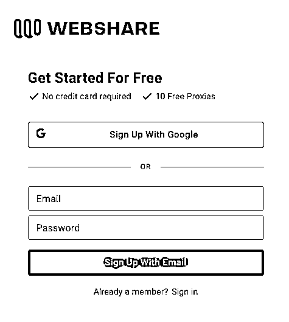
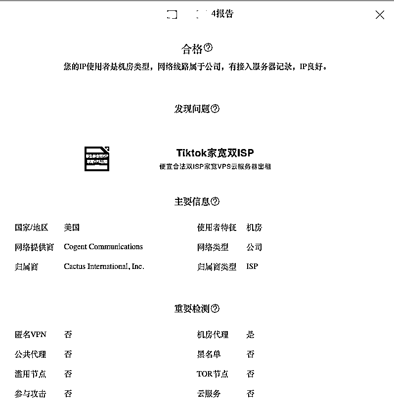
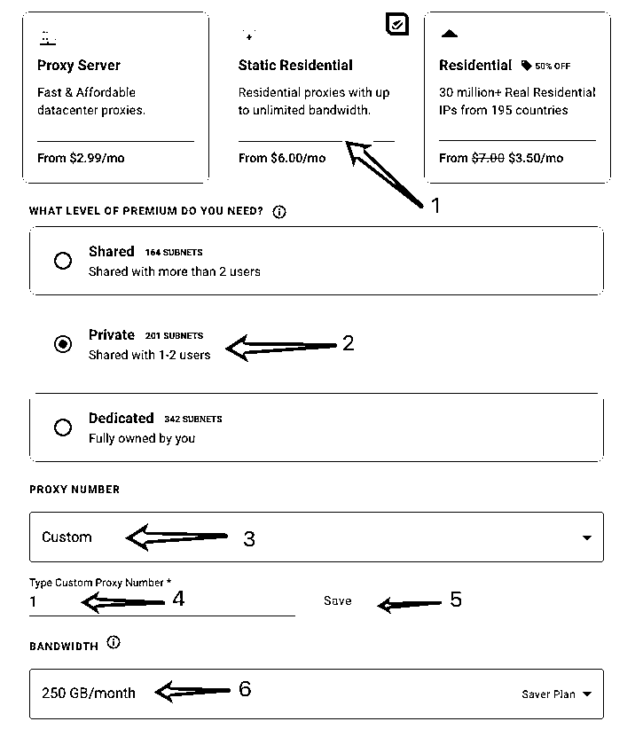
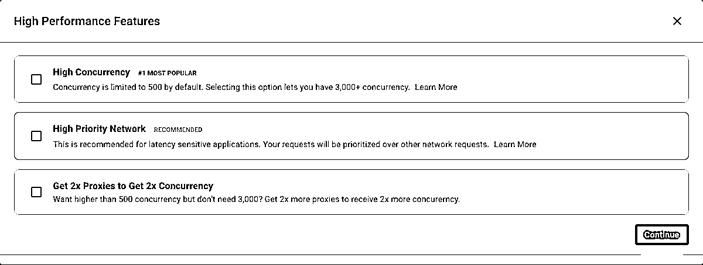
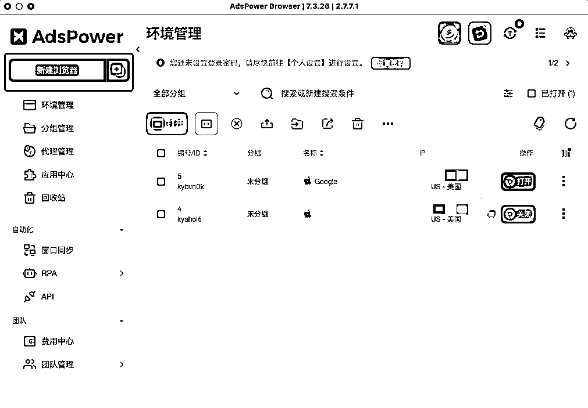
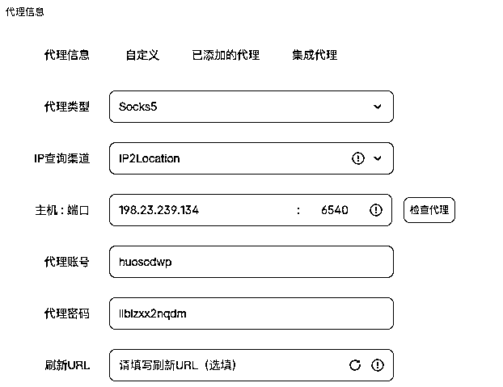
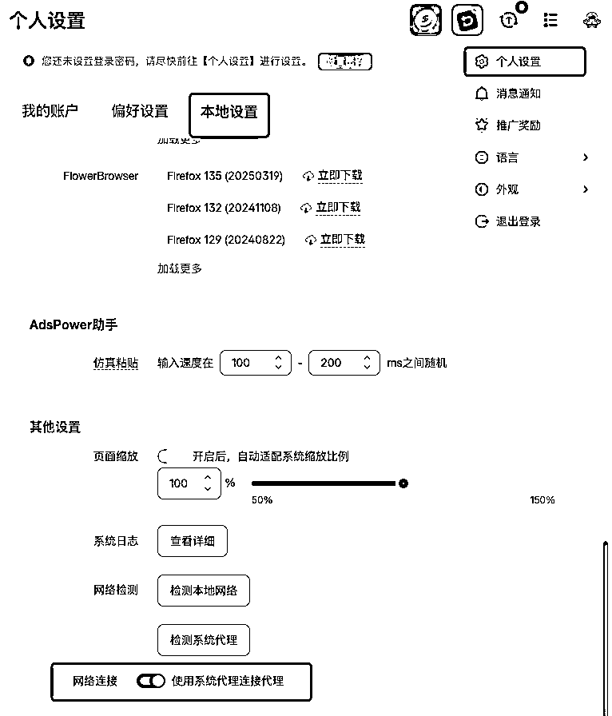
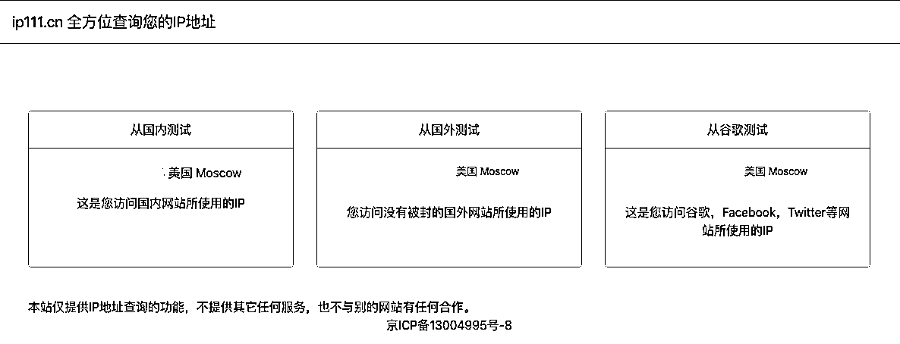
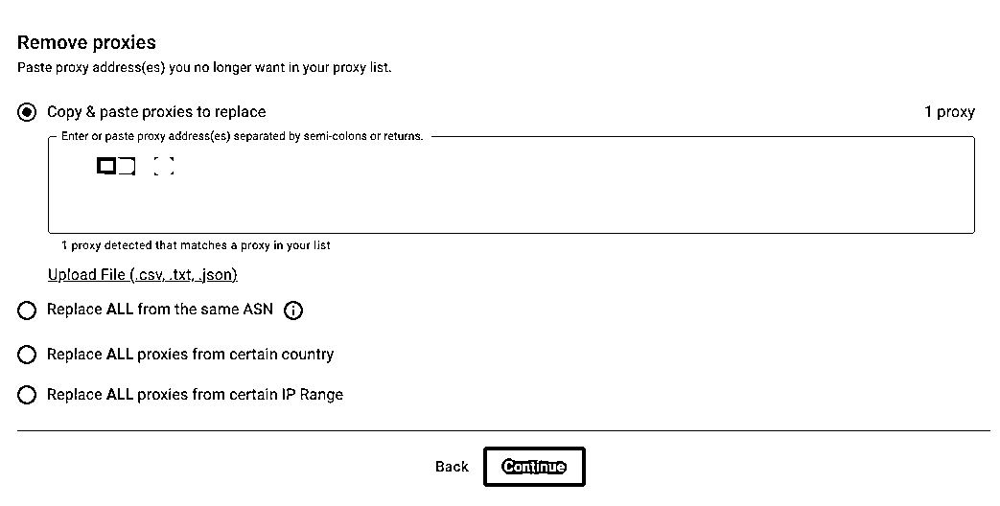

# 每个月1美元，稳定解决Claude环境问题

很多圈友都在问：Claude 确实好用，但新手想搞个稳定的环境，怎么才能不被封？低成本方案有没有？甚至有人卡在 Google 邮箱注册这一步。今天就把我自己在用的这套方法完整分享出来，思路很简单：指纹浏览器 + 静态住宅 IP，成本只要每月 1 美元。下面所有操作，请记得先开魔法。

### 第一步：注册 Webshare

官网地址：https://www.webshare.io/?referral_code=q1hh2vmrtydn

用 QQ 邮箱就能直接注册成功。注册完系统会送你 10 个免费的静态 IP，拿这些免费 IP 去注册 Google 邮箱完全够用。

进入页面后点击“Let's Get Started”就能看到免费 IP 列表。

把 Proxy Address 里的 IP 挨个复制到检测工具里测试，地址：https://ipjiance.com/ 。只要检测结果合格，就先把这些 IP 绑定到指纹浏览器上，用来注册几个 Google 邮箱。免费的羊毛不薅白不薅，如果你着急，直接付费买 IP 也行。具体怎么绑定，看第四步。

之前有圈友说检测结果是“优良”才敢用，我反正是没见过，只要显示“合格”就能用。

如果还不放心，可以用另一个检测工具试试 IP 的风险等级：https://scamalytics.com/

用这些免费静态 IP 注册几个 Google 邮箱足够了。接下来重点说下怎么在 Webshare 上付费购买静态 IP。

### 第二步：办一张招商银行 VISA 信用卡

之前圈里推荐的野卡已经不能用了，前段时间被封了。

### 第三步：购买静态 IP

在 Webshare 里点击 Subscription → Browse Plans。

代理类型选择 Static Residential（静态住宅代理），下面再选 Private。因为 Private 和 Shared 价格一样，都是 1 美元，那当然选更好的。至于独享（Dedicated）没必要，太贵了，而且后面我们有办法筛选 IP，如果 IP 被污染了，直接换新就行。

PROXY NUMBER 选择 Custom，然后在 Type Custom Proxy Number 里填 1（你想买几个就填几个），保存即可。我建议先买 1 个就够了。Bandwidth 选择 250GB/month。

代理地区选 United States，数量填 1。

确认无误后点击 Continue。

这里弹出的框不用管，直接再点 Continue。

付款页面绑定你的 VISA 信用卡，完成支付就行。

因为我们买的不是完全独享的 IP，所以每次使用前，先拿 https://ipjiance.com/ 测一下，没问题再用；有问题就换（怎么换看第五步）。检测方法前面已经讲过，就不重复了。

### 第四步：绑定指纹浏览器

我用的指纹浏览器是 AdsPower，下载地址：https://share.adspower.net/6nwzVs

安装后点击左上角“新增浏览器”。

基础信息设置：
- 名称随便填，比如 Google、Claude，能分清用途就行；
- 浏览器内核选 SunBrowser，版本选最新的 Google；
- 操作系统选一个你喜欢的；
- 其他的都不用填。

代理信息设置：
- 代理类型：Socket5
- 代理渠道：IP2Location
- 主机和端口：填 Webshare 上检测合格的 IP 地址和对应的 Port（每个人的不同，按实际填写）
- 代理账号：填该 IP 的 Username（同样以实际为准）
- 代理密码：填该 IP 的 Password

点击“检查代理”，看看能否连接成功。其他选项保持默认就好。

最后还需要设置“使用系统代理连接”，这样才能确保浏览器能访问外网。

点击“确定”后，就会自动打开一个新的浏览器窗口。

到这里你就可以直接去注册 Google 邮箱和 Claude 了。不管你的魔法是规则模式还是全局模式，指纹浏览器里打开的网页，IP 检测结果始终一致。检测工具：https://ip111.cn/

后面注册 Google 邮箱和 Claude 的流程，按照页面提示一步步走就行。有纯净 IP 在手，注册会非常顺畅。

### 第五步：如何更换 IP

在 Webshare 后台选中要更换的 IP，点击 Replace。

选择“Copy & paste proxies to replace”。

接着选择“Add a proxy from a Certain country”。

点击 Preview，确认无误后点“Yes, Replace”就完成了。

整套流程下来，每月成本就 1 美元，环境稳定，注册顺畅。有需要的圈友赶紧试试吧。