# 月付一刀，Claude 稳用不翻车的环境搭建全流程

> 来源：[https://oxpszlsgr00.feishu.cn/docx/MS7xdMgCHolyD4xDwGIcCbQ2n2g](https://oxpszlsgr00.feishu.cn/docx/MS7xdMgCHolyD4xDwGIcCbQ2n2g)

Claude 的体验大家有目共睹，但对新手来说，最头疼的从来不是会不会用，而是怎么低成本搞一套稳定、不易被风控的环境，甚至连 Google 邮箱的注册环节都卡住。

今天把我实操至今的方案拆开讲清楚，核心逻辑就两件套：指纹浏览器 + 静态住宅 IP。月成本压到 1 美元左右，环境稳。

下面所有步骤请在魔法环境下进行。

### 第一步，先去 Webshare 拿免费静态 IP

地址：https://www.webshare.io/?referral_code=q1hh2vmrtydn

注册支持用 QQ 邮箱，账号建好后会直接赠送 10 个免费静态 IP，正好拿来做 Google 邮箱的注册号。

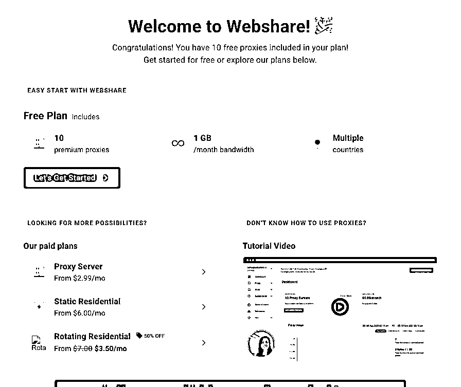

进入免费 IP 列表，点击 “Let's Get Started”。

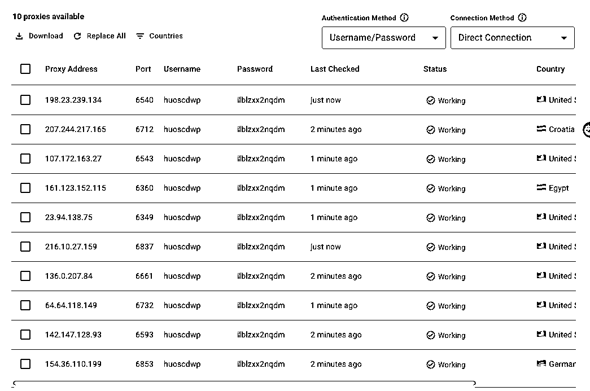

把列表里 Proxy Address 的 IP 挨个复制到检测站里跑一遍。只要检测通过，就能先拿去绑定指纹浏览器，用来批量注册几个 Google 账号。免费资源不用白不用，当然也可以直接付费扩容。

检测地址：https://ipjiance.com/

指纹浏览器的绑定方式见第四步

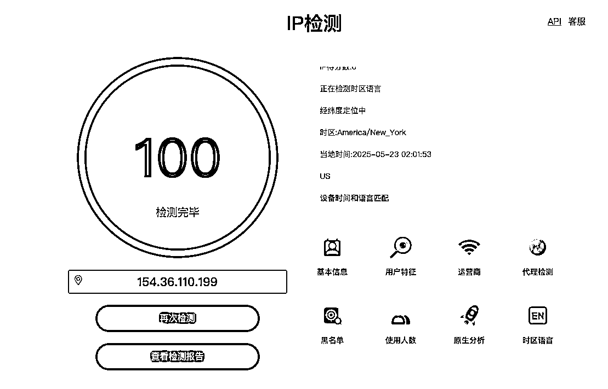

网上有人强调要等到优良才用，我实际测试下来合格等级就能正常用。

如果想更谨慎，可以再用 https://scamalytics.com/ 二次查验 IP 风险分。

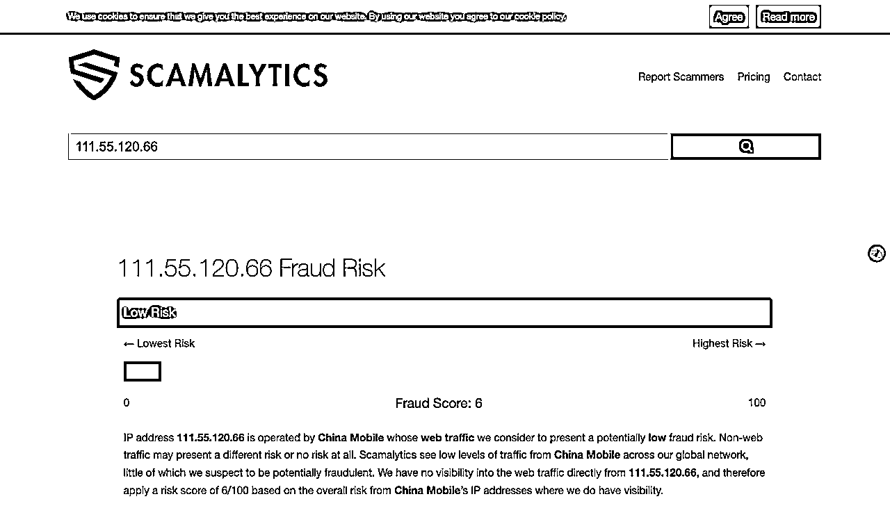

这批赠送的静态 IP 完成几轮邮箱注册完全够用。接下来再说付费购买的流程。

### 第二步，准备一张招商银行 VISA 信用卡

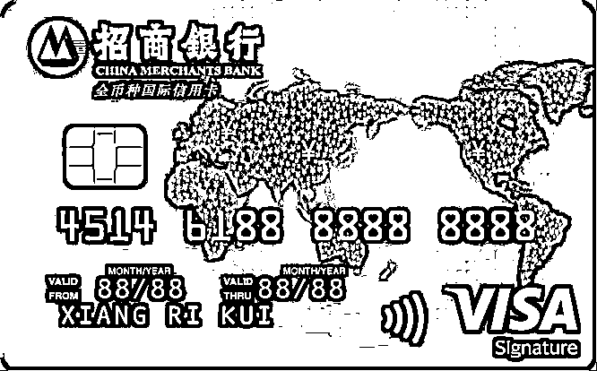

此前我推荐的是野卡，最近那条路不好用了。

### 第三步，在 Webshare 上买静态住宅 IP

进入后台后点击 Subscription 下方的 Browse Plans

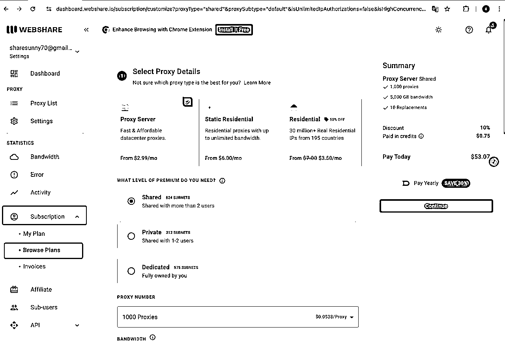

代理类型选 Static Residential 静态住宅代理，下方选 Private。单价和 Shared 都是 1 美金，Private 性价比更高。

独享代理不用考虑，价格贵且没必要，后续可以手动换 IP 清洗污染的节点。

设置 PROXY NUMBER 为 custom

「Type Custom Proxy Number」填 1，想多买就多填，点击 Save。入门买一个即可。

「Bandwidth」选 250GB/month

地域选 United States，数量填 1。

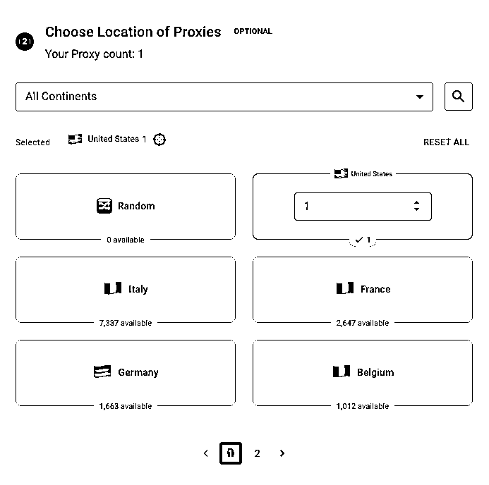

确定后点 Continue

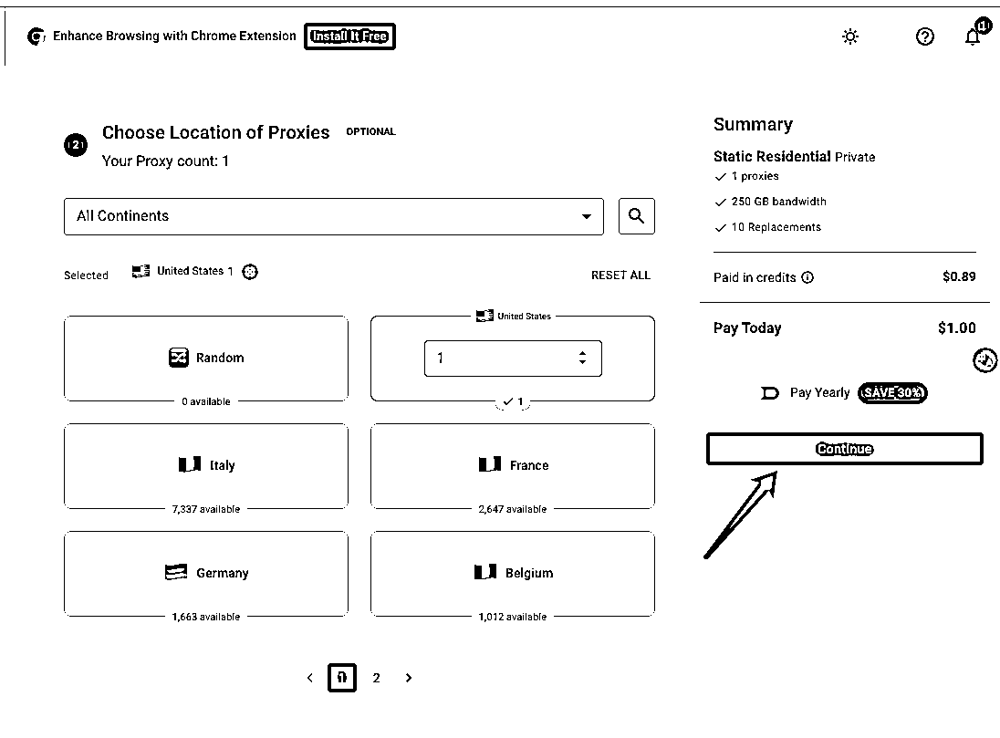

中间提示框直接略过，继续点 continue

到支付页绑定你的 VISA 卡完成扣费即可。

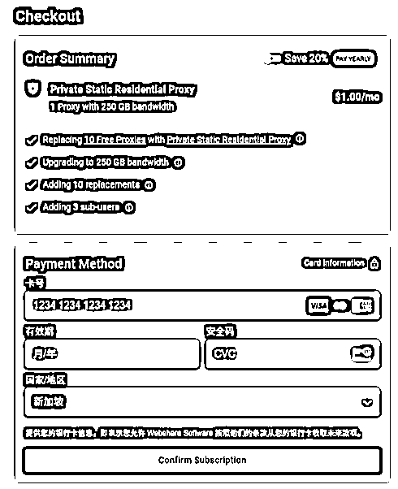

因为买的是非独享 IP，每次使用前建议先用 https://ipjiance.com/ 测一下通不通、稳不稳。没问题再用，有问题就换。换 IP 的操作见第五步。

### 第四步，把 IP 绑定到指纹浏览器

我这边用的是 AdsPower，地址：https://share.adspower.net/6nwzVs

安装完成后点左上角新增浏览器

基础信息配置

名称随便写，比如 Google、Claude，方便自己区分用途。

浏览器内核在 SunBrowser 列表里挑一个最新的 Chrome 版本

操作系统自选

其他项保持默认

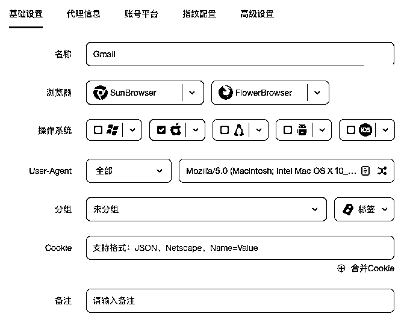

代理信息配置

代理类型：Socket5

代理渠道：IP2Location

主机：端口：填 Webshare 上刚检测合格的 IP 地址和对应端口

代理账号：填写该 IP 的 Username

代理密码：填写该 IP 的 Password

点检查代理，确认连接成功即可，其余保持默认。

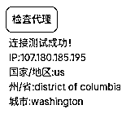

最后勾选系统代理模式，确保指纹浏览器内的外网访问走的是这个节点。

点确定后浏览器窗口自动打开。

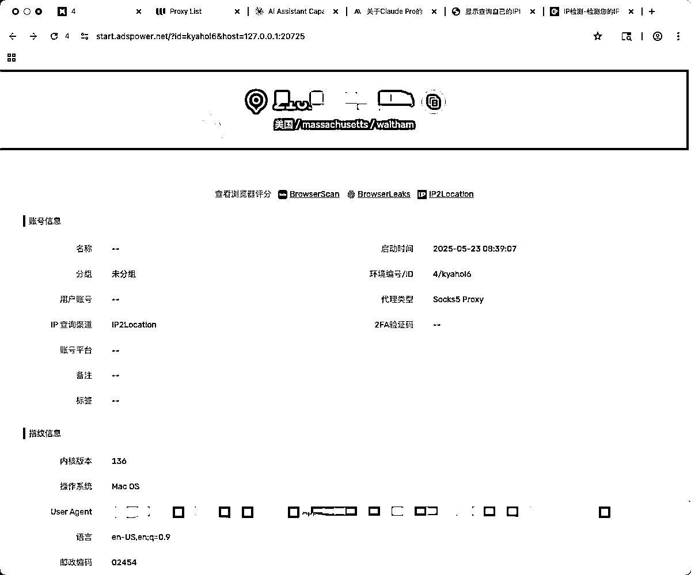

到这里就可以直接用这个干净环境去注册 Google 邮箱和 Claude 账号了。

不管你日常魔法是规则分流还是全局，指纹浏览器里访问的出口 IP 都是统一的。可用 https://ip111.cn/ 自检。

邮箱和 Claude 的注册流程按官方指引一步步走即可，有干净 IP 基本不会被拦截。

### 第五步，IP 失效时的快速更换

找到当前使用的 IP，点击 Replace

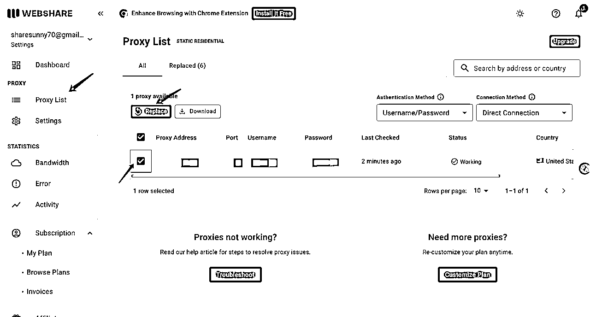

选择 Copy & paste proxies to replace

再选 Add a proxy from a Certain country

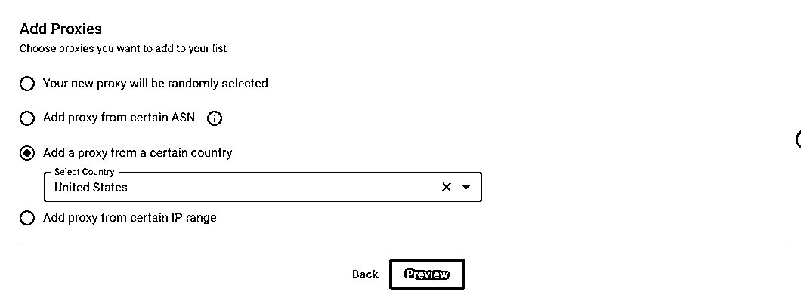

点 Preview 预览后，最后点 yes，Replace 完成替换即可