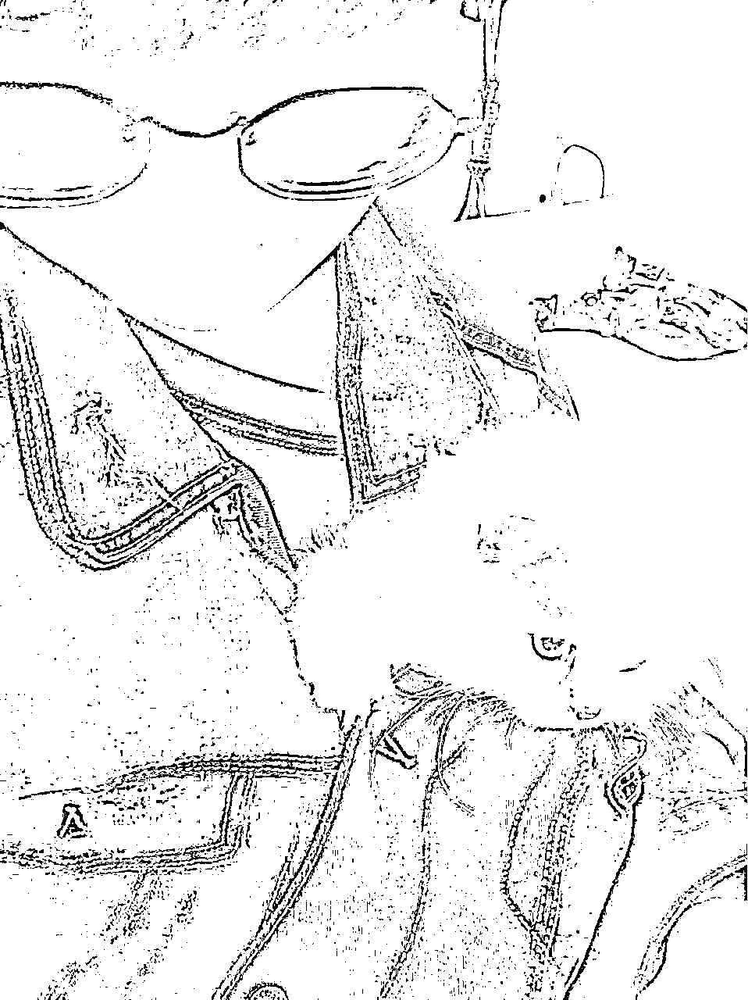
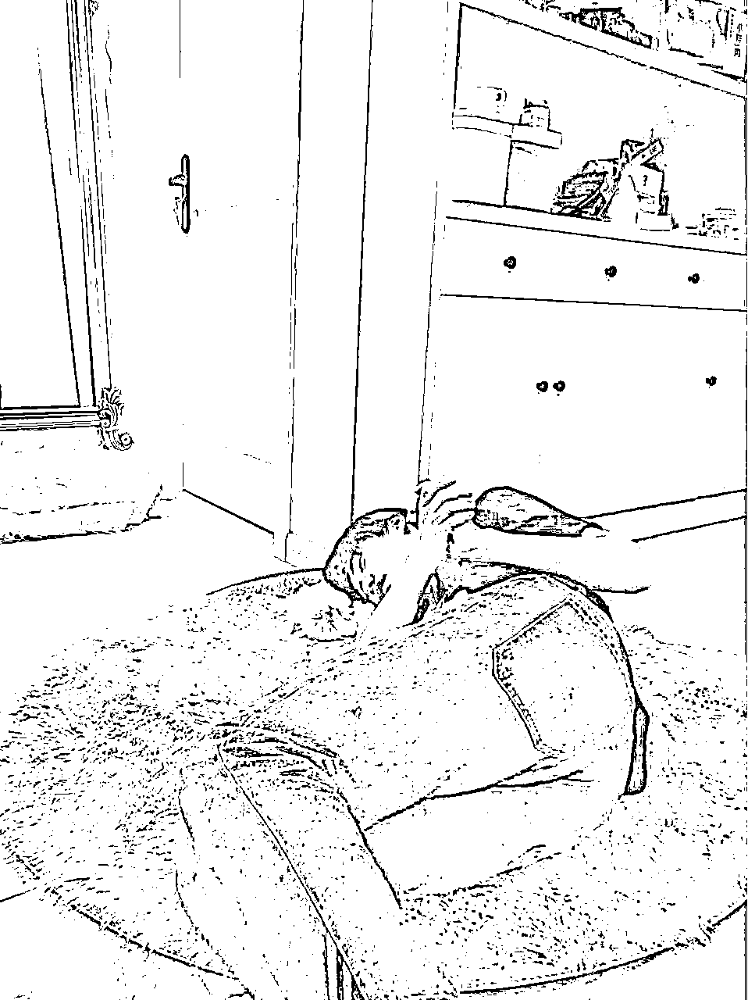
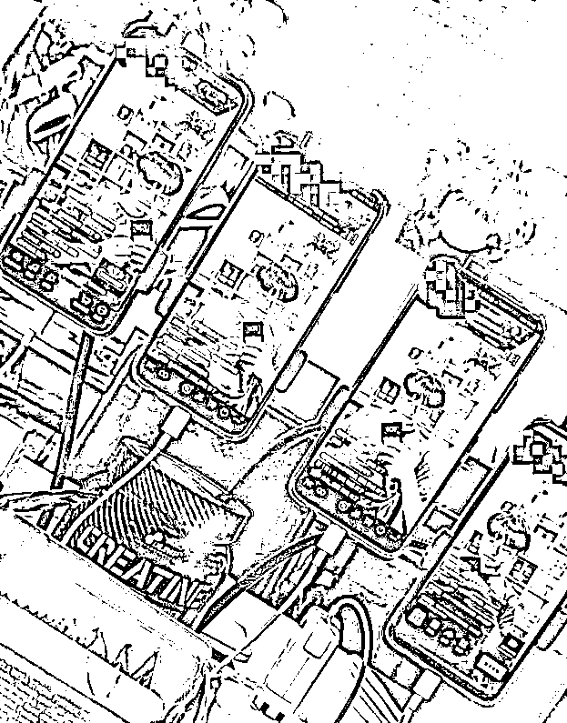
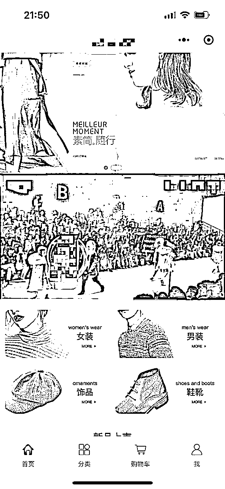
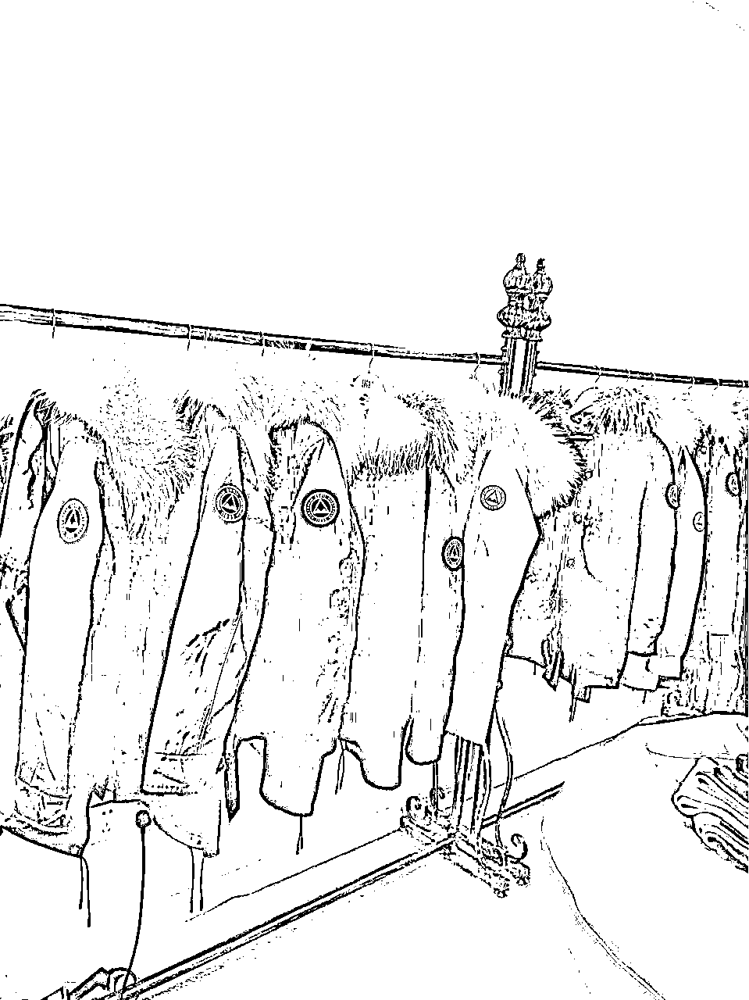
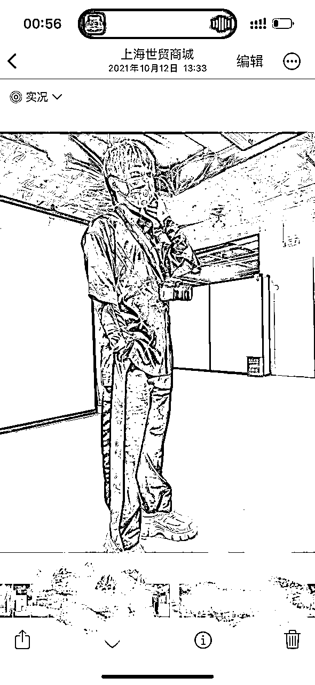

# 从零到第一个100万，我花了1年4个月

大家好，我是风小海，公众号也叫这个名字。

一直待在武汉，生财有术的老圈友了，三年下来不算短。做服装这行，赚过也亏过。现在时间上确实比以前自由，但讲真，离财富自由还差得远。

去年靠风向标中标，兑换了一张生财门票。我不觉得自己是那种天生会赚钱的人，只是弯路走得比别人多，坑踩得也够数。所以想把亲自验证过的东西整理出来，打算写100个真实项目，给那些愿意踏实生活、踏实挣钱的人。

新写的内容都会同步放生财。

# 我的第一桶金

## 写在前面

这篇文章记录的是我从0到100万的全过程，一个人，一台电脑，前后一共1年零4个月。你会看到我踩了哪些坑，又是怎么从坑里爬出来的。

它不是鸡汤，更不是什么爽文，只是一个普通人在什么都没了的地方，靠着一件一件事搭起来的生活。如果你刚好也在低谷，希望这点能量能照到你。

## 散场的灯火

2017到2019那阵子，我在一家跨境电商公司上班。公司不大，60人左右，做的是澳洲药妆、保健品和土特产，零售批发都有。我负责零售端，管4个淘宝店，20多个微信号，工资1万2。那会儿直播带货还不太流行，传统电商还算热闹，每天忙得像陀螺，累归累，心里是安稳的，总觉得这行还能吃好多年。

2019年元旦，风向变了。代购法落地，个人代购一夜之间变成灰色地带。

公司高层反应很快，直接把零售线砍掉，转身拿了几个澳洲品牌的中国代理权，开始做供应链批发。就这样，我们整个零售部门被团灭。

那阵子我才真正理解，很多看似稳固的东西，底层只是建立在“政策没变”这个前提上。风一来，牌局就散了。

散伙那阵子，老板单独请我吃了顿饭，多给了一个月薪水，说“谢谢你能撑到最后”。

2019年9月，我正式离开那家公司，成了一个没有工作的人。

## 被焦虑追着跑的日子

刚离职的时候，我以为自己终于自由了。不用早起，不用怕迟到，天天睡到自然醒。可没过多久就发现，松弛只是表面，闲久了心里全是慌的。一晃就是3个多月。

时间走到了2019年12月，武汉的风已经带刺，网上也冒出了肺炎的传闻。年底招聘本来就少，我就想着，要不等过完年再说。

后面的事大家都知道了。疫情突然爆发，武汉直接封城。长时间没收入，加上封控的压抑，我整个人都绷不住了。坐在电脑前，有一种说不出的窒息感。人真的是不能闲太久，一闲下来，脑子跟身体一起钝掉，整个人就废了。

那阵子我白天刷新闻，晚上数口罩，眼看存款只出不进，心里一点底都没有。更要命的是，我除了大学时在贴吧倒卖过球鞋，根本没有像样的创业经验。

封控那段时间，我每天只干一件事：打开百度，搜“赚钱”。

淘宝客、拼多多、shopee、悟空问答、自媒体、写小说、闲鱼无货源、知识付费、任务平台……网上叫得上名字的网赚项目，我全翻了一遍。平台注册了一大堆，账号密码抄了满满一页纸，却没一个真正跑起来。

这段经历让我看明白了一件事：市面上的“赚钱项目”，百分之八九十都是带饵的钩子，真正靠它赚到钱的，寥寥无几。

当时我已经听说生财有术了，但为了省钱，看的是盗版内容。这是我最后悔的一件事。如果2019年就进生财，肯定会少走很多弯路。

不过封控的三个月，也让我被迫学会了不少网赚技能。凡是能跑通最小MVP的，我就拼命放大；有潜力的但一时变现不了的，就先记下来，等有灵感再去试。

都是小打小闹，赚得也不多，但这段时间帮我扛过了最迷茫的时候。那些小项目让我发现自己还能做点事，也学到了不少以前完全不会的东西。

它们不是什么“躺赚”神器，可在那段暗无天日的日子里，起码帮我稳住了心态，也为后来的大动作打了底。每一次试错，后来都变成了我最值钱的积累。

## 重返职场，然后彻底离开

2020年5月，武汉开始解封，城市一点点活了过来。复工没多久，我从家里搬了出来，一个人租了套90平的二室一厅，养了一只猫，起名“波弟”。那些安静到发慌的晚上，都是它陪我过来的。

这时候我创业的心已经蠢蠢欲动了，但真正把我推出去的那一下，是一次吵到掀桌的骂战。

复工后我又找了一份活，给一个全网粉丝快500万的健身博主做电商运营。公司不到10个人，老板就两个。

名义上是运营，实际上什么都要干：客服、剪视频，每周还有一场免费的直播带货。最夸张的一天，加班到凌晨快1点，连晚饭都没吃上。

一个月后我实在撑不住了，提了离职，顺嘴给了些建议。结果聊着聊着就吵起来了。他拍着桌子吼我：“你是谁啊？你TM有什么资格跟我谈条件？”这句话我到今天都记得。那一刻我才反应过来，有些公司根本不是什么工作，就是一个牢笼。

## 没有退路，反而走出来了

吵完那架之后，公司倒也没拖，当天把工资结清了。我连夜收东西走人，心里那口气这才松下来。彻底告别稳定的时候，我有点慌，但也有点爽。

2020年8月，我正式和职场说了再见。买了台新电脑，10部二手手机，把房租一次交清。弄完之后一看，存款已经见底了。

我没有给自己留后路，就这样上了战场。反正打工是不可能打工的。

这一次我心里非常清楚，赚钱这件事说透了就一句话：低买高卖，赚中间差。其他的，都是包装，都是故事。

我开始在自己熟悉的领域里找产品，把资源重新捋了一遍。转机就是从这时候开始的。

因为倒卖过球鞋，之前在澳洲公司也认识一些同行，我第一时间在朋友圈里搜“鞋”。结果没搜到货源，只翻出了一些澳洲雪地靴，还是去年冬天发的。但我没死心，顺着牌子去淘宝搜。搜的时候，发现了一个反常的现象：当时武汉正热得能把鸡蛋煎熟，一款商品却逆势卖爆了——“皮草”。

你没看错，大夏天，皮草卖疯了。

这个牌子我之前多少有点印象，公司以前采购过它家产品当客户礼品。价格不便宜，起步三千，贵的上万。它家是预售制，下单到拿货大概要2个月。因为供应链和生产流程比较复杂，皮草原料又要看季节性屠宰的脸色，所以备货周期拉得很长，再加上进口还要过动物检疫、成分检测、物流清关这些关卡，整个周期就更长了。这些条件加在一起，反而造就了大夏天卖皮草的奇观。

## 没货怎么办，那就“无中生有”

产品定下来了，我开始疯狂找货源。

第一步，我私信了所有卖这个牌子的淘宝卖家，问能不能给分销价。结果80%的客服直接回绝，剩下20%客气地说“我反馈一下”，然后就没有然后了。

我坐在那儿想了一整天，忽然想明白了：我找的是客服啊。人家一个月拿四千块工资，多一事不如少一事，凭什么帮我给老板传话？

那就绕开客服，直接找老板。

淘宝店铺不是能看营业执照嘛。我一张张截图，去企查查上搜企业名，上面基本都有联系电话，多数都是老板本人的。

整理完电话，我编了一套说辞，大意是：“您好，我这边是做跨境电商的，手里有一批女性客户，看您家产品很适合我们的群体，想聊聊合作。”

可能是出于礼貌，90%的老板都愿意加微信细聊。可聊下来又卡住了——我没有实际订单，光靠嘴上的大饼，老板们一个个精得很，怎么画都没用，没有一家肯给我分销价。

但我没打算放弃。临门一脚了，说什么也得踢进去。

我又回头翻这个品牌官网，发现除了皮草，还有一个产品卖得也很好，价格最高也就300块——“瑜伽服套装”。疫情封控那阵子，全民都在家健身，运动服饰的需求正在爆发。

然后我做了一件挺反常规的事。

我找到以前公司批发部门的同事，向他推荐这个产品，先斩后奏地说：找我拿，最贵的那款一套能便宜100块。可能碍于旧同事的面子，加上确实便宜，他最后拿了10套。

这10套订单就是我的敲门砖。我拿着它挨个找之前加过好友的店主，说想先用瑜伽服试试合作，看能不能给点支持。

终于，有一家店主被我的无限画饼和真金白银的10套订单打动了，愿意一套便宜80元。我当然立刻下单——这笔账算下来，我不仅没赚，还倒贴了200块。一顿操作猛如虎，一看账户亏了250。当时那叫一个肉疼。

但正是这件看起来有点“傻”的事，让整盘棋活了过来。对方看我付款这么爽快，后面皮草的分销价，也就顺势拿到了。

## 从闲鱼出发，去做别人没做的事

分销价拿到了，接下来是卖的问题：去哪儿卖？怎么卖？

淘宝肯定不行，没有品牌授权，分分钟被人举报下架。答案很明显，闲鱼。

还记得封控那三个月我研究过闲鱼无货源吗？对，一切都对上了。那一瞬间我心跳加速，立刻把所有产品挂到闲鱼，价格比淘宝低一点。6个闲鱼号，当天出了2单，一单利润500块。又兴奋又紧张，心里痒得不行，一晚上没睡着，生怕这个钱被别人抢走了。

就这样连轴转了好几天，一个致命问题出现了：资金链。

皮草是预售制，最快也要1个月才能到货。而闲鱼上每下一单，我得先垫3000左右给供货商。单量一起来，我的口袋直接被掏空。

怎么办？只能想办法让客户直接转账。但几千上万的货款，一个刚认识的卖家，客户凭什么信你？

我注意到一个细节：这品牌的皮草款式特别多，有100多个型号，客户选款选得头大。但就连官方都没做一个方便选款的小程序，各家店的实拍图也少得可怜，用的全是清一色的电商白底图。

机会来了。

我连夜做了一个选款小程序，把100多款产品全部上架。那一晚灌了两罐红牛，心脏跳了一整夜。等所有产品传完，已经是第二天下午，整个人像被抽空了一样，但那种心流状态，根本感觉不到时间在走。

更离谱的是，一年多之后，官方终于也出了自己的选款小程序。点进去一看，页面架构跟我那个不能说毫无关系，简直像是我半夜托梦给他们的——连按钮位置都没挪。

那一刻我真有点“民间高手，隐姓埋名”的感觉。你要说他们抄了，人家是官方；你要说没抄，那也太像了。

小程序搞完，我又想到还差一个关键环节：实拍图。这才是让客户放心的核心。

这时候我手里已经有一些订单了，底气也足了些。我直接找供货商谈：“能不能让品牌方寄几件样品，我来拍点像样的图？”对方明显犹豫，我又补了一句：“我给押金，运费也我自己出。”

最后谈成了：押金2万，一次寄20件，拍完寄回去再换下一批。

从那以后，我开始了“皮草穿越大江南北”模式。拿到拍摄权之后，我女朋友有空也会来帮我拍照、录视频。虽然累得跟打仗一样，但那个业内前所未有的小程序终于上线了。名字嘛……我是照着官方的路子起的，看起来就跟正版授权的一样。

果然，客户一看就惊了。好多人直接在小红书上帮我自来水，流量自然跟着起来了。订单上来了，回款快了，资金链也不紧了。小红书上的自然流量几乎被我一家吃光了。那段时间日夜不停地在回消息，键盘都快敲出火星子。

我那阵子最大的感悟：当你能靠内容和工具去提升交易效率的时候，赚钱这件事，真的会变得轻松那么一点。

## 从喝汤到上桌

供应和选款的问题解决了，我开始一天十几个小时连轴转。引流、转化、客服、售后，一个人全扛。手机数量从10部涨到20多部，那个月赚了4万多，人瘦了10斤，脑子却前所未有的清醒。

整个人像被打通了任督二脉，每一步都走对了，信心冲到天上。

但爽完一阵，我开始认真想一个问题：我现在只是在桌边喝汤，汤都这么香，那主桌上的肉得是什么味儿？

我不想一直在外围打转，这辈子给人打下手。

心里一横：不行，我也要上桌吃肉。

我盯上了供货的那家淘宝店。他们能做的，我凭什么不能做？

问题很直接：我没有授权，没法在淘宝卖。品牌方也不给资格——代理门槛写得明明白白：第一要有公司，第二要有运营3年以上的淘宝店。

那就冲塔。注册公司，花3万块买一个2蓝冠的老店铺，把所有手续补齐。

手续齐了，还没完。

“想拿授权？可以。先充值30万。”

注意，不是拿货，是充值。拿到授权之后，出单了再从余额里扣。

那一刻，我打起了退堂鼓。

熬了半年，这笔钱我不是拿不出来，但砸进去之后，我又得回到口袋空空的状态。更怕的是：万一货卖不完怎么办？30万压在那里，动都动不了。

连着两晚没睡好，我一遍遍安慰自己：“拿着这30万，人生也翻不了多大浪。但如果今天我不干，过几年回头看，我肯定会后悔。”

第三天早上我坐起来，倒了杯水，咬着牙给自己下了命令：“干他妈的！上桌吃肉！”

当天我就把钱打了过去。拿下代理权的那一刻，浑身都是劲儿。

## 复制打法，批量拿下更多品牌

有了代理资格，日子比以前更忙了。闲鱼、小红书之外，淘宝这条主路也开始给我带量，收入水涨船高。但没过多久，焦虑感又找上门。创业嘛，没有固定工资，万一哪天皮草卖不动了呢？

这个念头刚冒出来，我突然清醒了，内心甚至有些激动：我为什么一定要卖皮草？这套打法既然能做成一个品牌，当然也能复制到其他品牌上。

于是我以皮草经销商的身份，去找其他品牌谈合作，提的思路是“资源换资源”：

我的皮草按成本价给你，一分钱不赚——你把品牌授权给我，再给我分销价。

结果出奇地顺利，一拍即合。

我趁热打铁，直接飞上海订货，连着谈了几轮，又拿下了一批品牌代理。到最后，小程序里上架的品牌超过300个。慢慢地，连线下实体店的老板也找上门，请我做他们的网店顾问。

那段时间，上海是我除了武汉以外待得最多的地方。

后来的事还算顺风。复工后大家开始报复性消费，我也算踩中了风口。那年皮草卖了将近200万，其他品牌加起来也有170万左右。

从2020年8月算起，我花了1年零4个月，在27岁那年赚到了人生第一个100万。

说句实话，100万没有改变我的命运，但它让我终于能为自己做决定了。

## 水流深了，声音就小了

赚到第一个100万之后，我反而变得更清醒了。

我发现，人一旦掌握了赚钱的底层逻辑，就再也不可能回到“靠死干活钱”的状态了。

你看事情的角度会变，判断速度会变，对项目的嗅觉也会变。你不凭感觉做事了，而是像开了第二层天眼，自动拆解每一个机会的本质。思维像是换了一套系统。

从那以后，我不再是到处找项目，而是不断有项目找上门。

创业思维一旦成型，它就像一副眼镜，自动帮你识别哪里有还没被发现的金矿。

这些年我陆陆续续跑通过不少项目，我不打算把它们藏着掖着。

接下来，我准备把自己脑子里的东西一点一点写出来。

写给那些还在黑夜里找方向的人，写给那些不愿沉睡的人。

## 生财给了我什么

前阵子，一个圈友跟我说：

“你教我的东西，已经远超我付的学费了。”

看到那条消息，我愣了几秒，心里确实被触了一下。

我从来不觉得自己做了什么了不起的事，只是刚好摔倒过、爬起来过，也愿意回头拉一把后面的人。

你知道吗，很多人根本不缺努力，缺的是一条路径感。而生财给我的，就是路径感。

那感觉就像有人走在你前面，然后回头跟你说一句：这条路可以走，别怕。

你会发现，真正厉害的人并不拒绝分享，他们只是愿意在特定的地方，跟特定的人开口。而生财，就是那个地方。

只要你走得足够真诚，够长期，一定会有愿意为你点灯的人。

那盏灯未必能照亮你全部的路，但足够让你看清脚下的位置。

生财有术对我来说，就像一个信息温泉。外面噪音多、真假难辨，它像一个安静的角落，聚着一群务实、不浮躁的人。一年四季都在做总结、打磨项目、研究底层逻辑。这里没人吹牛，大家都在交自己的答卷，不比谁嗓门大，只比谁挖得更深。

如果你刚进生财，不用太焦虑。

先沉住气，翻翻老帖子，别急着提问。你会发现，几乎所有问题都有人问过、答过、验证过了。缺的从来不是信息，而是你有没有把它变成自己的系统。

看不懂也没关系。先混着，看久了自然就通了——就像你会在某个深夜，突然读到一句话，觉得它像是专程写给你的。

* * *

如果你哪天刷到我，记得打个招呼。我不一定能帮得上什么，但很多话，我都听得懂。

愿你在风起的时候，敢伸手去争；风停的时候，也敢坦然放手。

愿你熬过没人看见的夜，也等到真正懂你的人。

愿你赚钱不迷路，自由不迷心。

如果这段经历能替你探出一点方向，那它就没白写。

风吹不倒自己砌的墙，一步一步，也能走成大道。

祝你生财，也祝你自由。

——风小海

* * *

## 2025年8月1日补充

三个月前，我把这篇赚到人生第一个100万的帖子发了出来，没想到收到了不少圈友的认可。

这段时间加了不少微信好友，有在校学生、有体制内的、有全职妈妈、有负债30万的创业者，还有一些单纯想认识我的人。其中最让我印象深刻的，是一位“听障人士”圈友。他虽然听不见，却能看懂我写的每一个字。

那一刻我突然明白：很多人都在负重前行。只是每个人背上的重量不一样，有的是身份焦虑，有的是经济压力，有的干脆是命运本身。

过去几个月，我被问到最多的几个问题是：

“真的要辞职去创业吗？”
“什么样的项目才能真正赚钱？”
“没看到希望的时候，靠什么撑住？”
“我的优势到底在哪？”

这些问题我反复问过自己，也听过无数次。今天就把我一路摸索出来的结论一次性摊开，说得直白点，希望能少让你走弯路。

## 01｜别急着辞职，安全感才是试错的底座

我的答案很明确：别冲动裸辞。

创业不是人人都能打的仗，也不是任何时间点都合适。辞职那一刻开始，现金流归零，焦虑上头，判断力会跟着一起掉线。越慌越容易乱花钱、乱决策。

更现实的是，大多数副业看起来风光，实际很脆弱。很多是靠窗口期吃饭，风口一过就剩一地鸡毛。我踩过不少坑，真正能长期跑通的屈指可数。

没资本、没技能的时候能做的项目，大多就是低价内卷的苦力活，本质上还是时间换钱，跟上班没差，甚至更累。

所以更稳的打法是：先不离场。用一份稳定的工作给你兜底，边上班边小规模验证。用副业去攒经验、攒人脉、攒第一桶现金，等水面够宽了再考虑All in。对绝大多数人来说，在职试水才是起飞的安全通道。

## 02｜好项目从哪来？从你的花钱欲望里找

总结下来就一句话：跟随好奇心，顺着消费欲望，去盯高频高客单的行为。

我这几年碰到的赚钱项目，几乎都是从我自己的“败家习惯”里长出来的。

举个最典型的例子。 我睡觉很挑床，出差旅游都爱选贵的酒店，图一个舒服。次数多了账单也吓人，于是我开始琢磨有没有更划算的渠道住到同等级的房。

没想到这需求不是我一个人的。后来我做到从3000一晚的房价帮用户压到2000，用户依旧觉得赚到，因为省下来的每一块都是真金白银，而信任就这么建立起来了。

高客单生意就这么个逻辑：贵没有问题，核心是你能不能帮客户省下差价、给出确定性。

关键是打破思维定式。别只问自己会什么。要反向提问：有钱人都在买什么？我能不能切进这条付费链路上？

“钱是花出来的”听着像鸡汤，但对我就是实操手册。大部分项目的灵感起点，都是我先以消费者身份深度体验、研究、复盘，再反向抽出可复制的赚钱模型。这个视角一旦养成，赛道抉择会变得清晰很多。

## 03｜撑住你的不是情绪，是方向感

有些人以为我抗压能力强，其实不是。我只是很清楚自己在打什么仗。

对我来说，这不是赌一个项目，而是让自己持续变富的长期战。毛主席讲战略防御、战略相持到战略反攻，我的人生轨迹也是这样。初期我弱，我就囤资源、练方法，熬到阶段优势后才集中发力。

只要我没放弃找方法，就永远在往“更有钱”的方向走。绕路、慢一点都行，就是不回头。方向对了，死不了的人最终都会赢。

所以我的动力特别简单：我知道自己在做什么，也知道它会把我带到想去的地方。短期看心态波动，长期看信念是否坚定。允许换道、兜圈、摔跤，但不允许掉头。输几仗不怕，怕的是不打持久战。

## 04｜优势没那么玄，拆开看就有了

怎么找到个人优势？我用过一个组合拳：马斯洛需求层次 + 自我拆解。

先把自己当成一个产品来做竞品分析。把姓名、长相、性格、家庭、技能、习惯、社交资源等维度全部摊开建模，从生理需求到自我实现，一层层往下剥，就能看到隐藏的线索。

用马斯洛来看，你最在意满足哪个层次的需求，往往优势就藏在哪。

比如极度在意安全感的人，通常对风控、理财、稳定系统有天然敏感度；
渴望被认同的人，沟通、组织、服务他人的能力会更突出；
追求自我实现的人，天生会往创新、创作、领导力方向发力。

找到优势有三个判断标准：是否让你有内驱力、做起来是否轻松有正反馈、是否能为别人创造价值。

接下来是系统性挖掘视角：

**基础标签**：姓氏的记忆点、性别带来的沟通风格、年龄段的资源禀赋、地域方言的辨识度。稀有姓氏好记，东北口音自带直播属性，这些都是可用的资产。

**外在条件**：高颜值适合镜头，亲和面相适合教育咨询，威严面相适合管理谈判。身高、声音、手部特征、皮肤状态都能对应到不同赛道。

**家庭与关系**：互补型伴侣可做夫妻档，支持型伴侣给你创业底气，有娃给你真实育儿视角，无娃给你时间自由度。父母经商给你商业嗅觉，父母从教给你表达逻辑。

**生活习惯**：早起型适合深度工作，夜猫子适合创意产出，养生达人可切健康赛道，运动爱好者自带自律人设。

**技能与爱好**：硬技能只是基础，沟通、逻辑、情商、幽默感、审美才是放大器。足球能做解说，跑步能做教练，剪辑能做内容，收藏能做文化生意。爱好不是消遣，是个人品牌的入口。

优势不是单点，是组合。公式很简单：技能A+技能B=独特定位；兴趣+专业=可持续热情；天赋+市场需求=商业机会。单点容易被替代，组合才有护城河。

## 05｜把优势找出来，还要验证

光盘点不够，要三步落地：

**自我盘点**：给自己30分钟，覆盖个人属性、外在形象、家庭关系、生活习惯、技能爱好五个面。用思维导图或表格列清楚。

**需求匹配**：对照马斯洛，看你的特质能满足别人的哪层需求。爱笑的人能提供归属感，英语好的人提供尊重感，旅行爱好者提供自我实现感。

**5W1H自问**：我擅长什么？为什么擅长？谁需要？什么时候最有效？在哪展示？怎么变现？

**验证三法**：问10个不同的人你最大的优点是什么；把内容或服务放出去看数据和付费意愿；观察这个优势是否可持续且越用越强。

常见误区别踩：只盯硬技能忽略软特质；总觉得优势不够完美；只单点思考不做组合；发现优势不看市场；把优势当成一成不变的东西。

最后说一句。真正的优势往往藏在最不起眼的细节里。你以为的缺点，可能就是别人愿意买单的真实感。

马斯洛讲，最高级的需求是自我实现，而自我实现的起点是认识并接纳自己。当你用系统的方法拆解自己，会发现自己比想象中更值钱。

不是先看到希望才坚持，是坚持才让希望出现。找到优势只是开场，持续行动和迭代才是主线。祝你早点看见自己的宝藏，并且用起来。