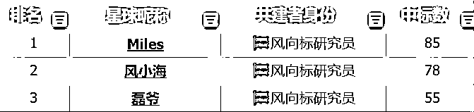
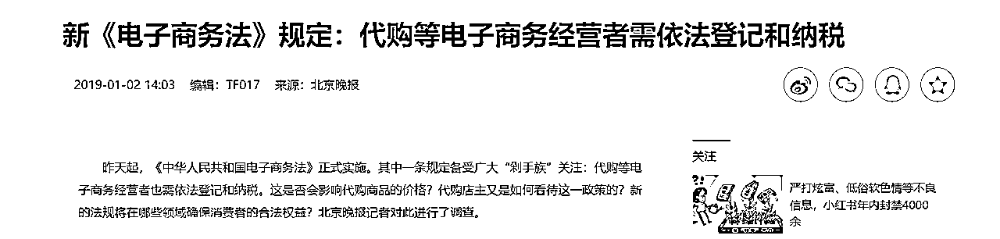
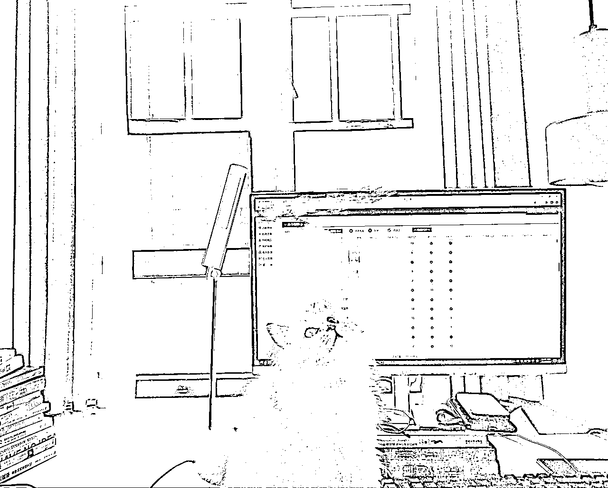
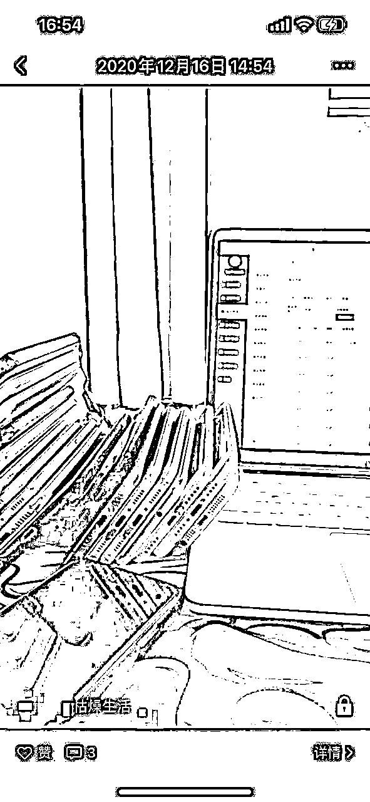
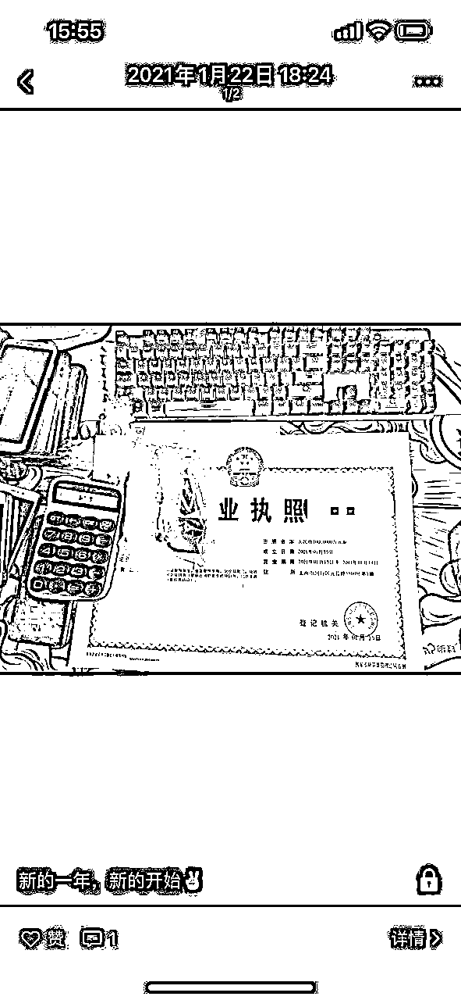
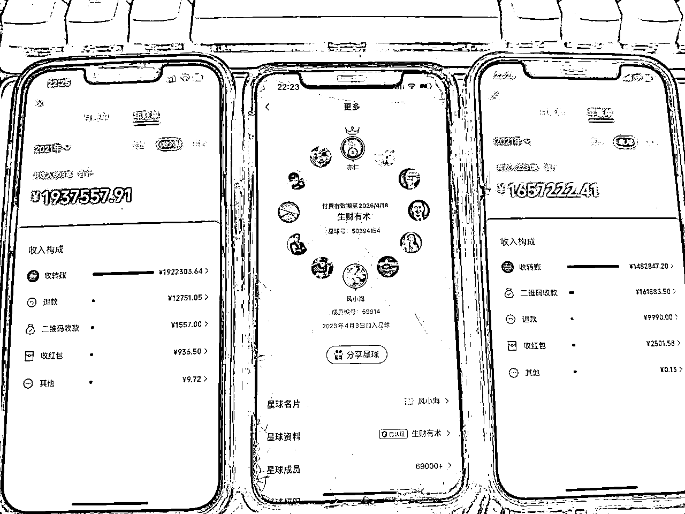
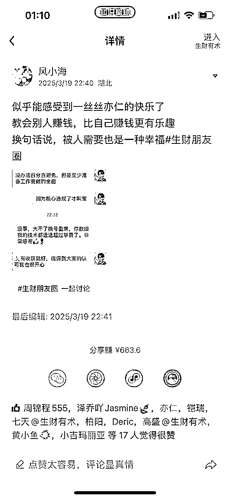
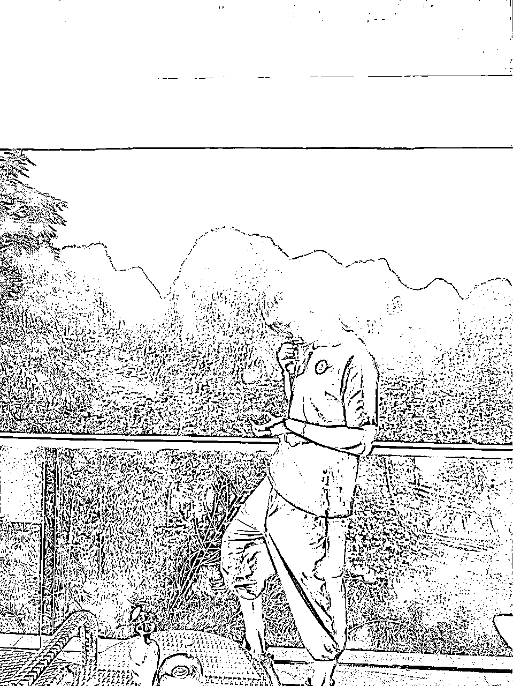

# 从0到100万，我用了1年零4个月（附补充）

先自我介绍：我是风小海，和公众号一个名字。坐标武汉，生财有术三年老圈友，常年混迹服装行业，亏过，也赚过。现在的状态是时间早就归了自己，但离财富自由还有一段要跑的路。

上一轮生财风向标中标，换了一年的门票。我从来不算天赋型选手，无非是踩的坑比别人多，淌过的浑水比别人深。接下来准备把我亲自试过的项目一个一个写出来，一共100个，送给所有认真生活、认真赚钱的人。后续内容也会同步在生财这边。

## 第一桶金

一个人，一台电脑，1年4个月，从零到100万。这算不上鸡血爽文，无非是一个人在废墟上，自己搬砖给自己垒了个地基。如果你正在低谷，但愿这点星火能给你照个亮。

## 从上班到失业

2017到2019年，我在一家跨境公司上班，60来号人，做澳洲药妆、保健品和土特产，零售加批发两条线。我负责零售，管着4个淘宝店和20多个微信号，月薪一万二。那时候直播带货还没影，传统电商还很兴旺，我忙得脚不沾地，但心里踏实，以为这碗饭能吃很多年。

2019年元旦，风向变了。代购法落地，个人代购整个变成灰色地带。公司高层当场砍掉零售线，转去做几个澳洲品牌的中国代理，专攻批发。我们整个零售部门，集体“毕业”。我这才明白：很多看似稳定的东西，底下垫着的都是“政策没变”四个字。风一吹，牌就散了。

部门散伙后，老板请我吃了顿饭，多打了一个月工资，说谢谢我扛到最后。2019年9月，我正式没了工作。

## 封控里的三个月

解脱感只持续了没多久。那阵子睡到自然醒，不用打卡，日子轻松，但焦虑偷偷从缝隙里长出来。一晃3个多月，到了12月，武汉已经进了冬天，网上开始飘一些关于肺炎的说法。年底招聘本来就淡，我寻思年后再说。

结果等来的是疫情和封城。整天闷在家里，长期不工作的空虚加上封锁的紧张，我坐在电脑前常有窒息感。人一旦闲得太久，脑子和腿脚一样，都会锈住。那段时间我白天刷新闻，晚上数口罩，既出不了门也挣不了钱，再加上我创业经验约等于零，整个人慌得不行。于是每天唯一动作就是打开百度，敲下“赚钱”两个字。淘宝客、拼多多、Shopee、悟空问答、闲鱼无货源、自媒体、写小说、知识付费、任务平台……凡搜得到的项目我几乎都过了一遍。平台注册了一大堆，账号密码记了满满一页，却一个都没跑通。这条弯路也不白走——我终于看清，所谓网赚项目，大部分只是挂着诱饵的套路。

当时我已经知道“生财有术”这个名字，但看的是盗版。这是我最后悔的事。如果2019年就进圈，至少能少踩一半以上的坑。被封控的近三个月，我像被关进一间训练室，被迫学会一身网赚杂技。能跑通最小闭环的项目，玩命放大；暂时没法变现但有潜力的，记进待办清单慢慢琢磨。那阵子赚得不惊人，但把迷茫给熬过去了，也攒下了不少日后用得上的技能。每一次试错，后来都变成我的弹药。

2020年5月，城市从长时间封控里醒来，我也顺势搬了出去，租下一套90平的两室一厅，养了只猫叫波弟。那时候心里已经长了创业的草，但真正把我推向悬崖的，是一场歇斯底里的骂战。

## 最后一份工

复工后我不信邪，又找了一份工作，给一个全网粉丝当时快500万的健身博主做电商运营。公司总共不到十个人，老板占了两个。名义上叫运营，实际上什么都干：客服、剪视频，每周还义务直播。最狠的一天加班到凌晨快一点，晚饭端到嘴边都没空扒两口。

撑了一个月，我实在顶不住，提了辞职，顺便给老板提了些建议。话不投机，直接吵起来。他拍着桌子吼：“你是谁啊？你有什么资格跟我谈条件？”这句话我记到今天。那一刻我彻底明白，有些公司是牢笼，不是工作。

## 背水一战

吵完当天，工资就结了，我连夜收拾走人，心里那口气总算顺了。彻底和稳定告别时，又慌又爽。2020年8月，职场这条路被我彻底留在身后。新电脑一台，二手手机十部，房租年付后，存款见了底。退路？从来没准备过。打工这条路，算是彻底焊死了。

做生意的道理说到底就一条：低买高卖赚差价。其他都是包装、套路和讲故事。我开始在自己熟悉的圈子里翻产品、盘资源。凭大学倒卖球鞋的底子，加在澳洲公司干过几年攒下的同行关系，我在朋友圈里搜“鞋”，没搜出鞋子，倒搜出一些澳洲雪地靴，还挂在去年冬天。出于好奇，我上淘宝输入这个牌子，发现一个大反常识的细节：武汉酷暑、地上能煎蛋，皮草却卖爆了。

大热天卖皮草？这牌子我以前待的公司买来送过礼，有点印象——单价不算低，入门三千起步，顶配破万。它家走的是预售，下单到收货大概要两个月。皮草这行供应链又长又绕，加工周期不稳，原料还得看季节性屠宰，进口再过动物检疫和成分检测，物流清关一堆事，所以必须提前很久备货。这就解释了，为什么夏天反而是它卖得最凶的时候。

## 搞货源

确定了产品，下一步是搞货源。我先私信了所有卖这牌子的淘宝店求分销价，八成客服直接回绝，两成说“反馈下”就没下文。想了一天反应过来：我找的是客服啊，月薪四千，凭啥替我递话？想通就好办——淘宝店铺都有营业执照，我截图后在企查查上搜企业名，把老板电话一个个挖出来。然后挨个打过去，大致就说：自己是做跨境电商的，手里攒着一批私域女性客户，正好看上了他们家的XX，问问有没有机会合作。

九成老板愿意加微信详聊。但老板一个个精得很，我手里单子都没有，全是空头支票，聊到最后没一家松口给分销价。

眼看临门一脚要落空，我不死心。盯着官网反复翻，发现他们除了皮草，还有个销量不错的品类：瑜伽服套装，单价不高，最贵也就300块。疫情带动居家健身，运动服饰需求正猛。我做了个反常规的动作：联系前公司批发部的同事，先斩后奏地说“找我拿这套瑜伽服，最贵那款每套能便宜100块”，软磨硬泡让他拿了10套。拿着这10套的真实订单，又挨个找之前加过的老板，提出先拿瑜伽服试水合作。终于有一家松了口，愿意给80元优惠。我当即下单，自己倒贴了200。一顿操作猛如虎，细算净亏250。但就是这笔亏本买卖，换来了对方的信任，皮草分销价也顺理成章拿到了手。

## 闲鱼开门红

货有了，卖去哪？在淘宝肯定没戏——没品牌授权，上架就得被举报。答案明摆着：闲鱼。还记得封城三个月里练过的闲鱼无货源吗？全对上了。我心跳加速，当天把所有货挂上闲鱼，价格比淘宝低一点。六个闲鱼账号一起上，当天就出了两单，一单净赚五百。我兴奋得一晚上没睡，总怕这机会一松手就没影了。

连干几天，资金链拉响了警报。皮草是预售制，最快一个月交货，一单平均压3000块在闲鱼上，供货商那边又要先款，钱包没多久就扁了。我不得不试着让客人直接转账，可几千上万的货款，对方凭什么信一个刚认识的你？

## 小程序与实拍图

转机在选款这个环节。这牌子100多个型号，客人选起来头大，可连官方都没个像样的选款工具，店铺之间也缺实拍，链接全是白底图。这机会被我抓到了——连夜做了个选款小程序，把100多个产品全传上去，一晚灌了两罐红牛，心脏突突到凌晨还不肯消停，完工已经是第二天下午。整个人像被吸进心流，时间感都没了。

更好笑的是，一年多后，官方自己也出了选款小程序。页面结构、按钮位置，和我当初做的不能说毫无关系，只能说一模一样，连按钮的位置都懒得改。那一瞬间，我真有种“民间高手深藏功与名”的恍惚。你说他们抄吧，人家是官方；你说没抄吧，实在说不过去。

选款搞定了，还差实拍，这才是客人信任的关键。我那时已经攒了不少订单，底气足了些，直接找供货商开口：“让品牌方寄几件样品，我来拍点像样的图。”对方犹豫，我补了句：“押金给，运费也包。”最后谈妥：押金两万，每次二十件，拍完寄回再换下一批。

于是我开始了一种奇怪的节奏：样衣在手上，拍照、打包、寄回，周而复始。女朋友有空也来帮忙拍照片、视频。累归累，一个前所未有的选款+实拍小程序终于上线。名字是照着官方的风格起的，看着就像正版授权。客人一看就服了，好多人自发在小红书安利，流量哗啦就来了。订单多了，回款快了，资金链也通顺了。那段时间我键盘按出火星子，日夜都在回消息。最大的感悟是：当你能用内容和工具抬高交易效率，赚钱这件事的难度曲线，会肉眼可见地往下掉。

## 主桌见

供应和选款理顺后，我每天像陀螺一样转十几个小时，引流、转化、客服、售后一个人全包。手机从10部扩到20多部。那个月进账4万多，人瘦了10斤，脑子反倒清醒得像刚冰镇过。

那阵子走路都带风，觉得自己开窍了。但爽了一会儿，想到一个问题：光喝汤就香成这样，那主菜还了得？我不甘心一直在外围转，也绝不想一辈子给别人打下手。心一横：上主桌。

目标锁定供货的那家淘宝店：他们能做的，我怎么不能？卡点还是授权。品牌方白纸黑字写着条件：一是公司，二是运营超过三年的淘宝店。于是我开始闯关——把公司注册了，又花3万块盘下一家两蓝冠老店，手续全办齐。

## 30万的坎儿

手续齐了，真正的坎才露面。品牌方放话：授权可以，先充值30万。是充值，不是拿货。出单之后从余额里扣。那话一出，我下意识想缩回去。熬了半年，钱勉强拿得出，但真砸进去，我又差不多被打回原形；更怕的是30万货砸手里。连着两晚，我都翻来覆去到天亮，反复安慰自己：“拿这30万，人生也翻不了多大的浪；但今天不干，回头我肯定后悔。”第三天早上，我灌了杯水，咬牙切齿对自己下令：干！上主桌！

钱打过去，代理权到手，浑身窜劲。

拿下代理后更忙了。闲鱼和小红书之外，淘宝这条主路也开始给我送流量，收入也跟着涨。但焦虑没走光：皮草要是卖不动了呢？这个念头刚冒出来，另一个念头紧接着拍醒我：谁规定只能卖皮草？打法在手，任何品牌都能套啊。我以皮草经销商身份去找别的品牌谈合作，思路是资源换资源：“皮草走成本价给你，我分文不赚，换的是你手里的品牌授权和分销资格。”顺利得不像真的，两边基本没拉扯就点头了。随后我一口气飞去上海，几场谈判谈下来，代理权一个接一个到手。到最后，小程序上已经躺着300多个品牌。慢慢地，也有实体店老板找上门，请我去做网店顾问。上海那阵子几乎成了我的第二常驻城市。再往后，疫情结束带来报复性消费，我也算踩上风口：那一年皮草卖了将近200万，其他品牌加起来约170万。

1年零4个月，27岁，人生第一个100万到手。说句实话，100万改变不了命运，但它第一次让我可以为自己做决定。

## 100万之后

拿到100万后，我反而更清醒。我发现一旦掌住了赚钱的底层逻辑，人就不可能退回“只知道死干”的状态。你看事情的角度会换，判断速度会变，对项目的嗅觉也会变。不再是凭直觉瞎冲，而是像开启第二层意识，本能地去拆解机会的内核。脑子里的整个系统，像被格式化之后重新装了一版。从那以后，与其说我在找项目，不如说项目不断在找我。创业思维一旦定型，就像长了一双能看见金矿的眼睛。

这些年，我陆续跑通了不少项目，不打算藏私，接下来会一点一点写出来。写给还在黑夜里摸索的人，写给醒着的人。

前阵子一位圈友跟我说，他从我这儿学到的东西，价值早就超出了学费本身。看到这句话我愣了一下，心里有点发烫。我始终认为，自己做的事很普通——无非是摔过的坑多，还乐意回头拉人一把。

你知道的，很多人差的不是努力，是路径感。生财给我的就是路径感。那感觉就像有人走在你前面，回头跟你说一句：“这条路我走过，别怕。”有本事的人其实很乐意分享，只不过他们想开口的时候，也要挑场合、挑人。而生财就是那个地方。只要你走得够真诚、够长期，自然会有人替你点一盏灯。这盏灯不一定照得到全程，但照清脚下已经足够。

用温泉来形容生财，我觉得挺贴切：信息量足，水温正好，什么时候去都是热的。外面又吵又杂，真假难辨，它却安安静静聚起一群务实不浮躁的人，一年到头都在复盘经验、打磨项目、钻研本质。这里没人吹牛，更像在交答卷，不比谁嗓门大，只比谁想得深。如果你刚进生财，真不用焦虑。先沉住气翻翻老帖子，别急着提问。用不了多久你就会发现，你想问的那些事儿，圈里早就有人问过一轮、答过一轮，连验证都做完了。你缺的从来不是信息，而是把它们变成自己系统的能力。当然也别怕看不懂。你先泡着，泡久了自然就懂——说不定某天深夜，你会突然读到一个句子，像是专门写给你的。

如果哪天你刷到我，记得打声招呼。未必帮得上忙，但你说的话，我大概率能懂。

愿风起时你敢争，风停时你舍得放。愿你熬过无人问津的夜，迎来有人理解的光。愿你赚钱时不迷方向，自由时不迷内心。若这段故事能为你探出一点方向，那它就没白写。自己垒的砖墙，风是吹不倒的；一步一步走，照样能走成大道。

祝你生财，也祝你自由。

——风小海

## 一个补充

2025年8月1日。三个月前分享了这篇帖子，收到不少圈友认可。这段时间微信里也加进来许多人：在校大学生、体制内工作人员、全职妈妈、欠了30万债的创业者，还有单纯想认识我的人。其中印象最深的是一位听障圈友——他听不到声音，但能看懂我写的每个字。

那一刻我才意识到：原来很多人都在负重前行。只是“重”的形状不一样，有人背着身份焦虑，有人扛着经济压力，有人干脆被命运捆着。过去几个月，我被问到最多的几个问题是——

“要不要裸辞去创业？”
“什么样的生意真的能赚钱？”
“看不到起色的时候靠什么撑住？”
“我的长处到底在哪？”

这几个提问我自己也反复琢磨过很久，今天就把结论一次性摊开，能用得上更好。

## 01｜创业，先别急着辞职

我的判断是：不要冲动离职。

不是所有人都能做创业，也不是每个阶段都适合All in。一旦离开岗位，现金流断掉，压力瞬间叠加，人的判断很容易失准，焦虑上来就更容易走弯路。

再加上市面上大部分副业窗口都很短，红利周期有限，今天有人在做，明天就被卷平，利润被稀释到几乎为零。

我翻过的项目不计其数，能真正稳定跑下去的屈指可数。

没有资源、没有核心技能时，能做的事基本都靠卖时间，和上班的本质区别不大，有时还更累。

所以更稳妥的做法是：先守住职场的底线，用在职的安全感去做小范围验证。边做正职边积累经验、关系和现金储备，数据跑通了再考虑是否全力投入。对绝大多数人而言，这才是可复制的起飞路径。

## 02｜赚钱的项目从哪来

核心公式：好奇心驱动 + 强欲望 + 高频高消费场景。

这些年我做的客单价较高的项目，几乎都赚钱，但它们并非硬找来的，而是从我自己的消费习惯里长出来的。

最典型的案例是酒店差价。

我本身认床，出差旅行习惯挑贵的住，体验好睡眠才好。次数多了费用压力就出来了，我开始研究有没有更划算的入住方式。

没想到这只是个例，不止我有这种需求。

比如一个标价 3000 的房间，我能以 2000 的成本拿下。对客户而言价格依然不低，但省下的 1000 是实打实落袋为安，信任就建立起来了。

高客单的本质不是贱卖，而是帮对方把溢价转化为可感知的节省，从而赚到信任。

更关键的是要跳出自我设限。

很多人找点子时只问自己会什么、能做什么。反向思维更有用：高净值人群正在为哪些东西买单？我能否切入这个支付链条？

“钱是花出来的”这句话听起来像消费主义，但对我而言是真实的成长路径。大部分项目的灵感都来自我先以消费者的身份去体验、拆解，再反向找到商业逻辑。

这种先花钱后赚钱的视角，长期来看重塑了我的判断体系。

如果你理解了我之前提到的“赚到100w”的底层思考，无论选择哪个赛道，都更容易拿到资源。

## 03｜支撑走下去的底气

我并不觉得自己特别能扛住。

底气来自一个清晰的认知：我做的事本身不会亏 —— 它让我越来越有钱。

毛主席在《论持久战》里提到的战略防御、战略相持、战略反攻的节奏，和我个人的经历高度重合。

我也在打一场持久战。不是死磕单一项目，而是清楚只要我不停止寻找方法，就始终在“变有钱”的方向上累加。路线可以绕，可以慢，但绝不回头。

我的驱动力很单纯：我清楚自己在做何事，也清楚这件事最终能把我带到想去的地方。

短期看情绪波动，长期看信念是否稳。真正能走远的人，都是方向对而且活得下来的人。

哪怕中途换方向、走弯、跌倒，只要没有掉头，就还在路上。还在路上，结局通常不会差。

所以遇到堵点时，我总能找到解法，并不因为智商高，而是因为我选了一场可以长期博弈的战，输几仗不重要，赢下整体才重要。

## 04｜如何定位个人优势

这个问题我持续拆解了几个月。方法上是马斯洛需求层次 + 系统自我拆解的结合。

先像拆产品一样拆自己。

姓名、外貌、气质、成长背景、技能储备、爱好习惯、社会网络……逐项建档，像给一个角色做立绘一样把自己立体化，再用马斯洛五层需求做对照，从生理到自我实现逐层筛出可用的线索。

### 为什么马斯洛有用

需求分为：生理、安全、归属、尊重、自我实现。

优势往往藏在你最在意被满足的那一层。

在意安全感的人，可能在风控、财务规划上更敏锐；
渴望归属与认同的人，沟通、组织、服务他人更在线；
追求自我实现的人，在创意、艺术、领导力上更有爆发力。

### 找优势的三条原则

内在驱动。能让你持续有兴趣且越做越顺的领域，往往就是优势带。
顺滑感。在优势区学习与执行成本低，正反馈快，不容易拖延。
创造价值。优势必须能换来对他人的价值，否则不可持续。

### 多维度挖掘示例

姓氏稀有度自带记忆点做个人品牌；
性别特征影响沟通风格与社会角色；
年龄阶段带来不同的资源与学习曲线；
地域方言如东北味的直播表达自带喜剧张力；
外形特质、身高体重、声音手感等都能转化为细分场景的切入点；
家庭结构、伴侣类型、父母职业、祖辈手艺都会形成隐性资源；
养宠习惯也在培养责任心与情绪管理；
作息类型、运动偏好、饮食习惯都能对应到不同的工作适配度；
硬技能如设计编程外语，软技能如表达逻辑情商；
兴趣爱好可延展成内容、教学、社群等多条变现路径；
性格维度如内向专注、外向感染、完美主义、冒险偏好等；
经历如挫折、跨界、海外背景都能形成独特视角。

单一能力易被复制，组合能力才构成护城河。

公式参考：技能A+技能B=差异化定位；兴趣+专业=可持续热情；天赋+市场需求=商业机会。

### 实操工具

自我盘点：30分钟内写下个人属性、外貌、家庭、习惯、技能、兴趣六维画像。
需求映射：把画像与马斯洛五层对照，看哪些特质能满足哪类需求。
基础自测：姓氏、声音有什么记忆点？年龄性别地域给了什么视角？初次见面别人记住什么？
关系自测：家庭给了什么隐性资源？我常扮演什么角色？别人什么事会找我？
技能自测：什么事我做起来轻省别人却觉得难？什么领域学得特别快？
心理自测：什么工作让我充满能量？什么状态下表现最佳？

5W1H 盘点：What 我擅长什么？Why 根源在哪？Who 谁需要？When 哪个阶段最合适？Where 什么场景、什么渠道？How 如何迭代放大？

验证方式：他人评价收集、市场小规模投放看反馈、持续投入观察增减趋势。

常见误区：只看硬技能忽略软特质；追求完美而迟迟不动；单点思考不做组合；只找优势不看需求；把优势当成静态不变的东西。

真正的优势往往藏在最平常的细节里。姓氏、长相、家庭、习惯，甚至长久以来的“缺点”，都可能成为差异化来源。关键在于视角和利用。

马斯洛说终极需求是自我实现，而自我实现的前提是认识并接纳自己。

当你用系统的方法重新审视自己，会发现价值远超想象。

不是先看到希望才坚持，是坚持后才看见希望。

找到向度只是开始，持续行动和迭代才是结果。祝你在这条路上，既找到擅长的事，也找到值得的事。