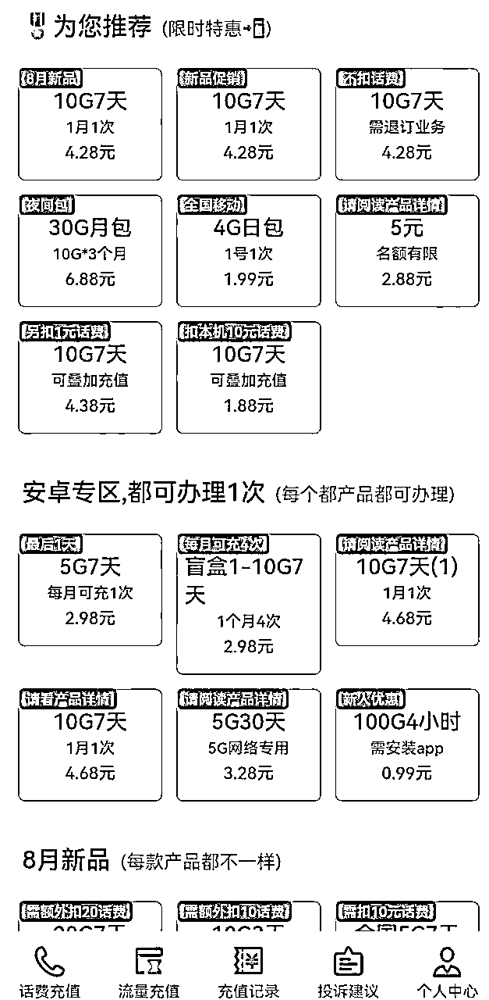
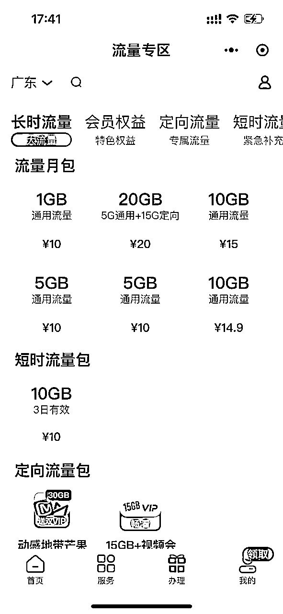
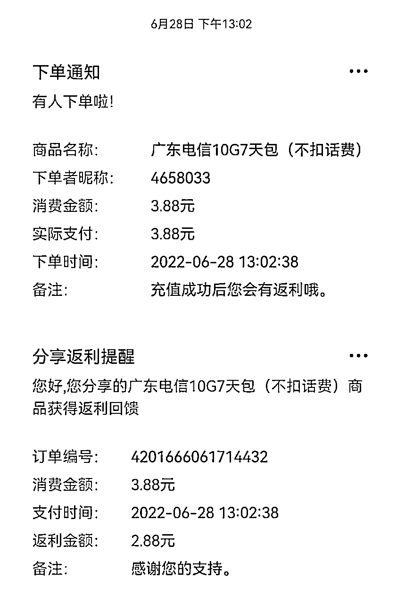
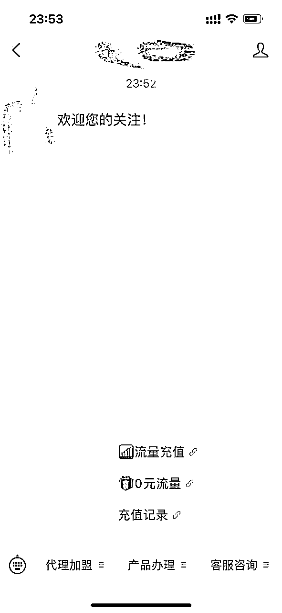
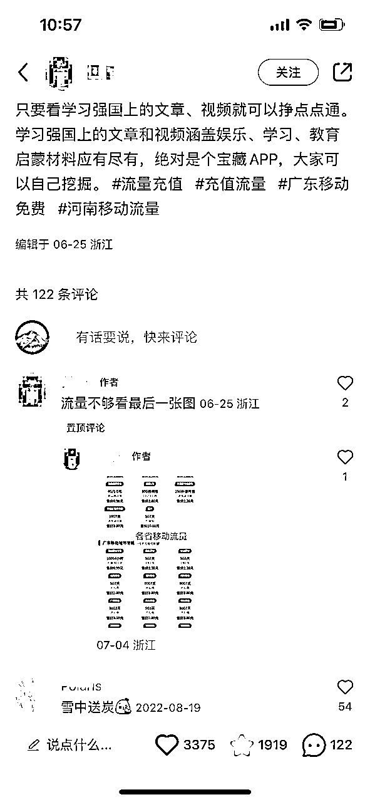
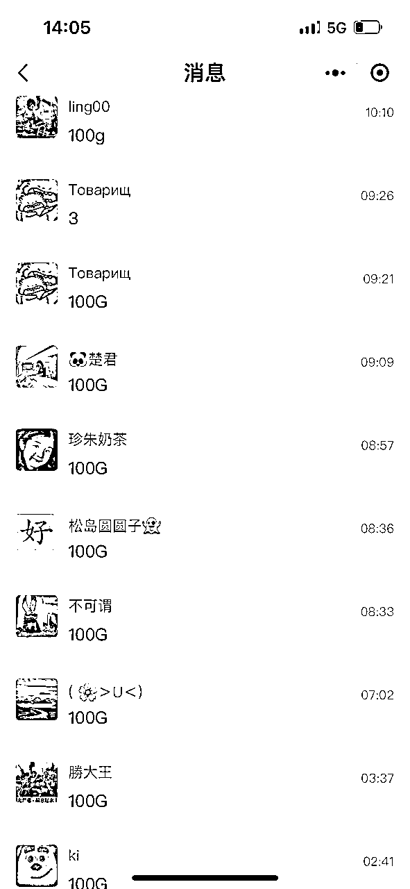
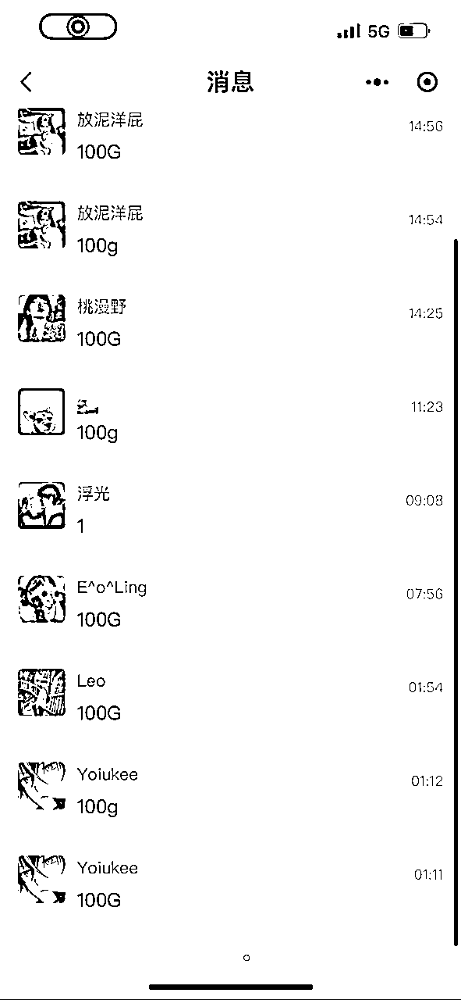
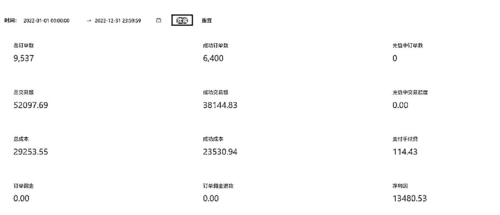
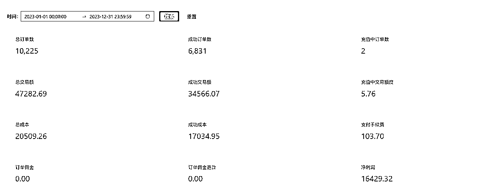
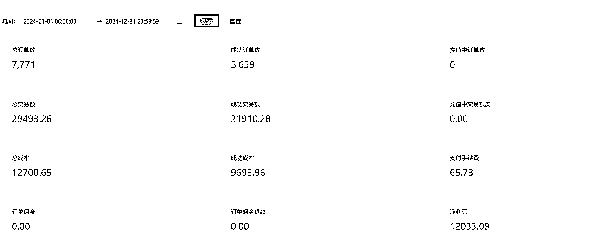

# 流量包充值项目拆解：低客单、高复购，如何搭建被动收益渠道

大家好，我是深潜。关注生财接近两年，虽然加入得比较晚，但这几年一直在研究虚拟产品和轻资产项目。

今天分享一个我前些年实际落地过的项目：流量包充值。

这个项目的特点很明确：

- 单个账号成熟后，年被动收益大约1万到2万元；
- 项目初期一年订单量接近1万笔；
- 产品客单价不高，但需求稳定、复购频繁；
- 系统搭建完成后，后续重点工作主要集中在流量推广。

## 一、项目是怎么被发现的？

### 1. 从一张朋友圈海报开始

有一次刷朋友圈时，我看到一张“几元钱充值10G流量”的推广海报。

当时运营商官网同规格流量包普遍要10元以上，而这类渠道只需要几块钱，价格差距非常明显。出于好奇，我扫码进入了对方的公众号，随后在菜单中跳转到流量充值页面。

平台上的产品规格从1G到10G不等，很多流量包都有有效期限制，通常需要在充值后3到7天内使用完。

为了验证真实性，我直接用自己的手机号购买了一款。下单后流量很快到账，运营商也同步发来了充值成功的短信，整个流程基本没有问题。

图1 图2

### 2. 为什么会判断它有市场？

实际使用一段时间后，我发现这种产品的需求并不是偶发性的。

一个月内，如果用户有三五次流量不够用，每次通过优惠渠道充值，就能节省几十元。对个人来说，这是一笔可感知的优惠；对平台来说，则意味着持续复购。

国内手机用户数量庞大，只要日常使用智能手机，就会产生移动流量需求。很多用户使用的还是多年前办理的套餐，月租不低，但包含的流量并不多。

当用户频繁超出套餐后，运营商通常会推荐升级套餐。例如原来每月38元、15G流量，可能会被建议升级到58元、30G流量。但对于部分用户来说，升级后的价格更高，增加的流量也未必足够。

如果不升级套餐，直接通过运营商官方渠道购买额外流量，单次往往需要十几元甚至更高；而在优惠充值平台，同类产品可能只需要几元。

这就形成了一个非常清晰的需求：

- 用户需要临时补充流量；
- 运营商官方价格偏高；
- 优惠平台价格更低；
- 流量属于高频刚需，使用后还会再次购买。

### 3. 顺便发现了分销模式

想到朋友圈里的推广海报，我便去对应公众号里查看是否可以申请推广。

结果发现平台开放了分销代理功能，而且申请门槛不高。推广者获得专属海报后，用户扫码关注，系统会自动建立上下级关系。

之后，只要这些用户在平台上充值，推广者就能获得相应佣金。

于是，我先开通了分销权限，用小范围推广的方式测试项目数据。

## 二、先测数据，再决定是否投入

判断项目能不能做，不能只看感觉，必须先跑出真实数据。

以当时的一款“10G、有效期7天”的流量包为例：

- 对外售价约3.88元；
- 每完成一笔订单，推广者可获得约2.88元返佣；
- 前期推广了两百多位粉丝，主要用于测试；
- 三个月后，累计收益接近200元；
- 后续观察发现，用户确实会重复购买，收益表现相对稳定。

虽然测试规模不算大，但已经能够说明两个问题：

第一，用户愿意购买这类产品；  
第二，流量充值具备一定的复购属性。

按照当时的数据，如果粉丝规模扩大几十倍，年收益达到五位数并不是没有可能。

与此同时，我也开始思考平台的产品成本。一个售价几元的流量包，平台还能拿出较高比例做分销返佣，说明上游采购成本可能更低。既然分销数据已经验证可行，下一步就可以尝试直接对接系统，自己搭建渠道。

系统返利模板

## 三、系统对接：花几千元搭建自己的充值平台

### 1. 寻找成熟服务商

我找到了一些已经拥有较大用户体量的流量充值公众号，与对方沟通系统合作。

这类系统通常可以直接打包完成，具体费用根据服务商和功能而定，几千元基本可以谈下来。

对接时，以下环节一般由对方负责：

- 流量产品供应；
- 充值发货；
- 技术系统搭建；
- API接口连接；
- 订单处理和相关功能配置。

系统搭建完成后，自己的主要任务就是推广和运营。

用户可以通过公众号菜单进入充值页面，选择对应产品并完成付款。同时，后台还可以开通分销功能，让其他推广者一起参与销售。

### 2. 产品利润空间

当时比较受欢迎的一款产品是“10G、7天有效期”流量包，初期采购成本大约在1元左右。

具体售价可以自行设置，常见做法是按照成本价的三到五倍定价，也可以结合渠道、用户需求和活动策略灵活调整。

这类产品虽然单笔金额不高，但毛利空间相对可观。更重要的是，流量属于消耗型产品，用户用完后往往还会继续购买。

从利润结构来看，它有点类似于高频消费品：单笔金额不大，但订单连续发生。甚至从单笔利润角度看，一笔流量包订单的收益，可能比便利店卖出一瓶饮料还高。

（搭建好的系统初步框架如图所示）

## 四、推广方式：公域引流，私域转化

系统上线后，项目能否持续产生收益，关键取决于推广。

### 1. 利用已有资源启动

前期可以从自己熟悉的渠道开始：

- 在各类微信群、社群中发布优惠信息；
- 找小红书素人批量发布相关内容；
- 联系手机、省钱、生活服务等领域的达人投放；
- 在抖音等公域平台测试短视频和内容广告；
- 通过公众号承接用户并完成充值转化。

其中，小红书的效果比较明显。除了内容发布当天的直接转化，还会持续带来搜索流量。用户在平台上搜索“便宜流量”“流量包充值”等关键词时，也有机会找到相关内容。

同行在达人账号上投放的笔记，也能取得不错的曝光和转化效果。

（同行找达人博主投的一篇笔记）

### 2. 用低成本赠品做引流

除了直接推广付费产品，还可以设置一些低成本甚至接近免费的引流产品。

比如“100G、4小时”这类短时流量包，采购成本可能只有几毛钱。推广时，可以在公域渠道发布“免费领取100G流量”的活动。

用户进入公众号后，回复指定关键词，例如“100G”，系统便自动发送领取指引。

这种方式有几个优势：

- 用户更容易被免费福利吸引；
- 引导用户关注公众号；
- 后续可以继续触达和转化；
- 成本可控，适合批量测试。

如果在不同渠道使用不同关键词，还能区分粉丝来源。

例如：

- 小红书渠道使用关键词A；
- 抖音渠道使用关键词B；
- 社群渠道使用关键词C。

这样就可以在后台统计不同平台带来的粉丝量、领取量和后续充值数据，判断哪个渠道的投放效率最高。

### 3. 开放代理，扩大推广规模

公众号后台还可以设置分销权限，推广者能够自行调整佣金，招募更多代理一起销售。

这样做的好处是，不必完全依靠自己的流量。只要产品、系统和佣金机制设置合理，就能让更多人主动帮忙推广。

这一部分的核心，就是做好：

- 产品价格；
- 代理佣金；
- 结算规则；
- 推广素材；
- 售后处理。

## 五、收益情况与订单说明

从22年至24年的数据来看，单个公众号每年的收益表现较为稳定。

需要注意的是，后台数据通常会区分：

- 总订单数：用户提交或发起的订单数量；
- 成功订单数：最终充值成功的订单数量；
- 净利润：扣除成本后的实际收益。

流量产品并不是每笔订单都一定能够充值成功，常见失败原因包括：

1. 用户当前的手机套餐不支持同时办理某款流量产品；
2. 某类产品达到每月购买次数上限；
3. 运营商规则或用户号码状态导致充值失败。

因此，分析收益时不能只看订单总量，还需要重点查看成功率和实际利润。

后续通过公众号矩阵进行推广后，单个账号即使只有几千粉丝，只要用户质量和复购情况不错，年收益达到五位数也是有可能的。

## 六、项目总结

流量包充值本质上属于典型的刚需型虚拟产品。

它有几个明显特点：

- 用户覆盖面广；
- 使用频率较高；
- 单笔客单价低；
- 复购率相对较好；
- 系统可以自动发货；
- 适合通过公众号和代理渠道持续放大。

但这个项目也有两个关键前提。

第一，后端供应链必须稳定。产品规格要丰富，能够覆盖不同用户的流量需求，避免用户进入后发现可选产品太少。

第二，采购成本一定要有优势。只有上游价格足够低，才能同时留出推广佣金、活动成本和自身利润。

系统完成对接后，用户下单、付款和发货都可以自动完成，运营者主要负责持续获取流量、优化渠道和维护代理。

因此，流量包充值更适合被看作一个“前期搭建系统，后期依靠推广持续产生收益”的虚拟项目。它不是一夜暴富的玩法，但在刚需、高频和自动化交付的基础上，具备长期运营和积累复购的空间。