# 数字人口播流水线搭建指南：扣子、飞书多维表与蝉镜协同实操


## 开篇：把口播制作交给流程

大家好，我是骄阳。很早之前，我就开始测试数字人口播内容的制作方式。当时曾经搭过一套飞书多维表，用扣子里的相关能力调用飞影和蝉镜来合成数字人视频。由于当时免费方案响应较慢，而且成片带有水印，所以没有及时整理成教程。

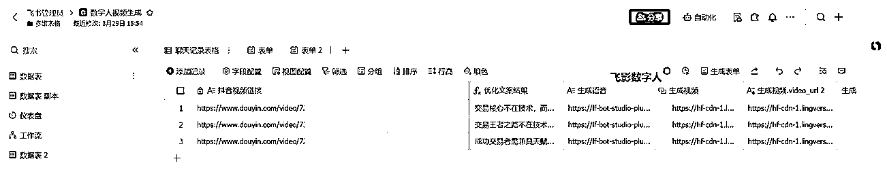

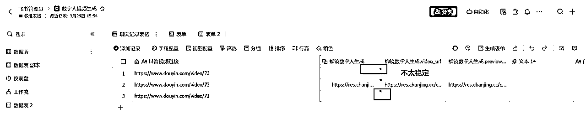

最近发现手里的蝉豆即将失效，正好借这个机会，把蝉镜数字人口播的搭建方法完整记录下来，也让这些资源得到利用。

这篇文章会围绕“扣子工作流+飞书多维表格”展开，带你搭出一套可以批量处理脚本、提交生成任务并回收成片的数字人视频方案。

## 先看传统制作卡在哪里

在短视频运营中，真人口播往往不是偶尔做一条，而是需要持续、稳定地更新。常见内容包括：

- 书籍推荐与带货类表达
- 读书记录、生活化实拍内容
- 个人IP角色输出
- 人生感悟、情绪表达等主题


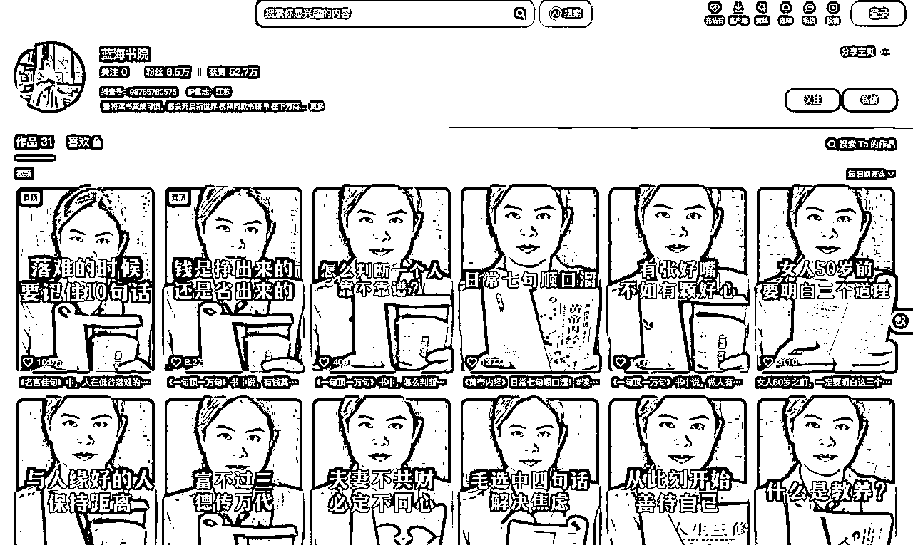

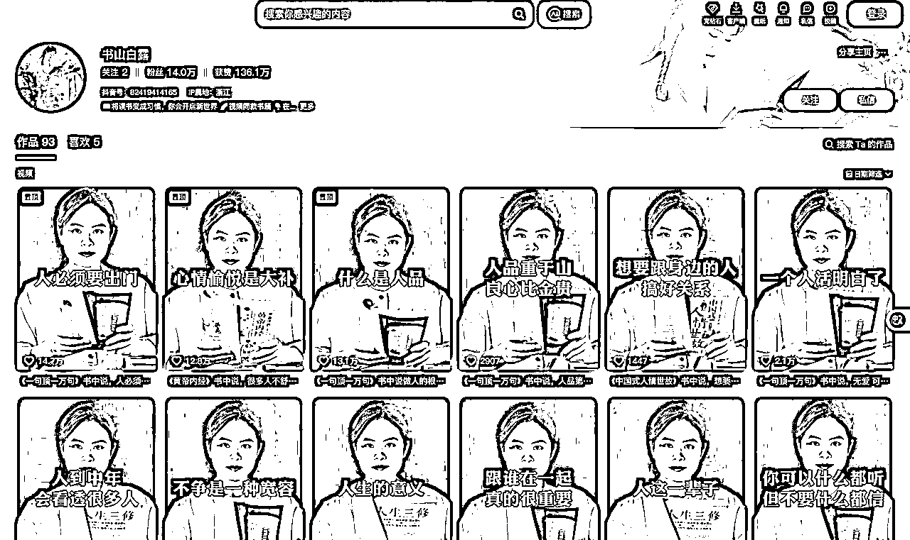

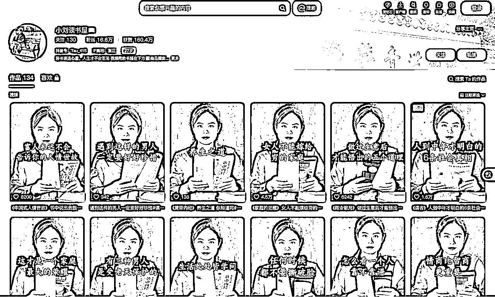

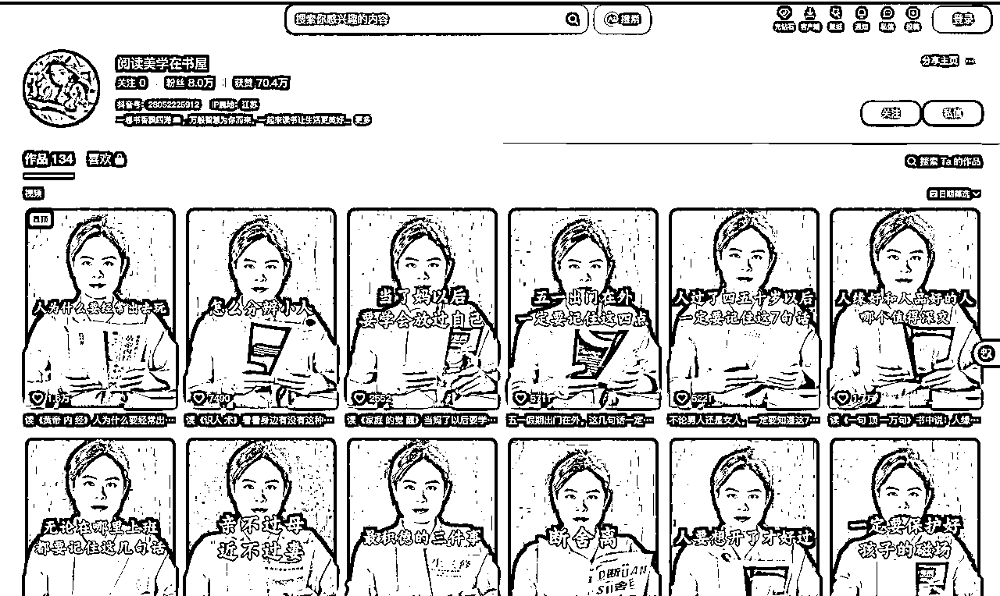

读书口播-书籍带货视频


读书日记口播-实拍型

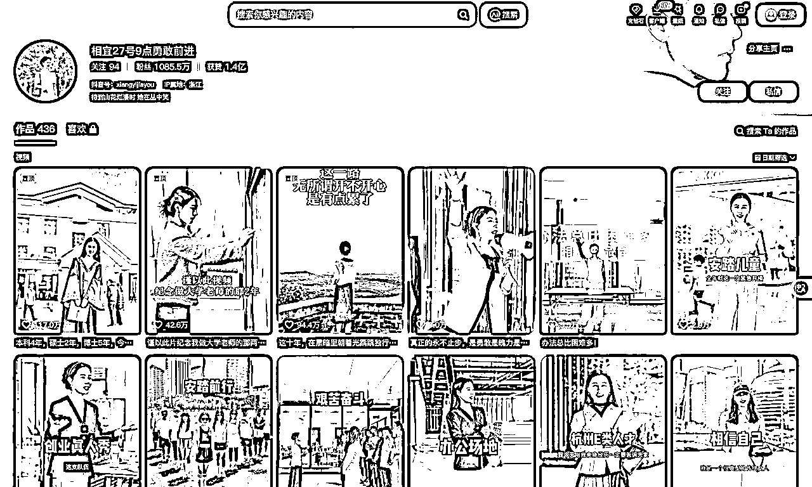

IP形象口播


人生感悟·哪吒

真人拍摄主要会遇到三类问题：

### 1. 更新频率带来压力

不少账号一天要发布5条、10条，甚至20条以上内容。若每支片子都依赖真人出镜，持续拍摄会迅速消耗时间和精力。

### 2. 制作人力难以扩张

- 一条视频从准备到完成，往往要花费一两个小时甚至更久；
- 如果提前囤积整月素材，拍摄、剪辑和整理都会变成沉重负担；
- 真人状态、语速和表达稳定性有限，经常需要反复重拍。

### 3. 不同渠道需要反复适配

横版、竖版、不同语言版本通常不能直接共用。同一主题如果要投放到多个平台，往往意味着重复录制。使用数字人后，只需替换参数或文案，就能快速复用同一套内容。

## 数字人能带来哪些改善

### 生产速度更快

按照蝉镜当前的合成比例，一分钟左右的台词，大约需要三分钟完成视频生成。相比人工拍摄、剪辑和返工，整体周期明显缩短。

### 适合批量提交

多个脚本可以放入多维表中统一排队，再由工作流批量发起处理，适合一次准备大量选题。

### 声音更干净

系统朗读不会频繁出现“嗯”“那个”等口头停顿，可以减少后续清理杂音和语气词的工作量。

### 减少拍摄成本

不必每次都安排真人出镜，也能少投入摄影场地、灯光、收音和专业设备；后续剪辑与包装环节所需的人手也会相应减少。

### 信息集中可查

脚本、任务状态、返回地址以及成片信息，都能集中放进飞书多维表，团队成员查看和协作会更方便。成片还可以进一步转移到对象存储中，便于长期留档。

### 维持统一风格

固定的数字人形象有利于建立账号识别度，稳定的声音参数也能避免因不同拍摄状态造成声线变化。

# 本文会搭建什么

整套方案主要分为两部分。

## 第一部分：扣子侧流程

扣子工作流包括：

1. 蝉镜人物形象资产的制作流程；
2. 蝉镜声音资产的制作流程；
3. 数字人形象提交与状态查询；
4. 后续数字人口播视频合成流程。

其中，人物克隆会涉及形象素材准备、声音素材准备、接口调用和结果回传。

## 第二部分：飞书多维表侧结构

多维表负责承接输入与输出，主要包含：

1. 新建工作空间中的多维表；
2. 【数据表-克隆数字人】；
3. 【数据表-克隆声音】；
4. 【数据表-生成视频】；
5. 公共数字人配置；
6. 可用字体清单。

公共数字人与字体列表可以直接复制现成模板，不必从零设计。

# 搭建前要准备的账号

## 蝉镜

用于创建数字人、训练声音并合成视频。

官网：https://www.chanjing.cc/

## 扣子

用于编排工作流、连接工具和调用相关能力。关于注册及访问凭证的获取方式，可参考此前的相关教程。

官网：https://coze.cn/

## 飞书

多维表格将在飞书中完成。没有账号的读者，按页面提示注册后，再复制对应模板即可。

官网：https://www.feishu.cn/

## 阿里云对象存储（可选）

如果希望把训练素材和最终视频集中保存，可以开通阿里云对象存储，并准备以下信息：

- AccessKey ID
- AccessKey Secret
- Bucket
- Endpoint

官网：https://oss.console.aliyun.com/

对象存储主要承担两项工作：

1. 为人物视频和声音文件提供蝉镜能够识别的地址；
2. 保存合成完成的视频。

最终成片也可以利用飞书附件转CDN地址的插件进行转存，这部分相对简单，后文不再展开。

# 一、蝉镜人物资产的制作思路

整体步骤可以概括为：

## 形象部分

1. 准备人物照片，或直接录制符合要求的视频；
2. 如果只有图片，可先做图片转视频；
3. 将视频放到可公开访问的对象存储地址；
4. 调用蝉镜接口提交人物训练；
5. 接收数字人编号、名称等返回数据。

需要注意，蝉镜会根据无查询参数的文件地址及扩展名判断文件类型。例如视频通常要使用以`.mp4`结尾的地址，临时附件链接可能无法被正确识别。

## 声音部分

1. 录制一段清晰、无明显噪声的声音；
2. 或使用无版权、可公开使用的音色素材；
3. 将音频放到对象存储；
4. 调用声音训练接口；
5. 保存返回的声音编号和名称。

音频地址应使用`.mp3`等明确后缀，避免平台无法判断文件格式。

## 关于网页端与接口端

蝉镜网页端创建的数字人资产，目前不能直接作为接口资产调用。若后续要通过工作流自动处理，建议从接口流程开始准备和登记相关资产。

# 二、形象克隆：从照片到人物视频

本文只是为了展示流程，因此采用AI图片再转视频的方式。若要制作自己的数字人，应按照蝉镜官方规范录制人物视频，可参考“创建基础版数字人”的要求。

## 图片准备

1. 使用即梦制作一张人物图；
2. 根据需要放大或生成高清版本；
3. 对图片进行清理，移除不需要的背景元素。

### 图片生成提示词

```
哪吒之魔童闹海角色正面站立姿态，圆脸大眼睛Q版造型虚幻引擎渲染，对称构图，超现实材质表现微距细节光晕，除了人物无需其他物品，纯绿幕背景，背景颜色代码#489b58
```

### 初次生成效果

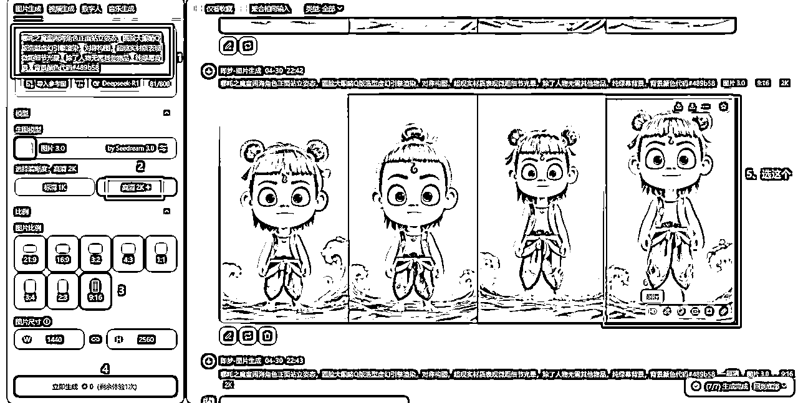

### 高清版本

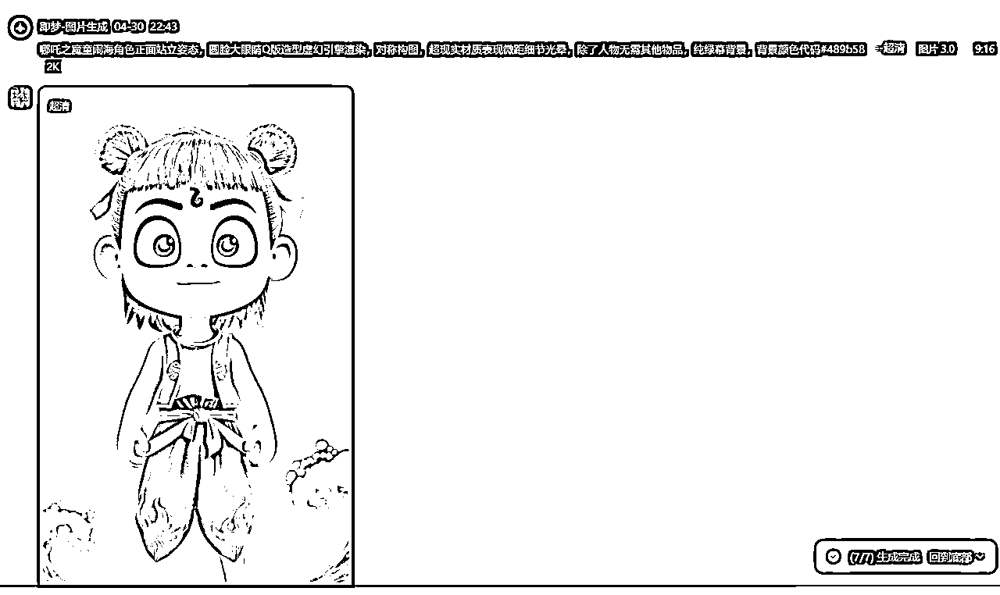

### 图片修整

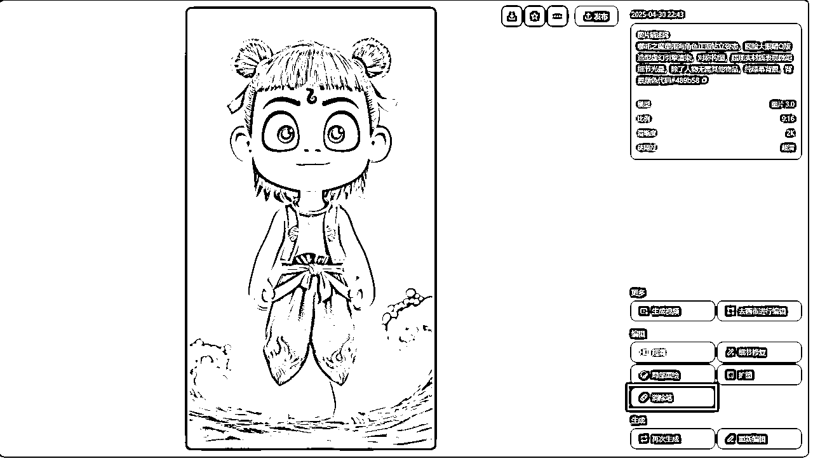


## 让静态图动起来

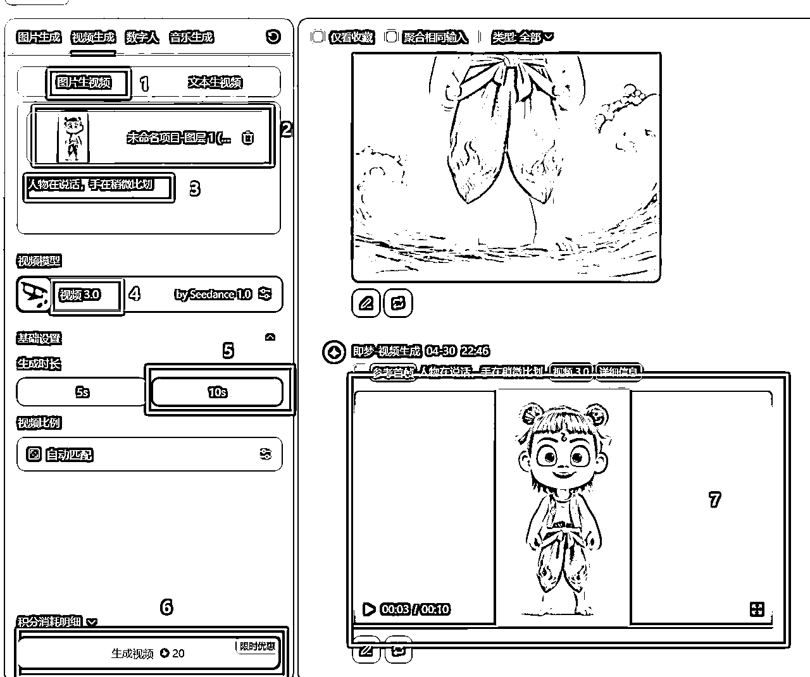

生成完成后，可使用猫抓保存无水印视频。

测试过程中发现，漫画风人物在说话时容易出现嘴部结构异常，因此后续改用写实真人形象。

```
哪吒之魔童闹海里的哪吒真人Cosplay版，真实感，实拍，正面生活照，全身照。整体色调高级红黄，高级感不带背景图。
```

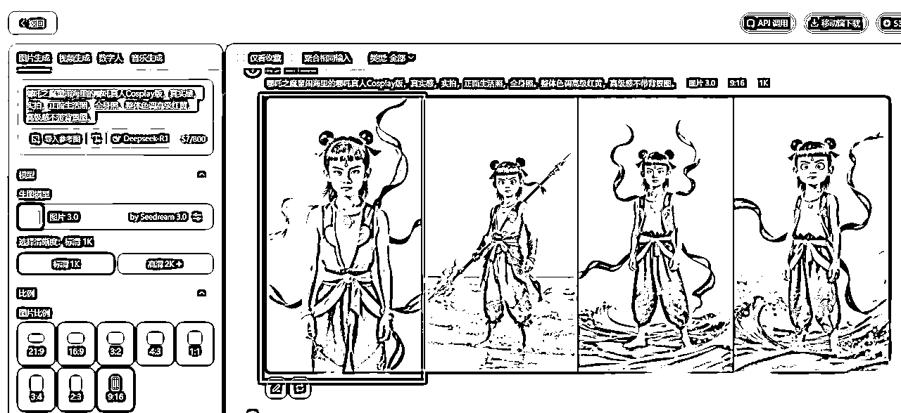

视频生成效果：

```
手进行讲解时的动作
```

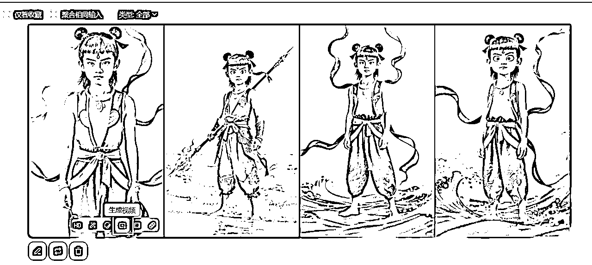

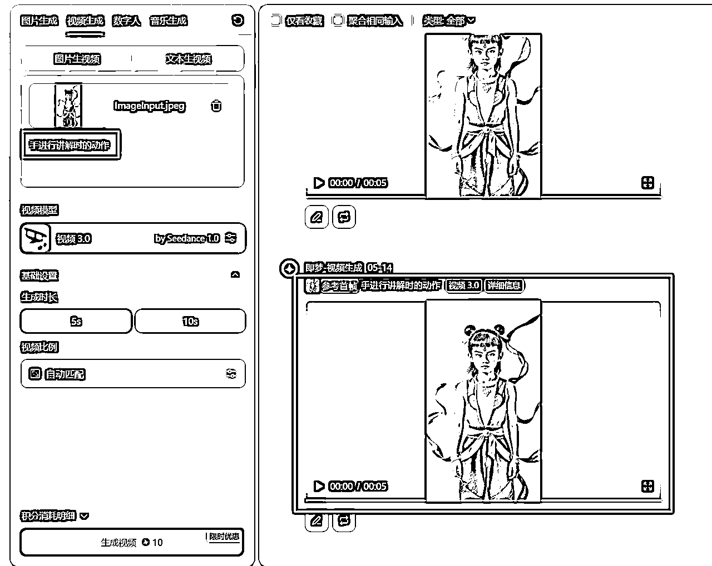

完成后同样使用猫抓保存无水印文件。

# 三、声音资产制作

## 方案一：准备一段干净语音

建议准备约1分钟的连续人声，录制时尽量远离风扇、键盘和环境杂音。也可以在剪映里输入一段文字，让指定音色朗读，再把声音单独导出。

示例文案：

```
您好！我现在感觉很好，语调很轻松，我很有信心能做好这次视频录制。
我现在就在镜头前，准备开始。 

光线很好，我的脸上没有任何刺眼的阴影。我的发音很清晰，感觉很放松， 我会做一些自然、轻微的手部动作。 一些细微的姿态动作会让我看起来更自然、更放松。 在整个视频录制过程中，我不会移动我的身体，也不会做太剧烈的任何动作。

我没有戴眼镜或其他任何饰物，所以我的脸可以清楚地显示出来。我的语调平稳，说话自然。
我在句子之间停顿一下，闭上嘴，用鼻子呼吸。我的心情很放松，这个录音过程真的很有趣。

我还想和大家分享一些有趣的事情。我在想一些快乐的回忆，这让我觉得生活很充实、很有趣。
我把这种轻松快乐的心情，希望永远保持下去。 

现在，我要尝试加入一些轻微的手部动作，让一切感觉更自然。
我的语调依然平稳而富有感情，到目前为止我一直做得很好。我会继续努力，直到录音结 束。 

很高兴今天能见到你们，我很期待看到这次录音的结果。
到目前为止，一切都很顺利，希望你们也一切顺利 。 
```

## 在剪映中生成音频

2、在剪映添加文字内容，选择合适的朗读音色，生成对应语音：


3、把合成后的音频导出：

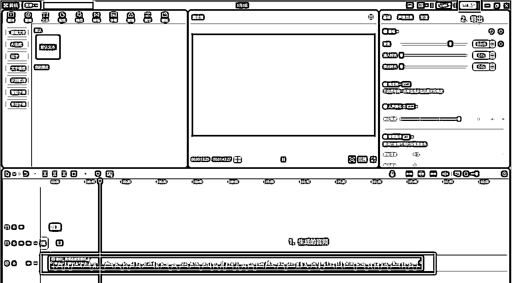

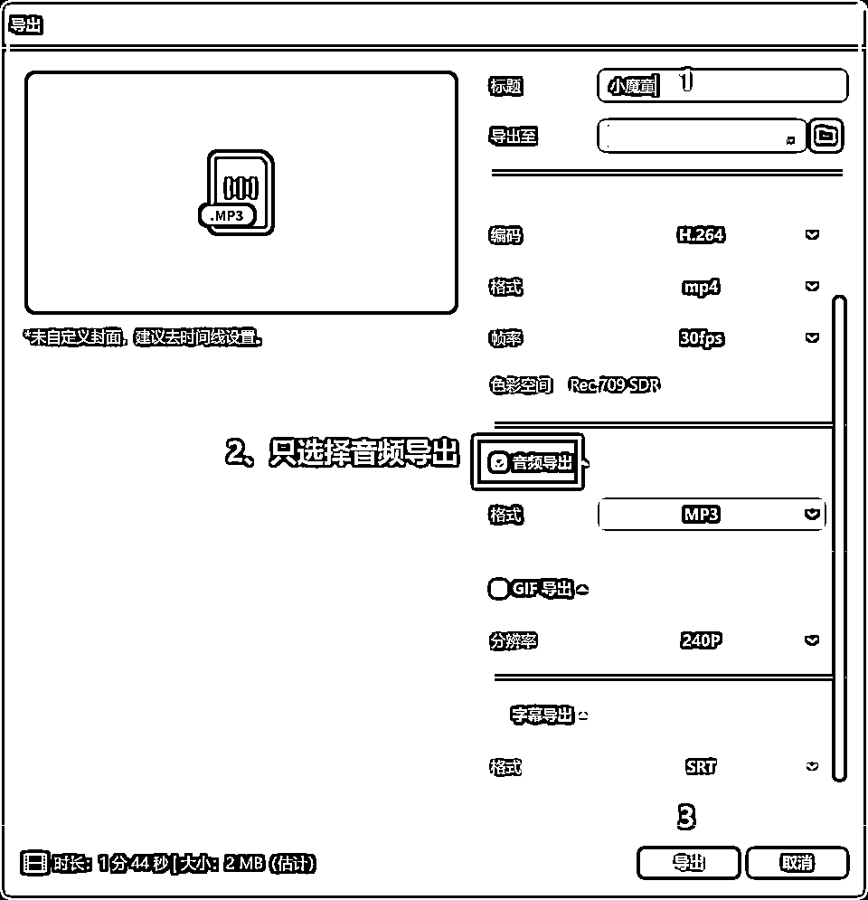

导出的文件即可作为声音训练材料。

## 方案二：从参考视频中提取音频

如果要制作类似“人生感悟·哪吒”的内容，可以先保存参考视频，再用剪映的音频提取功能分离人声。

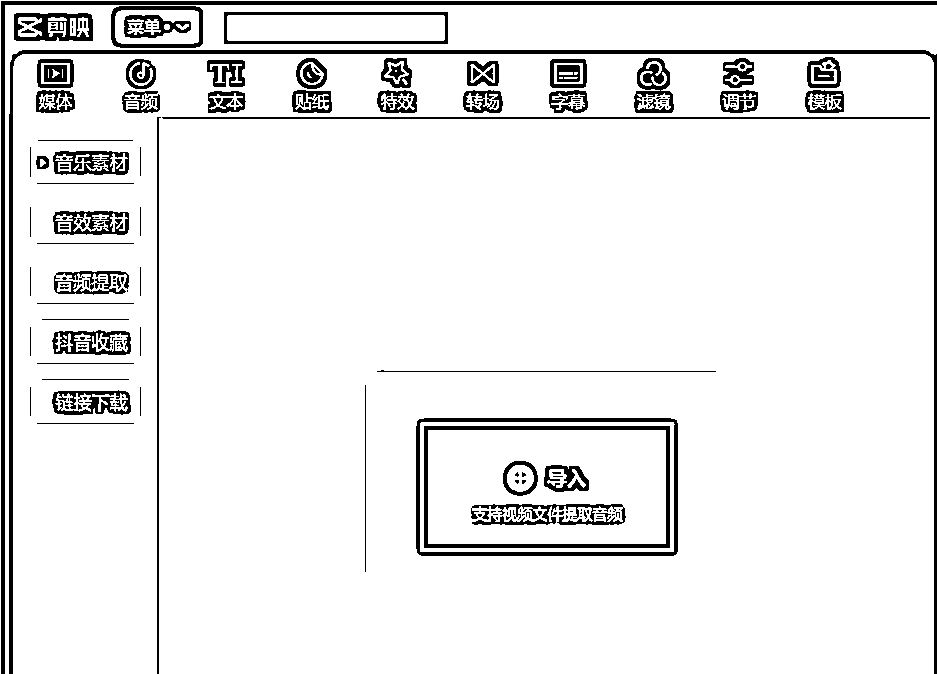

把提取出的音轨放入时间线，导出前关闭其他声音轨道即可。

# 四、数字人克隆工作流搭建

## 流程概览

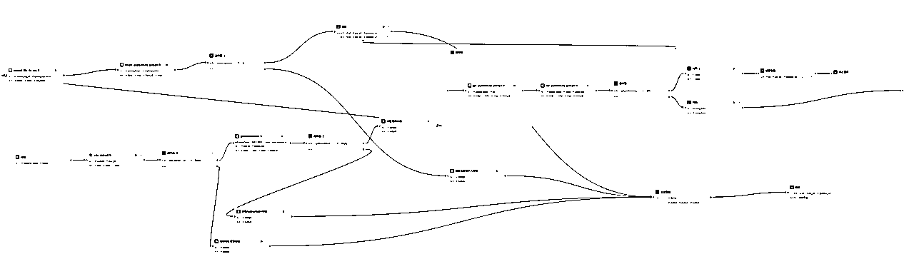

提示：流程图中的“代码_1”可以移除，之前展示时忘记删掉。

## 具体配置步骤

### 第1步：新建流程

进入【工作空间➡️资源库➡️+资源➡️工作流】，创建新的工作流。

建议名称使用：

`create_customised_person`

名称和描述可以自行调整，重点是后续能够快速识别用途。


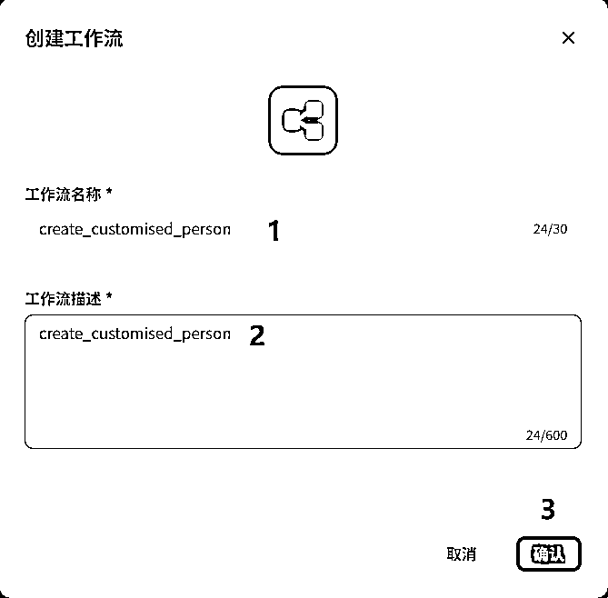

### 第2步：定义入口参数

在开始节点添加两个文本参数：

- `material_video`：人物训练视频地址；
- `name`：数字人名称。

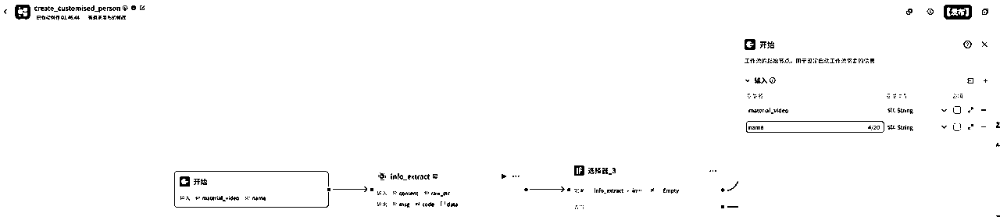

### 第3步：解析飞书附件地址

添加工具集合中的`info_extract`能力。可以在插件商城搜索“工具集合”，也可以通过相关入口导入。

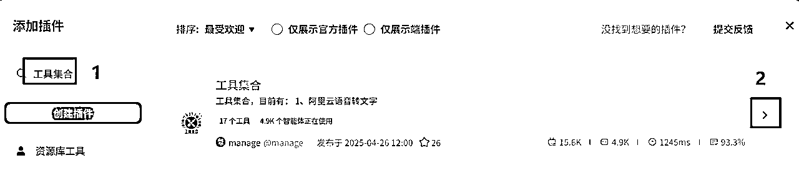

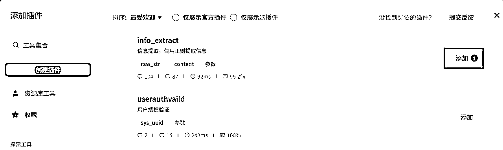

参数设置如下：

- `content`：传入开始节点中的`material_video`；
- `raw_str`：填写对应的原始附件文本。

```
(https://.*?.feishu.cn/space/api/box/stream/download/authcode/\?code=.*?)"
```

飞书多维表的附件字段通常不是普通URL，而是一段结构化文本，因此需要先从中解析出真实文件地址。若不想使用该工具，也可以改用代码节点完成提取。

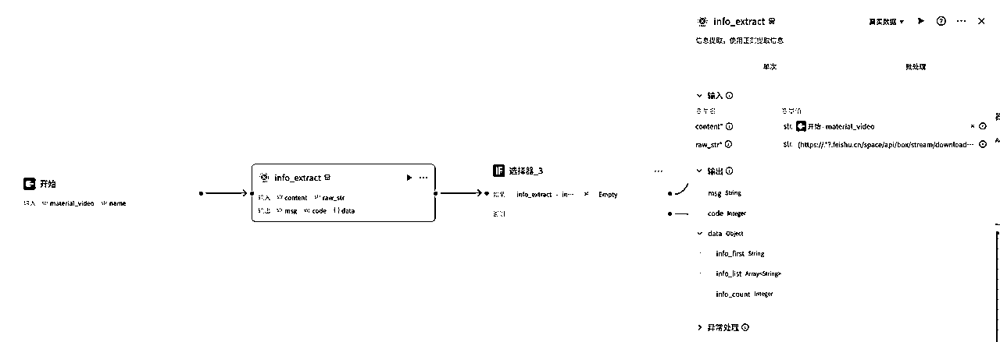

### 第4步：检查是否拿到文件地址

加入条件判断，检查解析结果里的`info_first`是否存在。

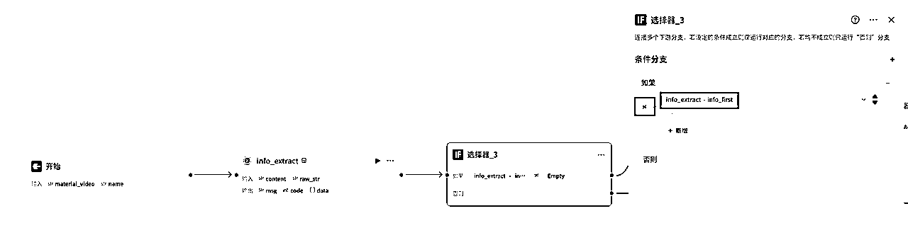

有值代表已经解析出文件地址；没有值，则说明附件内容未成功识别。

成功路径继续前往获取蝉镜访问凭证的节点；失败路径进入【视频地址提取错误】节点，并把解析工具返回的`msg`作为错误提示。

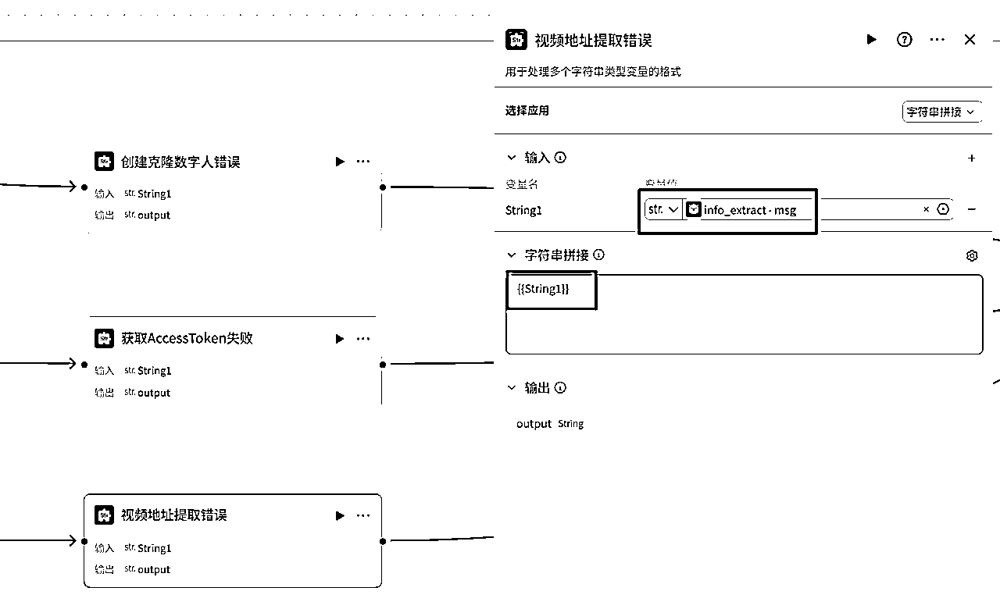

### 第5步：获取蝉镜访问凭证

添加蝉镜数字人API中的`getAccessToken`能力。

蝉镜后台个人资料页可以找到应用ID和密钥。

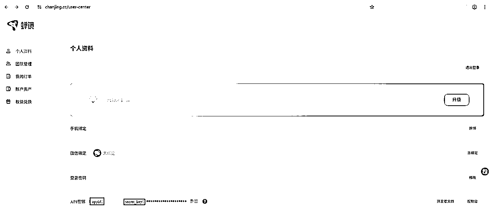

参数对应关系：

- `app_id`：蝉镜应用ID；
- `secret_key`：蝉镜应用密钥。


### 第6步：判断凭证是否有效

再次加入条件节点，检查`getAccessToken`返回的`data`字段。

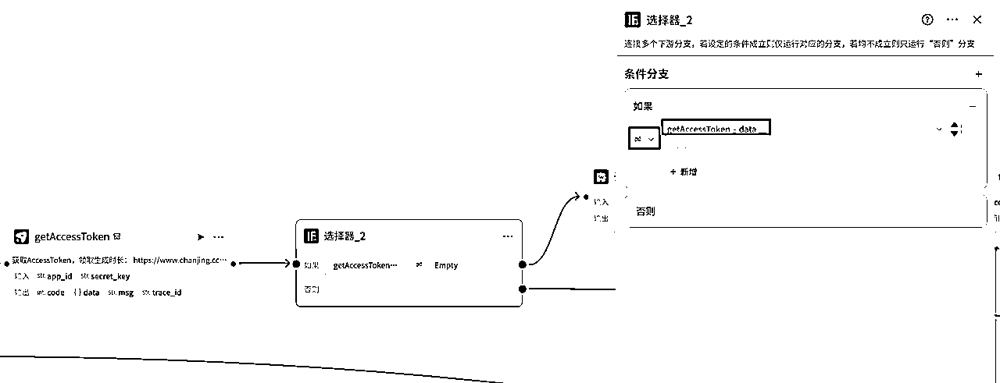

若数据存在，则进入文件命名环节；否则进入【获取AccessToken失败】节点，并引用接口返回的`msg`作为报错内容。

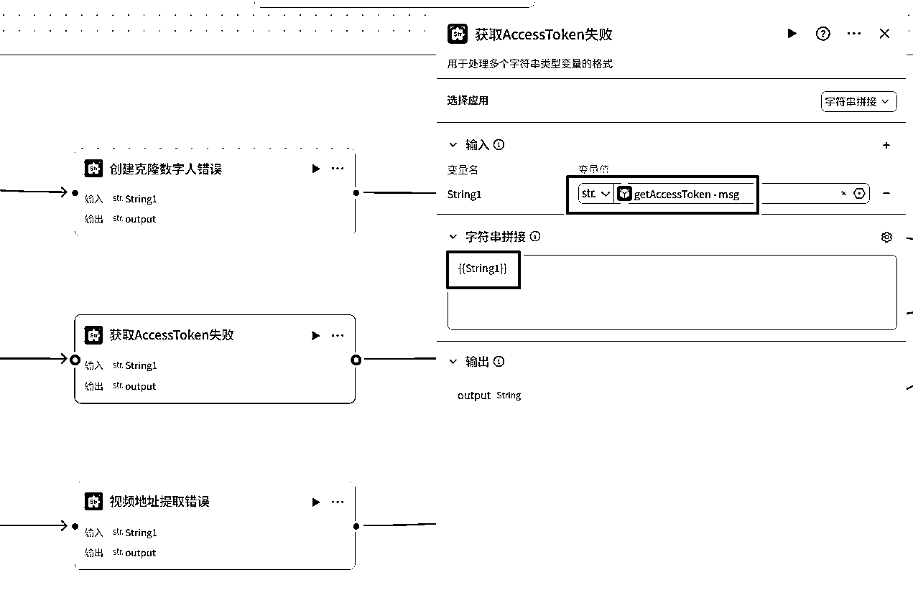

### 第7步：生成上传文件名

新增文本处理节点【设置视频名称】。

输入：

- `String1`：引用开始节点中的`name`。

再通过字符串拼接，为上传文件生成完整名称。

```
{{String1}}.mp4
```

人物训练视频建议优先使用MP4文件。

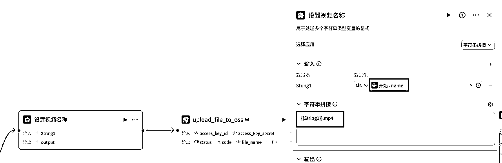

### 第8步：将视频转入对象存储

加入蝉镜数字人API里的`upload_file_to_oss`能力。

需要填入对象存储账号信息：

- `access_key_id`：阿里云访问ID；
- `access_key_secret`：阿里云访问密钥；
- `bucket`：目标存储桶；
- `endpoint`：存储区域地址；
- `file_url`：引用前面解析出的真实文件地址；
- `expire_hours`：地址有效时长，默认可设为24小时；
- `file_name`：引用刚才生成的文件名称。

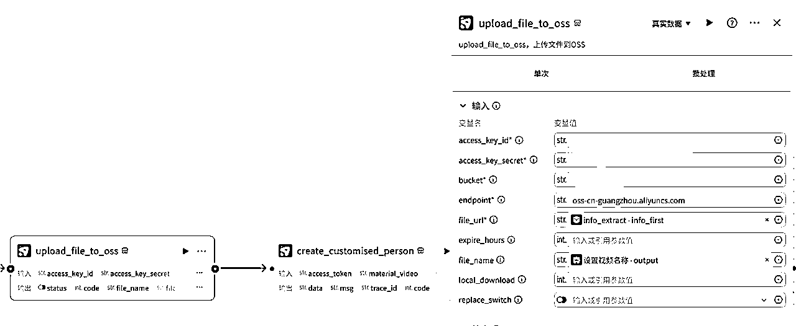

这样做的原因是：飞书附件地址未必能被蝉镜直接读取，先转成对象存储地址后，接口才能稳定识别素材。

### 第9步：发起人物训练

加入蝉镜数字人API中的`create_customised_person`能力。

参数关系如下：

- `access_token`：使用前一步获取的访问凭证；
- `material_video`：使用对象存储返回的`oss_file_url`；
- `name`：使用开始节点中的数字人名称；
- `train_type`：填写`figure`。

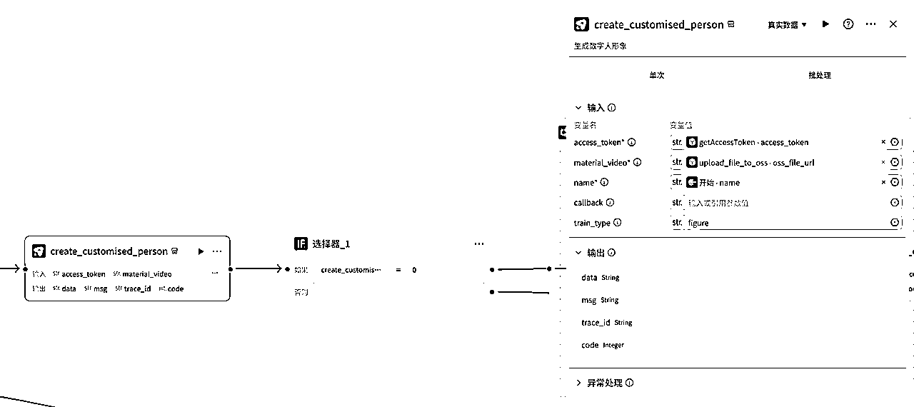

该接口用于提交人物训练。返回码为0时，说明请求已经成功受理；其他值则表示提交失败。

### 第10步：判断提交结果

设置条件，判断`create_customised_person`返回的`code`是否为0。

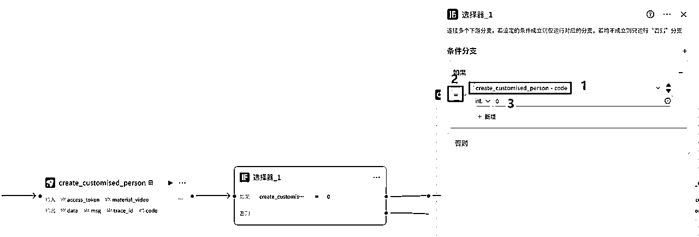

成功后进入循环查询；失败则进入【创建克隆数字人错误】节点，并将接口返回的`msg`展示出来。

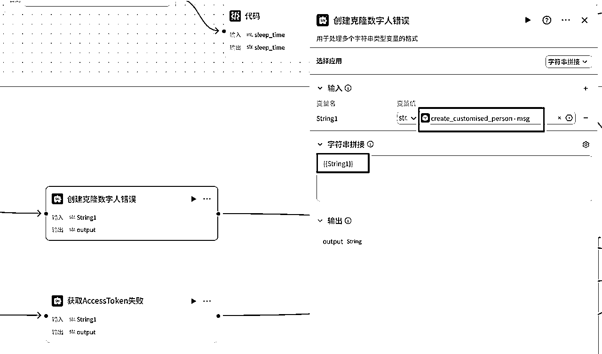

### 第11步：配置循环查询

新增循环节点，持续查询人物训练状态。

循环方式选择：无限循环。

中间变量可以按下面方式初始化：

- `id`：文本，初始值为空；
- `pic_url`：文本，初始值为空；
- `preview_url`：文本，初始值为空；
- `audio_man_id`：文本，初始值为空；
- `height`：整数，初始值为1；
- `width`：整数，初始值为1；
- `name`：文本，初始值为空；
- `msg`：文本，初始值为空。

输出字段分别连接到循环变量：

- `id` → 循环中的`id`
- `pic_url` → 循环中的`pic_url`
- `preview_url` → 循环中的`preview_url`
- `audio_man_id` → 循环中的`audio_man_id`
- `height` → 循环中的`height`
- `width` → 循环中的`width`
- `name` → 循环中的`name`
- `msg` → 循环中的`msg`

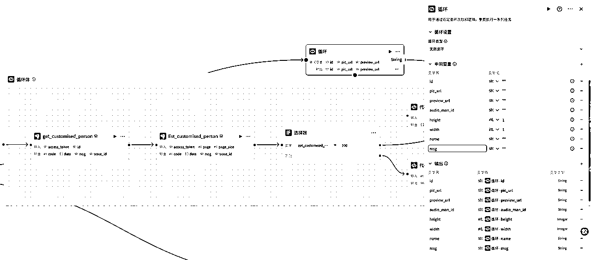

到这里，人物克隆工作流的基础骨架就搭好了。后续只需要继续补充状态查询、声音训练、视频合成，以及多维表回写等环节，就能形成完整的数字人口播生产线。

很多同学在搭数字人自动化时，最头疼的就是“形象克隆、声音克隆、视频生成”三个工作流怎么串起来。其实只要理清节点关系，照着下面的步骤走，很快就能跑通。文章稍长，建议先收藏，再对照着搭。

## 一、数字人克隆工作流

从循环体开始处理。先添加【蝉镜数字人API】插件中的【get_customised_person】节点，用来获取数字人形象克隆结果。配置输入参数时：

- access_token：引用【getAccessToken】节点的 access_token；
- id：引用【create_customised_person】节点的 data。

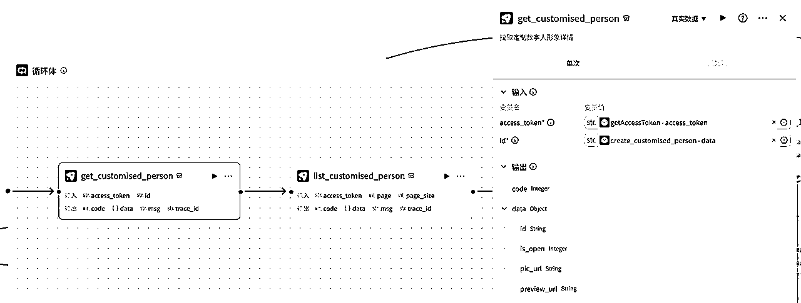

这里补充一下：get_customised_person 返回的 process 字段代表克隆进度，数值到 100 就说明完成；status 字段则代表当前状态，1 是制作中，2 是成功，4 是失败，5 是系统错误。如果想更严谨，可以把 status 也一起加进判断条件里。

接着在循环体里再添加一个【list_customised_person】节点，配置如下：

- access_token：引用【getAccessToken】节点的 access_token；
- page：设为 1；
- page_size：设为 20。

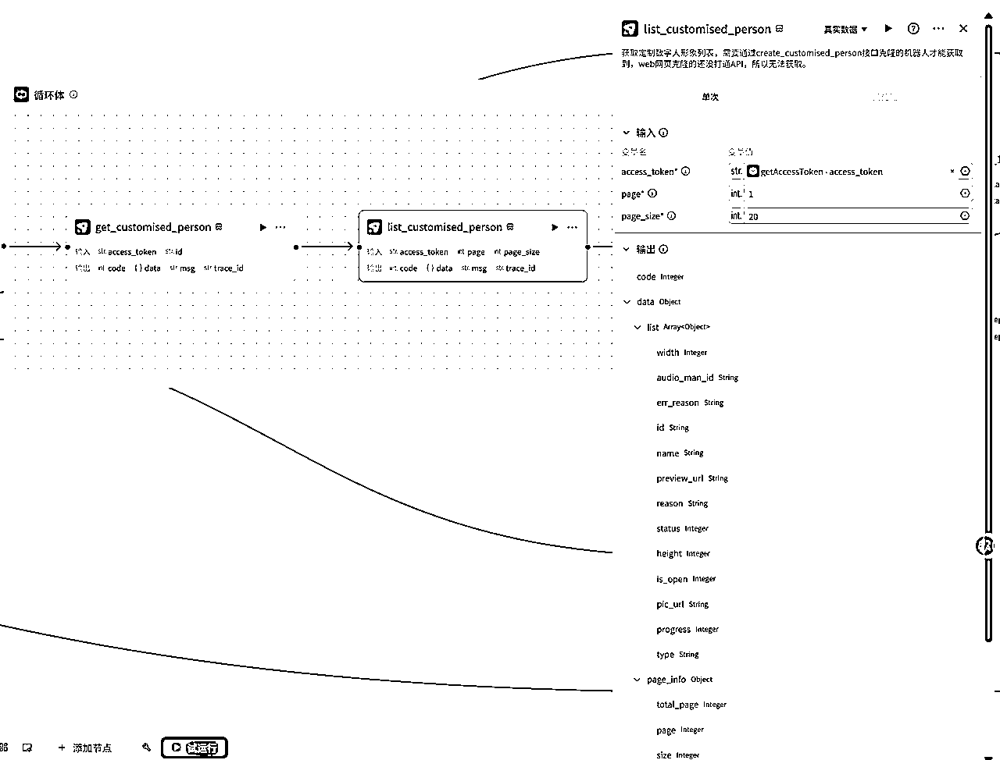

这个节点本身是用来获取定制数字人形象列表的，属于可选项，不用特意添加。我这边只是当时忘记删了，你完全可以跳过它。

接下来添加一个选择器，判断 get_customised_person 返回的 process 是否等于 100。

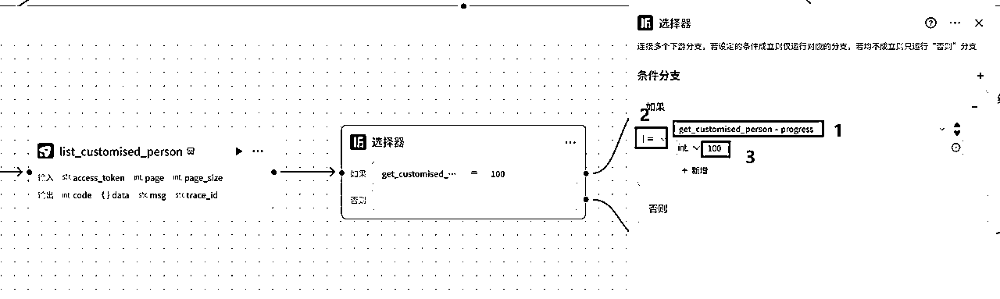

如果条件成立，就走【设置变量】节点；如果条件不成立，则进入【代码(停顿)】节点。

然后添加【设置变量】节点：

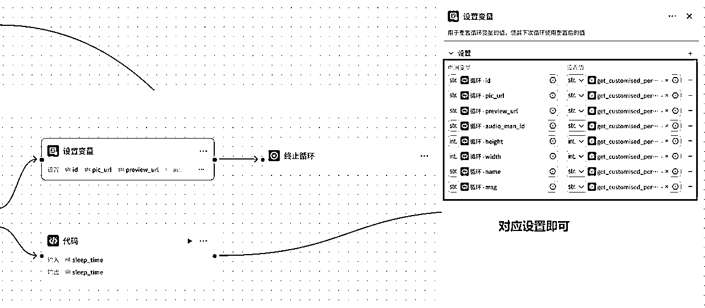

在这个节点里把需要赋值的变量设置好，完成后再连接到【终止循环】节点。

继续添加【代码(停顿)】节点：

- sleep_time：建议设置为 5，也可以调更长；
- 输出参数：sleep_time，类型为 string。

之所以要加停顿，是为了给循环留出缓冲，防止请求频率太高，一下子把工作流的节点运行次数跑超。注意，这里的代码是 Python 而不是 JavaScript，记得在左上角把语言切换为 Python。

```
import time

async def main(args: Args) -> Output:
    params = args.params
    sleep_time = params["sleep_time"]

    time.sleep(sleep_time)
    # 构建输出对象
    ret: Output = {
        "sleep_time": sleep_time
    }
    return ret
```


再添加一个【变量聚合】节点，把分组名设为 info，并加入以下输出项：

获取AccessToken失败-output  
创建克隆数字人错误-output  
视频地址提取错误-output  

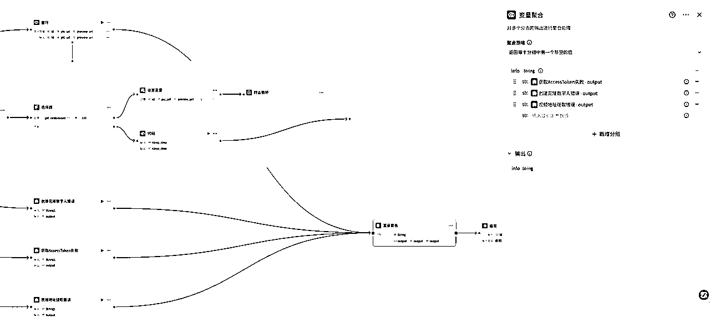

接下来配置【结束】节点，输出变量需要引用循环节点中的字段：

- id：引用【循环】节点的 id；
- pic_url：引用【循环】节点的 pic_url；
- preview_url：引用【循环】节点的 preview_url；
- audio_man_id：引用【循环】节点的 audio_man_id；
- height：引用【循环】节点的 height；
- width：引用【循环】节点的 width；
- name：引用【循环】节点的 name；
- msg：引用【循环】节点的 msg；
- info：引用【变量聚合】节点的 info。

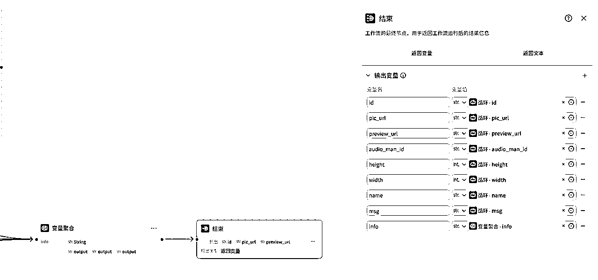

记得把【结束】节点切换为“返回变量”模式。

工作流配置完成后，点击“坚持发布”进行发布。

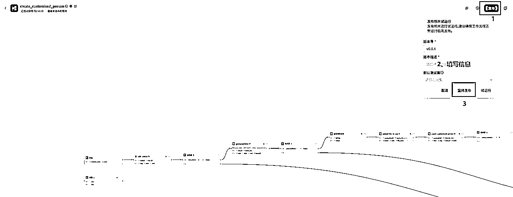

发布成功后，到工作流列表里获取工作流 ID。

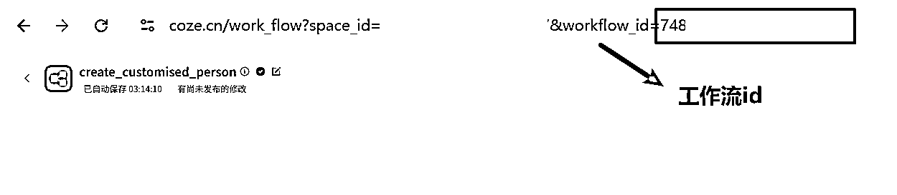

这个 ID 后面配置多维表格时会用到，先记好。

## 二、声音克隆工作流

先看一下整体流程：

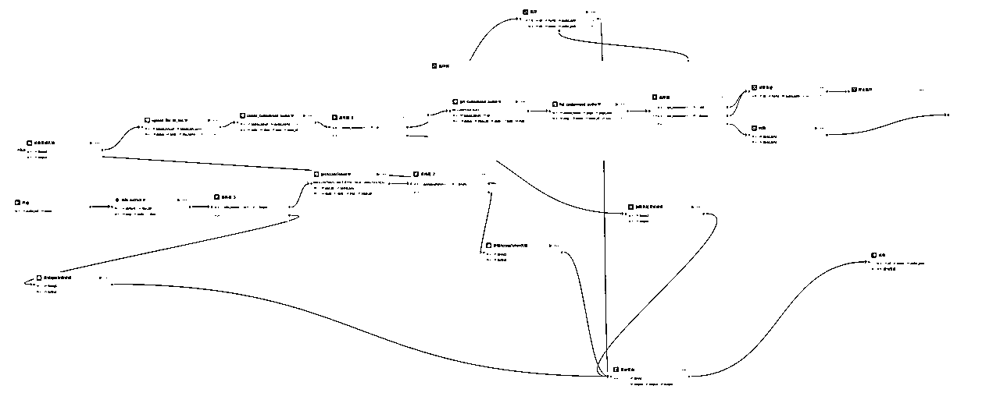

接下来按步骤搭建。

1. 新建一个工作流，路径为：工作空间 → 资源库 → 添加资源 → 工作流，把工作流名称和描述都设置为“create_customised_audio”。


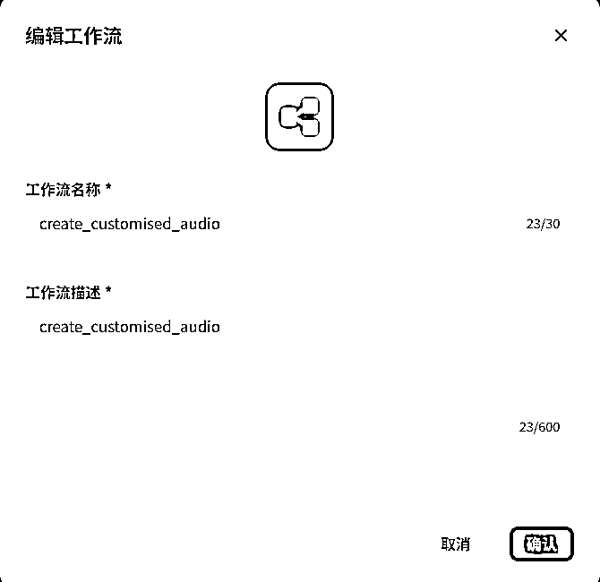

2. 在开始节点中创建两个字符串变量：audio_url 和 name。

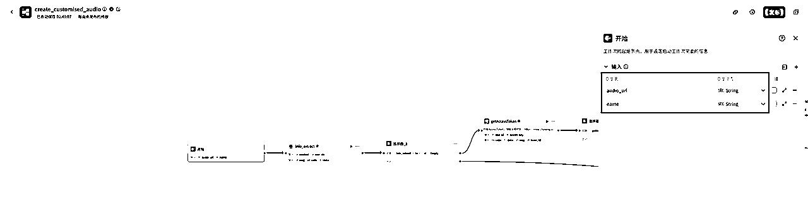

3. 添加信息提取插件 info_extract。可以通过插件商店搜索“工具集合”来添加，也可以直接用相关链接接入。


输入参数中，content 引用开始节点的 audio_url，raw_str 留空即可。

```
(https://.*?.feishu.cn/space/api/box/stream/download/authcode/\?code=.*?)"
```

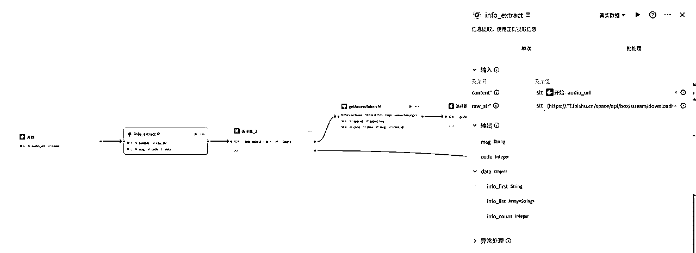

4. 添加选择器，判断 info_extract 返回的 info_first 是否不为空。

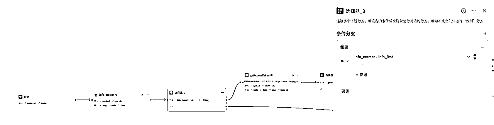

如果非空，就进入下一个 getAccessToken 节点；如果为空，则进入“音频地址提取错误”节点，这个文本处理节点的内容要引用 info_extract 的 msg 字段。

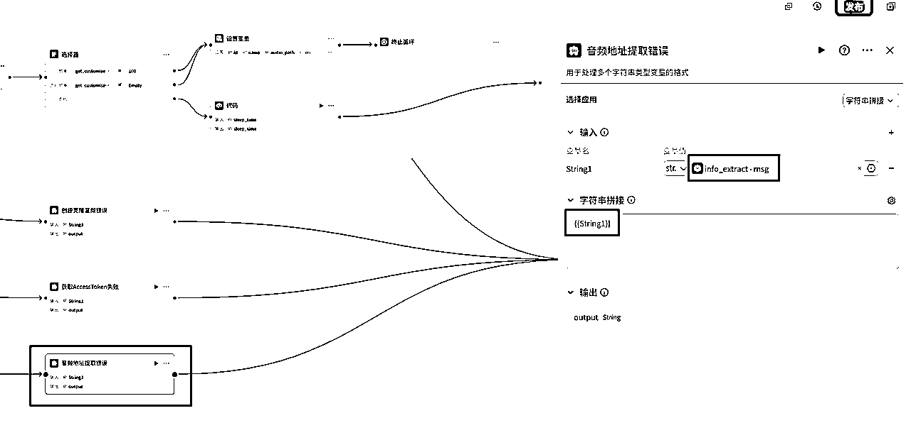

5. 添加【蝉镜数字人API】插件中的 getAccessToken 节点。app_id 和 secret_key 可以在蝉镜官网的个人资料页面获取。


输入参数如下：

- app_id：蝉镜官网的 app_id；
- secret_key：蝉镜官网的 secret_key。

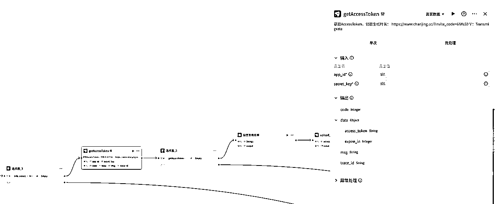

6. 再添加一个选择器，判断 getAccessToken 的 data 是否不为空。

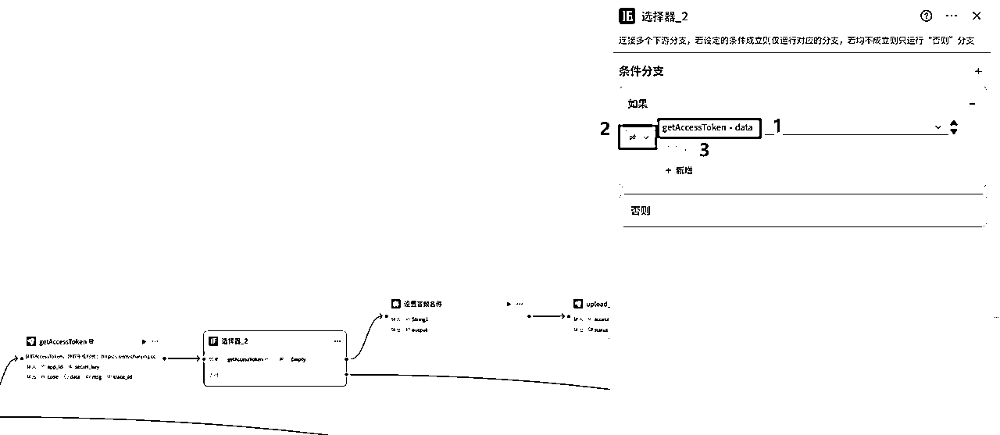

如果 data 有值，就继续走到“设置音频名称”节点；否则进入“获取AccessToken失败”节点，该文本处理节点的内容引用 getAccessToken 的 msg。


7. 添加文本处理节点“设置音频名称”。输入参数中的 String1 引用开始节点的 name，字符串拼接方式按截图配置即可。

```
{{String1}}.mp3
```


8. 添加蝉镜数字人 API 中的 upload_file_to_oss 节点，用于把音频文件上传到阿里云 OSS。access_key_id、access_key_secret、bucket、endpoint 都需要开通阿里云 OSS 后获取。

输入参数配置：

- access_key_id：阿里云 OSS 的 access_key_id；
- access_key_secret：阿里云 OSS 的 access_key_secret；
- bucket：阿里云 OSS 的 bucket；
- endpoint：阿里云 OSS 的 endpoint；
- file_url：引用 info_extract 的 info_first；
- expire_hours：链接有效期，默认 24，可以不设置；
- file_name：引用“设置音频名称”文本处理节点的输出。


9. 添加 create_customised_audio 节点，发起音频克隆：

- access_token：引用 getAccessToken 节点的 access_token；
- url：引用 upload_file_to_oss 节点返回的 oss_file_url；
- audio_name：引用开始节点的 name。


10. 添加选择器，判断 create_customised_audio 返回的 code 是否等于 0。


如果 code 为 0，就进入下一个循环节点；否则进入“创建克隆音频错误”节点，该文本处理节点的内容引用 create_customised_audio 的 msg。


11. 添加循环节点，配置如下：

- 循环类型：无限循环；
- 中间变量：
  - id：string，默认为空；
  - name：string，默认为空；
  - audio_path：string，默认为空；
  - err_msg：string，默认为空；
  - progress：int，默认为 1；
- 输出设置：
  - id：引用循环的 id；
  - name：引用循环的 name；
  - audio_path：引用循环的 audio_path；
  - err_msg：引用循环的 err_msg；
  - progress：引用循环的 progress。


11.1 在循环体中添加 get_customised_audio 节点：

- access_token：引用 getAccessToken 节点的 access_token；
- id：引用 create_customised_audio 节点的 data。


11.2 再添加一个 list_customised_audio 节点，该节点也可以不用设置：

- access_token：引用 getAccessToken 节点的 access_token；
- page：设为 1，可不设置；
- page_size：设为 20，可不设置。


11.3 添加选择器，先判断 get_customised_audio 的 process 是否等于 100，再判断 err_msg 是否不为空。


如果 process 为 100，或者 err_msg 有值，就进入【设置变量】节点；否则进入【代码(停顿)】节点。

11.4 添加【设置变量】节点：


按输出需求配置好变量后，连接到【终止循环】节点。

11.5 添加【代码(停顿)】节点：

- sleep_time：建议设置为 5，也可以调更长；
- 输出参数：sleep_time，类型为 string；
- 代码语言：Python，不是 JavaScript，记得在左上角切换。

```
import time

async def main(args: Args) -> Output:
    params = args.params
    sleep_time = params["sleep_time"]

    time.sleep(sleep_time)
    # 构建输出对象
    ret: Output = {
        "sleep_time": sleep_time
    }
    return ret
```


12. 添加【变量聚合】节点，分组名设置为 info，并加入以下输出项：

获取AccessToken失败-output  
创建克隆音频错误-output  
音频地址提取错误-output  


13. 配置【结束】节点，输出变量如下：

- id：引用循环节点的 id；
- name：引用循环节点的 name；
- audio_path：引用循环节点的 audio_path；
- err_msg：引用循环节点的 err_msg；
- progress：引用循环节点的 progress；
- info：引用变量聚合节点的 info。


同样，记得把【结束】节点设置为返回变量模式。

14. 发布工作流时，点击“坚持发布”按钮。


15. 发布成功后，获取工作流 ID。


这个 ID 后续配置多维表格时也要用到。

## 三、视频生成工作流搭建过程

先看整体流程：


下面是详细步骤。

1. 新建工作流，路径同样是：工作空间 → 资源库 → 添加资源 → 工作流，名称和描述都设置为“chanjing_video_generate”。


2. 在开始节点中新增 7 个字符串变量：audio_man_id、wav_url、person_id、text、font_id、font_color、font_size。

默认值设置如下：

- audio_man_id：声音克隆结果的 ID；
- wav_url：声音克隆结果的 wav_url；
- person_id：数字人克隆结果的 ID；
- text：数字人朗读的文案，默认设为“这是一段测试文本”；
- font_id：字体 ID，默认设为 d6deed050b0e43e58ac87cf4eccfa295；
- font_color：字体颜色，默认设为 #FFD900；
- font_size：字体大小，默认设为 64。


3. 添加 getAccessToken 节点。app_id 和 secret_key 同样在蝉镜官网个人资料中获取。


输入参数：

- app_id：蝉镜官网的 app_id；
- secret_key：蝉镜官网的 secret_key。


4. 添加选择器，判断 getAccessToken 的 data 是否不为空。


如果 data 不为空，就进入下一个“配置生成”代码节点；否则进入“获取AccessToken失败”节点，该文本处理节点的内容引用 getAccessToken 的 msg。


5. 添加“配置生成”代码节点，输入参数如下：

- text：引用开始节点的 text；
- audio_man_id：引用开始节点的 audio_man_id；
- wav_url：引用开始节点的 wav_url；
- person_id：引用开始节点的 person_id；
- volume：100；
- font_id：引用开始节点的 font_id；
- font_color：引用开始节点的 font_color；
- font_size：引用开始节点的 font_size。

输出参数：

- person：object 类型；
- audio：object 类型；
- subtitle_config：object 类型。

代码同样使用 Python 编写，不是 JavaScript，记得在左上角切换语言。

哈喽，各位搞自媒体和AI变现的朋友们，今天分享一篇用扣子、多维表格和蝉镜数字人做视频的保姆级教程，干货满满，建议先收藏！

```
async def main(args: Args) -> Output:
    params = args.params
    audio_man = params["audio_man_id"]
    wav_url = params["wav_url"]
    person_id = params["person_id"]
    font_id = params["font_id"]
    font_color = params["font_color"]
    if font_color == "":
        font_color = "#FFD900"
    font_size = params["font_size"]
    if font_size == "" or font_size == 0:
        font_size = 64
    volume = params["volume"]
    text = params["text"]

    audio = {
        "tts": {
        "text": [text],
        "speed": 1,
        "audio_man": audio_man
        },
        "wav_url": wav_url,
        "type":"tts",
        "volume":volume
    }
    person = {
        "id": person_id,
        "width":1080,
        "height":1920,
        "x":0,
        "y":0,
        }

    subtitle_config = {
        "color":font_color,
        "font_id":font_id
    }

    # 构建输出对象
    ret: Output = {
        "person": person,
        "audio": audio,
        "subtitle_config":subtitle_config
    }
    return ret
```

先说说几个容易踩坑的参数。audio的type记得填“tts”，要填成“audio”的话，系统会直接去音频里抓文案，不会根据你输入的文本来生成音频了。person的x和y坐标要分别设成0、0，不然默认是0、480，最后视频里数字人形象只会露出一部分。subtitle_config呢，只需要设置颜色和字体id就行，文字位置、大小这些用默认的就好（接口目前对font_size不太友好，设置了也不生效）。字体id可以从多维表格的字体列表里拿。


接着，第6步，在工作流里添加【蝉镜数字人API】插件下的【create_video】节点。输入值这样配：
- access_token：引用【getAccessToken】节点的access_token输出。
- audio：引用【配置生成】代码节点里生成的audio。
- bg、bg_color、callback、screen_height、screen_width都可以留空。
- person：引用【配置生成】代码节点的person。
- subtitle_config：引用【配置生成】代码节点的subtitle_config。


第7步，加一个选择器（条件判断），判断create_video返回的code是不是等于0。


如果等于0，就走【循环】节点那条分支；如果不等于0，就进【创建合成视频失败】节点，这个失败节点的文本内容直接引用create_video节点的msg。


第8步，开始配置循环节点：
- 循环类型：选“无限循环”。
- 中间变量：video_url，类型string，初始值设空字符串""。
- 输出设置：把循环里的video_url作为输出。


8.1、在循环体里添加【蝉镜数字人API】的【get_video_details】节点。输入设置：
- access_token：引用【getAccessToken】节点的access_token。
- id：引用【create_video】节点返回的data。


8.2、再加一个选择器，判断get_video_details返回的process是否等于100。


如果等于100，就连接到【设置变量】节点，否则就接到【代码(停顿)】节点。

8.3、添加【设置变量】节点，把对应变量设置好，然后连接到【终止循环】节点。


8.4、添加【代码(停顿)】节点。输入设置里，sleep_time设为5，其实设更长点也行，停一下是为了避免循环跑太快，导致工作流节点运行次数超限。输出设置里，sleep_time类型为string。

代码部分要注意，这里用的是Python代码，不是JavaScript，记得通过左上角把语言切换成Python再粘贴。

```
import time

async def main(args: Args) -> Output:
    params = args.params
    sleep_time = params["sleep_time"]

    time.sleep(sleep_time)
    # 构建输出对象
    ret: Output = {
        "sleep_time": sleep_time
    }
    return ret
```

（这里放Python代码的位置，原教程有对应代码块）


第9步，添加【变量聚合】节点。把分组名称设为info，然后添加两个输出项：获取AccessToken失败-output、创建合成视频失败-output。


第10步，配置【结束】节点。输出变量设置：
- video_url：引用【循环】节点的video_url。
- info：引用【变量聚合】节点的info。


别忘了把【结束】节点设置为“返回变量”。

第11步，试运行一下工作流，看看有没有问题。


（试运行成功的截图位置）


确认没问题后，就可以发布工作流了。

第12步，点左上角的【发布】按钮，把工作流发出去。


（发布按钮位置）

第13步，获取工作流id。


这个工作流id很关键，后面多维表格配置参数时要用到。

# 数字人口播视频生成多维表格设计

## 创建多维表格

1、先在飞书里建一个多维表格，名字随便，比如【魔童数字人视频生成】，然后创建下面5个数据表（直接按我给的模板来就行）：

```
数据表-克隆数字人
数据表-克隆声音
数据表-生成视频
公共数字人
支持的字体列表
```

（数据表模板截图）


## 设计【数据表-克隆数字人】数据表

1、先添加字段：【数字人名称】用文本类型，【形象视频】用附件类型。然后再加一个【克隆数字人】字段，搜索“扣子工作流调用”这个字段捷径插件。


（插件搜索位置）

2、配置插件：
- 认证令牌：在扣子官网获取。
- 工作流ID：填前面获取到的工作流id。
- 参数字段：选择【形象视频】附件字段。
- 参数名称：设为material_video，对应工作流里的material_video参数。
- 请求模板：按图填写。

```
{
  "material_video": "$$material_video$$",
  "name": "【引用数字人名称字段】"
}
```

（请求模板截图）

输出结果1：设置为id。
输出结果2：设置为name。
开启“获取更多信息”，把里面的选项全部勾上。
自动更新：看自己需求，可以启用，也可以手动调用工作流。


（配置详情截图）


（配置详情截图2）


（配置详情截图3）

配置好以后，点击【确定】保存，再点一下【仅保存配置】。

3、保存好之后，先填数字人名称，再上传形象视频，就能自动开始克隆数字人形象了。


（运行成功的截图）运行成功后，能看到输出结果1（数字人id）、输出结果2（数字人名称）还有完整响应数据都不为空，就说明成功了。

## 设计【数据表-克隆声音】数据表

1、同样，添加字段：【音色名称】文本类型，【声音】附件类型。再加一个【克隆声音】字段，搜索“扣子工作流调用”插件。


（插件搜索位置）

2、配置插件：
- 认证令牌：同上，从扣子官网获取。
- 工作流ID：还是填前面获取到的。
- 参数字段：选【声音】附件字段。
- 参数名称：设为audio_url，对应工作流里的audio_url参数。
- 请求模板：按图填。

```
{
  "audio_url": "$$audio_url$$",
  "name": "【引用音色名称字段】"
}
```

（请求模板截图）

输出结果1：设置为id。
输出结果2：设置为audio_path。
同样开启“获取更多信息”并全部勾选。
自动更新：看情况设置。


（配置截图）


（配置截图2）


（配置截图3）

点【确定】保存，再点【仅保存配置】。

3、配置完，先填写音色名称，再上传声音文件。如果没有开启自动更新，需要手动点击单元格，然后点【刷新】图标来触发音色克隆。


（运行成功截图）成功后，输出结果1（音色id）、输出结果2（音色地址）和完整响应数据都会有值。

## 设计【数据表-生成视频】数据表

1、先添加几个文本字段：【视频文案】、【音色名称】、【数字人名称】。再添加三个查找引用字段：【音色ID】、【音色地址】、【数字人ID】。


（字段设置截图）

2、【音色ID】查找引用字段这样配：


设置好之后，会根据音色名称自动匹配对应的音色ID。

3、【音色地址】查找引用字段：


同理，根据音色名称自动带出音色地址。

4、【数字人ID】查找引用字段：


根据数字人名称自动带出数字人ID。

5、再加一个【视频合成】字段，搜索“扣子工作流调用”插件。


（插件搜索位置）

配置插件：
- 认证令牌：扣子官网获取。
- 工作流ID：还是之前那个。
- 参数字段：选【视频文案】文本字段。
- 参数名称：设为text，对应工作流里的text参数。
- 请求模板：按图填。

```
{
  "material_video": "$$material_video$$",
  "name": "【引用数字人名称字段】"
}

{
"text": "$$text$$",
  "audio_man_id": "【引用音色ID字段】",
  "wav_url": "【引用音色地址字段】",
  "font_color": "#FFD900",
  "font_id": "d6deed050b0e43e58ac87cf4eccfa295",
  "font_size": "64",
  "person_id": "【引用数字人ID字段】"
}
```

（请求模板截图）

输出结果1：设置为video_url。
输出结果2：设置为info。
开启“获取更多信息”，全部勾选。
自动更新：按需设置。


（配置截图）


（配置截图2）


（配置截图3）

点【确定】保存，再点【仅保存配置】。

3、配置好后，先设置【音色名称】和【数字人名称】，然后填【视频文案】，就能自动生成数字人视频了。


（运行截图）


（运行成功截图）运行成功的话，输出结果1、输出结果2和完整响应数据都会显示内容。

PS：
1、形象视频如果只有5秒，生成超过5秒的视频就会看出明显切换痕迹。所以建议上传时长更长的形象视频来克隆数字人，效果更好。
2、多音字可能会导致发音和口语不一样，遇到这种情况可以查一下官方开发者文档，按文档里的规则标注读音。
3、想让文案更省事，可以装一个抖音文案提取插件（扣子发布到多维表格），或者搭一个工作流来提取文案，再用DeepSeek字段捷径插件改写，最后再接数字人视频生成流程，全自动搞定。

# 结语
教程就到这里啦，欢迎大家一起交流，碰撞出更多变现的新思路、新玩法。

# 附录
1. 多维表格模板链接
2. 蝉镜数字人开发者文档
3. 数字人口播自动化：扣子+多维表格+蝉镜实战教程-可复制代码