AI这阵风吹了也有段时间了，我身边不少朋友都在嘀咕：明知道机会摆在眼前，可自己既不会写代码，也没搞过技术，是不是就只能眼睁睁看着？实话说，我之前也有过这种慌。但最近我把市面上能玩的AI玩法挨个试了一遍，最大的感触就是：压根不需要你会什么技术，把它当成一个随叫随到的工具就行。这篇文章就把我实测过、普通人能直接套用的几个方向整理出来，每个都附带具体的操作思路和起号步骤，希望对你有用。

先聊聊我筛选这些玩法的标准，其实就四条：第一，上手不能太难，不懂技术也能照着做；第二，要么赛道竞争还没那么激烈，要么做成的概率比较大；第三，赚钱的路径得清晰明了；第四，不是做一锤子买卖，最好能长期运营或者有延伸空间。按这个标准跑了一圈，我挑出了下面这些方向，覆盖抖音、视频号、小红书等主流平台。篇幅有限，这里只讲最核心的操作链路，更多玩法大家可以自己摸索。

# 方向一 萌娃送祝福

先放几个我刷到的案例感受一下：

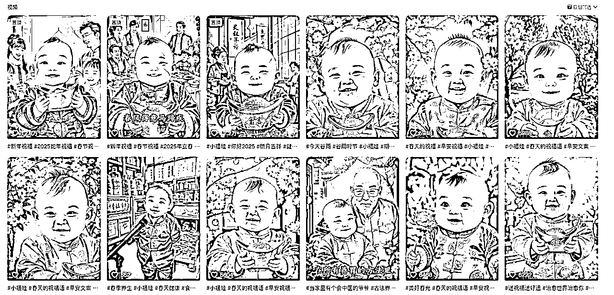

**这个玩法是什么？**
用AI做一个超可爱的萌娃形象，让它配合祝福语音频做嘴型同步，看起来就像真的宝宝在说话。

**怎么变现？**
最主要的是拿创作者分成。拿视频号举例，一条点赞破10万的作品，单条收益差不多在1500到3000块。等账号有了一定粉丝基础，可以偶尔穿插带货视频，比如让萌娃讲养生知识，顺带挂一些养生食品或者书籍的链接。

**赛道情况：**

竞争中等，起号概率高，制作不难，收益中等，整体打分4星。

**实操步骤：**
1. 截图对标视频里萌娃的正脸画面，发给豆包让它反推画风描述。
   
2. 打开即梦，把这些描述连同参考图一起传上去，生成萌娃图片，挑一张满意的存下来。这里有个小诀窍：先点“去画布编辑”，再右键把图存下来，能绕开水印。
   
   
   
3. 图准备好了就去即梦的功能区找“对口型”，把这张萌娃正面照传上去；再把对标视频的音轨单独提取出来，也传上去，选择大师版开始合成。
   
4. 视频渲染完成后，下载到手机或电脑就能直接发。想更精致的话，丢进剪映加一行字幕、调一下倍速再发也不迟。

**几个提醒：**
这类视频爆的概率其实不低，核心就靠两个：角色长相和台词内容。长相方面，尽量跟着爆款走；台词方面，祝福类偶尔会被平台判定违规，可以混着发一些治愈系文案，或者用第二个方向里的早安文案中和一下。另外，从即梦下载成片时用IDM工具，能直接扒到无水印版。

# 方向二 早安祝福

先看案例：

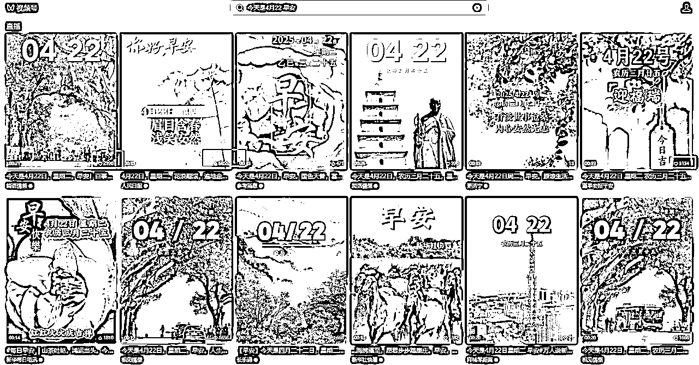
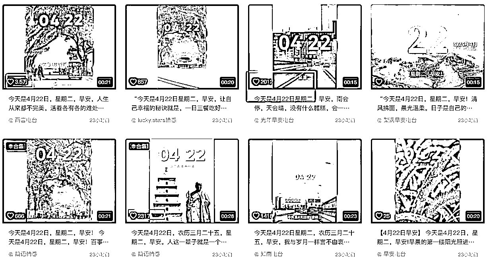

**这个玩法是什么？**
拿风景类动态画面打底，配上一段温暖走心的早安寄语。

**怎么变现？**
主要靠创作者分成。每天稳定更新两三条，碰到节气或者重要节假日的时候，流量会有明显爆发。账号权重上来之后，可以趁着节气发带货视频，挂养生食品或者养生书。

**赛道情况：**

竞争中等，起号率中等，制作难度中等，收益中等，综合3.5星。

**实操步骤：**
1. 在即梦站内搜“风景”“柳树”“喜鹊”这些关键词，刷到合适的画面后，直接点击“去做同款”。
   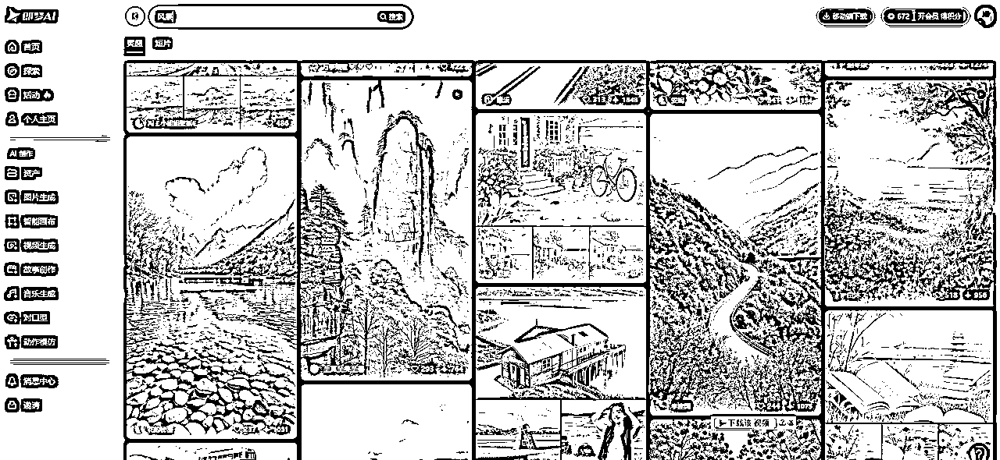
   
   
   
2. 选中图片后点生成视频，想要画质更细腻的话可以用S2.0pro。渲染好后保存到设备里。
   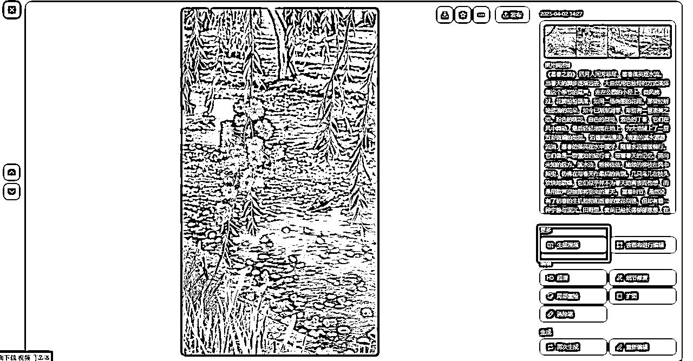
   
3. 打开剪映把视频素材放进主轨。从你整理的文案库里挑一条合适的，把日期改成当天，加到画面文字层。
   
   
4. 点亮“朗读”功能，在音色列表里选“心灵鸡汤”生成旁白。
   
5. 所有素材对齐后，加上背景音乐、字幕，导出就能发。
   

**几个提醒：**
市面上大量早安号走的都是情感语录路线，红海中的红海，新人进去很难冒头，不建议碰。祝福类相对好做些，想要提升起号速度，可以在文案开头加上生肖，比如：“属猴人，今天是4月23日，农历3月26，早安……”效果会好很多。文案的话，把广场上初一到初十的内容都扒下来，丢给豆包仿写就行；节气、节日记得单独准备对应版本。

# 方向三 育儿经

先看案例：

**这个玩法是什么？**
把育儿知识做成视频，画面配的是古风水墨风格的动态图。

**怎么变现？**
创作者收益是基本盘，建议直接用多账号矩阵来放大；账号有一定分量之后，可以挂车卖育儿书、儿童玩具、文具这些。

**赛道情况：**

竞争激烈，起号率偏低，制作门槛稍高，但收入上限不低，综合3星。

**实操步骤：**
1. 先找几条对标内容下载下来，把视频链接发给豆包，它能直接帮你把文案抠出来。
   
2. 参考对标视频的画面表达，让豆包帮你生成分镜式的画面描述，部分描述需要结合你的文案微调。
   
3. 拿最终定稿的分镜描述，一屏一屏去即梦生成图片，选图片2.0pro，出图后挑满意的点“超清”。
   
4. 用同样的方式，把做好的图片逐张转成动态视频，动作描述按文案内容来写，或者让豆包生成后微调。
   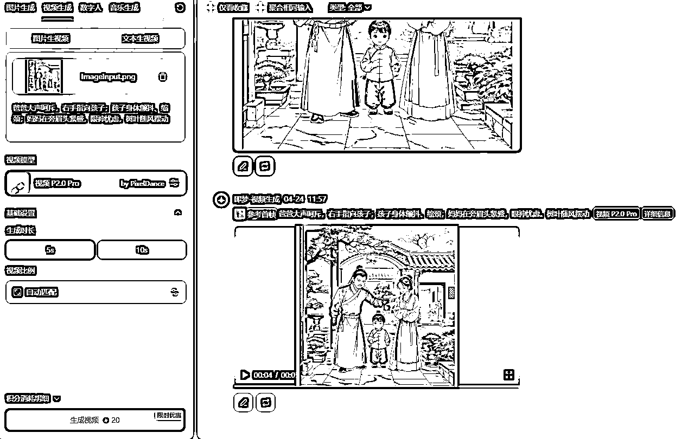
   
5. 把渲染好的视频按顺序拖进剪映，调整每个片段的时长，跟配音对齐，再加上标题和字幕，导出上传。
   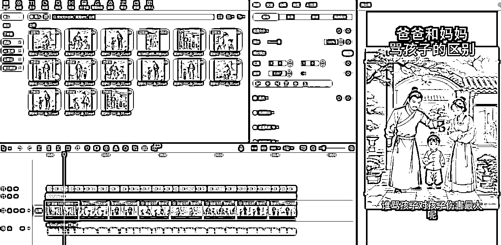

**几个提醒：**
要是想让视频里的人物一直保持同一张脸，复杂度会成倍增加。前期不用死磕这个，画面跟文案内容匹配、看着不突兀就够了，这个赛道本质是靠文案质量和发布量砸出来的。配音用剪映朗读或第三方配音软件都行，新手期可以直接使用对标视频的原声，后面再逐步换成自己的文案和声音。

# 方向四 英语启蒙

**这个玩法是什么？**
卡通风格的画面，配上儿童英语知识点的讲解配音。

**怎么变现？**
核心是带货，在视频里挂购物车，卖英语绘本、课程、文具等。

**赛道情况：**

竞争很卷，起号难度不小，但制作流程短、操作简单，收益中等，综合3星。

**实操步骤：**
1. 先让豆包产出英文教学文案，可以参考这个指令来写。
   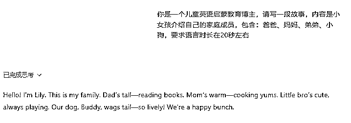
2. 再让豆包生成对应的画面分镜描述，拿着描述去即梦出图。
   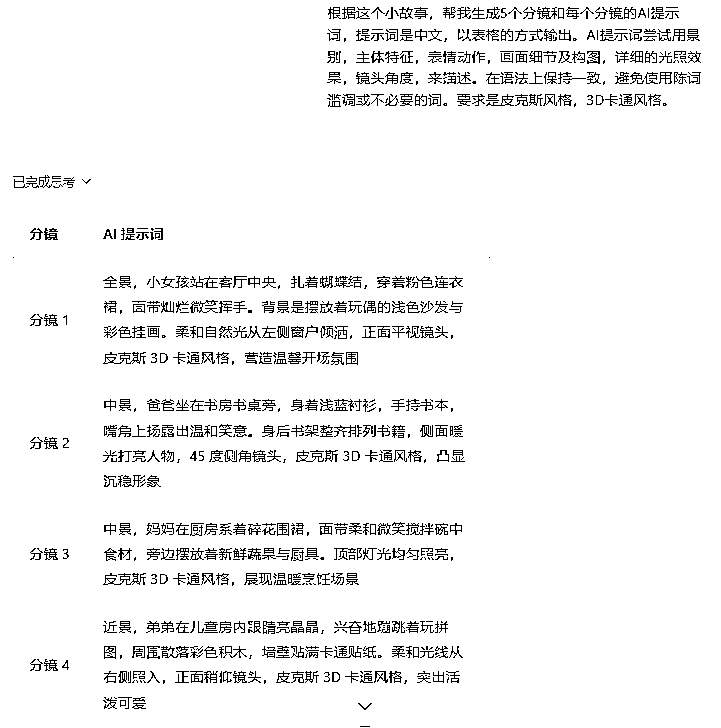
   
3. 挑出满意的图片，按顺序点生成视频并保存到本地。这类内容不需要太高的画面精准度，用S2.0模型足够了。
   
4. 把写好的文案贴进剪映文本区，挑一个亲和力好的音色生成朗读。
   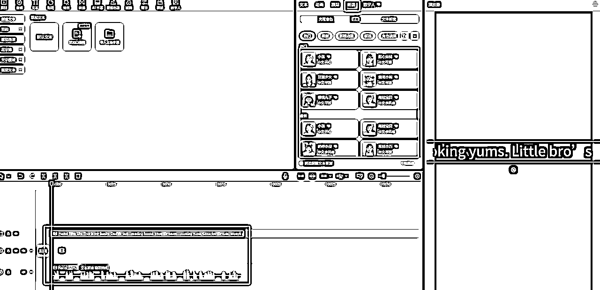
5. 视频和音频在剪映里对齐，配上字幕和标题，导出发布。
   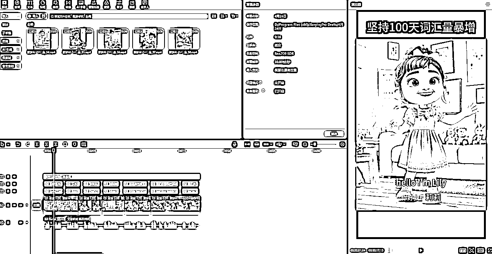

**几个提醒：**
这个玩法的优点是好上手、赚钱路径清楚，缺点是入局者太多。想跑出来，要么内容做出差异化，要么靠数量硬堆。

# 方向五 治愈系奶奶

先看案例：

**这个玩法是什么？**
卡通风格的慈祥老奶奶或老爷爷形象，配上走心的治愈系旁白和背景音乐。

**怎么变现？**
创作者分成是主要收入之一。有一个小技巧可以提高收益：最后一张配图放一句引导语，比如“留下你的故事”，能带动评论区互动。带货方面，目前挂书比较多，也可以延伸挂养生食品，但需要文案配合。

**赛道情况：**

竞争度高，起号难度大，制作简单但收益偏低，综合2星。

**实操步骤：**
1. 新手期建议直接去找爆款账号的文案来模仿，摸到感觉之后再让豆包写原创文案。豆包的智能体广场里有很多“治愈系奶奶”角色，既能产出文案也能产出画面描述，不过质量参差不齐，要手动筛一下。
   
2. 把定好的文案带去即梦，搜索“治愈系老奶奶”，找合眼缘的模板做同款，再把模板里的文案替换成你自己的版本，逐张出图。
   
   
3. 把生成的图片按顺序拖到剪映里，卡着BGM的节奏合成视频，加一些转场效果，导出发布。
   

**几个提醒：**
这个赛道现在同行扎堆，大多数账号爆了一两条就没了，根源在于内容太像。想突围可以试试反治愈路线，比如这条：“一定要牢记，别随便对人掏心掏肺，不是每个人都会真心待你；别对任何人过于亲近，不是每个人都像你这般善良。”另外，也可以结合近期很火的养生操来延伸。

# 方向六 怀旧乡村风景

**这个玩法是什么？**
充满年代感的乡村生活画面，搭配舒缓怀旧音乐。

**怎么变现？**
创作者收益波动较大，需要多做差异化内容，并在画面或文案里引导观众留言互动。带货的话一般挂怀旧主题的小物件或玩具。

**赛道情况：**

竞争度高，起号率中等，制作门槛低，收益偏低，综合2.5星。

**实操步骤：**
1. 画面描述还是交给老朋友豆包来生成。
   
2. 把描述拿去即梦出图，记得在描述前面加上“高清实拍”“高饱和度”一类的限定词。
   
3. 挑好图片后，点超清再点生成视频，动作描述不知道怎么写的话，继续求助豆包。
   
   
4. 剪映里完成剪辑，配上BGM、调整视频节奏，导出即可。
   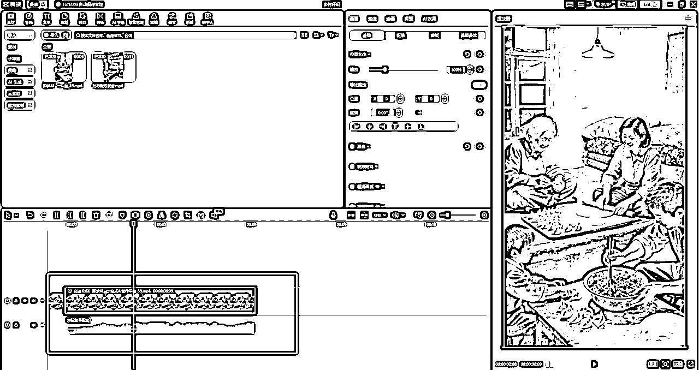

**几个提醒：**
这个类目的账号现在最大的问题同样是内容同质化严重。怀旧风格的延展空间比较有限，往治愈系的调性上靠，可能会打开更多可能性。

# 方向七 墙绘鲜花女孩

先看案例：

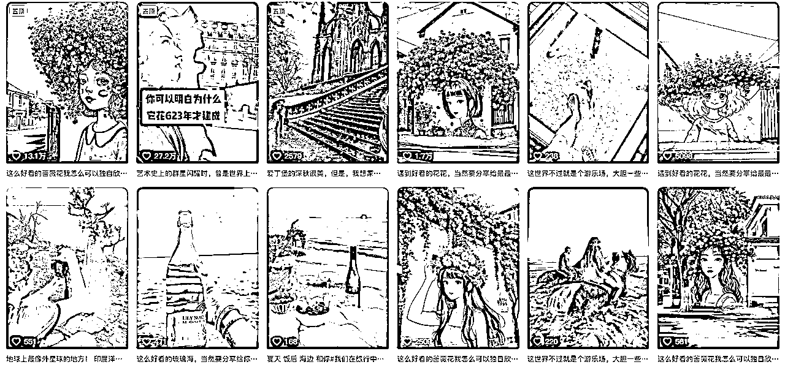

**这个玩法是什么？**
墙上绘制的女孩肖像，一头由盛开的鲜花组成的长发。

**怎么变现？**
除了创作者分成，还能给线下实体墙绘工作室引流，或者做AI绘画教学。

**赛道情况：**

竞争中等，起号率中等，制作不难，收益中等，综合3星。

**实操步骤：**
1. 出图有两条路：一是截取对标账号的画面喂给豆包，让它反推绘画描述；二是直接在即梦搜“墙绘女孩”，找喜欢的模板做同款。
   
   
2. 选好图片后，点超清、生成视频，动作描述围绕图片内容写，通常就是镜头缓推、花朵微摆、花瓣飘落这类。
   
3. 剪映里加背景音乐、调一下色调，还可以用倒放来拉长时长，导出发布。
   

**几个提醒：**
这个模式是最近刚跑通的，已经有不少人跟上，流量表现都还不错。墙绘题材的可扩展性很强，但还是那句话——想长期做，必须做出差异。类似的思路还有灵魂画手、热点手绘等等。

# 方向八 星座解读

先看案例：

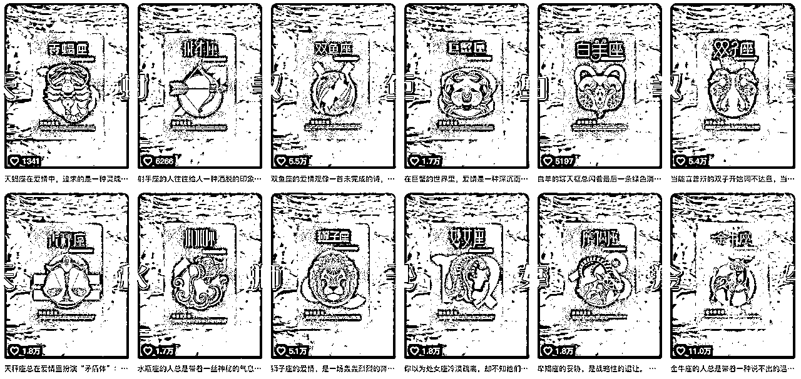

**这个玩法是什么？**
书单推荐式开头，配上星座运势解读文案和风景背景素材。

**怎么变现？**
渠道比较多元：创作者分成、挂车带货、私域运营、课程教学都可以串起来。

**赛道情况：**

竞争中等，起号率比较高，制作难度中等，收益中等，综合3.5星。

**实操步骤：**
1. 做星座图卡：点开小红书搜“星座”，把喜欢的图片存下来。
   
2. 打开即梦搜索风景类、情绪类画面，选中后做同款。
   
   
3. 用豆包仿写对标视频的文案，再到配音工具里找一个合适的音色生成旁白。
   
   
4. 开始剪辑：把背景图拉到主轨，星座图片缩小到30%依次排开，合成一个复合片段；再给这个复合片段设位置关键帧，做出横向滚动的效果；讲到某个星座时，把它放到时间线对应位置，通过位置和缩放的关键帧突出展示；接着把其余情绪图和风景图按节奏接入主轨，加上边框特效；最后配上字幕、旁白、音效导出。
   

**几个提醒：**
这个玩法目前参与者不多，起号成功概率相对较高，抖音和小红书都比较适合。

# 方向九 古法养生

相关资料如下：

这个方向很有潜力，由于篇幅有限这里先放案例，运营细节和操作路径大家可以在跑通前面几个玩法之后再回头深挖。

说到底，AI并没有很多人想象中那么玄乎。它就是一台摆在台面上的生产机器，有人拿它出图，有人拿它写稿，有人拿它做视频，差别只在于谁先动手。浪潮最大的公平之处，就是工具免费开放，赛道还没定型——早一步跑通流程的人，大概率能吃到第一波红利。挑一个方向，今天就开始试吧。

最近刷到一类短视频：古风人物一本正经地跳起了健身操，画风又滑稽又上头。今天就帮你把这套玩法从头到尾拆明白。整体看，它门槛不高，适合新手练手，也有多条变现路子，但入场的人非常多，想靠它快速起号并不容易。

# 项目一：让古画里的人物跳操

## 项目速览

- 内容载体：古人形象 + 跳健身操的反差画面
- 赚钱方式：创作者收益、带货、卖课，也可以挂钩减肥类产品
- 当前行情：竞争激烈，起号率偏低，操作难度不大，收益处于中等水平，综合推荐指数3星

## 实操流程

1. 搞定古人图片
打开即梦，搜“古人健身操”，找一张你觉得效果好的图，直接“做同款”，把古风角色底图拿到手。

2. 找一条健身操参考视频
在抖音搜“健身操视频”，选动作清楚、节奏感强的内容，下载到本地备用。

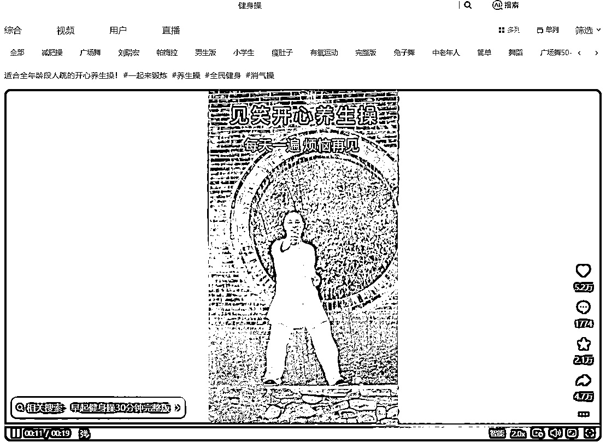

3. 生成角色跳操视频
把刚才生成的古人图片传进即梦，找到“数字人—动作模仿”，上传本地这支健身操视频，系统就会自动生成古人跟跳的视频，保存即可。

4. 剪辑发布
如果你觉得原视频就能用，直接发布；想更精致一点，就导入剪映加标题和字幕，再导出发布。最终成片效果很有戏剧性。

## 提醒几句

- 这个模式现在确实卷，好在延展性很强。你可以往古法养生、五音疗愈、食物养生等方向做，只要做出差异化，就有机会拿到结果。
- 人物风格也可以换，比如Q版、萌娃版、小动物版，都能带来不一样的新鲜感。

# 项目二：睡前故事儿童绘本

## 案例

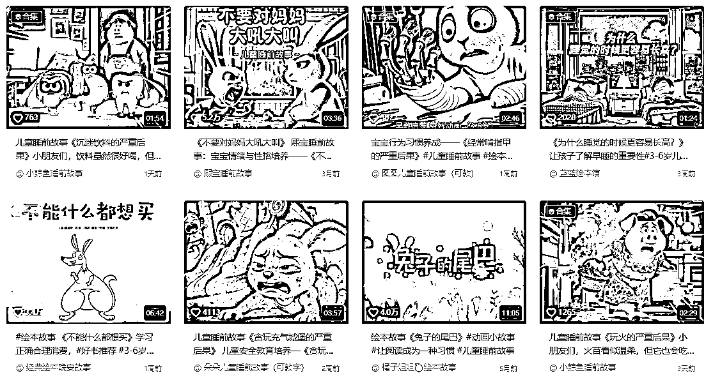

## 项目速览

- 内容载体：3D插画 + 故事配音
- 赚钱方式：主要靠创作者收益，也能带货儿童书籍
- 当前行情：竞争度高，起号率低，操作难度低，收益中等，综合推荐指数1星

## 实操流程

1. 写出儿童故事
用豆包生成一个儿童启蒙故事，也可以找现成的爆款儿童故事改写一下，文案就有了。

2. 一键生成视频
把故事文案放进剪映的AI成片功能，系统会自动完成画面和配音，基本不用手动剪辑，生成后直接发布即可。

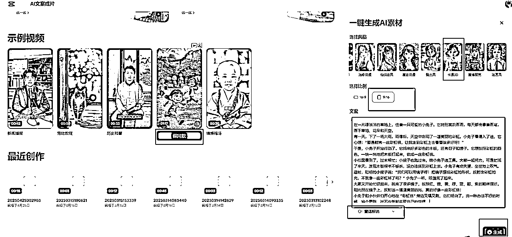

成片效果就是那种柔和绘本风，孩子睡前看很合适。

## 提醒几句

这类内容现在非常卷，账号能跑起来的概率不算高。拿来练手没问题，或者单纯做给自己家孩子当睡前故事，也很有价值。

# 最后总结

- 所有项目里的起号率高低，都带有一定主观判断。因为做得多、经验多，我们更容易做出差异化。大家还是要结合自己的情况选项目，别闭眼冲。
- 前期可以模仿，先把整个流程跑通；但跑通之后必须做出差异化。别人用水墨风，你就换卡通风；人家做古诗，你做文言文；人家走怀旧，你做养生。一直跟在别人后面，很难跑出来。
- 这些项目都适合用“堆号”方式放大产量。想堆号的可以自己摸索。下面图里就是一个工作室批量产出内容的现状，国风类短视频每台机器都在自动持续生成。

# 更高阶玩法

还有一些难度更大的方向，这个帖子里就不逐一拆解了。感兴趣的可以自己研究：古文拆解、电影/历史人物独白、灵魂手绘、古人复活/独白、书单号、AI短剧、神话讲解。