# AI风口这么大，普通人怎么上车？我实测过的9个项目，逐一拆给你看

眼看着AI的消息一天比一天热闹，很多人的状态是：心动，但不敢动。心动是因为风口肉眼可见；不敢动是因为自己既不懂代码，也没想好从哪个具体项目切入，想挤进去却不知道第一步往哪儿落。

最近我密集测试了AI和各种场景的结合，也和不少同路人聊过这个话题。大家的焦虑其实是同一个：热闹都是别人的，自己除了围观，好像什么都做不了。

这篇内容，就是来打破这种焦虑的。

我筛项目有四个硬标准：

- 一是上手门槛足够低，不碰技术，看着流程图就能照做；
- 二是确定性相对强，或者赛道竞争还不算红海，做出成绩的概率更大；
- 三是变现路径必须明确，不能只赚吆喝；
- 四是要有长期价值或延展性，不能干一票就没了。

按这四条，我从实测过的项目里筛出了10个方向，覆盖视频号、抖音、小红书等平台。篇幅有限，每个项目只讲最直接的操作链路，更多可能性留给你自己挖掘。话不多说，直接开始。

## 1. 萌娃祝福

案例素材：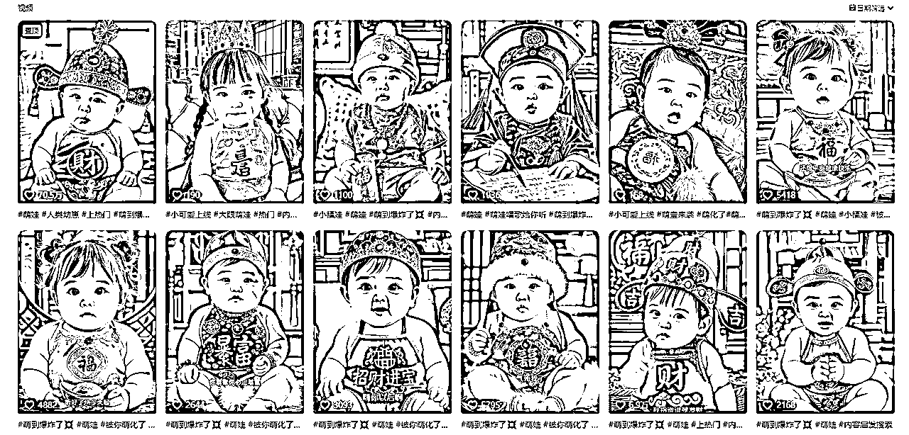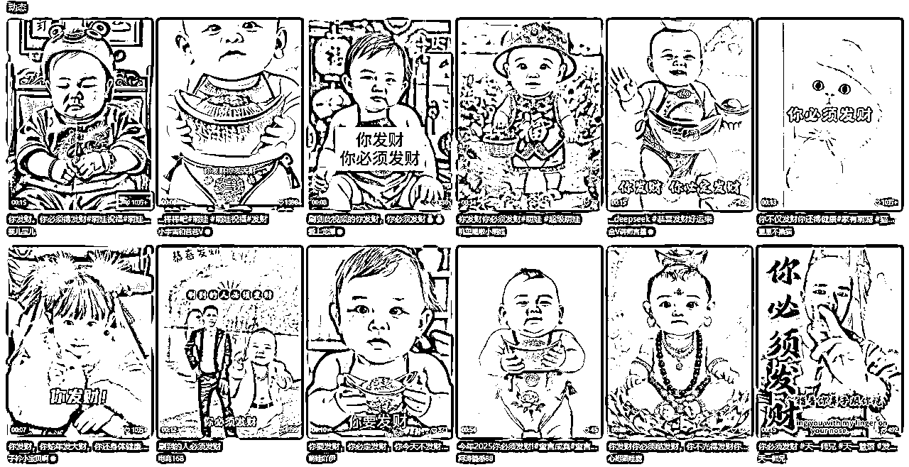

玩法不长：AI生成萌娃，做对口型效果，配上祝福类音频。变现大头是创作者收益，视频号上点赞10w+的作品，单条收入大概在1500到3000元之间；账号权重拉起来之后可以间歇穿插带货，让萌娃讲养生知识，挂养生食品或书籍的链接。

项目画像：竞争度 中｜起号率 高｜制作难度 低｜收益 中｜推荐 4星

操作步骤拆给你：

① 从对标视频里截图萌娃形象，丢给豆包反推提示词：

② 去即梦，把提示词和参考图一起上传，生成一批萌娃图，挑一张最顺眼的存下来。想免水印，点进画布编辑，右键另存为图片就行：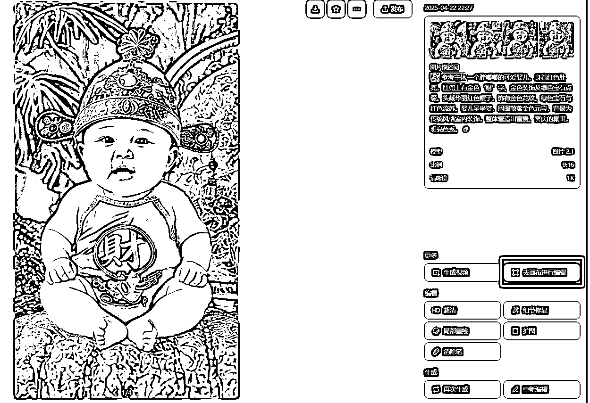

③ 把图片传到即梦的“对口型”功能里，再从对标视频里提取音频一并上传，选“大师版”生成动态视频。演示时排队排了29分钟，这里放个之前生成的成片效果：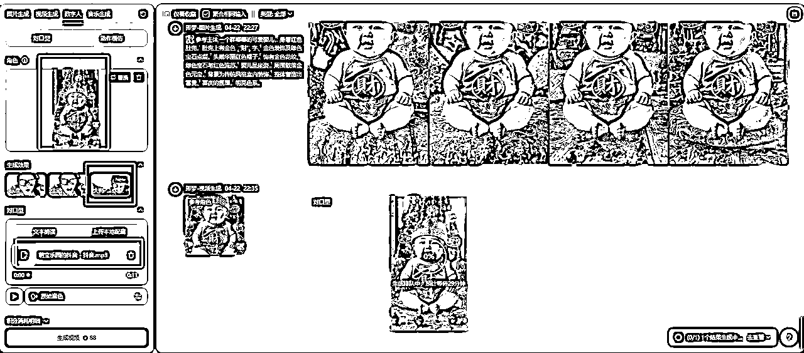

④ 下载回本地，可以直接发，也可以丢进剪映加字幕、调倍速再发。下载用IDM可以拿到无水印版。

避坑提醒：这类视频爆率很高，决定生死的是形象和文案。形象方面，大胆复刻爆款即可；文案方面，祝福语偶尔容易被判违规，可以混着治愈系文案或早安文案发布，扩展到其他内容也非常顺手。

## 2. 早安祝福

案例素材：

内容是风景画面+早安文案，制作成本极低。变现主要是创作者收益，每天发两三条，逢二十四节气或节假日特别容易爆；账号起来后可以顺势挂车，推荐养生食品或书籍。

项目画像：竞争度 中｜起号率 中｜制作难度 中｜收益 中｜推荐 3.5星

操作步骤：

① 在即梦搜索风景、柳树、喜鹊等关键词，看到合眼缘的图直接点“做同款”：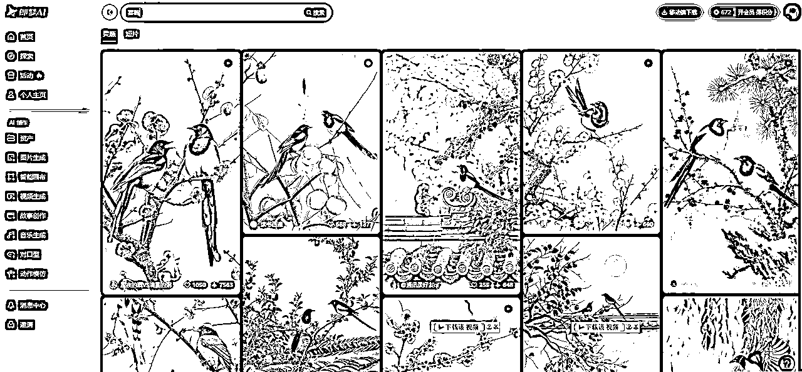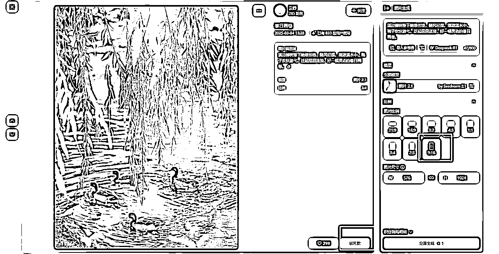

② 选图片生成视频，想画质更佳可以用S2.0pro，生成的视频保存到本地：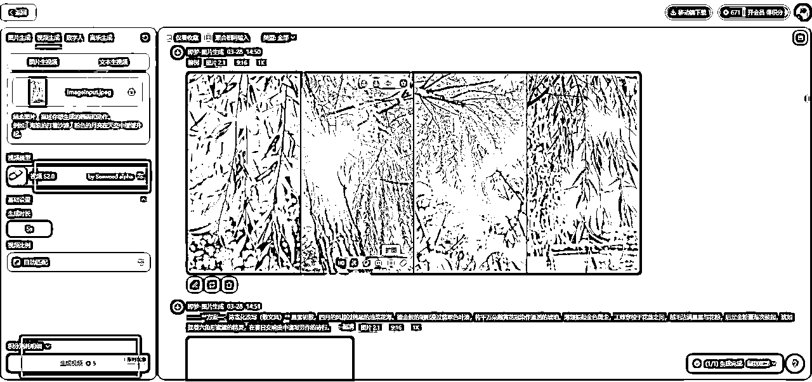

③ 把视频拖进剪映，从备好的文案库里挑一条适合当天的文案，顺手把日期改成当天：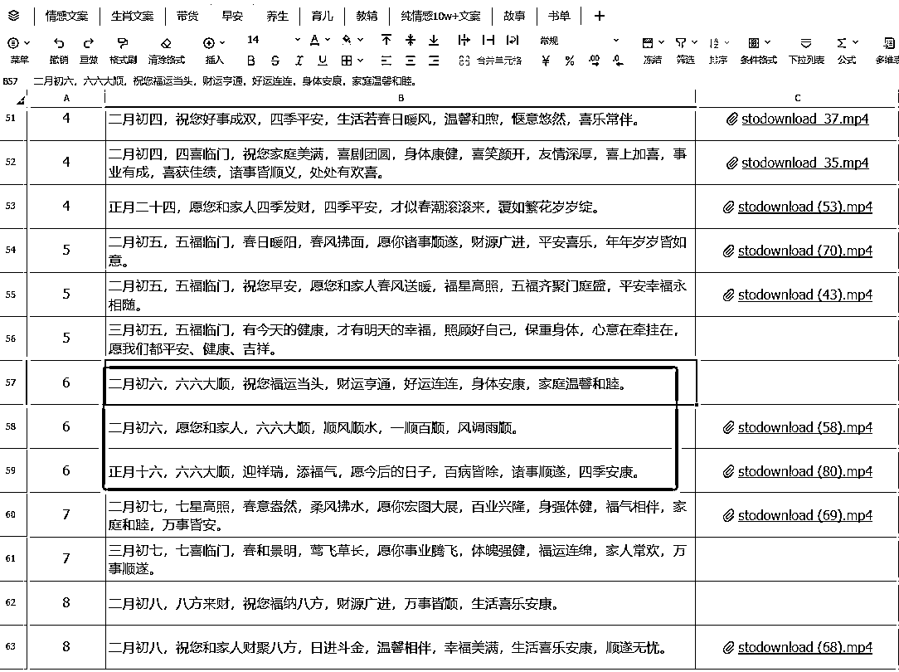

④ 点朗读，选“心灵鸡汤”音色生成配音：

⑤ 素材放主轨，对好时长，加配乐和字幕，导出发布：

避坑提醒：目前市面上早安号大多是情感类文案，红海中的红海，起号率很低，不建议去做。祝福类起号率中等偏上。分享一个提高起号率的小技巧：在早安文案前加上生肖，比如“属猴人，今天是4月23日，农历3月26，早安……”，效果会明显改善。文案可以从广场上把初一到初十的祝福语全部扒下来，扔给豆包仿写；遇到节气或节假日，记得专门出对应内容。

## 3. 育儿经

案例素材：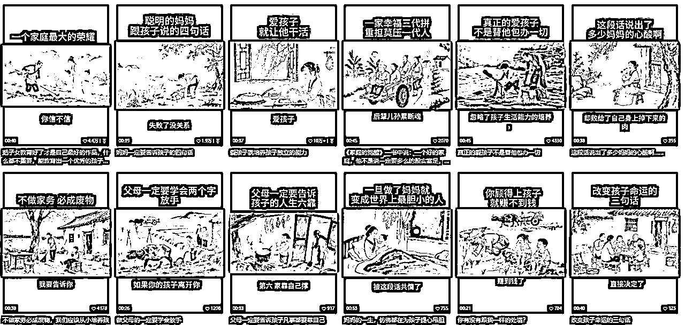

内容是育儿知识+搭配文案的古风水墨画视频。变现上，创作者收益适合多账号运营来放大；账号做起来之后，挂车卖育儿类书籍、玩具、文具都很顺。

项目画像：竞争度 高｜起号率 低｜制作难度 高｜收益 高｜推荐 3星

操作步骤：

① 先把对标视频下载下来，把视频链接发给豆包，让它提取文案：

② 参考对标视频的画面特征，让豆包生成分镜提示词，再根据文案内容手动调整细节：

③ 拿着调整好的提示词去即梦，用图片2.0pro生成图片，满意的选“超清”：

④ 把图片依次生成视频，提示词就按文案意思填写，也可以继续找豆包代写：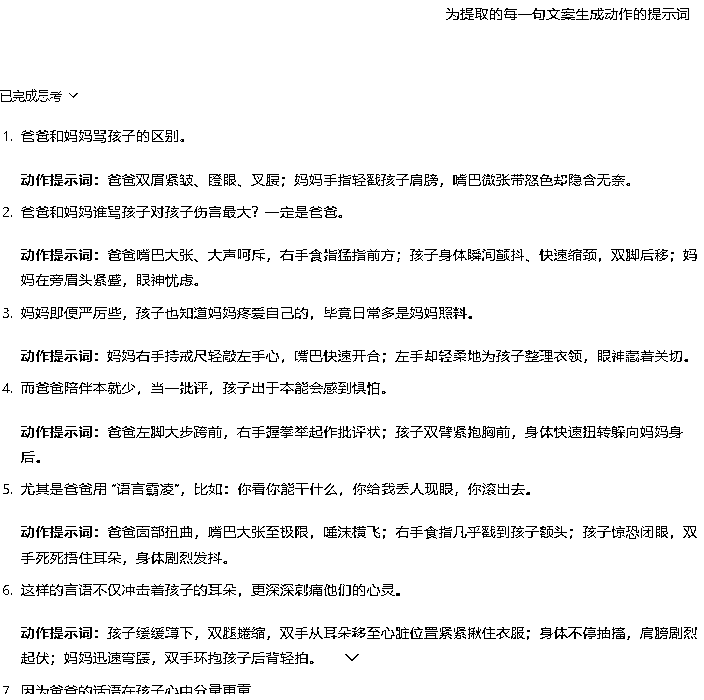

⑤ 所有素材导入剪映，按顺序排好，把画面时长和音频对齐，加标题和字幕，导出上传：

避坑提醒：如果追求人物形象从头到尾保持一致，制作难度会明显飙升。前期不用太执着，只要画面内容和文案意思匹配、观感不违和就行，这个赛道是靠文案和数量砸出来的。配音方面，配音软件或剪映朗读都可以；新手可以直接先沿用对标视频的原声，后期再逐渐换成自己的文案和声音。

## 4. 英语启蒙

玩法是卡通画面+儿童英语知识配音。变现路径很单一也很清晰：视频挂车，卖英语书籍、课程、文具。

项目画像：竞争度 高｜起号率 低｜制作难度 低｜收益 中｜推荐 3星

操作步骤：

① 用豆包生成文案，提示词长这样：

② 再用豆包生成分镜提示词，去即梦出图片：

③ 选好图片后逐张生成视频。这个内容不要求精细动作，用S2.0模型就够：

④ 文案加进剪映，选一个合适的音色朗读：

⑤ 把视频素材拖到剪映里对齐文案，音频时长统一，加字幕和标题，导出：

避坑提醒：操作确实简单，变现也明确，但竞争非常激烈，想跑出来要么做差异化内容，要么老老实实靠堆量换概率。

## 5. 治愈奶奶

案例素材：

内容是卡通老奶奶或老爷爷的形象，配上治愈系文案和背景音乐。变现方面，创作者收益有个小技巧：最后一张图记得引导观众评论，比如“留下你的故事”，互动会明显更好；带货目前挂书最多，延展到养生食品也可以，但文案需要搭配好。

项目画像：竞争度 高｜起号率 低｜制作难度 低｜收益 低｜推荐 2星

操作步骤：

① 新手先扒对标账号的爆款文案或热门情感文案；顺手看看豆包智能体里的“治愈系老奶奶”，文案和提示词都能生成，但质量需要自己筛选：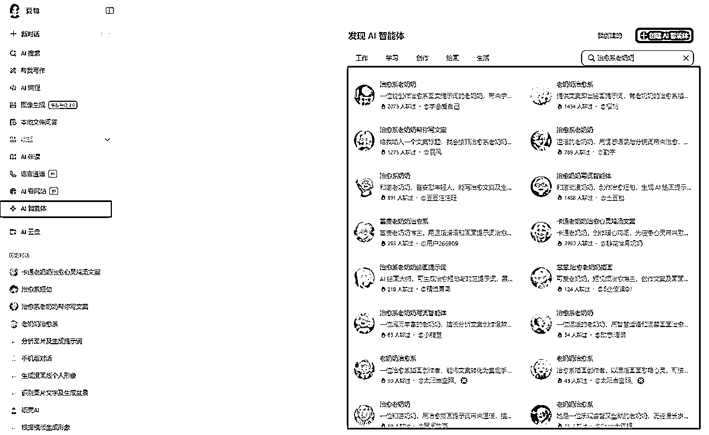

② 把文案带到即梦，搜索“治愈系老奶奶”，选喜欢的模板做同款，再把模板文案改成自己的，然后批量生成图片：

③ 图片导入剪映合成视频，注意跟背景音乐卡点，加转场动画，导出发布：

避坑提醒：现在同赛道的人非常多，不少账号爆了一两条就再也不爆，核心原因就是内容同质化。想活下来得做差异化，比如反治愈风格：“一定要牢记，别随便对人掏心掏肺，不是每个人都会真心待你；别对任何人过于亲近，不是每个人都像你这般善良。”另外，还可以往最近很火的养生操方向延伸。

## 6. 怀旧乡村

内容是乡村怀旧画面+舒缓音乐。创作者收益不太稳定，要靠差异化和评论引导来补；带货可以挂怀旧类视频或怀旧玩具。

项目画像：竞争度 高｜起号率 中｜制作难度 低｜收益 低｜推荐 2.5星

操作步骤：

① 提示词继续找豆包：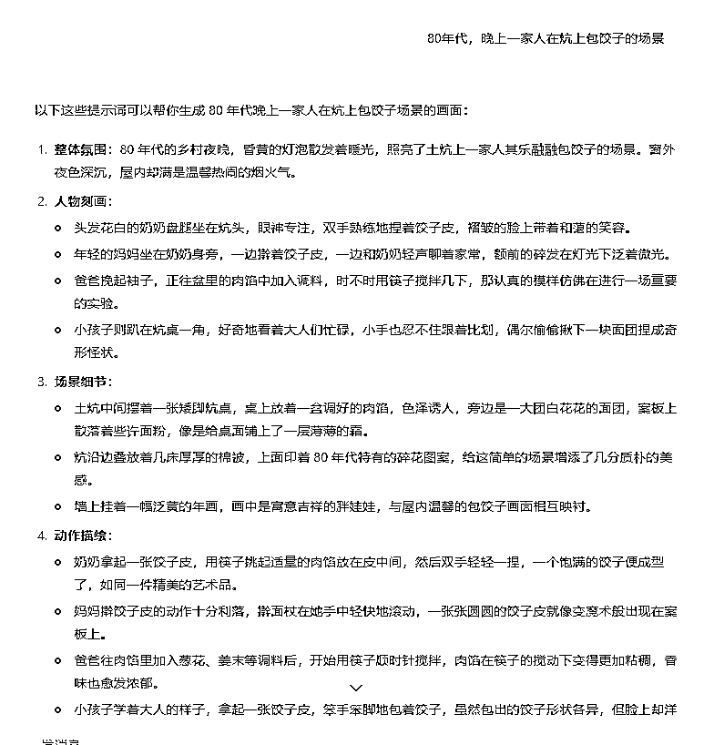

② 拿提示词到即梦生成图片，开头记得加“高清实拍、高饱和度”等词，画面质感会更好：

③ 选合适的图点“超清”再生成视频，动作提示词按画面需求填，不会写还是找豆包：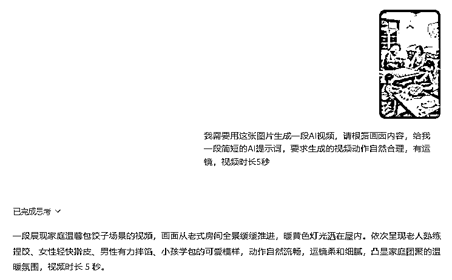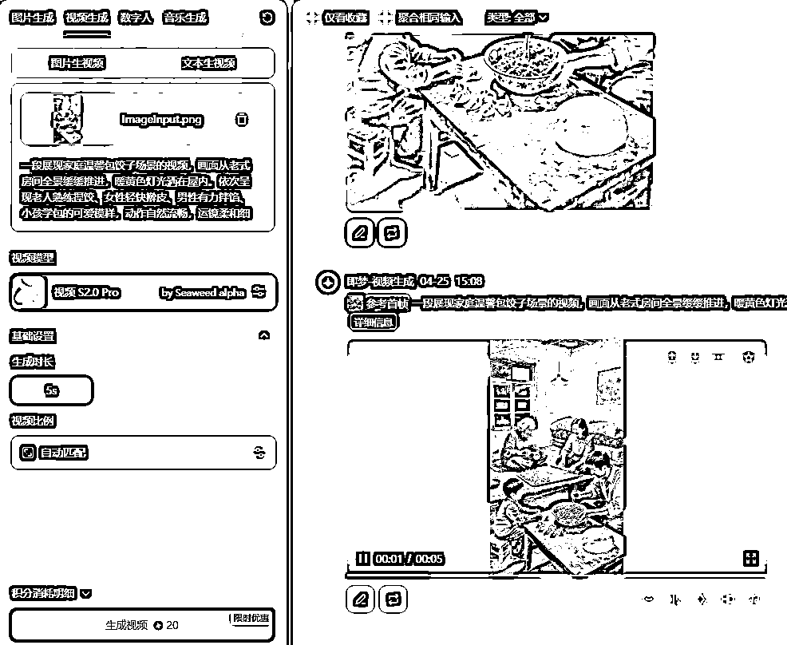

④ 剪映里加背景音乐，调倍速，导出即可：

避坑提醒：这类账号最大的问题是同质化严重，怀旧风扩展性有限，可以考虑往治愈系方向去延伸。

## 7. 墙绘女孩

案例素材：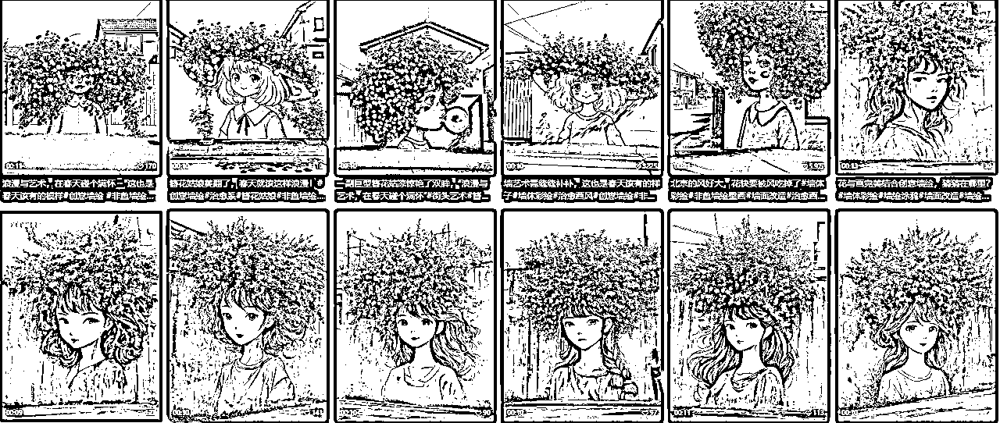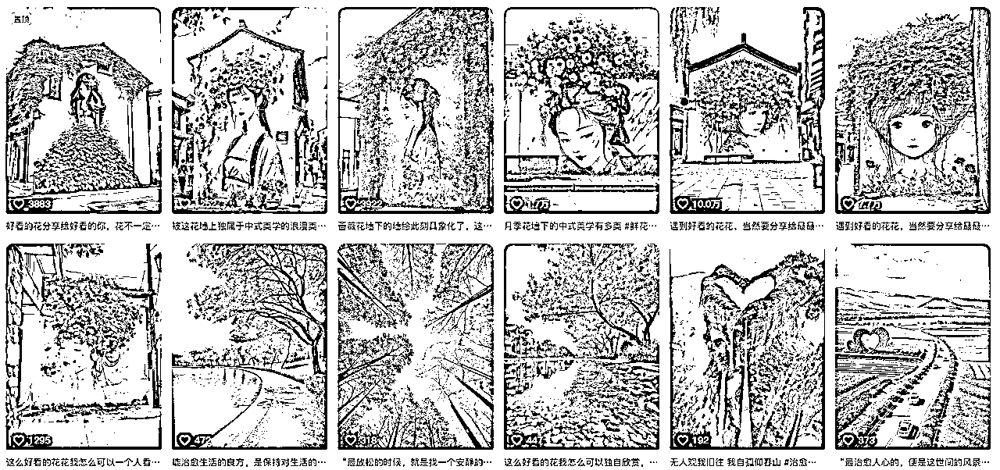

内容是墙绘女孩+鲜花头发的视觉画面。变现方式比较多元：创作者收益、线下实体墙绘引流、AI绘画教学都能跑通。

项目画像：竞争度 中｜起号率 中｜制作难度 低｜收益 中｜推荐 3星

操作步骤：

① 图片有两种做法：截对标账号画面给豆包反推提示词；或者去即梦搜“墙绘女孩”找模板做同款：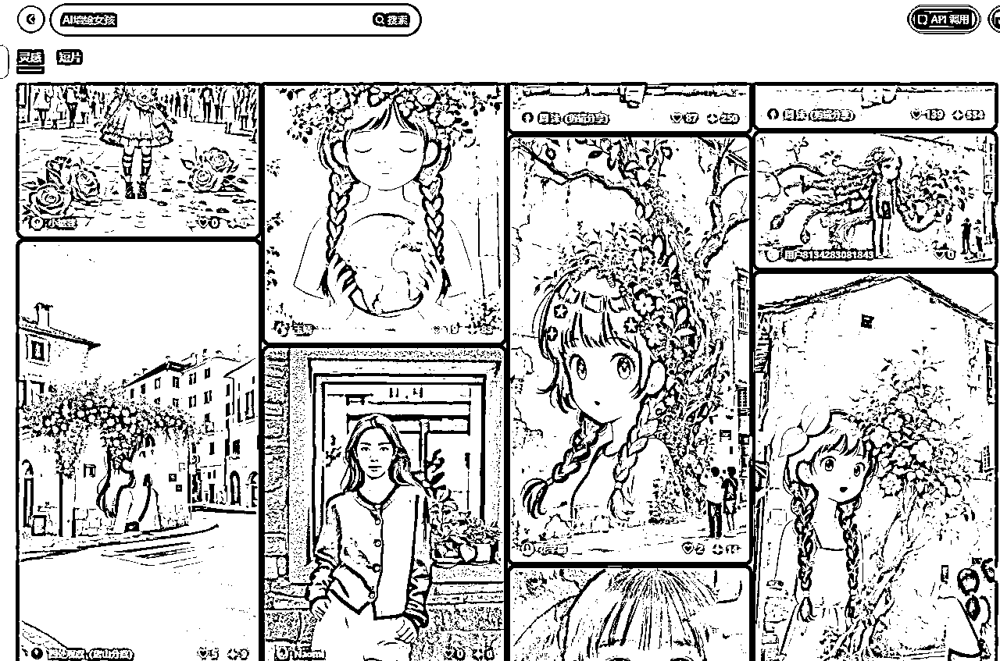

② 选好图片生成视频，提示词按画面内容来写，一般是镜头推进、花朵随风摆动、花瓣散落这些：

③ 视频进剪映，加背景音乐、调色；想拉长时长，可以再加一个倒放效果，导出：

避坑提醒：这是最近刚跑起来的模式，跟风的人已经不少，流量普遍不错。这种绘画类IP的可延展内容很多，关键还是差异化。类似的路子还有灵魂画手、热点手绘等。

## 8. 星座

案例素材：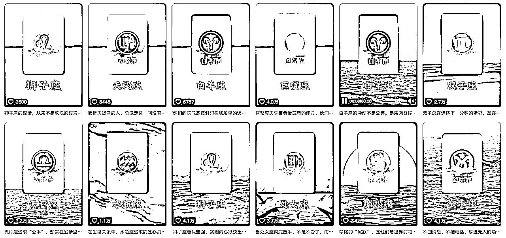

形式是书单式开场+星座文案+风景素材。变现场景最多：创作收益、带货、私域、教学都能接上。

项目画像：竞争度 中｜起号率 高｜制作难度 中｜收益 中｜推荐 3.5星

操作步骤：

① 到小红书搜“星座”，找到合适的图片保存下来：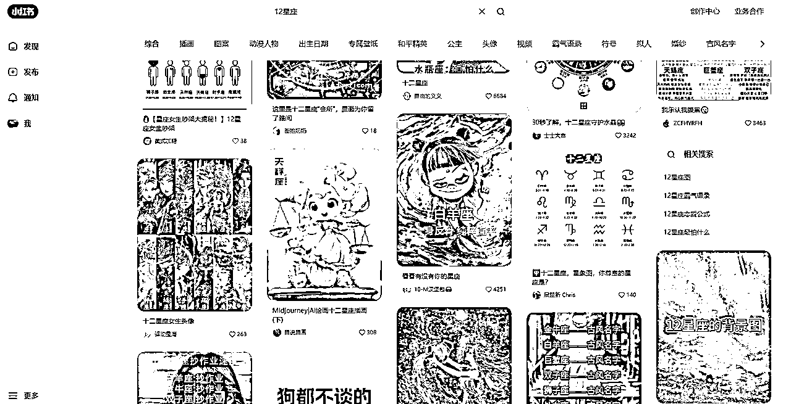

② 打开即梦，搜索风景和情感类图片，选好就做同款：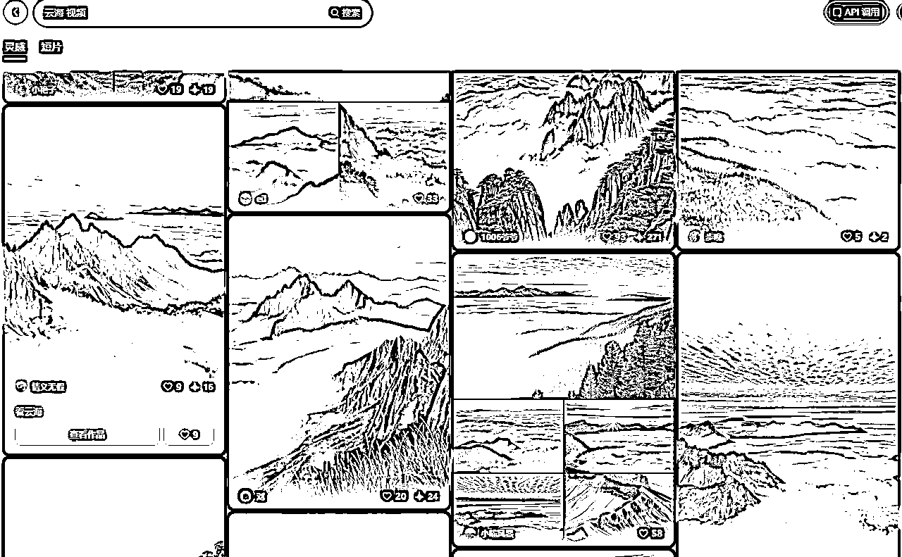

③ 用豆包仿写对标视频的文案，再拿去配音软件选一个合适的声音生成配音：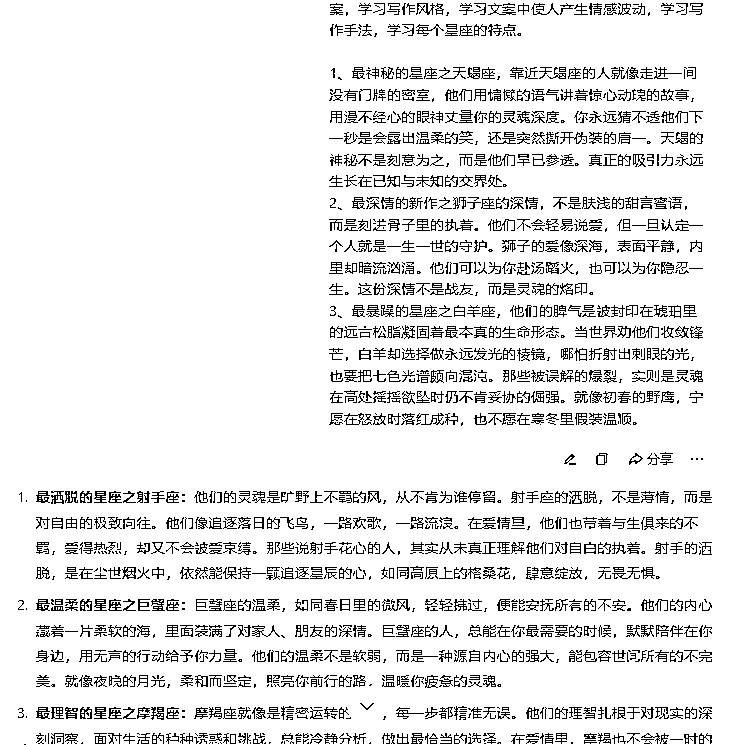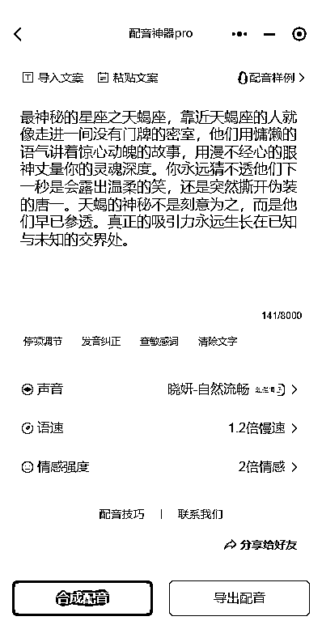

④ 重点来了，剪映里这么排版：背景图片放主轨；星座卡缩小到30%依次排开，打成复合片段；给复合片段打位置关键帧，实现滚动效果；要讲解的那张星座图，放到对应时间线处，通过位置和放大关键帧做出强调效果；其余情感图、风景图依次加到主轨，加边框特效；最后补上字幕、配音和音效，导出：

避坑提醒：这个模式目前做的人不算多，起号率比较高，抖音和小红书都适合跑。

## 9. 古法养生

案例素材：

这个项目在原始资料里只展示到了案例画面，具体的模式拆解还没有放出来，等拿到完整资料再补齐。从项目名和案例画面来看，大概率是围绕传统养生知识展开的内容方向，很适合与国风画面搭配，有进一步拆解空间。

最后说句实在话：AI领域不缺技术大神，缺的是愿意把工具用起来的人。以上这些项目有一个共同逻辑——普通人切入AI，未必要先啃技术，把AI当作趁手工具、直接放进真实场景里，反而是最顺的那条路。挑一个你感兴趣的方向先跑起来，迈出第一步，比围观和焦虑有用得多。

打开抖音，你可能刷到过“古人”跳健身操的视频，也看过那种3D画风的儿童睡前故事。这些内容看着简单，背后却藏着两套成熟的AI短视频玩法。下面直接拆解给你们。

## 一、让古人跳操，也能赚钱？

这个玩法的核心，就是给古风人物加上健身动作，碰撞出一种反差感。变现方面，平台创作收益是基本盘，此外还能带货健身器材、卖相关课程，甚至对接减脂产品。

从数据看，这个方向竞争已经偏高，起步成功概率不算高，但技术门槛低，收益中等，综合推荐度三星。

具体怎么操作？几步就能跑通：

第一步，搞定古人图片。打开即梦，搜索“古人健身操”，找一张喜欢的图做同款。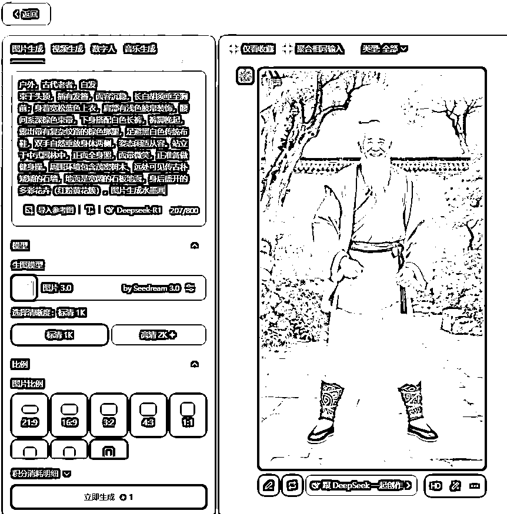

第二步，找到对标视频。去抖音搜健身操，选一段效果好的下载到本地。

第三步，让图片“动”起来。把刚才那张古人图传到即梦，进入数字人功能，选择动作模仿，上传本地健身视频，系统会自动生成一段人物跳操视频，保存即可。

第四步，剪辑发布。视频可以直接发，也可以导入剪映，加上字幕、标题再发表。

需要提醒的是，现在这个模式很卷，但延伸方向多。你可以往古法养生、五音疗愈、食物养生等方向做差异化，仍有突围机会。画面样式也可以换，比如Q版、萌娃版、小动物版。

## 二、睡前故事绘本，做成视频还香吗？

先看几个案例。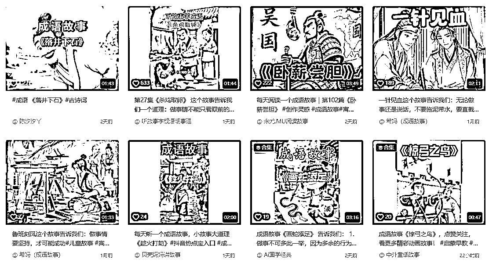

这个项目说白了，就是“3D插画+故事配音”，专门给低龄孩子做睡前内容。变现方式主要是创作收益，还有儿童书籍带货。

目前它的情况是：竞争度高、起号率低、难度低、收益中，但推荐指数只有一星。为什么？因为想靠它做出爆号并不容易，更适合练手或自用。

操作流程也不复杂：

先用豆包生成儿童启蒙故事，或者从爆款故事里挑一篇改写。

再把故事交给剪映，用AI成片功能直接生成视频，发布就行。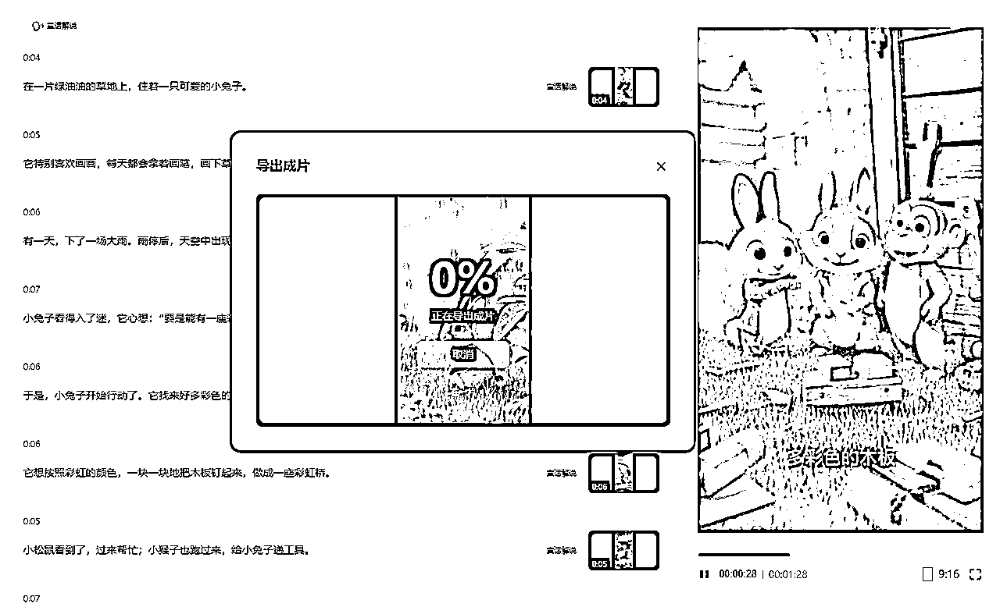

如果你只是想跑一遍AI流程，或者给自己家孩子做专属睡前故事，这倒是个不错的练习项目。

## 三、一些真心建议

不管是上面哪个项目，起号率的高低判断都带主观性。因为我们平时做的差异化更多，经验也更丰富，所以你们参考时，最好结合自身情况再决定。

前期可以模仿，但别永远做搬运工。流程跑通后，要做差异：别人水墨风，你就卡通风；别人做古诗，你就做文言文；别人走怀旧，你就做养生。一直抄作业，很难跑出来。

另外，所有项目都支持矩阵堆号。想批量操作的可以自己研究，这里放一个工作室的堆号现状，国风类短视频，图中每台机器都在自动批量产出。

如果这些基础玩法已经满足不了你，下面几个进阶方向欢迎研究：古文拆解、电影/历史人物独白、灵魂手绘、古人复活/独白、书单号、AI短剧、神话讲解。