大家好，我是纸壳。最近这段时间，我一直在密集测试AI和各类项目的组合玩法，跟不少朋友交流下来发现，很多人心里其实都有点发慌：AI话题这么热，谁都不想错过这波浪潮，可真到自己上手的时候，又不知道从哪里切入——技术不懂，项目也没影儿。其实我测了一圈下来，有不少方向非常适合普通人当作进入AI领域的起步抓手，不碰代码、不研究底层原理，纯粹把AI当工具用就行。今天我就把这些项目的拆解思路和操作流程整理出来，给大家做个参考。

先说说筛选项目的标准。我主要看四点：第一，操作门槛要低，不用懂技术，照着流程走就能落地；第二，竞争度相对可控，或者确定性比较强，做起来大概率能有起色；第三，变现方式要清晰，不能只赚热闹；第四，项目要有长期价值，或者有延展空间。基于这套标准，我从测试过的项目里挑出了10个，横跨抖音、视频号、小红书等平台。篇幅有限，每个项目我就讲最直接的操作路径，剩下的扩展玩法可以自己摸索。

下面直接进正题。

## 项目一：萌娃祝福

先看案例感受一下：

这个项目的玩法是用AI生成萌娃形象，再做对口型，配上祝福类的音频。变现上主要有两块：一是创作者收益，拿视频号来说，一条点赞过10万的作品，单条收益大概在1500到3000元；二是带货，账号权重足够了以后，可以隔三差五发一些萌娃讲养生的视频，顺便挂车卖养生食品或相关书籍。从现状看，这个项目竞争度中等，起号率高，制作难度低，收益中等，综合推荐指数四星。

具体操作分三步。第一步出图：先截取对标视频里的形象，丢给豆包反推提示词；然后去即梦上传提示词和参考图，生成萌娃图片，挑满意的保存到本地。这里有个小技巧：点进“画布编辑”，再右键保存图片，就能拿到不带水印的版本。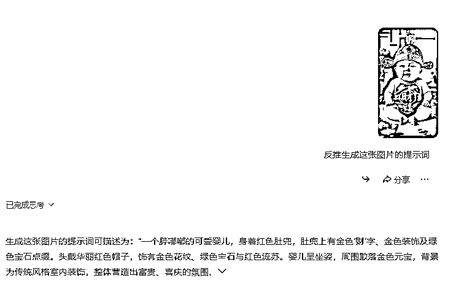 实际操作的效果是这样的：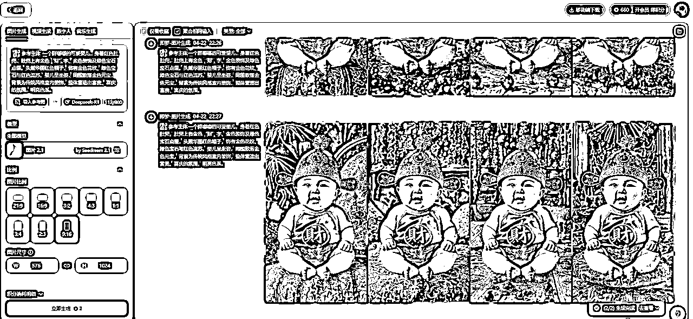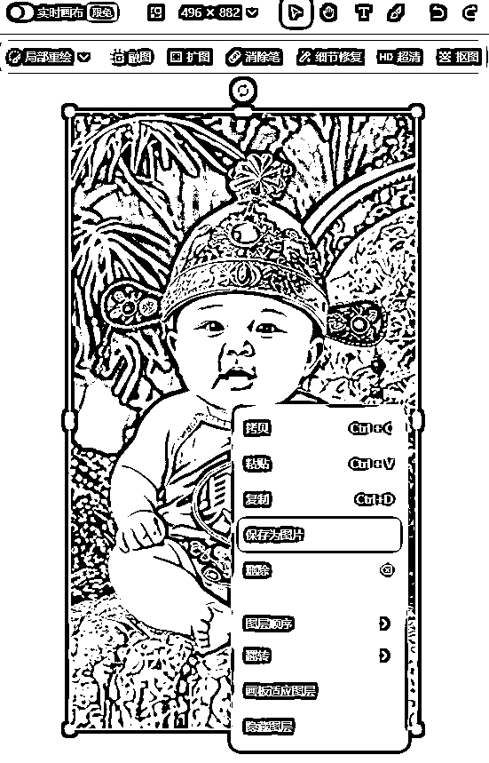

第二步对口型：把保存好的图片上传到即梦的对口型功能，再从对标视频里提取音频一起传上去，选“大师版”，生成视频。刚才演示的时候排队排了二十多分钟，放一个之前做好的成片吧。

第三步剪辑发布：把生成好的视频下载到本地，可以直接发，也可以放进剪映加字幕、调倍速后再发。

几个注意点：这类视频爆的概率很高，核心在于形象和文案，形象尽量复刻爆款；文案方面，祝福类内容有一定违规风险，可以和治愈系文案混着发，或者用项目二里的早安文案，扩展空间很大。另外，用IDM下载即梦生成的视频，可以得到无水印版。

## 项目二：早安祝福

先看案例：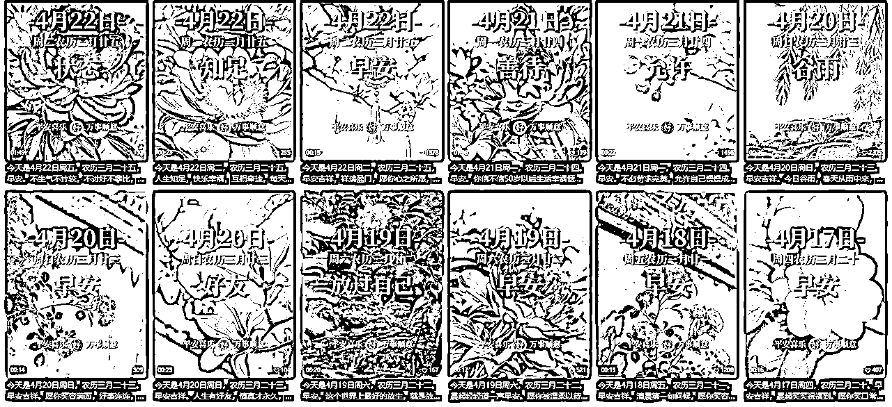

这个模式是风景视频配早安祝福文案。变现主要靠创作者收益，每天发2到3条，逢节气或节假日特别容易爆；账号权重升上来之后，可以趁着节气发带货视频，卖养生食品或书籍。目前竞争度中等，起号率中等，制作难度中等，收益中等，推荐指数三星半。

操作流程不长。第一步，去即梦搜“风景”“柳树”“喜鹊”这类词，找到合适的图片，点“去做同款”。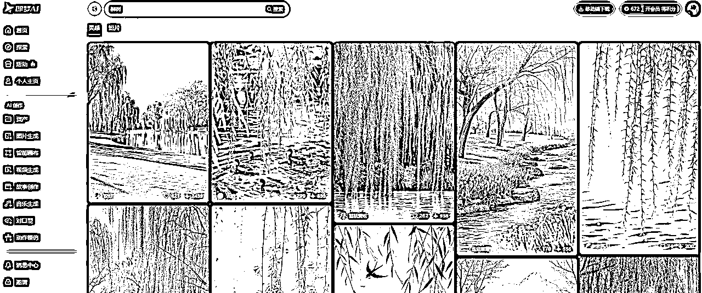 第二步，挑好图片后点生成视频，想要更好的效果可以用S2.0pro，生成后存到本地。 第三步，把视频拖进剪映，从提前整理好的文案库里选一句合适的，改好日期加到文本轨道；点“朗读”，选“心灵鸡汤”音色生成配音；再把素材放到主轨，调整时长、加配乐和字幕，导出发布。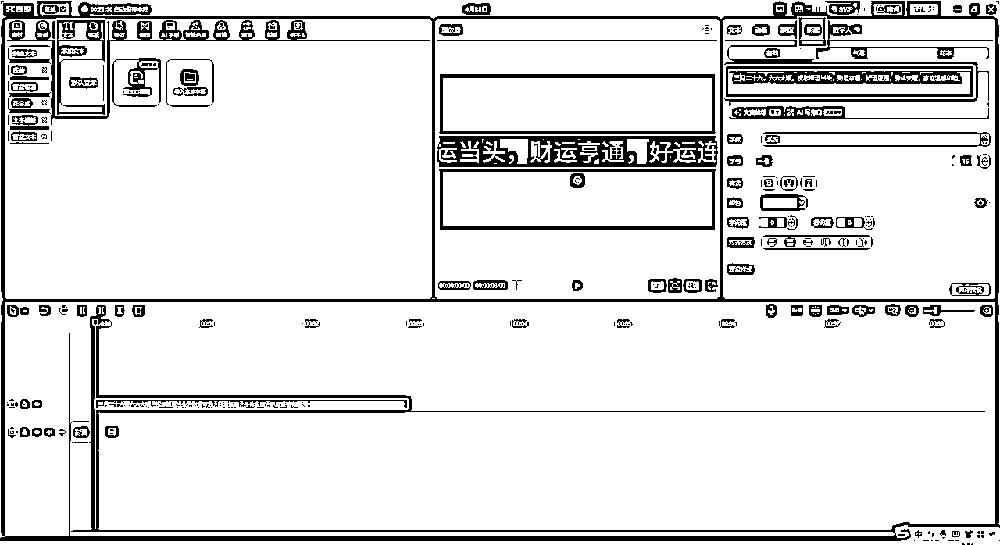

注意事项：市面上大部分早安账号做的是情感鸡汤，竞争很激烈，起号率低，不建议碰；祝福类起号率中等，想再提一提的话，可以在传统早安文案前面加上生肖，比如“属猴人，今天是4月23日，农历3月26，早安……”，能明显提高起号效率。文案方面，把相关广场上初一到初十的内容扒一圈，丢给豆包仿写就行；遇到节气或节假日，要单独准备对应文案。

## 项目三：育儿经

先看案例：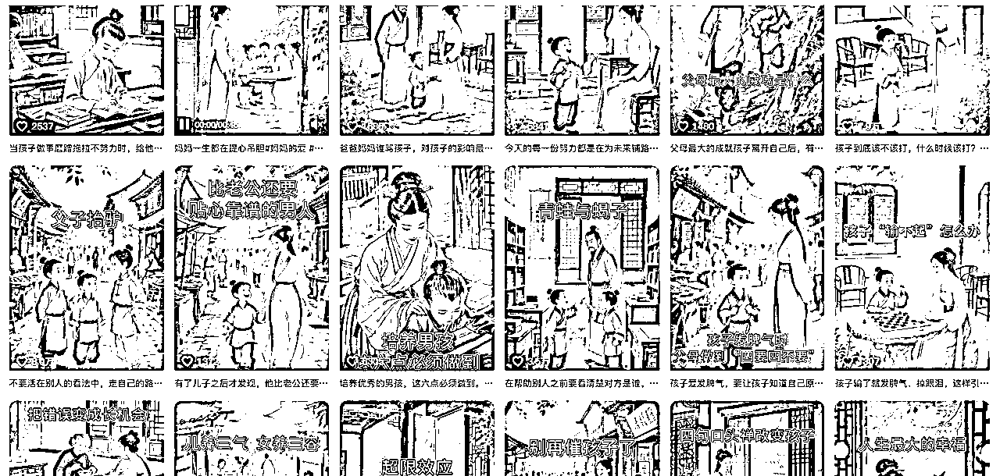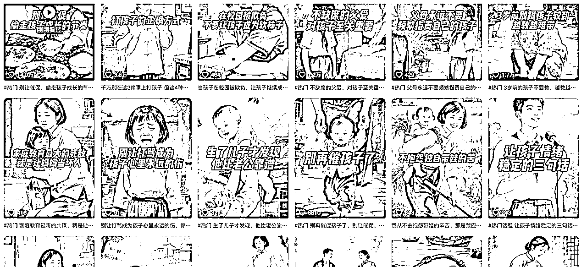

内容形式是育儿知识配上古风水墨画风格的视频。变现上，创作者收益是主要来源，建议多账号一起运营；账号权重够了以后，视频可以挂车卖育儿书籍、玩具、文具等。目前这个项目竞争度高，起号率低，制作难度高，收益高，推荐指数三星。

操作流程大概五步。第一步，下载对标视频，把视频链接发给豆包，让它提取文案。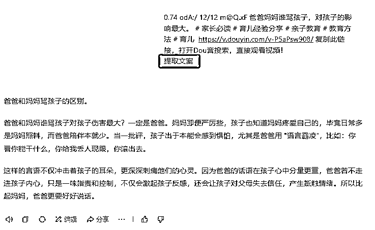 第二步，参考对标视频的画面特征，用豆包生成分镜提示词，有些提示词需要根据文案内容做调整。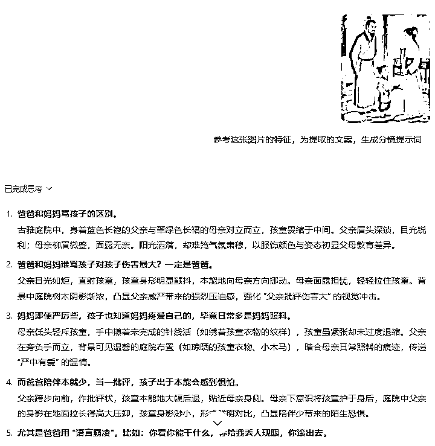 第三步，拿着调整好的提示词，依次到即梦生成图片，选“图片2.0pro”，挑满意的图再点“超清”。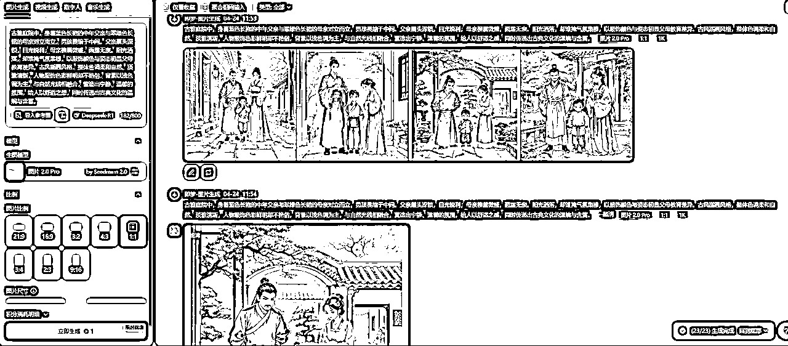 第四步，把保存的图片依次拿去生成视频，提示词按文案内容填，也可以用豆包生成后微调。 第五步，把所有视频导入剪映，按顺序排好，调整画面时长和音频对齐，加上标题和字幕，导出上传。

注意事项：如果想让人物保持前后一致，制作难度会直线上升。前期只要画面内容和文案匹配就行，主要靠文案质量和堆量来爆，画面不违和就过关。配音可以用配音软件或剪映朗读，新手阶段先用对标视频的原声，后面再慢慢做自己的原创文案和配音。

## 项目四：英语启蒙

这个项目没有放案例图，直接说内容形式：卡通画面加儿童英语知识配音。变现路径很清晰，就是视频挂车卖英语书籍、课程、文具等。目前竞争度高，起号率低，制作难度低，收益中等，推荐指数三星。

操作流程很轻：第一步，用豆包生成文案，提示词如下： 第二步，再用豆包生成分镜提示词，然后去即梦生成图片。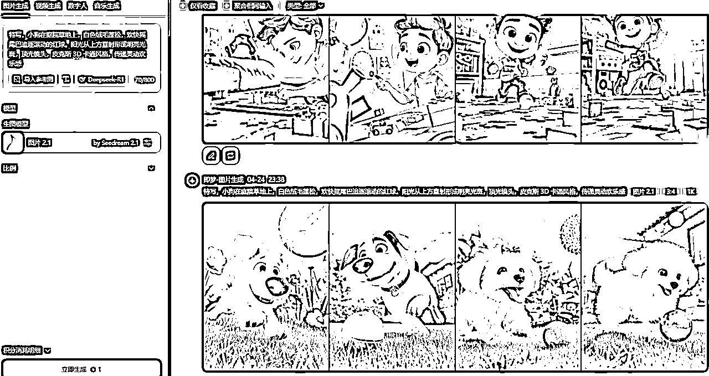 第三步，选合适的图片依次点生成视频，保存到本地。因为这类视频对精准度要求不高，用S2.0模型就行。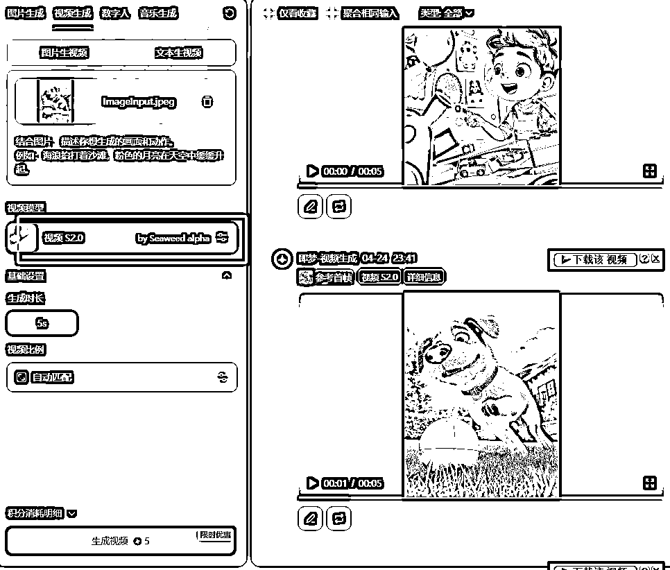 第四步，把文案复制到剪映文本，选一个合适的音色朗读。 第五步，把视频加到剪映，和文案位置对齐，音频时长统一，加上字幕和标题，导出。

注意事项：这个模式做起来简单，变现方向明确，但竞争非常激烈。想跑出来，要么做出差异化，要么就堆量。

## 项目五：治愈奶奶

先看案例：

内容形式是可爱的卡通老奶奶或老爷爷，配上治愈系文案和背景音乐。变现上，创作者收益有个小技巧：最后一张图可以引导观众评论，比如“留下你的故事”；带货方面，目前挂车卖书的比较多，也可以搭配文案卖养生食品。目前竞争度高，起号率低，制作难度低，收益低，推荐指数两星。

操作流程：文案方面，新手建议先去扒对标账号的爆款文案或热门情感文案，有经验之后再用豆包生成原创。豆包智能体里有很多治愈系老奶奶的角色，可以生成文案，也能生成提示词，不过有些不太好用，需要自己筛选。 图片方面，去即梦搜“治愈系老奶奶”，挑一个喜欢的模板做同款，把文案改成自己的，然后一张张生成。 最后到剪映里把图片合成视频，注意跟背景音乐卡点，加转场动画，导出发布。

注意事项：目前这个模式同行已经很多，很多账号爆一两条就没下文了，根子是内容同质化。尽量做差异化，比如反治愈风格：“一定要牢记，别随便对人掏心掏肺，不是每个人都会真心待你。”还可以延伸到其他方向，比如结合最近挺火的养生操。

## 项目六：怀旧乡村

这个项目没有放案例图，内容形式是乡村怀旧类画面配上舒缓音乐。变现上，创作者收益不稳定，需要多做差异化内容并引导观众评论；带货可以挂怀旧类视频、玩具等。目前竞争度高，起号率中等，制作难度低，收益低，推荐指数两星半。

操作流程：第一步，提示词依然交给老搭档豆包。 第二步，拿着提示词去即梦生成图片，前面加上“高清实拍”“高饱和度”等词，画面质感会更好。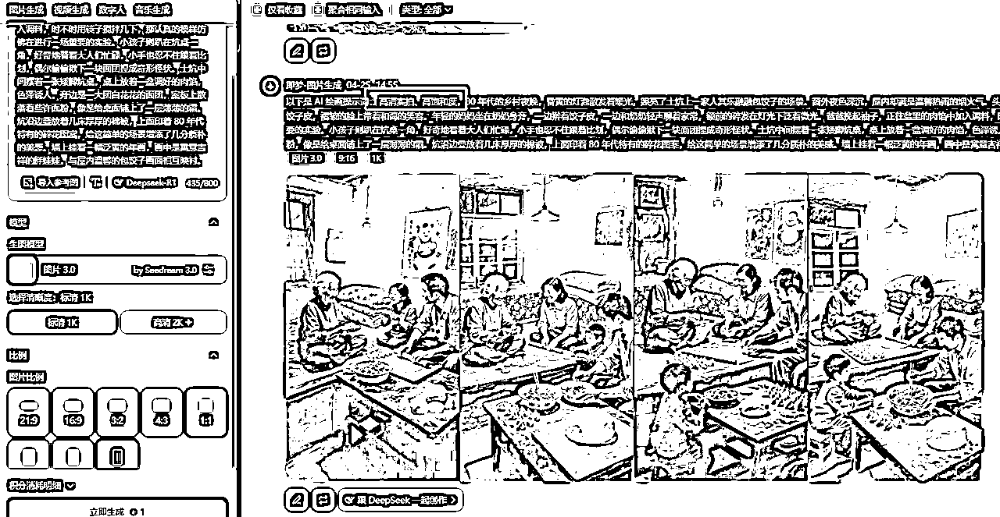 第三步，选中合适的图片，点“超清”再生成视频，动作提示词不会写的话，继续找豆包。 第四步，把视频导入剪映，加上背景音乐、调一下倍速，导出发布。

注意事项：这类账号目前最大的问题也是同质化严重，怀旧风的扩展性不算强，可以考虑往治愈系方向延伸。

## 项目七：墙绘女孩

先看案例：

内容形式是墙绘女孩加鲜花头发，画面很有辨识度。变现方式比较多元：创作者收益、线下实体墙绘引流、AI绘画教学都可以走。目前竞争度中等，起号率中等，制作难度低，收益中等，推荐指数三星。

操作流程分三步。第一步生成提示词和图片：一种办法是截取对标账号的画面丢给豆包反推提示词；另一种是直接去即梦搜“墙绘女孩”，找模板做同款。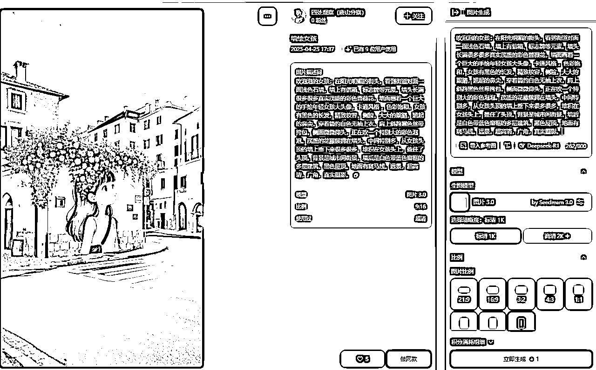 第二步，选好图片，点“超清”再生成视频，提示词按图片内容写，一般就是镜头推进、花朵随风摆动、花瓣散落这些。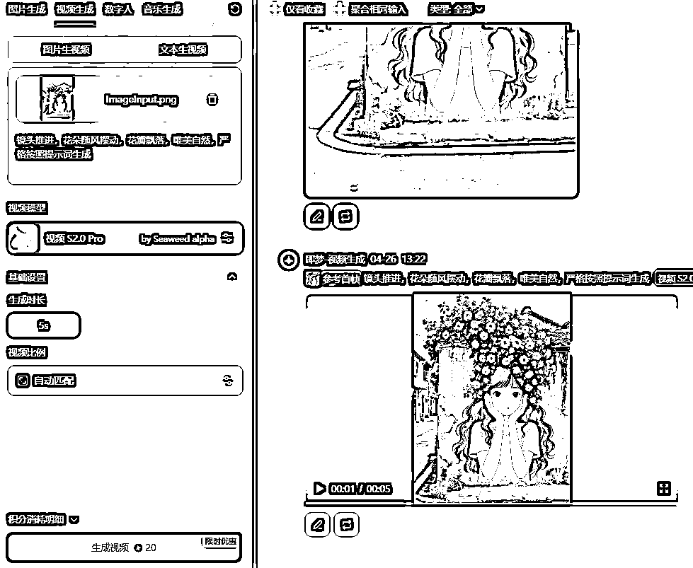 第三步，把视频放进剪映，加背景音乐、调色，想延长时长的话可以用倒放，导出发布。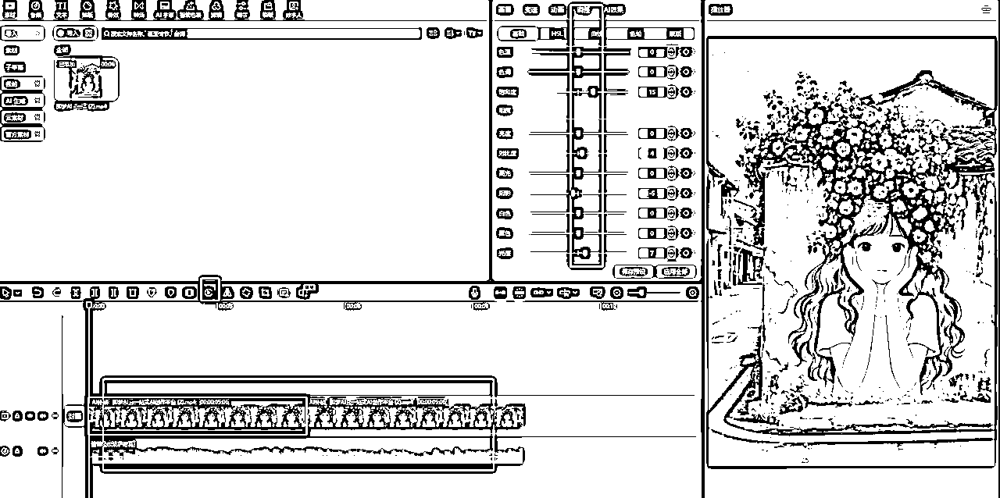

注意事项：这个模式最近刚跑起来，已经有不少人跟进，流量都不错。绘画类内容可延展的东西很多，但还是要注意做差异化。类似的项目还有灵魂画手、热点手绘等。

## 项目八：星座

先看案例：

内容形式是书单式开头加星座文案加风景素材。变现方式很灵活，创作收益、带货、私域、教学都能做。目前竞争度中等，起号率高，制作难度中等，收益中等，推荐指数三星半。

操作流程如下：第一步，打开小红书搜“星座”，找到合适的图片保存下来。 第二步，打开即梦，搜风景和情感类图片，挑合适的做同款。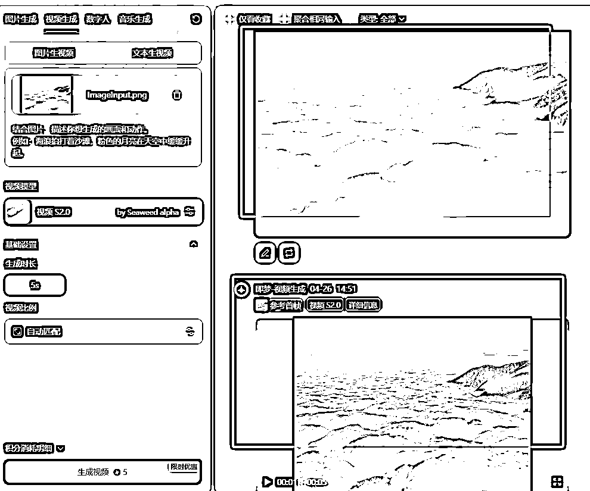 第三步，用豆包仿写对标视频的文案，写好后拿到配音软件选个合适的声音生成配音。 第四步，把所有素材导进剪映：背景图片放主轨，星座图缩小到30%依次排开，打成复合片段，并设置位置关键帧做出滚动效果；把要讲解的星座图放到对应时间线，设置位置和放大关键帧，做出突出强调；再依次把其他情感、风景图片加到主轨，加边框特效；最后加上字幕、配音和音效，导出。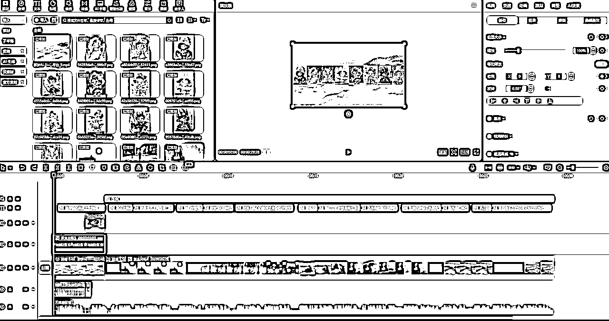

注意事项：这个模式目前做的人不算多，起号成功率比较高，适合抖音和小红书平台。

## 项目九：古法养生

案例先放出来：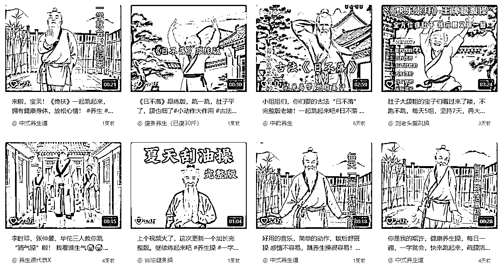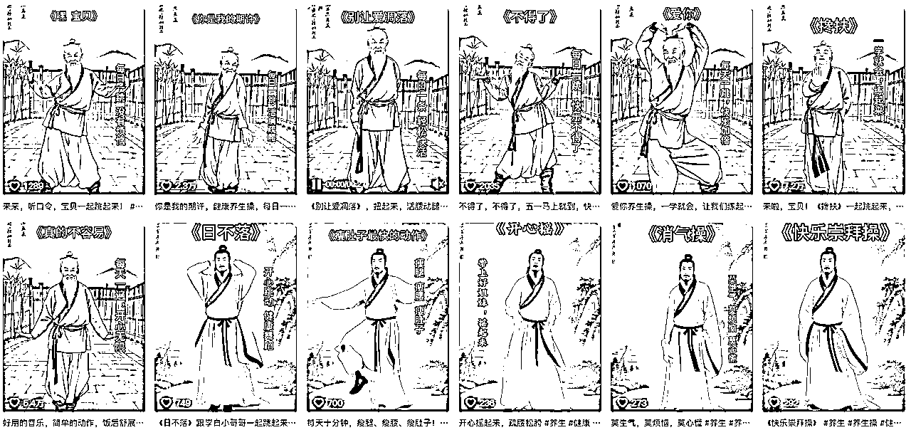

关于这个项目的详细拆解，篇幅有限，这次先不展开。想看深度拆解的话，后面有机会再单独聊。

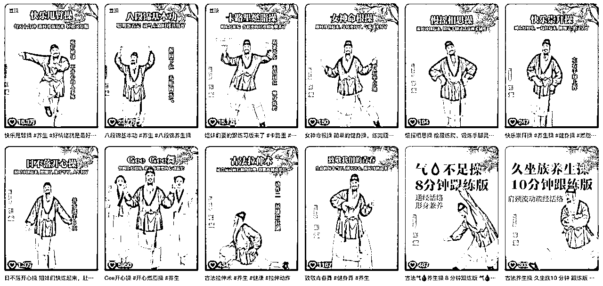

你有没有发现，短视频平台上最近冒出一批“穿越”来跳操的古人？他们穿着宽袍大袖，动作却现代感十足，看着有点违和，又有点上头。这类视频背后，其实是一套可复制的AI玩法。今天来拆解两个适合普通人的小项目，顺带聊几句做号心得。

先说“古人健身操”这个玩法。

它的内容本质很简单：让AI生成的古代人物形象，在视频里跳健身操。别小看这个组合，变现的路子并不窄，流量分成、带货、卖课、减肥相关产品，都能往里接。

目前这个赛道热度很高，但新号跑出来的概率不算高；操作门槛不高，收益属于中等水平，综合推荐指数三星。

具体操作分四步。

第一步，生成古人图片。打开即梦，搜索“古人健身操”，挑一张中意的图片，做同款。效果参考在这里：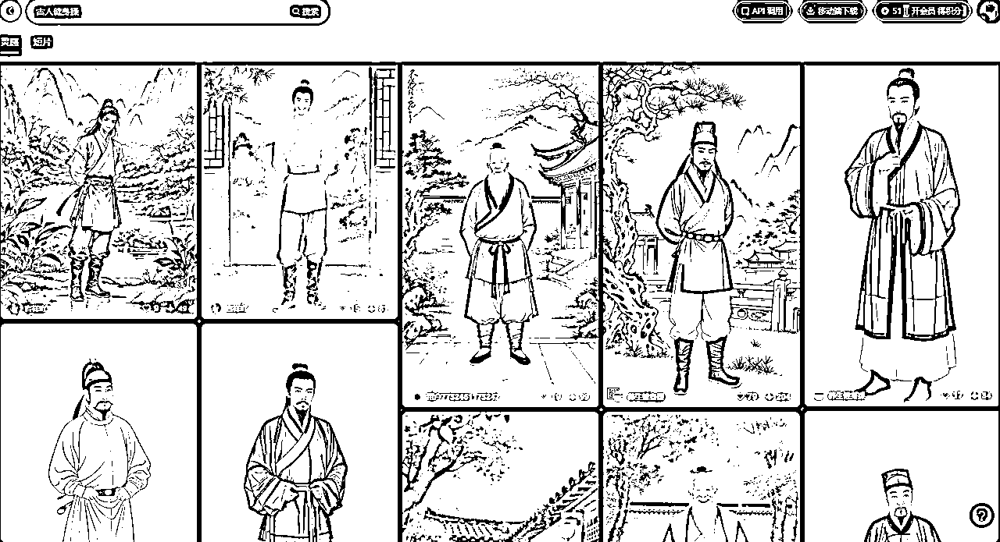

第二步，下载对标视频。去抖音搜“健身操视频”，把合适的视频下载到本地，当作动作模仿的素材。就是这类对标内容。

第三步，生成动作模仿视频。把刚做好的古人图片导入即梦，进入“数字人-动作模仿”，上传本地视频，系统就会生成一段古人跳操的视频，保存下来就行。

第四步，剪辑发布。如果懒得加工，直接发也行；想要更精致，就导入剪映，加上字幕和标题，导出发布。

这里要提醒一句：眼下这条路已经很拥挤，但好在这个玩法的可拓展性不错。你可以绕开红海，去试试古法养生、五音疗愈、食物养生等细分方向，只要做出差异化，依然有机会。画面风格也能变，Q版、萌娃版、小动物版，都能玩出新意思。

接下来看另一个项目：睡前故事儿童绘本。

先感受几个案例：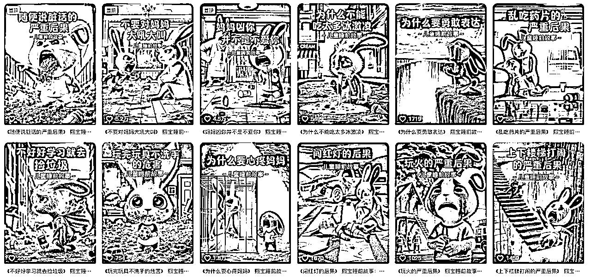

它的内容形式一句话就能说清：3D插画配上故事配音。变现方式也不复杂，主要靠创作收益，同时可以带货儿童书籍。目前这个赛道的竞争同样激烈，起号率比较低，操作难度不高，收益中等，综合推荐指数一颗星。

操作流程也很短。

第一步，生成儿童故事。用豆包生成儿童启蒙故事，或者把市面上的爆款故事拿来改写。生成出来的文本效果可以参考：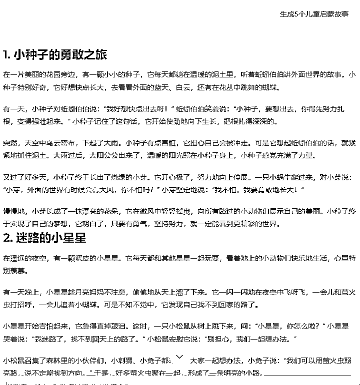

第二步，生成视频。用剪映的AI成片功能，一键生成完整视频，导出后直接发布就行。成片效果大致是这样的。

注意事项：这个模式现在同样很卷，起号率低。不用把它当成唯一指望，拿来练手，或者给自己家孩子做专属睡前故事，都很合适。

最后做点总结。

关于起号率的高中低，不同人的判断会有主观性。因为在这个领域，我们手里的经验相对更丰富，能做出的差异化也更多，所以给你的结论也只是一个参考，实际选择还得结合自己的情况。

做这个领域，记住一点：不要一味模仿。前期可以抄作业，跑通流程后一定要做差异化。比如画面风格上，别人都用水墨，你就可以走卡通；内容题材上，别人做古诗，你试试文言文；别人主打怀旧，你去做养生。模仿只能跟风，差异才有出路。

另外，前面提到的所有项目，都可以用批量堆号的方式放大来做。真想堆号的，可以自己摸索。给你们看一个工作室的堆号现实——国风类短视频，每台机器都在自动批量产出：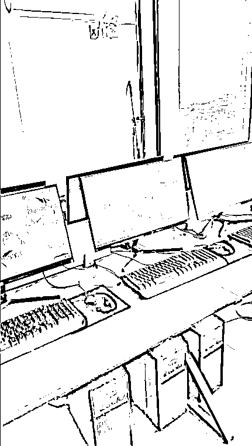

最后，还有一些难度更高的进阶方向，这次就不展开拆解了。感兴趣的朋友可以自己研究：古文拆解、电影/历史人物独白、灵魂手绘、古人复活/独白、书单号、AI短剧、神话讲解。

如果你觉得这些思路有用，建议先收藏，再去跑通一条完整流程。有了第一步，再谈差异化也不迟。