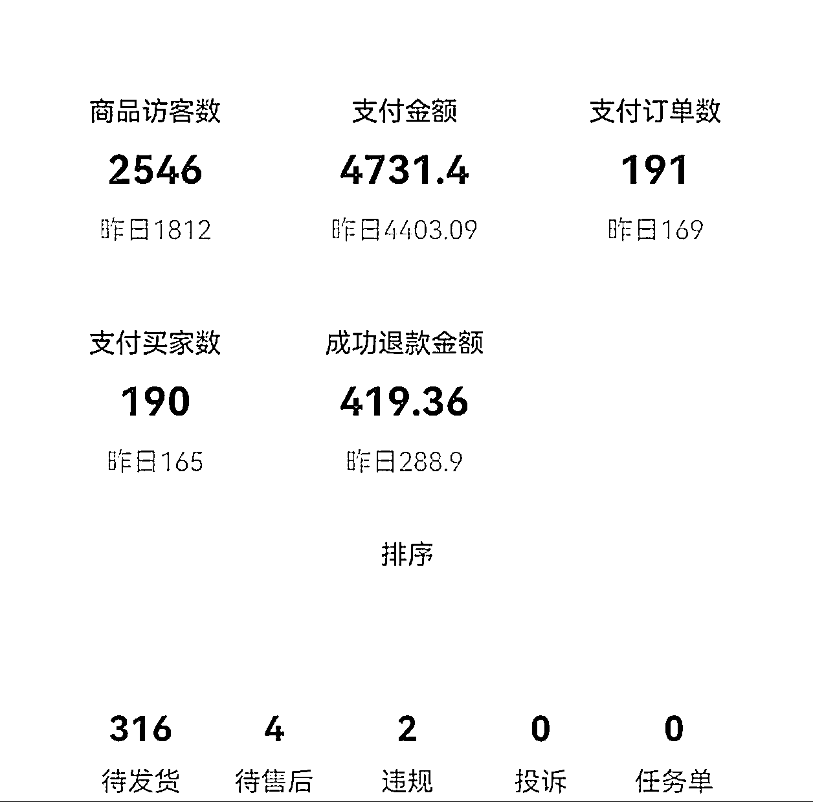
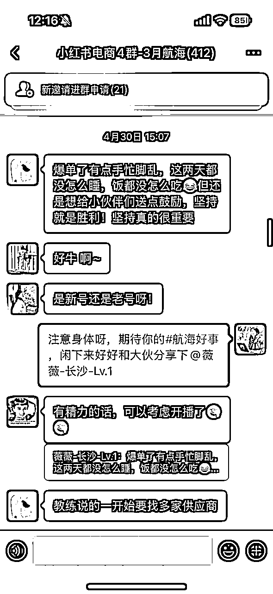
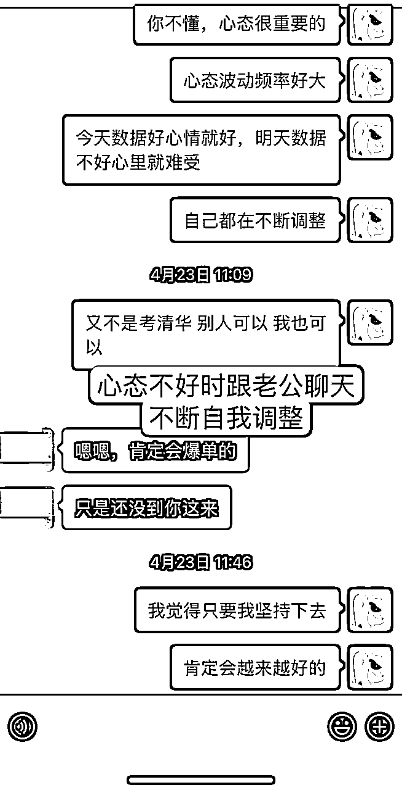
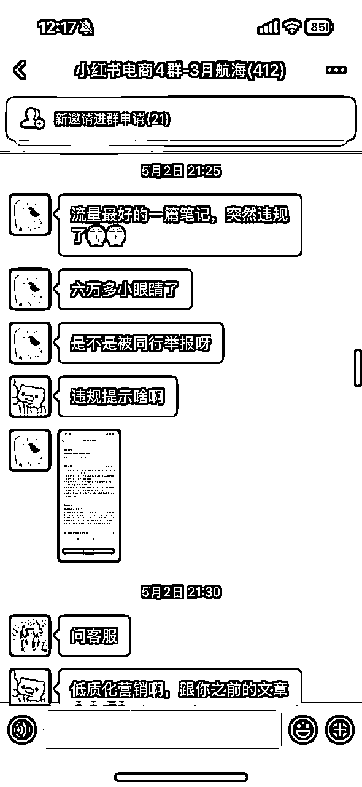
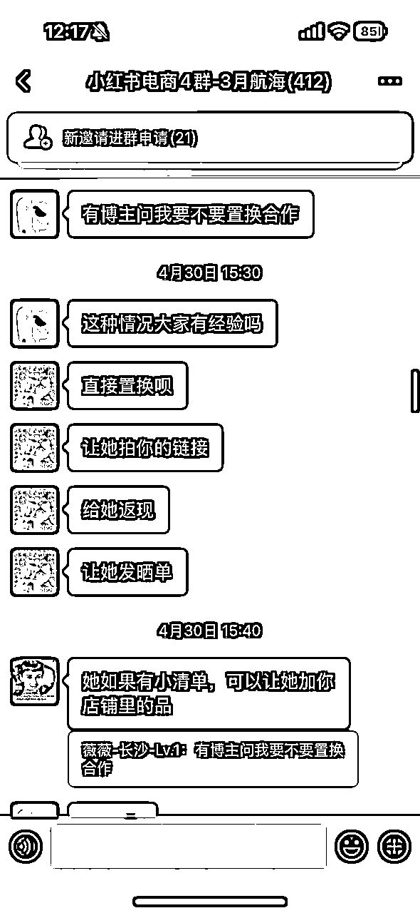
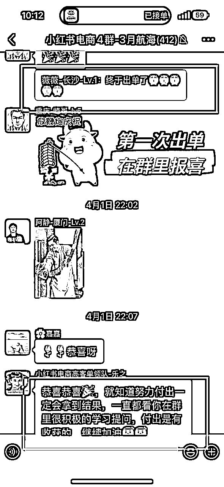
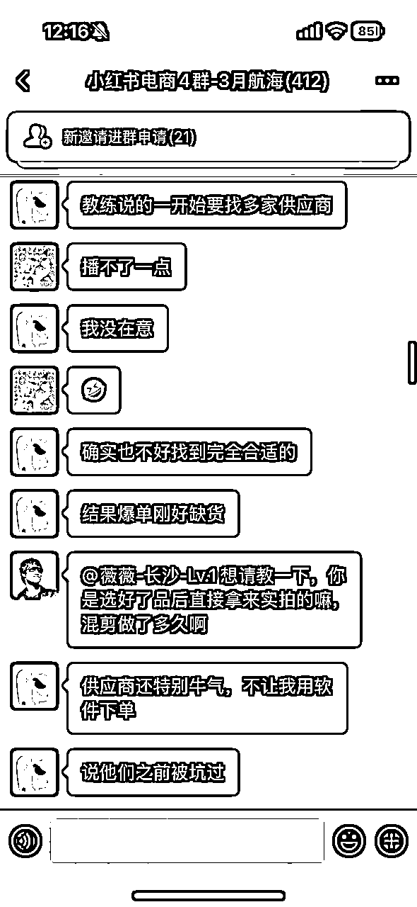

# 赚钱首航两周就开单，两个月回本：一个前教师转战📕电商的实战复盘
作者：龙哥

大家好，我是龙哥。25年2月底裸辞，入场赚钱。入行前我在一所民办中学教了十年书，其中八年担任中层管理，曾牵头全国教育协会的全国大会，操盘过万人级的音乐晚会，也带过上百场大型活动。

离开体制后想找条能跳出旧圈层的路，于是把第一桶水押在了📕电商航海上。这是我在赚钱报名的第一次航海，没想到第二周就出了第一单，一个月后直接起量，最高单日卖出200多单，截至现在GMV已接近5万。两个月就把航海门票赚了回来。作为赚钱新人能这么快吃到正反馈，真的又一次证明了：我能行，赚钱的路径是通的，别人能做的事我也能做。

应赚钱澄歌的邀请来做一次分享。目前我算📕电商里的新手，爆单里运气占比不小，但过程里踩过的坑、悟到的点，足够拆开来讲给同样刚起步的伙伴，无论是心态还是落地执行。

一、心态别内耗，保持相信并持续行动

做任何事，心态都是地基。做航海期间我刚裸辞，迷茫、焦虑、自卑、无助轮番上阵。对航海项目既期待又怕受挫。但我提前给自己做了心理建设：新赛道必然有坎，那就把精力放在解决问题，而不是消耗在情绪上。

起步阶段的失落感几乎是普遍的。把它当成常态去接纳，反而能少掉很多无效焦虑，把注意力拉回到能做的事情上。

保持信念很重要：项目本身能变现，我也有能力把它做成。圈子里那么多真实案例，就在提醒你——能成的人都在眼前。只要选对方向、用对方法持续深耕，结果会像量变到质变一样慢慢到来。

二、把航海手册用起来：理论+实操同步，问题多问教练

1、把手册当教材反复啃。手册信息密度很高，一遍肯定不够，尤其是选品这类核心章节，我反复看了十次以上。

2、学一点做一点。不要堆一堆理论再开干。每个知识点学完立刻去实操，会立刻暴露看似懂了实则不懂的地方。这个节奏就像上数学课：先学公式，再跟着老师做例题，再自己刷题，最后写作业巩固。📕电商的学习也一样，学完就用。

3、多在群里提问。我在航海群里算是提问狂魔，有疑惑就问，不怕问题简单。能实时被教练点拨的感觉太宝贵了。航海结束后很多问题只能自己去搜、去等官方客服，效率低且解决率差。

三、实操卡点与踩坑清单

1、选品：最容易翻车的地方。长期当消费者会带偏商家视角，我一开始只看销量高、符合自己审美就上。结果笔记曝光个位数。后来严格按手册来：看销量是否来自近期爆文、近一个月评论是否100+，对标账号是否以实拍为主。最后选中的品各项数据都达标，对标实拍也普通，正好可以先模仿再优化。

选品错了后面全是无效功。没有正反馈会直接打击坚持的动力，所以前面多花时间卡死选品，是省时间的做法。

2、标题和封面决定冷启动。我买了货自己实拍，总觉得对标的图太普通，想靠审美创新。结果自创封面数据远不如像素级模仿对标。最后爆的那篇，就是严格照搬对标标题和封面的那一篇。

复盘下来，市场验证过的样式就是大众审美，平台也更愿意推。别用个人审美去否定已经跑通的内容，前人总结的经验先照做再说。

踩坑提醒：

爆单后我没顺风顺水，反而因售后准备不足损失不少。复盘都是学习不到位导致的：

1、提前备好2-3家供应。别觉得单量小不用准备。爆单可能一天的事。我因缺货导致发货延迟，每单被罚3元还触及违规。

2、物流要盯死。发货不是结束，24小时内必须揽收，揽收后24小时内必须揽运。节点要卡准。

3、品质是底线。缺货时临时找的厂，品控差直接引发大量售后，既拖垮客服时间，又因差评导致流量受限。

四、用学习把运气变成确定性

电商本质是技术活。持续学习、持续实操、持续复盘迭代。每个新知识点立刻用、每个问题立刻总结，就像打游戏升级，熟练度上去后成功率会滚雪球式增长，能力最终会压过运气。

航海结束后我没停下来，后续问题倒逼我补课，也发现还有很多没吃透。看到新航海聚焦实拍和长期主义特别有感：平台规则像天气一样变，玩法必须同步调整。能持续学习的人才能一直踩在节奏上。这也是赚钱一直在线的原因。

给赚钱新人的几句话：

1、想要快速获得正反馈，📕电商航海非常友好。还在纠结入哪个项目，可以先试试这个。

2、选定方向后，就信自己的选择和赚钱的体系。把每一步都做扎实，没结果只是时间问题，学习+实践的闭环走下去，结果会来。

3、心态和执行力是成事根基。

4、赚钱的线下活动很值得去，时间允许我基本都参加。收获未必立刻见效，但总会在关键时刻用上。

也欢迎大家来找我交流，互相支招，一起成长，一起龙哥盟~