搜索流量，从来不会因为你的忽视而消失。它一直都在那里，静静等着被看见。

最近和不少做流量的朋友聊天，大家普遍的感受是：2025年的流量生态，已经卷到让人有点喘不过气。推荐流量的爆发力虽然诱人，但越来越难以掌控，内容一波流、转化靠运气，团队一停，增长立刻归零。

那还有没有一条路，能让流量获取变得相对确定？

我的答案是：搜索流量。

我是波波，20年加入生财，生财私董会成员。从0到1的创业路上，我靠搜索流量做到过10亿营收，且不含投放。19年转战抖音，从抖查查数据工具起步，20年在杭州落地分公司，做电商、投流和更多业务，团队最高做到200多人。生财第一届抖音大航海，当时的船长就是我。

为什么我现在这么看好抖音搜索？

很简单，推荐流量是赌爆发，搜索流量是拼积累。每天每个关键词下面有多少搜索量，是明明白白摆在那里的。这种确定性，正是缓解流量焦虑的最好解药。

所谓DSO，也就是Douyin Search Optimization，抖音搜索优化。它的核心只有三件事：精准选词、内容覆盖、转化产出。通过系统化的运营手段，让你发在抖音上的内容，在搜索结果页里排得更靠前。用户搜某个词，第一眼看到的就是你，对你产生兴趣，然后留资、下载、购买，一气呵成。

工具地址：www.aidso.com

工具使用文档：

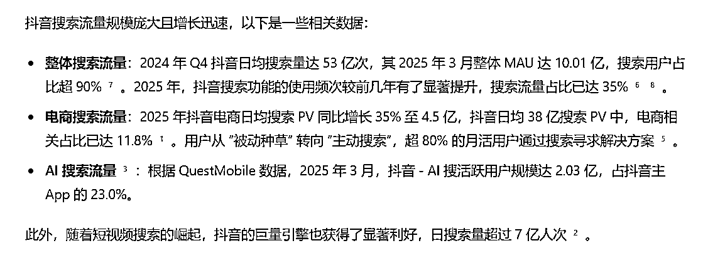

为什么会出现搜索流量优化这种玩法？

抖音今天能起来，靠的是推荐机制。推荐机制确实猛，一旦踩中热点，流量成本极低，爆发力极强。但它的短板也很致命：不好掌控，流量来得快去得也快，承接转化非常吃力，一波流的问题始终存在。

于是市面上出现了各种应对打法：

有人蹭热点、搬内容，赌的是运气；

有人夸大产品效果、过度承诺，本质上就是靠忽悠硬转化，生怕浪费了来之不易的流量；

有人拼团队体力，短视频不停发、投流不停烧、直播不停播、私域不停加，但团队一旦停下来，业务增量立刻归零。

这些打法，没有一个能长久。

搜索流量优化之所以能跑出来，是因为它服务的用户是另一类人——带着明确需求、主动搜索的人。在抖音庞大的用户池里，这部分人可能只是一小部分，但对商家来说，这是精准得不能再精准的潜在客户。你只需要持续打造长效内容，打磨出一个成熟的转化模型，就能在一个个关键词下面，占住一个又一个流量池。关键词覆盖得越多，你拥有的流量池就越多，每天都会有源源不断的精准用户主动找上门。

DSO的完整链路是：

选词 > 内容覆盖 > 排名优化 > 点击率优化 > 完播/停留/互动 > 引导 > 转化

这三个环节——选词、内容生产、转化产出，每一环都要做好。

先看几个案例。

我们自家的抖查查账号，24年就是靠搜索流量起号的，自然流千人在线直播间一直做到现在。你看，那个男孩是我们程序员，女孩是运营同学，都是普通素人。善用搜索流量，普通人一样能建起稳定的流量池。带货数据也从5月的一个月几万块，做到年底单日最高近10万GMV。

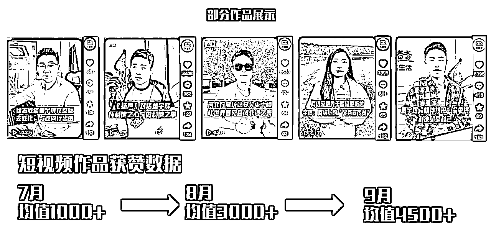

再来看看某企业蓝V账号的数据：

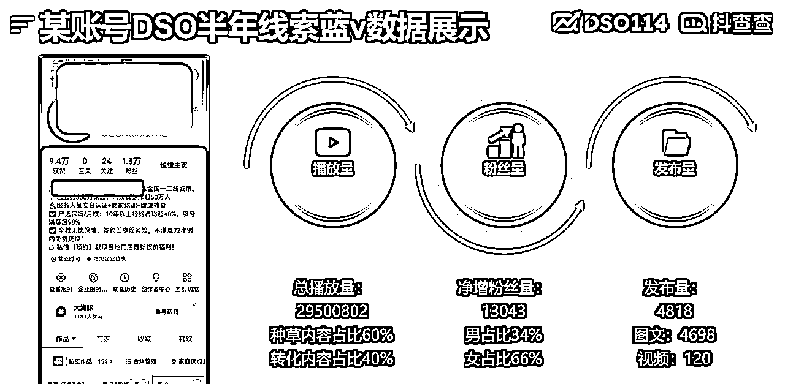

懂SEO、懂搜索引擎逻辑的朋友，把你的经验迁移到抖音，甚至更多社交自媒体平台，大概率会有新的收获。如果你是纯新手，完全不懂流量、不懂赚钱，那搜索流量作为流量入门课，也是一条非常明智的路径。

大家参加航海，最关心的无非是：适不适合我？能不能拿到结果？以后能不能持续用上，帮我不断放大成绩？

那DSO到底难不难学？

我不敢保证每个人都能拿到巨大收益，但我敢保证，有一部分人会拿到远超预期的价值。我们公司一个实习生，把DSO学到手后用到自己的工作中，学了一周，单条视频一天的搜索流量就破了百万。

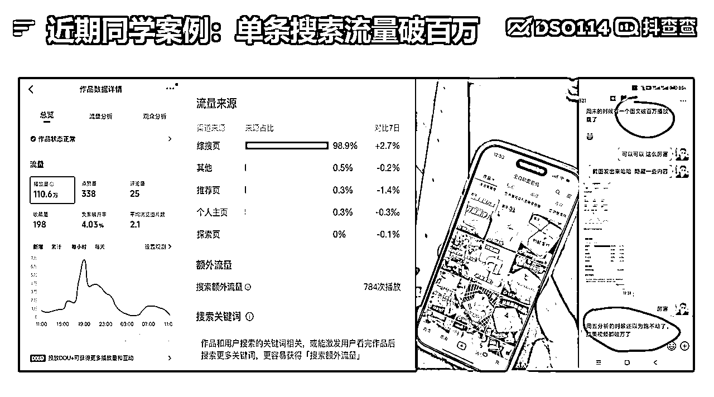

顺便教大家一个小技巧：怎么看自己视频的流量来源？

打开抖音，进入你的作品，点右下角三个点，找到“数据分析”，选择“流量分析”选项卡，往下滑就能看到流量来源。如果作品大部分流量都来自“搜索”，那这就是一条完美的DSO视频。再往下看，还能知道具体是哪些关键词给你带来的流量。

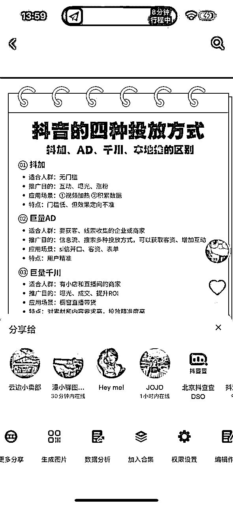

我每个月都会办不少流量主题的线下沙龙。每次我都会问在场的人：谁能确定性地做出搜索流量占比超过80%的抖音内容？举手的人寥寥无几。偶尔有人说做过搜索流量占比30%左右的内容，我追问他背后的制作逻辑，就答不上来了。

这说明什么？

搜索流量在抖音这样的平台里，存在巨大的信息差。光是知道怎么做，就能超过95%的人。抖音的内容创作者有几百万甚至上千万，大家全在拼镜头、拼画质、拼颜值、拼才艺，绝大多数人注定拿不到流量，因为太普通了，比不过。

但如果有一种流量获取方式，99%的人都不懂，你是不是就觉得机会来了？

没错，抖音搜索流量的机会，远比想象中要大。只要你参与这次航海，就能把这个信息差拿在手里。

这次航海，我和我们讲师小伙伴，会系统地把搜索流量的方法论完整拆解给大家。不管你有没有基础，都能听懂、学会、用上。

那学会之后，怎么靠它赚钱？

主要有三条路径：

1）已经有业务基本盘的同学，用搜索流量能力在自己的赛道上放大结果；

2）职人、行业从业者，掌握了流量能力后，可以赋能同行，做培训、做企业陪跑；

3）纯流量玩家，可以利用DSO能力，在高变现的小赛道里快速变现。航海过程中，我们会推荐一批有代表性的变现赛道。

先看部分学员案例：

农业私域转化：

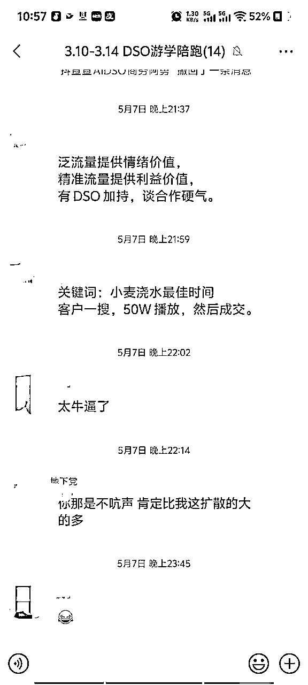

托运私域转化：

装修设计：

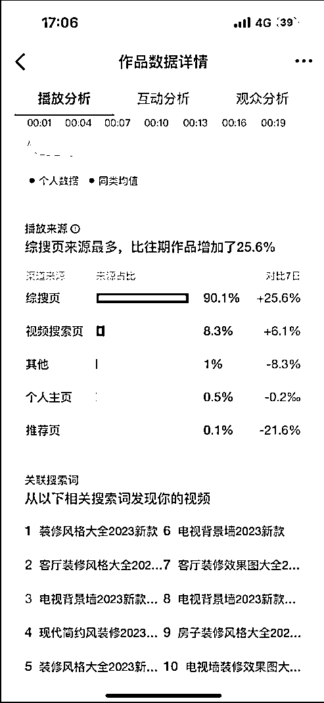

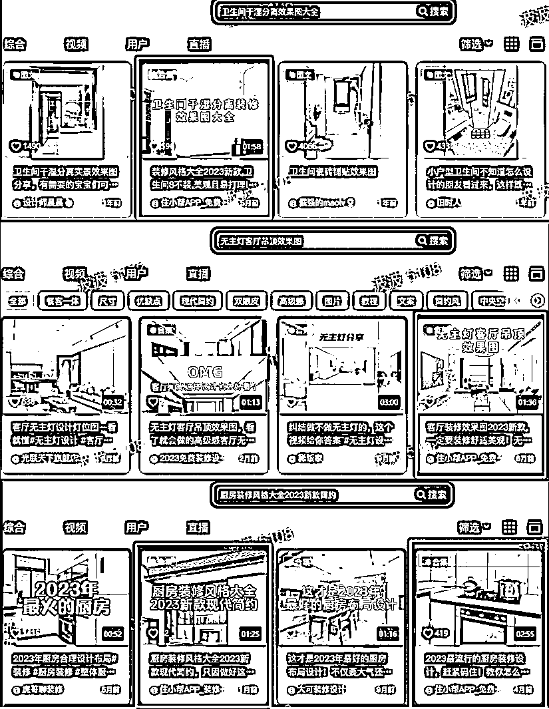

金融贷款：

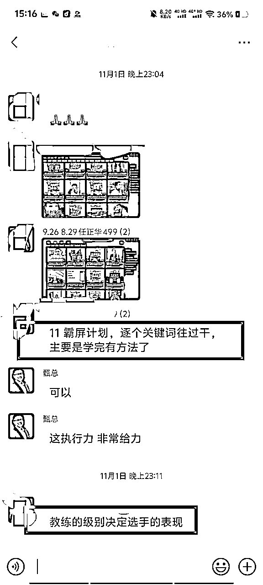

教育：

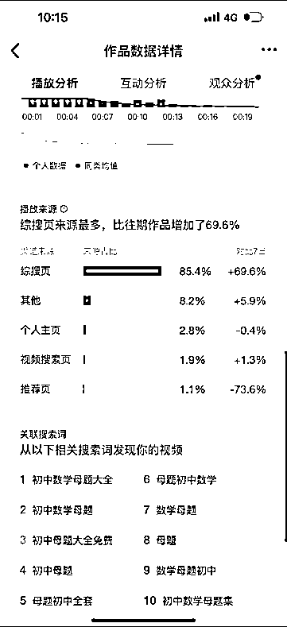

DSO工具已经推出一年多，越来越多的同学在不同行业吃到了搜索流量的红利，并且在深度布局。

波波在北京线下活动，给生财的同学讲抖音搜索DSO的知识：

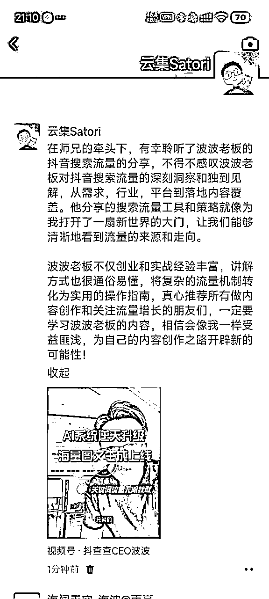

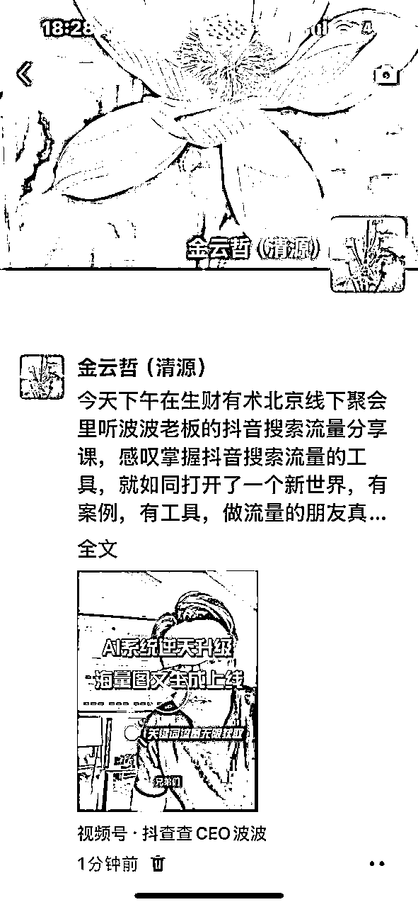

变现的逻辑，其实就分两类：有自有业务的和没有自有业务的。

如果你已经有成熟的基本盘，利润也跑通了，那搜索流量就是你的放大器。把它布局好，业务翻倍甚至翻几倍、几十倍，都很正常。

我过去在生财发过不少行业做DSO的案例，比如旅游行业、减肥赛道、轻度游戏、财税线索、律师法律、留学行业等等，都有详细拆解。这里我插一个之前发布的视频，讲了搜索流量最适合和哪类赛道结合。有业务盘的同学可以对照看看，什么样的业务做搜索效果最明显、拿结果最快。就算你的业务不太匹配，也可以靠搜索流量的布局得到一定提升。

如果你还没有变现业务，也别急，我会给大家一些快速变现的方向指导，甚至提供一些现成的变现渠道，比如大场CPS项目、旅游线索、本地线索等等，方便你快速上手拿到收益。

工具怎么用？

除了系统课程和方法论，这次航海还会给大家提供搜索选词工具，配合选词、内容生产以及任务监控管理。具体使用教程，可以先看使用文档：

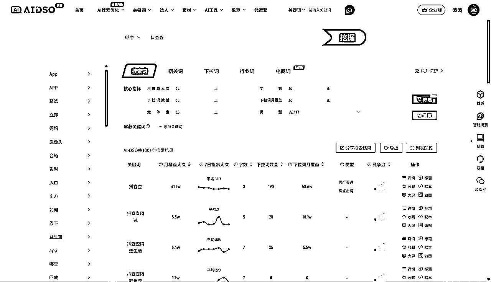

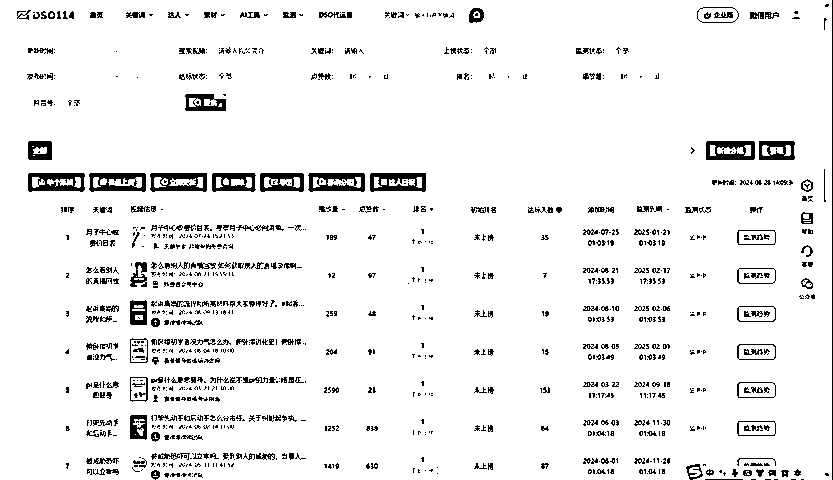

关于难点和风险，也要说清楚。

最大的难点是：正反馈周期比较长。

推荐流量是短跑，拼爆发；搜索流量是长跑，拼耐力。很多人的失败，不是因为方法不对，而是心态先崩了。

记住一句话：快，不如持久。只要不断正确选词，持续生产高转化内容，流量就会源源不断。

我这边有个三年多没更新的老账号，每天仍然有几万搜索播放进来。还有一个做了半年的新账号，每周稳定100万搜索播放。主力DSO内容贡献了80%的搜索流量。所以说，DSO内容一旦做起来，是可以吃老本的。

项目推进分三个阶段：

前期，做产品分析——包括产品定位、目标人群、盈利模式、主要业务功能、推广方式、经营现状等；做竞品分析——至少找3款相似竞品，拆解它们在抖音的推广内容；再做关键词词性定位——确定方案里关键词类型和数量，选择高转化精准词进行拓量。

中期，围绕选定关键词做内容创作，包括排名创意、覆盖创意；拍摄、剪辑、发布、运营、创建合集，把关键词覆盖、排名抢占、霸屏、目标转化这些指标一一拿下。

后期，每天盯运营数据，实时监控，随时挖掘商机和新黑马关键词，动态调整策略，一切以流量最大化和转化为最高目标。

项目风险方面，因为启动成本非常轻，几乎没有什么大的系统性风险。主要风险点在账号和违规上：

1）堆砌低质量内容，流量分配权重会下降。比如同一个词反复生成雷同内容，大量发布，反而会伤号；

2）引流行为过于严重，蓝V账号的线索功能可能被封禁；

3）搜索盈利的核心奥义在于赛道选择。小赛道，要藏好自己找到的赛道和优质关键词，别让竞争对手发现来抢词，不然运营成本会越卷越高。大赛道藏不住，有被恶意模仿、举报的风险。所以不要做平台不喜欢的引流行为，比如简介留微信、跳站外，内容不符合规范，或者去做擦边、违禁的行业。

应对方案：如果是高暴利赛道，就要有废号的觉悟，提前准备够足够的资源。不过我还是更建议大家走长效经营的路子，吃时间红利，越做越强。

什么样的人适合参加？

优先考虑有短视频拍摄、剪辑经验的朋友。

一要有韧性。执行力是基本素质，不必多说。但在执行力之外，韧性很关键。起号有周期，初期正反馈一般在一周到一个月之间，效果爆发期往往出现在三个月左右。没做好坚持三到六个月准备的人，不适合这个项目。

二要有时间。每天花在项目上的时间不能低于三小时。

最后是项目预期和注意事项：

1）启动周期，快的话一个月内能看到比较明显的结果，正常情况两到三个月；

2）专注做DSO，不建议和推荐流量混着做。这两种逻辑截然不同，混在一起容易走火入魔。先清空推荐流量带来的固有观念，才能真正研究透DSO的逻辑和玩法；

3）提前把剪辑、编导能力练起来，一年以上经验最佳。如果完全没经验，小白建议先按操作手册，把剪映等工具玩熟练。

以上就是抖音DSO做获客的完整介绍。如果你对抖音搜索流量获客感兴趣，或者想用它赋能自己的业务，欢迎来报名6月航海，我们一起深入参与、实战拿结果。