# 别再赌算法爆款了，试试更稳的路

先自报家门：波波，2020年成为赚钱圈友，同时是创业者私董小组成员。老朋友们可能看我眼熟，毕竟首届抖音项目航海就是我带的队。

过去我做过一个接近10亿元收入的盘子，全部靠用户主动搜出来，一分钱广告费都没花。早年创业多次靠这个模式起家，也帮不少公司跑通过项目。2019年转战抖音后，先做了数据产品抖查查，后在杭州又拉起了一支团队，最多时有200多人，知识服务与品牌代运营都做到过第一梯队。

进入2025年，大家的共同感受是：免费流量越来越难抢。焦虑的根源在于不确定——推荐算法随时可能翻脸。而搜索入口是另一个逻辑：每个词每天有多少查询量，是一本相对明白的账。抓住这份确定性，至少能让你心里不慌。

接下来聊聊我们到底在做什么。

## 一、什么是DSO

这套玩法业内常叫 DSO，三个字母里，D 代表抖音，SO 可以理解成搜索排序。本质上，就是让作品被搜出来时，位置更靠前。三块核心工作：第一，找对关键词；第二，让内容去占住这些词；第三，把访客顺利转化为提交资料、下载应用或直接下单。

一句话总结：用户搜某个词时，你得出现在前面，还得让人愿意点、愿意信、愿意行动。

为什么值得做？因为推荐算法虽好，但有明显盲区。爆款容易起量，代价是流量来得猛也走得快。如果团队只会追热点、言过其实地宣传、堆人头式地制作内容，一旦停下来，业务也跟着停。这些路我都见过，很难持续。

搜索入口刚好弥补这个短板：用户是带着问题来的，需求明确。你围绕这些需求持续生产内容，每拿下一个词，就多一个入口；入口多了，每天都会有主动找上门的访客。

整条链路从选词开始，经过内容制作、排名与点击优化，再到完播互动、引导转化。词、内容、承接，三块缺一不可。

相关的说明文档放在下方，方便对照：

## 二、真实案例

先看团队自己的账号。抖查查这个号是2024年用这套方法做起来的，直播间能稳定到千人同时在线。画面里的小哥是写代码的，姑娘是做运营的，他们都没有什么光环，靠普通人的执行力做到了这个结果。月销售额也是肉眼可见地涨：5月还是几万，到年底单日最好能接近10万GMV。

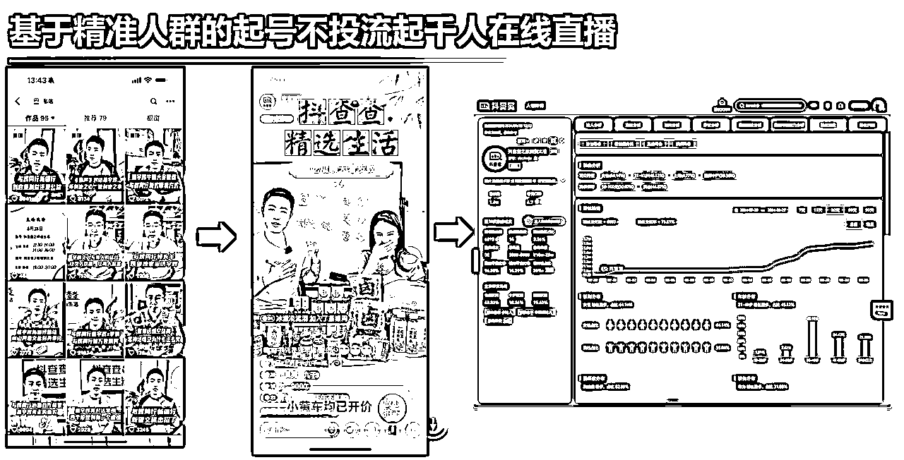

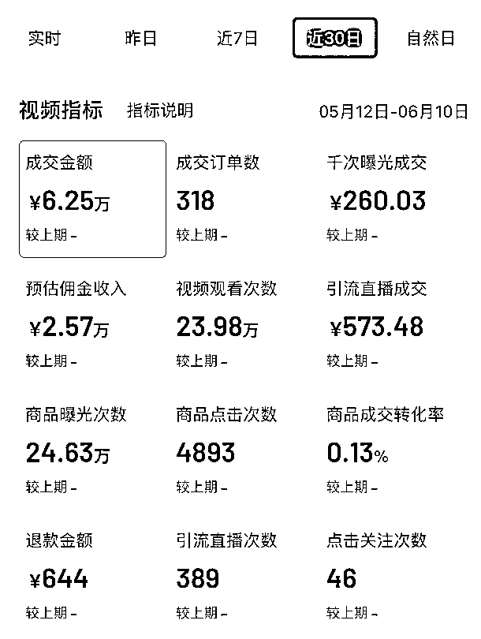

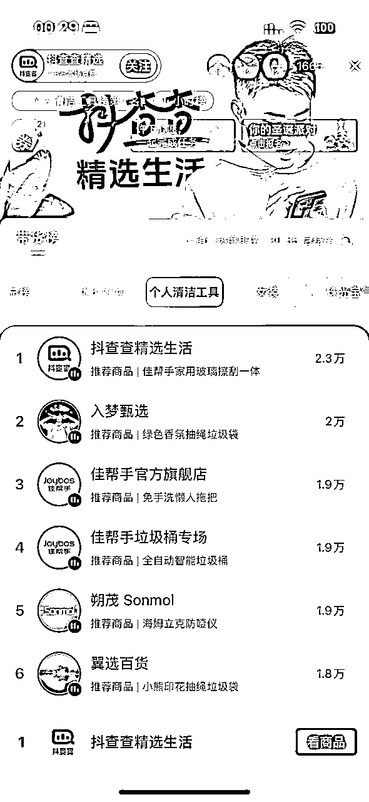

一家公司认证号的数据也放出来：

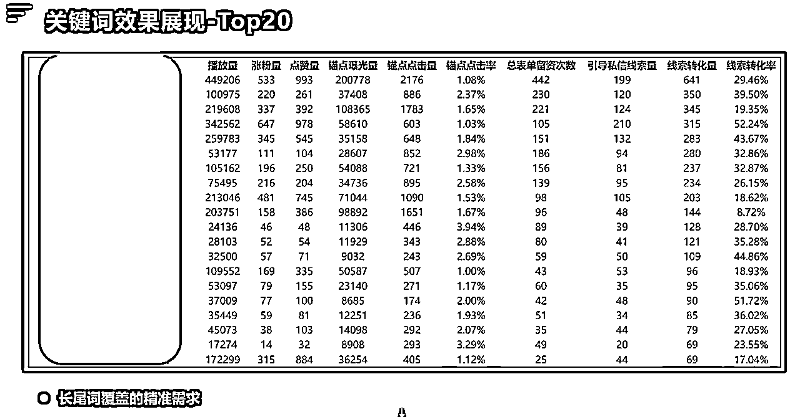

如果你有SEO基础，这套逻辑你会很熟悉；把它搬到短视频平台，会有新的产出。如果你是小白，从搜索入口学起，也比从推荐算法入手更不容易劝退。

大家参加实战项目，关心的无非三点：是否匹配自己、能否见效、能否长期复用。我认为，只要认真跟下来，这三点都能得到正面回答。

我们公司有个实习同学，用这套方法做自己的账号，学了一周，单条内容仅靠搜索入口，一天就多出百万级播放。

怎么判断自己是不是做对了？在作品页打开数据后台，查看访客来源，如果搜索占比很高，下面会列出具体词。能看到这一步，说明方向基本没错。

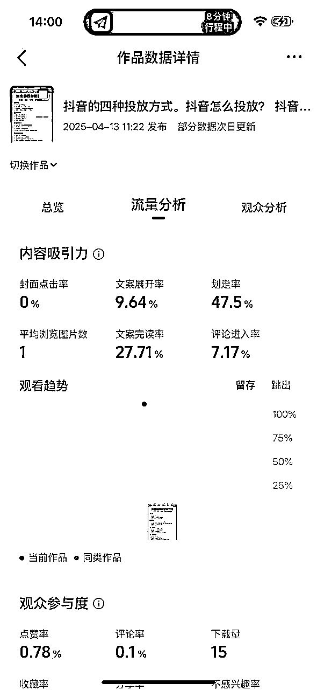

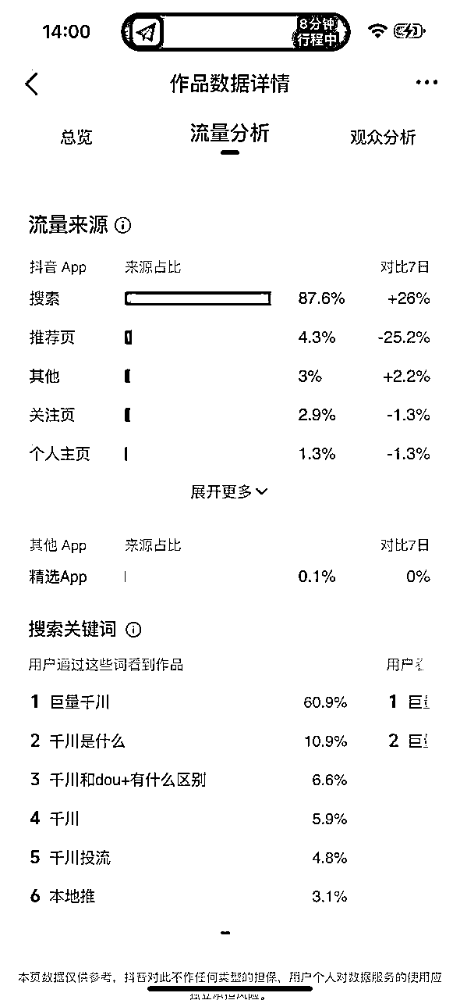

我常组织或受邀参加各种闭门交流，现场经常问一个问题：谁能稳定做出搜索来源占比80%以上的内容？几乎没人举手。偶尔有人说做到过30%，再问具体做法，就沉默了。这就是巨大的认知盲区。知道方法的人，已经能超过绝大多数同行。这次实战营，我们会把这个方法系统讲清楚，无论之前是否接触过，都能跟得上。

## 三、怎么赚钱

方法学会以后，要考虑的就是变现。三条路最常走：

1. 生意已经站稳的人，把关键词获客的本事接上去，放大现有结果；
2. 想靠技能吃饭的人，把这套方法产品化，给同领域的人做培训，或接手企业代运营；
3. 擅长搞流量的人，选高客单的细分方向直接变现，实战营里会推荐具体领域。

下面是不同行业学员的反馈截图，依次是农产品私域、宠物托运、家装设计、信贷、教培：

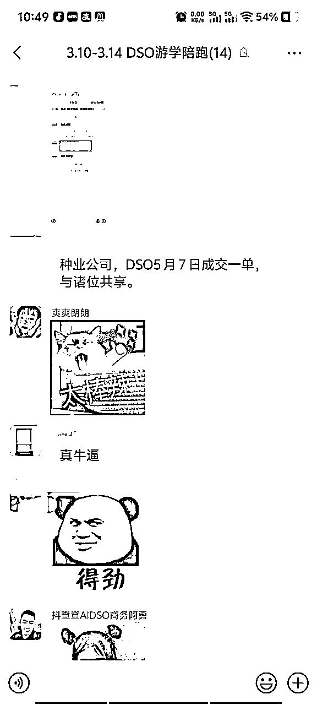

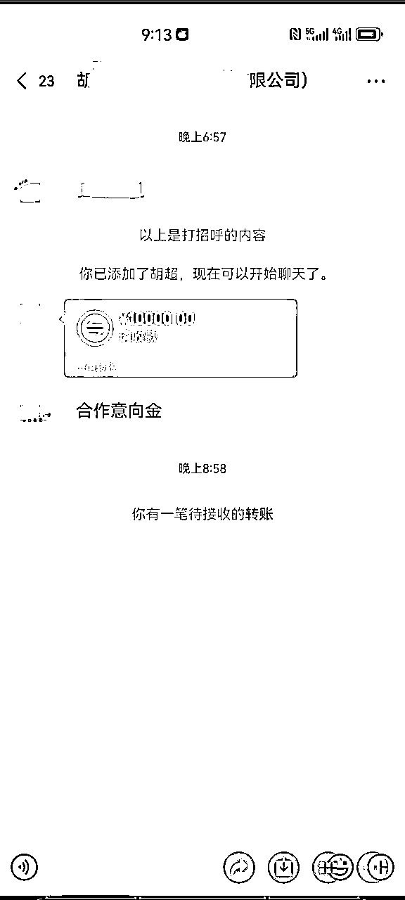

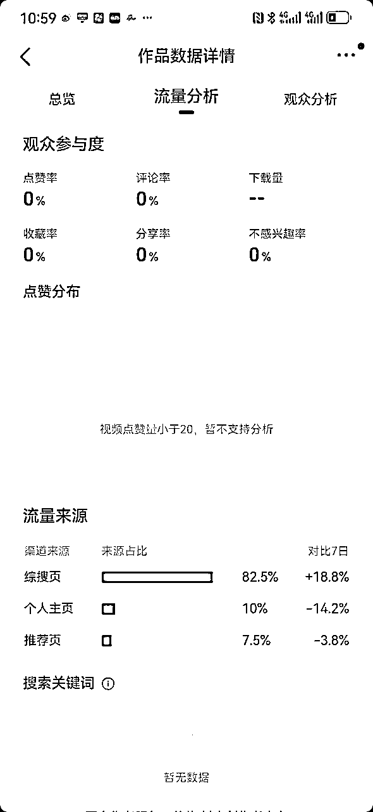

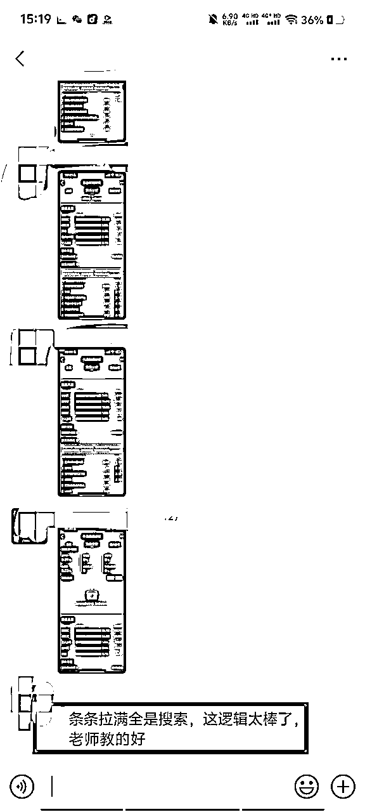

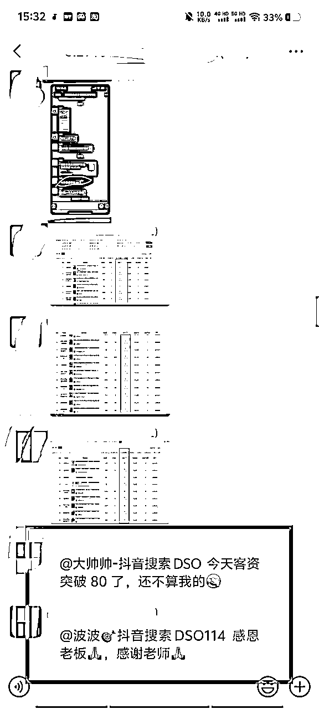

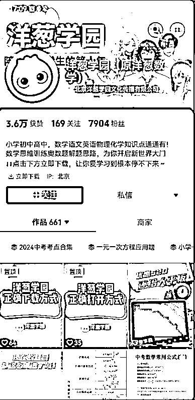

这套工具上线一年多，已经有不少人吃到红利。我也在北京做过线下分享。

从赚钱路径看，只有两种情况。已经验证过盈利的人，搜索就是放大镜，只要模式跑通，订单放量只是时间问题。还没有项目的人，实战营里会给快速落地方向，也会提供一些渠道，比如大场分销、旅游客资、本地商家客资等。

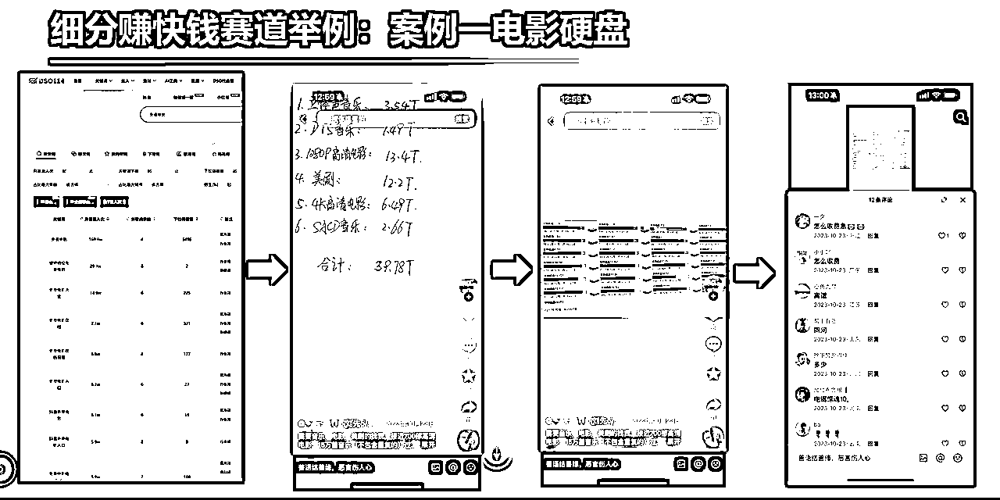

另外还有一条视频，专门聊什么类型的生意放在搜索上见效最快，适合有现成业务的人参考。此前我也在社群里发过多个行业的拆解，比如旅游、减脂、小游戏、财税、法律、留学这些方向，大家可以直接搜标题看。

## 四、配套工具

除了整套方法，这次还会提供配套的关键词工具。从选词、排期到任务管理，一个后台搞定。使用说明在下方文档里：

## 五、难点与风险

最大的门槛是反馈慢。推荐算法是百米冲刺，搜索入口是马拉松。多数人不是输在方法，而是输在等待。我手里有一个停了三年没管的旧账号，每天仍有几万播放是靠用户搜出来的；另一个运营了半年的号，每周能靠搜索收到百万次观看。其中八成左右来自几篇主力内容。这就是长尾的力量。

项目分为前期、中期、后期。前期做调研与定位，包括产品、人群、赚钱方式和竞品；中期按词做内容并发布维护；后期每天盯数据、调词，持续放大跑得好的内容。

风险其实不大，启动这件事花不了多少钱，主要是账号层面的坑：内容重复堆砌会被降权；引流太猛，企业号的客资功能可能被收回；窄众领域要保密，热门领域防眼红。别在简介里留微信，别碰擦边行业。如果执意做高利润灰产，就要有换号的准备。我更倾向于做长久生意，让时间站在你这边。

## 六、适合人群

会拍会剪的人优先。但比经验更重要的是韧性，这个项目出效果需要等待，通常以周为单位，明显起量多在三个月前后。如果愿意撑过三到六个月，再来报名。每天至少投入3小时。

## 七、预期与注意事项

顺利的话，四周内会有苗头，常规节奏在十周上下。

不建议一边做搜索一边指望推荐爆款，两套逻辑相冲，容易把人搞乱。先清空脑子里的旧玩法，再专注研究DSO。

拍摄后的剪辑、编排能力，最好提前练起来；有一年经验更好；新手先用工具把剪映练熟。

以上是围绕搜索入口获客的分享。如果你也想让生意拥有相对稳定的访客来源，或者想把这套能力变成自己的基本功，欢迎加入6月的这期实战营，我们船上细聊。