# 酒店预订副业深度指南：从低风险入门，到高端资源变现

> 资料参考：[飞书文档](https://fi8jncah4ds.feishu.cn/docx/RyS7dVX4koi1KbxUgDHcMwd5n1b)

## 开场先介绍一下自己

大家好，我是风小海，公众号也是这个名字。

我目前在武汉，混生财社区已经三年，主业做过服装，经历过亏损，也尝过盈利。如今时间相对自由，不过距离真正的财富自由，仍然有一段不短的路。

过去一年，我通过分享风向标换到了年度会员资格。我不是那种一学就会、一路开挂的人，只是比很多人更早踩过坑，也更愿意把过程记录下来。

接下来，我会持续拆解100个自己研究或实践过的真实项目，写给那些想认真改善收入、又不想被夸张话术收割的人。

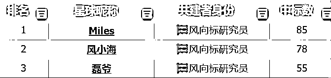

## 我的第一笔收入是怎么来的

* * *

# 先把话说在前面

酒店预订服务这个领域，公开系统讲清楚的人并不多。今天把它完整拆开，可能会触碰一些既得利益者，但我还是想把真实情况讲明白。

因为对不少普通人来说，创业听起来太远，每月多出1000元，可能就足以缓解一部分生活压力。

这类业务的特点是：

- 不需要购买库存；
- 不涉及打包寄件；
- 不必长期出镜直播；
- 一部手机就能开始了解；
- 即便不做生意，自己出行时也能用相关渠道降低住宿成本。

当然，它并不是“随便发条信息就能赚钱”的无风险项目。你需要熟悉房型、规则、订单流程，还要知道哪些资源合规、哪些玩法容易出问题。

本文主要讲三件事：

1. 酒店市场如何分层；
2. 常见房源和价格渠道是怎样形成的；
3. 旅行社协议资源如何通过内容平台获客，并按照规则获得服务收益。

感谢 @潇墨｜生财鱼丸 耐心帮忙审阅文章。

# 酒店市场的基本分层

做预订服务之前，先要理解不同酒店面对的客群、价格和消费场景。只有知道客户想买什么，后面才谈得上匹配资源。

## 经济型：解决“住得方便”

大致对应一至三星级酒店。

这类酒店通常强调位置、卫生和价格，适合短途停留、学生出行以及预算有限的商务客。

常见品牌包括：如家、汉庭、7天、锦江之星、格林豪泰。

参考区间：每晚100—300元。

## 舒适型：满足日常出行

大致处于三星以上至四星级之间。

房间配置更完整，整体环境比经济型更舒适，常见于出差、周末游和短期旅行。

品牌示例：全季、桔子、亚朵、怡程、喆啡。

参考区间：每晚300—600元。

## 高端型：更看重环境与体验

通常对应四星以上至五星级酒店。

这类客人除了住宿本身，还会关注设计、服务、餐饮和氛围，常见场景包括商务接待、情侣出游和纪念日入住。

品牌示例：希尔顿欢朋、万达嘉华、美居、华邑、皇冠假日。

参考区间：每晚600—1200元。

## 豪华型：购买品牌与服务

这类酒店拥有成熟的服务体系、较好的硬件以及稳定的品牌认知。

例如：香格里拉、洲际、瑰丽、悦榕庄、W、英迪格。

参考区间：每晚1200—3000元。

## 顶级奢华型：消费的是稀缺体验

这部分酒店更强调品牌调性、私密性、服务细节和入住记忆。

例如：宝格丽、安缦、文华东方、四季、丽思卡尔顿、半岛等。

基础房价通常在3000元以上，热门时段达到8000元甚至更高并不罕见，节假日出现万元级价格也很正常。

# 酒店行业常见词汇

## BAR价是什么

BAR通常指酒店当前面对普通消费者公布的可售最低价，常见于品牌官网或大型预订平台。可以把它理解为公开零售价。

## 协议价是什么

协议价是酒店针对企业客户、旅行机构、渠道伙伴或特定会员体系设置的专属房价，通常不会像公开零售价那样直接展示给所有人。

## 房型怎么区分

- **大床房**：一张双人床，适合单人或情侣；
- **双床房**：两张单人床，适合朋友、同事或亲子出行；
- **套房**：通常包含独立客厅和卧室，部分房型还带厨房或餐区；
- **行政楼层**：可能配套专属休息区、早餐、下午茶或商务服务；
- **家庭房/三人房**：面向多人出行，有的会配置上下铺；
- **无窗房**：价格往往较低，但采光和通风有限，销售时要提前说明。

## 房态相关表达

- **甩房**：酒店临近入住日，以较低价格处理尚未售出的房间；
- **封房**：某个日期或房型暂时停止售卖，常见于满房或特殊活动期；
- **超售**：酒店在一定概率下接受超过实际库存的订单，出现客满时，可能通过调房或升档解决。

## 什么是OTA

OTA就是线上住宿预订平台，例如携程、飞猪、去哪儿、马蜂窝、同程等。

酒店服务商要形成竞争力，通常来自三个方面：价格、附加权益和服务响应速度。但不能简单承诺“永远比平台便宜”，实际价格仍要以日期、房型和库存为准。

## 确认编号的作用

订单生成后，系统一般会提供确认编号。它可以让入住人向酒店核验订单，是沟通中的重要凭证。

## 常见英文缩写

- **CI**：办理入住；
- **CO**：办理退房；
- **No Show**：已预订但未到店；
- **Upgrade**：房型升级；
- **含早/不含早**：是否包含早餐权益。

# 常见房源渠道拆解

酒店预订服务的核心，不是先去发布广告，而是先弄明白房间从哪里来、价格优势如何形成、规则边界在哪里。

## 会员保级房与房卡房

部分高级酒店会员每年需要完成一定住宿量，才能维持会员等级。若会员本人无法使用相关权益，有时会寻找其他人入住，以完成相应的住宿记录。

会员看重的是等级权益，例如升房、早餐、延迟退房或行政酒廊待遇；入住者则可能获得更好的价格和服务。

需要特别注意，部分酒店要求预订人本人办理入住。市场上因此出现了“房卡房”等做法，但这类方式可能涉及酒店身份核验和入住规则，操作前必须确认酒店政策，不能通过冒用身份、规避实名管理等方式违规入住。

## 企业协议资源

一些大型企业与酒店集团签有长期合作协议，员工可以使用特殊价格入住，折扣幅度有时较大。

过去曾有人通过伪造工牌或修改证明材料来套用这类价格，这不仅违反酒店规定，也可能涉及欺诈风险，不应模仿。

目前较常见的情况是，具备资格的员工本人完成登记，再按照酒店允许的方式转让权益或协助入住。具体是否允许，必须以酒店和协议条款为准。

## 澳门会员积分房

澳门部分酒店资源与博彩会员积分体系有关。高频消费的会员会产生相应积分，积分有时可以兑换住宿或其他权益。

围绕这些积分，市场上存在中介撮合。由于积分可能有有效期，持有人会选择折价转让。

不过，这类房源的不确定性比较明显：

- 房态可能随时变化；
- 订单归属与入住规则需要核实；
- 资源提供者的稳定性参差不齐；
- 价格可能因竞争而临时变化；
- 即便付款，也不代表入住一定万无一失。

所以，不能只盯着低价，还要核验订单、确认酒店政策，并尽量选择可追溯、可验证的交易方式。

## 平台批量采购房

大型线上旅游平台会提前向酒店采购一批房间，凭借采购规模拿到相对有优势的结算条件。

平台再根据库存、日期和权益重新组合，形成限时价、套餐价、含早餐价或延迟退房产品。

部分房型页面出现“代理”标识，通常与第三方库存、批量采购或渠道商供货有关。

## 房券类资源

酒店在淡季、开业期或促销期，可能会与银行、信用卡机构、企业福利平台、团购渠道合作发放住宿券。

这类券有明确的使用日期、适用房型和预约规则。部分持有人因为忘记使用、行程变化或不熟悉规则，会将其转让。

但转让前要核对：

- 是否允许更换入住人；
- 是否需要实名预约；
- 是否存在使用期限；
- 是否包含早餐及其他权益；
- 酒店是否要求提前确认。

# 重点：旅行机构协议资源

这部分是整个酒店预订服务中，客单价和服务价值都比较高的方向。

## 它的优势在哪里

与来源不稳定的积分房、个人会员转让相比，正规旅行机构协议资源通常有相对清晰的下单流程：

- 入住人以真实身份登记；
- 订单可以向酒店核验；
- 客人通常在前台自行结算；
- 视渠道政策可开具发票；
- 部分订单可以累计酒店会员权益；
- 服务责任边界更清楚；
- 不需要服务方长期垫付全部房费。

这类模式最初主要服务于高端信用卡客户。部分信用卡体系与全球酒店合作，为持卡人提供早餐、升房、延迟退房、酒店消费额度等礼遇。

现在，一些国内旅行机构已经接入类似的高端酒店预订体系，通过系统或小程序向客户提供相关资源。消费者不一定需要持有对应信用卡，也可能通过旅行机构渠道获得相近的礼遇。

覆盖范围通常包含众多国际及国内高端品牌，例如四季、安缦、华尔道夫、柏悦、宝格丽、瑞吉、文华东方、丽思卡尔顿、瑰丽、凯宾斯基、洲际、W、艾迪逊等。具体酒店、日期和权益，以系统实时显示为准。

## 这类资源如何产生收益

其底层逻辑通常是CPS，也就是完成有效订单后，渠道方按照实际成交获得返佣。

流程可以概括为：

1. 客户提出目的地、日期和预算；
2. 服务方查询可售房型与对应权益；
3. 客户确认后生成订单；
4. 入住人凭真实身份办理入住；
5. 酒店完成服务与结算；
6. 渠道根据有效订单进行佣金结算。

它不是凭空制造低价，而是把酒店、旅行机构和客人之间的合作权益重新匹配。

## 公开经营时要特别注意

高端酒店通常非常重视品牌定位，不希望协议价被当作公开促销价广泛传播。因此，很多渠道会对宣传方式、平台展示、品牌名称、价格截图、客户沟通用语等做出限制。

可能涉及：

- 渠道保证金；
- 违规扣除佣金；
- 罚款；
- 取消合作资格；
- 限制后续使用；
- 平台内容违规或账号限流。

因此，不能把“隐性渠道”理解成可以随意隐藏真实信息，更不能通过虚假身份、冒用他人证件、误导消费者等方式完成交易。

## 我的经历：我是怎么接触到它的

我最初并没有计划做酒店预订服务，只是平时喜欢研究信用卡权益，也经常关注高端酒店体验。

在信用卡论坛里，常旅客会分享入住报告，我慢慢对酒店品牌、房型和礼遇产生了兴趣。后来我在二手交易平台看到有人提供高端酒店预订，价格居然和我通过高端信用卡获得的价格接近，甚至有些日期还更低。

我当时开始怀疑，这背后可能存在渠道佣金。继续研究后才发现，部分高端酒店优惠源于信用卡机构与酒店的合作，再由旅行机构承接资源，最后通过CPS方式完成分销。

客人获得相对优惠的住宿和礼遇，酒店增加订单，渠道方获得服务佣金，逻辑上确实可以形成多方受益。

但我早期也因为沟通不充分吃过亏。有客户到店后主动说明自己是通过某二手平台预订，导致酒店对订单来源产生疑问，旅行机构也因此找到我沟通。

这件事让我明白：做这类服务，最重要的不只是找到价格，更是遵守渠道规则、提前讲清入住流程，并避免让客户在前台使用不当表述。

不要擅自修改身份信息，也不要使用他人证件规避酒店审核。只要涉及实名入住，必须让实际入住人按照酒店要求完成登记。

## 内容平台如何获客

这类业务常见的获客入口包括生活方式平台和二手交易平台，但平台规则随时可能变化。

可尝试的内容方向包括：

- 城市高端酒店攻略；
- 周末度假酒店清单；
- 生日、纪念日住宿建议；
- 商务出差酒店选择；
- 房型与礼遇对比；
- 不同预算下的住宿方案；
- 酒店早餐、行政礼遇和延迟退房说明。

内容重点应放在真实体验、服务流程和适用人群上，不要用“内部价”“全网最低”“百分百升级”等绝对化表达。

如果咨询量较大，避免在公开评论区留下敏感价格或不符合平台规则的交易信息。可以使用平台允许的商品或咨询工具，并保留完整订单记录。

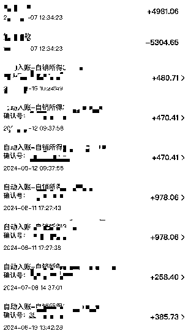

这类内容的搜索周期可能比较长。一篇文章发布后，未必马上带来咨询，但当用户在几周甚至几个月后搜索目的地、酒店或出行场景时，仍可能看到它。

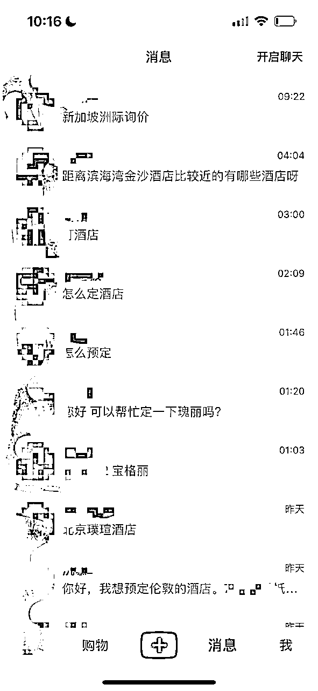

如果频繁在私信中发送重复营销内容，账号可能被系统识别为营销或违规信息。更稳妥的做法是完善内容、商品说明和服务流程，让用户主动发起咨询，并在店铺或合规沟通工具中完成后续交流。

# 新人从哪里开始更稳妥

酒店预订看似简单，实际涉及库存、会员等级、实名入住、取消政策、房型差异和售后责任。新手一上来就做高端酒店，可能因为一个细节出错而承担较高损失。

更适合练手的方向，是中端及大众连锁品牌的会员权益服务，例如：

- 华住旗下品牌；
- 锦江旗下品牌；
- 亚朵体系；
- 东呈体系。

这些品牌通常具有几个特点：

1. 房价相对容易理解；
2. 客户需求比较明确；
3. 会员规则相对标准化；
4. 出差和短途住宿需求稳定；
5. 单笔风险通常低于顶奢酒店。

## 案例一：华住会员体系

华住覆盖的品牌范围较广，从经济型到中高端都有布局，例如如家、宜必思、全季、桔子水晶、禧玥等。

高等级会员通常可以获得折扣、早餐、房型升级等权益，但具体待遇要以会员等级、门店和当期政策为准。

服务方式一般是：

1. 客户提供入住日期和城市；
2. 查询会员价及适用权益；
3. 说明入住人信息和取消规则；
4. 通过合规方式完成预订；
5. 提供订单信息并跟进入住。

大众品牌的单间利润通常不会特别高，可能以固定服务费为主；定位更高的门店，服务费空间相对大一些。

此外，官方会员体系可能提供积分。长期使用后，积分可以兑换住宿、早餐、饮品或品牌周边，但不要把积分收益当成主要盈利来源。

## 案例二：亚朵体系

亚朵更偏向中产商务和生活方式客群，常见产品包括普通亚朵、亚朵X、亚朵S等不同定位。

会员权益可能包括折扣、早餐、房型升级或其他服务，实际以账户等级和当期活动为准。

它的复购特点比较明显。部分客人出差频率高，习惯固定品牌，因此服务体验一旦稳定，就容易形成重复购买。

亚朵积分除了可以兑换房晚，也可能兑换部分酒店同款商品，例如枕头、洗护用品、杯具等。品牌枕头曾经拥有较高销量，这也说明酒店服务可以延伸到住宿之外的消费场景。

需要提醒的是，利用接码批量注册、绕过平台规则获取异常价格等方式，存在账号封禁、订单取消和售后纠纷风险，不建议作为长期经营策略。

# 进阶方向：高端旅行机构资源

高端酒店预订并不适合完全没有经验的人直接开始。

难点不只是找到房价，而是：

- 能否准确解释礼遇；
- 能否判断房型差异；
- 能否处理特殊需求；
- 能否管理取消和改期；
- 能否与客户建立稳定信任；
- 能否持续维护供应方规则。

长期做下去，通常需要培养三种能力。

## 1. 内容获客能力

通过目的地攻略、酒店对比、入住场景和真实案例，让用户先产生兴趣，再主动咨询。

## 2. 成交与服务能力

客户在意的不只是数字，还会关注房型、早餐、景观、入住时间、取消条件以及是否能核验订单。

## 3. 私域维护能力

在获得客户许可的前提下，持续提供出行建议、酒店信息和节日提醒，逐渐形成复购和转介绍。

# 高端酒店卖的不是一张床

顶级酒店的客人，往往不会只问“多少钱一晚”。

他们可能会关心：

- 房间所在楼层；
- 是否能看到特定景观；
- 床型与面积；
- 是否有欢迎礼；
- 早餐地点和形式；
- 是否能延迟退房；
- 是否有行政酒廊；
- 庆祝场景能否提前布置；
- 订单是否可以累计会员权益。

这类客户购买的是省心、确定性和整体体验。

因此，高端预订服务更接近“行程管家”，而不是简单比价。你需要在下单前把权益、限制、付款方式、取消政策和酒店规则解释清楚。

如果只是把低价截图发给客户，却无法处理后续问题，很容易出现纠纷。

# 为什么有人愿意为这项服务付费

高端客群通常不缺支付能力，但缺时间，也不愿意反复研究酒店规则。

如果你能做到：

- 信息准确；
- 回复及时；
- 订单可核验；
- 需求记录完整；
- 变更提醒及时；
- 预期管理清晰；

客户就可能在下一次出行时继续找你。

这类业务的优势不在于每笔都能赚很多，而在于客单价、复购率和转介绍潜力可能更高。

# 市面上的训练营到底在讲什么

不少酒店预订训练营会把这类内容包装成“神秘内部资源”，常见话术包括：

- 自己认识某奢侈酒店高层；
- 渠道来自某集团高管；
- 市面上无人知晓；
- 只有付费学员才能获得。

实际上，很多课程反复讲的仍是几件事：

1. 高端酒店合作资源；
2. 渠道订单系统；
3. 佣金结算方式；
4. 内容平台获客；
5. 客户沟通与售后。

真正决定结果的，不是听完一套课程后显得多专业，而是能否理解规则、做好服务、控制风险并持续积累客户。

# 最后，能不能赚到钱？

可以，但不要把它理解成“注册一个账号就自动产生收入”。

你的收益通常受到以下因素影响：

- 供应渠道是否稳定；
- 酒店和日期是否有库存；
- 客户需求是否匹配；
- 单笔订单的服务价值；
- 平台获客成本；
- 售后与改单比例；
- 账号和渠道是否合规；
- 能否形成复购。

大众连锁更适合练习流程，利润通常偏薄，但需求稳定、风险相对可控；高端酒店客单价和服务费空间更大，但对专业度、沟通能力和规则意识要求也更高。

如果你准备尝试，建议按照这个顺序：

1. 先研究酒店品牌和房型；
2. 再熟悉会员权益与取消政策；
3. 从低风险、规则清晰的产品开始；
4. 每一笔订单都保留沟通记录；
5. 不做虚假宣传，不冒用身份；
6. 确认渠道条款后再扩大规模；
7. 用内容和服务积累长期客户。

酒店预订服务本质上是一个信息匹配和客户服务生意。资源只是起点，真正能留下客户的，是准确、可靠和省心。

如果你只是想先试试，可以从自己熟悉的城市、常住品牌和真实入住体验开始，不必一上来就追逐所谓“顶级资源”。

稳稳把一件小事做顺，往往比听信夸张的暴利故事更重要。

说实话，我看到这单的回报时，第一反应是愣了一下——它差不多能顶我在华住跑十来单的总收入。

房费越贵，你能拿到的佣金就越多。而这群客户，一旦你服务到位，复购率高得惊人，几乎不会流失。

他们跟那种一年出门旅游一回的普通住客完全不同，一年里光出差加度假就能住上几十晚。这些人规划行程时，第一件事往往不是定景点，而是“先看哪家酒店能订到”。

只要你能稳稳拿下这样一个客户，就等于给自己装了一台随时吐钱的取款机。这真不是我在渲染气氛，是亲手做过之后才有的体感。

#### 更让你偷着乐的是另一件事

越是顶奢级别的酒店，越会不定期放出“住三付二”“住四付三”之类的隐藏优惠。拿曼谷文华东方来举个例子：

4月24日到27日，三个晚上，携程挂出来的报价是12087.33元

同样的日期和房型，通过渠道下单只要10957.88元

一对比，里外差了1129.45元，而且咱们的渠道还额外附带100美金的消费额度，甚至能争取免费升级房型。

这种优惠只有少数高端渠道能拿到，你在普通OTA平台根本搜不到。

你只需要在小程序里帮客人完成预订，客人到店自己去前台付款，退房之后系统会自动按照房费给你结算佣金，比例一般在5%到7%之间浮动。

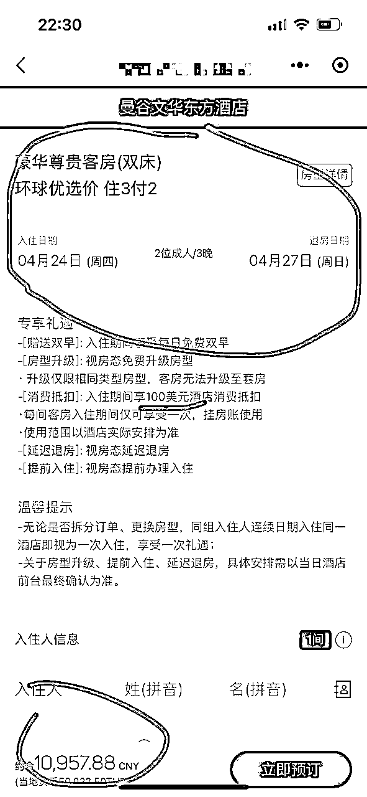

咱来笔实实在在的账：

还拿刚才那单来说，总房费10957.88元

按照6%的佣金比例来算，这个单子就能给你带来657.47元

要是碰上“住四付三”“住五付三”，总价更高，一单赚上近千元也完全可能。

#### 这不仅仅是订房，更是一份稳稳的信任

往深了说，你不是代订，你是他随叫随到的“私人酒店管家”。

有时候你帮他搞到一间早已满房的紧急套房，或者帮他协调好提前入住、刚好赶上飞机——

客户脱口而出那句“终于有人懂我了”的瞬间，那种价值感真的很难用钱去量化。

我见过太多人，第一次合作完就主动加微信，张口就是：“下次去别的城市，还得麻烦你帮我看看。”

一来二去，你就成了他朋友圈里唯一的“酒店顾问”。

你可能会嘀咕，这事儿听起来是不是不太真实？

但等你真正接下一两单，被客户信任、赚到第一笔佣金、看到好评弹出来的那一刻……

你大概就明白，为什么我一直说这条路值得你认真深耕了。

# 独家渠道

我把它特意放在最后说，不是因为它无足轻重，恰恰因为它的分量太重了，不能轻描淡写。

这种资源，也是所有渠道里最难拿到的。不是你花时间搜网页就能搜到，也不是加几个代订群就能打听到，更不可能在朋友圈里看到有人公开分享。

想拿到它，只有一个字：“熬”。

它是靠时间一点点熬出来的信任。你要常年跑在一线，配合得滴水不漏，专业、细致，还不能制造任何麻烦。哪怕是出了意外状况，你宁愿自己掏钱补窟窿，也绝不给酒店添一点堵。只有做到这个份儿上，酒店经理才可能记住你、信任你，在合适的时机为你打开一扇别人看不见的门。

因为你自己清楚，这种资源得来不易：时机、口碑、人脉，三样缺一不可。而且这种东西，一旦丢了一次，就永远找不回来了。

我现在手里的很多独家价格，都是用这种笨办法磨出来的。

你得把每一个细节都处理得精雕细琢，才有机会换来对方一句：“这个价，我只给你一个人。”

你得亲自走到那扇门前，才会发现门背后还有另一重门。

# 结尾

我知道你看到这儿，不是来听大道理的，

也不是只想学几招赚钱的技巧。

你更像在寻找一种答案：有没有一种可能，

让生活变得再轻松一点、自在一点、多一点选择？

我没跟你讲什么高深的道理，

都是一些自己试过的做法，踩过的坑，走过的路。

如果恰好给你推开了一扇窗，

甚至只是某一瞬间让你觉得，

“这人懂我。”

那我们，其实已经算认识了。

愿你在自己的世界里，舒舒服服地做自己。

我是风小海。

祝你口袋有钱，来去自由。

* * *

# 2025年6月2日更新

那篇帖子发出去之后，现在越来越多圈友来找我订房。同时，也有更多朋友意识到“原来找代订订酒店能省不少钱”。为了不让大家以后在外面被各种代订骗局坑到，我专门补一篇市面上常见的骗术揭秘：

## ①信用卡盗刷（主要出现在境外酒店）：

核心套路：黑卡套现 + 虚假代订

具体操作流程是这样的：

1.骗子手里有非法弄来的信用卡卡号，大多数是境外被盗刷来的卡。

2.他拿这些黑卡去酒店官网给你正常下单。

3.你该住住，但房费是从别人的信用卡里扣的。

4.等真正的持卡人发现被盗刷、向银行发起拒付，银行就会把钱原路退回去。

5.酒店发现没收到钱，就只能取消订单，再反过来找你追责。

而骗子呢？早就消失得无影无踪，钱已经稳稳到手，后果跟他一毛钱关系都没有。

### 最让人脊背发凉的地方是：

你作为住客，表面上什么坏事都没做，但实际上已经被卷进了一条非法的资金链条。

有人因为这种事被警方叫去问话，甚至被立案调查。

有人直接被酒店列入了黑名单，以后再也订不了这家酒店。

更惨的是，有人在入住高峰被酒店当场赶出去，钱没了，脸面也没了。

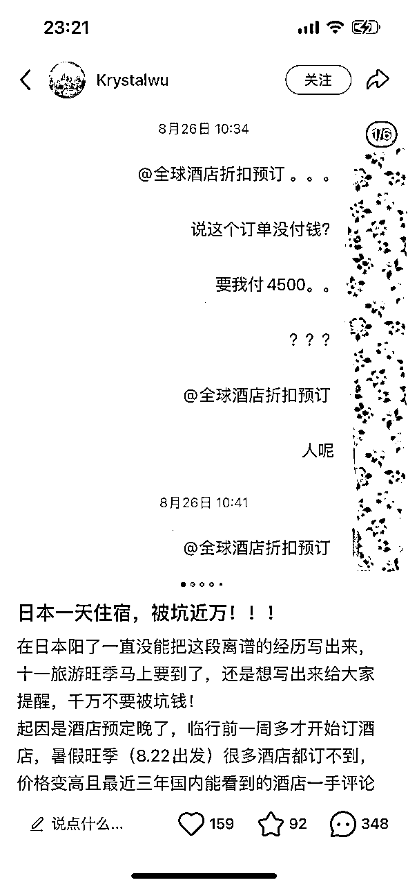

* * *

## ②LV“员工邀请函”入住骗局

这种套路跟PS世界500强工作证操作是一模一样的。

骗术形式：

骗子伪装成“能拿到某奢侈品大牌（LV、Chanel、Dior等）员工价或内部名额”的人，拿这个来招揽客人。他会先收低于市场价的房费，然后在入住前发给你一张伪造的员工工牌或名片，让你冒充品牌员工去办入住。

如果酒店没看出来，顺利住进去了，骗子就白赚了一笔房费差价；万一被识破，骗子就会一脸无辜地说“哎呀渠道出了点问题”，赶紧退款或承诺补偿，装出一副自己也很无奈的样子。

但真正的风险是：你一旦拿着这些假资料去入住，就等于配合实施了对酒店的欺诈，酒店如果报警，第一个找到的绝对是你。骗子呢？早就躲在暗处了。

### 骗子的逻辑和心态分析

这是一种典型的“单边赌局”。

✅ 成功入住 → 赚走你付的房费差价

❌ 被识破 → 装作配合处理，退款退群，转身就跑

套路跟“算命的说保生儿子”一模一样：

要是蒙对了，他就白赚；要是没蒙对，他也没什么损失，最多把钱退给你。

换句话说，他既没出力也没担任何风险，全靠你的胆量和酒店的疏忽来赌一个概率。

更讽刺的是，这种骗子还经常在小红书或闲鱼上晒各种订单截图、客户好评，看起来全都精挑细选过，因为：

❌ 没骗成的那部分客人早就被退款拉黑了

✅ 骗成功的那部分客人以为自己捡到了便宜，还高高兴兴地给好评

所以，这种骗局看起来像那么回事儿，看起来像是专业代订，实际上就是一场赌博——赌你不懂行、赌酒店看走眼、赌他运气好。

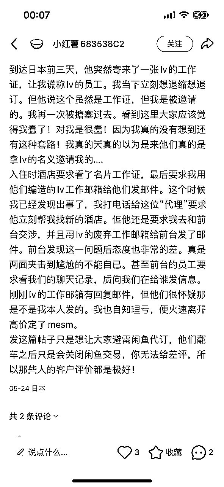

* * *

## ③澳门“房卡房”骗局

### 骗局形式

骗子会在闲鱼、小红书这些平台上挂出澳门酒店的“超低价房”，像威尼斯人、新濠影汇、巴黎人这种热门豪华酒店，报出来的价格比官方渠道低一大截，吸引你先付定金，然后告诉你“到店再付尾款就能入住”。

但等你到了现场，根本不是正常的前台登记，走的是所谓的“房卡房”，也就是给你一张房卡直接开门入住。这种房的来源，你根本不知道，可能是赌场会员积分免费换的、员工内部房、甚至有些来路不明的风险房源。

### 骗子的操作流程

1.低价钓鱼：挂出一个低得离谱的“内部渠道价”，让你觉得自己捡到宝了。

2.定金锁客：先让你交一笔小额定金，说剩下的到店给，让你放松戒备。

3.入住当天失联：等你到了酒店，消息开始已读不回，电话接通了也是各种找理由推脱。

4.临时坐地起价：突然告诉你“房没了，得加钱换个别的”，或者干脆把你塞去另一家不太行的酒店。你带着老人孩子、拖着一堆行李，又是节假日根本找不到别的房，想讲条件都没有余地。

5.不加价就拉倒：让你自己另想办法，但定金想退？那得等平台介入了。

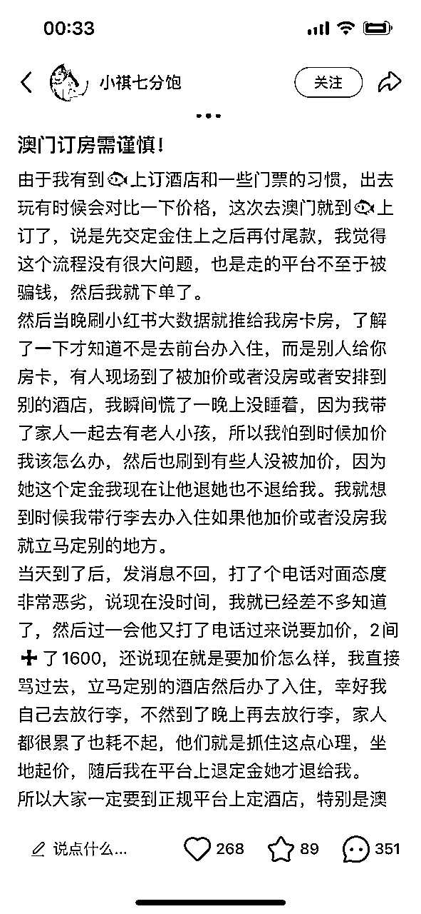

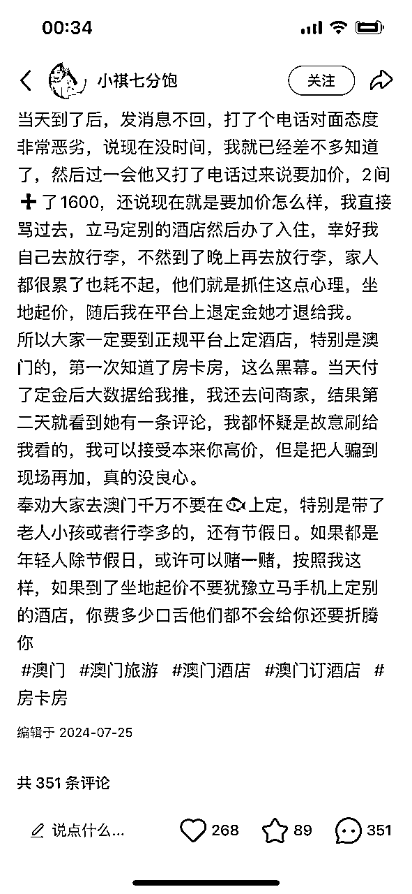

* * *

## ④ 假扮前台

### 骗局形式

骗子蹲在小红书这类社交平台，主动给用户发私信，声称自己是酒店的工作人员——可能是前台、内部员工、也可能是搞淡季营销的负责人。用一套听上去特别合情合理的话术，加你微信，收定金和尾款，等你到了入住那天，直接人间蒸发。

### 骗子的操作逻辑

1.钓鱼筛选目标：专门挑那种发帖“求推荐酒店”的用户下手，假装热心酒店前台主动搭话。

2.慢慢建立信任：加了微信之后不停地聊，发旅行攻略、关心你的行程安排，让你一点点放下戒备。

3.拿“内部保本促销”收定金：告诉你这是淡季清仓价、加盟内部优惠，只需要交300元定金就能锁房。

4.再进行二次收费：过几天又联系你说“得付尾款才能保证留房”，再收你一笔400元。

5.临到入住就变脸：等你到了酒店当天，突然说“加盟出了问题，没法入住了”，承诺给你退款。

6.假装退款拖延：要了你的银行卡号，说“转账不成功”一再拖延，然后彻底失联拉黑。

7.一人扮演多个身份：跟你面前是酒店员工，跟别人面前是代订机构，每个身份都编得严丝合缝。

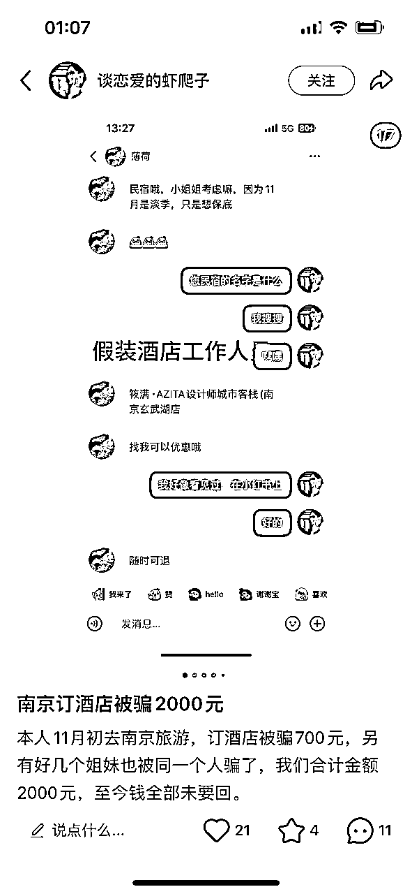

* * *

## ⑤追星拼房骗局

这个案例知道的人不多，但生财圈里也有不少在校大学生，我觉得还是值得写一下。

背景是某位粉丝计划去澳门看演唱会，在小红书发了求拼房的帖子，然后被一个自称从事低价酒店渠道的人盯上。对方抓住了“演唱会期间房价高”“房源紧俏”这些心理暗示，一步步连环套路，差点就让她白白损失了一笔钱。

### 为什么会有这么多人上当？

1.港澳那边的酒店很多预定后就不能退款，骗子就抓住“晚订更贵”“不早订就没了”来制造焦虑，让人紧张。

2.对港澳酒店情况不了解的粉丝，特别怕到了之后没地方住，心里一急就容易掉进圈套。

3.追星本身就是赶时间看演出，情绪很急，注意力很难集中，判断力自然就容易被带偏。

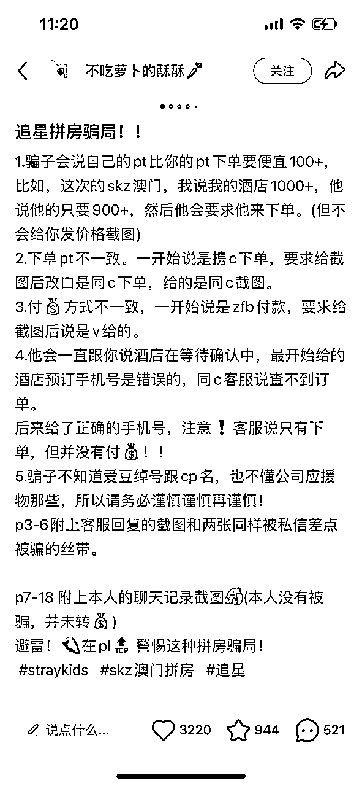

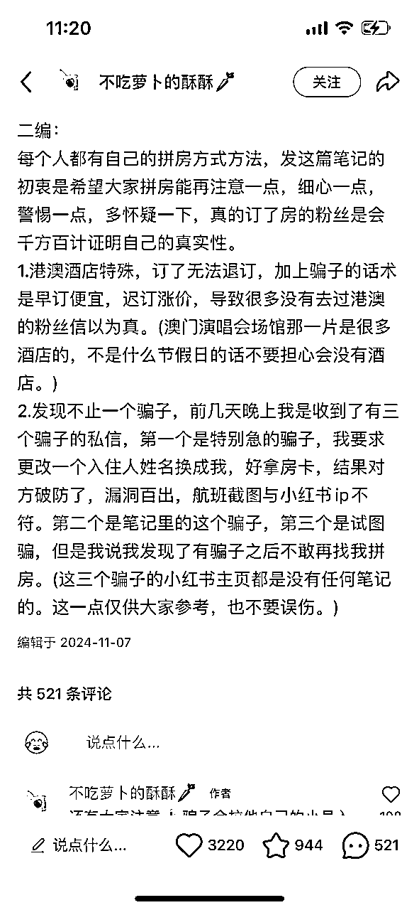

* * *

记住下面这几条铁律，你就永远不会掉坑：

任何情况下都不要提前转账、不要提前确认收货。

一段真正靠谱的合作关系，不应该建立在你先放弃主动权的基础上。不管订酒店还是找人拼房，都应该等你实实在在住进去了、确认一切正常、平安退房之后，再考虑付款或确认收货。

永远别让自己陷在一个被动等别人讲良心的处境里。这世上最靠不住的一件事，就是“想着对方不会骗你”。

你唯一能管住的，只有自己的行为界线。你可以保证自己不骗别人，但你没法用你的真诚去换取别人的真心。

所以，把你的安全感放在流程和规则上，不要放在聊天截图、身份证照片，或者“对方看起来也挺正常”这种表面印象上。别嫌麻烦、别图快，凡是能走平台的，就坚决别走私下。