# 住宿代理副业全拆解：不压货、不出镜，一台手机就能跑通的隐藏玩法

我是龙哥，这是我网上一直用的名字。常驻武汉，在龙哥盟社群待了三年，之前做过服装生意，亏过也赚过。现在时间归自己管，可离财务自由还差得远。去年靠发风向标换了一年门票，我谈不上什么天赋型，只是踩过的坑比一般人稍多。接下来的100个真实项目，我会一个一个写出来，给所有踏踏实实过日子、想靠双手搞钱的人当参考。

## 最初那笔钱

---

### 先讲点真心话

把住宿代理这门生意完完整整摊到桌面上讲，我大概是头一个。这么干，肯定会招来一些人不高兴。
但我也清楚，眼下有太多普通人急需找到一条靠谱的副业路。不用开口闭口创业，哪怕每月多挣一千块，日子都能松快不少。
这个活儿不用压货，不用寄包裹，更不必开镜头露脸。
哪怕你压根不想做这门生意，自己出门旅行、出差，订房也能省下一笔。
关键是，它没你想的那么难，也没那么卷。一部手机，嘴皮子利索，就能试着干起来。
特别感谢 @潇墨｜赚钱鱼丸 耐着性子帮我校对。
这篇文章最想做的，是把市面上各种拿房渠道的原理一次说透，再手把手讲怎么利用“旅游服务商合作价”，在种草平台和二手交易平台引流、拿佣金。

---

### 住宿怎么分档，先搞明白

在学赚钱之前，先给住宿这门生意降降门槛。你总得先弄清楚客人愿意住什么，才知道怎么赚他们的钱。
按档次分，大致五层：

#### 经济型（1星~3星）
像快餐店，便宜、干净、住着不心疼。代表：如家、汉庭、7天、锦江之星、格林豪泰。参考价：100～300元/晚。

#### 中档型（3星+~4星）
有床、有桌、有窗，出差异地短住都合适。代表：全季、桔子、亚朵、怡程、喆啡。参考价：300～600元/晚。

#### 高端型（4星+~5星）
带点调性，小资情侣、商务宴请和讲究仪式感的人常用。代表：希尔顿欢朋、万达嘉华、美居、华邑、皇冠假日。参考价：600～1200元/晚。

#### 豪华型（五星+）
牌子响、服务硬、设施顶，住进去会觉得自己“人上人”。代表：香格里拉、洲际、瑰丽、悦榕庄、W酒店、英迪格。参考价：1200～3000元/晚。

#### 顶奢型
一晚上一台手机的价格，朋友圈能拍照吹一整年，代理赚头也相当大。代表：宝格丽、安缦、文华东方、四季、丽兹卡尔顿、半岛。参考价：3000元起步，8000元常见，节假日破万也很正常。

---

### 行话先学明白

看懂这些词，你已经赢过八成外行。做代理，术语是基本功。

1. BAR价（Best Available Rate）
就是门市价，住宿官网或OTA上公开给普通客人的价格。

2. 机构合作折扣
专门给大客户、旅游服务商、代理的隐藏价格。

3. 房型别弄混
大床房：一张大床，适合情侣或一个人出差。
双床房/标间：两张单人床，适合朋友或拼房。
套房：客厅、卧室分开，有些还带厨房，商务接待或特殊日子好用。
行政楼层：带专属酒廊、早餐和下午茶，商旅人士常选。
家庭房/三人房：适合带娃家庭，偶尔有上下铺。
无窗房：便宜，但住着像“密室逃脱”，推荐要谨慎。

4. 房态词
甩房：临时降价清库存，眼尖的代理会死盯。
封房：节假日满房不接单，但偶尔还能翻出“隐藏房”。
超卖（Overbook）：有些接待方超量接单，老住户反而更可能被升级。

5. OTA（Online Travel Agency）
在线旅游商，比如携程、飞猪、去哪儿、马蜂窝、同程。代理的核心卖点，就是比它们更低价、更灵活。客人第一句永远是：“你比携程便宜吗？”

6. 预订确认号 / PNR
客人下单后会收到一串确认号，也叫PNR。它不是平台，你又不出镜，这串数字就是你和客户之间的“信任证明”，比发十条语音都管用。

7. 常用词
CI / CO：入住 / 退房。
No Show：订了没来，“鸽了”。
Upgrade：升级房型，通常要会员或加钱，但里面也有操作空间，以后细讲。
含早 / 不含早：有的早餐比房费还贵，下单前看清楚，别光盯价格。

---

### 低价房从哪来

想靠这行赚钱，第一件事不是找客源，而是弄清楚你手里能拿到什么房、凭什么比别人划算。这部分就是带你看懂“进货端”。

#### 保级房 / 门卡房
很多住宿品牌的高等级会员，一年要住够指定晚数。有人没空去住，又不想掉级，就把入住资格挂出去卖，找别人代住。会员权益确实香：折扣、升房、免费早餐、延迟退房、酒廊畅吃，全都包含。于是会员保住了级别，你也享受到了优惠，两边都合适。
有些住宿管得严，必须本人到入住登记处核实身份。于是有人提前开好房，把门卡交给你，你绕过登记台，直接刷卡上楼入住。这就是“门卡房”。

#### 五百强企业内部价
说白了就是大公司专属福利，最低可以打到五折上下。这类价格来自大集团和住宿方签的全球合作协议，只面向自家员工。
早几年住宿方查得不严，有人直接拿PS的大厂工牌去碰运气，让你蹭到低价，他赚中间差价。当然，翻车也时有发生，这时候就看你的临场表演了。
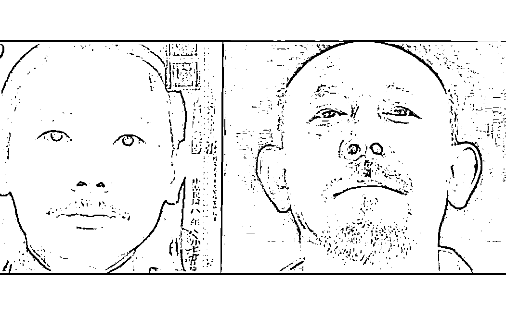
现在没那么容易了。通常是大厂员工用自己身份开房，再以门卡房形式转交给你，私下赚点外快。

#### 澳门积分房
这个说到底是赌场的积分玩法。你在赌场每下一回注，系统就记一笔分。这分不能换鸡蛋，但能换住宿。
“叠码仔”这时候就出现了。他们手里握着一堆高赌客的积分，低价出掉，哪怕一单只赚几十块也干，毕竟分过期就作废，今天不用明天清零，能出一单是一单。
但便宜不代表安稳。叠码仔靠不靠谱，全看运气，有讲信用的，也有跑路的。而且抢的人太多，它不像正规渠道那样锁房锁得死，更像小型拍卖：谁出价高，谁就睡那张大床。哪怕你钱都付了，兴冲冲收拾行李，也可能在去住宿的路上接到电话：房间被一位多加两百块的土豪截胡了，只剩你大包小包在风里发呆。

#### 平台包房
如果把住宿比作演唱会，OTA平台提前包下的房源，就相当于黄牛囤的前排票。
OTA会先跟住宿方谈批量价：我一次包你100间，能不能给个实惠价？
住宿方一想，反正空着也空着，有人肯付现钱，当然好。
于是包来的房被上架、组合，再挂上“限时秒杀”“含双早”“延迟退房”的标签，就成了你看见的“捡漏价”。经常用携程的人，应该注意过有些房型标着“代理”，货就是从这儿来的。
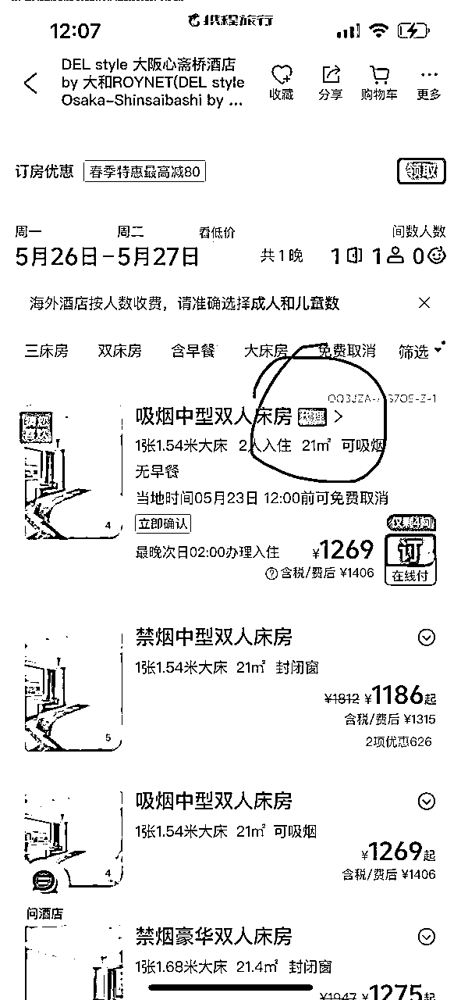

#### 房券
这差不多是住宿界的百亿补贴。为了拉新、冲销量、养口碑，住宿方会联合平台、银行、信用卡公司搞活动，散发一堆限时券。淡季没客人，酒店宁愿打折回血，也不想空房发霉。
可大多数人要么懒得用，要么直接忘了。于是有人低价把券收来，再转手卖掉赚差价。
所以你在某些平台、团购群、员工福利商城看到的房券，表面像亏本，实际是店家在回血。

---

### 旅游服务商合作价（重点）

### 圈内“正规军”：不押金、不跑路，还自带五星体验

正规手续入住，能开发票，连佣金都依法纳税。
如果说澳门积分房像在赌场边上蹭饭，那旅游服务商合作价就是住宿代理界的海底捞——流程标准、服务到位，还送额外小福利。
这个资源最早是美国运通白金卡、黑金卡用户的专属福利：住宿有折扣，还送早餐、升房、延迟退房，到店送100美元消费额度，非常风光。
如今，不少国内旅游服务商已经悄悄接入了运通的高端住宿体系，甚至做出了专门的代理小程序。你不用美卡、不用黑卡、不用任何卡，只要拿到一条链接，就能订到从前“高攀不起”的住宿，待遇一模一样。
这套体系覆盖全球1000多家顶级住宿，包括四季、安缦、华尔道夫、柏悦、宝格丽、瑞吉、文华东方、丽思卡尔顿、瑰丽、凯宾斯基、洲际、W、艾迪逊等。
最要紧的是：
不用垫资。你帮客人下完单，客人自己去入住登记处付款，资金周转压力为零。
完全正规。全程透明，客人能打电话到住宿方，用自己的名字查到订单，天然信任。
能开发票，能累积客人自己的会员积分，简直无敌。
用客人本人身份入住，出了问题也能直接找住宿方反馈，售后基本不用你管。
客人住得放心，你赚得安心，谁都不吃亏。
全程VIP待遇，该有的礼遇一样不少，走正路赚正钱。

### 我是怎么撞上这条路的

一开始，我真没打算做代理，就是喜欢玩信用卡，尤其喜欢那些能带人住高端住宿的卡。信用卡论坛里总有常旅客分享住宿体验，我也慢慢变成“住宿控”——出差也好、旅行也好，住哪儿成了我最大诉求。很多卡确实能带来顶级住宿折扣和VIP待遇。
后来有一次，我在二手交易平台上看到有人做住宿代理，价格居然跟我通过高端信用卡拿到的差不多，偶尔还更低。我当时有点懵，琢磨了一会，意识到背后八成有返佣机制，好奇心瞬间被勾起来。
接着我开始深挖。原来这些住宿优惠，最早是信用卡公司和住宿方谈好的合作价，再由几家大旅游服务商承接。我通过这些服务商下单，他们给我返佣，也就是CPS（按销售额分成）。大家都开心——我住到便宜房，服务商和住宿方也有赚头，等于三赢。甚至有人直接拿这个模式开了公司，做成长期主业。你在种草平台看到的那些高端住宿代理，基本都是这个套路。
但这里有个矛盾：这类资源不能放到淘宝、二手交易平台或种草社区上公开叫卖，传统OTA更不可能。服务商连自己的名字都不许在公开场合说，怕住宿方追究。做这个还要交押金，一旦踩线，轻则佣金清零，重则罚款、押金没收，甚至永久拉黑。
别问我怎么知道的，都是血泪教训。第一次接单，我跟客人没沟通清楚，结果客人到入住登记处办手续，脱口而出“我是在二手平台订的”，当场被晾在大厅，场面非常难看。住宿方去找服务商，服务商再找我……你能想象我有多尴尬吗。
后来我只能换家里人的身份证，低调继续用这条路子。
我管它叫“隐形合作价”。
顶级住宿很爱惜形象，怕影响调性。但话说回来，空房率确实高，他们也愿意让我们帮忙消化，前提是“暗中来”。只要别被住宿方抓到，合作的服务商不被投诉，就能一直做下去。所以主战场还是在种草平台和二手交易平台。
去年一条种草平台的帖子突然爆了，带给我差不多5000块收益，我几乎什么都没干。长尾流量的威力，挡不住。
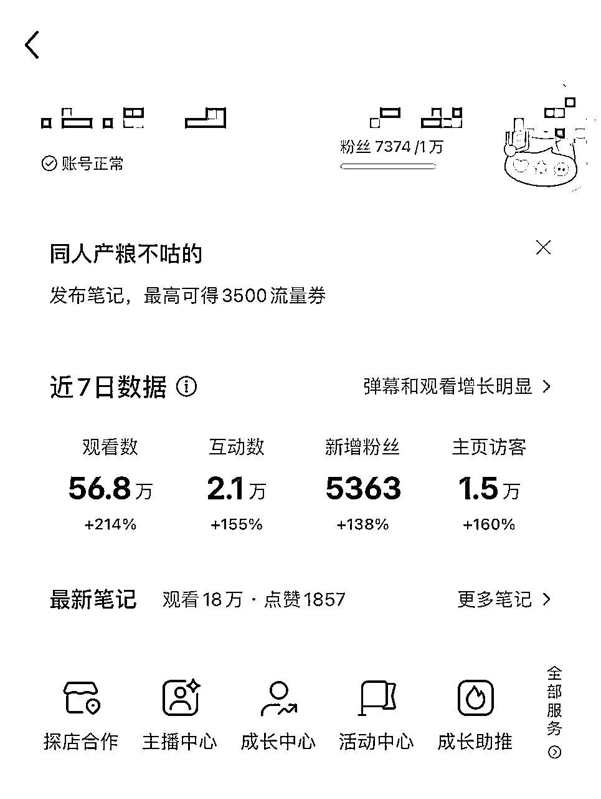

种草平台的长尾效应相当明显。
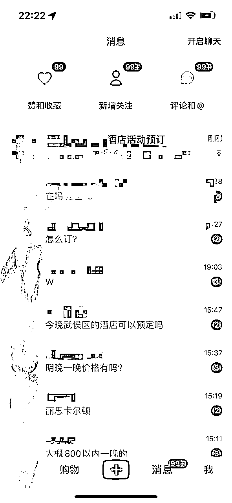

私信回多了会违规限流，之后可以在笔记里挂链接，再引导到店铺里聊。
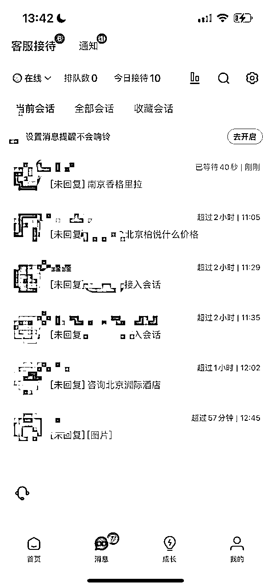

---

### 新手适合从哪儿开始

住宿业门道很多，新手一上来就玩高端，很容易踩雷，弄不好还得倒贴钱。
我的建议是：先从中低端连锁品牌的会员资格做起，也就是江湖上传的“华住系、锦江系、亚朵系、东呈系”。
原因很简单：房价不贵，高级会员门槛低，套路少，客人要求也不高。客群好找，商旅、学生短租的需求很旺；就算翻车，因为总价低，你也赔得起，风险很友好。
拿亚朵和华住举例子。如果说旅游服务商合作价是豪门夜宴，那华住和亚朵就是楼下小卖部里最香的那份卤味拼盘——门槛低、出货快、利润稳。

#### 操作原理
#### 案例一：华住体系

“中产代理界”的老大哥。旗下从如家、宜必思，一路排到全季、桔子水晶、禧玥，高中低全覆盖，一线到五线都有据点。有路灯的地方，大概率就有华住。
高等级会员能拿85折+双人早餐+免费升房，吸引力很足。
弄一个高卡会员就能直接开工。在二手平台和种草社区发“华住代订”的帖子引流，高端子品牌一间能赚上百差价；中低端房价低，就按每单二三十收服务费。
还有官方App和积分体系，做久了能攒下大量积分，这些分可以换房、换咖啡、换早餐，还能换酒店同款枕头、香薰、浴袍，顺便薅点福利也不寒碜。
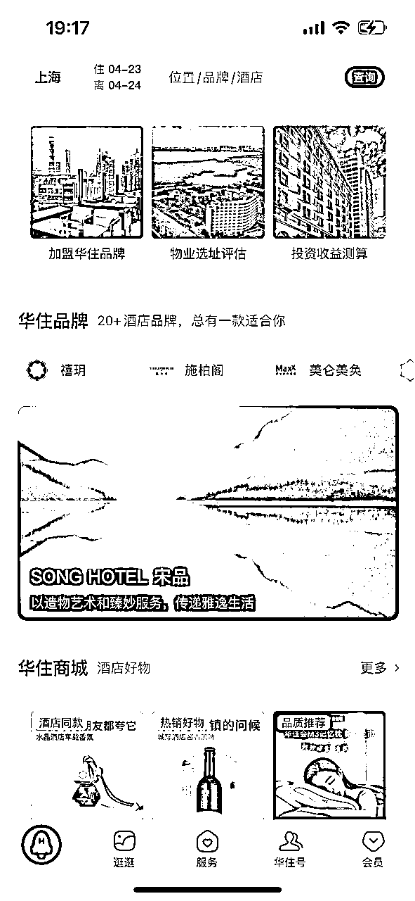

#### 案例二：亚朵

“文艺中产代表队”，主打书香调性，号称能洗去一身旅途疲惫。
旗下有：
亚朵S（高端）
亚朵X/优选（设计感）
普通亚朵（商务）
会员体系同样诱人，高卡可以打到8折，还经常送早、升房。
去年甚至能靠接码平台批量注册新账号，拿到低于8折的价，单子多到接不完。
跟华住一样，在种草平台和二手平台引流，利润差别也不大。不过亚朵和会员之间的关系更紧，回头客特别多。亚朵积分能换房，也能换洗衣液、咖啡杯等酒店同款，最出名的还是2024年销量破380万个的亚朵枕头。
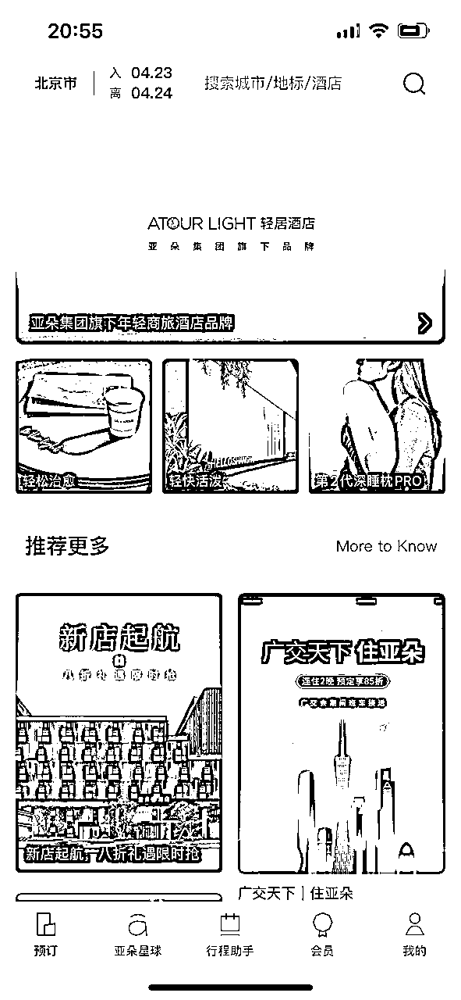

---

### 进阶渠道

就是前面反复说的“旅游服务商合作价”。
这也是我最推荐的一条长期路子，但先提醒：
新手先别急着碰。难的不是入门，而是门槛长在人身上。
这个赛道天花板很高，适合长期经营。你会在这里慢慢磨出三种本事：
种草内容能力：会讲故事、做合集，让人主动来咨询。
二手平台转化能力：成交更轻松，客户更信任你。
🛰️私域运营能力：用朋友圈养信任、做复购、沉淀高质量客源。

#### 这条线主要订什么？
五星以及五星以上的顶级住宿：
北京宝格丽、上海半岛、杭州西子湖四季、三亚艾迪逊、澳门永利皇宫……
一晚上两三千很正常，顶级套房上万也不稀奇。
住在这些地方的常客，最在意的是：“你到底懂不懂我。”

#### 你的客人是谁？
不是普通旅客，而是把住宿当成生活方式的人。
这就是我不建议新手冲高端的原因。你的客人不是来“睡一晚”的，他们是在“选体验”。你能不能把他们服务好，不是比谁价格低，而是能不能成为他的“私人住宿管家”。你得懂品牌、懂服务、会提前规划、客人还没开口你就知道他想要什么。
他们对住宿的消费观很纯粹，也极度讲究仪式感：
房间要有欢迎水果，红酒得提前冰好；
对房型有执念，对风景有情怀，对早餐自助能写小作文。
房型、楼层、朝向、早餐、欢迎礼，连窗帘是不是自动的，都影响心情。
一晚上7000块的房间，哪怕门卡边角有点磨损，他们都会找你抱怨。
这时候，你不再只是“帮他找个便宜房”的人，而是“懂他的人”。一个靠谱又万能的住宿管家。
他们要的不多，就是一句：“放心，我来搞定。”
* * *
说白了，这类人不缺钱，缺的是省心。你要是能帮他订到优惠，又懂他，你在他们眼里就是活地图+活菩萨：不光会推荐，还能带来升套、送早餐、延迟退房。
只要服务到位，他们下次出行一定还找你。
这也是为什么这个渠道一旦做顺，客单价高、粘性强、还容易转介绍，稳得不行。

#### 那些收费1999、2999的住宿代理课程，讲的就是这件事

他们怎么包装？
台词基本是这样：
“我在住宿行业十年，和某奢牌区域经理是朋友……”
“这路子是我朋友在万豪做副总裁时私下给我的……”
“市面上没人知道这种内部资源，今天只讲给你听……”
收你学费，后面还要抽你的佣金。
但说到底，他们讲的就是我们正在聊的这套——顶级住宿合作价体系，以及配套的返佣结算机制。
唯一的区别是：
他们拿“神秘”当门票，而我拿“常识”开门。
* * *
你只要看懂了前面的逻辑：
佣金从哪来、优惠怎么产生、客人为什么愿意找你订……
你已经比那些交了大几千学费、还一头雾水的人强了。
说白了，这就是个服务业，拼的是细节、资源和长期专业度。
不是听完一节“怎么装懂住宿”的网课，就能装成住宿教父。
* * *
我一直觉得，真正有本事的人不会藏私，
而是愿意拿自己的经验，让别人走得更稳。
所以，如果你看到了这里，哪怕只是有一点点心动，
先把这篇收好，说不定哪天它就能带你迈出第一步。

#### 💰 那到底赚不赚钱？

结论嘛——

说实话，我看到这单的回报时，第一反应是愣了一下——它差不多能顶我在华住跑十来单的总收入。

房费越贵，你能拿到的佣金就越多。而这群客户，一旦你服务到位，复购率高得惊人，几乎不会流失。

他们跟那种一年出门旅游一回的普通住客完全不同，一年里光出差加度假就能住上几十晚。这些人规划行程时，第一件事往往不是定景点，而是“先看哪家酒店能订到”。

只要你能稳稳拿下这样一个客户，就等于给自己装了一台随时吐钱的取款机。这真不是我在渲染气氛，是亲手做过之后才有的体感。

#### 更让你偷着乐的是另一件事

越是顶奢级别的酒店，越会不定期放出“住三付二”“住四付三”之类的隐藏优惠。拿曼谷文华东方来举个例子：

4月24日到27日，三个晚上，携程挂出来的报价是12087.33元

同样的日期和房型，通过渠道下单只要10957.88元

一对比，里外差了1129.45元，而且咱们的渠道还额外附带100美金的消费额度，甚至能争取免费升级房型。

这种优惠只有少数高端渠道能拿到，你在普通OTA平台根本搜不到。

你只需要在小程序里帮客人完成预订，客人到店自己去前台付款，退房之后系统会自动按照房费给你结算佣金，比例一般在5%到7%之间浮动。

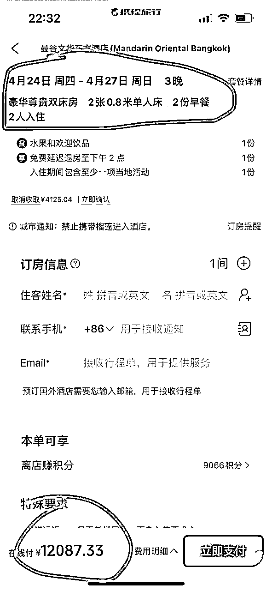

咱来笔实实在在的账：

还拿刚才那单来说，总房费10957.88元

按照6%的佣金比例来算，这个单子就能给你带来657.47元

要是碰上“住四付三”“住五付三”，总价更高，一单赚上近千元也完全可能。

#### 这不仅仅是订房，更是一份稳稳的信任

往深了说，你不是代订，你是他随叫随到的“私人酒店管家”。

有时候你帮他搞到一间早已满房的紧急套房，或者帮他协调好提前入住、刚好赶上飞机——

客户脱口而出那句“终于有人懂我了”的瞬间，那种价值感真的很难用钱去量化。

我见过太多人，第一次合作完就主动加🛰️，张口就是：“下次去别的城市，还得麻烦你帮我看看。”

一来二去，你就成了他朋友圈里唯一的“酒店顾问”。

你可能会嘀咕，这事儿听起来是不是不太真实？

但等你真正接下一两单，被客户信任、赚到第一笔佣金、看到好评弹出来的那一刻……

你大概就明白，为什么我一直说这条路值得你认真深耕了。

# 独家渠道

我把它特意放在最后说，不是因为它无足轻重，恰恰因为它的分量太重了，不能轻描淡写。

这种资源，也是所有渠道里最难拿到的。不是你花时间搜网页就能搜到，也不是加几个代订群就能打听到，更不可能在朋友圈里看到有人公开分享。

想拿到它，只有一个字：“熬”。

它是靠时间一点点熬出来的信任。你要常年跑在一线，配合得滴水不漏，专业、细致，还不能制造任何麻烦。哪怕是出了意外状况，你宁愿自己掏钱补窟窿，也绝不给酒店添一点堵。只有做到这个份儿上，酒店经理才可能记住你、信任你，在合适的时机为你打开一扇别人看不见的门。

因为你自己清楚，这种资源得来不易：时机、口碑、人脉，三样缺一不可。而且这种东西，一旦丢了一次，就永远找不回来了。

我现在手里的很多独家价格，都是用这种笨办法磨出来的。

你得把每一个细节都处理得精雕细琢，才有机会换来对方一句：“这个价，我只给你一个人。”

你得亲自走到那扇门前，才会发现门背后还有另一重门。

# 结尾

我知道你看到这儿，不是来听大道理的，

也不是只想学几招赚钱的技巧。

你更像在寻找一种答案：有没有一种可能，

让生活变得再轻松一点、自在一点、多一点选择？

我没跟你讲什么高深的道理，

都是一些自己试过的做法，踩过的坑，走过的路。

如果恰好给你推开了一扇窗，

甚至只是某一瞬间让你觉得，

“这人懂我。”

那我们，其实已经算认识了。

愿你在自己的世界里，舒舒服服地做自己。

我是风小海。

祝你口袋有钱，来去自由。

* * *

# 2025年6月2日更新

那篇帖子发出去之后，现在越来越多圈友来找我订房。同时，也有更多朋友意识到“原来找代订订酒店能省不少钱”。为了不让大家以后在外面被各种代订骗局坑到，我专门补一篇市面上常见的骗术揭秘：

## ①信用卡盗刷（主要出现在境外酒店）：

核心套路：黑卡套现 + 虚假代订

具体操作流程是这样的：

1.骗子手里有非法弄来的信用卡卡号，大多数是境外被盗刷来的卡。

2.他拿这些黑卡去酒店官网给你正常下单。

3.你该住住，但房费是从别人的信用卡里扣的。

4.等真正的持卡人发现被盗刷、向银行发起拒付，银行就会把钱原路退回去。

5.酒店发现没收到钱，就只能取消订单，再反过来找你追责。

而骗子呢？早就消失得无影无踪，钱已经稳稳到手，后果跟他一毛钱关系都没有。

### 最让人脊背发凉的地方是：

你作为住客，表面上什么坏事都没做，但实际上已经被卷进了一条非法的资金链条。

有人因为这种事被警方叫去问话，甚至被立案调查。

有人直接被酒店列入了黑名单，以后再也订不了这家酒店。

更惨的是，有人在入住高峰被酒店当场赶出去，钱没了，脸面也没了。

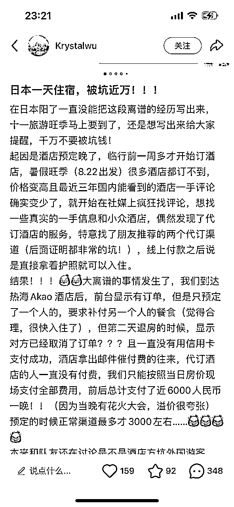

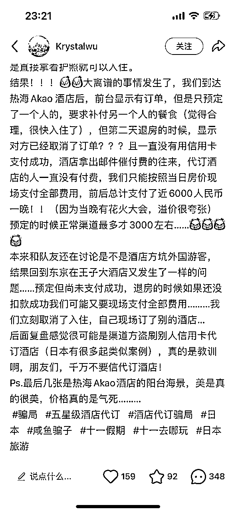

* * *

## ②LV“员工邀请函”入住骗局

这种套路跟PS世界500强工作证操作是一模一样的。

骗术形式：

骗子伪装成“能拿到某奢侈品大牌（LV、Chanel、Dior等）员工价或内部名额”的人，拿这个来招揽客人。他会先收低于市场价的房费，然后在入住前发给你一张伪造的员工工牌或名片，让你冒充品牌员工去办入住。

如果酒店没看出来，顺利住进去了，骗子就白赚了一笔房费差价；万一被识破，骗子就会一脸无辜地说“哎呀渠道出了点问题”，赶紧退款或承诺补偿，装出一副自己也很无奈的样子。

但真正的风险是：你一旦拿着这些假资料去入住，就等于配合实施了对酒店的欺诈，酒店如果报警，第一个找到的绝对是你。骗子呢？早就躲在暗处了。

### 骗子的逻辑和心态分析

这是一种典型的“单边赌局”。

✅ 成功入住 → 赚走你付的房费差价

❌ 被识破 → 装作配合处理，退款退群，转身就跑

套路跟“算命的说保生儿子”一模一样：

要是蒙对了，他就白赚；要是没蒙对，他也没什么损失，最多把钱退给你。

换句话说，他既没出力也没担任何风险，全靠你的胆量和酒店的疏忽来赌一个概率。

更讽刺的是，这种骗子还经常在📕或闲鱼上晒各种订单截图、客户好评，看起来全都精挑细选过，因为：

❌ 没骗成的那部分客人早就被退款拉黑了

✅ 骗成功的那部分客人以为自己捡到了便宜，还高高兴兴地给好评

所以，这种骗局看起来像那么回事儿，看起来像是专业代订，实际上就是一场赌博——赌你不懂行、赌酒店看走眼、赌他运气好。

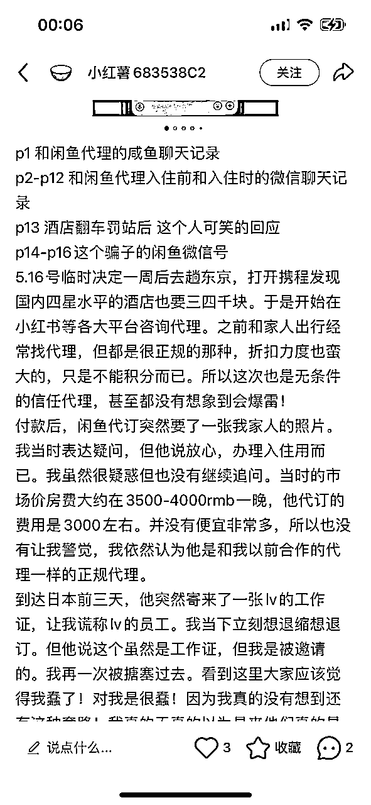

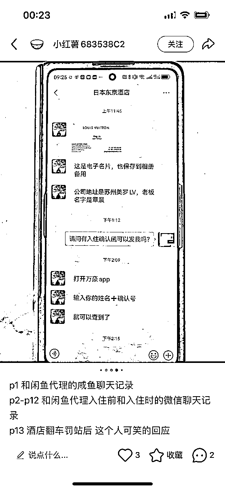

* * *

## ③澳门“房卡房”骗局

### 骗局形式

骗子会在闲鱼、📕这些平台上挂出澳门酒店的“超低价房”，像威尼斯人、新濠影汇、巴黎人这种热门豪华酒店，报出来的价格比官方渠道低一大截，吸引你先付定金，然后告诉你“到店再付尾款就能入住”。

但等你到了现场，根本不是正常的前台登记，走的是所谓的“房卡房”，也就是给你一张房卡直接开门入住。这种房的来源，你根本不知道，可能是赌场会员积分免费换的、员工内部房、甚至有些来路不明的风险房源。

### 骗子的操作流程

1.低价钓鱼：挂出一个低得离谱的“内部渠道价”，让你觉得自己捡到宝了。

2.定金锁客：先让你交一笔小额定金，说剩下的到店给，让你放松戒备。

3.入住当天失联：等你到了酒店，消息开始已读不回，电话接通了也是各种找理由推脱。

4.临时坐地起价：突然告诉你“房没了，得加钱换个别的”，或者干脆把你塞去另一家不太行的酒店。你带着老人孩子、拖着一堆行李，又是节假日根本找不到别的房，想讲条件都没有余地。

5.不加价就拉倒：让你自己另想办法，但定金想退？那得等平台介入了。

* * *

## ④ 假扮前台

### 骗局形式

骗子蹲在📕这类社交平台，主动给用户发私信，声称自己是酒店的工作人员——可能是前台、内部员工、也可能是搞淡季营销的负责人。用一套听上去特别合情合理的话术，加你🛰️，收定金和尾款，等你到了入住那天，直接人间蒸发。

### 骗子的操作逻辑

1.钓鱼筛选目标：专门挑那种发帖“求推荐酒店”的用户下手，假装热心酒店前台主动搭话。

2.慢慢建立信任：加了🛰️之后不停地聊，发旅行攻略、关心你的行程安排，让你一点点放下戒备。

3.拿“内部保本促销”收定金：告诉你这是淡季清仓价、加盟内部优惠，只需要交300元定金就能锁房。

4.再进行二次收费：过几天又联系你说“得付尾款才能保证留房”，再收你一笔400元。

5.临到入住就变脸：等你到了酒店当天，突然说“加盟出了问题，没法入住了”，承诺给你退款。

6.假装退款拖延：要了你的银行卡号，说“转账不成功”一再拖延，然后彻底失联拉黑。

7.一人扮演多个身份：跟你面前是酒店员工，跟别人面前是代订机构，每个身份都编得严丝合缝。

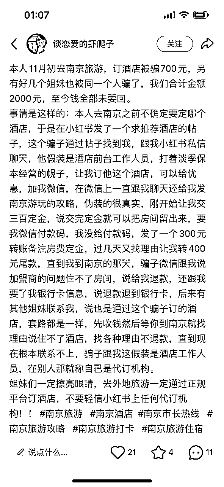

* * *

## ⑤追星拼房骗局

这个案例知道的人不多，但赚钱圈里也有不少在校大学生，我觉得还是值得写一下。

背景是某位粉丝计划去澳门看演唱会，在📕发了求拼房的帖子，然后被一个自称从事低价酒店渠道的人盯上。对方抓住了“演唱会期间房价高”“房源紧俏”这些心理暗示，一步步连环套路，差点就让她白白损失了一笔钱。

### 为什么会有这么多人上当？

1.港澳那边的酒店很多预定后就不能退款，骗子就抓住“晚订更贵”“不早订就没了”来制造焦虑，让人紧张。

2.对港澳酒店情况不了解的粉丝，特别怕到了之后没地方住，心里一急就容易掉进圈套。

3.追星本身就是赶时间看演出，情绪很急，注意力很难集中，判断力自然就容易被带偏。

* * *

记住下面这几条铁律，你就永远不会掉坑：

任何情况下都不要提前转账、不要提前确认收货。

一段真正靠谱的合作关系，不应该建立在你先放弃主动权的基础上。不管订酒店还是找人拼房，都应该等你实实在在住进去了、确认一切正常、平安退房之后，再考虑付款或确认收货。

永远别让自己陷在一个被动等别人讲良心的处境里。这世上最靠不住的一件事，就是“想着对方不会骗你”。

你唯一能管住的，只有自己的行为界线。你可以保证自己不骗别人，但你没法用你的真诚去换取别人的真心。

所以，把你的安全感放在流程和规则上，不要放在聊天截图、身份证照片，或者“对方看起来也挺正常”这种表面印象上。别嫌麻烦、别图快，凡是能走平台的，就坚决别走私下。