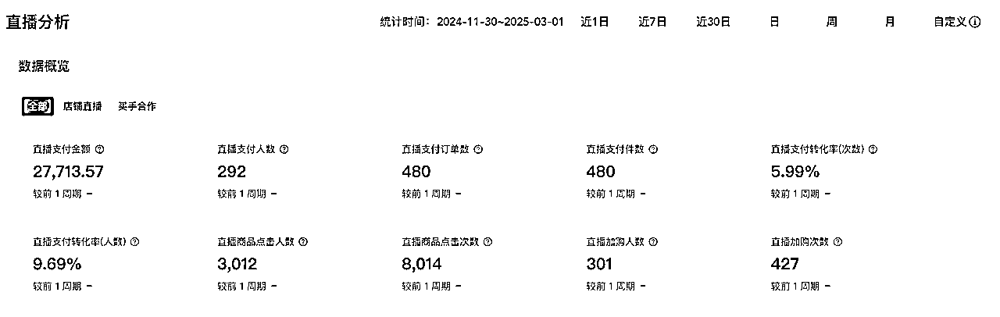

# 手工市集摆摊经历·我如何用一年赚到人生的第一个20万

从打工牛马到周末摆摊：我用21场市集，换来了人生第一个20万

我是龙哥，进赚钱圈不到半年，属于日常潜水那种小透明。但这次我不想藏着了，因为翻遍了圈子，发现聊手工博主、聊线下市集的人几乎为零。那我来填个空吧，把过去一年最真实的摸索经历和盘托出。

先把账摊开：去年我一共出了21次市集，线下成交额12万，直播只有可怜巴巴的2400多块；今年到现在，线下摆摊9场，卖了6.9万，🛰️加📕这条线转化了5万，加起来11.9万。别急着鼓掌——请注意，这些数字都不是纯利润，中间踩过的坑、吞进去的成本，我后面慢慢讲。

但这依然是我第一次不靠“打工”赚到钱。跟圈里的前辈比，这点成绩不够看；可跟去年那个只会朝九晚五的自己比，我已经往前迈了一大步。如果你恰好手上有手艺、喜欢做手工，或者只是单纯热爱手作小物，我觉得这条路真的值得一试：投入不高，反馈还特别快。

一切的开始，源自一个直播间

去年我还在老老实实上班，对“生意”两个字完全没概念，心里就一个念头：想多赚点。

2024年6月，和朋友聊天时发现，她在一个手作首饰直播间前前后后花了三千多，她说自己“根本停不下来”。我好奇去看了一眼，发现这种风格在市面上非常小众，实体店里基本见不到，而且溢价空间不小。当时我就觉得，这也许是个机会。当机立断注册了新🛰️，一边在直播间选款，一边顺手找市集报名。货到手之后我更坚定了想法，跑去联系首饰店老板想谈批发，结果被起订量卡住了，拿不到更低的折扣。于是我只能换个打法：做线上线下的信息差——把线上选出来的尖货，带到线下卖出去。

第一阶段：以为在摆摊，其实在填坑

起步阶段，我的私域玩法很朴素：养一个文艺名字的🛰️号，认真拍照发圈，拜托朋友帮忙宣传，前前后后加了近50个好友。大家很给力，累计买了10来件。但我也清楚，这里面人情单居多，靠这个根本撑不起来。想通之后我决定：去人多的地方，扯开嗓子吆喝。

找市集报名那会儿，我的经验为零，心态是“有摊摆就行”。好在运气不错，碰上一个刚离职想做自己品牌的市集策划，摊位费很低，看了我的产品图就爽快通过了。

上摊前的准备无非三样：货、陈列、包装。货对我来说最省心，短期内不用测品，直接拿现成的，但要备足量。陈列的话，桌子主办方一般会提供，剩下就靠桌布、架子、耳环盘这些细节堆出来。当时我连二维码都是蹭公司彩印机打的，能省一分是一分。包装是我踩得最实的坑——图便宜买了塑料袋，后来才发现市集上好多人是买来送人的，一只厚实的牛皮纸袋比什么都体面。

第一场市集：我摆得满头大汗，走出去逛了一圈回来，发现自己的摊位跟旁边一比，简直像没装修的毛坯房。好在品类够新鲜，加上单价低，第二天我赶紧打折，两天一共卖了800块（289和603）。回头看，那场位置太偏、宣传太弱，来逛的人寥寥无几，买我东西的还有三分之二是摊主。教训第一条：人流很重要，陈列更重要。

第二场市集，我特意挑了个“人多”的——小区旁边的音乐市集。人流确实旺，但两天下来只卖了908。大爷大妈们看看热闹就走，压根不是我的目标客群。摊位费两天300，算下来利润连摊位费都盖不住。教训第二条：人流量只是基本条件，客群对不对才是决定生死的关键。

第三场，我在第二场期间就报上了名。本来被上一场的摊位费吓到想放弃，隔壁摊主却跟我说那场位置极好，强烈建议我去。因为我是上班族，而那场是周五到周日，我就跟隔壁卖首饰的摊主商量拼摊：周五她看，周末我俩轮着来。最后三天成绩分别为176、747、712，总算破千了。不过数据也提醒我：拼摊这件事要谨慎，容易分流客人。

第四场市集，我像被点亮了一样开始整改。买了各种陈列架和托盘，请了一天假，三天全勤，逮着客人就聊，把自己活活聊成了“情绪价值供应商”。那三天的成绩是1611、1590、1825——我第一次真切感觉到：原来真的能赚钱。按时间算，这时候刚好做满一个月，虽然只是周末投入，但对当时那匹打工牛马来说，这正反馈实在太顶了。

后面几场越走越顺，第六场赶上节日加上位置实在好，三天直接干到8900。我开始有点飘了。

转折点：第八场市集后的“对账”，让我天塌了

先别急着羡慕前面的成绩，第一阶段的背后藏着一个巨大的“坑”——囤货。首饰类目有个特性：你得给客人足够的挑选空间。我每卖出一对，身后至少得有十对存货等着被挑；卖掉一些，还得赶紧补货。钱没在自己兜里捂热，就换成了一盒又一盒的货存在家里。

到第八场市集时，我终于——是的，我终于——认认真真算了次账。不算不知道，一算吓一跳：前面那些所谓的“好成绩”，全是我自嗨，充其量是回本。当时我的感觉就是：以前在公司给老板打工，现在副业给上游打工。整个人差点裂开。

冷静下来，我给自己做了个诊断：品类特殊、成本太高、渠道单一。实体囤货躲不掉，但我只有市集一条销路，私域转化也弱得可怜，这妥妥是慢性自杀。

于是我做了一个大胆的决定：主动联系上游，摊开自己的销售数据去谈合作。成本降下来之后，我的压力瞬间小了很多。

紧接着我干了一件更重要的事：换品。在市集里泡久了，我太清楚这类场子里的人想要什么了。我开始发展新品类，甚至亲自参与到制作环节中，年底还搭了个小团队，做了自己的📕IP。这件事后来被证明非常关键——手作品想做线上IP，原创就是护城河。

再然后，正好撞上📕的自媒体航海，我紧紧跟学，把线上转化和直播一起补上了。从去年12月开播到现在，已经播了30多场。过年那阵子最有意思：别人走亲戚串门，我在家里直播，全家帮我打包发货。当时真的觉得，直播这东西也太好上手了，我这种零基础的人都能咔咔出单。节后流量理性回归，现在大概每月播5到6次，每次3小时，单场最低500，最高能到2800。

复盘：能跑通这件事，靠的不是运气

先说一个核心观察：好的市集场域一定是能赚钱的。可能短期内赚不到什么大钱，但对于上班族来说，只要你有执行力、有审美判断力，就一定能赚到小钱。我身边很多年轻人周末出门根本不是逛商场，而是逛市集。优质市集自带充足的自然流量，在线上获客越来越贵的今天，只要你能挤进一场靠谱的市集，它就能帮你检验品类和产品的真实市场反应。我还观察到一个细节：很多优质市集里都有一批全职摊主——有人愿意一直做，背后一定有盈利在支撑。

如果你也想入局，我建议分三步走：

第一步：找对标！先在自己所在的城市做调研，多去优质市集逛一逛。注意，好的市集大多集中在一线城市。而且除非你能把成本控制得极低，否则千万不要冲动跑去外地出摊。网上也能搜到一些知名市集的名单，想深入了解就去📕翻翻。

第二步：定品类！给你三条思路：
1.做差异化。一定要跟别人不一样！在手工市集里卖通货，除非你手里有过硬渠道，不然太难了。
2.走高客单。手工市集的逻辑和夜市摆摊完全不同，想赚钱就往高客单方向走。这两年水晶和玄学特别火，线下能跑出大几千一单的成交。另外你可以参考我的办法：先看线上什么好卖，再确认线下有没有，把那个空位补上，就是你的机会。
3.跟随自己的喜好。但先做好一件都卖不出的准备。跟电商不同，你想做就要承担囤货成本，哪怕是纯手工，材料费也能压垮人。不过有一点很奇妙：当你卖的是自己喜欢的东西，那份热情会替你说话。

第三步：报名！去实践！赚钱没有标准答案，哪怕让现在的我重新来一遍，也不一定能复制去年的成绩。你只能靠不停试错、不停调整，慢慢走出一条自己的路。大部分报名入口在📕，找不到就直接去市集上问摊主，或者📕私信、评论主办方。报上名之后，认真准备，每一场都认真复盘，慢慢就会找到属于自己的风格和定位。

最后一个很重要的提醒：保持灵活，把路越走越宽。最近我又解锁了新玩法：上游首饰老板跟我谈定了新的合作模式，改成品牌授权——我不需要囤货，只负责帮卖拿提成。这不就是从源头消灭囤货焦虑吗？同时，新品类这边也收到了一些别的机会，比如艺术商店、买手店、礼品店甚至品牌店都来联系我，这些全是摆市集带来的衍生收益。

大概因为我天生爱复盘、爱学习，我一直相信“所有发生皆有利于我”。前几天在📕分享了一篇市集经验，结果小爆了一下，比我其他笔记的阅读量高出一大截。所以我也想在这里做一次“利他”，把这些真实的经验和数据统统分享出来，给有需要的朋友做个参照。

这条路，从头到尾都是我一个人摸索过来的。如果未来想把它做大，我需要更多同频的伙伴。所以我选择先发声，站在高处找伙伴。做这个项目，或许只是我接触“钱”的开始，但敲开“生意”这扇门之后，后面还有更多方向等着我去探索。

赚到第一块钱，从来不是终点，但它是起点。让命运的齿轮转起来吧。