从“想拒绝”到“跑通闭环”：一个被用户逼出来的AI产品，8周完成商业验证

两个月前，我还很想推掉这个需求；两个月后，它却帮我打通了从流量到变现的完整闭环。

这短短八周，我经历了好几个人生第一次：拿到第一张营业执照，开始从“随便试试”变得有责任感；遇到第一位合伙人，陪我改Bug、头脑风暴、深夜发版；做出第一个AI工具，从内容创作者变成要服务400多位付费用户的产品研发与运营者；第一次把一个商业闭环——流量、价值创造、价值传递、推广、收益——完整地跑通。

兴奋、焦虑、试错是这段日子的底色，所以我想认真做一个复盘。如果你也在打磨产品、做副业突围，或者想用AI实现变现，希望我的经历能给你一点方向、一点勇气，以及一些可落地的方法。

## 为什么做这个产品？

说实话，这个AI降重工具并不是我主动发现的“机会”，而是被用户倒逼出来的。

二月底，不少粉丝朋友开始找我“求救”，说学校或平台对AI内容的检测越来越严，“降重”成了他们最头疼的问题。那段时间，我的私信和留言里充满了迫切感，甚至有人把我当成了“最后一根稻草”。

可我当时的处境是：手头还有智能体商单，主业经常加班，还要兼顾写文章和做分享。第一反应其实是：这不是我的能力圈，投入进去值吗？

冷静下来后，我决定先做一轮理性判断，分析这个需求到底有没有真正的价值。

第一步，看需求真实吗。我不只听表面的请求，更关注背后的紧迫程度：这些用户有多急？问题不解决会怎样？他们现在怎么解决？为什么不满意？

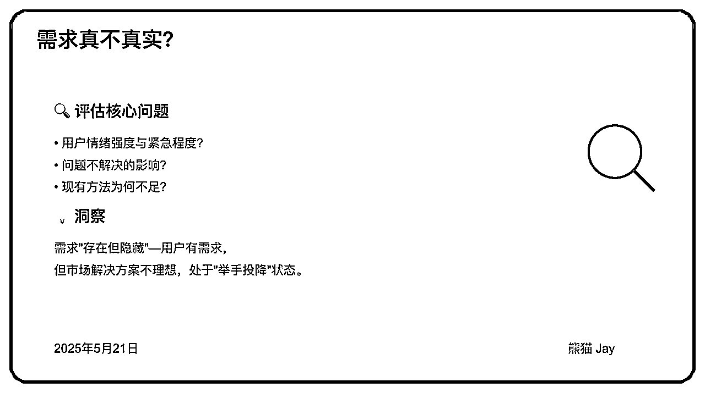

多轮对话之后，我的结论是：这是一个“存在但隐藏”的需求。用户确实需要，但市面上的方案都不理想，很多人处于无奈甚至放弃的状态。

第二步，看需求是不是太小众。网上可查的资料不多，我就去咨询行业朋友，观察各渠道的讨论热度，分析潜在用户的数量和特征。

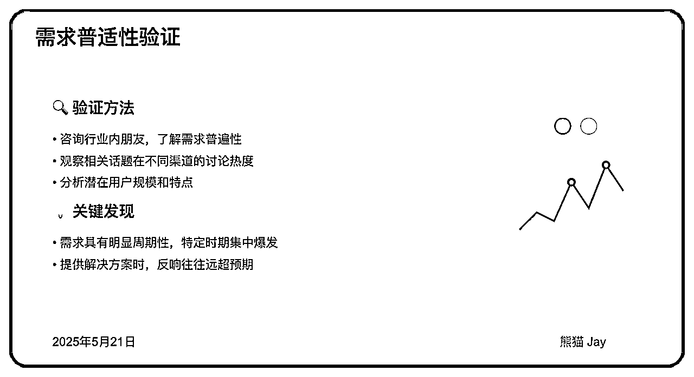

思考之后，我发现了两个特点：第一，这个需求有周期性，到了特定时期会集中爆发；第二，虽然很多人不会主动说，但只要把方案摆出来，响应会远超预期。

第三步，看现有方案有什么差距。我做了简单调研，核心是两件事：技术上能不能落地？市面上的工具好不好用？然后重点看主流方案的特点、用户最不满的地方、以及被忽视的空白。

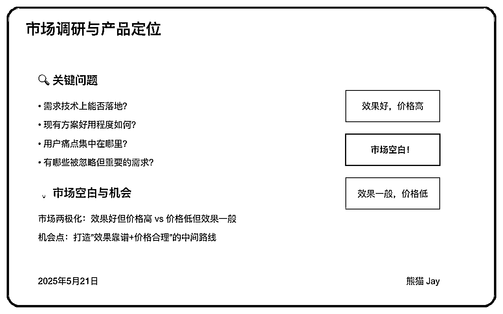

结果很清晰：市面上的方案严重两极分化——效果好但太贵，便宜但效果差。用户缺的正是“效果靠谱+价格合理”的中间路线。我当时预感到，这个空白就是我的差异化机会。

第四步，做一次需求强度测试。我向一些潜在用户描述了一个还没有界面的模糊方案，只问他们两句话：如果真做出来，你愿意付费吗？如果我现在开发，你愿意预付一部分钱，换内测资格和最低折扣吗？

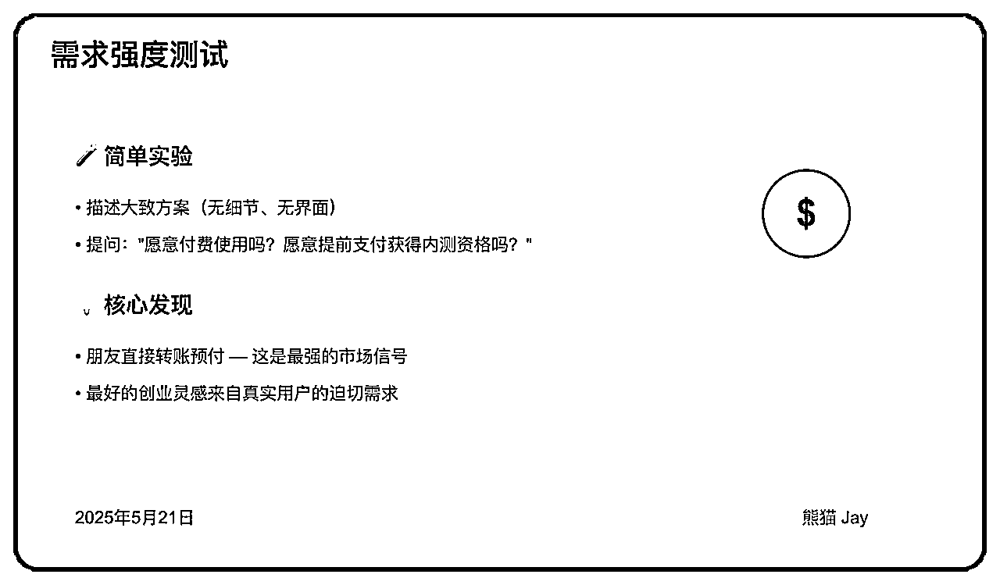

让我没想到的是，好几个人直接转账了。

这就是最强的市场信号——当用户愿意为一个还不存在的产品付款，你就知道需求是真的。

这个阶段最大的收获是：最好的创业灵感往往不是脑子里想出来的，而是从真实用户的痛点里冒出来的。不需要一鸣惊人的创意，但要有足够敏锐的同理心，去听懂用户的难处。这种敏感度来自平时多看、多听、多尝试，以及对用户处境的体察。

## 怎么快速做出产品原型？

需求确认后，我进入了开发阶段。由于资源有限，第一步就是圈定MVP（最小可行产品）的范围：哪些是必须有的核心功能？哪些可以往后放？用户的核心体验路径是什么？

甚至可以只问一个问题：“如果现在只能做一件事，哪件事最能解决用户痛点？”

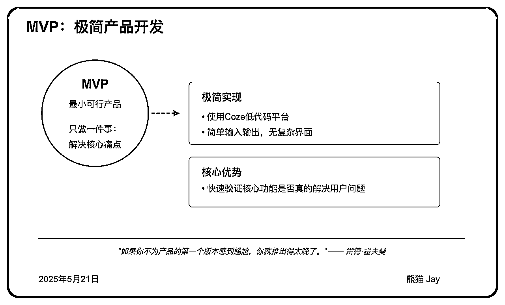

对我来说，答案很简单：先帮用户搞定一个平台的AIGC检测问题就够了。

功能明确后，还要走传统产品开发流程吗？原型设计、原型确认、软件开发——个人和小团队根本玩不起。我选择了极简路线：直接做一个Coze智能体。输入文本，输出降重结果，没有华丽界面，没有复杂选项。

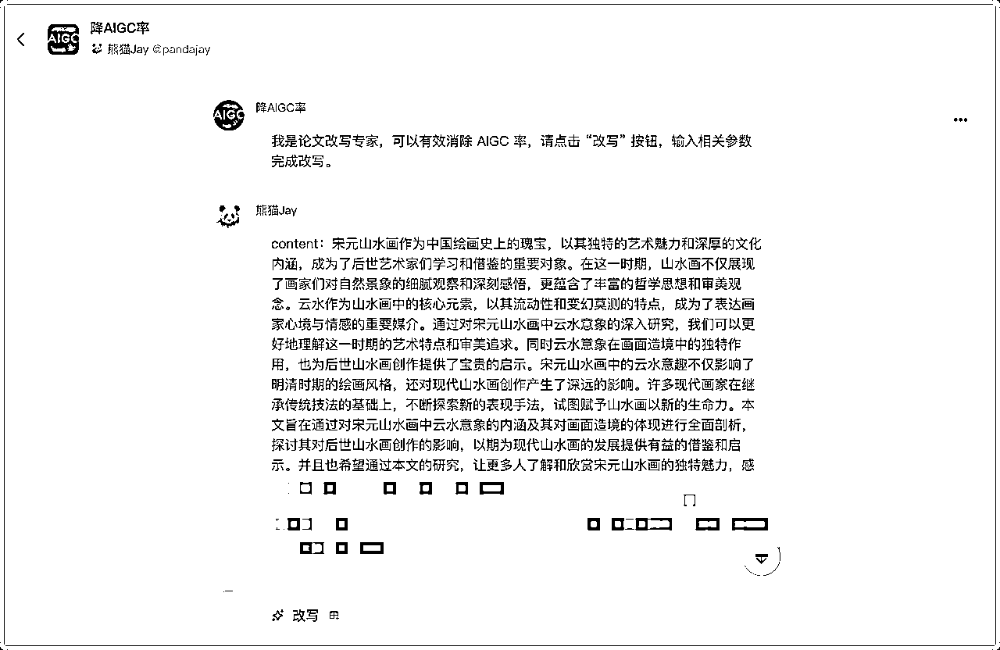

这种形态确实不专业，UI不好看，体验也粗糙。但它最大的优点是：能在最短时间内验证核心功能有没有用，不被流程绑架。LinkedIn联合创始人雷德·霍夫曼有句话很共鸣：“如果你不为产品的第一个版本感到尴尬，说明你推出得不够早。”

顺便说一句，Coze本质是低代码平台，对普通人很友好。只要愿意学，人人都能以低门槛做出自己的AI产品雏形。

## 产品优化：从一个被质疑的demo开始

初版上线后，我遇到了很多创业者都会遇到的困境：反馈不足。只有几个微信好友在用，样本量太少，不足以支撑我继续投入。那段时间，我甚至怀疑过要不要做下去。

转折来自一位苏州朋友。那天我们在餐厅见面，他拿着我的demo测了很久，一直测到晚上11点。他说：“本来困得不行，结果越测越精神，兴奋得完全睡不着。”那种用户情绪的正向反馈，让我确信方向没错。

他给了一堆建议，尤其是关于定价和体验的，还特别强调：必须做成网页工具，才能让更多人方便使用。

这句话点醒了我，产品形态很重要。如果换作从前，我大概率会陷入纠结——我是做技术管理的，不是一线编码出身，虽然能想清楚需求，但写代码的速度跟不上。要做网页版，就得准备预算、找开发、再找UI，成本一高，故事可能就到此为止了。

但现在不一样。有AI编程在，只要把需求说清楚，各种形态的产品都能快速实现。

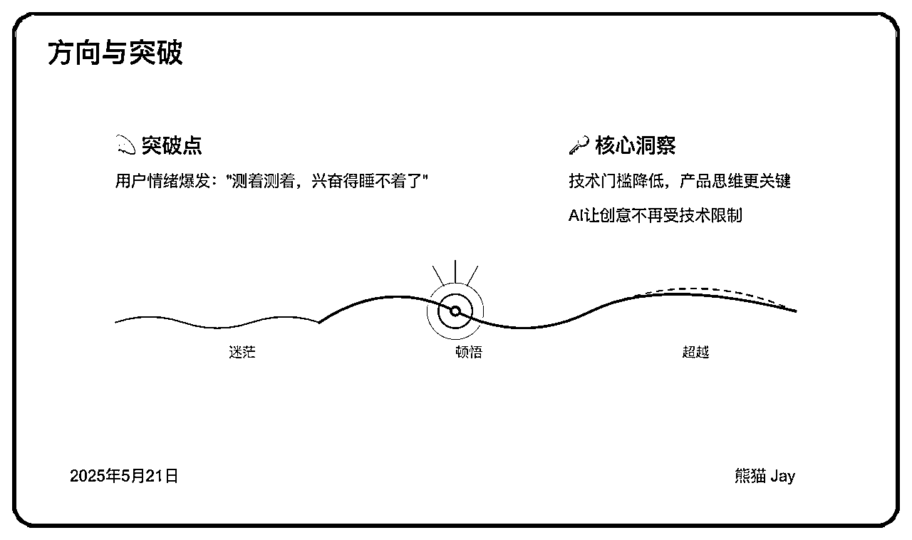

事实上，整个产品迭代过程中，约70%的代码都是由AI帮我完成的。这件事让我强烈感觉到：技术门槛正在降低，而“知道该做什么”的产品思维越来越值钱。一个懂需求、懂业务、有清晰思路的人，即使技术基础一般，也能借助AI工具做出自己的产品，这在以前很难想象。

## 持续运营：用AARRR模型做增长

有了预付款和后续收入后，下一步就是放大收益、持续增长。这阶段我用的核心框架是AARRR模型：拉新、激活、留存、转化、推荐。

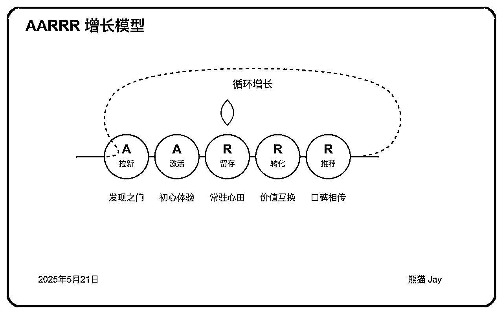

### 拉新：让用户主动靠近产品

第一笔新用户充值只有25块钱，却给我带来了极大的激励。预付款代表过去的信任，而陌生用户愿意充值，说明更多人可能会为这个产品买单。

拉新就两件事：扩大曝光，降低第一次使用的门槛。过去做自媒体让我积累了不少人脉，也转化出第一批付费用户。那段时间，我在朋友圈和公众号持续发使用体验、案例、软文，甚至私聊，用各种方式反复触达用户。

有一次，我按“先给干货、再带货”的套路写了一篇软文，阅读量不算高，但产品当日营业额直接翻了一倍。

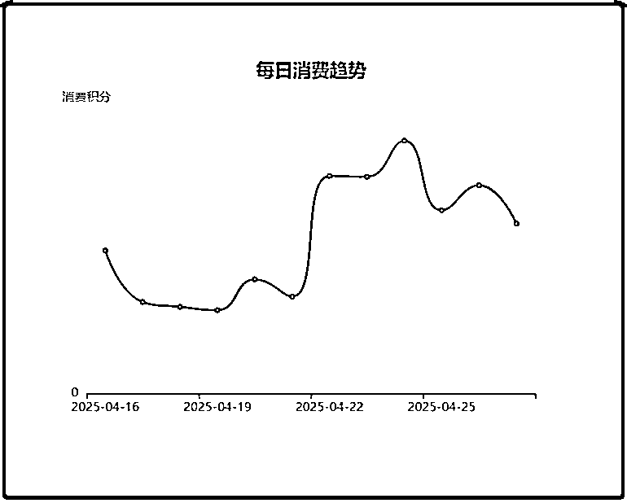

同时，我还发放内测码和免费额度，让大家零门槛试用，效果立竿见影。

### 激活：让用户第一次用就留下来

用户来了，如果第一次体验留不住，后面全是白费。我的体感是：好用比任何口号都更能激活用户。

早期团队把大量精力花在打磨产品上，用数百篇不同类型的文章和不同场景反复测试，确保稳定，让用户第一次用就立刻感受到价值。同时，我们也在UI上花了功夫，把最初简陋的智能体一点点变成了交互友好的网页。

### 留存：让用户愿意长期用

留存的核心是持续创造价值+做好用户运营。我们一边迭代功能，一边保持沟通，快速答疑、高质量反馈。为此还专门拉了群，用户在里面感受到被重视，自然更愿意留下来。

群聊还带来了两个额外好处：一是帮助我们促成用户间的合作，实现共赢；二是一堆Bug和“用腻了”的抱怨都能及时收集，成为我们优化的方向。两个月内，我们迭代了15个版本，团队经常深夜12点还在发版。

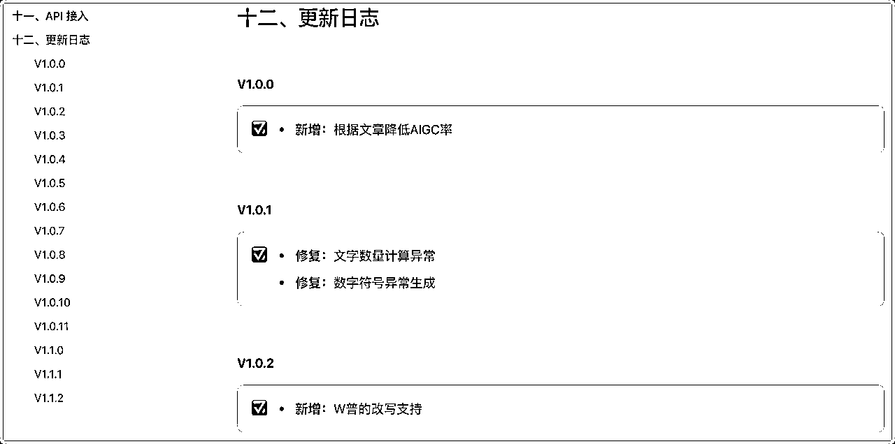

### 转化：把用户流量变成收入

这一步最现实：产品再好、用户再多，没人付费照样活不下去。

我们的打法是降低用户的付费心理门槛，让他轻松做出决定。早期有几个关键动作：一是把门槛压到最低——先给免费试用额度，满意再充钱；充值最低5元起步，一开始没有任何限制，用户根本不纠结。二是定价有性价比——对比市面上同类产品后，我们定出一个让用户觉得“超值甚至赚到”的价格，充值到一定额度还有不同等级折扣，逢年过节再做点小活动回馈老用户。

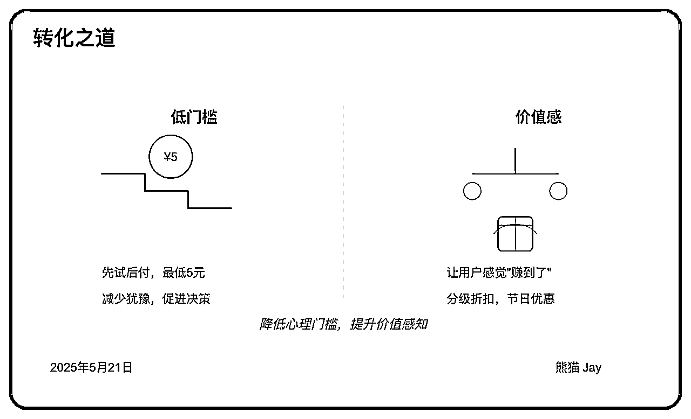

### 推荐：让用户主动帮你传播

最好的营销永远是用户自发推荐，成本最低，信任度最高。要让用户愿意传播，核心是让他们觉得“推这个产品值”。

我做三件事。第一，做好分销。最开始分销模式没设计好，流量一度卡壳；后来专门做了三级分销，用户推荐成功就能拿到佣金，顺手一推还能有点收入，自然有动力。第二，提供代理模式。设置不同代理等级，给推广能力更强的用户更大折扣，但设了门槛；针对高级代理，我们甚至提供纯净版网站，让他们完全掌握客户资源，推广就更卖力。

当然，技巧只是短期手段。长期来看，最稳定的增长来源仍然是产品力和口碑。

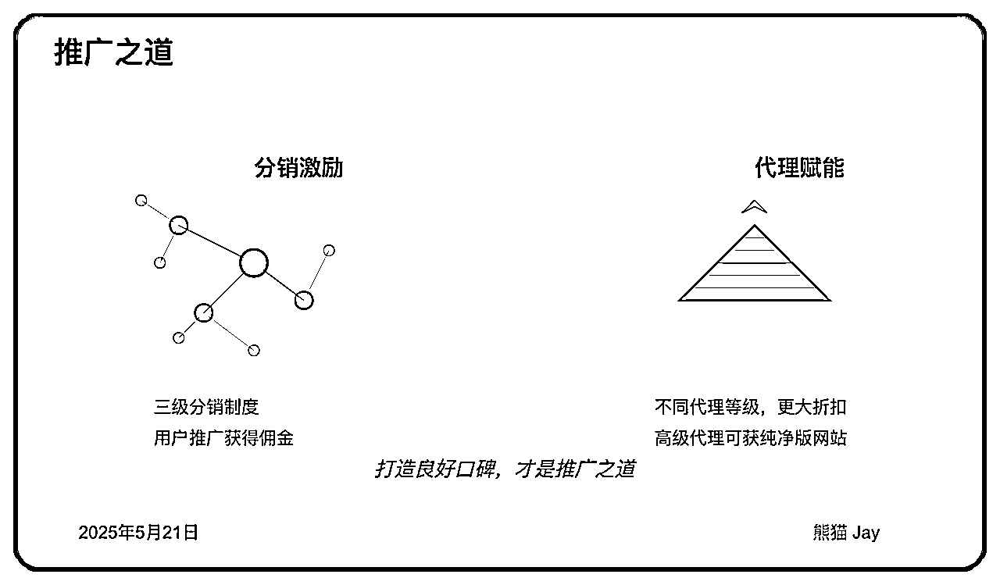

## 问题与心得

### 主业和副业怎样平衡？

整个过程中最大的困扰，是主业太忙，副业精力跟不上。我做了一个关键决策：聚焦核心，学会取舍。

过去我朋友圈和公众号都保持高频率更新，但有了更重要的事之后，我果断做减法：公众号不周更了，朋友圈也基本不发了。上周去杭州参加线下活动，一位关注我很久的大佬一见面就问：“熊猫，你怎么最近消失了？”

类似这种“消失”，就是我为了更重要的事主动放弃的。

另一个关键决策是找到合适的合伙人。我的标准是：时间节奏一致、能力互补、靠谱。节奏一致才能保证高效协作；能力互补才能各司其职、形成1+1>2；如果找和自己一模一样的人，很容易谁也不服谁，天天吵架。

找不到合适的人怎么办？我的方法是：多做项目、多参与讨论、多线下交流。靠谱的人会在这些互动中自然浮现。

### 预算不够，怎么省钱？

1. 服务器：够用就好，别一上来就高配。起步阶段我们买了一台很普通的低配服务器，像阿里云、腾讯云的入门款，一年都不到100元，先把项目跑起来。

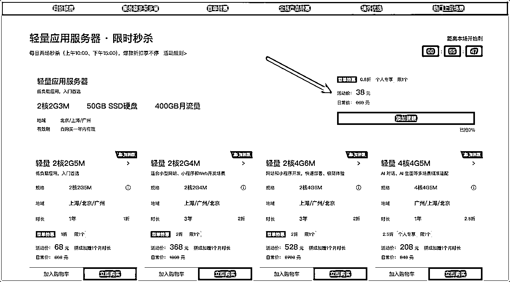

虽然性能有限，但初期流量不大，只要能稳定跑核心功能就足够了。这正好符合“先验证、再投入”的原则。等用户量上来了，再考虑升级。升级时也没有冒险迁移，而是用了蓝绿部署做平滑切换，既保证服务不中断，也留下回滚空间。最后我选了性价比更高的雨云：https://www.rainyun.com/NDg1Mzcw_

2. SSL证书：淘宝真的能省大钱。很多人不知道，官网买SSL证书往往比淘宝贵好几倍。比如阿里云通配符证书，官方卖几千块，淘宝同款几百甚至更低就能搞定。

### AI使用心得

1. Bug修不好怎么办？不要急着让AI一遍遍改，先检查两个盲点：
- 需求有没有说清楚？有没有留下只有自己才懂的模糊描述？
- 有没有让AI给代码加上详细日志？纠错时有没有把完整日志交给AI？
好几次我陷入Bug死循环，尤其是第二点，帮我解决了大问题。

2. 需求想不全怎么办？让AI边做边补需求文档。独立开发经常是边写边想边改，细节一多就乱。我的做法是：每次遇到重大调整，就让AI把当前需求整理成一段补充说明，更新到原始需求文档里；下次开发功能前，再把已有文档描述发给AI，让它基于原有逻辑做增量修复，避免全盘推翻。这套方法让我后期维护省了大量时间。

3. 修完Bug别急着走。我习惯让AI立刻总结三件事：问题现象是什么？原因是什么？最终的解决方案是什么？然后扔给它一句Prompt：
“请总结这次对话中我遇到的最重要的xx个问题，以及对应的原因和解决方案，整理成格式精美的笔记卡片。”
这样一张张知识卡片，慢慢就沉淀成了我的个人知识库。

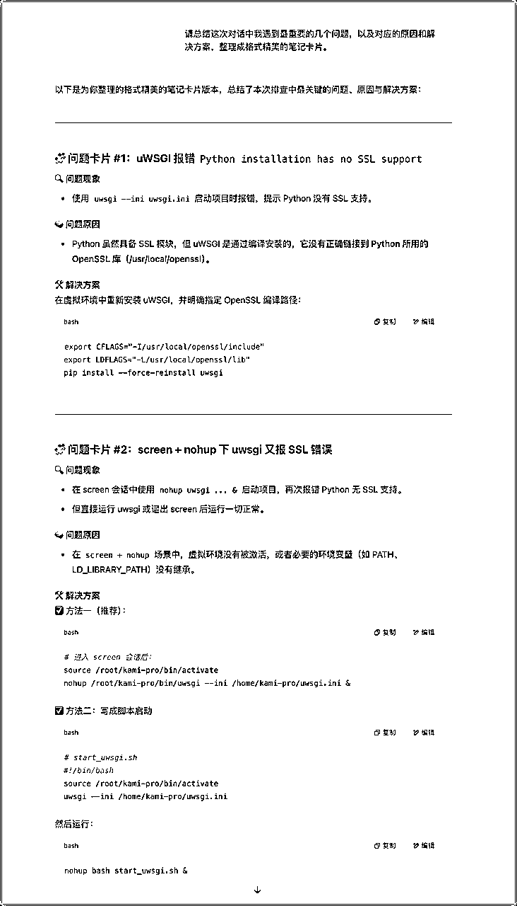

## 写在最后

两年前，我刚想动手做AI产品时，面对的还是需求模糊、预算有限、工具匮乏的窘境，每次都是“想想就算了”。

而今天，当我真正开始做，世界会以意想不到的方式向我靠近：AI成了我的外脑，朋友圈成了顾问团，过去的同事和合作伙伴，可能就是我未来的合伙人。

所以，动起来真的比什么都重要。

这一路，我也放弃了很多：公众号的周更、定期的社群分享、丰厚的AI商单，以及所有可能分散注意力的事。因为我选择了一条从未走过的路。

就算失败，就算产品很快死掉，我也希望通过这次尝试找到一条可以复制的路径：聚焦自我，解决问题，吸收内化。这些东西才真正属于我，也才让我在未来更有底气。

我是🐼熊猫Jay，希望这篇复盘能给你带来一点启发。