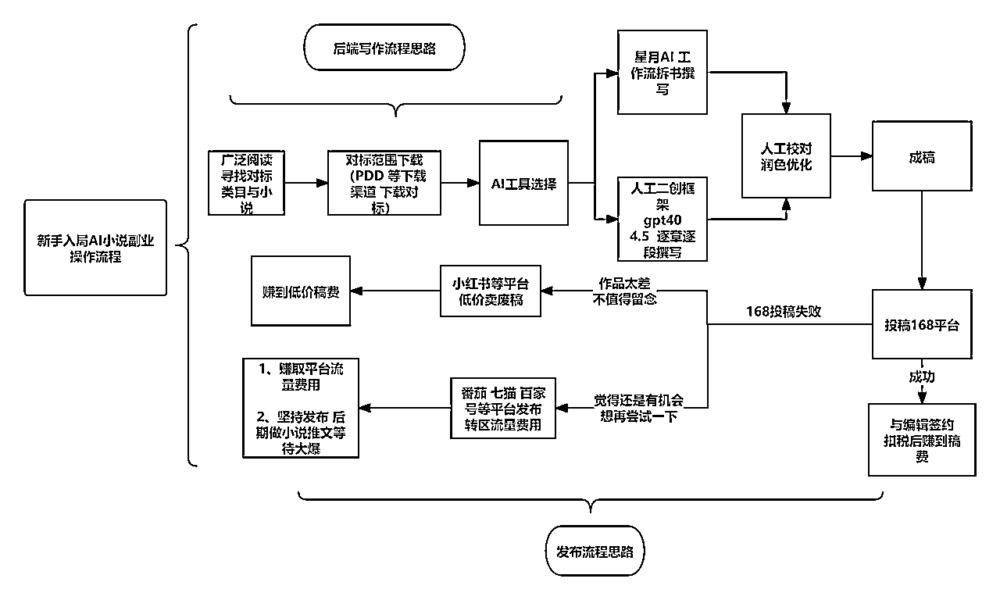

三月份的AI小说航海群答疑，我整理了一份完整版。

先介绍一下自己，我是荷包蛋糕。文字创作这条路上走了六年，近三年开始把人工智能工具引入工作流。上个月航海活动中，我负责“AI小说：从写作到变现”这条船的答疑。那二十一天里，和盟主君、三月雨、发发教练配合，带了一千名船员在AI小说这片海域里从零开始探索。群里的问题五花八门，感谢@嘉平六先前整理过一版航海群百问百答，我在那基础上又挑了一批高频问题做了更细的解答。听说五月航线没有AI小说这条船了，但这份资料还是想送给打算入圈的朋友们，帮大家省去摸索的时间，更快找到自己的节奏。

# 赛道现状和入局路径

网文市场到底有多大？2023年的数据摆在这里：中国网络文学市场规模404.3亿元，同比增长3.8%；创作者数量2405万人；作品总量超过3620万部；读者规模5.37亿。用四个字形容就是：人、文、读三旺。业内预测到2025年这个盘子会扩大到436.1亿。机会明摆着，关键是怎么进去。

新手的具体走法，其实就三步：

第一步，大量看小说，锁定自己感兴趣的题材，把几本表现好的对标作品下载下来当参考。第二步，挑一款顺手的智能创作工具（比如星月写作、GPT-4），让它产出初稿，再靠人工润色提质。第三步，把成稿投给“168平台”。走通了签约拿稿费；万一没被选上，还能低价脱手给内容平台，或者发到番茄、七猫、百家号这些地方靠流量分成赚钱。无论结果如何，总能找到一条变现出口。

# 新手的五个典型困惑

**没有写作功底，能不能碰AI小说？**

完全可以。这类工具最大的贡献就是拆掉了门槛。现在市面上星月、ChatGPT、豆包这些智能助手都能扛起绝大部分内容输出，新手只需要熟悉基本操作、学会拆解对标作品、掌握简单润色，就能完整跑通从写到投的闭环。航海群里不少零起点船员，从什么都不懂到赚到第一笔稿费，只花了两三周时间。

**从长篇切入还是短篇切入？**

我的建议始终是短篇优先。一到五万字的体量，节奏紧凑，创作周期短，拿来练手再合适不过。五十万字以上的长篇虽然稿费丰厚，但战线拉得长，对剧情连贯性的要求也严苛得多，更适合跑通全流程后再去挑战。先用短篇把基础打牢，再慢慢寻找自己擅长和喜欢的类型。

**写出来的东西怎么变现？**

主要有三个出口。其一是签约：向168平台（旗下有番茄、七猫等）投稿，通过后次月就能结算稿费。其二是流量分成：把内容铺到百家号、小红书、番茄等渠道，靠阅读量产生收益。其三是低价卖稿：投稿失败就把稿子放到任务平台或小红书上低价出掉，多少能回收一些成本。

**投稿被拒就等于白写了吗？**

并不会。AIGC创作的一大红利就是“一鱼多吃”。168平台不接收，你照样可以把作品发到流量平台赚取分成，也能改造成图文或者短视频脚本投放到小红书和抖音，还能卖给需要素材的自媒体博主。内容质量在线的话，不存在白写这回事。

**怕撞题、怕被平台看出是机器写的？**

只要把“拆解对标、搭好创意框架、人工精修”这三步做到位，撞题概率非常低。平台审核的核心维度是内容质量和市场潜力，不会因为工具的属性就一票否决。借助星月的拆书模板或者GPT的辅助功能，做到“灵魂换皮”，创意的内核还在，而文本的原创度也能拉得上去。

# 写作端的十六个破题思路

**顺序问题：先有纲还是先有文？**

必须先有纲。没有大纲直接让机器产出正文，内容跑偏和节奏失控是大概率事件。正确做法是先让智能工具辅助拆解对标作品，或者让它搭建一个“起承转合”的三段式框架，再按框架一步步细化。星月和ChatGPT都能通过提示词快速完成大纲规划，方向准确且省力。

**段落衔接不自然，怎么处理？**

“上下文补全法”很管用。把上一段原文贴给工具，加上“继续写”三个字，衔接度立刻提升。另一个技巧是“章节小标题法”——给每一段标注一个微型目标，比如“主角冲突”“反派登场”，工具输出时的逻辑性会明显增强。

**让文字变精炼、变有张力？**

提示词要做到短促而有指向性。举例：“写男主发现女主真实身份的一幕，氛围紧张，悬念拉满，语言干净。”更好的策略是“风格限定词+任务指令”组合使用：“按爽文节奏写一段女主当众回击上司的对话”，工具就能精准领会你的意图。

**如何避免撞梗？**

核心打法就六个字：换结构、改细节。热门梗不排斥，但表达角度必须另辟蹊径——比如“霸总追妻”这个老梗，反转成“女总裁反套路”就立刻有了新鲜感。让工具一次生成多个版本，挑差异最大的那个来用。星月、deepseek这类拆书工具能帮你实现“灵魂换皮”。

**怎么写出让人眼前一亮的开头？**

三句话打出钩子：悬念+反转+情绪爆点。拿“她以为是去相亲，结果对面坐的是自己上司”举例，一句话就营造了戏剧冲突；紧接着再补一段对话或情节推动，读者的情绪就被吊起来了。让工具出三个版本的开篇，选最戳人的那个。

**内容反复生成还是不满意？**

换一个问法，换一批关键词。工具有时会陷在语言惯性里，这时候你需要改变提问路径，比如“以第一人称写主角内心独白”，或者“加一段冲突升级的对话”。也可以切换到指令更清晰的模式，比如星月的“扩写功能”或者ChatGPT的结构化提示词。

**中长篇怎么维持节奏？**

用章节规划法。把故事按四段切分：开端（设定+冲突）→中段（推动+反转）→高潮（对抗+决断）→结尾（解决+伏笔）。每段再细分为二到四章，让工具按照这个结构推进，故事就不会写着写着跑偏。

**情感渲染不够浓？**

“内心+动作+环境”三件套。比如“她笑了笑，指尖却轻轻发抖”——表面云淡风轻，内里波澜翻涌。可以让工具生成三种情绪表达风格——细腻型、直接型、对比型，选最合适的一种替换进去，画面感立马上一个台阶。

**如何判断产出内容的质量？**

三查法：查逻辑、查冲突、查钩子。逻辑是角色驱动能否自洽、事件链条是否通顺；冲突是每一章有没有明确的矛盾点或推进点；钩子是章节结尾有没有留下悬念、能否勾住读者点下一章。写完后通读一遍，如果产生了“想快进”或者“注水”的感觉，那就是没达标。

**内容平铺直叙，没有画面感？**

加入感官描写、动作细节、情绪线索。把“他很生气”改写为“他一把摔下手机，胸口剧烈起伏”，画面立刻活了。直接给指令“重写这段，补充细节和情绪”，或者要求“用镜头化的语言表达”。配合小说描写万能句式模板，事半功倍。

**所有角色说都像一个人？**

给每个角色确定“语言风格+口头禅”。男主设定为沉默寡言，女主设定为犀利毒舌，那就把提示词写成“以毒舌女主的语气怼人，不带脏字但句句扎心”。还可以让工具模仿特定小说人物的说话方式去生成对话，角色个性自然就分开了。

**怎么摆脱“模板网文”气质？**

多变形、少照抄。题材可以用热门的，但在设定上做“轻改”——换主线目标、换世界背景、换职业身份。语言层面融入自己的特色，比如幽默、讽刺或细腻的笔触。工具能模仿套路，但独特的风格始终要靠自己调教。

**机器写太快，跟不上修稿节奏？**

“写一休一”计划：今天批量产初稿，明天统一修改。工具出手快，但人的审美判断和逻辑审校需要时间沉淀。当天盲目追求写完又改完，质量容易崩。隔一天再从头梳理标题、情节和人物逻辑，问题更容易暴露，状态也不会太疲惫。

**短篇写好之后，能升级成长篇吗？**

完全可以。先用一个出彩的短篇试水，数据反馈不错的话，围绕主角继续铺开——增加前传故事、支线剧情、反派视角，一步步架构长篇的体量。也可以让工具直接帮你生成扩展方案，输入“基于这篇短文，为我生成一部十万字小说的分卷大纲”这样的指令，可执行路径立刻就有了。

**怎么防止前后设定打架？**

建立设定文档。把主角身份、性格、人物关系、世界观等核心信息全部归档。每次动笔前复制相关设定作为提示词的一部分，明确要求“保持人设一致性”。星月和ChatGPT都具备长期上下文或记忆功能，顺手就能用起来。

**如何贴合不同平台的调性？**

在提示词中点明风格。比如“仿番茄爽文的路子写开头，钩子要硬、反转要快”“仿知乎盐言的调性，主打女性共鸣+情绪张力”。或者复制几段平台热门作品给工具学习句式节奏和语言氛围，再让它一来创作全新内容。

# 平台选择和投放环节十五问

**签约番茄之后，还能投别家吗？**

合同层面不行，签约就意味着独家授权。不过番茄的短篇审核没那么严苛，不是爆款基本没人追究。真要多投，务必修改标题和前几章内容再重新生成，维持足够的差异性，别让平台判定为重复发布。

**番茄上传作品用哪个APP？**

两个应用分清楚：番茄免费小说是读者的阅读端，番茄作家助手才是作者的后台管理端。电脑端投稿体验更好，审核效率也更高。

**平台显示某类小说有几十万本，数字是真的吗？**

那个数字统计的是最近90天内有过更新动作的小说，包括大量没写完的短篇、长篇，甚至只创建了书名一个字没发的也算进去了。它并不等于完结作品数量或优质作品数量，别被数据唬住。

**番茄读者的口味偏向？**

女频用户是主力军，偏爱情绪浓度高、反转狗血的故事。像“大学生存”这类题材完全可以写，关键在于呈现方式——写成室友大战、逆袭打脸、恋爱反转、黑红网红等脑洞文，贴近现实的同时把情绪张力放大，效果才会出来。

**番茄审核要等多久？**

常规情况下1到7天，最近审核速度有所放缓。节假日或者投稿高峰期可能超过一周。可以在后台留言联系客服申请加急，但通常情况不需要催，耐心等就好。

**短篇签约后，阅读量和收益什么时候能看到？**

阅读量更新很快，但收益要到次月才能结算。番茄属于“后置型结算”平台，只要作品持续保持完读和更新，收益就会一点点累积起来。

**知乎盐选不让用AI内容，是不是就不能碰了？**

可以用，前提是润色到看不出机器痕迹。Claude产出的文字AI味比较淡，和知乎文风比较契合。写完后用检测工具跑一遍，控制在10以下。操作方法上，重点手动修改导语、开头和人物语气，再补进一些真实生活化的细节，审核就能通过。

**知乎投稿审核要多久？**

通常一周上下，也可能会拖更久。知乎的审稿团队是二十多位真人制作人，稿量大的时候进度自然慢。可以主动联络编辑催审，或者在后台备注写作思路，加深对方印象。

**知乎编辑真的只看开头吗？**

大多数编辑确实只看导语加前三章。这意味着开篇质量直接决定去留。机器写完后，务必花力气打磨开头三段，把爆点和反转前置，让编辑一眼就被抓住。

**签约成功了但显示“没有有效订单”，什么意思？**

账号资料没齐全。把签约人对应的银行卡和手机号绑定上去，信息补全后就能生效，合约也能正常查看。

**短篇签约后，推荐什么时候来？**

通常一到两周内。推荐机制包含数据测试和编辑手动打标签两个环节，目的是把内容匹配给合适的读者。也可以主动和编辑沟通，请求加速推荐。

**参考小说怎么下载？**

去拼多多搜“番茄短篇小说下载”，资源很丰富。挑那种无需安装软件、不用每日签到打卡的卖家，多看看评价再下单。也可以先买个短期体验套餐试试服务效果。

**168平台投稿流程麻烦吗？有哪些注意点？**

168是自动化投稿分发平台，把你的稿子推给上百位编辑。几个要点：优先选“文件投稿”而不是链接，避免被判为钓鱼邮件；邮箱用老版QQ邮箱，打开率更高；标题写成“自媒体风格”更吸引眼球；上传完整稿件而非章节连载；投稿前手动改一下模板内容，显得专业。

**168平台必须要付费吗？**

是的，这是付费系统。它帮作者省去了筛选、投递、联络编辑的时间成本，适合有批量投稿需求的作者。建议手里存量稿件足够再上，免得白花冤枉钱。

**168平台哪种投稿方式更推荐？**

首选“文件投稿”。中转站方式容易被忽略或者打不开，编辑很可能直接跳过。用Word文档附件发送，阅读和下载体验更顺畅，命中率自然更高。

# 工具操作实务十二讲

**拆书该用哪个模型？**

“思考者”模型比较省字数，适合初期拆解。生成太短就用“追问功能”补充情节，或者切到deepseek、Claude做更细致的补全。

**拆书显示字数对不上？**

多半是因为开了“深度思考”功能导致统计偏差。把这个功能关掉，同时把生成长度控制在500到800字之间，避免冗长。还不行就切到Claude，输出更稳定。

**星月的AI起名要会员吗？**

不需要。消费过一次基本就能解锁。但不少人反馈效果一般，建议多生成几组再做手工挑选，或者直接自己拟名。

**星月扩写上限只有2500字，大纲也是，怎么往下走？**

分段推进，别让工具一口气写完一整章。每次扩写三到五个小剧情点就够了。工具突然“抽风”的话，换提示词或换模型解决。

**人称总是不统一？**

不同提示词默认的叙述视角本来就不一样。如果你要的是第三人称，每次输入时都要带一句“以第三人称叙述，保持风格一致”。星月也支持自定义提示词固定视角。

**生成的大纲里出现韩文俄文？**

模型接口异常或提示词里混入了乱码字符。切换模型、清理提示词、清空缓存重新生成，问题基本能解决。

**细腻版生成的字数太少？**

把大纲拆成两段分别生成，或者用星月的“AI扩写润色”模块，把现有段落和想增加的剧情一并输入，让它“保留原意并丰富内容”。

**即梦做封面，书名显示不出来？**

试试1号模型，它对封面题字的识别率相对更高。也可以手动添加“封面题文：XXX”作为显性指令，识别成功率会显著提升。

**从星月复制到番茄，格式全乱了？**

可能是提示词规范不到位，也可能是生成的格式本身就有兼容问题。先把内容贴到WPS或Word整理好后，再粘进番茄后台。Claude出来的文本一般比较规整，也可以换它来生成。

**拆完书选不了章节？**

检查第一章开头有没有多余空格或格式异常。没问题的话退出页面重进，或者清缓存后重新加载。

**盐选小说不能截屏，怎么存档？**

上拼多多买盐选小说下载站服务，通常两三块钱就能换一份PDF，本地阅读方便很多。

**用deepseek拆书的提示词怎么写？**

用结构化指令，比如“请将这本书拆解为主线剧情+五章内容结构”。航海手册里的标准提示词模板也可以直接参考。

# 心态卡点五问

**总觉得自己写得不够好，怕被拒稿？**

拒稿是常态，不写才是真正的失败。每个写得好的人，背后都积压过一堆退稿信。AI小说这条路更像是一次次模型训练和内容打磨，不是追求一出手就完美，而是在快速试错中持续迭代。把第一阶段当成“练稿期”，主攻节奏、钩子和情绪点，投得多了自然熟能生巧。

**觉得机器写得“没灵魂”，自己也不喜欢？**

你要摆正定位：不是操作工，而是导演。机器给你的是骨架和素材，你需要往里面注入风格、情绪和个性化的表达。试着把个人经验、观察和偏好融进文本里，把机器的产出当成毛坯而非成品。灵魂恰恰来自你加进去的那层“人味”。

**写了几篇没人看、零收益，撑不住怎么办？**

冷启动是内容创业绕不开的路。别急着用第一批作品的收益来证明自己。你眼下在做的是：搭作品池、练结构感、熟悉平台规则、测试题材方向。这些地基打牢了，数据起飞是迟早的事。副业本质上是微创业，拼的是耐心、方法和节奏。

**拖延症严重，老是开不了头？**

设定“小目标+低期待+高频率”。把“今天必须写完三千字”改成“先写一段开头”或者“先写三百字看看”，开头就没那么难了。启动永远比完成重要。每天保持动笔频率，写作的肌肉记忆自然会形成。

**看别人写得又快又好，自己焦虑到不行？**

别比速度，要比是否持续在路上。每个人的起点和节奏完全不一样。那些看起来“一发就爆”的作者，背后可能潜伏了半年、投了无数篇稿子。与其焦虑，不如找回自己的节奏：一周一篇、每月试一个新题材、每次改进一个细节。慢慢写，写着写着，成绩就来了。

# 最后补两个衍生问题

**只签一家，还是改改投多家？**

先选一家稳定签约（比如番茄、七猫），拿到持续稿费之后再考虑多平台铺开。签约平台默认独家授权，真想“一稿多吃”，务必修改标题和前几章内容，别让平台判定为重复。

**对标作品分类很合适，但评论一般，还能用吗？**

能用，但要有取舍。评论差并不代表没有可取之处——它赢在选题角度，也可能输在节奏或叙事。你要拆的是它“被选中”的原因，同时避开它“没做对”的部分。别人的作品是指路牌，不是终点，最终打磨出来的还得是你自己的东西。

—

这份百问百答的精华整理就到这里了。AI小说这条路，说难是难在开头，说简单是只要迈出第一步就能持续迭代。希望这些回答能帮你绕开那些不必要的弯路，早日写出你自己满意的故事。

## AI小说写作答疑：从投稿避坑到稳定变现，真正重要的是这三件事

很多人开始尝试AI写小说，最先遇到的并不是“不会写”，而是投稿、平台规则、账号风控和内容转化等一系列问题。下面把常见情况集中整理，帮助大家少走弯路。

### 一、常见问题解答

#### 1. 看到别人的作品数据不错，可以直接模仿吗？

可以参考，但不要简单照搬。

重点要观察作品的题材、叙事框架和读者反馈是否适合自己。评论区往往能暴露读者真正关注的问题，也能帮助你发现哪些地方需要优化。

如果一篇作品的点赞和收藏表现都不错，通常说明故事方向本身是有受众的。数据不理想时，不一定是题材错了，也可能是开头、节奏、冲突安排或表达方式还不够成熟。

#### 2. 小说里能不能直接写“抖音”？

不建议使用真实品牌名。

更稳妥的方式是采用模糊化表达，例如“音符APP”“短音平台”等。这样既能保留读者熟悉的场景感，也能降低版权和平台审核方面的风险。

#### 3. 星月平台的免费字数用完了怎么办？

新用户可以通过兑换码 **AI联盟888** 获得额外5万字免费额度。

如果仍然不够，也可以根据实际需求进行小额充值，解锁更多功能。整体来看，投入不高，适合先试用再决定是否长期使用。

#### 4. 因为内容注水，番茄账号被限制推荐，合约期间又不能删文，应该怎么处理？

这属于平台针对灌水内容采取的风控措施。

在合约尚未结束前，建议先暂停发布新作品，把时间用来重新梳理现有内容，提升结构完整度和情节质量。等合约结束后，再考虑重新运营账号，或者转向其他平台。

不要试图换个新号继续发布低质量内容。平台通常会通过设备、行为和内容特征识别关联账号，继续违规可能导致更严重的限制。

#### 5. 知乎拒稿后，还能不能把稿子投到别的平台？

可以，关键要看作品当时的发布状态。

- 如果只是参加“知乎盐选投稿”，但还没有被发布成回答，可以先撤稿，再投稿其他平台。
- 如果内容已经发布在回答中，建议重新调整标题、结构和具体表达，避免产生版权归属争议，然后再考虑投稿168、番茄等渠道。

#### 6. 168平台退稿，说作品“没有付费感”，具体是什么意思？

简单来说，就是读者缺少继续看下去、甚至愿意付费的动力。

可以重点重写开头3000至4000字，在前期尽快放入高强度矛盾、情绪刺激和剧情反转。家庭冲突、极端关系、连续打脸、意外翻盘等元素，通常更容易形成追读欲。

例如“父亲去世、母亲爆红，随后母亲的一句话竟逼得父亲跳楼”这样的强钩子，虽然戏剧化程度很高，但能迅速制造悬念，让读者产生“后面到底发生了什么”的心理。

#### 7. 投稿168时，编辑说附件打不开，应该怎么解决？

这种情况很多时候不是文档本身出错，而是外部中转链接不兼容，或者触发了安全限制。

建议不要只发送网盘或中转站链接，而是直接上传Word文档作为邮件附件。如果编辑依然无法打开，可以通过邮箱重新发送，并在邮件中写清楚：

- 稿件标题  
- 作品简介  
- 作者联系方式  
- 附件格式及文件名称  

这样更方便编辑处理，也能减少来回沟通成本。

---

## 二、给刚开始做AI写作的人三点建议

### 建议一：别让AI替你思考，要让AI帮你提速

AI写作并不等于把所有工作交给工具。

更合理的分工是：你负责确定题材、人物、冲突和章节目标，AI负责根据要求快速生成初稿、拆解情节、调整对话以及辅助优化节奏。

最终作品能不能成立，仍然取决于你是否具备判断力。结构是否顺畅、人物是否立得住、冲突是否持续、语言是否有感染力，都需要人工检查和二次修改。

真正值得掌握的，不是某一个提示词，而是一套可以反复执行的流程：

**拆解同类作品 → 搭建故事框架 → 分章节创作 → 投放测试 → 根据反馈迭代。**

把“从零写完一篇小说”拆成许多小步骤，效率会更高，过程也更容易控制。AI适合充当写作助理，而不是完全自动运行的写手。

没有经验时，偶尔出现爆款可能有运气成分；但想要长期稳定产出并持续获得收益，依靠的一定是流程、数据和系统能力。

可以给自己制定一个循序渐进的计划：

- 第一周：拆解5本目标平台的热门小说；
- 第二周：完成一篇完整短篇；
- 第三周：开始投稿，观察阅读和转化反馈。

灵感固然重要，但稳定执行的方法，往往比偶尔出现的灵感更有价值。

### 建议二：先研究平台和读者，再决定怎么写

AI小说能否变现，本质上是内容与平台需求之间的匹配问题。

很多新人觉得自己的设定新颖、文字细腻、投入了大量情绪，却在投稿后没有任何反馈。这不一定代表作品很差，更可能是内容没有送到真正需要它的读者面前。

不同平台的偏好差异很明显：

- 番茄女频通常更重视强情节、强反转和爽感释放；
- 知乎盐言往往更看重生活代入感、现实共鸣和文字质感；
- 七猫更强调类型标签明确、推进速度快、节奏紧凑。

因此，动笔前最好先做一轮“扫榜”。重点观察：

- 哪些题材长期有热度；
- 爆款作品的开头如何制造悬念；
- 每章大致多长；
- 冲突通常在什么位置出现；
- 评论区读者反复讨论的是什么；
- 点赞、收藏和追读数据呈现什么规律。

写作不是单纯满足自己的表达欲，而是要让目标读者愿意点开、继续读下去，并在合适的节点产生付费意愿。

研究平台规则，实际上就是在研究内容变现的路径。

### 建议三：不要把失败稿丢掉，它们也属于你的内容资产

一篇稿子没有通过，并不等于它没有利用价值。

AI写作的一个优势，就是内容生产成本相对较低，同一份素材可以经过重新拆分、改写和包装，应用到不同场景中。

例如：

- 拆成短视频平台的故事素材；
- 改造成吸引点击的文案；
- 低价出售给有需求的客户；
- 用于测试不同类型的提示词和模型；
- 重新调整后投稿其他平台。

从第一篇作品开始，就建议建立自己的“作品池”。保存原稿、记录投稿平台、整理编辑反馈，并持续汇总阅读、点赞、收藏和转化数据。

当你拥有足够多的作品和反馈之后，每篇稿子都可能变成新的流量入口、成交脚本，或者后续训练与优化的样本。

副业的长期收益，从来不是押注某一篇稿子突然爆发，而是依靠持续创作、合理分发和内容资产管理，慢慢形成复利。

---

## 三、最后想说

感谢生财有术提供了一个可以分享经验、交流方法的平台。希望这次整理，能够帮助更多对小说和AI写作感兴趣的朋友找到适合自己的路径。

写小说并不一定要背负很大的压力。能够在自己的故事世界里构思人物、设计剧情，本身就是一件有趣的事情，而且入门门槛并没有想象中那么高。

当你真正完成第一篇作品，并拿到第一笔稿费时，信心往往会明显提升。大家一起加油，把兴趣逐渐变成能力，再把能力转化为收入。

如果想继续了解AI小说、AI写作和内容变现，也可以回顾之前整理的文章：

**2025年**

精华：【Ai写作】我用ai写爽文小说，赚到第一笔小说稿费的故事  
https://t.zsxq.com/vE1Vy

**2024年**

精华：【AI写作】针对新手的私域谈单话术技巧与案例分享  
https://t.zsxq.com/2rCmR

精华：【Claude绘制SVG图形】新手入门实操教程与结果展示  
https://t.zsxq.com/zODJI

精华：【AI私域写作变现百问百答】常见问题整理  
https://t.zsxq.com/1lGDJ

普通：【AI写作】适合新手宝宝们入局的写作提示词指令实操演示  
https://t.zsxq.com/hPz3V

**2023年**

普通：【AI写作月入从5位数到6位数了，自营盘搭建分享】  
https://t.zsxq.com/WHufV

普通：【AI写作变现】分享一下我AI写作变现操盘现状与后期思路  
https://t.zsxq.com/6g7TX

