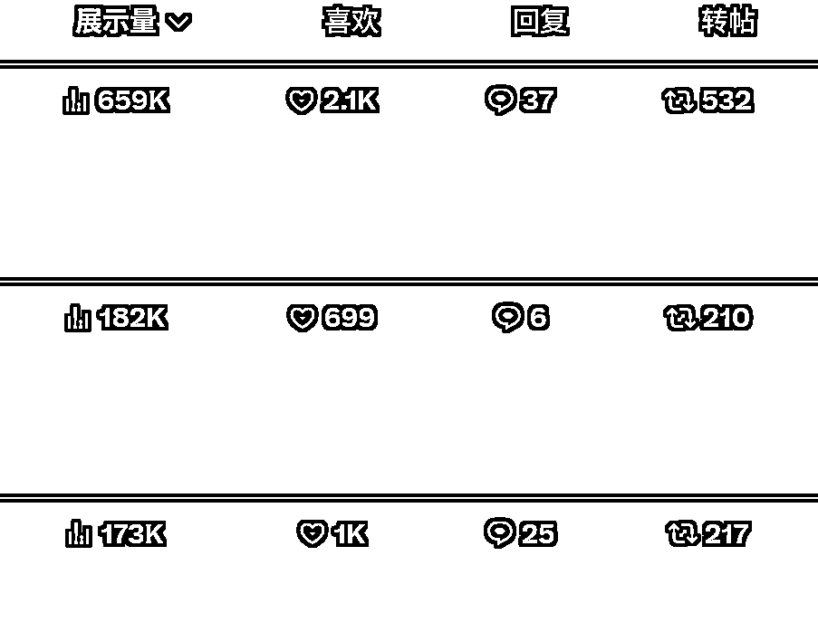
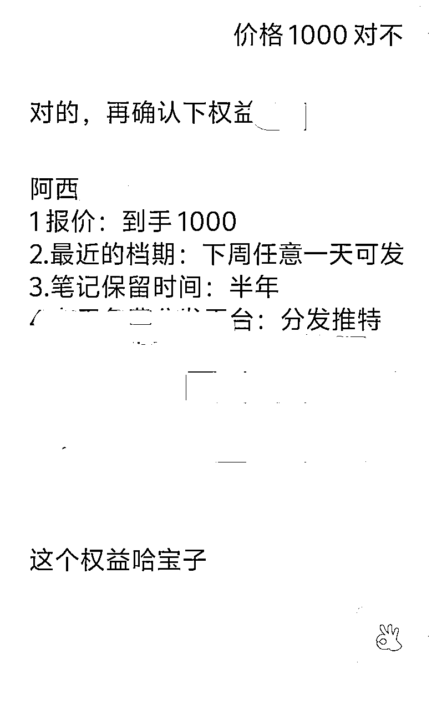
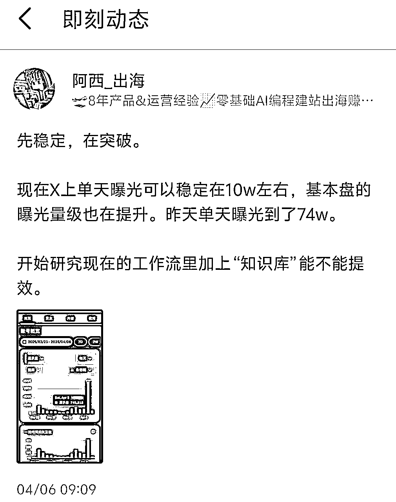
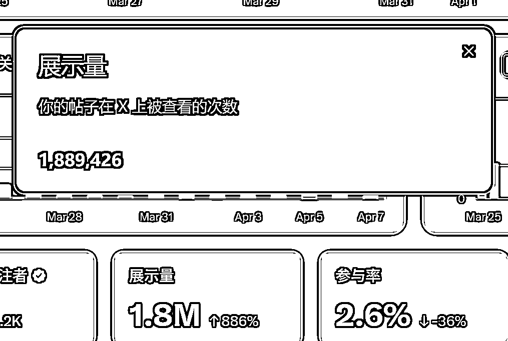
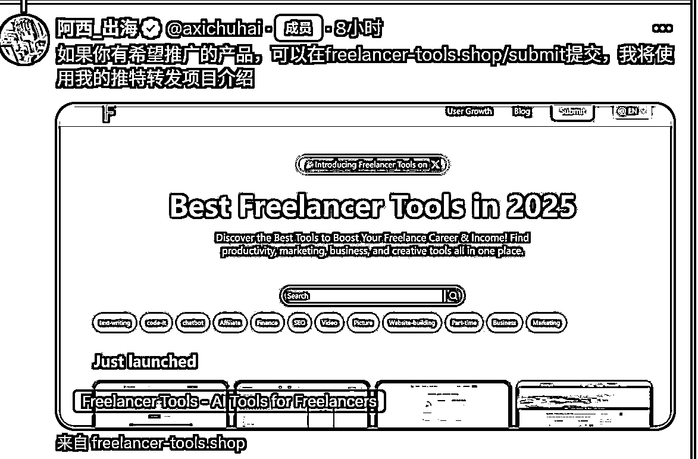
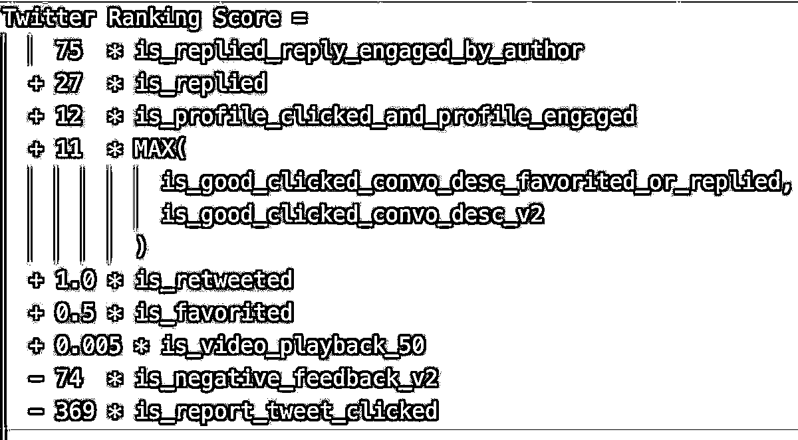
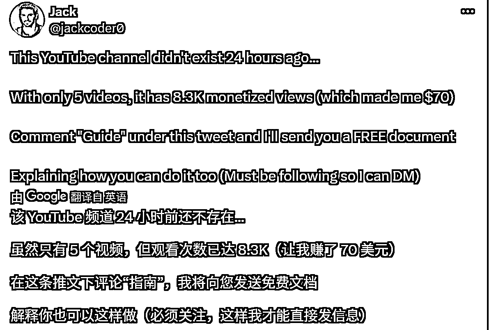
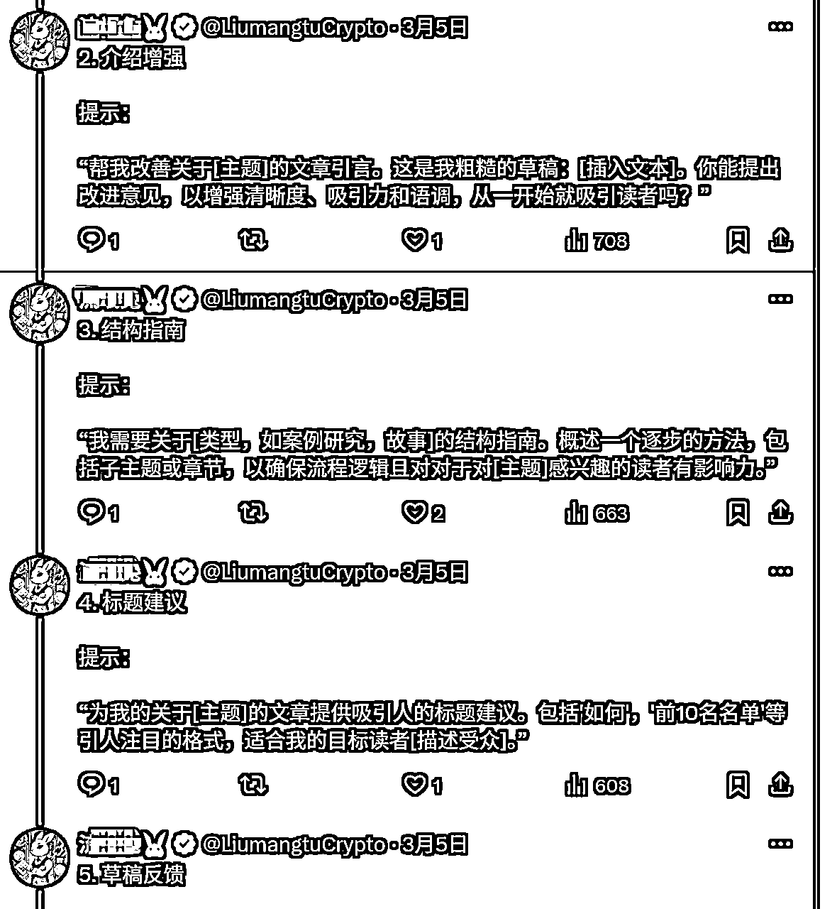
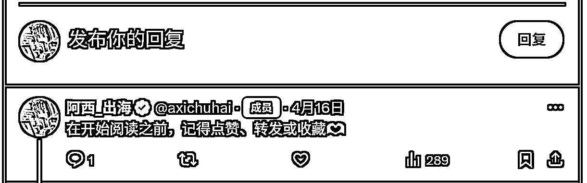
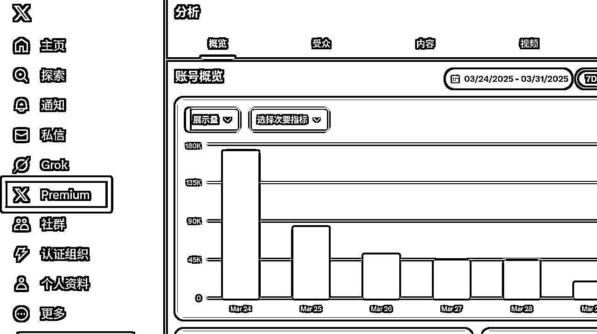

# 我是如何从零开始运营推特，并完成流量与变现闭环的

大家好，我是阿西，一名长期从事互联网产品运营的人。

此前，我曾在赚钱分享过一篇《0编程经验，我如何借助Cursor搭建AI出海工具站赚美金》，并入选精华内容，获得了140多位圈友的认可。除了赚钱，我也在即刻、推特和小红书运营出海、AI相关账号，账号名为“阿西_出海”，曾发布过多篇浏览量超过10万的内容。

这次想和大家聊聊：一个完全没有推特经验的新手，如何在推特完成账号冷启动、持续获得曝光，并最终实现变现。

我最初做推特，是因为自己一直在运营出海网站和工具，希望通过推特接触更多精准用户，为产品带来流量。

去年12月，我第一次注册推特。那时对平台规则、内容形式和流量机制都不了解，只能边做边摸索。没想到，原本只是为了给产品找用户，后来却逐渐跑通了推特账号的增长和商业化路径。

短短两天，我涨粉超过1000；多条推文浏览量突破10万，最高的一条超过65万浏览，并获得2000多个点赞。更重要的是，我不仅通过推特获得了网站付费用户，也成功接到了商单，实现了账号变现。

这是我的爆文数据↑

这是我的商单合作↑

在持续运营的过程中，我也逐渐总结出一套相对稳定的方法。目前，账号单日曝光基本可以维持在10万左右。

下面，我会从账号定位、内容创作、涨粉和变现几个方面，拆解如何从0到1运营一个推特账号。

文章主要包括三个部分：

1. 为什么值得做推特？
2. 如何借助AI确定账号定位？
3. 怎样提升曝光、涨粉并获得变现机会？

## 一、为什么值得做推特？

### 1.1 推特有哪些优势？

#### 1）内容生产成本相对较低

抖音、小红书、YouTube、TikTok等平台，往往需要视频剪辑、精美图片或复杂包装，创作门槛相对较高。

而推特更像海外版微博，很多时候只需要把自己的观点、经验或观察写成几段文字，就有机会获得大量传播。

比如下面这条低粉账号的爆款内容，作者只有6万粉丝，却凭借6行纯文字内容，获得了500多万浏览量：

所以，即使你不擅长拍视频、剪辑和设计，只要能够持续输出有价值的文字，也有机会在推特上做出爆款。

#### 2）平台分成机制叠加美元收入

当账号满足一定的粉丝量、曝光量及认证条件后，可以申请推特的创作者分成计划。简单来说，推文互动越多，账号获得的分成机会通常也越大。

与一次性的商单相比，平台分成更具持续性，也更加依赖长期内容积累。

此外，分成收入以美元结算。考虑到美元与人民币之间的汇率差，海外平台的收益在金额上往往具备一定优势。

#### 3）推特用户的付费能力相对较强

推特用户主要由海外用户以及能够使用科学上网工具的国内用户组成。愿意为网络工具付费，本身就意味着这部分人群具备一定消费能力。

同时，推特往往是很多科技、商业和经济信息的最早发源地。很多信息的传播路径大致是：

推特 → 即刻 → 小红书、微博

因此，推特用户更容易接触到行业前沿内容。那些希望尽早获得信息的人，通常包括创业者、行业从业者、专业人士和各类兴趣爱好者。

从这个角度来看，中文推特上的用户整体具备较好的商业价值。当然，这里不讨论NSFC和键政类用户。

我也观察到，不少知识付费创作者在推特上的转化效果不错，这进一步说明了推特用户的付费潜力。

### 1.2 推特上有哪些变现方式？

#### 1）创作者分成

目前，申请创作者分成通常需要满足以下条件：

1. 订阅Premium会员，最低费用为每月8美元；
2. 过去3个月内，帖子累计获得至少500万次展示；
3. 至少拥有500名Premium会员关注者。

其中最难完成的通常是500万展示量。

不过，展示量并非遥不可及。按照我自己的运营节奏，持续两周后已经获得了188万曝光。如果保持这个节奏继续运营，理论上一个多月就有机会达到500万展示量。

#### 2）为自己的产品导流

如果你拥有知识付费课程、软件工具、独立站或其他付费产品，可以把产品放进账号变现路径中。

常见做法包括：

- 在个人简介中添加产品介绍；
- 在每条推文结尾放置产品入口；
- 单独发布一条产品介绍内容；
- 将产品推广帖置顶在主页；
- 通过长线程详细介绍产品的使用场景和价值。

如果你是面向海外市场的独立开发者，也可以直接运营英文账号，通过内容接触目标用户，推广自己的产品。

#### 3）商单合作

当账号积累了几千名粉丝后，就可能获得商单机会。

推特不像小红书那样拥有成熟的官方接单平台，因此商单大多依靠私信、邮箱或商务主动联系。为了提高被发现的概率，可以在以下位置标注商务合作信息：

- 个人简介；
- 置顶推文；
- 日常内容中；
- 主页公开邮箱。

需要注意的是，推特商单相对分散，合作前一定要自行判断对方是否可信。

我的建议是：

- 尽量少接按效果付费的合作；
- 对于金额较大的固定报价商单，最好先收取部分定金；
- 合作前确认交付内容、发布时间和付款方式。

下面这个账号就是在简介中留下了商单邮箱：

## 二、如何借助AI明确账号定位？

### 2.1 先回答三个问题

正式开始运营之前，建议先想清楚以下三件事：

1. 运营中文账号，还是英文账号？
2. 选择哪个行业或内容赛道？
3. 生产什么类型的内容，最终依靠什么方式盈利？

#### 中文推还是英文推？

这两个方向对应的是完全不同的用户群体。

推特的主要用户来自英语国家，因此英文账号的用户规模更大，潜在粉丝上限和内容曝光天花板也更高。

以独立开发者赛道为例，中文推上的头部账号拥有几万粉丝已经非常不错，而英文推中，十几万甚至几十万粉丝的同类账号并不少见。

但对于刚入门的中文创作者来说，直接做英文账号并不容易，原因主要有两个：

- 语言表达存在障碍；
- 不同国家的文化、语境和内容偏好差异较大。

如果只是把中文内容机械翻译成英文，往往很难真正打动英语用户。

因此，对于新手来说，更建议先从中文推开始，先熟悉平台规则、内容结构和流量逻辑，等具备一定经验之后，再考虑拓展英文账号。

#### 选择什么赛道？

赛道选择可以从两个方向出发。

第一，围绕自己已有的业务展开。

比如你正在销售养生产品，就可以运营健康、养生或生活方式相关账号；如果你做软件、课程或咨询，也可以围绕这些业务打造内容。

第二，从个人兴趣和能力出发。

如果目前还没有明确业务，就想想自己擅长什么、喜欢什么，以及哪些事情能够长期研究和表达。

我选择AI科普方向，是因为自己长期从事互联网产品工作，也喜欢独立研究AI产品，同时比较熟悉互联网行业。

账号运营需要长期输出，最好不要单纯追逐热点，而是选择自己愿意持续投入的方向。只有内容与个人兴趣、经验相匹配，才更容易坚持下去。

#### 内容类型与盈利方式如何匹配？

很多人做账号时，只想着先涨粉，认为只要粉丝足够多，后续变现自然会发生。

但如果没有提前想清楚粉丝的用途和商业路径，那么曝光和涨粉本身并不一定有价值。单纯为了粉丝数量，甚至不如直接买粉来得快。

真正重要的是：你希望通过什么方式赚钱，再反过来决定应该生产什么内容。

推特上的账号大致可以分为三类。

##### 1. 专业型账号

这类账号主要分享行业知识、工具教程、实操经验和深度观点。

以AI领域为例，专业型账号可能会介绍某款AI产品的使用方法、应用场景和具体案例。

这类账号对创作者的专业能力要求较高，但用户精准度和付费意愿通常也更强。

##### 2. 资讯型账号

资讯型账号主要负责追踪和发布行业动态。

内容越及时、越接近信息源头，越容易积累关注。这种账号相对容易上手，但需要持续关注热点，投入大量时间筛选和整理信息。

例如@小互就属于这一类型。

##### 3. 娱乐型账号

娱乐型账号覆盖面更广，内容包括情感、鸡汤、健康、财商、键政等，普通用户都可能参与消费。

三类账号的用户数量大致是：

专业型 ＜ 资讯型 ＜ 娱乐型

但从用户付费能力来看，通常是：

专业型 ＞ 资讯型 ＞ 娱乐型

原因很简单：越专业的内容，受众越小，但用户更加精准，付费意愿也更强；越大众化、娱乐化的内容，覆盖人群越广，但用户构成复杂，转化难度也更高。

相应的变现方式可以参考：

- 专业型账号：知识付费、课程、星球、小报童、一对一咨询、自有产品；
- 资讯型账号：平台分成、广告、商单合作；
- 娱乐型账号：平台广告、普通商单。

### 2.2 用AI辅助完成定位与规划

如果你仍然不知道该做什么方向，可以借助AI完成一次系统分析。

#### 第一步：让DeepSeek帮你寻找方向

可以使用下面这段提示词：

> 作为一名职业顾问，请帮我分析我的专业背景和兴趣，找出最适合在推特上发展的2-3个可能方向。
>
> 我的背景：[详细填写你的工作经历、技能、兴趣和资源]
>
> 请重点分析：
>
> 1. 我的专业优势是什么？
> 2. 我在哪些领域拥有独特经验或见解？
> 3. 哪些方向适合我长期持续输出？
> 4. 哪些方向具备较好的变现空间？

#### 第二步：使用Grok做竞品研究

由于Grok属于推特官方推出的AI工具，可以直接调用推特上的相关信息，因此更适合用来分析同赛道账号。

提示词可以这样写：

> 请帮我寻找3-5个与我方向相似且运营成功的推特账号，并分析：
>
> 1. 他们主要发布哪些主题？
> 2. 哪些内容形式表现最好？
> 3. 他们采用了什么变现方式？
>
> 我的当前情况是：[填写你的限制，例如不擅长视频、每天只有1小时运营时间等]
>
> 请根据我的实际情况，推荐最适合我作为对标对象的账号，并说明理由。

#### 第三步：让Grok制定运营计划

提示词示例：

> 我的目标是：[例如通过推特实现每月1万元知识付费收入]
>
> 我的账号赛道是：[填写具体方向]
>
> 请帮我制定一份完整的推特运营计划，包括：
>
> 1. 账号包装方式；
> 2. 内容栏目规划；
> 3. 发文频率；
> 4. 适合的内容形式；
> 5. 粉丝增长节奏；
> 6. 达成目标的大致周期；
> 7. 适合的变现路径。
>
> 如果还有其他需要注意的事项，请一并补充。

完成这三步后，你基本就能确定账号定位、对标对象和运营节奏。

接下来，根据Grok提供的建议完善个人简介，就可以正式开始创作推文了。

## 三、如何涨粉并获得更多曝光？

### 3.1 先理解推特的流量机制

我曾经发布过一篇内容，分析推特开源代码中与推文排序相关的计算逻辑。

从公开信息来看，不同行为对应的权重大致如下：

1. 推文作者参与回复：+75分；
2. 推文收到回复：+27分；
3. 用户进入作者主页并进一步互动：+12分；
4. 用户点击对话内容并点赞或回复：+12分；
5. 推文被转发：+1分；
6. 推文被点赞：+0.5分；
7. 视频播放进度达到50%：+0.005分；
8. 用户给出负面反馈，例如标记“不感兴趣”：-74分；
9. 用户举报推文：-369分。

从这些数据可以看出，回复和评论的价值明显高于单纯点赞或转发。

因此，创作时不要只追求阅读量，也要主动设计互动入口，引导用户留言。

比如一些海外创作者会通过“评论关键词领取资料”的方式，提升评论数量：

### 3.2 提高曝光的四个方法

#### 方法一：保持稳定且较高的发文频率

持续发推主要有两个作用。

##### 第一，帮助新账号建立正常行为轨迹

新账号注册后如果长期只浏览、不发帖、不互动，容易被平台判断为异常或垃圾账号，甚至面临封禁风险。

##### 第二，通过数量积累制造增长机会

可以用一个简单公式理解：

> 总浏览量 = 推文数量 × 单条推文平均浏览量

头部账号发一条内容可能就有几万浏览，但小账号单条可能只有几百。

如果头部账号每天发一条，而你每天发布十条，即使单条效果不如大V，整体曝光也可能接近甚至超过对方。

随着内容数量不断增加，账号积累的曝光会越来越多，涨粉速度也会提高。只要内容对用户有价值，粉丝增加之后，单条推文的平均浏览量也通常会继续提升。

这就像滚雪球，越早开始积累，后续增长越容易。

#### 方法二：使用长线程创作爆款

我在实操中发现，相比普通单条推文，长线程更容易产出高曝光内容。

##### 什么是线程？

线程就是先发布一条主帖，再通过连续回复自己的方式，把多个帖子串联起来，最终形成一篇完整内容。

下面是长线程示例：

而普通帖子通常是这样的：

##### 为什么线程更容易获得曝光？

推特信息流节奏很快，普通帖子内容较短，用户滑动时可能瞬间看完，很难留下深刻印象。

长线程通常包含10条甚至更多内容，可以完整讲述一个故事、拆解一个方法或解释一个观点，用户停留时间更长，也更容易产生点赞、回复和转发。

互动行为增加后，平台也更有可能继续扩大内容分发。

##### 一条高传播线程通常包含哪些结构？

###### 1）开头：用第一条帖子抓住注意力

第一条内容不宜写得过长，重点是制造兴趣，让用户愿意继续打开后面的内容。

可以使用以下几类结尾句式：

- 故事型：“这个故事真正精彩的部分，现在才开始↓”
- 干货型：“解决这三个问题的方法如下↓”
- 资讯型：“这次更新的完整内容，我整理在下面↓”

###### 2）尽早安排互动引导

长线程较长，用户阅读到后面时可能忘记互动，因此需要在前几条内容中主动提醒。

我一般会在第二条线程就加入评论、点赞或转发引导，因为越靠后，用户流失越明显。

###### 3）优先使用视频，其次是图片

根据我的测试，线程正文中加入视频，通常更容易形成爆款；没有视频时，配图也比纯文字更容易吸引注意力。

视觉素材的作用不只是美观，更重要的是延长用户停留时间。用户在内容上停留越久，平台越容易判断这条内容值得继续推荐。

###### 4）结尾承接流量

能够读到线程结尾的用户，通常对内容有较高兴趣。这时要及时把他们转化为关注者，并引导其转发主帖。

可以参考这样的结尾：

> 如果你喜欢这类内容：
>
> 1. 关注我（@xxxx），获取更多关于xxxxx的内容；
> 2. 点赞并转发下面的第一条帖子。
>
> [这里放主帖链接]

#### 方法三：主动与行业大V互动

##### 1）借助大V评论区获得曝光

在头部账号的评论区留下高质量观点，通常有两个好处。

第一，优质评论本身就是一个免费展示位。

比如，在某款科技产品的推文下，分享自己的实际体验或独特看法，就可能吸引对该产品感兴趣的人进入你的主页。

第二，评论获得的展示量也可以计入创作者分成计划所要求的总曝光量。

可以重点关注特朗普、马斯克、赵长鹏等高流量账号，在他们发布内容后尽快参与讨论。由于这些账号本身曝光巨大，评论也有机会获得额外流量。

##### 2）拓展行业关系

推特上的行业圈子往往比较集中，创作者之间的距离也没有想象中那么远。

只要你的内容和评论足够有价值，就可能出现在行业大佬的时间线上，甚至获得转发或进一步交流。

我自己的账号在早期就是因为内容被出海圈的一位大佬转发，才完成了冷启动。

建议每天主动与5-10位行业创作者互动，持续输出有观点、有信息量的评论。这种方式成本低，却有机会同时带来曝光、涨粉和人脉资源。

#### 方法四：建立属于自己的素材库

推特运营需要高频创作。除了每天发帖，一天最好发布多条内容，但不要连续发布，建议两条之间至少间隔一个小时，否则可能影响分发。

高频输出的前提，是拥有稳定的灵感来源。

可以使用推特的收藏功能建立素材库。开通蓝标会员后，收藏内容可以进行分类管理，使用起来更方便。

我的收藏夹主要分为两类。

##### 1）主题灵感库

用来记录哪些主题近期容易获得传播。

判断一条推文是否具备爆款潜力，可以观察浏览量与粉丝量之间的比例。

如果一条推文拥有6位数以上浏览量，同时浏览量超过作者粉丝数的5倍，那么它基本可以被视为一条高传播内容。

##### 2）结构模板库

用于收集高互动、高浏览内容的表达方式。

例如，前面提到的长线程就是一种内容结构；下面这种通过关键词引导用户回复的方式，则属于互动模板：

持续拆解这些爆款内容的选题、开头、节奏和互动方式，可以显著降低后续创作难度。

### 3.3 通过数据看板持续优化

开通蓝标会员后，可以使用账号数据分析面板：

很多人只关注每条推文的浏览量，但数据看板的价值远不止于此。

#### 1）找出真正有效的内容

爆过的主题往往具备重复验证的可能。

你可以记录曾经表现突出的选题、标题和内容结构，过一段时间后，用AI重新改写和包装，再次发布，依然有机会获得不错的传播效果。

#### 2）及时判断账号是否被限流

账号成长过程中，难免会遇到限流。

如果数据看板中的日曝光曲线突然持续下降，就要及时检查近期是否存在违规内容、异常操作或其他问题，并尽快处理。

限流原因比较复杂，这里不展开细讲，但最重要的是要尽早发现，而不是等账号长期没有流量后才开始排查。

#### 3）了解创作者分成条件的完成情况

数据面板会展示认证粉丝数量、近3个月累计曝光等关键数据。

对于计划申请创作者分成的账号来说，这些数据能够帮助你清晰了解距离目标还有多远。

#### 4）提升账号的可信度

开通Premium会员后，账号昵称旁边会显示蓝标。

相比普通账号，蓝标账号通常更容易获得用户信任。毕竟，付费认证本身就向用户传达了一定的稳定性和真实性。

补充说明：我实际操作时发现，移动端无法完成蓝标会员开通，需要在电脑端进行操作，支付一般需要Visa或MasterCard。

## 四、最后总结

以上就是我从零运营推特账号过程中总结出的经验。

需要说明的是，这些方法并不能保证每个人都能快速涨粉或篇篇写出爆文。它们真正的价值，是帮助你提高成功概率，少走弯路，并尽早建立一套可重复执行的运营流程。

推特账号的增长，本质上是定位、内容、互动和长期积累共同作用的结果。

先选对方向，再持续输出；用数据复盘，用互动扩大曝光，用产品或服务承接流量，才更有机会真正跑通从0到1的增长与变现闭环。

如果一定要从所有经验里提炼出一条最关键的建议，我会告诉你：经营推特，真正拉开差距的不是技巧，而是持续行动。

每天发布内容，安排固定时间浏览动态，主动回复、点赞和参与讨论——这些看似普通的动作，长期坚持下来，才会慢慢形成账号的影响力。

推特本身就拥有很大的商业潜力。更重要的是，当你持续运营一段时间后，往往还能发现许多额外的机会。

比如，你在其他平台接到商业合作时，品牌方可能会进一步询问，是否可以同步在推特发布。这样一来，合作报价甚至有机会提升到原来的两到三倍。再比如，一条内容如果在推特上获得了不错的传播效果，将它重新整理后发布到小红书、抖音等平台，也很可能再次取得较好的表现。

所以，推特的价值并不只是发布内容、积累粉丝这么简单，更多可能性需要你亲自进入其中、持续探索。

不妨先完成注册第一个账号，发出你的第一条推文。接下来，坚持下去，边做边总结，相信你会在过程中收获意料之外的惊喜。祝你成功！