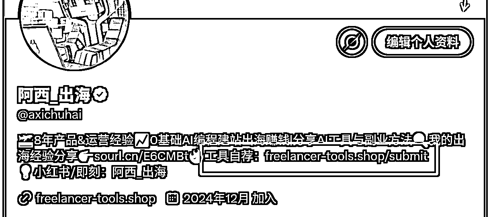
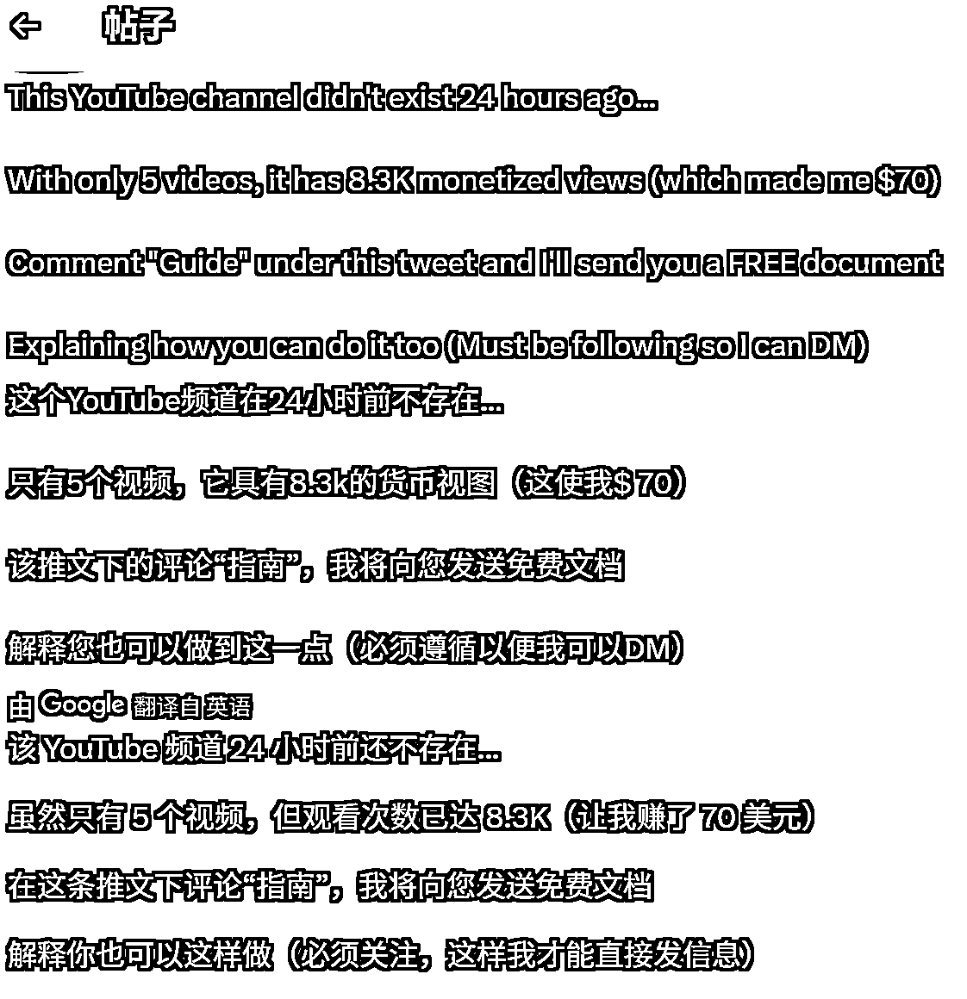

# 从注册到稳定变现：我的推特账号冷启动全记录

> 来源：[https://tjvomspfav.feishu.cn/docx/UVwWd2blmoxiTlxrxrrcUWrWnWh](https://tjvomspfav.feishu.cn/docx/UVwWd2blmoxiTlxrxrrcUWrWnWh)

我是阿西，做过多年互联网产品运营。之前在生财有术发过一篇用Cursor做AI出海工具站的复盘，侥幸拿到了精华帖，也收到了140多位圈友的认可。平时我还在即刻、推特、小红书同步更新“阿西_出海”这个账号，主要聊出海和AI相关的话题，产出过不少阅读量破10万的内容。

这篇想好好聊聊，一个从来没玩过推特的人，怎么在几个月内把一个新号盘活，实现从内容创作到商业变现的闭环。去年12月我第一次注册推特，当时的想法很简单：我做了个出海工具站，想找个渠道触达更多精准用户。结果完全超出预期——网站来了付费用户，账号2天多了1000个关注，好几篇帖子阅读超过10万，最猛的一篇冲到65万+、点赞2000多，还意外谈下了第一个商单。

上面是爆文的数据截图↑

这是当时的合作记录↑

在这段摸索中，我沉淀了一套自己的打法，目前账号的单日曝光基本能稳定在10万左右。

接下来从四个方面做完整拆解：平台价值判断、账号定位策略、内容增长打法、数据工具应用。

## 一、为什么我建议你认真做推特

### 1.1 这个平台的底层优势

**内容生产成本极低**

抖音、B站、小红书这类平台，想获得流量通常得配精致的画面、剪辑甚至出镜。推特本质上是“海外版微博”，一段随手写的文字就可能被大量转发。有个6万粉的账号发了6行纯文字，最终浏览量超过500万：

说白了，哪怕你只会写字，在推特也有做爆款的概率。

**流量分成+美元结算**

蓝标认证用户只要达到一定门槛，就能开通创作者的流量分成计划。简单说就是：你的推文互动越多，分成收入越高。这对比商单来说更稳定、更细水长流。而且平台结算用的是美元，天然比人民币收益多出约7倍的汇率优势。

**粉丝质量与付费意愿更强**

除了海外用户，能稳定上推特的国内用户，本身就等于跨过了一道筛选门槛——他们愿意为工具付费，消费能力通常不弱。而且推特上的科技、财经热点往往跑得最快，信息通常先出现在推特，再传到即刻、小红书、微博。想抢信息差的人，大多是创业者、行业从业者和研究者，这部分人群价值很高。我也接触过一些知识付费博主，他们反馈推特的转化率确实优于其他平台。

### 1.2 有哪些落地变现渠道

**官方流量分成**

开通需要满足三个条件：
1. 订阅Premium会员（月费最低8美元）
2. 过去3个月累计展示量达到500万
3. 拥有至少500名Premium会员关注者

最有挑战的是展示量。我自己用了一套运营方法，两周做到188万展示，按这个速度推进，冲到500万大概一个多月就能实现。

**给自有产品导流**

手上如果有课程、工具或付费服务，可以在个人简介、每篇推文末尾放链接，也可以单独写一篇产品介绍置顶在主页。面向海外用户的独立开发者，完全可以另开一个英文号，用内容直接圈住目标人群。

**接商单**

粉丝做到几千就能开始接推广。推特没有小红书那种官方交易平台，商业化比较“野生”，需要自己判断合作方是否靠谱。我的经验是：尽量别接按效果付费的单子，一口价的合作如果金额较大，先收定金再开始。

## 二、用AI辅助做好账号定位

### 2.1 起号之前先想清三个问题

① 做中文号还是英文号？② 进哪个领域？③ 用什么内容形态，靠什么赚钱？

**语言方向决定了市场天花板**

英语用户在全球推特占主导，意味着英文号的成长上限更高。以独立开发者这个领域举例：中文圈做到几万粉已经算是头部，英文圈里十几万甚至几十万粉的账号一抓一大把。但对国内作者来说，语言和文化差异是两道坎。直接把中文硬翻成英文，传播效果会打折扣。新手建议先从中文号做起，熟悉玩法后再考虑英文号。

**领域选择跟随你的业务或兴趣**

如果你正在卖养生产品，就去做健康相关的内容；如果没有明确业务，那就顺着自己的热情走。我自己做互联网产品，平时喜欢闷头研究AI工具，所以选了AI科普方向。内容创作需要长期输出，只有真正喜欢，才不容易放弃。

**内容形态和变现方式要绑定着定**

太多人先把粉丝做起来再考虑怎么赚钱，最后发现流量没有价值。我观察下来，推特上做内容的基本可以分为三类：

- **专业类**：深耕垂直领域，内容偏干货和科普，用户少而精准。适合卖课程、做一对一咨询、带自有产品。
- **资讯类**：追热点、发快讯，选题越及时越容易涨粉，但比较耗精力。适合平台广告和商务合作。
- **娱乐类**：鸡汤、情感、健康、理财等泛内容，覆盖面最广，但用户五花八门，付费转化相对一般。

人群数量排序是专业类＜资讯类＜娱乐类，付费能力则正好相反：专业类＞资讯类＞娱乐类。内容越精专，看的人越少，但愿意掏钱的人越多。

### 2.2 三步跑通定位

**第一步：用DeepSeek做定位分析**

提示词参考：
> 你是一名职业顾问，请帮我结合我的专业背景和兴趣，找出2-3个最适合在推特发展的方向。我的背景是：[详细描述]。请分析：我的专业优势、我有独特见解的领域、我能长期持续产出的内容类型、哪些方向有变现潜力。

**第二步：用Grok做竞品分析**

Grok是推特官方的AI工具，能直接调取平台数据。提示词参考：
> 请选择3-5个与我方向相似的成功账号，分析他们的内容主题分布、最成功的内容形式、变现模式。我的情况是：[比如不擅长视频、每天只能投入1小时]，请推荐一个最适合我对标的账号。

**第三步：用Grok做运营节奏规划**

提示词参考：
> 我的目标是：[比如6个月内通过知识付费月入1万]，我的赛道是XX。请帮我制定完整运营规划：最快多久能达成目标、运营节奏如何、账号怎么包装、发文频率多少合适，其他建议请一并写进去。

三步走完，你的账号方向基本就定了，照着规划执行就行。

## 三、怎么让账号持续涨粉、稳定获得曝光

### 3.1 理解平台的推荐逻辑

我研究过推特开源代码里的排序公式，互动行为和权重直接挂钩：
- 作者参与回复：+75分
- 推文被回复：+27分
- 用户点进作者主页继续浏览：+12分
- 用户点开对话详情并点赞或回复：+12分
- 被转发：+1分
- 被点赞：+0.5分
- 视频播放过半：+0.005分
- 被标记“不感兴趣”：−74分
- 被举报：−369分

看得出“评论”是权重最高的加分动作。所以在内容里要有意识地引导大家留言讨论，比如很多海外博主喜欢用“评论区留言即可领取资料”，效果相当好。

### 3.2 制造爆款的四个核心打法

**第一，保持高频更新**

持续发文有两个意义。一是养号：新号注册后只刷不发，容易被判定为僵尸号导致封禁。二是摊大饼：总浏览量≈发帖数×平均单篇浏览。大V一条推文有几万阅读，但一天可能就发一条；你几百粉，一条只有几百阅读，但一天发十几条，总量就可能反超。推文发得越多，涨粉越快，粉丝多了单条阅读量也会提升，雪球就这样滚起来了。

**第二，模仿被验证过的爆款结构**

我实操中发现，“长线程”比普通单帖更容易爆。

什么是长线程？就是在主帖下不断追加评论，形成一条完整的连载内容。

普通帖子内容太短，几秒就被刷过去了，很难留住注意力。

而长线程有足够的信息量去完整呈现一个观点、故事或主题，更能黏住读者，互动率自然更高——转发、评论越多，平台给的推流也越多。

打造一条“病毒式”线程可以这样设计：

- **开头抛钩子**：第一帖不能太长，目标就是让用户忍不住点开看后续。结尾可以用这几类句式——“下面就是这个故事的开端↓”“三个解决办法在这里↓”“这次发布的所有细节如下↓”
- **中途引导互动**：长帖读到后面容易忘记点赞转发，最好在第二条就开始提醒用户互动，越往后流失越严重，越早引导越有效。
- **视频优先于图片，图片优先于纯文字**：视频或配图能让用户停留更久，停留越久平台给的自然流量越多。
- **结尾承接转化**：读到最后的人通常对内容很满意，这时要及时把流量变成关注。我的固定结尾是——“喜欢这类内容的话：1. 关注@xxx，获取更多干货；2. 点赞+转发下面这条帖子的链接”。

**第三，有策略地和行业大V互动**

在头部博主的评论区做高质量回复，一举两得。一条有价值的评论相当于免费广告位，能被很多人看到并顺手关注你；同时评论产生的曝光也计入创作者分成的展示量。可以特别留意特朗普、马斯克、赵长鹏这类顶级账号，第一时间去评论，曝光量相当可观。

更关键的是，推特上的圈子相对扁平，内容够好就有机会出现在行业大佬的时间线上。我的账号冷启动，就是因为一条评论被出海圈的大佬转发，瞬间带来了一波关注。每天花少量时间，和5到10个行业大V做有价值的交流，性价比非常高。

**第四，搭建自己的素材库对抗灵感枯竭**

高频更新的前提是稳定且充足的素材供给。开通蓝标会员后，收藏夹支持分类，我把它分成两个：

- **主题灵感**：收藏那些近期容易火的选题方向。判断爆文有个简单标准：浏览量达到6位数，且是发帖者粉丝数的5倍以上，基本就是爆款了。
- **模板灵感**：收集高互动、高阅读的内容结构，比如长线程，或者引导用户回复关键词的互动玩法。

### 3.3 用数据指导后续动作

开通蓝标会员后可以查看完整的账号数据面板：

很多人觉得看数据没用，其实价值很大：

- **找出可复制的爆款规律**：记录哪些选题、哪些结构曾经爆过，过段时间用AI改改写，重新发一遍，大概率还有好成绩。
- **尽早发现限流**：从每日浏览量曲线能明显看出异常下滑，及时排查违规项、解除限流，别等问题拖严重了。
- **直观掌握分成达标进度**：面板上直接显示认证粉丝数和3个月总浏览量，不用自己手动统计。
- **蓝标本身是信任背书**：花了钱的账号看起来更可靠，用户更愿意互动。

补充一个细节：蓝标开通在移动端操作不了，需要在电脑端完成，支付必须用Visa或Master信用卡。

## 写在最后

以上是我做推特这段时间积累的实战经验。方法不能保证谁都能快速做成大号，但能明显提升成功率，帮你少踩一些坑。做内容没有捷径，有方法、有耐心、持续迭代，总会等到爆发的那天。

聊了这么多具体的操作技巧，如果非要我用一句话点出运营推特账号的根本，那就是一条：扛住坚持。

每天稳定输出内容、每天雷打不动抽出固定时段刷时间线、每天主动去互动，就是这么简单的一套循环，决定了你能不能把账号做起来。

推特的商业潜力比很多人想象的大得多。光是平台内部的变现只是起步，当你真的把它当成日常在经营，你会收到一堆意想不到的反馈。举个例子，我在其他平台谈合作时，客户经常会额外要求“顺便在推特上也发一条”，就这一项，单价直接涨了两到三倍。还有一点也很实在，推特上火起来的内容，稍作改动搬到小红书、抖音这些平台去发，爆的概率非常高。

推特能给你的远不止这些，等你自己上手了自然会挖出更多。先别想太多，先去注册一个账号，发出你的第一条推文，然后就按部就班地坚持下去。只要你真的做了，惊喜迟早会找上你。祝你玩转推特，早日看到回报！