# 搜索入口正在迁移：看懂 DSO，才能抓住下一波增长

过去做流量，很多人第一反应是研究百度。谁能出现在结果页前列，谁就拥有更大的曝光机会。

但如今，用户寻找答案、产品和服务的场景，早已不只在传统搜索引擎里。短视频平台也正在成为重要的信息入口。以 2020 年前后的公开数据为例：

搜索“vlog”，抖音日均约 44000 次，百度相关数据约为 530+2818，前者约是后者的 13 倍。

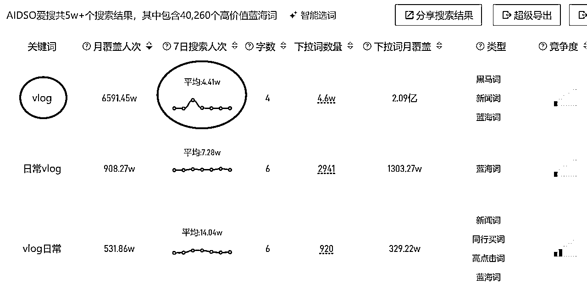

搜索“获客”，抖音约 794 次，百度约为 26+40，差距接近 70 倍。

推荐机制的热度很高，容易让人忽视平台内主动搜索所产生的需求。实际上，即使拍摄能力一般、投放经验不足，只要内容能够匹配用户正在寻找的词，也有机会获得稳定曝光。

## 为什么搜索型流量值得长期布局？

推荐流量依赖内容在某个时间段内被大量分发，而搜索流量更像一条持续打开的入口。

当一条内容与某个需求词建立关联，并且在结果中保持较好位置，它就可能在较长时间里不断带来目标用户。曾有一条累计播放约 50 万的视频，其中约 49 万播放来自自然搜索；相比之下，许多普通内容的搜索来源占比只有 1% 左右。

更值得关注的是，真正掌握平台搜索获取规律的创作者并不多，这意味着市场仍存在明显的认知差。

搜索带来的播放通常不是一次性爆发，而是持续累积。内容表现能否不断增长，主要受两个因素影响：

1. 目标词每天有多少人主动查询；
2. 你的作品在相关结果中的展示位置。

想确认自己的流量来自哪里，可以这样操作：

进入近期发布的作品，点击右下方的更多选项，找到数据分析，再进入流量分析页面并向下查看。这里不仅能看到不同来源的占比，还能识别具体贡献流量的搜索词。

如果需要持续观察词位变化，则可以借助 AIDSO 的监测模块，对指定词进行追踪。

## 长尾需求，可能是更适合普通人的突破口

很多人只盯着热门大词，却忽略了那些表达更具体、竞争更有限的长尾需求。

AIDSO 在抖音侧累计收录关键词超过 10 亿条。词库越丰富，越容易从细分行业中发现搜索量尚可、竞争压力相对较低的机会。内容创作者、达人、品牌、商家以及流量运营者，都可以利用这类工具进行研究。

通过筛选与分析，能够找到一批尚未被充分争夺的词，再结合内容生产与发布策略，短视频或图文都有机会获得较高比例的主动搜索来源，部分案例中搜索占比可达到 80% 以上。

## DSO 到底在做什么？

可以把它理解为三步：

**找到合适的需求表达 → 用内容覆盖这些需求 → 让流量完成商业动作。**

它并不是简单地把词塞进标题，而是围绕结果页表现，对选题、表达、发布、互动和转化进行系统调整。最终目标是：当用户主动查询某个问题时，更早看到你的内容，并进一步完成咨询、留资、下载或购买。

推荐内容负责激发兴趣，主动查询则说明用户已经有明确问题。前者未必产生交易，后者往往距离成交更近。

围绕明确需求打造长期内容，跑通一套转化路径后，就能在某个词下面形成稳定的流量来源。继续扩展更多相关词，就相当于不断建立新的入口。

这种流量的特点是启动较慢，但生命力更强。推荐内容更像短距离冲刺，讲究瞬间爆发；搜索内容更像长距离耐力赛，重视持续积累。不断找到合适的需求词，再持续产出能够解决问题的内容，流量才会越滚越大。

同时，平台的搜索与推荐并非完全割裂。搜索表现、互动表现和内容质量之间存在联动，做好主动搜索，也可能反过来改善整体分发。

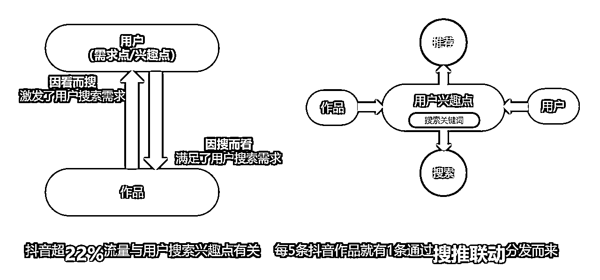

按照这类运营节奏，细分长尾词通常约 5 天有机会出现变化，竞争更强的核心词可能需要约 20 天。一个用于收集线索的蓝 V 账号，从搭建到稳定获得每日 100—200 条有效线索，通常需要约两个月持续更新。

电商账号也可以围绕用户查询词制作商品内容，再配合投放，把主动搜索人群引导至直播成交场景。

## 一套完整的执行路径

整体可以拆成：

**研究词群 → 设计覆盖 → 改善展示位置 → 提升点击 → 优化观看与互动 → 设置行动引导 → 完成转化**

### 第一阶段：明确业务与机会

先梳理产品定位、目标人群、盈利方式、核心业务、推广渠道和当前经营状态；再挑选 3 个相近竞品，观察它们在平台上的选题、表达和推广方式。

接着对词语进行分类，预估不同类型的数量，并优先挑选成交意图更强、适配度更高的需求词进行扩展。

### 第二阶段：围绕词群生产素材

根据前期确定的词，设计不同方向的选题：一类服务于结果页竞争，另一类负责扩大覆盖范围。

随后完成拍摄、剪辑、发布、账号运营和合集整理，让内容逐步覆盖目标需求，并争取获得更好的展示位置与转化表现。

### 第三阶段：持续复盘调整

每天查看核心指标，实时关注内容表现，及时寻找新出现的机会词和快速增长词，再根据结果调整选题、表达与发布策略。

## 不同阶段可能对应的收益区间

以下数据属于原手册中的参考模型，实际结果仍取决于行业、产品、团队能力和执行周期。

| 级别 | 参考月毛利 | 常见特征 | 典型状态 |
|---|---:|---|---|
| SSS | 50 万以上 | 适合的细分领域、矩阵账号与付费手段结合，持续占据核心需求入口 | 少数成熟精英团队可达 |
| S | 约 10 万 | 高客单业务稳定更新，持续获得有效咨询；高价值线索每日超过 100 条，或低客单线索每日超过 1000 条 | 少量团队已实现稳定盈利 |
| A | 约 5 万 | 行业适配主动查询，内容持续更新，展示位置和线索量同步改善 | 成熟团队可达到 |
| B | 约 2 万 | 业务规模较小，但已经掌握完整运营链路，内容与转化能力开始产生利润 | 部分陪跑学员约两个月达到 |
| C | 约 1 万 | 行业较小或变现能力有限，能够偶尔抓住优质词并获得收入 | 初学者可能达到的阶段 |

## AIDSO 爱搜：把搜索研究做得更细

AIDSO 是一款面向内容运营、电商和品牌推广的搜索增长工具，适用于短视频作者、营销人员及电商从业者。

它主要能够完成：

- **词语研究**：利用大规模词库与榜单，发现用户正在关注的表达；
- **自动拓展**：借助算法辅助寻找相关需求，并生成内容方向；
- **趋势研判**：观察搜索变化、用户行为和时间趋势；
- **流量规划**：根据需求数据安排内容布局；
- **对手追踪**：查看竞品及自身账号的词位变化；
- **文案辅助**：帮助提高脚本与标题产出的效率；
- **需求可视化**：通过关键词关系图，理解用户从问题到决策的路径。

官网： https://www.aidso.com/

同时也提供小程序入口：

# 主要模块说明

## 1. 行业词盘

首页行业大盘可用于观察不同领域的热门词、低竞争词和整体需求变化。企业用户还能批量下载行业词库，便于从更大范围规划词群与账号布局。

不少成熟品牌会先通过行业报告判断平台上的需求结构，再决定内容方向、人员配置和执行节奏。

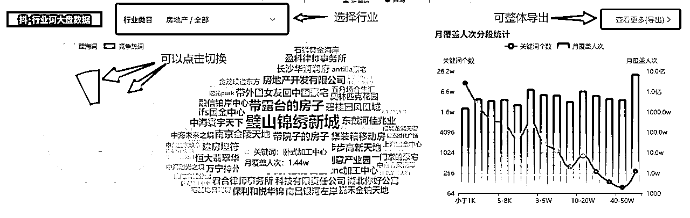

## 2. 词库查询

词语研究是整个流程的起点。AIDSO 的词库规模大、更新频率高，并配有相关词扩展、筛选和导出能力。

入口：
https://www.aidso.com/KeywordDouyin/searchWord

以抖音为例，不同层级的词适合不同打法：

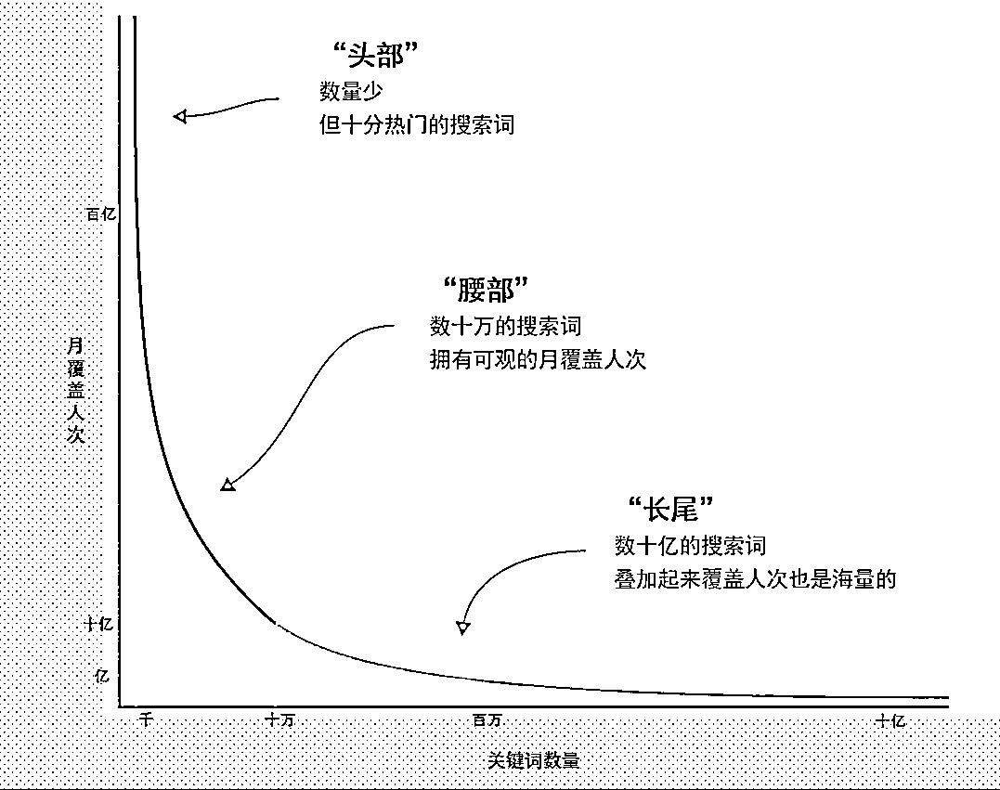

- **头部词**：搜索人群宽、竞争强，通常需要高质量内容配合付费筛选；
- **腰部词**：人群相对明确，适合深入扩展并寻找尚未充分竞争的方向；
- **长尾词**：表达具体、数量庞大，可通过批量布局提高覆盖效率。

词的热度越高，对内容质量和账号能力的要求往往越高。刚开始就争夺头部词，未必是最优选择。更合理的路径，是先从成交意图清晰、竞争压力适中的需求切入，再逐步拓展人群词和行业热门词。

平台可提供月度覆盖人数、关联词、搜索下拉、竞争程度及词类标签等信息。以“考研”为例，可以进一步查看相关搜索、行业方向和电商方向。

筛选时可参考以下思路：

- 月覆盖人数超过 1 万，通常具备一定需求基础；
- 若希望降低竞争，可将上限控制在 50 万以内；
- 字符数达到 6 个或以上的表达，往往更接近长尾需求；
- 条件组合越合理，越容易找到被忽视但有价值的方向。

### 六个实用筛选角度

1. **看近期稳定性**：参考近 7 天的查询人数，避开忽高忽低的词；
2. **看覆盖规模**：优先关注月度触达人群较大的表达；
3. **看需求具体度**：表达越完整，用户意图通常越明确；
4. **看竞争结构**：优先寻找热度尚可、同类内容较少的词；
5. **看商业迹象**：有同行投放记录的词，往往具有商业价值；
6. **看竞争数值**：在需求相近时，优先选择竞争程度更低的方向。

常见标签可以这样理解：

- **黑马词**：近期查询量快速上升；
- **蓝海词**：需求不小，但竞争相对有限；
- **商机词**：带有明显购买或咨询意图；
- **地域词**：包含城市、省份等地理信息；
- **同行投放词**：近期有同业广告记录；
- **高点击词**：用户进入相关内容的比例较高。

打开某个词的详情页后，还能查看近 30 天变化、关联下拉表达、人群画像、地域分布、年龄、性别和兴趣等信息。系统也会辅助生成一些标题方向，供后续策划参考。

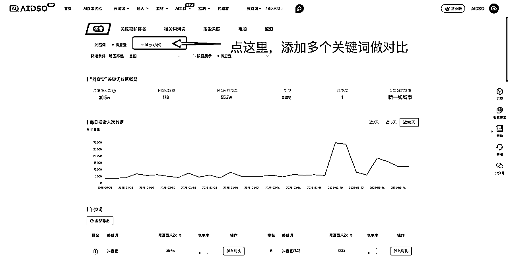

在相关内容部分，可以查看结果快照、前 100 条相关表达，以及用户查询与内容之间的关联情况。

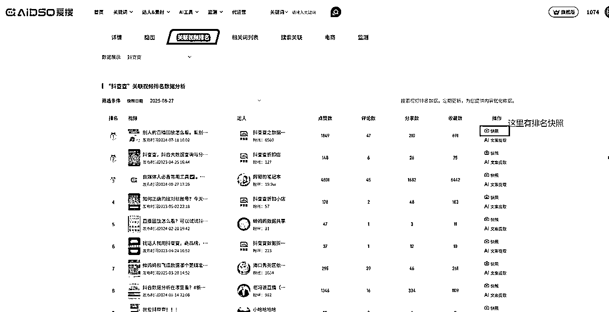

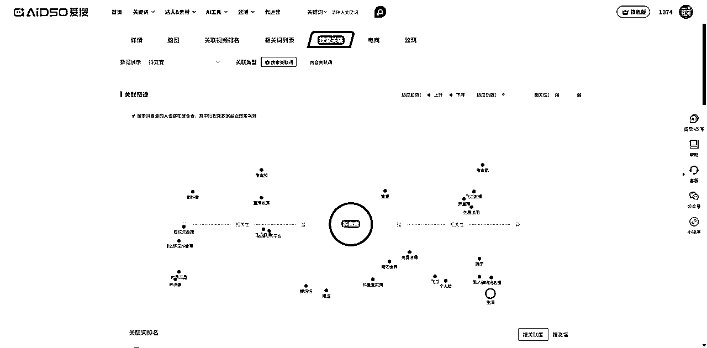

若想持续跟踪某个词，可在监测页面加入目标。等待数据刷新后，就能按小时观察词位变化与流量波动。

除抖音外，平台还覆盖多种内容生态：

- RSO：查看小某书的词语、关联表达、下拉结果和行业信息；

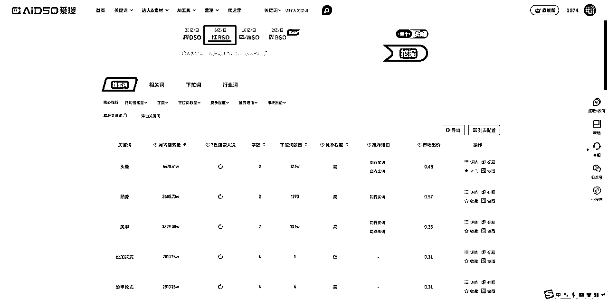

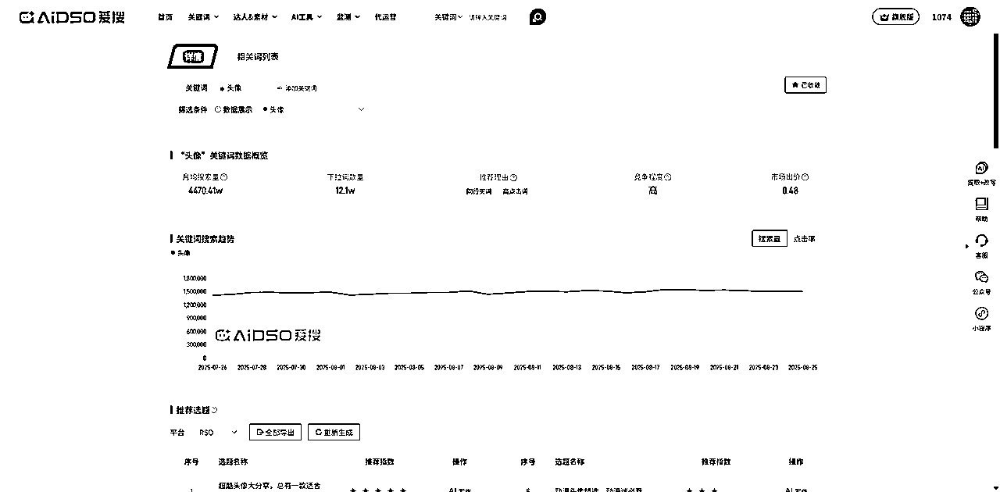

- WSO：查看微信搜一搜相关数据；

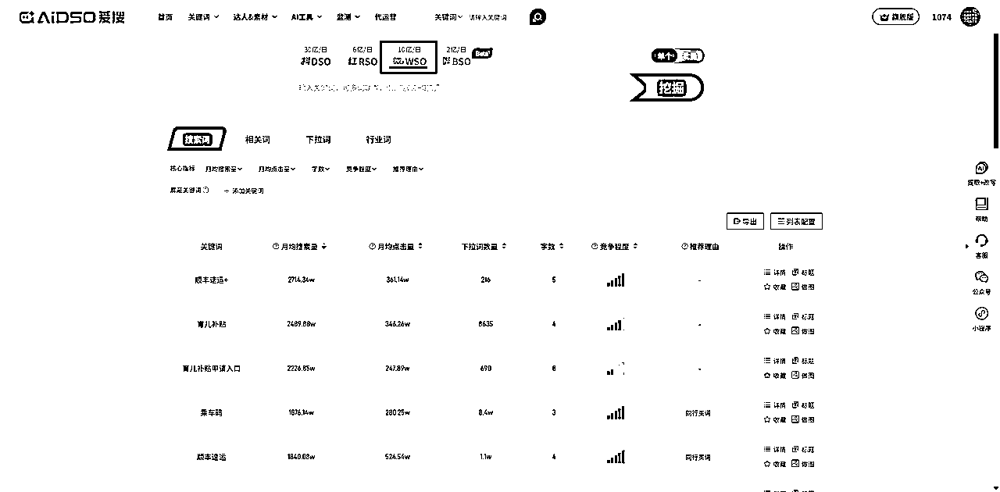

- BSO：查看哔某站相关数据；

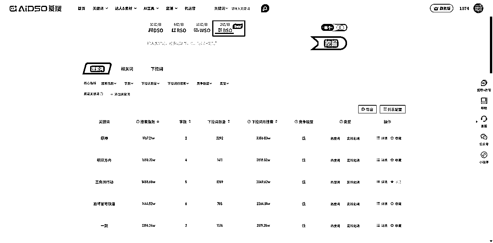

- TSO：查看 TikTok 的词语、关联表达、下拉结果及电商方向数据。

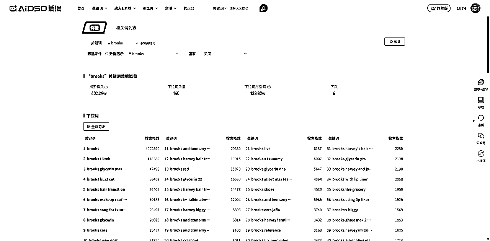

## 3. 热点榜单

榜单的价值，在于帮助运营者了解大众近期正在集中关注什么。AIDSO 汇总了抖音侧的多类榜单，并支持筛选与导出。

入口：
https://www.aidso.com/KeywordDouyinHot/blue

- **小蓝词榜**：聚合带货种草内容与成交倾向较强的商品词；

- **话题榜**：包含整体热度榜和增速榜；

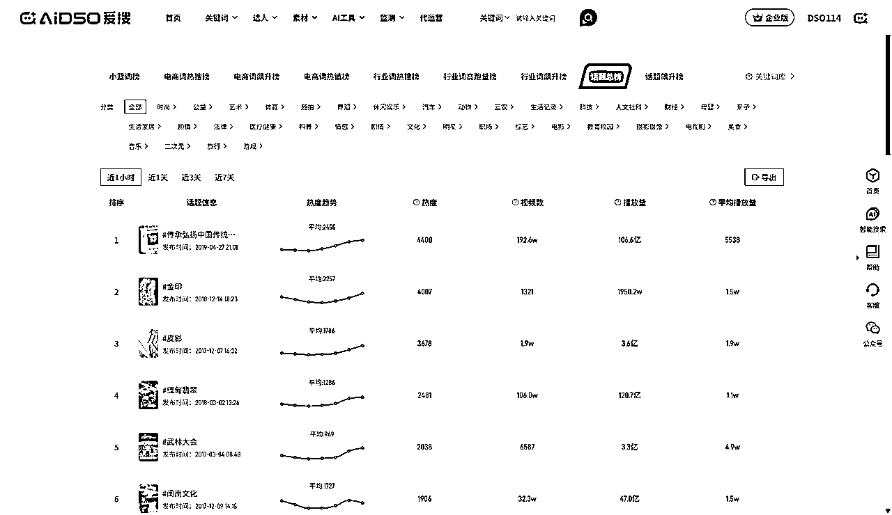

- **电商词榜**：可查询热搜、增长、热销等周榜与月榜；

- **行业词榜**：覆盖热搜、高跑量和快速增长方向。

其中，快速上升的词值得重点留意。它们通常刚进入大众视野，需求增长很快，但同类内容还没有完全跟上，因此可能形成短期窗口。

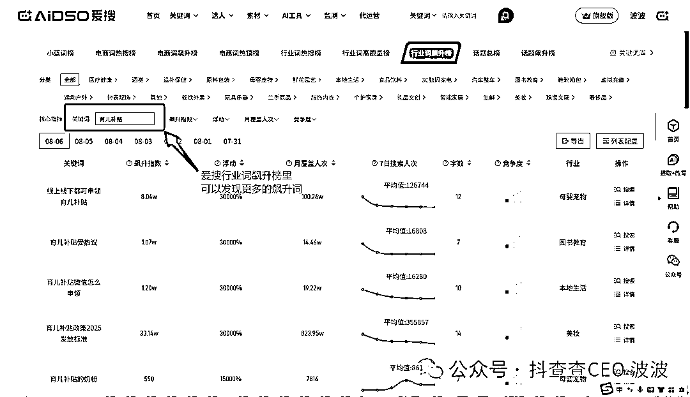

通过电商增长榜、行业增长榜，再结合品类与主题筛选，可以进一步挖出这类高潜方向。

## 4. 内容抽取与改写

该模块可处理抖音、小红书、快手、B 站等平台的图文或视频文案，并进行结构整理与重新表达。

入口：
https://ai.aidso.com/

使用相关功能时，应遵守各平台规则、版权要求和法律规定。

## 5. 任务协同与词位追踪

对于需要多人协作的团队，这一模块可以帮助统一任务、汇总结果，并围绕策略、素材质量和运营指标进行复盘。

新版入口：
https://www.aidso.com/dataMarketNew

功能说明：

在监测大盘中，可以集中查看账号作品的多项指标，并自动整理运营日报，减少人工汇总工作。

搜索型增长的核心，不是单纯追逐热门，而是找到真实需求，再用持续、匹配、可转化的内容去承接它。谁能把需求研究、素材生产和效果复盘串成一条线，谁就更有机会把主动查询转变为长期生意。

AIDSO爱搜围绕内容搜索场景，搭建了从数据洞察、素材分析到智能生产、线下辅导的一体化服务体系。下面带你快速了解其主要能力。

### 一、平台能力

#### 1. 关键词表现追踪

在排名监控模块中，可查看已绑定账号内各条作品对应词的表现情况。进入“监测趋势”后，还能按每3小时一个节点查看变化轨迹，及时掌握排名起伏。

#### 2. 达人数据中心

达人库收录了不同行业优秀创作者的DSO经营指标，便于用户寻找参考样本，结合自身账号情况调整内容方向和运营方法。

进入某位达人的专属页面，还能进一步查阅其作品涉及的词项、名次表现、内容概况以及受众特征。

#### 3. 高潜内容素材库

素材中心会呈现热门内容所覆盖的词语及其历史峰值位置，可为选题规划和内容打磨提供依据。

平台同时配备便捷检索入口，输入目标词即可筛选对应的优质作品。打开单条内容的详情，还可了解当前流量状态与观看人群特征。

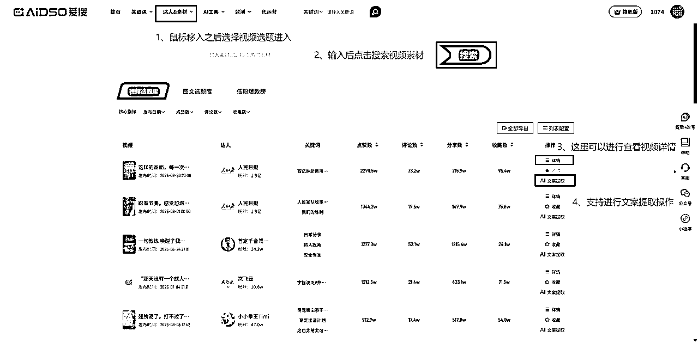

#### 4. 智能生产组件

- **关键词拓展**：提交一个核心词后，平台会按照DSO方法筛选可用于搜索布局的相关词，帮助完善选词方案。

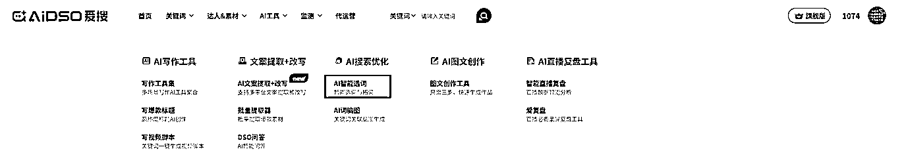

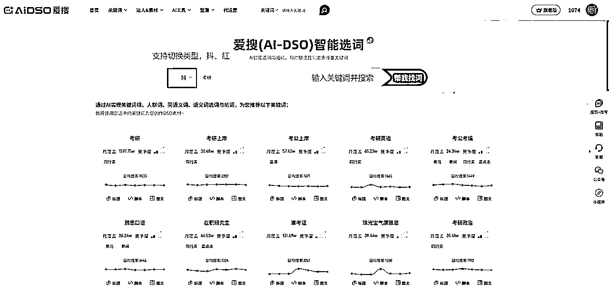

- **视频脚本生成**：除了产出脚本，还会补充关联词以及排名前五的参考信息，方便创作者判断方向。

- **脚本再次打磨**：若初稿不符合预期，可使用“换一换”，或直接描述修改要求，让系统重新整理内容。

- **作品标题批量生成**：点击【写标题】，即可快速获得多组热门风格标题，提升发布效率。

- **图文内容生产**：通过【写图文】入口，可围绕指定词生成图文稿件，并在页面内继续修改完善。

- **场景化文案撰写**：选择对应的写作用途，系统便能快速输出匹配场景的运营文案。

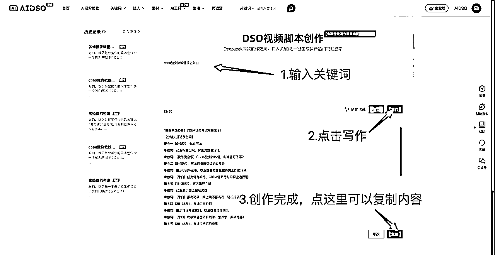

- **热门脚本采集**：输入目标词后，可提取相关高热度作品的脚本，便于研究表达方式和内容结构。

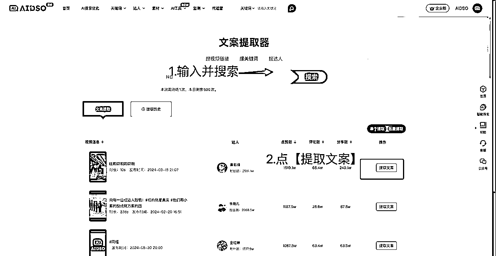

- **词汇关系图**：输入主题词，系统会自动整理关联词网络，为后续拓词和选题提供启发。

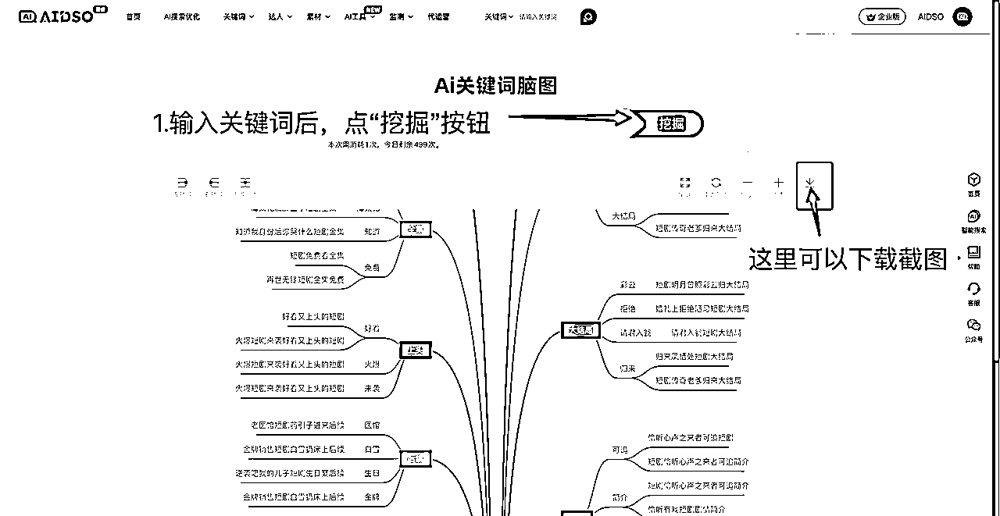

- **直播内容复核**：支持完成直播录制、内容复核，并在线查看整理后的结果。

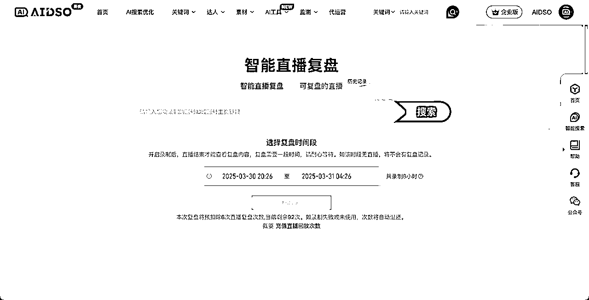

- **创作记录归档**：过往生成过的内容统一保存在写作记录页面，可按需查阅和整理。

### 二、线下活动与企业培训

#### 1. 城市沙龙

从去年8月30日开始，AIDSO爱搜团队已在多个城市开展线下交流活动，邀请行业讲师及实战操盘人士，围绕内容搜索方法和真实项目案例进行分享。活动持续获得积极反馈，目前每月举办不少于两场，欢迎关注后报名。

活动影像资料：

北京站活动

北京我司游学

杭州站活动

上海站活动

上海站活动

字节服务商杭州我司游学

杭州站第二场活动

成都站活动

广州站活动

深圳站活动

杭州第三场

#### 2. 企业专项培训（咨询桃子微信：dcc2899）

搜索流量正逐渐成为头部企业的重要增长来源，不少公司已经组织专门团队，以DSO作为获客抓手，并获得了较为突出的转化成果。针对企业实际需求，AIDSO提供相应的内训支持。

内训活动记录：

### 三、沉浸式游学与陪跑案例（桃子微信：dcc2899）

DSO深度游学为期5天，学员来到爱搜公司集中参与训练，同时直接推进自己的项目。学习期间可获得资深运营人员的现场辅导，针对冷启动阶段的具体难题及时处理。

项目实践中的阻碍通常各不相同，某个环节迟滞一天，就可能持续消耗大量时间和人力；如果执行细节长期偏差，试错成本还会进一步增加。通过线下沉浸式训练，能够更快掌握方法并推进结果落地。

游学陪跑现场：

#### 学员成果展示

**学员名称：西安老任**  
行业赛道：金融贷款  
游学时间：2024.10.14-10.18  

学习效果：  
账号从零起步后，短视频曝光突破10万，综合搜索页面带来的流量占比超过95%。在没有广告投入的情况下，每日新增留资20余条，目前每月精准线索量已达到2000以上。

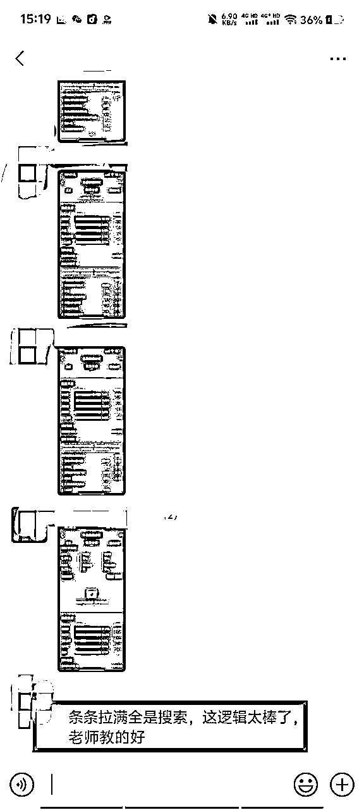

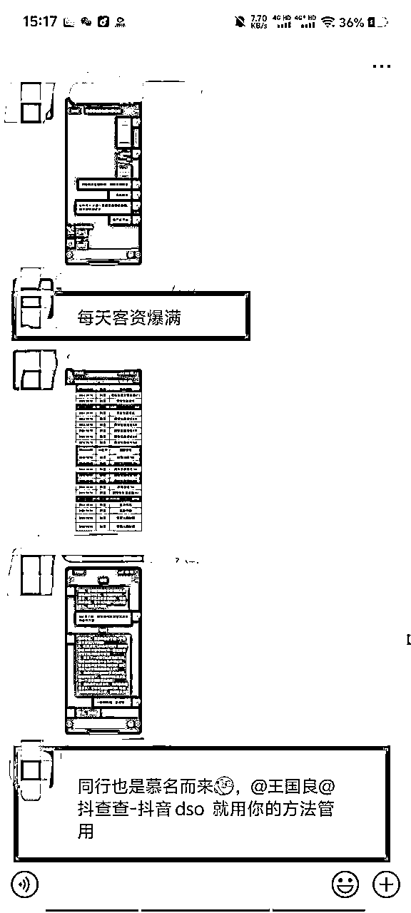

* * *

**学员名称：罗女士**  
行业赛道：两性健康  
游学时间：2024.11.18-11.22  

学习效果：  
结训次日，按照DSO方法制作的内容便取得明显增长，近7天累计播放超过500万，最高单条达到100万以上。全程依靠自然推荐，没有付费推广，每周仍可带来约300万自然播放，整体趋势继续向上。

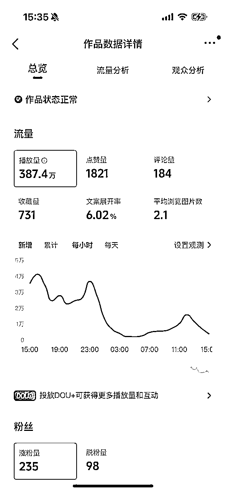

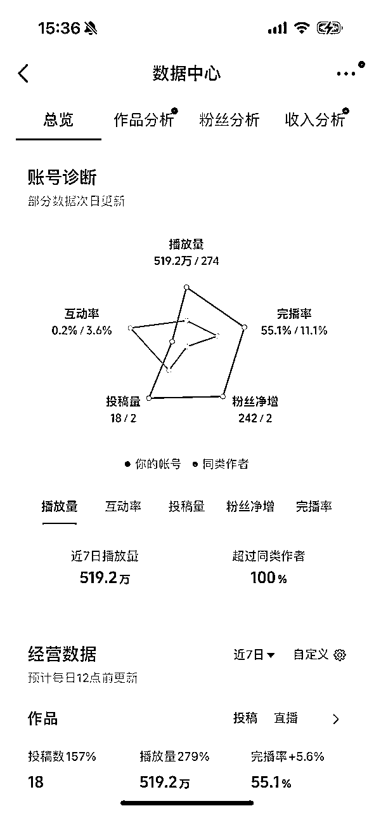

* * *

**学员名称：张女士**  
行业赛道：律所  
游学时间：2025.1.6-2025.1.10  

学习效果：  
结训第二周，她将所学方法应用到视频号，单条内容获得40万以上播放，并新增粉丝3000余人，带来大量潜在客户。随后搭建矩阵体系，推动内容规模化产出。

在“工程款拖欠超过三年怎么办”这一搜索词下，前16条结果中有9条为其相关内容，涵盖律所机构账号及3位律师的个人账号，均已进入搜索展示范围并保持排名。

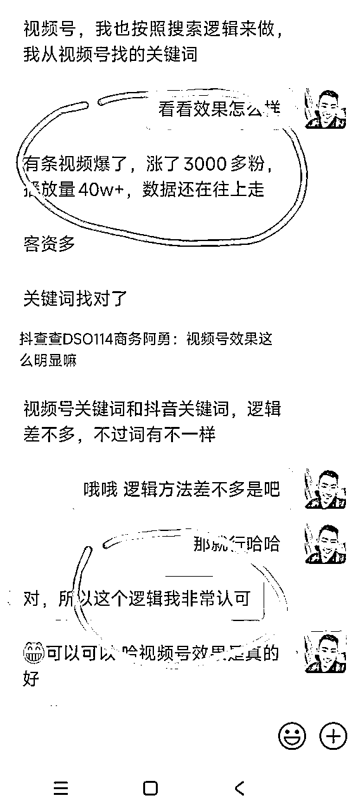

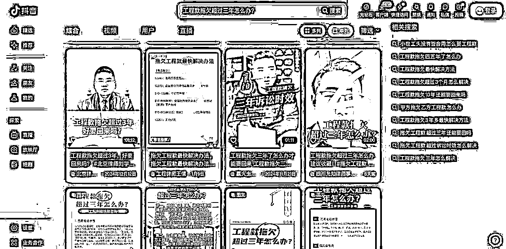

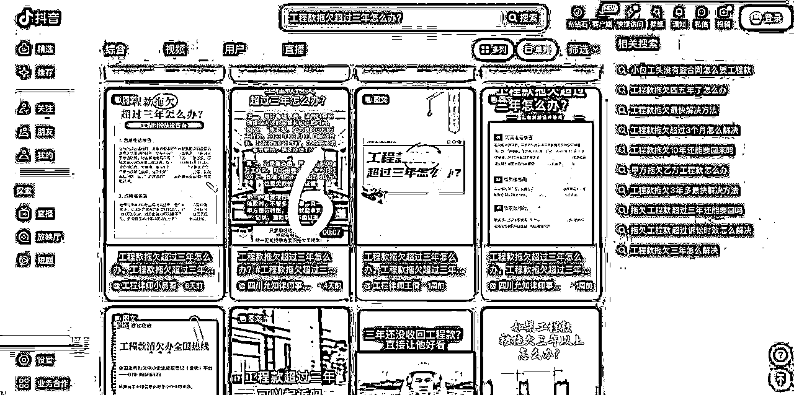

* * *

**学员名称：新农人祥子聊农业**  
行业赛道：农业教育  
游学时间：2025.3.10-3.14  

学习效果：  
训练结束第六天，利用所学方法制作的短内容吸引到精准受众，并实现1万元收入。后续多条作品持续获得较高曝光，同时进入搜索结果前列，带动后续转化。

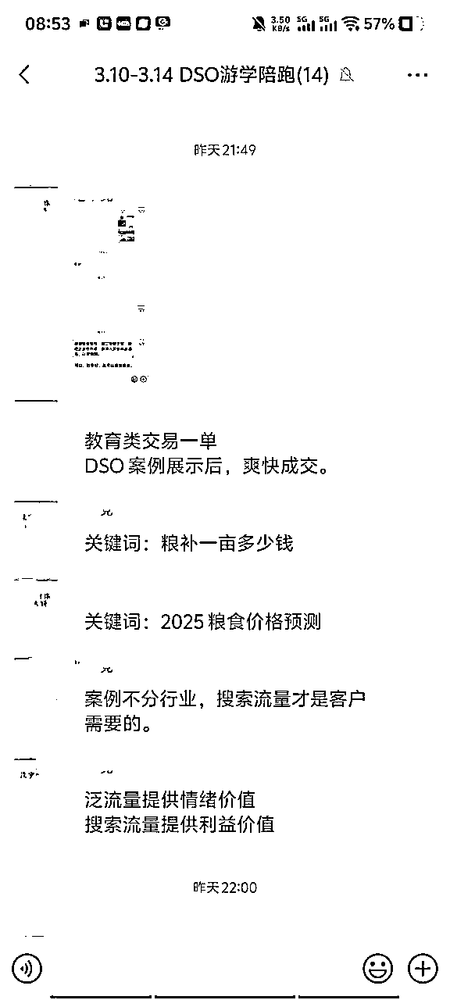

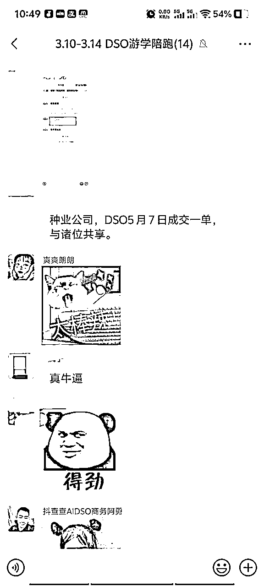

* * *

**学员名称：小枫**  
行业赛道：电动车托运  
游学时间：2025.3.10-3.14  

学习效果：  
在训练第三天，他使用两枚刚启用、粉丝基础很低的账号，便验证了从内容触达用户到完成转化的完整链路。

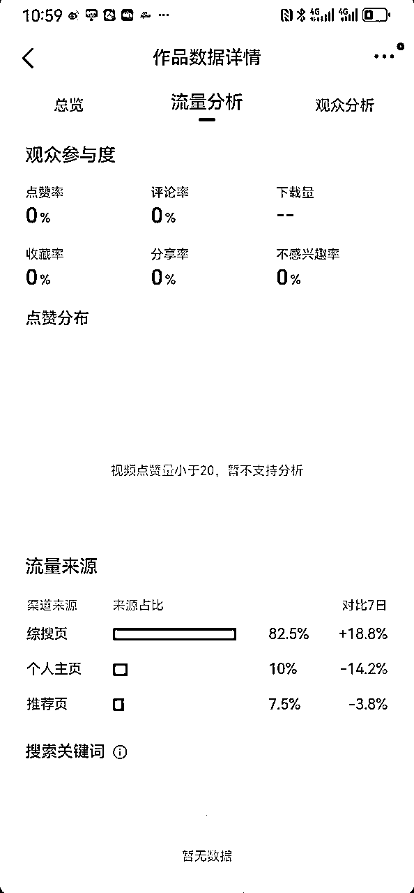

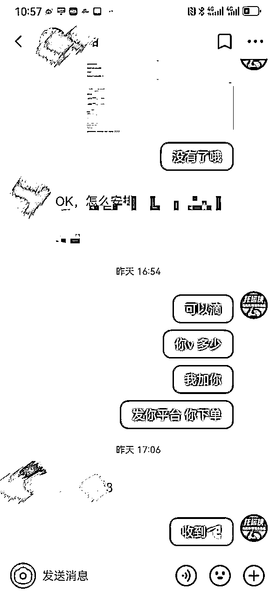

### 四、咨询与加入方式

1. 关注CEO波波视频号，固定于每周四晚进行直播分享。

2. 扫码进入知识星球，爱搜讲师团全年提供线上答疑。

3. 如需了解平台详情及其他服务，可添加企业微信咨询。

4. 关注AIDSO官方公众号，及时获取行业动态。

5. 企业培训或游学陪跑相关需求，请联系桃子同学（微信：dcc2899）。

