# 抖音搜索正在成为被忽视的流量富矿

过去十余年里，百度榜首意味着流量入口。如今在短视频生态里，抖音的检索热度已悄然反超百度。以“vlog”举例，抖音的日均检索量约为百度13倍；以“获客”为例，差距被拉到约70倍。

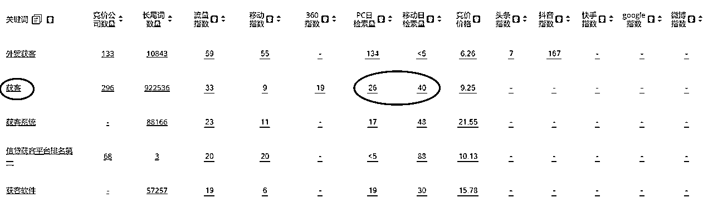

推荐分发太吸睛，让很多人把注意力放在信息流上，却漏掉了检索这块基本盘。哪怕内容制作一般、付费投放不熟练，只要掌握正确的抖音搜索优化思路，就能切入这波红利。

DSO的核心含义是让内容在特定检索词下获得更靠前的展示，优先触达主动检索的人群，进而带来关注、线索、下载与购买。推荐负责种兴趣，检索负责接需求；兴趣不一定能变现，而带有明确意图的检索流量则转化力更强。

检索的价值在于长效。一条吃透检索词的内容可以持续数年稳定输送精准访问。素材里有一条50万播放的视频，自然检索贡献了49万播放；反观大多数账号，检索带来的播放占比通常只有1%左右。

信息差在这里非常明显，全网创作圈对检索获取方法了解的人并不多。检索流量是持续注入式的，符合DSO逻辑的内容，其播放曲线往往会持续攀升，每日都有相对稳定的表现。

查看流量来源的小方法：在抖音的近期作品页，点击右下角的三个点，进入数据分析后切换到流量分析，下拉即可看到来源构成及对应的检索词。若配合爱搜的监测能力，还能对更多检索词的排名进行追踪。

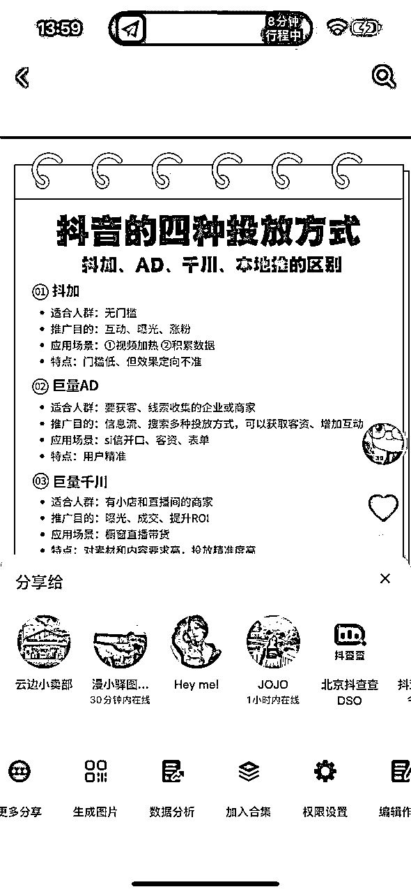

长尾检索词是常被低估的蓝海。AIDSO爱搜在抖音端的词库收录规模超过10亿条，词量越大，挖掘低竞争高价值词的概率越高。无论是内容创作者、流量操盘手、品牌方、达人还是商家，都可以借助这一工具获取更精准的搜索访客。

结合成熟方法论，检索流量的占比完全可以做到80%以上。整体框架可归纳为三步：选词精准、内容覆盖、转化兑现。具体路径为：选词→覆盖→排名提升→点击率优化→完播/停留/互动→引导→转化。

实操节奏上，长尾词通常5天左右可见位次变化，主词的周期大约在20天左右。一个蓝V线索号从搭建到日均稳定产出100到200条有效线索，一般需要约两个月的持续输出。电商号也能够用检索词制作爆品带货内容，并借助检索流量为直播间带来成交激活。

与推荐流量相比，检索的正反馈来得更慢，但一旦起量更持久。推荐像是短跑，比爆发；检索像是长跑，比耐力。快不如稳，持续做正确的选词和持续生产高转化内容，流量会像滚雪球一样积累。平台的搜推联动机制还能反向带动推荐的基本盘。

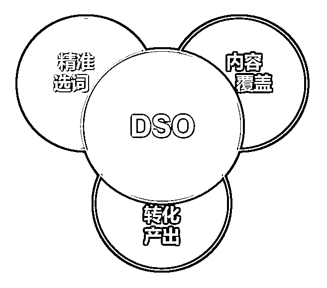

DSO的变现天花板很高，有团队通过该方法实现月入五十万以上，也有新人刚起步实现月入万元。关键在于赛道选择、持续更新和稳定上词。不少公司已经组建了专职的DSO小组，把流量获取做成可复制的生意。

落地分三个阶段：前期做产品梳理、竞品梳理、检索词定位；中期围绕选定词进行内容策划、拍摄剪辑、发布和合集运营；后期每日盯盘数据，挖掘黑马词并及时调整策略，始终以流量最大化与转化效率为目标。

这时需要合适的工具支持。AIDSO爱搜是一个面向新媒体检索优化的平台，覆盖抖音、快手、小红书、微信搜一搜、B站、TikTok等多端。

主要能力包括：

* 精准选词：基于海量词库与榜单数据，挖掘潜力热词，洞察真实用户需求。
* 智能选词：AI可自动完成检索词扩展与视频脚本生成。
* 数据洞察：全面拆解检索词趋势，指导内容方向与发布时间。
* 精准获客：依据数据制定内容策略，实现高效引流。
* 竞争监测：实时对比自身与对手的检索词与排名变化。
* AI创作：结合AI写作能力，批量产出高质量文案。
* 需求理解：借助词脑图快速把握潜在用户意图。

PC端可通过官网 https://www.aidso.com/ 进入，亦有小程序入口。

重点功能概览：

**行业检索大盘**：首页即可对比各行业的竞争词与蓝海词分布，快速判断检索态势。头部企业常据此制定赛道打法，企业版支持一键导出行业全词库。

**词库中心**：选词是DSO的起点，爱搜的核心能力之一即为词库建设，结合AI辅助选词。以抖音为例，词量分布可分为三类：

* 头部词：竞争激烈、受众泛化，打法为极致内容加付费漏斗筛选；
* 腰部词：受众精准、质量较高，适合挖掘蓝海并做优质内容加轻付费；
* 长尾词：需求细分、总量庞大，适合大规模布词配合AI提效。

检索热度与内容质量要求相关，内容分不足很难在核心词上获得位次。与其争夺人尽皆知的热词，不如寻找价值被低估、流量却可观的词，先做易转化的词，再逐步拓展人群词与行业种草词。

爱搜支持多平台词查询，总库超10亿条，可查看月覆盖人次、下拉词、竞争度、词类等多维信息。以“考研”为例，可查看检索结果、相关词、下拉词、行业词、电商词等。

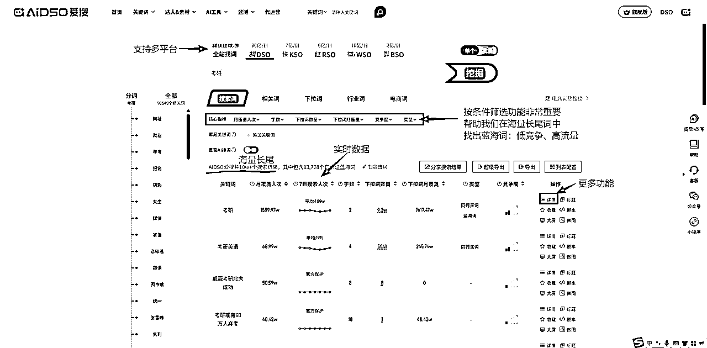

选词经验：月覆盖人次建议设置在1万以上、50万以内，竞争相对可控；字数在6字以上的检索词多为长尾，容易被忽略。按此筛选，蓝海词会更明显。

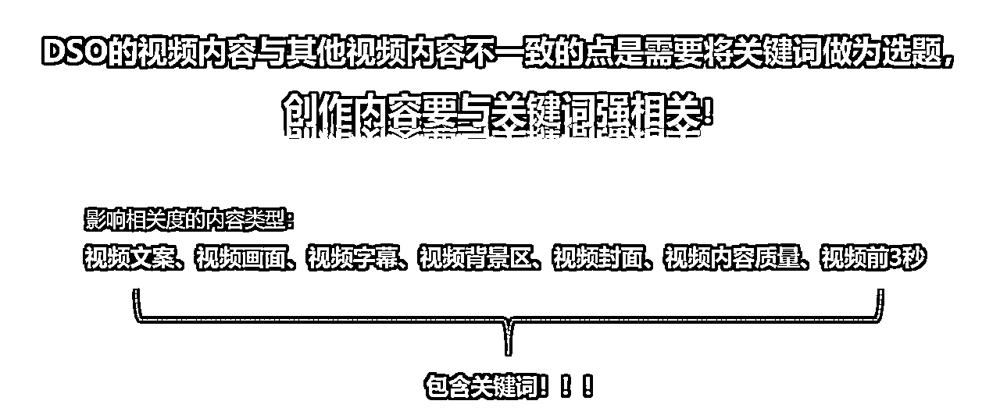

六个快速选词思路：

1. 查看近7日检索人次，挑选趋势稳定者；
2. 优先月覆盖人次较高的词；
3. 词越长，意图越明确，竞争越小；
4. 优先竞争低、流量足的蓝海词，可在类型标签中判断；
5. 观察同行投放过的词，具备商业价值；
6. 选取竞争度较低的词。

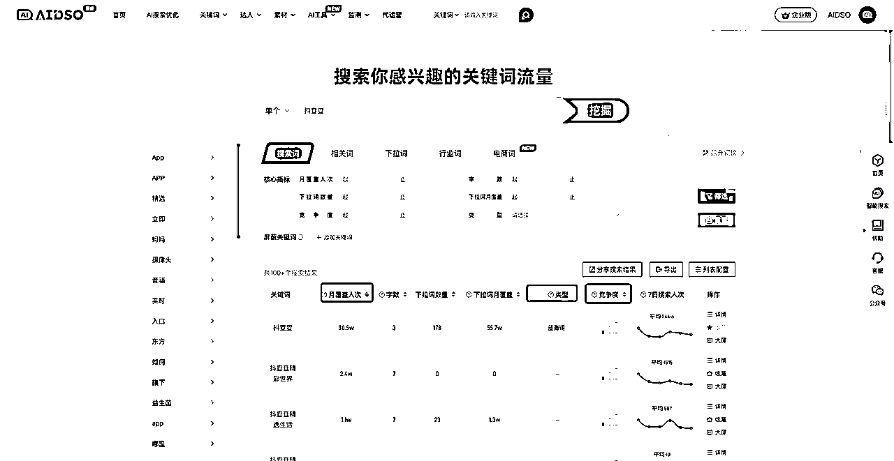

概念提示：黑马词指检索量近期快速增长的词；蓝海词指流量大且竞争小的词；商机词指带有购买意图的词；地域词包含城市或省份；同行买词指同行有广告投放记录的词；高点击词指点击率表现优异的词。

进入检索词详情页，可查看30日趋势、下拉词对比以及用户画像的地域、年龄、性别、兴趣分布，AI还会同步生成多个标题供创作参考。

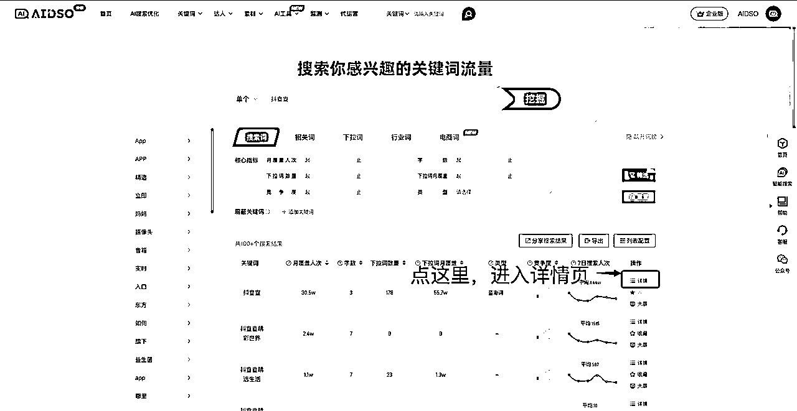

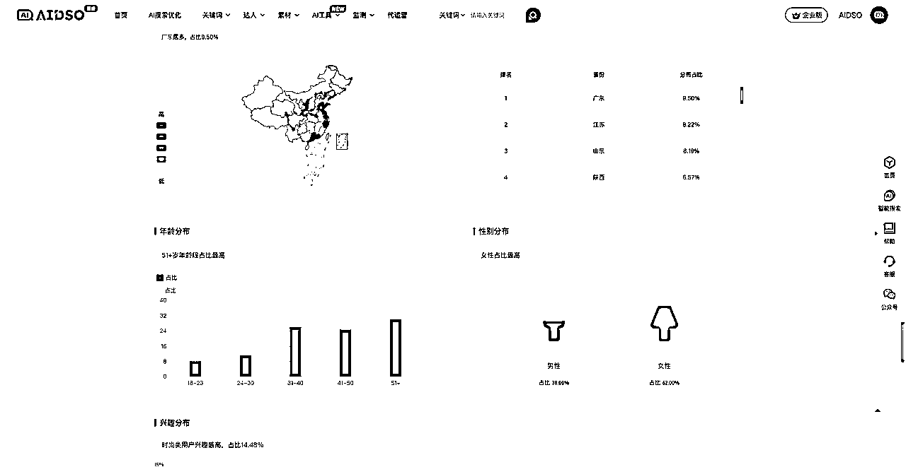

关联视频排名数据亦可查看，包含TOP100相关词、检索关联与内容关联。

使用监测功能后，1小时内即可看到小时级更新的排名与流量变化。

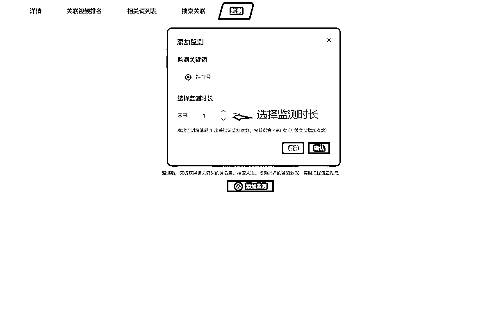

除抖音外，其他平台的词库也已覆盖：

* RSO词库：小红书词、相关词、下拉词、行业词；
* WSO词库：微信搜一搜数据；
* BSO词库：哔哩哔哩词数据；
* TSO词库：TikTok词及电商词。

**检索榜单**：提供全网较全的抖音检索榜单，支持导出。总榜与分类榜能反映用户每周及每月的关注热点。

* 小蓝词榜：热门带货种草视频与电商高成交词；
* 话题榜：总榜与飙升榜；
* 电商词榜单：热搜、飙升、热销周榜/月榜；
* 行业词榜单：热搜、高跑量、飙升周榜/月榜。

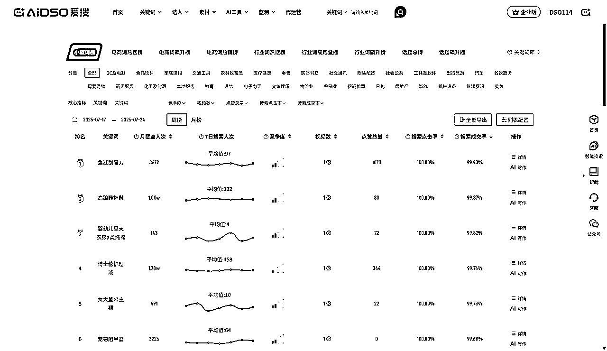

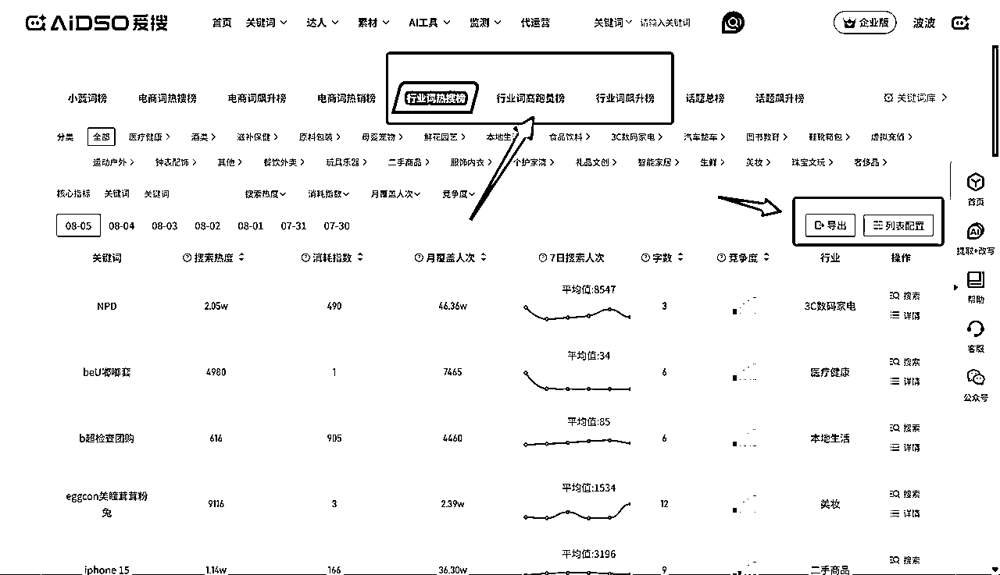

注意：飙升词通常是最大蓝海，流量大且竞争小。借助行业飙升榜配合类目筛选，可挖掘超级蓝海词。

**AI内容提取与改写**：支持抖音、小红书、快手、B站等平台的文案提取与AI智能改写，兼容视频与图文。入口为 https://ai.aidso.com/ ，使用时请遵守各平台规则。

**DSO任务管理与排名监测**：帮助团队执行落地与数据汇总，实现策略、内容质量与数据的全盘把控与迭代。新版入口：https://www.aidso.com/dataMarketNew

数据大盘与运营日报可自动生成多维分析报告，提升工作效率。

检索流量的时代已经到来，别再只盯推荐的光环。掌握DSO方法，借助合适的工具，检索完全可以成为持续获客的永动机。每一个入口，都是通往精准流量的通道。尽快行动吧。

从数据诊断到内容产出，再到线下陪跑，这篇文章把完整服务链路梳理了一遍，你可以按需跳到对应板块。

一、看数据：知道自己的内容处在什么位置

作品检索词排行追踪
在“排行监测”页面，可以集中浏览已获授权账号下所有短片的检索词位次。点开“趋势变化”，系统按三个小时粒度展示名次升降，便于及时察觉搜索热度波动。

达人研究
达人专区汇集各领域优质创作者的DSO经营表现，适合用来对照自身短板、优化账号打法。
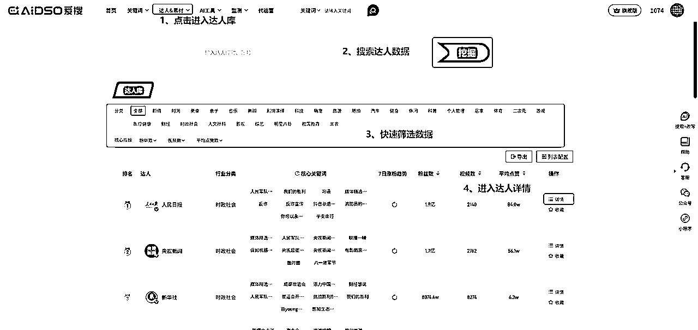
进入某位达人的主页，还可以看到其作品检索词、位次记录、内容概况与受众特征，方便逐项拆解。

素材案例库
案例库里能看到热门素材使用的查询词，以及这些词曾达到的历史最佳名次，为选题提供参考。借助检索框，可以按某个查询词筛选对应的高热度作品；点开任意作品，则能看到实时访问指标与受众结构。

二、智能创作工具

智能扩词
给出一个种子词，系统会按DSO的思路推荐一批适配检索优化的扩展词。

台本生成
系统在自动写出短片台本的同时，也会附带相关查询词和该词下观看量前五的作品数据，让判断更有依据。

台本修改
如果成稿不理想，可以点“换一批”，或直接输入修改意见，让系统重新出稿。

标题批量生成
点击「写标题」，一次就能得到多组高点击风格的作品题目。

图文生成
点击「写图文」，即可围绕查询词自动产出图文稿，并在网页端继续修改。
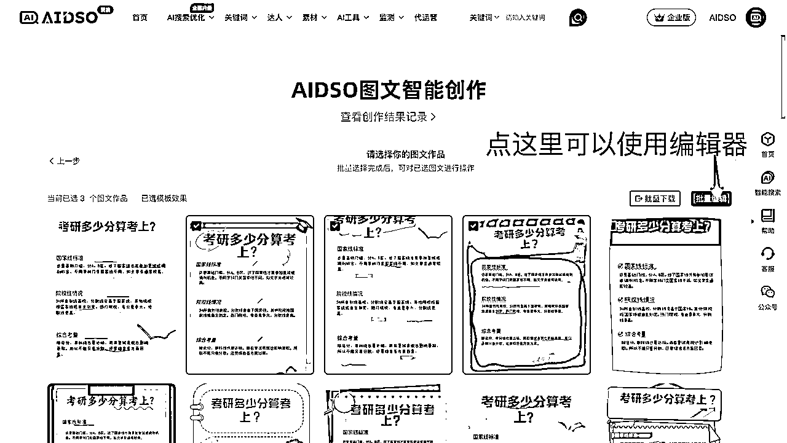

场景化写稿
选定一个内容场景，系统会快速生成日常投放所需的文稿。

文案提取
输入查询词，即可快速调出同类高热度短片的台本，方便学习分析。

联想词图谱
输入一个查询词，系统会自动生成一张相关词关系图，帮助拓展选词思路。

直播总结
一键录下整场直播并生成复盘报告，结果可以直接预览。

创作历史
所有通过智能工具产出的内容，都会自动归档到「我的创作」，方便随时查阅整理。

三、线下分享会：和实战派面对面

自去年8月30日起，团队已在多个城市组织线下交流，邀请知名讲师与一线实战高手，分享搜索引流的方法论和真实做号案例。活动口碑很高，目前每月保持两场以上，欢迎关注和报名。

部分现场照片：

北京场

北京公司研学
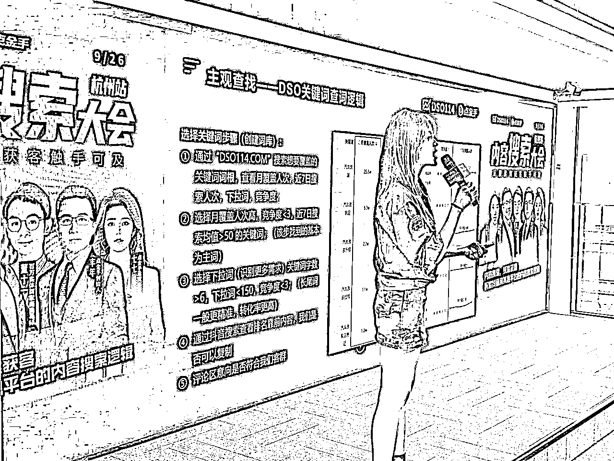
杭州场

上海场

上海场

字节服务商杭州公司研学
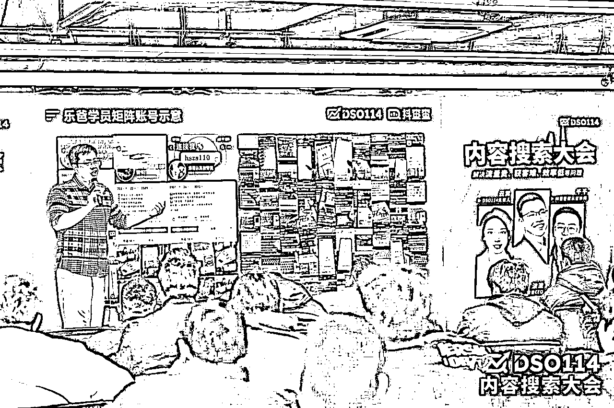
杭州第二场

成都场

广州场

深圳场

杭州第三场

四、公司内部培训

越来越多头部公司把搜索自然流量当作重点增长来源，专门投入人手，全力用DSO方式获取客户，已拿到相当可观的回报。如果想让团队快速掌握这套打法，可以约一场内部培训。咨询请联系桃子（微信：dcc2899）。

培训现场照片：

五、驻场实训营：5天集中陪跑

深度实训营是到我们办公室，用5天时间集中实战。学员边上课边亲自运营自己的账号，遇到从零起步的常见难题，可以得到资深导师的即时反馈。实操中每个人卡住的地方不一样，一个细节多耗一天，一个月很快就没了；与其低效试错，不如用5天时间集中攻坚，早点把方法跑通，早点把结果做出来。报名同样可联系桃子（微信：dcc2899）。

实训现场照片：

六、部分学员成果

西安老任｜金融贷款｜2024.10.14-10.18
一个从零开始的新号，短片曝光量做到10万+；来自综合搜索页的访问占比超过95%。在完全不投流的情况下，每天能收到20多条客户留资，目前每月稳定获取2000条以上精准线索。
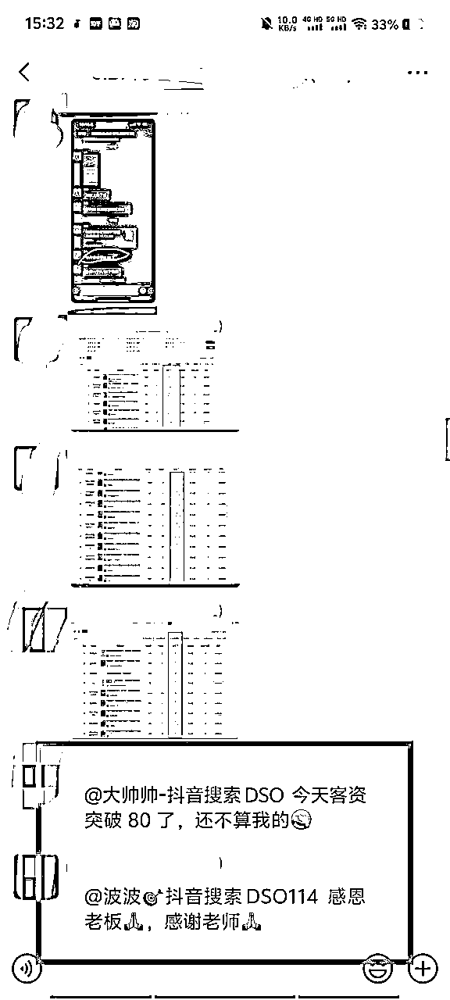

罗女士｜两性健康｜2024.11.18-11.22
结课第二天，她按DSO方法制作的内容，近7天观看量超过500万，单条达到100万+。全程没有买量，全靠免费推荐，现在每周还能新增约300万观看，而且仍在上涨。
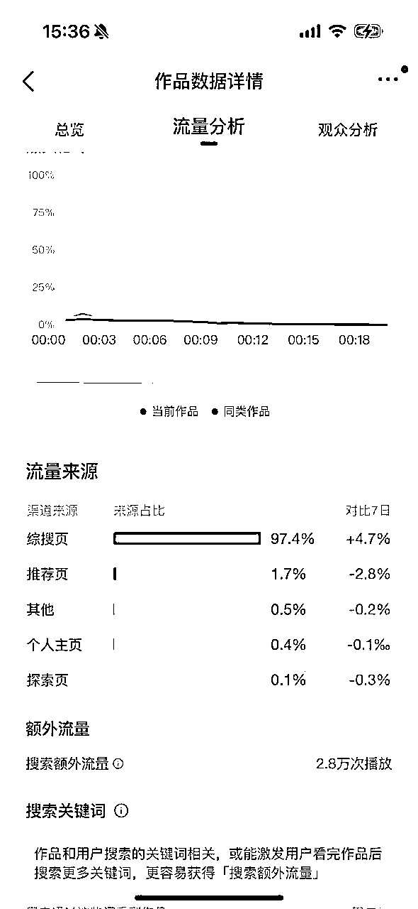

张女士｜律所｜2025.1.6-2025.1.10
结课第二周，她将DSO策略用到微信短视频主页，单条作品观看量40万+，新增关注3000+，同时带来大量客户咨询。之后她继续搭建账号矩阵，用DSO做内容批量化生产。搜索“工程款拖欠超过三年怎么办”时，前16条结果里有9条来自她的布局，包括机构认证号和3位律师的个人主页，均被平台收录并停留在榜单上。
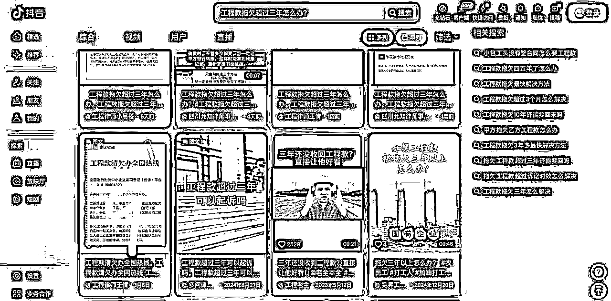

新农人祥子聊农业｜农业教育｜2025.3.10-3.14
开课第六天，他用DSO方法产出的短片吸引到精准用户，直接产生1万元收入。之后陆续有多条作品起量，并在检索结果中占据靠前位置，继续完成转化。
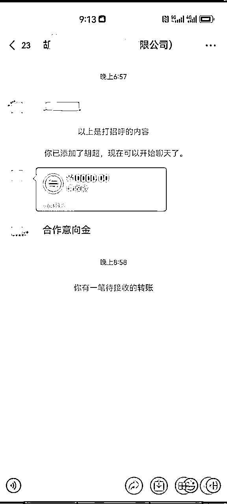

小枫｜电动车托运｜2025.3.10-3.14
第三天，他就在两个全新且粉丝量极低的账号上，完整验证了借助内容实现引流与转化的DSO闭环。
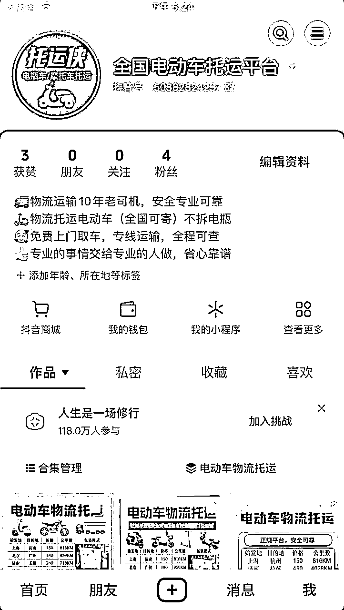

七、找到我们

每周四晚，波波会直播分享做号经验与搜索获客方法。

扫码进入付费星球社群，讲师团队全年驻群，随时解答问题。

想了解更完整的服务内容，可以添加商务微信沟通。

欢迎订阅 AIDSO 的官方号，及时获取行业新动态。

公司内训、驻场实训等合作需求，请直接联系桃子（微信：dcc2899）。
