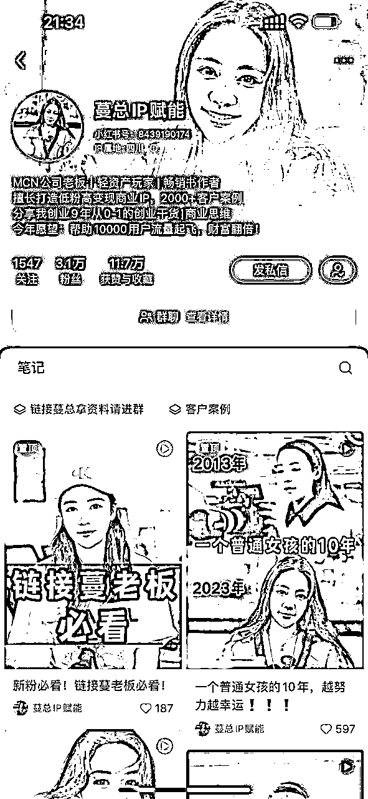
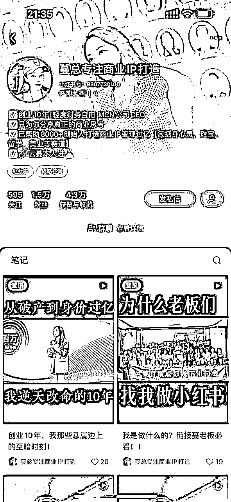
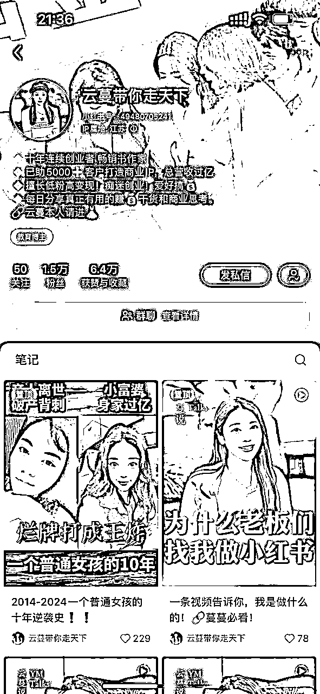
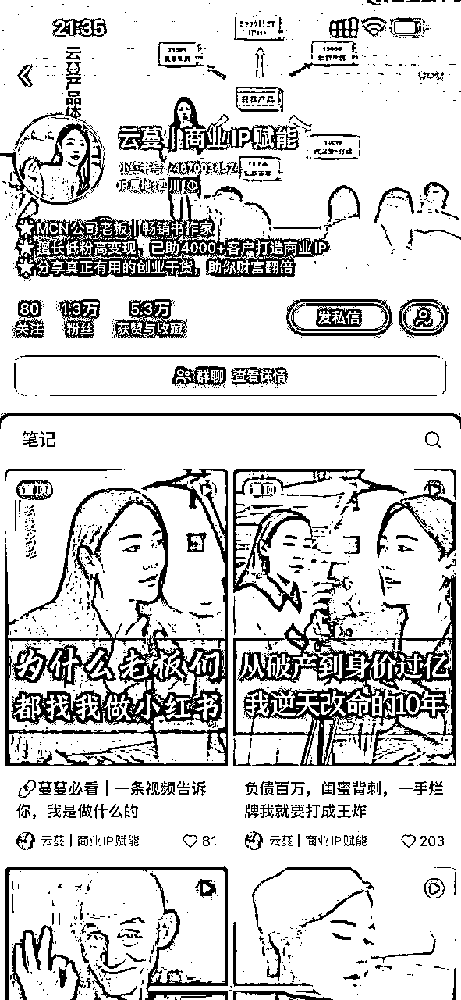
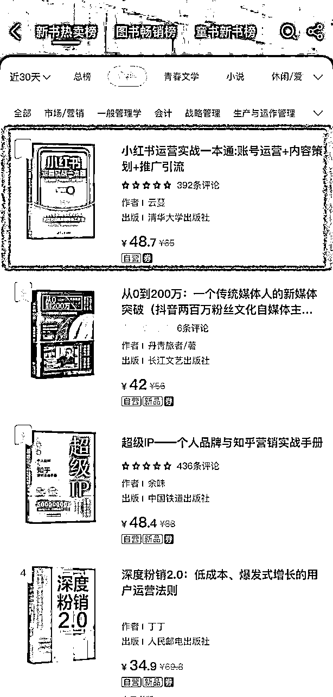
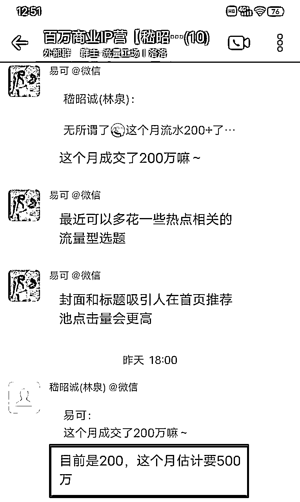
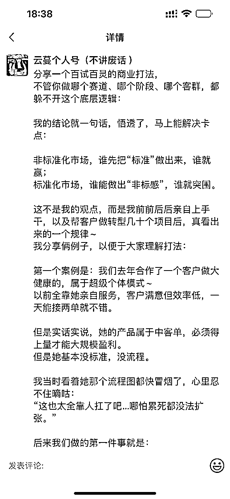
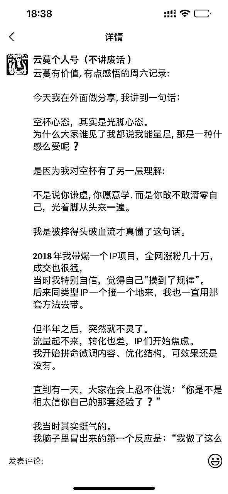
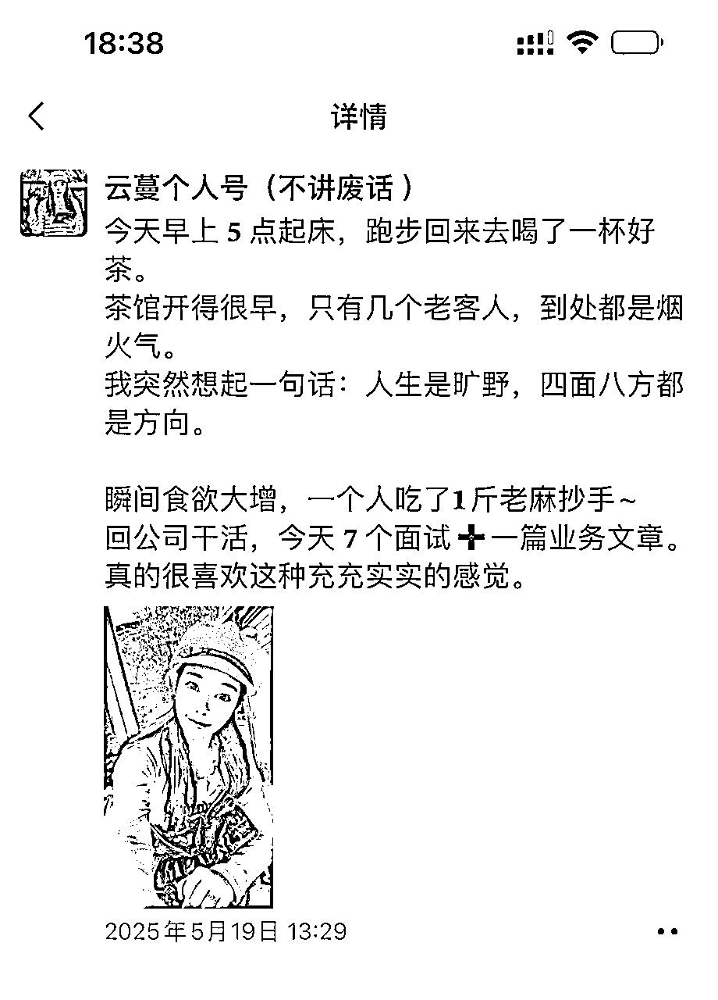

# 低粉丝也能高变现？小红书商业IP的真正打法

> 来源：[https://shengcaiyoushu01.feishu.cn/docx/Um52dXCVYoPu12xGGTAc8H66n2e](https://shengcaiyoushu01.feishu.cn/docx/Um52dXCVYoPu12xGGTAc8H66n2e)

可能很多朋友对我还不太了解，先简单做个自我介绍。

我是云蔓，目前在小红书操作着200+的单IP矩阵。
出版过《小红书运营实战一本通》《人人都要学的个人IP打造法》，这两本书在营销类榜单上多次登顶。
我的主攻方向是低粉丝量撬动高客单的商业IP变现。
服务过的行业超过30个，累计帮助客户变现超过10亿。

这是我部分在跑的矩阵账号：

我的实战书籍也都在这里：

今天想把我这几年在战场上真刀真枪打出来的经验，拆开给你看。最好的老师从来不是讲台上的人，而是每天在前线的人。方向对了，框架对了，精细运营才能出结果。我把自己的路走一遍，为你省时间。

先聊清楚一个核心问题，什么是商业IP？

## 一、商业IP的本质是模型，不是粉丝数

2025年的今天，很多人对商业IP的底层认知还是错的。我前面展示这么多矩阵号，你能猜出我60万粉的号，和1万粉的号在变现上到底有什么区别吗？

答案是：几乎没有区别。很多时候小号的转化甚至超过大号。更关键的是，大号发一篇成本高，小号一天能量产上百条。所以我越来越不愿意养大号。

现在是细分商业IP的时代，竞争的终点已经从“谁粉丝多”变成了“谁的变现模型更赚钱”。商业IP的核心绝不是内容本身，而是商业模型。内容、产品、客户，都是为模型倒推的。

每一篇内容的背后，每一次互动的方向，都在为成交做铺垫。商业IP的底层逻辑是：用内容建立信任，用结构推动转化，用产品完成交付。

换成大白话：一个能变现的IP，不只是会讲故事、灌鸡汤，而是要让客户一眼看懂，你能提供什么、解决什么痛点、怎么联系你、为什么要信你，给他一个无法拒绝的购买理由。

拆解市面上真正赚钱的IP，无论哪个赛道，背后都遵循同一个公式：产品模型 + 内容结构 + 成交路径。

普通IP是自我表达：我是谁？我怎样？
商业IP是价值传递：你是谁？你的问题我能怎么解？你凭什么信我？

后台经常有人问我：为什么你们粉丝不高却能变现很高？
说实话，粉丝量和变现能力没有必然联系。身边不乏三五百万粉却不赚钱的账号。2025年自然流量在持续下滑，大网红的收入也在缩水。但我们陪跑的客户里，4个粉丝开始变现、7个粉丝就成交、1000多粉变现几十万的案例太常见了。

低粉高变现和网红打法本质不同。商业IP的第一步永远是以终为始，先把商业闭环设计好。

我为什么一直强调以终为始？
因为产品大于流量，商业路径大于流量。你在起号前就必须想清楚，你到底要卖什么。互联网的变现方式无非几种：卖产品、卖资源、卖咨询、卖课程、卖机会、卖社交。所有模式都围绕用户需求展开，所以必须先从变现路径入手。

我不建议先做涨粉。哪怕客户的变现路径已经清晰，我们也会重新梳理定位、梳理变现体系，明确第一阶段卖什么，引流款是什么，盈利款是什么。产品模型成熟了，再去做流量，才能在粉丝很少的情况下做到高效变现。

自媒体的方法论不是变现的核心，真正决定能不能赚钱的是商业模型。你要用最少的客户量，快速把高客单卖出去。

我做商业IP陪跑五年了，有一个类型的客户我们直接拒绝：他线下没有真实的商业场景，客户也不为他买单。这种闭环在互联网上也跑不起来。

## 低粉丝高变现具体怎么做？看两个真实案例

### 案例1：海外求职培训
这个客户小红书只有3万粉丝，年变现超过3000万。不是因为他文案标题好，也不是因为他更努力。核心是赛道选对了，产品够硬，定位一开始就很清晰。做的是英国方向的海外求职培训。

### 案例2：信托保险
粉丝只有几千，人群价值极高，年变现也达到几千万。高净值业务线上无法直接成交，但她的路径非常清晰：短视频做精准筛选 → 导流微信 → 微信约线下见面 → 线下成交。

做小红书高客单商业IP，我会从三个维度系统拆解：产品设计、人设设计、营销设计。

## 高价产品的底层逻辑

想做高客单商业IP，就必须敢卖高价。低粉高变现的根基就是用高价产品承接。

来做个小测试：如果一个新客户进入私域，你会先推高价还是低价？大多数人回答：先卖低价，让用户体验后再升级。

低粉高变现的打法恰恰相反：先卖贵，让用户觉得贵，再卖便宜。

这和小众品牌逻辑一样。小品牌不要打价格战，要卖溢价。你拼不过大品牌的规模，但可以在非标品和服务上建立壁垒。

我的很多客户做大健康、做疗愈，团队十来个人，我都让他们做非标、卖高价。因为小团队最缺的就是利润。没有利润就活不下去，就提供不了好服务。

个人品牌和产品品牌本质一样，都是盈利逻辑。小IP要避开已经红海的标品和IP盘，粉丝少的时候反而要卖高价，把服务做到极致。这正是大团队不愿做、却最有钱景的区域。

为什么有客户4个粉丝就开始变现？因为他们卖的是长期陪伴型服务，撬动的是用户情绪价值。交付重，但利润高，不依赖粉丝量，市场刚需。富人更在乎定制化、陪伴感、确定性和省时间。

我第一次创业时家里欠了几百万。我算过，卖1万的产品要找到600个人，在当时几乎不可能。最后我卖了30万的高价产品，只卖给20个人就翻盘了。

有人会问：这样以后怎么标准化、怎么做大？
活下来才有资格谈规模。知识付费市场今年普遍下滑，几百块的录播课很难活。能付这个价的人觉得不值，付不起的人只想找盗版。高客单客户更懂价值，更有素质，交付反而更简单。

别把重心放在自媒体本身。AI时代，一天能产出200多篇稿子，流量本身不值钱。商业IP的核心是商业打法，是高客单模型。流量必须匹配业务，否则就是无效流量。

## 人设设计：让客户感同身受

高客单对应的是高净值用户。人设必须和产品同频。要讲清四个问题：
你是谁？角色定位是什么？
你为何进入这个赛道？
客户为什么要链接你？
你的产品价值观是什么？

比如做疗愈， 人设必须有陪伴感、柔软度、有共情。讲自己如何走出伤痛，比只输出干货更打动人。

我做朱苒疗愈IP时，单月变现最高达到220万。之前她只发干货，咨询师怎么接单怎么变现，用户一点反应都没有。转折点是把人设故事梳理出来。

核心问题就四个：你怎么进入这个行业的？你为什么坚持？你从入行到现在发生了什么变化？你的未来愿景是什么？这条视频直接带来上百万变现。

故事结构是：我是朱苒，我心里有坑洞，内在小孩从未被疗愈，我从消费者变成从业者。入行时一小时52.1，现在年入千万，只用了三年。我做这个事，因为消费者需要体系化，而从业者不敢收高价。我要改变十万个咨询师的生活...

内容打动人是因为有温度。买单的决策是感性的。户外的吹风机，卖的不是功率，是风吹起来时的自由感。

人设不是功能堆砌，是情绪共鸣。卖房卖给妈妈，不是冲着地铁旁的升值，而是“和妈妈只隔一碗粥的距离”。

很多家庭教育客户，我们不贩卖焦虑，改卖美好。一个妈妈分享：儿子不是学霸只是普通，但我用一套方法让他有了原动力。儿子说妈妈我普通但不平庸。评论区一堆人私信求方法。这就是人设带动产品。

## 高客单的销售逻辑

高客单的销售和低客单完全不同。

“一支哈根达斯的成本和路边雪糕差不多，但客户愿意付十倍价格，因为它让你觉得自己配得上更好。”

客户买的不是知识，而是你的身份、你的承载感。不会锚点的人只卖原料，会锚点的人卖情绪价值和品牌感。

做高客单销售，记住一句话：削弱营销感。

我一直认为，朋友圈不是广告栏，而是一个人长期经营出来的“线上门面”。

我把自己的朋友圈截图整理成了一组图，其实你会发现，我每天发布的内容并不是随意更新，而是有清晰结构的。

我的朋友圈主要围绕四个方向展开。

### 第一类：记录真实生活，先让别人看见“人”

我会分享当天的工作状态：开会、和客户沟通、与团队讨论，也会记录一些当下的情绪和吐槽。

这些内容不一定直接带来成交，但它们能让别人感受到，你不是一个只会重复发广告的账号，而是一个有工作、有情绪、有判断、有生活的真实的人。

客户加到你的微信之后，首先需要确认一件事：自己连接的到底是谁。

所谓“活人感”，就是让他知道，你不是一块随时可能消失的广告牌，而是一个正在认真做事、持续经营的人。

### 第二类：持续输出思考，让用户和你产生精神连接

高客单产品，早就不是单纯靠功能和价格竞争了。

当大家的产品能力越来越接近，客户最终选择谁，往往取决于价值观、认知和信任感。

所以我会持续分享自己的思考、判断和行业观察。

当客户发现，你表达的内容，恰好说出了他心里想说却没有说出口的话，他就会产生一种感觉：

“她的想法和我很接近。”

这种同频感不会立刻带来购买，但会让客户愿意持续关注你。因为你的朋友圈对他来说不再是推销，而是有意义、有启发的内容。

这其实是在做用户留存。

高客单成交最忌讳急于求成。客户刚进入私域时，你要做的不是马上逼他下单，而是让他逐渐认识到：你是一个有思想、有价值、值得长期关注的人。

我经常提醒做IP的伙伴，每天把自己的思考记录下来，整理成内容发出去。

这个动作通常不会立刻产生转化，它更像是每天“出摊”。你在持续展示自己的认知，也在持续和用户建立连接。

坚持三个月、半年，甚至更久之后，客户会越来越熟悉你的判断方式，也会越来越觉得你和他处在同一个频道。

一个人连续365天受到你的思想影响，他最后购买你的产品，还是购买一个陌生人的产品？

因此，这类思考与认知内容，大约占我朋友圈的40%。

### 第三类：提供行业干货，让朋友圈具备实用价值

除了展示自己是谁，我还会分享行业知识、商业案例和具体打法。

这部分内容的作用，是让客户在加到你之后，不会轻易把你删除。

换位思考一下，一个新客户加你微信，第一件事大概率就是翻你的朋友圈。如果你的外形没有强到让人一眼记住，那么他为什么要留下你？

因为你能提供他真正需要的东西。

以我的客户为例，他们大多是创业者，所以我会围绕他们可能关注的方向持续输出：

- 爆品和产品设计
- 团队管理
- 流量获取
- 私域运营
- 行业发展趋势
- 不同赛道的机会
- 市场上正在赚钱的项目和模式

当你长期稳定地提供高密度、有用的信息，客户就会觉得删除你很可惜。

这一类内容承担的是“功能价值”。

前面的生活分享，是让别人认识你这个人；思考内容，是让别人和你建立认知上的连接；而行业干货，则像一份持续更新的商业信息订阅。

客户每天看你的朋友圈，都能获得一点启发，学到一些东西，自然就不愿意轻易离开。

### 第四类：做有分寸的软营销，让客户看见结果

朋友圈不能只有生活和观点，也必须有适度的成交内容。

不要以为高客单客户和低客单客户完全不同。无论客户实力多强，很多决策仍然遵循共同的人性逻辑。

比如，我会展示哪些客户加入了陪跑项目，并在合规、获得授权的前提下，适当呈现他们的身份背景。

当一个人看到，年收入几千万的创业者也选择了你，他很容易产生这样的判断：

“比我更有经验、能力更强的人都愿意跟她合作，说明她一定有值得认可的地方。”

原本处在观望状态的客户，可能因此进一步降低疑虑。

我也会分享客户取得结果的案例，但重点不会放在“赚了多少钱”上，而是拆解他为什么能做到，以及背后采用了什么方法。

这样做至少有三个作用：

第一，让别人知道这是我们真正参与并做出的成果；

第二，让案例本身具备学习价值，而不是一条赤裸裸的广告；

第三，激发客户的期待——他会开始想象，自己加入之后，是否也能获得类似的增长和变化。

所以，软营销的关键不是隐藏销售，而是把销售内容做得有价值、有逻辑、有启发。

### 高客单销售的核心：只吸引，不打扰

做高客单产品，我一直坚持一个原则：

不要频繁骚扰客户，不要动不动群发消息，也不要每天追着别人问“考虑得怎么样了”。

你只需要持续经营自己的朋友圈，稳定地展示四件事：

- 你正在取得什么结果
- 你在思考什么问题
- 你帮助客户解决了什么问题
- 你是一个怎样真实、可靠的人

我自己每天大约发布四条内容，持续展示结果、认知、案例和生活状态。

让客户在私域里看到一个立体的人：有成绩，但不浮夸；有专业能力，也有真实温度；能提供价值，而且长期稳定。

我做这件事已经五年多了。

这份持续性本身就是信任。客户会知道，你不是突然出现，也不是赚一波就离开的短期玩家。

所以，即使遇到账号受限、流量大幅下滑等情况，我们的业绩也没有出现断崖式下跌。因为有些客户已经关注我们一年、两年，甚至三年。

他们最开始可能没有需求，但在长期观察中，他们知道你一直在做这件事，也知道你没有突然消失。

一个产品能够持续经营五年多，往往说明这个人愿意长期投入，也确实在一线实践。

当客户真正产生需求时，他自然会想到你，甚至愿意主动转介绍。

所以，高客单生意最不能做的，就是急。

## 高客单IP的成交链路：先提供价值，再讨论付费

很多人问我，高客单产品到底应该怎么卖？和客户聊天时应该说什么？

我的答案是：聊天主题本身不是重点，关键在于你能不能在沟通过程中解决客户的问题，能不能让他感受到你的价值。

比如客户告诉我，他现在遇到流量增长困难、产品设计不合理，或者销售转化链路出了问题，我通常会先把自己能想到的解决思路直接告诉他。

有人会问：

“都把方法说了，那客户为什么还要付费？”

因为知道方案，不等于能够真正执行出来。

但你愿意在没有收钱之前，认真分析问题、给出方向，本身就会让客户感受到你的专业和诚意。

我更愿意先拿出最大程度的真诚，筛选那些同样真诚、真正想解决问题的人。

当然，客户继续深入追问时，我也会直接说明：

“你现在问到的部分，属于付费服务内容。”

这件事没有必要躲躲藏藏。

很多人不敢谈收费，根本原因是前面没有建立信任。他还没有让客户看见自己的专业，也没有证明自己能解决问题，就急着强调“这个要收费”。

客户自然会想：

“我还不了解你的价值，你为什么先告诉我需要付费？难道你默认我不会花钱吗？”

高客单客户真正关心的，不是你有没有收费，而是你是否有能力满足他的需求。

你需要先让他确认三件事：

- 你理解他的问题；
- 你确实有解决方案；
- 你的方案有价值，并且不是随便一个人都能提供。

当客户已经明确感受到“你有问题，我有方法”，成交就会变得顺理成章。

最终促成购买的，通常是多个因素叠加：

第一，他确实存在需求；

第二，他认可你的专业能力；

第三，他认可你的态度和为人，愿意进一步建立关系；

第四，他长期看过你的朋友圈，知道你是稳定、踏实、专业且有温度的人。

这就是一种持续的信任累积。

所以，很多人认为高客单产品难卖，实际上并不一定是产品难，而是日常的精细化运营没有做到位。

从产品设计、人设塑造到销售沟通，本质上是一套完整体系。框架只是起点，真正产生结果的，是你能否持续执行。

过去五年多，我们服务和打造过许多低粉丝、高变现的商业IP，覆盖三十多个行业。

这些案例说明，粉丝数量并不是唯一答案。

## 真正重要的，不是技巧，而是长期主义

在存量经济时代，我特别认同凯文·凯利提出的“1000个铁杆粉丝”观点：

只要你拥有一千个真正信任你、愿意持续支持你的粉丝，人生就有很强的抗风险能力。

很多人觉得这句话太理想化，但从实际经营来看，它完全有可能实现。

关键不在于你掌握了多少技巧，而在于你是否愿意踏踏实实提升自己的价值。

你究竟能为客户解决什么问题？

你的出发点是否真诚？

你有没有真正关注市场中的现实难题？

方法当然重要，但方法永远建立在心态之上。

我们在做陪跑服务时，交付团队有时会抱怨：

“这个客户的问题怎么这么多？”

这种情绪可以理解，因为确实有些客户会提出大量复杂问题。

但我的看法是：在存量竞争的环境里，一个客户还愿意把问题交给你，就意味着你还有机会。

把他的问题解决掉，就是你的价值所在。

不要试图遮掩问题，更不要把客户的困难当成麻烦。真正能够长期留下来的人，往往不是最会包装的人，而是愿意认真面对细节、持续解决问题，并且用积极、正向的方式处理问题的人。

这个世界从来不缺聪明人。

你可能会看到一些案例：几千个粉丝实现几千万收入，几百个粉丝创造几百万业绩。

但这些数字本身，并没有想象中那么重要。

真正重要的是，当一个具体的人来到你面前时，你是否愿意把他当成用户、朋友和一个真实的人去理解。

先尊重他的处境，先贡献你的价值，而不是一上来就索取。

这才是高客单IP真正能够走远的底层逻辑。

此文，致敬每一位认真做产品、踏实解决问题的人，也致敬生财有术。