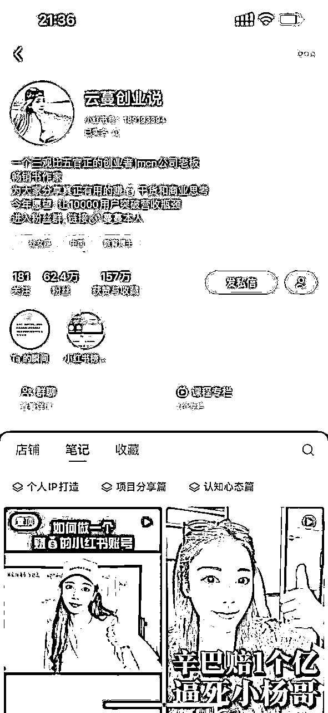
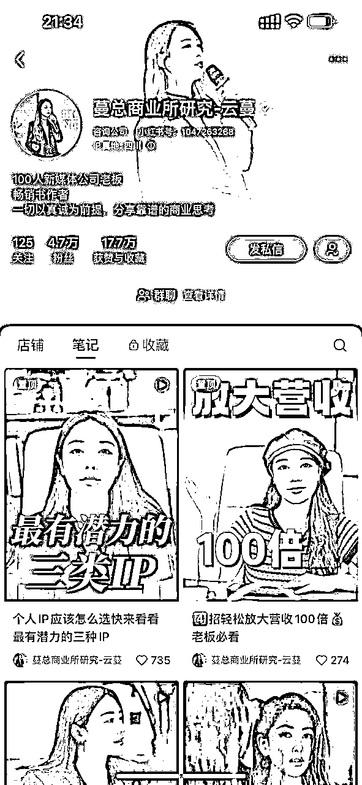
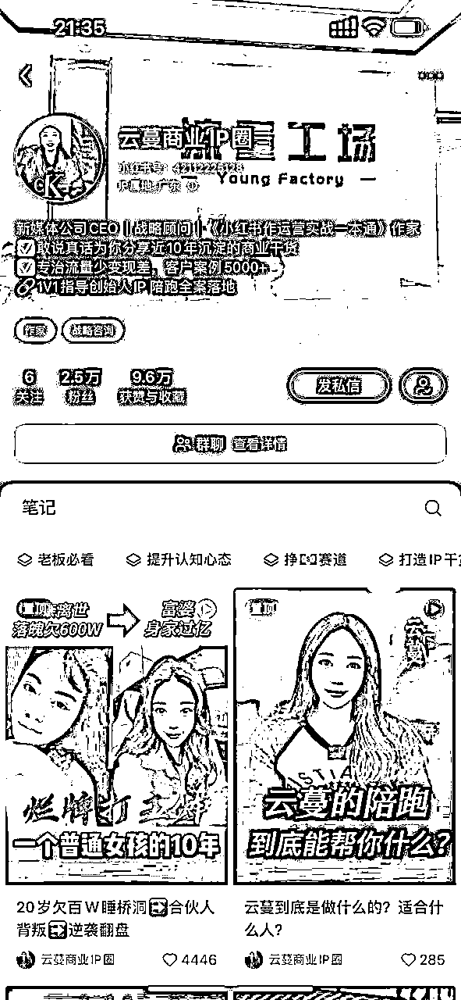
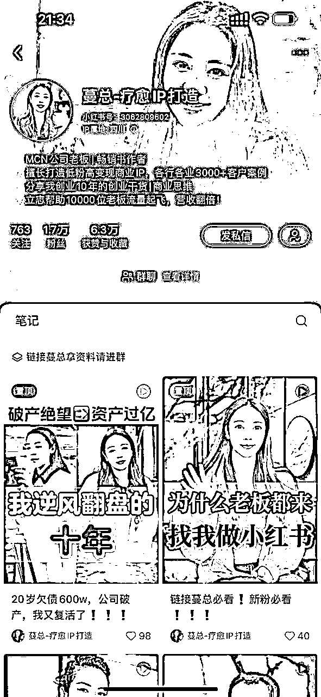
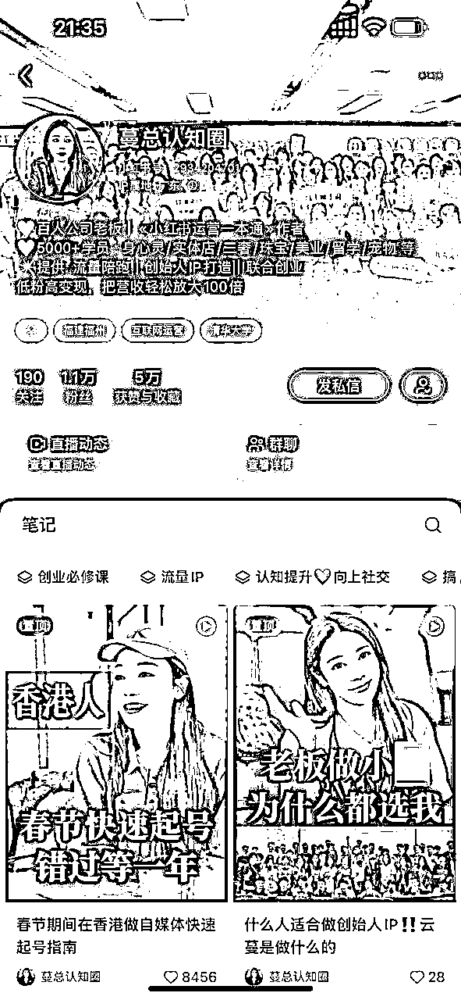
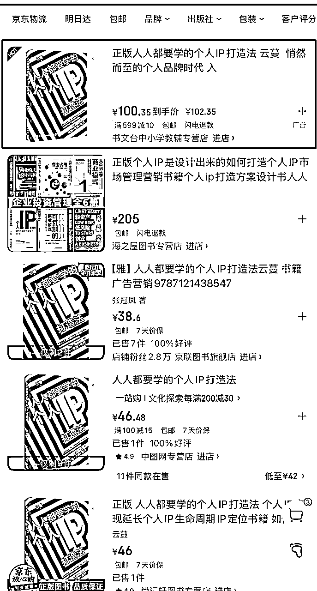
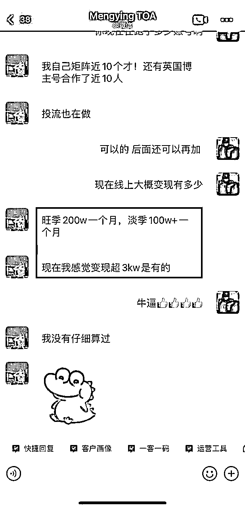
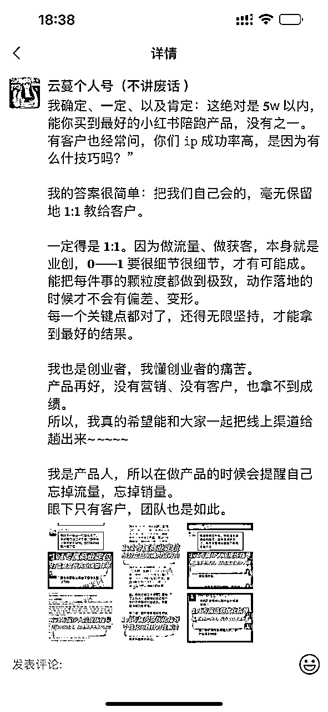

# 低粉高变现的📕商业IP，怎么玩才不走弯路？
作者：龙哥

先做个自我介绍，方便大家了解视角。

我是谁：

l 云蔓，单人IP操盘200+账号矩阵
l 出版人，《📕运营实战一本通》《人人都要学的个人IP打造法》作者，多次登顶营销类榜单
l 专注低粉高成交的高客单商业IP方法论
l 服务行业超30个，累计助力客户变现破10亿

我的部分矩阵案例：

我的干货合集：

今天想把自己这些年在战场上打出来的认知和操作逻辑摊开讲。最好的老师不是讲师，是实战。时间成本对想做事的人来说最贵，方向对了，框架对了，精细化才能出结果。我把踩过的坑和走通的路还原出来，帮你省时间。

那到底什么是商业IP？

## 一、商业IP的底层定义

2025年的今天，很多人对商业IP的理解还停留在旧框架。

我带了几十个矩阵账号，粉丝从几千到六十多万都有。盲猜一下，六十多万粉丝的号和一万粉丝的号在赚钱能力上有什么本质差别？答案是：几乎没有。甚至不少大号的变现效率还不如小号。大号发一条要耗费大量精力，小号一天可以批量产出上百条。所以我本人更偏爱运营小号。

现在细分赛道成熟，竞争的维度已经从粉丝体量转向变现效率和利润率。

商业IP的核心不是内容本身，而是商业模型。内容、人设、产品要围绕模型倒推。每一篇内容的埋点、每一次互动，本质都是在为成交服务。

简单说：用内容建立信任，用结构推动购买，用产品兑现价值。客户要清晰感知到你能交付什么、解决什么痛点、如何联结、为什么值得信任，以及一个足够强的购买理由。

拆解市面上能持续变现的IP，你会发现都有一个清晰公式：产品模型 + 内容架构 + 成交路径。

普通IP是自我表达：我是谁？我经历了什么？
商业IP是价值交付：你是谁？你有什么难题？我如何帮你解决？你凭什么信我？

后台总有人问：为什么粉丝这么少，变现却很高？
粉丝数和变现高低没有必然因果。有些客户粉丝三五百万，却不赚钱。2025年自然流量持续下行，大号收益普遍承压。而我们陪跑的案例里，四位数粉丝启动变现、七位数粉丝半年破几十万的，比比皆是。

低粉变现和网红模式的打法完全不同。

商业IP的第一步是倒推商业闭环，以终为始。

我一直坚持产品先于流量。做IP前先想清楚卖什么。互联网变现无非几种：卖货、卖资源、卖咨询、卖课程、卖机会、卖社交。都要围绕用户需求设计。

不建议先冲粉丝。我们的客户，哪怕路径已经清晰，我们也会重新梳理定位、变现体系、首阶段攻坚点、引流款和利润款。产品逻辑清晰后再做流量，才能用极低的粉丝基数实现高效成交。

现在自媒体人泛滥，自媒体方法论不是变现核心。真正决定商业结果的是模型。如何用最少触达，卖出高客单？

我做商业IP陪跑五年，坚决拒绝一种客户：线下没有真实成交场景、客户不买单的项目，根本不适合搬到线上。

## 低粉高成交的操作拆解

直接上案例。

### 案例1：海外求职

客户📕粉丝3万，年成交额3000万+。不是文案好、标题炸、更新勤。是赛道选准、产品定位清晰。主攻英国求职培训，需求集中、客单高、交付清晰。

### 案例2：信托保险

粉丝只有几千，年变现数千万。客群本来就不是线上直接成交的。

她的路径：短视频做精准筛选 → 引流私域 → 🛰️深度沟通 → 线下见面签约。线上只做筛选，成交在线下闭环。

📕高客单商业IP，我通常从产品设计、人设设计、营销设计三个维度系统拆解。

## 高价产品的底层逻辑

想做📕高客单商业IP，核心一定是高客单承接。

有人问：客户进私域，先卖低价还是高价？大多数人会说先便宜再升级。但低粉高变现的打法是反的：先给贵的价格锚点，再给相对便宜的选择。

小众品牌也一样。与其打价格战，不如卖高价。铺规模拼不过大厂，活下来才是第一要务。小品牌的核心差异是服务和非标。

我带的大健康、疗愈类客户，很多团队十人以内，我都建议做非标品卖高价。因为创业初期利润是生命线。没有利润，服务和口碑都撑不住。

个人品牌和传统品牌逻辑一致，都是载体不同。大IP团队不愿意做的事情，小IP恰恰能做到：低粉丝、高服务、高定制。情绪价值和陪伴类产品就是典型。

有人说我四个粉丝就开始变现，七个粉丝就成交。核心是开了长期陪伴、顾问类服务。这类产品交付重、利润高、对粉丝量不敏感。有钱的客户更在意定制、确定性和省时。

我第一次创业时负债几百万。当时算过：卖一万的产品要找600个人；卖三十万的产品只要20个人。最后选择了后者，活下来了。

知识付费市场现在很艰难。几百块的录播课，价格高的人觉得不值，价格低的人直接去找盗版。标品化课程很难活。

我建议做陪伴型、顾问型、高客单、有复购的模式。

别过度迷恋自媒体。AI时代量产效率极高，200篇稿子一天能出。但真正的核心不是流量，是商业模型和打法。如果业务匹配不上流量，流量就是空数。就像认知匹配不上财富，认知也是空的。

商业IP本质是做离钱最近的事。低粉丝基数下，把重心放在信任建设和用户运营。高客单比低客单更易交付。价格是筛选器，付得起高价的客户认知成熟，沟通成本低。低客单看似好卖，实际诉求杂乱，需要过度承诺。

## 人设设计：从表达到共鸣

高客单产品对应的是高净值用户。人设要贴近客户在意的关键词：确定性、品味、温度、结果。人设和产品脱节，人设就失效。

一个完整的人设故事要回答：你是谁？角色是什么？你为什么进入这个赛道？客户为什么要联结你？你的产品价值观是什么？

做疗愈类，人设必须有陪伴感和共情力，要能讲出自己的疗愈历程。

我分享自己的经历时，会讲失败和重生。创业亏光再用一部手机起盘，百人团队支撑的业务体系。这种经历能让客户产生共振。

举例：朱苒疗愈IP。

前期她只讲干货：咨询师怎么接单、怎么变现。专业但不成交。后来我们重做人设故事，单条视频带来上百万变现。

核心线：她曾是消费者，心里有坑洞进入行业。入行时一小时52.1元，三年后年入千万。她认为咨询师必须先健康、能活下去，才能托举来访者。她立志改变十万咨询师的生活，帮助消费者走出原生伤痛。

内容有温度、有冲突、有愿景。客户买的不是方法，是她的状态和信念。

人设高级的关键是情绪共鸣而非功能罗列。买房时，地段、升值我都不在意，打动我的是“同一小区，你和妈妈隔一碗粥的距离”。那一刻决策就定了。

做家庭教育客户，我们也避开贩卖焦虑。焦虑人群支付力弱。我们卖美好：儿子原本学渣，通过方法论从内驱力改变。文案不提产品，只讲孩子的转变和父母的成长，私信暴增。

你要卖的不是产品，是客户渴望成为的样子。

## 高客单销售逻辑

高客单销售和低客单完全不同。低客单靠转化率，高客单靠信任密度。

在私域里，第一原则是削弱营销感。

顶级销售不是追着卖，而是让客户觉得“值得被选择”。

“一支哈根达斯的制作成本和路边冰棒相差无几，但客单价能高出十倍，靠的是你配得上更好的暗示。”

客户买的不是知识，是你说话时的身份感和确定感。会做锚点的人卖的是情绪价值和品牌感，不会做锚点的人只能卖原料。

记住，高客单销售的核心是降低客户的防御感，提升信任的安全感。这个底层心法能解决90%的问题。

从流量思维转向客户思维，商业IP的价值才开始显现。

发朋友圈这事，我研究了很多年。别不信，我连自己朋友圈发什么、怎么发，都是有一套固定章法的。先给你看几张我朋友圈的截图，你就明白了。

今天就把这套“私域出摊”的底层逻辑，完完整整掏给你。

我的朋友圈，长期来看就四个板块。

第一个板块，是自己的生活日常。开会、见客户、跟团队磨方案、发发牢骚、晒晒忙碌……这些内容看似琐碎，作用却很大——它向所有添加我的人证明：你加的是一个有血有肉的大活人，不是一块牛皮癣广告。这是人与人建立连接的第一块基石。

第二个板块，是每天的思考和认知。为什么我一再强调这部分？因为到了高客单价的战场，拼产品功能早就拼不动了。我需要让客户在阅读中感受到“同频”。怎么让他觉得我们是一路人？我就是他的“嘴替”，替他说出那些他认同但没表达的观点。他看我的文字，会觉得：天，她说的就是我。于是愿意长期看下去。这个动作短期不会带来任何转化，但它是一种“持续出摊”的累积效应。当你的思想连续几个月、半年、甚至更久地影响着他，他最终买你的产品，还是买别人的？答案不言自明。这一部分，我给它占到了朋友圈比重的四成。

第三个板块，是行业干货和实战打法。这部分是带着“功能属性”的。换位思考一下：一个陌生人加了你的🛰️，第一件事肯定是翻朋友圈。如果你既没有惊艳的外貌，又没有任何亮点，大概率会被顺手删除。怎么才能让人舍不得删？你得持续输出对他有实际价值的内容。拿我举例，我的客户是创业者，我就按他们的需求去分类：爆品怎么打？产品怎么做？管理要学什么？流量从哪里来？私域怎么运营？行业会怎么变？包括当下有哪些赛道正在赚钱……当他发现你的朋友圈等于一个高密度、高价值的信息源，他不仅不会删你，甚至会把你的朋友圈当成一个“订阅专栏”来阅读。

第四板块，是“去营销感”的软营销。别以为高客单客户和低客单客户在决策上完全不同，人性底层的共性永远都在。我经常晒陪跑客户的加入截图，并且会适度透露客户的身份信息。比如某位年入三千万的企业家也加入了，这时观望者的心态就会发生变化：他比我厉害都选了云蔓，看来云蔓确实有两把刷子，那我也能买。这时候原本犹豫的人，也跟着下单了。另外我分享客户变现案例时，从不直接说“他赚了多少”，而是拆解他赚钱的打法和背后方法论。这里有三层用意：第一，证明这是我们做出来的案例；第二，让你觉得我的分享有含金量，不会把我当发广告的；第三，勾起痒点——我加入之后是不是也能流量暴涨、变现暴涨？这就是软营销的三重价值。

所以做高客单生意，就一句话：只吸引，不骚扰。别群发，别追着聊，就踏踏实实地晒朋友圈。我每天固定四次出摊：晒结果，晒思想，晒案例，晒生活。五年来从不间断。客户看的不是一个朋友圈，而是一个活生生、立体的、有思想、有价值、还持之以恒的人。他会想：这人都干了五年多，不会跑路，我给他交钱放心。这就是为什么哪怕我们遭遇平台封号、流量断崖式下跌，业绩依然坚挺——因为很多客户在🛰️里默默看了我一两年甚至三四年，等到需求出现的那一天，他们第一时间想到的就是我，甚至主动帮我转介绍。高客单的生意，急不得。

再聊聊高客单的销售路径，也就是怎么跟客户聊天。

很多人问我：高客单怎么聊？我总说，聊什么真的不重要，重要的是你能不能在那段对话里解决他的问题、给他价值。比如客户跟我倾诉一堆苦恼——流量做不起来、产品设计有缺陷、销售转化链路太长。他说的过程中，我会毫无保留地给出解决方案。有人就笑我：方案都白送了，你还卖什么？我的逻辑恰恰相反：方案我给了，他能落地吗？大概率不能。但这个方案确实帮他打开了思路，这就是价值。我拿出最大的诚意，也是在筛选同样真诚的人。

等客户还想追问，我会很坦荡地讲：你接下来想问的，属于付费部分了。为什么有人不敢大大方方谈钱？因为他在第一步就没建立信任。客户凭什么信你？凭的是你的专业、你的深度，以及你愿意在不收费的情况下先贡献价值的态度。你一上来就摆出一副“先交钱再说话”的姿态，高客单客户只会扭头就走：怎么着，你是觉得我付不起钱？可你的价值我都还没看见。

高客单客户的心理是这样的：你先满足我一部分需求，让我知道“你有病我有药”，而且这个解决方案只有你能提供——这时候他自己就会下单。因为他有需求，认可你的专业，喜欢你这个朋友，又通过朋友圈确认你是个稳重靠谱有温度的人。这套组合拳，我们叫“饱和式攻击”。所以别再说什么高客单难卖。真不难，难的是你把精细化运营做到位了没有。

最后说点更底层的。我特别推崇凯文·凯利的一句话：如果你拥有1000个铁杆粉丝，这辈子就衣食无忧了。很多人觉得夸张，我负责任地讲，这是真的。但想拥有铁杆粉丝，不能靠技巧。我讲了这么多技法，可技法从来不是最重要的。最重要的永远是心法：你愿不愿意踏踏实实把价值做高？你到底能为客户创造什么？你的发心正不正？你敢不敢面对市场上真实存在的问题？

在存量竞争的时代，任何一个还愿意向你提出问题的客户，都是你的出路。只要你能把他的问题解决掉，路就越走越宽。而不是选择掩盖和回避。这个世界从来不缺聪明人，你可能看到的是“2000粉丝变现3000万”“200粉丝变现500万”的案例，但这些数字跟你没什么关系。真正重要的是：你能不能把一个用户当“人”来尊重，先贡献价值，再谈索取。

谨以此文，致敬所有踏踏实实做产品的人，也致敬龙哥盟。