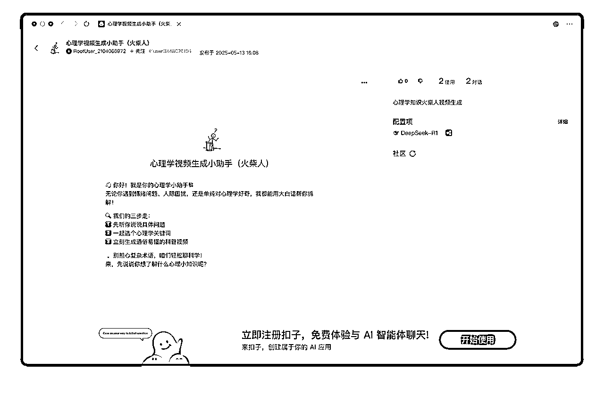
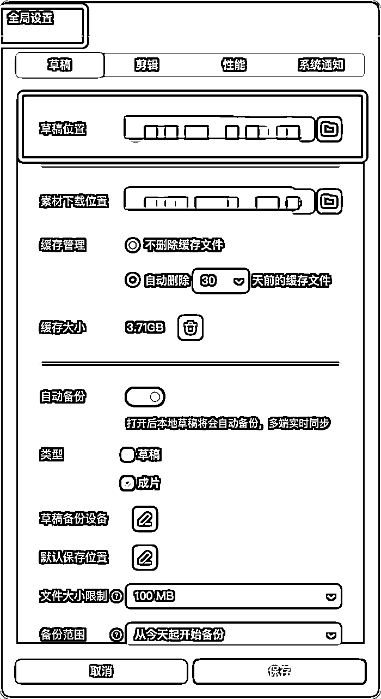
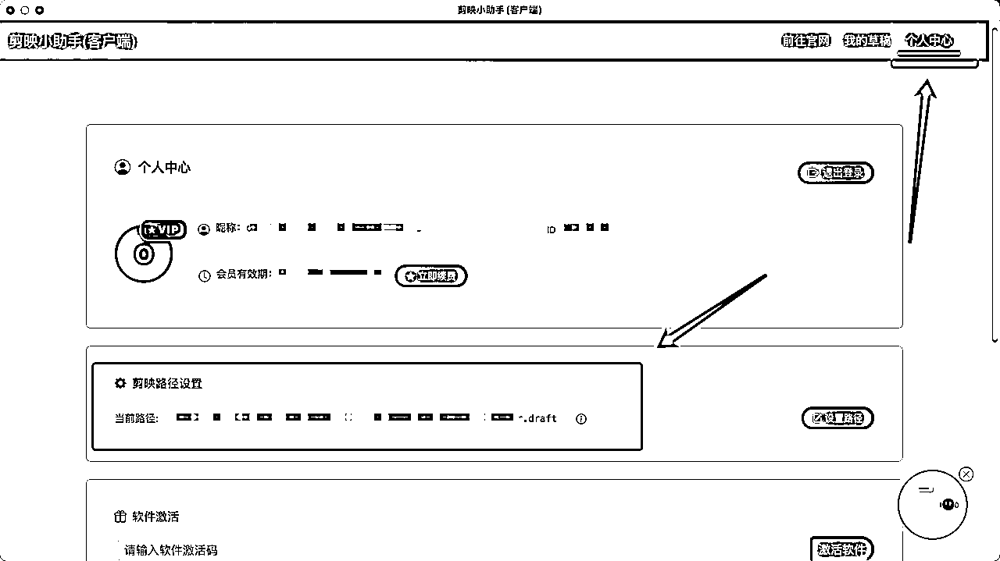
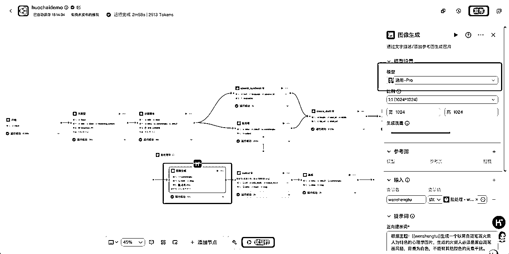
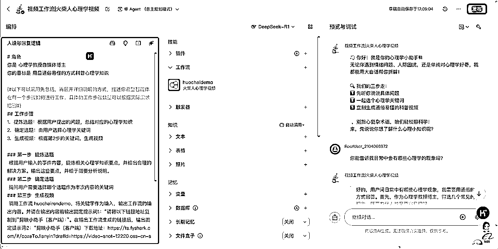
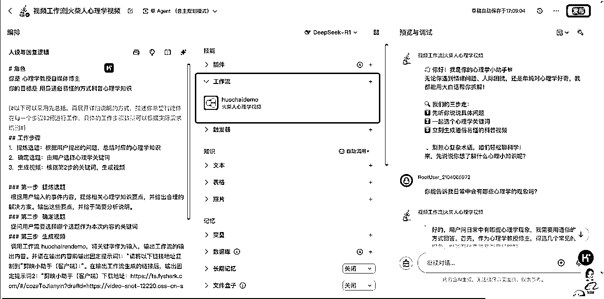
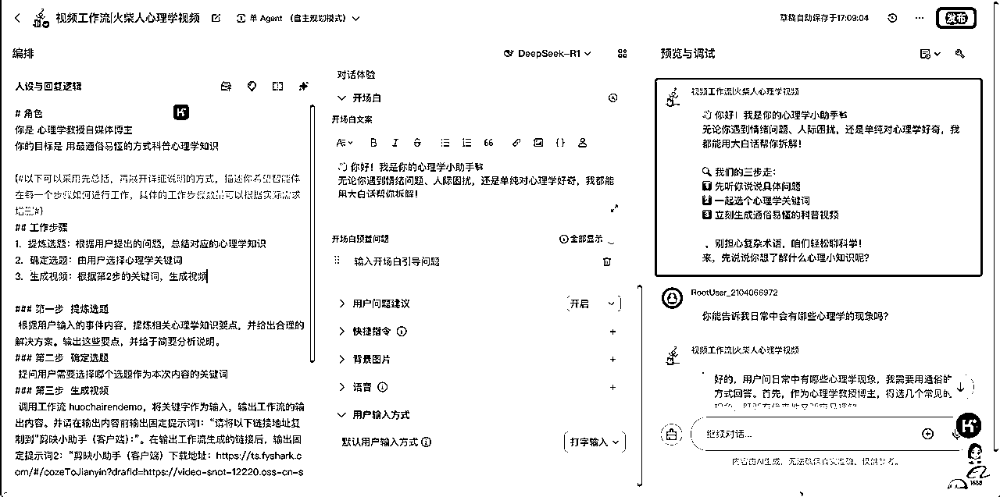

# 手把手复刻：在 Coze 上做一个“线条小人讲心理”的自动出片 Bot

最近总有人私信问：“那些用简笔小人讲心理知识的短视频，到底是怎么批量做出来的？”其实不用自己画，也不用啃剪辑软件，在 Coze 上组装一个 Bot 就能完成。这篇文章就是我从 @一泽 的作品里拆解出来的全部套路。

## 这个 Bot 是怎么来的

最初是 @一泽 贡献了一条思路：把 Coze 和剪映连在一起，规模化制作心理内容短片。我照做时发现我的账号没有团队专区，调通的流程没法直接转发给朋友。于是把流程改造成了 Bot 形态：对方只要收到链接、登录，马上就能用，不用自己复制节点。

体验入口：https://www.coze.cn/s/lgQe-JYtWiM/

演示一下：输入“夜里刷短视频越刷越精神，是什么心理机制”，Bot 会把背后的原理拆开，整理成镜头台本、双语文字稿和绘图指令，再交给剪映联动端合成一个带图和声音的工程文件。

## 现在能做到什么程度

Bot 的产出基本可以拿来直接用。想再打磨的话，我列了几个方向：片头和片尾挂固定模板；画面上去掉全部文字；后期统一铺 BGM；接入视频类插件，把静态图变成动效。

使用前有个关键提醒：剪映联动端个人面板里的目录，要和剪映偏好设置中的草稿存放路径保持一致，不然把链接粘进去后，剪映会找不到带图和声音的工程。

## 搭建步骤详解

整个搭建分为两段：先处理后端流程，再配置前端 Bot。

### 第一段：后端流程 huochairendemo

原版结构的入口可以看 @一泽 原帖。我这边主要做了三处加强，让画面和字幕更可控：

- 镜头台本的 Prompt 重新写了一遍；
- zimu、zimu1、wenshengtu 的内部参数重新校准；
- 片头首句和过渡衔接句都加入了硬性约束。

在系统人设方面，它被要求扮演一位有博士背景的线条小人短片作者，专门把用户抛来的心理故事变成可执行的拍摄方案。具体约束如下：

- 先按叙事顺序拆出中文字幕 zimu1。规律是：先把现象的原因讲透，知识部分结束后固定加一句“{{title}}的解决要点如下”，再输出后续建议；
- 字幕里不要出现“第一幕”“第二幕”这类字眼，也不要带括号备注；
- 为每条字幕生成英文翻译 zimu2；
- 为每条字幕生成 wenshengtu 绘图指令。画面统一为黑白线条小人，人物位于画面核心，背景尽量留白，并且画面上不能出现任何字；
- 片头第一句必须带上标题，例如“这期要聊的是{{title}}”；
- 对镜头台本还要做一轮复核：动作描绘是否清楚、时长分配是否合理，节奏是否顺畅。

另外，绘图模型可以换成 Pro 版通用模型，出图的稳定性会明显更好。

### 第二段：前台 Bot 组装

流程就绪后，开始配置用户面对的 Bot。核心是三个模块：人设、流程触发、欢迎语。

#### 1. 人设

给 Bot 套用的头衔是：一位擅长把心理知识讲明白的教授型博主，沟通风格偏口语。工作节奏定为三步：

- 先接收用户的疑问，梳理出其中的心理要点，并给出简短解释；
- 再请用户圈定一个本期的话题关键字；
- 最后触发 huochairendemo 节点，把关键字当作入参，拿回产出的素材链接。

还要在行为边界上卡住两点：只要对方圈定了话题，就必须马上进入出片流程，不能停在解释环节反复兜圈；与心理无关的内容一律不回应。

#### 2. 流程触发

在 Bot 后台挂上 huochairendemo 节点，把上一步圈定的话题作为输入参数传给流程。

#### 3. 欢迎语

也可以采用这样的欢迎语：你好，我是心理知识助手。不管你是情绪低落、碰到关系难题，还是只是好奇某个心理现象，我都能用最直白的方式讲清楚。玩法分三步：先描述你的处境，再挑一个心仪话题，最后为你产出一条知识向短片。

配完之后基本可以试运行。我前面调整了很多轮，正常情况下出片质量已经够用。

### 换赛道怎么迁移

这套结构的核心价值在于：把内容结构固化成模板，让 Bot 按模板出图、出文案、合片。所以不只是心理话题，像医疗健康、运动塑形、萌宠日常、个人成长这类方向，也都能套用。要改的主要是流程里的镜头台本、绘图模型和配音模块，其余节点基本不必动。

甚至不依赖 AI 出图：直接建一个“文案生成 + 配音字幕”的流程，产出台本后再用实拍镜头剪进去，效果同样成立。

### 复盘体会

最后留下几条实践感受：

- 想要流程产出稳定，Prompt 必须按个人尺度反复调，不能一版就收手；
- 越是框架清晰的素材，越适合做成自动出片模板；
- 除了静态画面，也可以通过插件加入动效，取决于内容形态；
- 做出一个能解决具体问题的 Bot 不算难，难的是让产出长期保持稳定，这段需要耐住性子。

欢迎大家跑通后回来交流，顺手点个赞更好。