第九年的418快到了，后台被问得最多的，翻来覆去还是那几件事：新进来先干嘛、体验卡怎么发、《生财宝典》什么时候到手、航海要不要掏钱。索性一次性捋清楚，省得大家各自翻文档。

先说新人进门头一个月会碰上哪些安排。

四月底先开新人融入营，三天的节奏，把社区规则、可用资源、基本玩法带着走一轮，相当于热身。五月上旬起，《生财宝典》开始往外交寄，凡是种草官带进来的新会员都在名单里。这本东西被叫作生财版的纳瓦尔宝典，内容是请了上百位在各自领域真拿到过结果的人回答同一批问题——老华、硅谷王川、身家十几亿的老板都在里面，聊经验、聊踩过的坑、聊对机会的判断。只印实体，不放电子的，今年续费和新加入的都能收到。亦仁那句话是：光这一本，门票钱就回来了。同一时段，AI传术师继续开放申请，达标的新会员可以进群，跟着一线的人做实操。各地的新人引导局也一场场开起来，主题就是“新人接财、老人传术”，让刚落地的人先在本地找到组织。五月中下旬第九期航海开放报名，AI、出海、IP等十九条航线铺开，五月底正式开跑，边做边跑通闭环。再到5月20日，会员日福利上线，留了点惊喜给大家。

那具体到拉新动作，怎么把意向用户变成圈友？

路子有两条。第一条，直接引导对方加入。第二条更轻，用三天体验卡。这卡只发给还没进过生财的人，一人限领一次；领完能翻近180天的全部内容，窗口期就三天。

卡怎么发出去，两种办法。一是圈友自己动手，把知识星球的免费体验卡甩给目标用户，扫码就能进星球逛；逛完记得补上自己的分销码，跟进别断。二是走生财有术体验营，让官方代发——手机端打开指定页面，生成的二维码自带埋点，后面谁绑了谁一清二楚。时间上有个坎：想完整跑完体验营周期，最好赶在周三17点前发完；过了23号，就别折腾体验卡了，直接上分销海报更省事。

把朋友拉进体验营，他能得到什么？头一件，亲手翻一翻星球和官网，看看内容对不对胃口、评论区聊得诚不诚、氛围合不合自己。第二件，能听两场直播课，纪钟老师等团队成员来讲，讲的是生财的底层逻辑，比公开直播挖得更深。亦仁那句话说得直白：描述一千遍，不如自己进来摸一遍。

## 新面孔进门，先看哪里

亦仁给了三条。

头一条，超级标，必须看。那是他亲自筛出来、亲自盯的赚钱情报，敢放出来就说明这方向不挤，且一年内有做到百万的空间。第九年他给自己压了五十个超级标的指标。对正在找项目的人来说，这是最不绕弯的路标。

第二条，跟上五月的航海实战。现在可以先啃航海手册，挑一个顺眼的赛道，把近一年的内容通读一遍，AI的、IP的都有，链接就在手册里。

第三条，线下组局。同城的小范围聚会多露脸，信息往往在小圈子里流得最快。

这三条专门说给那种一进生财就被信息量砸晕的人听。真正的关键还是收窄：认准一个方向，往深里钻，从零到一，再从一到十。现在用小组来归拢项目和平台，就是想让人聚焦。行有余力，再去别的项目和平台逛，满足好奇心，顺手把灵感搬回自己的盘子里。

大师兄涛哥的路数更糙更直接：先把“生财有术”公众号的文章从头到尾扫一遍，不求甚解；再到官网搜那些读着有感觉的词，基本什么都能挖出来；最后翻航海手册，那里面随便一节，放到外面都是大几千的课。

布道师小排老师给的三步是：航海手册先看；年度榜单的精华帖全过一遍；周边的线下见面会尽快去一趟。

航海教练来来把生财当图书馆使，按人所处的阶段拆成五种用法。

还迷糊的时候，没项目也不急着找，就多刷风向标，从一个信息差切进去，找到一个对味的就够。准备入场了，盯着小红书或AI这类赛道，多泡小组，把一个细分领域的知识塞进脑子。开始动手了，挑一到三篇精华帖，照着步骤走一遍，验证这个细分方向能不能出钱。做到一半卡住了，去航海实战，跟着二十一天实操，把知识体系和SOP补圆。项目跑通了想找搭档，就去线下聚会或者付费进航海家，扩人脉、找运营合作、对接投资方。

## 其余高频疑问

《生财宝典》什么时候发？五一之后、5月10号之前。届时鱼丸会喊大家填地址，记得提醒新圈友扫码加上鱼丸，后面一整年的交付都靠这条线。

### AI这波，生财怎么帮人接住

三处发力。内容端，精华帖里大约三成跟AI沾边，请的都是在一线打的实战派。航海端，过半航线把AI嵌了进去。平台端，官网上了两个功能：一个把上万字长帖压成几百字干货，一个帮你拆开看风向标背后的门道。

往后排队的还有一批：能对着精华帖直接提问的问答功能、把精华变成可视化卡片、面向小红书这类垂直领域的专业搜索升级、把五到十万字航海手册接进AI支持对话，以及一个风向标AI Agent——自动扒全球的新机会，AI整合分析完推到你面前，帮你把筛信息的时间省下来。

### 垂直化这条路怎么走

过去一年定下的调子，压在这几块：AI是头号方向，工具应用、创业都算；出海覆盖YouTube、AI开发网站、应用开发、独立站、流量获取；IP涵盖自媒体、知识付费、虚拟产品，是普通人低成本起量的入口；新流量看视频号和小红书，往后两三年还有肉；电商虽卷，但门槛低，仍是新手练手的好去处。

垂直知识去哪捞？官网“小组”板块按方向堆了大量内容，把一个板块啃完，基本就是这个领域的半个专家，而且全是一线打出来的经验。也可以直接翻年度榜单，AI、出海、IP、小红书最硬的帖子和作者都在上面。

### 超级标与风向标

超级标是亦仁亲自盖章、能领先行业半年的机会。整个体系分三层：最底下的风向标负责抛线索，中间的中标是精选出来的分享，顶上的超级标是情报网里捞出的尖货。超级标对所有圈友免费，官网官方专栏里能找到。今年亦仁立的flag是发满五十条。

风向标本身指的就是商业情报和线索，团队从各平台搜集筛选。拆解功能能帮人看懂背后的生意，往后还要长成“AI商业私教”，磨的是商业嗅觉和判断力——那才是面对市场的底气。

怎么分辨风向标里的机会真假？亦仁给的答案是“先相信”。习惯质疑的人不少，但只有先信了，才会去验证、去深挖，然后才分得清好坏。否定一切确实不犯错，可机会也从指缝里溜走了。当然，要砸大钱的机会得悠着点，一般的机会，先乐观接着，再回头查。

### 航海实战，花钱吗，新在哪

航海是生财自己摸索出来的训练营路子，带人真刀真枪下场。常规航海不收学费，只押保证金。一年下来覆盖约十万人次，从2017年磨到现在，系统已经跑顺。每三个月来一场大的，一两万人同时上船，跑二十一天。保证金九十九或一百九十九，平均九成会退回去。亦仁说得很清楚，这不是生意，是逼你把注意力摁在项目上——“所有竞争最后都是注意力的竞争”。

第九年，航海往两头长。一头是Mini航海，一百到两百人的小船，用龙珠碎片这类东西激励大家把经验写下来；摸到好机会就沉淀成手册，再用大航海带上更多人。理想状态是周周有船开，目标“一百条船同时在开”，谁有兴趣谁上船，没有现成手册，小船长带着边聊边探，亦仁觉得这事“会非常好玩”，也让新机会能更快被人接住。另一头是深海圈，给已经通过航海认准方向的圈友——目前有YouTube深海圈，专职教练带一年，额外收费，为的是让教练肯花更多时间掏新玩法。

### 为什么劝你别去闲鱼买共享账号

几块钱买共享网盘，体验先不说，最要命的是注意力：便宜到手的东西不会被当回事，几十G资源躺着吃灰是常态。更关键的是，生财本质是个社群，不是课程包。你买的是信息筛选、注意力引导、一个圈子、一片新的人脉土壤。只有真进去跟人、跟事、跟信息撞出链接，价值才出得来。线上线下这些产品设计，全是为这个目的。

### 老圈友的福利与回归

原则就一句：对老朋友越来越好。续费有专属价，服务权益也更多。

过去一年生财动了不少刀。社区规则上，原先想走开放共建的路子，允许留微信，结果低估了某些人的歪心思，去年七八月一刀切下：禁止留微信、禁止标题党。这个转身不轻松，从松到紧，但得为圈友兜底。有意思的是，规矩立起来后内容没塌，反而把杂质滤掉了，好内容浮上水面。这半年社区的状态是真诚、干货、知无不言，很多人说“生财的味道又回来了”。因这些变化走掉的老朋友，欢迎回来看看，三天内不满意，全额退，零风险。

### 这到底是个什么样的社区

亦仁的形容是真诚、实诚，有什么说什么，对未来三个月、半年乃至一年的判断都不藏。社区要的是纯净，不欢迎引流党和不真诚的人。“我们如此真诚地对待别人，将心比心，以心换心。”愿意分享的人，是在往世界里递善意，同频的自然会被吸过来。全国每周有三四十场线下分享。最独特的文化就是真诚分享，不少人推荐朋友时是这么说的：“我感觉他跟生财的气质很像，也是个愿意分享的人。”

### 进来一年没赚到钱，怎么办

正常。赚钱是技能、认知、经验叠出来的复合结果。亦仁自己在做生财之前也折腾过不少项目，八成折了；可当年看着白费的尝试，后来做项目时全派上了用场，成了别人比不了的底子。所以心态得摆正：进生财不保证赚钱，短期大概率也赚不到，这是实话；没有任何地方能打包票，生财也不能。但它能把赚钱的概率往上抬。方向对了，持续做，时间会给答案。

成长从来不是直线。停一停、倒个车、原地绕圈，都正常。别急，一边实战一边攒财富和认知；认知追不上财富，钱来了也留不住，“盈亏同源，赚多少照样亏出去”。

人生是指数线。认知、财富、项目最好齐头并进，这条路注定慢，开头那段平得让人怀疑。“人生一定是指数的，指数线最后越往上走，前期就会越平。”眼下没结果的人不必慌，可能正走在指数最平的那一段。“前面的指数越长，后边爆发也会越高。”

### 项目迟迟没反馈，扛还是撤

亦仁的回答很干脆。别去无人之境挖宝——实战底子不够时，挑一个谁都不知道的项目，很容易把自己挖迷路。去做已经被验证的事，比如圈里大批人在跑的YouTube、视频广告分成、小红书电商，路径现成，反馈来得也快。

整本手册翻下来，第九年418想说的其实都在里头了：新人怎么起步、卡怎么发、宝典怎么寄、AI怎么布、垂直怎么切、超级标和风向标怎么用、航海怎么玩、社区信什么、老朋友回不回来、赚不到钱怎么想。剩下的，就是自己跳进来试一遍。

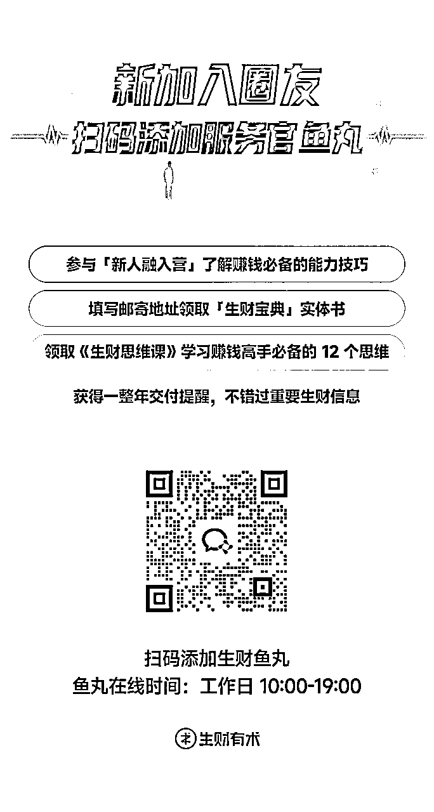
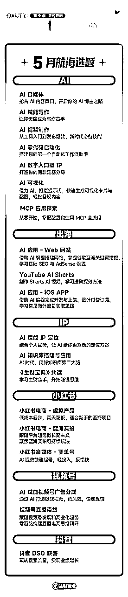

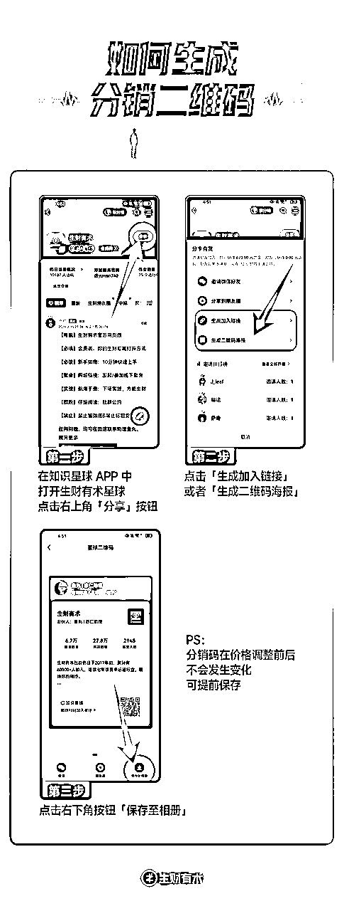
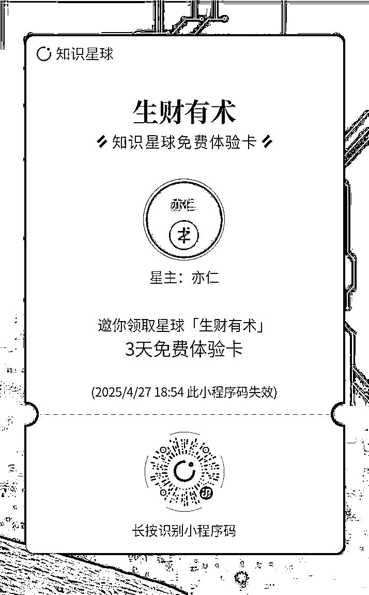

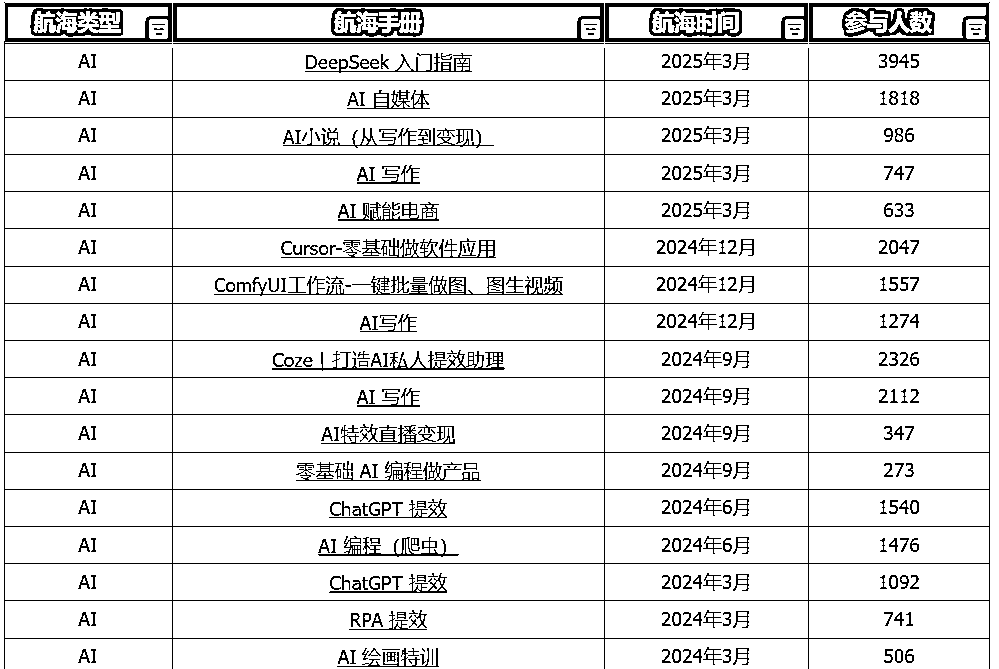
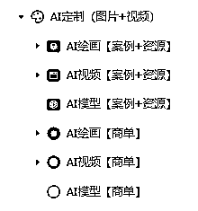

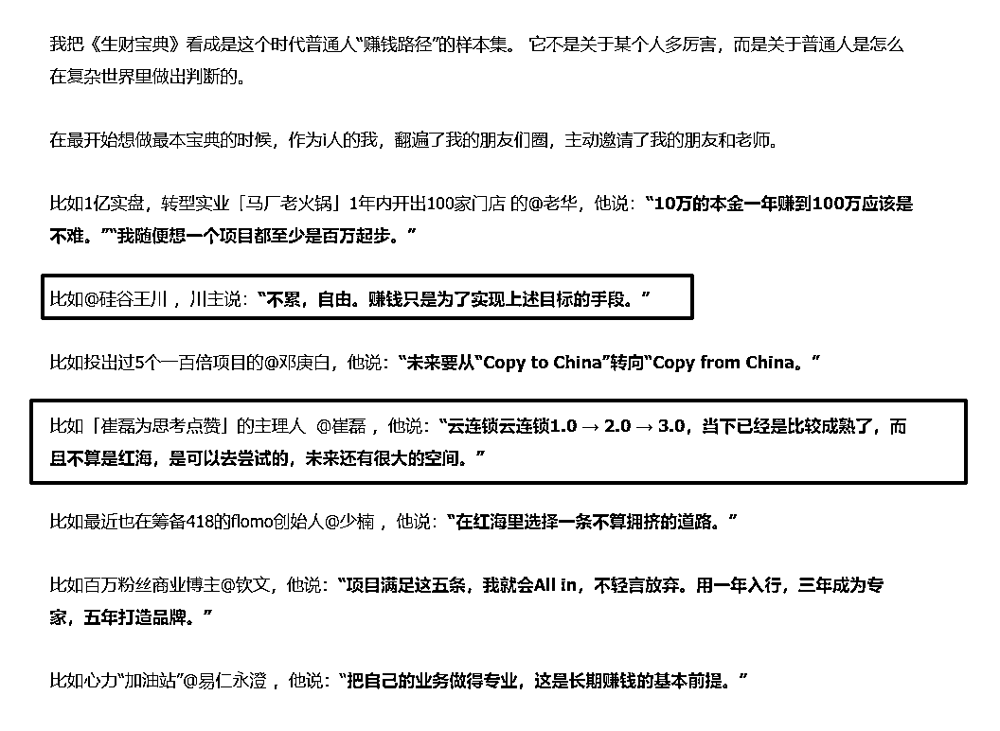

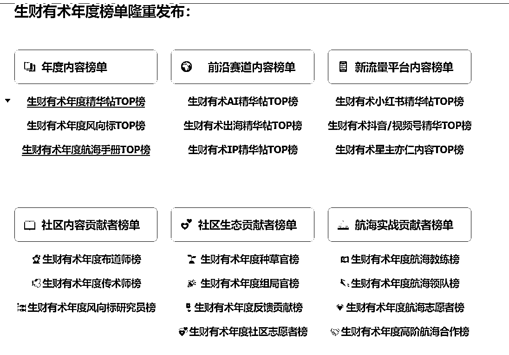

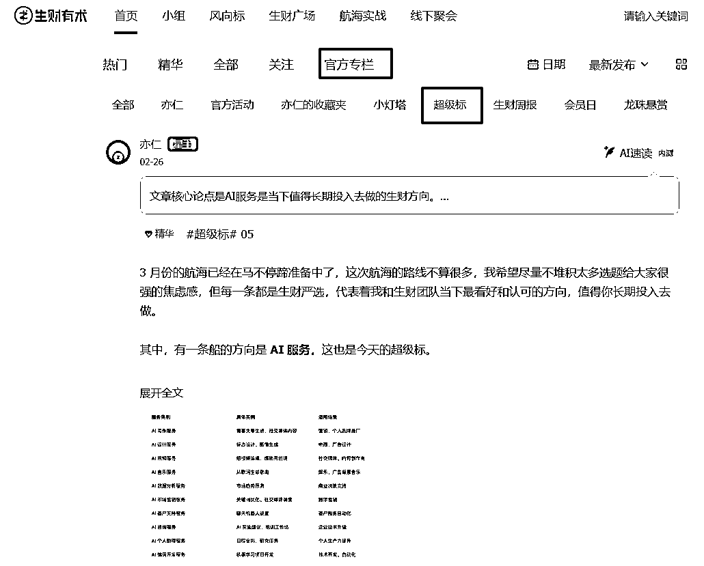
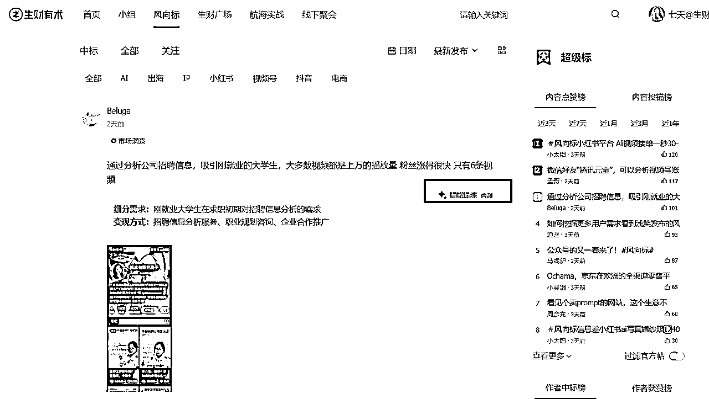
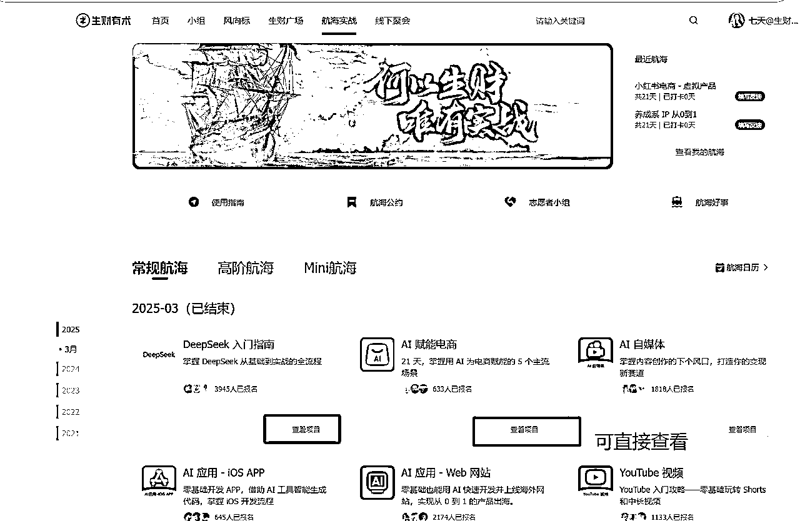

*   真正值得长期投入的方向，往往已经有人跑出稳定结果，市场里也确实存在可被验证的收益空间。

*   如果进入一个已有案例、需求和成交记录的领域后仍然没有收入，优先需要排查的，通常不是方向，而是自己的认知、方法和执行细节。

1.  把成长当成主线任务

*   发现卡点来自自身，才会主动补课、试验、复盘，再根据反馈不断修正。
*   哪怕某次尝试没有带来现金回报，过程中积累的判断力、技能和经验，也不会白费。
*   当能力、理解和实战积累到一定程度，变现只是时间问题。

亦仁的观点很明确：只要选择的方向经得起验证，并且愿意持续实践、持续升级，最终获得收入只是迟早的事。

## 圈友常问：生财内容这么多，怎样才能真正开始做？

很多时候，所谓“执行力不足”并不是核心矛盾。

*   人不会专门研究“怎样才能坚持吃饭”，因为生理需求会自然推动行动。
*   当目标不够有吸引力时，人就容易在刷内容、看案例和亲自下场之间反复横跳。

亦仁早年的行动状态，和当时的现实压力密切相关：

*   上大学期间，家里的经济条件并不宽裕，学费需要通过借款解决。
*   他没有太多犹豫空间，只能通过做项目挣出学费。
*   生存和目标共同形成了强烈的推动力，行动自然变得果断。
*   最底层的念头很简单：必须创造收入。

所以，亦仁更建议大家换个问题：

*   与其研究“怎样逼自己行动”，不如先看清楚自己究竟为什么要行动。
*   如果暂时没有经济压力，生活也没有特别想改变的地方，不必为了执行而执行。
*   一旦明确了想争取的结果，也看清了当下的不甘，很多拖延会自行减少。
*   所处环境同样重要。身边如果聚集着目标感强、愿意做事的人，个人状态也更容易被带动。
*   长期相处的人会影响你的判断方式和思考边界，生财有术希望提供的正是这样一个积极、务实的环境。

# 🎉社群运营参考话术及物料：

生财有术已经进入第 9 个年头，现在扫码即可了解并加入。

## 用一段话重新认识第 9 年的生财有术

生财有术诞生于 2017 年，是一个围绕赚钱机会、项目实践与创业交流建立的真实社群。平台连续运营 8 年，续费表现长期处于知识星球前列。如今进入第 9 年，累计付费会员已超过 7 万人。

## 一张图快速了解生财有术

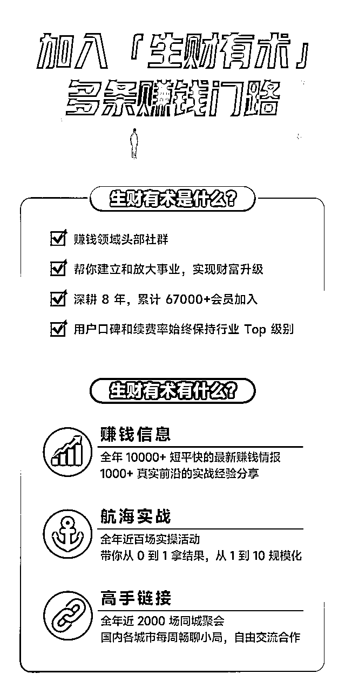

在这里，每天都会出现从轻量变现到规模化经营的真实案例。来自不同领域的操盘者、创业者和实战玩家，会公开交流自己的路径、数据、判断与复盘，也会组织多种实践活动，让成员不只是阅读，还能亲自验证。

有人把生财有术称作“赚钱领域的黄埔军校”。平台主要通过机会信息、航海实践和圈层连接，帮助成员扩大认知范围、找到可验证的方向，并在真实行动中争取结果。

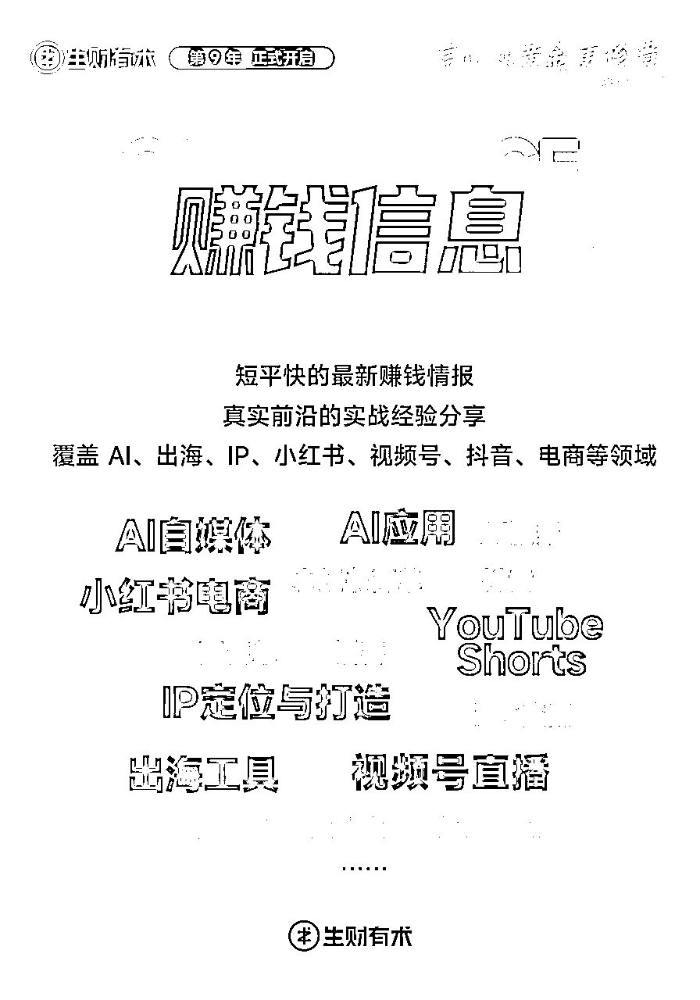

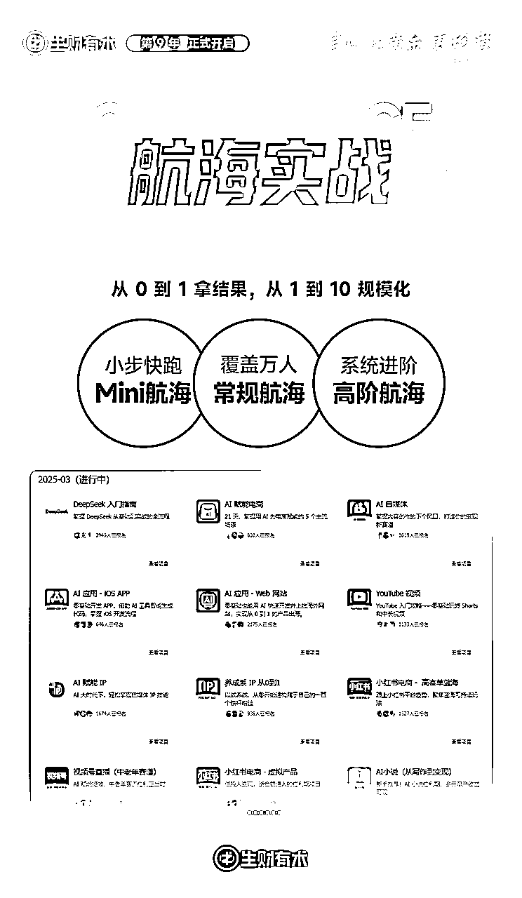

很多人关心：生财有术到底解决了什么问题？

亦仁曾在直播里讲过一位资深成员“紫菜”的案例。紫菜会从社群中挑选值得验证的方向，再交由自己的团队进行标准化复制。按照他的分享，单个团队基本可以做到七位数级别的收入。

在紫菜看来，社群的价值主要体现在两方面：

1. **减少信息噪音**：面对海量资讯，先帮成员过滤掉大部分无关内容，把时间集中到更值得研究的方向上。

2. **建立行动信念**：有真实成绩的人和具备判断力的人，能够为尝试者提供参考与信心，让执行不至于停留在反复怀疑阶段。

这也是生财有术持续建设的两条主线：一边通过专业成员和经验内容帮助大家判断什么值得投入，另一边让已经验证过路径的人提供案例、反馈和行动参照。

近期，生财有术官网（https://scys.com）也在持续增加智能化功能，用于压缩阅读时间、辅助理解内容，并帮助成员从不同角度观察机会。

目前涉及的方向包括：

1）已开放：精华内容快速阅读、风向标智能分析

2）后续计划：精华音频、精华问答、知识卡片、思维导览、站内检索、手册智能问答等

3）仍在讨论：风向标智能助手、商业顾问型工具，以及按日、周、月生成的内容汇总等

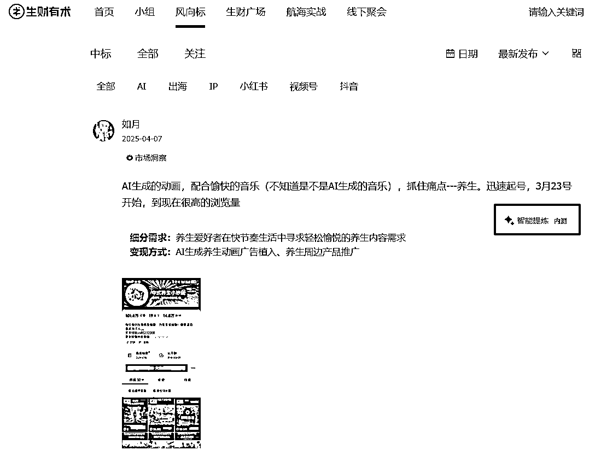

同时，社群也在帮助擅长智能工具应用的成员，把能力进一步转化为业务成果：

1）**AI 传术师俱乐部**

汇聚社群内外具有实操经验的智能化玩家，让他们参与内容建设、案例沉淀和新机会发现，形成反向供给。

2）**AI MCN**

通过整合广告需求、开发创作工具，帮助成长起来的智能内容创作者和个人品牌拓展商业空间；同时让做智能产品的成员与内容渠道互相连接。

3）**SCAI 实验室**

在线下集中一批真正投入智能产品出海的成员，进行项目孵化，目标是探索具有国际影响力和行业价值的产品。

4）**生财 AI 学堂**

结合线下授课、企业顾问服务和线上训练项目，帮助具备实践能力的人整理经验、传播方法，并获得相应回报。

对大多数已经拥有具体业务的人来说，“原有业务 + AI”很可能会成为未来的重要增长路径，生财有术也在持续加快这方面的布局。

社群的判断是：人工智能不该被当作一道可做可不做的选择题，而应该成为各类工作和业务的基础设施。无论是经营企业，还是从事日常工作，都需要思考怎样把智能工具嵌入自己的流程。生财有术正在围绕学习、理解和实际使用，帮助成员完成这一步升级。

### 为什么成员愿意把自己的经验写出来？

1. **这里聚集着愿意互相成就的人**

大家不只记录成功，也会公开机会来源、过程细节、失败原因和踩过的坑。

之所以愿意持续输出，是因为许多人先在这个环境里获得过帮助，也愿意用自己的经验回馈后来者。

2. **大赛道需要协作，而不是单打独斗**

过去一年，生财有术累计沉淀了 39218 篇帖子、19844 条风向标、19374 篇帖子、1740 个风向标、955 篇精华内容，以及近百个经过验证的 0-1 赚钱项目。

抖音、视频号、小红书、AI 等方向的市场足够大，单个人很难覆盖全部机会。个体放在整个行业中只是很小的一部分，与一群有共同目标的人共同研究，往往能够加快试错速度，也不会削弱自己的业务，反而可能带来新的增量。

此外，社群还设置了“生财思维课”，专门梳理做项目时容易出现的判断偏差，并帮助成员建立更适合实践和学习的思考框架。

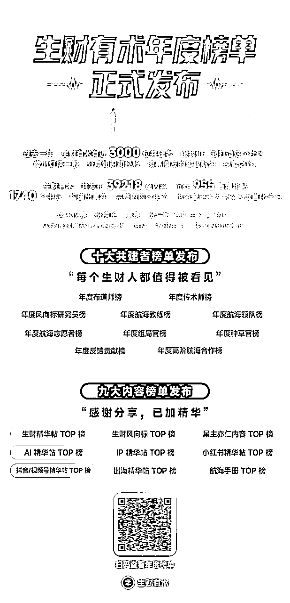

3. **社区规则相对清爽**

平台会重点治理夸张标题、恶意引流等行为，对动机不正、破坏交流秩序的账号进行处理，尽量维护真实交流的氛围。

### 为什么有人愿意公开赚钱机会？

亦仁曾这样解释成员分享机会时的心理变化：

1. 当一个人长期看不到机会时，稀缺的信息就像救命资源，自然不愿轻易告诉别人。
2. 但在机会足够多的人眼中，单个机会并不稀缺。亦仁曾说，自己刷半小时抖音，往往就能看到几十个值得研究的方向。
3. 对于目标是年收入八位数、九位数的创业者来说，分享一个年收入百万级的机会，并不会削弱自己的核心业务。
4. 识别机会本身就是一种能力。当越来越多人愿意公开观察和验证，分享就会从个人选择逐渐变成群体习惯。

在生财有术内部：

1. 如果有人长期保留关键信息、只展示结果而不讲方法，其他成员通常能够感受到这种差异。久而久之，缺少开放精神的人很难融入，留下来的往往是更愿意交流和互相帮助的人。
2. 持续输出的人，也更容易认识经验层级更高的伙伴，甚至进入传术师等深度协作群体，进一步形成内容、项目和资源之间的正向循环。

### 哪些人更适合来到生财有术？

亦仁曾总结过几类匹配度较高的人：

1. **偏行动派、擅长把想法做出来的人**

例如产品经理、程序员、开发者、独立开发者等。只要获得较准确的信息和方向，他们通常就能迅速进入验证阶段。

2. **正在经营个人品牌的人**

包括自媒体创作者、知识服务从业者、虚拟产品卖家等。社群本身也是知识服务产品，内部积累了大量文档、案例与成员交流内容，适合这类人学习和碰撞。

3. **自由职业者**

尤其适合长期独自在家工作、缺少同行交流、对下一步方向犹豫不决的人。社群里有不少同类成员，能够提供交流、参考和情绪支持。

4. **互联网行业从业者**

设计、产品、开发、运营等岗位都可以从中获得启发。亦仁及其团队本身具有互联网背景，社群讨论也更强调用户、产品、增长和迭代等思路。

5. **小团队经营者**

十人以内的公司老板或合伙人，可以把社群当作一个持续更新的案例库和判断库。别人走过的弯路，可能替你避免几十万甚至数百万元的损失；有些行业基础，通过阅读几篇高质量内容就能先建立起来。

6. **大厂中层管理者**

月收入几万元的中层，可以借此了解更多副业和业务路径，再结合自身资源，逐步寻找新的选择。拥有可切换的能力和收入来源后，职场中的心理状态往往更稳定，也更敢于独立思考、和上级讨论问题。

真正的职场安全感，不是永远依赖某个岗位，而是你始终具备重新选择的能力。

7. **大学生**

时间弹性大、试错代价相对低，可以通过航海手册或实践项目尽早完成第一次真实验证。小鹅、书虫、更绪、辛亥、汤姆cc等 00 后成员，都是在生财有术中逐步成长起来的案例。

### 重点提醒：为什么 4 月 18 日至 25 日，是加入或续费的好窗口？

#### 原因 1：当前费用更低，并附带限量权益

👉 适逢生财有术 9 周年，年度费用优惠 600 元，现价 2765 元；前 1 万名还可获得实体版《生财宝典》。

👉 已经加入过的老成员，续期价为 1659 元，相当于六折，是全年较少见的优惠节点。

👉 《生财宝典》收录了 100 位高手的项目经验，前 1 万名可免费领取，实体书仅作赠送，不单独售卖。

⏰ 开放时间：4 月 18 日 20:00 至 4 月 25 日 20:00

#### 原因 2：本年度航海方向覆盖面更广

今年共有 19 个选题，重点分布在 AI、海外市场、个人品牌、小红书、视频号等细分方向。

其中既有适合长期投入的高潜领域，也加入了不少新玩法和新机会。相关选题可以在 5 月正式开船前提前报名，尽早进入准备阶段，就能获得一定的时间优势。

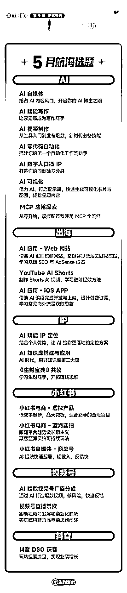

### 🔥生财有术的几项主要特点：

1. **方向丰富，并强调实际落地**

每年会组织 8 次以上航海训练，覆盖智能工具、海外业务、小红书、视频号等热门方向。

每次活动都会配套完整手册，帮助参与者理解一个项目如何从零开始验证、推进和优化；即使不参加当期活动，手册也可以作为后续复盘资料长期查阅。

2. **内容更新频率高，筛选成本低**

过去一年，平台产生了 3 万多篇帖子、955 篇精华内容和 1740 个中标项目，每天至少有 50 条以上的真实项目信息更新。

成员不必再独自翻遍全网，只需围绕社群已经整理出的内容，就能更快观察行业变化和潜在方向。

3. **交流半径广，同行密度高**

平台上活跃着小红书操盘者、海外业务探索者、跨境从业者和智能工具实践者等群体。

线下会组织同城交流，覆盖北上广深杭，也逐步延伸到更多三四线城市；线上讨论同样持续进行，适合不想长期闭门摸索的人。

4. **强调长期主义、真实交流和互相成就**

社群不承诺一夜暴富，更重视陪成员拆解路径、验证模型、解决执行中的问题。

许多已经获得结果的成员，正在持续把经验带回社区，每年输出近千篇精华内容和航海总结。对于积极参与共建的人，平台也会通过龙珠、术值等虚拟权益给予反馈，并提供与高手交流的机会。

如果你或身边的朋友还有顾虑，可以先了解两项保障：

1. 加入后 3 天内支持无理由退款，可以先观察内容、成员互动和整体氛围，觉得不适合再退出。

2. 社群内有《生财使用指南》知识库，由熟悉实战、擅长带人上手的传术师群体共同整理，方便新成员快速找到入口，也便于把这套方法介绍给身边的朋友。

生财有术使用指南链接如下：

### 最后，给准备加入的人 3 个建议：

1. **如果你对项目和机会感兴趣，不妨给自己一次验证机会**

按 2700 元左右的年度成本计算，每月约 200 元。它的投入上限相对明确，但如果能借此建立一套持续观察、判断和实践的方法，潜在回报并没有固定上限。

2. **不要把第一年的回报预期定得过高**

收入通常来自认知、项目和环境的共同作用。社群更重要的作用，是帮助你理解机会、找到可执行的路径，并把想法推进到验证阶段。第一年未必马上回本，但只要持续实践并提升判断效率，之后做选择和推进项目的成本都会下降。

3. **主动靠近那些已经在创造结果的人**

想提高赚钱能力，不能只停留在抽象讨论里，还要观察真实做事的人如何判断、取舍和推进。圈层变化会影响一个人的目标感和行动意愿。

紫菜、刘小排、黄小刀、陈雪等成员，都是在社群中逐步拿到结果的案例。即便一年只认识十位这样的人，长期积累下来，关系、信息和合作机会的价值也很难用短期价格衡量。

最后再次提醒：

截至 4 月 25 日 20:00，加入和续费价格将进行调整。活动期间可享年度优惠：

- 新成员：2765 元，加入第 9 年生财有术；日常价格为 3365 元，本次优惠 600 元。
- 老成员续期：1659 元，续一年，按新人优惠价继续享受六折续费。

如果你认可这里的内容质量、交流氛围和项目机会，也欢迎把真正适合的朋友推荐过来。

# 附录

## 可结合个人定位、受众特征与表达习惯进行调整

## 可直接转发给正在了解社群的朋友

## 也可以根据对方需求，选择对应的使用指南发送