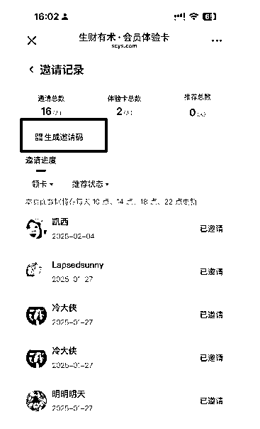
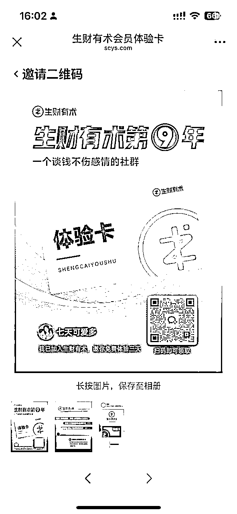
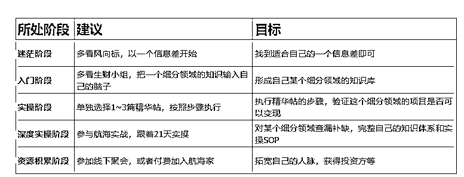
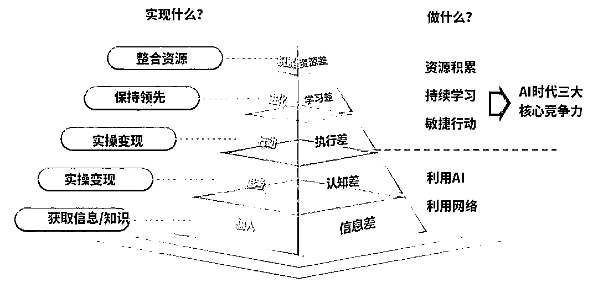
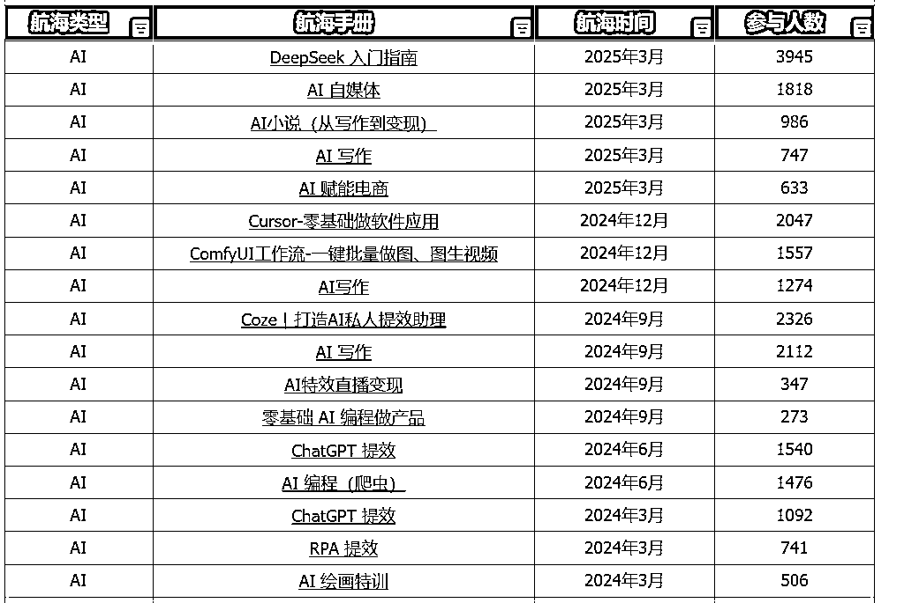
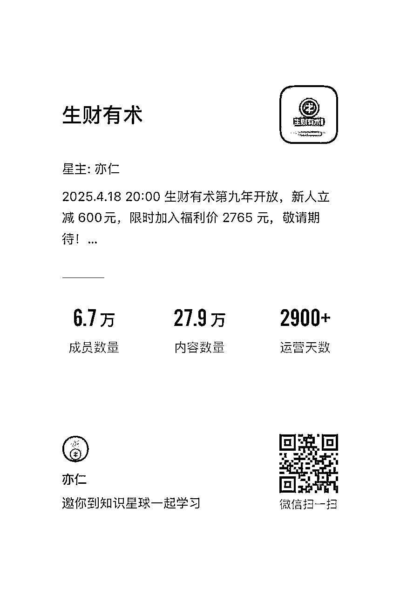
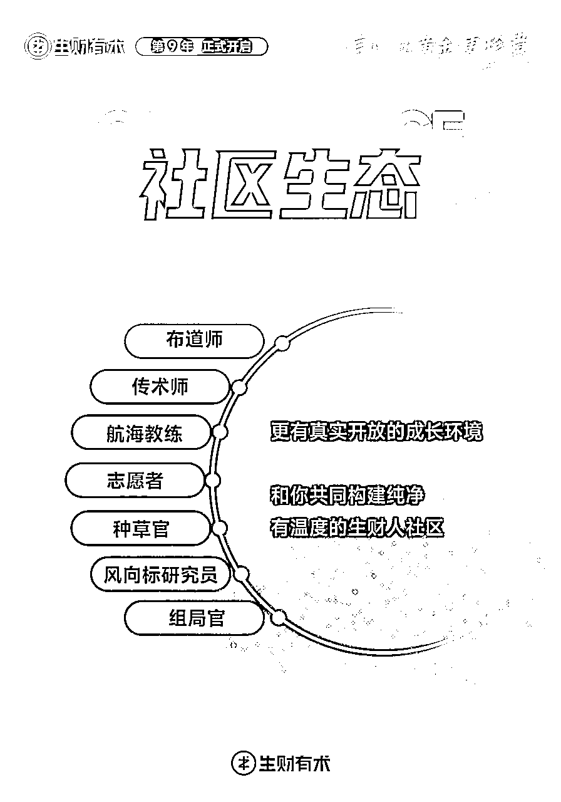
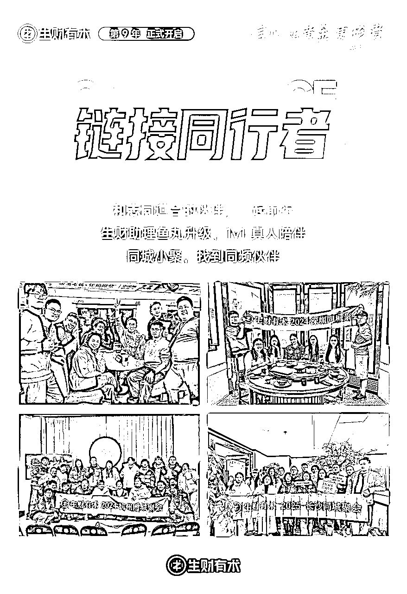
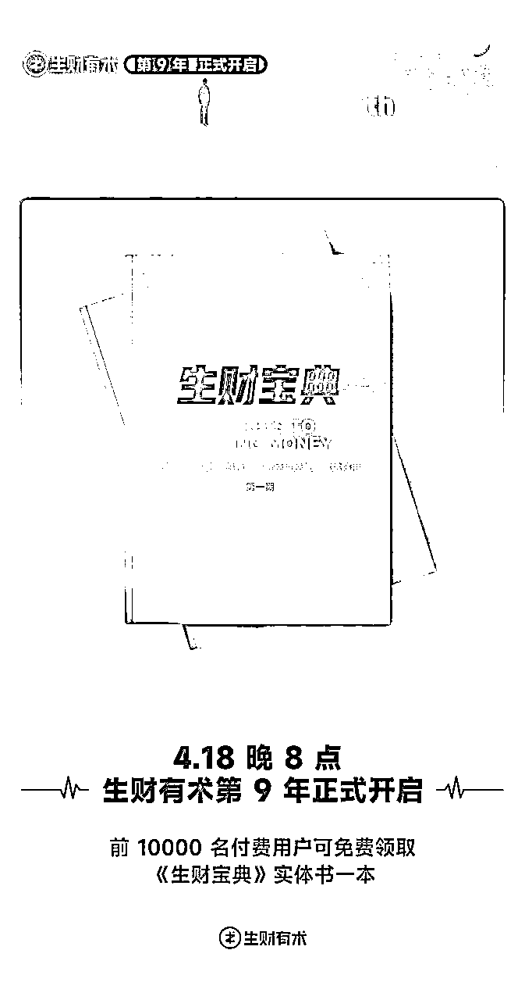
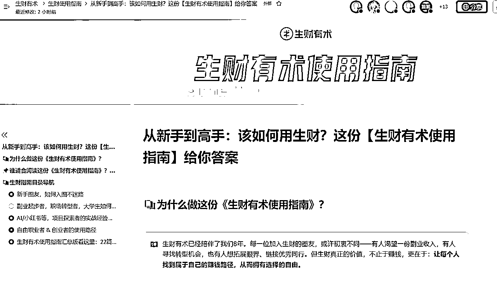

# 生财第九年 418 新人行动参考手册：排期与答疑合集

> 参考来源：[https://shengcaiyoushu01.feishu.cn/docx/Uy5JdWiFPoyYnCxju0hchVTEn2e](https://shengcaiyoushu01.feishu.cn/docx/Uy5JdWiFPoyYnCxju0hchVTEn2e)

本期 418 资料主要收纳三类内容：

1.  新人进群后可参与的时间线
2.  推广者被反复询问的要点
3.  群聊运营时可借鉴的表达与素材

分销手册链接：

# 🎉 入群首月活动节奏概览

### 四月底：新人适应期开启

三天内完成平台机制、社群规范与资源盘点的快速引导，帮助新成员更快建立链接。

### 五月初：实体《生财宝典》开始发出

经推荐官邀请加入的新成员，将陆续收到纸质手册。详情页：https://t.zsxq.com/S6pVc
所有符合邀请条件的推荐官渠道均会安排寄送。

### 五月初：AI 传术师持续招募

达到标准的近期成员可申请入群，参与前沿生成式技术的实操训练：https://t.zsxq.com/zyRat

### 五月初：全国城市新人见面会陆续落地

由资深成员发起“新人收财、老员授术”线下主题局，加速同城人脉搭建。

### 五月中下旬：第 9 期航海招募启动

聚焦生成式 AI、全球化、内容 IP 等 19 条赛道，预计五月底正式开航，边学边干跑通闭环。

### 五月二十日：520 会员日

当月会员专属福利日，将释放权益与惊喜。

# 转化路径：两种进入方式

## 方式一：直接成为正式成员

## 方式二：先领取三日体验码

### 适用人群
仅针对尚未加入生财有术的外部用户，人均一次免费用。

### 权限范围
激活后可在 72 小时内查阅近半年平台全部内容。

### 01 成员自助投放
成员可自行推送“知识星球免费体验卡”，引导意向用户扫码进入星球体验。
体验结束后，记得补发个人分销二维码并跟进。

### 02 官方体验营统一发放
由生财团队统一派发体验资格。

#### 获取路径
手机打开：https://scys.com/mobile/mine/experience
生成绑定追踪的体验卡二维码，便于后续归因。

#### 投放时机建议
1. 若要使用体验卡，建议在本周三 23 号 17 点前完成投放，否则可能赶不上体验营周期。
2. 23 号之后更建议改用个人分销海报。

#### 朋友加入体验营能获得什么
1. 实地感受平台内容与氛围
   * 主题是否匹配自身兴趣
   * 干货程度是否达标
   * 评论区互动是否真实
   * 社区氛围是否舒适
2. 参加两场内部直播
   * 由生财团队讲师如纪钟主讲
   * 解析平台底层逻辑，深度高于公开课
亦仁强调：再多介绍不如亲自感受。

# 💡 种草官高频问答整理

## 新人进群第一时间看什么

### 亦仁的推荐排序
1. 超级标必看
亦仁亲自背书的机会情报，一年内具备较高变现可能性的方向。第九年目标发布 50 条，为成员提供清晰赛道。

2. 跟上五月航海
先浏览航海手册，挑选一个感兴趣的赛道，把过去一年的精华系统梳理一遍：

3. 线下局多参与
优先报名同城主题活动，在小圈子获取一手信息。

对信息过载焦虑的新人建议：先锁定一个方向深耕
* 从零到一，再从一到十
* 平台采用小组制整合资源，便于聚焦
* 主线稳定后可适度拓展，吸取灵感

### 大师兄涛哥的三点
1. 先通读生财有术公众号全部文章，不求速通。
2. 在 scys.com 官网用关键词检索。
3. 看航海手册，内容价值对标外部数千元课程。

### 布道师小排老师的三点
1. 先看官网航海手册
2. 浏览年度榜单精华帖
3. 尽早参加周边线下见面

### 航海教练来来的五段式用法
把生财有术当作分门别类的图书馆，按阶段使用：

1. 探索期：无项目方向，多看风向标，从信息差切入，找到可长期研究的点
2. 入门期：进入目标小组，把细分领域的知识装入脑中
3. 实操期：挑 1-3 篇精华按步骤执行，验证变现可行性
4. 攻坚期：加入航海训练补齐短板，形成个人 SOP
5. 资源期：项目跑通后参加线下或航海家圈层，寻找合作与投资

## 《生财宝典》何时寄出？内容是什么

预计五一后至 5 月 10 日前发货，鱼丸会统一收集地址，提醒新成员添加鱼丸。

这本纳瓦尔式实体手册由生财制作：
* 100 位不同领域成果者实名作答
* 含老华、硅谷王川、过十亿级企业家
* 分享实战经验、踩坑、认知与未来判断
* 纯纸质版，无电子版
* 赠予当年度续费与新加入成员
亦仁认为单本书已值回门票

## 平台如何助力把握 AI 机遇

1. 内容侧：约三成精华贴与 AI 相关，邀请一线实战者分享
2. 航海侧：半数以上航海项目与 AI 结合
3. 产品侧：官网新增 AI 功能
   * AI 精华摘要
   * AI 解构风向标
后续规划：
* AI 问答精华
* 知识卡片可视化
* 垂类搜索升级
* AI 航海手册问答
* 风向标 AI Agent 自动挖掘情报

AI Agent 可自动完成重复流程，生财正在研发的风向标 Agent 将自动抓取全球机会、整合分析并推送，大幅节省筛选成本。

## 垂直战略覆盖的板块

* AI：工具应用、创业
* 出海：YouTube、AI 网站、应用开发、FILA、获客
* IP：自媒体、知识付费、虚拟商品，低成本起量
* 新流量：视频号、小红书等，未来 2-3 年仍有空间
* 电商：竞争激烈但门槛低，适合入门

垂类知识可在官网小组板块系统学习，先从年度榜单切入快速定位核心作者。

## 超级标的定位

由亦仁从情报网中筛选出的领先行业半年的优质机会，隶属风向标体系：
风向标 → 中标 → 超级标
所有成员免费查看，官网官方专栏可查。第九年目标发布 50 条。

## 风向标的价值

地址：https://scys.com/opportunity
团队从各渠道收集并筛选商业线索，通过 AI 解构帮助理解机会逻辑。
未来将进化为“AI 商业私教”，培养嗅觉与判断力。

如何判断真伪？亦仁提出“先相信再验证”：
先保持开放假设，再查案例与执行条件，最后判断价值。投入大的项目需更谨慎。

## 航海实战是什么？是否收费

链接：https://scys.com/activity

生财原创训练营模式，带领成员实操入场：
* 常规航海免费，仅收 99/199 元保证金，约九成可退
* 始于 2017，已成体系
* 每季一次大型航海，周期 21 天，万人级参与

第九年演进：
Mini 航海：100-200 人小队，用龙珠碎片激励沉淀，探索出机会后形成手册放大。目标实现百船同开。
深海圈：针对已确认方向的成员，如 YouTube 深海圈，由专职教练带队深耕一年，需额外费用激励教练投入。

## 为何不建议在闲鱼购买共享账号

* 体验差且不稳定
* 低成本导致不用，资料闲置
* 缺失社群核心价值：信息筛选、注意力引导、优质人脉与环境
社群价值来自人与信息的持续交互。

## 老用户权益

坚持对老朋友更好：
* 续费价格优惠
* 专属服务权益

## 近期调整与回归建议

过去一年社区规则收紧：
* 禁止在社区留微信
* 禁止标题党
规则后内容质量回升，氛围重回真诚干货。离开的老成员可先用三日体验感受变化，不满意可全额退款。

## 社区风格与价值观

* 真诚分享，预测与判断公开
* 反引流、反虚假
* 全国每周 30-40 场线下活动
核心文化是利他分享，气质相近者相互吸引。

## 一年未盈利如何看

正常现象。赚钱是多维度能力叠加，亦仁早期亦失败无数。加入不保证短期盈利，但能提升概率。
成长是非线性的，认知与财富需同步，否则守不住。
指数曲线前期平缓，后期爆发，先积累再加速。

## 项目无反馈时选择

1. 避免无人区项目，无经验期不要碰完全空白方向
2. 优先做平台验证过的赛道，如 YouTube、视频广告分成、小红书电商，先有参照再优化

有些赛道早就被反复验证过，里面赚钱的人一抓一大把。在这种项目里还拿不到钱，先别归咎于赛道，通常是你自己的打法、认知还差那么一口气。

一、把重心放在自我进化上
当你意识到根源在自己身上时，自然会去钻研、去尝试、去重构自己。哪怕最后没挣到钱，这一路的各种试错和调整，已经把你的能力、判断力、经验值全部磨厚了。带着这些东西往前走，变现就是时间问题。方向站对了，坚持前进加持续成长，最终一定会有回报。

二、执行力不靠逼，靠动力
执行力其实是个很虚的词。你不会问“怎么提升吃米饭的执行力”对吧？不想吃，是因为不饿。在刷短视频和做项目之间摇摆不定，说到底就是心里那股劲不够。
亦仁当年读书时，家里拿不出学费，全凭自己想办法。他没得挑，必须靠做项目把钱挣出来，执行力根本不用培养，自然就长出来了。底层驱动力只有一句话：必须搞到钱。
所以别成天琢磨执行力，先搞清楚：我的动力到底在哪？如果你现在日子舒坦、啥都不缺，那确实不需要硬逼自己。但如果你心里有目标、不甘于现状，把这些想明白了，干起来根本不是问题。
另外，换环境比逼自己管用得多。身边有一群有干劲的人，你会被带着往前跑。生财有术就是这种地方。

三、生财有术到底是个啥？
说白了，它是一个讲究实在、接地气的搞钱情报交换与创业交流社区。2017年成立，连续8年续费率排在知识星球前列，现在已经开到第9年，累计付费圈友突破70000人。

这里每天都会冒出各种规模不等的搞钱路子，各领域的老手愿意把一手经验摆到台面上聊，同时也设计了大量实战环节，让人直接下场动手。有人形容它是“搞钱圈的黄埔军校”——靠机会情报、航海实战和资源连接，帮圈友提认知、涨见识、下场练、拿结果。

总有人好奇：花这个钱进来，到底买到什么？亦仁上礼拜直播聊过圈友“紫菜”的案例。紫菜的做法很简单：在生财里认真挑项目，拿回公司让团队照着跑，结果每个团队都做到了七位数的营收。在他看来，这个平台提供的核心价值只有两点：
①帮你省掉筛信息的力气——这个时代缺的不是信息，是值得看的信息，有人帮你把关，你只管花时间在真正重要的事情上；
②给你一股“敢相信”的底气——当那些已经跑出结果的人告诉你“这么做能行”，你干起来就特别笃定。
一边是智囊团替你过滤噪音，一边是真实拿到过收益的大佬托底信心，这就是平台的底层作用。

最近生财官网（https://scys.com）陆续推出了不少AI工具，方向很集中：帮大家省时间、加深理解、打开视野。
已经开放的：AI精华速读、AI智能拆解风向标；
计划上线的：AI精华播客、AI精华问答、AI精华知识卡片、AI导图、AI搜索、AI手册问答等；
还在酝酿的：风向标AI Agent、AI商业私教、AI汇总日报周报月报等。

同时也在帮那些AI应用能力比较突出的圈友，把商业价值进一步放大：
①AI传术师俱乐部——把生财内外最出色的AI实操者聚到一起，持续反哺平台上的内容、机会和案例；
②AI MCN——整合广告主资源、开发创作工具，让从生财走出来的AI自媒体和IP更好变现，同时也和做AI产品的圈友打通，产品、渠道互相借力；
③SCAI实验室——线下组局，孵化一批专心做AI出海产品的圈友，目标是做出在国际上有分量的AI产品；
④生财AI学堂——以线下培训、企业咨询、线上实操营这些形式，帮AI实操者既能把经验传出去，也能获得回报。

对绝大多数手里有业务的人来说，X+AI应该放在战略首位。生财的判断很直接：AI不是可选题，是必答题，思路就是“万物加AI”。无论是企业老板还是普通上班族，都要把AI和自己的业务、工作融在一起。生财正在提速，带圈友把AI学好、弄懂、用透。

四、为什么生财的人都这么愿意掏心窝分享？
①社区的氛围就是真诚互助。做项目跑通的经验、捡到的机会、踩过的雷，都有人愿意摊开讲。原因也简单：在这里受益之后，自然想把手里的东西传下去。
②共同创造，一起成长。过去一年，这里有39218篇帖子、19844条风向标、19374篇帖子（此处素材原文如此）、1740个风向标、955篇精华帖，近百个被验证过0-1的搞钱项目。瞄准的赛道比如抖音、视频号、小红书、AI，单靠一个人根本做不完，个体只是千万分之一，有一群人在一块儿干，业务不但不会受影响，反而跑得更快。生财思维课就是专门讲做项目时的常见坑，以及该用什么思路去学。
③这是个很干净的圈子。标题党、引流党管得很严，动机不纯的直接封号处理。

再说说为什么有人敢把赚钱路子公之于众？亦仁的解释很有意思：
①当你眼里看不到机会时，一个机会就是救命稻草，恨不得捂得死死的；
②但在他眼里，机会遍地都是——“刷半小时抖音，就能看出一堆能落地的生意”；
③那些冲着年入八位数九位数去的人，根本不在乎分享一个一年赚百万级的机会；
④能看见机会本身就是一种本事，而分享的氛围一旦立起来，就会沉淀成圈子文化。
在生财，如果有人藏着掖着，大家很快会感觉到“这个人没有生财味”，久而久之就会被边缘化。最后留下来的，全是肯分享的人。而且你越愿意分享，越容易触达更高圈层的人，比如传术师群体，就会跟平台形成各种深度合作，正向循环一直转。

五、什么人来生财最合适？
①动手能力强的人：产品经理、开发者、独立开发者，拿到靠谱的信息和方向，自己就能跑出成绩。程序员、产品经理、互联网从业者都算。
②做个人IP的人：搞自媒体、知识付费、虚拟产品的，生财本身就是知识服务产品，社区沉淀了大量文档内容和会员交流，天然匹配。
③自由职业者：尤其是一个人在家、方向模糊、渴望有人碰撞的，生财里大量同类，能找到共鸣和交流。
④互联网从业者：设计师在内的所有互联网人，亦仁团队自带互联网基因，思维同频。
⑤小公司老板：十人以内团队的老板和合伙人，花几千块相当于买了一个情报库和认知库，看几篇精华帖就能建立行业基础认知，少踩几个坑就值回票价了——一个错误决策可能亏掉几十万上百万。
⑥大厂中层：月入几万的，完全可以借生财开辟一条新路，从副业试起，结合自身优势慢慢把副业变主业，拥有真正的职场底气。这种底气反而会让你的职场表现更好，因为你敢独立思考、敢跟老板平视讨论。真正的职场底气，就是你有随时炒掉老板的能力。
⑦大学生：时间充裕，试错成本低，照着航海手册就能快速干起来，赚到人生第一桶金。小鹅、书虫、更绪、辛亥、汤姆cc这些00后，都是在这里成长起来的。

六、为什么说418到425是进圈或续费的最佳节点？
原因1：全年最低价，还有限时福利
9周年庆，年费直降600元，只需要2765元，另外加送实体书《生财宝典》——前1w名专属。老圈友续费只要1659元（6折），一年只有这一回。
前1万名还能0元拿到《生财宝典》——100位高手项目经验合集，纸质版，不对外售卖。
⏰ 只开放4月18日晚8点到4月25日晚8点。

原因2：这一期航海选题很能打
19个选题，围绕AI、出海、IP、小红书、视频号等垂直赛道持续做深。大空间、高价值的长期选题继续保留，新的玩法、新的机会点也补充了一大批。5月开船前就可以提前锁定位置，这时候进圈，先发优势直接拿到手。

最后盘一下生财的几个核心优势：
①项目多、可落地：每年8+次“航海”实战集训，AI、出海、小红书、视频号这些热门方向全覆盖。每期都产出完整手册，照着学就能跑通从0到1。哪怕不参战，手册拿来做复盘和实操参考也很有价值。
②信息密度高、更新极快：过去一年3万多篇帖子、955篇精华帖、1740个中标，每天至少更新50+条真实项目情报。全网信息不用自己刷，平台已经筛好，跟着走就能看到趋势。
③圈子强、交流密度大：小红书操盘手、出海探索者、跨境出海、AI实战派这些高手都在活跃。每周有同城聚会，不止北上广深杭，三四线城市也有覆盖，今年还会继续扩大同城聚会版图。线上群聊也很活跃，不再一个人瞎琢磨。
④理念正、利他实干：不喊一夜暴富的口号，而是长期陪你拆项目、跑项目。一批大佬牛人已经开始“反哺社区”，每年输出近1000篇精华帖和航海项目总结。对共建者还有龙珠、术值等虚拟权益激励，和高手直接互动。

还有两颗定心丸：
①进圈3天无理由退款，可以先进来看看环境和氛围，觉得不值再退也没关系；
②生财使用指南知识库——今年传术师群体做了《生财使用指南》，可以带身边朋友高效用起来。

生财有术使用指南链接在这里。

最后三个建议：
①给对的人一个机会：2765元一年，算下来一个月200出头，约等于一顿饭钱，却可能打开一整年的赚钱逻辑。这是一个下限明确、上限很高的选择。
②别怕赚不回：赚钱是认知+项目+圈子的叠加，这里最核心的是教你“看得懂、做得出、跑得通”。第一年大概率赚不到大钱，但只要你行动力和认知持续升维，赚钱效率一定会往上涨。
③想要赚钱，就靠近真正赚到钱的人：去围观一帮爱搞钱又不吝啬分享的人。圈子的变化会带来愿力的变化。紫菜、刘小排、黄小刀、陈雪这些人能跑出结果，背后一定有原因。哪怕一年认识10个这样的人，这些人脉带来的无形资产也远远不是数字能衡量的。

最后划重点：
即日起到4月25日晚8点，价格调整窗口期，进圈/续费都能拿到年度最低：
新人进圈：¥2765加入第9年生财有术（日常价¥3365，直减¥600）
老圈友续费：在此之上直接6折，也就是¥1659续期一年
如果你觉得生财的内容、氛围、机会适合身边的朋友，欢迎把链接转给对的人。

# 附录
（可根据自己的人设、用户群体，适当修改使用）
（可直接分享给意向用户）
（可选取适合的指南给意向用户）