# 用人工智能连接优质信息源，让普通人跑赢信息差与认知差
作者：龙哥

从去年六月起试水单人 AI 团队，到十一月正式开启 AI 创业，至今已接近一年。

这段时间里，身边的人总会问我同样的问题：

- 你怎么能这么快切入一个陌生的赛道？
- 📕、👸号、视频号的流量逻辑和变现打法，你是哪里摸熟的？
- 那些副业选题和赚钱思路，你到底从哪儿触达的？

我的回答其实很简单，用一句话概括：

> 人工智能 + 高质量输入源 = 搞清是什么 / 为什么 / 怎么做

厘清概念、拆解原理、落地方法。

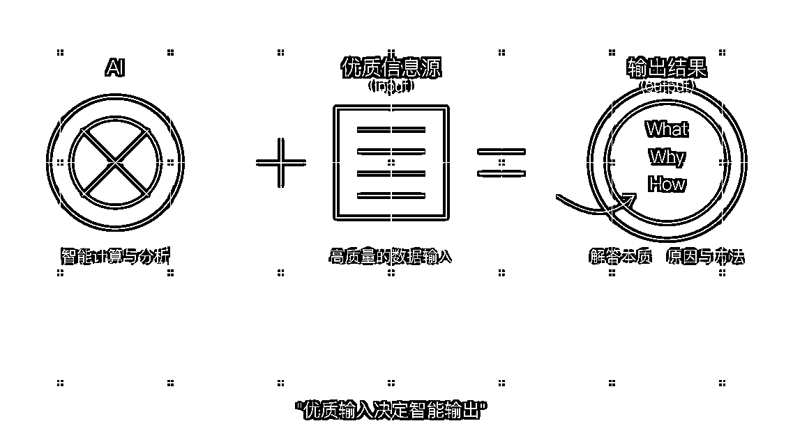

这篇文章想把这段实践的思路分享出来，供参考。

---

## 普通人容易陷入的信息焦虑

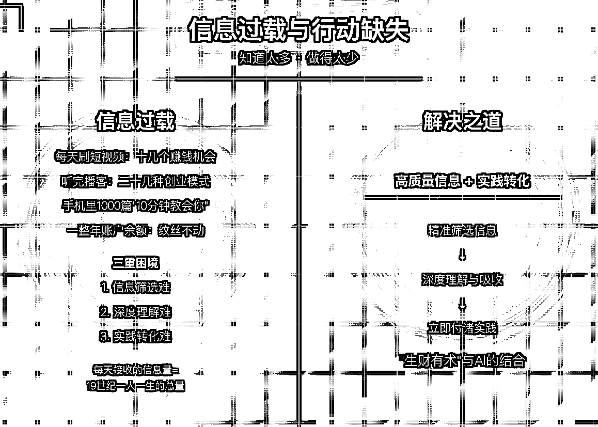

以前的我，每天刷完短视频，脑子里就会冒出十几个看起来能赚钱的机会。

听完一期播客，又会觉得发现了二十几种创业模型。

可整整一年过去，账上数字基本没动。

拥有了大量线索，却没有产生结果。

手机里存了上千条「十分钟月入十万」的笔记，真正迈出第一步的却屈指可数。刷的内容越来越多，自己却始终原地踏步。

这就是典型的过载。算法把注意力推向新奇刺激，而判断力跟不上。

据公开数据，现代人一天接收的信息量，已接近十九世纪一个人一生接触的总和。

大脑的处理带宽却没有同步扩容。

于是出现三重卡点：

1. 筛选困难：什么值得跟进，什么只是噪音？
2. 理解浅薄：能看懂表层，难以消化内核。
3. 落地乏力：明白不等同于能执行。

在变现相关领域，这种困境更明显。

认识的小林曾花五千元买了一套「AI 写作变现课」，学完才发现八成内容在公开渠道就能免费拿到。

这是信息差距，也是认知差距。

越是理解认知差，我越在想：是否能找到一种方式，既能拿到高质量输入，又能迅速内化、快速验证？

答案在「龙哥盟」与人工智能的结合里找到。

---

## 龙哥盟：一个围绕实战的赚钱信息生态

第一次听说「龙哥盟」，是2024年七月，人人玩转 ChatGPT 作者黄小刀跟我提及，

「那里集聚了6.7万人，每天都在分享实操赚钱经验。」

起初我持保留态度。网上教赚钱的平台太多，很多是卖铲子比挖金更赚钱的游戏。

真正进入后，我才看清差异。

龙哥盟不是单纯的知识付费，而是一个完整的赚钱信息生态：

1. 信息筛选：每年沉淀近千篇精华帖，1.9万多条风向标，覆盖主流赚钱方向。
2. 实战闭环：8次以上的「航海」集训营，从理论到落地的完整链路。
3. 高质量人脉：6.7万多名成员中不乏行业头部从业者，形成独特网络。

圈友「紫菜」的经历让我印象深刻：他从龙哥盟挑选优质项目，交团队复制执行，多数项目实现七位数收入。

这体现了核心价值：降低筛选成本，增强行动信心。

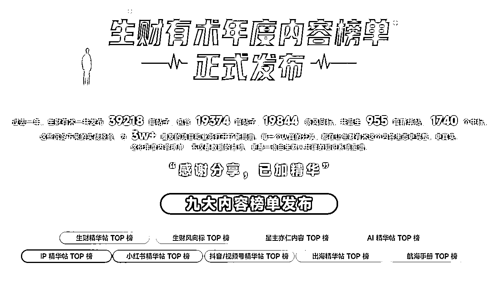

问题随之而来：内容体量这么大，该从何下手？每天能挤出两到三个小时，如何快速吸收？

这时，人工智能成为我的秘密武器。

---

## 人工智能学习，让海量内容十倍速内化

首先，我给自己定了三条使用原则：

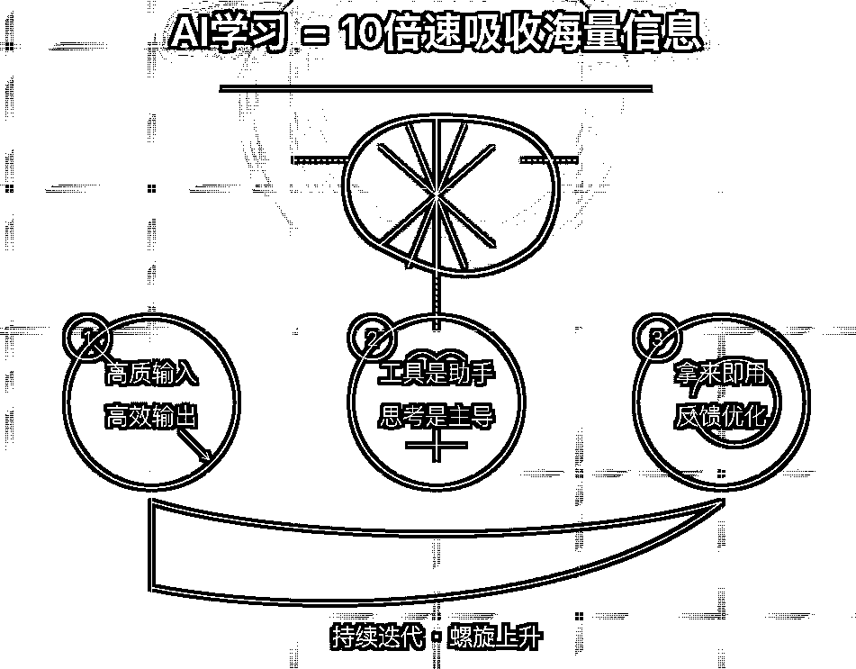

1. 输入决定产出。
2. 工具是辅助，思考是主导。
3. 立刻使用，反馈迭代，不断优化。

在此基础上，我搭建了自己的学习体系，分为三块。

### 第一块：内容筛选与归类

龙哥盟的信息量极大，人工阅读难以覆盖。我让人工智能帮忙先筛后总。

比如处理《赚钱使用指南》这类手册，二十分钟内就掌握了核心玩法和要点。身边朋友通读这份材料花了整整一周。

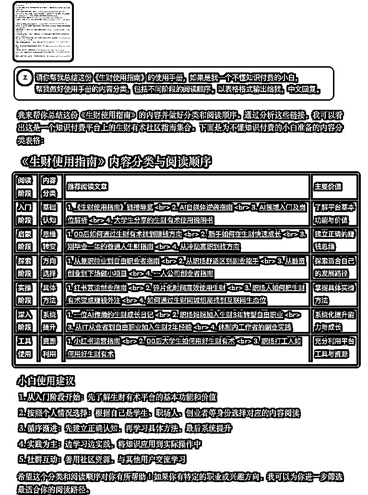

再比如📕垂类内容梳理。

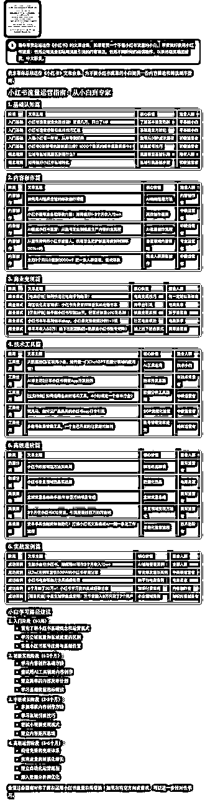

### 第二块：知识转化与深度理解

筛选只是第一步，真正难的是深度消化。

我用「费曼学习法+人工智能」的组合：

1. 阅读筛选后的材料。
2. 用自己的话向人工智能复述核心概念。
3. 让人工智能指出理解偏差与盲点。
4. 要求人工智能提3到5个应用场景问题，检验掌握度。

本质上是给自己配一个刻意练习的陪练老师，快速对齐陌生知识的卡点。

比如：

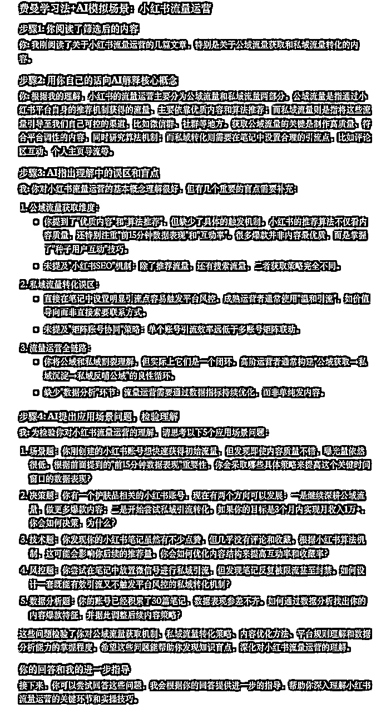

### 第三块：行动计划与执行追踪

知识不落地等于零。

我让人工智能帮忙：

1. 把知识点转化为可执行的任务清单。
2. 把大目标拆成小里程碑。
3. 设计执行追踪表，记录每日进度。
4. 分析执行障碍，提供解决思路。

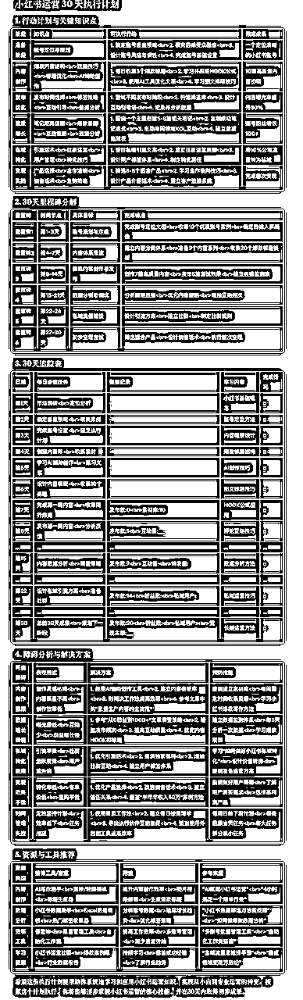

执行中每天反馈进度，人工智能据此调整计划。一个月后，我把5个📕号从零粉丝拉到平均500+，其中一个还获平台官方推荐。结果不算惊艳，但比长期徘徊在百流量状态要清晰太多。

---

## 人工智能+优质信息源的学习模型：觉醒学习框架

传统学习：看十篇文章→理解七成→记住三成→用上一成。

人工智能辅助学习：看一篇精华→理解九成→记住六成→用上四成。

过去一年，我借助人工智能+龙哥盟的方式启动了三个副业项目，月增收两万五千元以上，涉及👸号爆文、代写、小绿书引流。

围绕三个问题展开。

### What：这是什么？核心逻辑？

让人工智能输入并总结航海手册。

输入

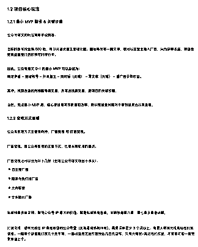

得出：

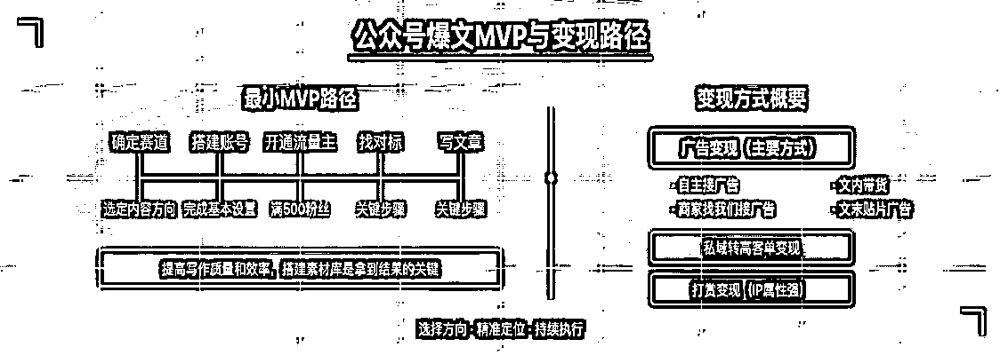

### Why：为什么有效？原理？

让人工智能解释航海手册中的思维模型。

输入：航海手册《赚钱思维课之 MVP 思维》

得出：

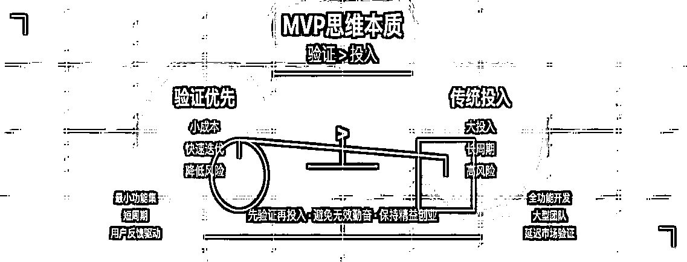

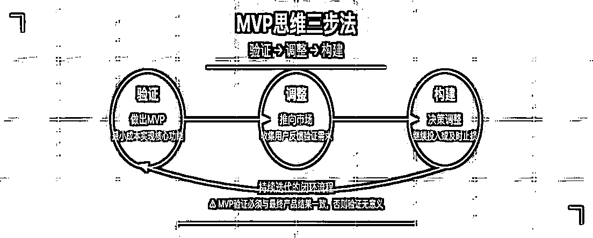

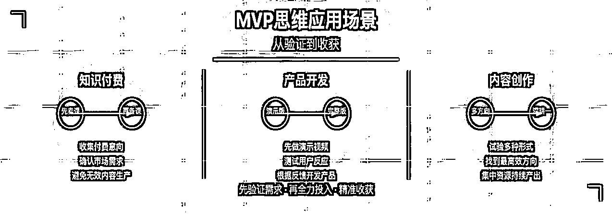

### How：怎么做？步骤与注意？

让人工智能基于航海手册生成提示词并实操。

输入：

输入：

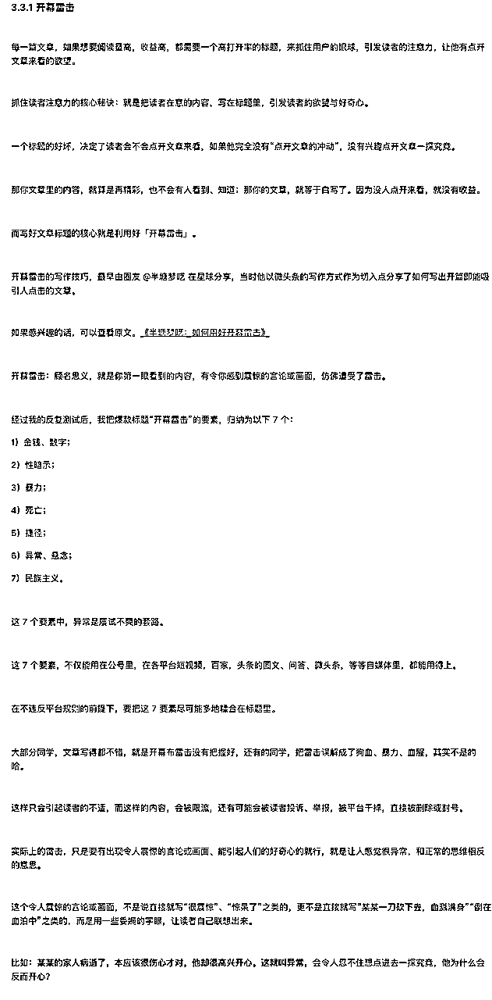

提示词：

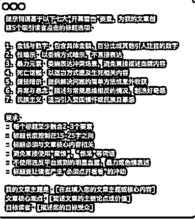

效果：

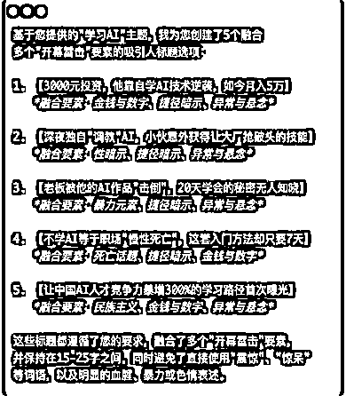

传统模式线性：接收→记忆→应用。

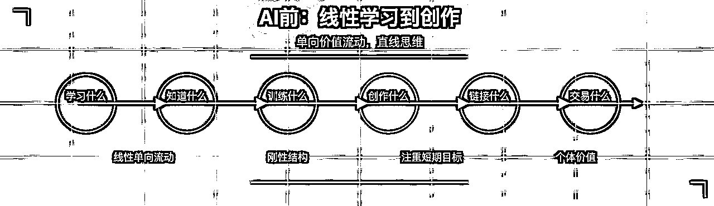

人工智能+优质信息源模式网状：提问→获取答案→提炼模型→应用→反馈→迭代。

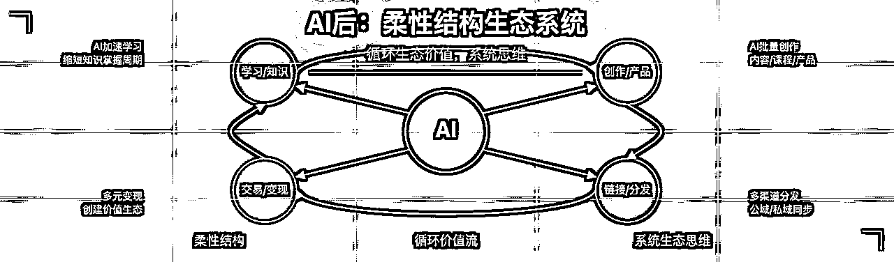

这样我不再是信息的被动接收者，而是知识的主动构建者。人工智能不是替代思考，而是让思考更高效的信息→知识→智慧的催化剂。

---

## 学习是为了创造与分享

随着对人工智能和龙哥盟的深入，我从纯消费者变为分享者。

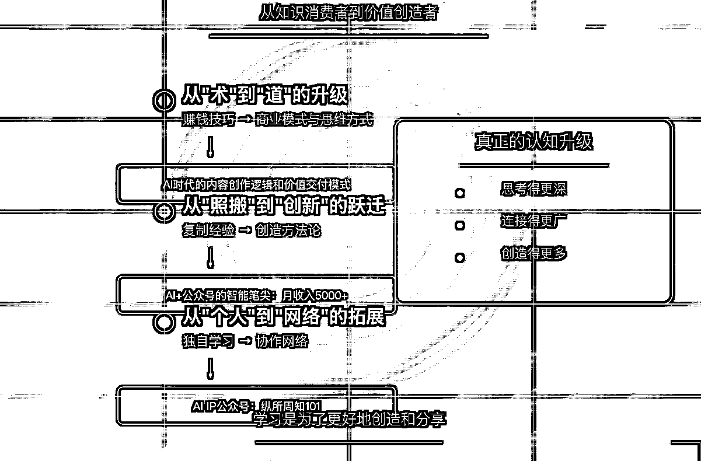

过程中出现了三个转折：

### 从术到道的升级

起初关注具体赚钱技巧，现在更关注商业模式和思维方式。

不再只问「如何用人工智能写爆款文案」，而是思考「人工智能时代的内容创作逻辑和价值交付模式」。

### 从照搬到创新的跃迁

早期复制成功经验，现在能融合多领域知识创造方法论。

我把龙哥盟中学到的👸号爆文运营经验与人工智能自动化技术结合，开发出「人工智能+👸号工具」的智能笔尖，该产品已帮助朋友实现每月五千元以上的副业收入。

```
地址：https://aiawaken.top/dc/v53e930y
```

##### 效果：

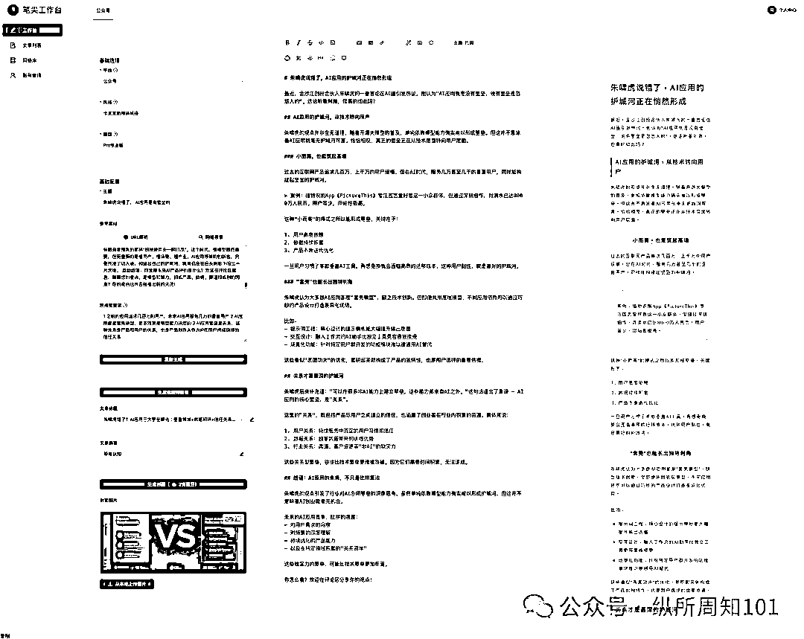

### 从个人到网络的拓展

从独自学习到链接资源，形成协作网络。

我把在赚钱的输出思路用于自己的 AI IP 👸号「纵所周知 101」。

这三个转折让我明白：认知升级不是知道更多，而是思考更深、连接更广、创造更多。

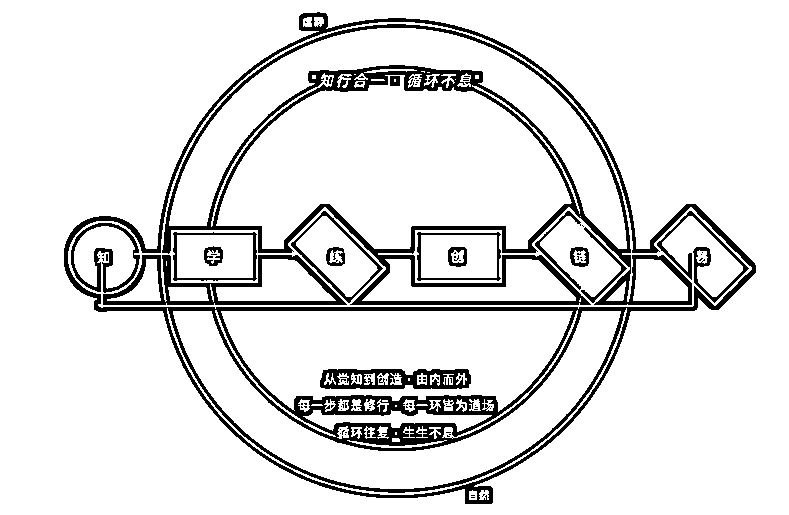

左手学习，右手生产连接。

---

## 2025年的趋势判断

我认为人工智能与知识社群的结合将在2025年进入爆发期。

据微软2025年人工智能趋势报告预测，人工智能驱动的智能体将拥有更高自主性，深入工作生活场景。人工智能不再是简单工具，而成为学习工作的重要伙伴。

我已看到龙哥盟在人工智能能力建设上的动作：

* 人工智能精华速读
* 人工智能智能拆解风向标
* 人工智能导图与搜索
* 人工智能传术师俱乐部

这些功能不仅提升效率，更在重塑获取与应用知识的方式。

未来人工智能+优质社群将带来三大变化：

1. 选择高质量信息源解决信息差。
2. 人工智能学习缩短认知差周期。
3. 从学习到封装产品的周期大幅缩短。

---

## 回顾与收尾

近一年最大的收获不是技术或项目，而是一种学习方法和思维模式。

对信息：不是获取更多，而是获取更高质量。

对内容：不是记住更多，而是提取更多模式。

对方法：不是被动接收，而是主动构建适合自己的系统。

人工智能+优质信息源的组合让我明白：胜出者不是信息最多的人，而是能最有效处理信息并转化为行动的人。

这种元能力会随时间产生复利。

今天快10%，一年后可能是100%，三年后可能是1000%。

工具会迭代，平台会更替，但学习的能力和行动的习惯将伴随终生。

人工智能觉醒思考，方得始终。

最后推荐龙哥盟。

一个稀缺的高质量、可实操的信息源。