# 公众号运营一个月，凭一篇27万阅读起飞，我到底做了什么

> 来源：[https://parwc0x6nb.feishu.cn/docx/VX3hdGNPBotPJdxPPu2cDYrvnsT](https://parwc0x6nb.feishu.cn/docx/VX3hdGNPBotPJdxPPu2cDYrvnsT)

大家好，我是刘同学。了解我的人应该清楚，在4月1号之前，我从未在任何地方聊过公众号的事。因为没碰过，所以也不好乱讲。

自从我开始自学上手后才发现，公众号的盘子比想象中大得多。下面我直接把部分数据摊出来给大家看。

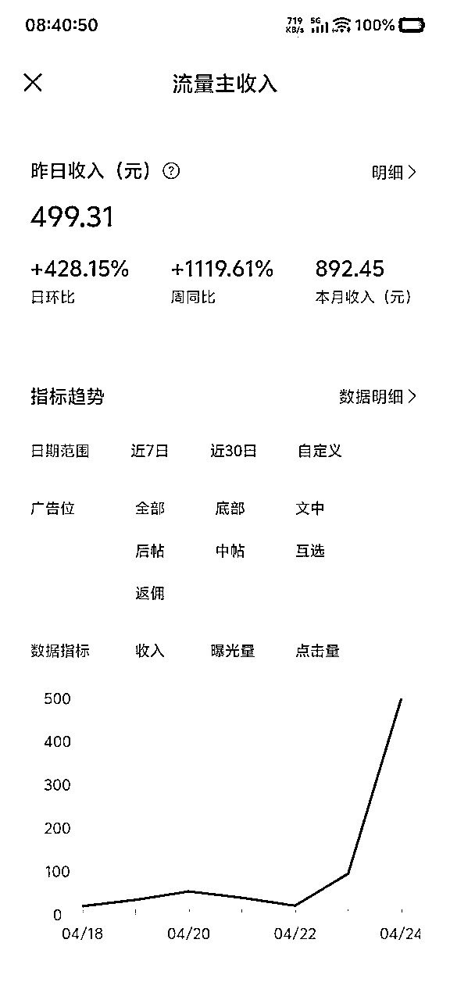

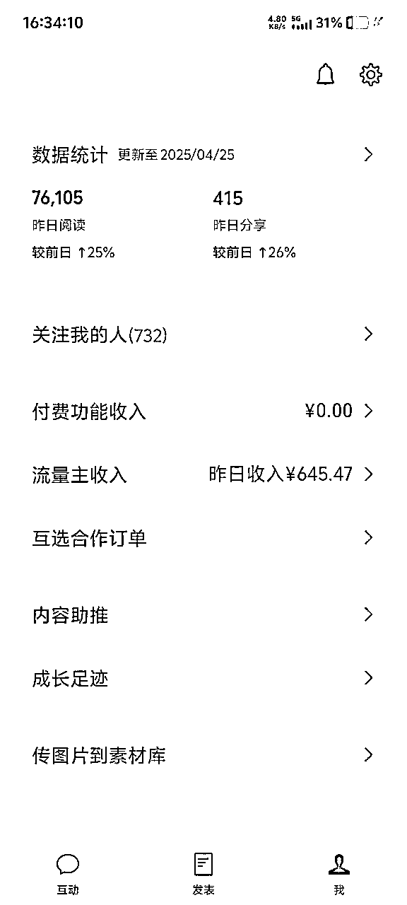

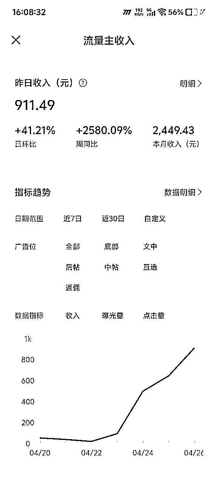

# 一、我为什么入局公众号

因为这是生财有术第12期航海计划里的核心项目。生财把这个项目做到第12期，说明它经得起检验。市面上随便扒一个号，月入几千上万的案例比比皆是，这就足够说明变现能力。

我刚起步时，1万阅读带来的收益就在50元左右，低的时候也有45元。真正上手后才明白，1万阅读真不是难事，10万阅读才有挑战。上面几张图，感兴趣的可以自己算一下。

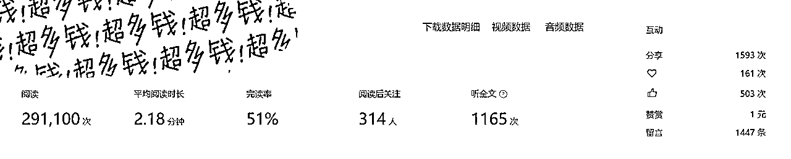

# 二、公众号具体怎么玩

## 先解决涨粉问题

可以看这篇干货合集。https://t.zsxq.com/LeM6H 天津老秦关于公众号涨粉的精华总结

## 我现在在用的涨粉打法

1. 把视频号和公众号绑定起来，同时做视频号直播。
2. 直播别用PPT或图片挂着，一定要用实景。去乡镇集市或者城市核心商圈的十字路口实地开播，时间点选在晚上10点左右。我的号在长沙五一广场直播过，状态好的时候一小时涨粉五百多很常见。
3. 福袋要猛发。直播间3个人就丢3个，4个人就丢5个，8个人就丢10个，直到人数十几人时丢20个。别让每个人都顺利领到，可以让部分人重复抢，把气氛炒热，涨粉速度才会上去。记住，时间就是成本。
4. 不要想着买粉。我以前做过卖粉的业务，买粉贵还容易没售后，而且现在平台对买粉的限制更严，会影响权限。还不如花点时间拉真粉。直播涨粉要一次性猛冲，别三天打鱼两天晒网，否则掉粉快，成本也会越来越高。靠福袋来的粉丝粘性本来就弱。

# 三、从12期航海手册里我提炼出的关键点

## 标题怎么取

标题必须抓人，要带情绪、带钱、带数字，具体套路手册里讲得很细。

## 选题决定成败

选题比文笔重要得多。把时间花在打磨选题上，远比抠内容有用。选题够炸，文章基本不会差，写的人是谁反而次要。

## 怎么找选题

比如要写公众号相关的主题，就去微信搜一搜里检索这个关键词，看过去一年甚至最近一段时间有没有持续出10万+的文章。没有数据支撑的选题，别凭感觉硬写，一定要用数据验证过才稳。

## 文章长度控制

字数建议控制在800到1500字之间。原因跟广告位有关。没必要深究内嵌广告和底部广告的展示次数，关键是研究选题和内容与广告的匹配度，因为广告是根据内容匹配的。

# 四、拿“河南麦子”做例子，全流程拆解

最近河南麦子这个话题很热，就用它来演示流程，不作为最终选题建议。

## 先做搜一搜验证

我会搜“河南的麦子”“河南麦子”等关键词，看近期有没有爆款。如果有，我再判断哪个细分角度更有爆发的可能。下面这组数据能看出，最近半年播放破1万、破10万的文章非常少。最近七天只有一条4.2万播放的，能不能成为那个爆的那个，就看运气了。这里只是演示，就先用它。

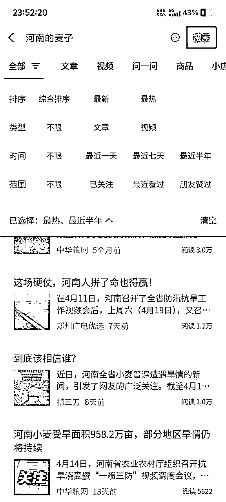

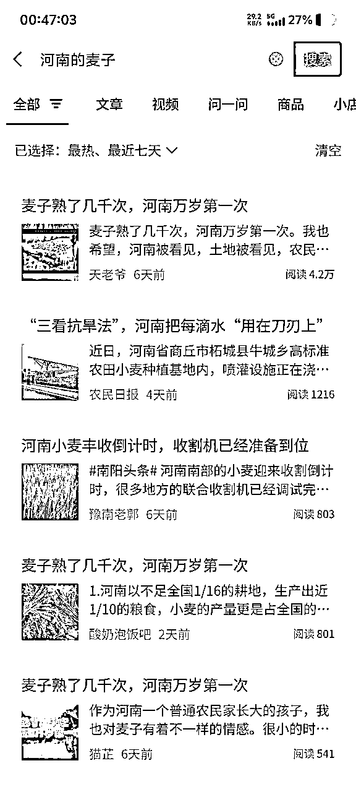

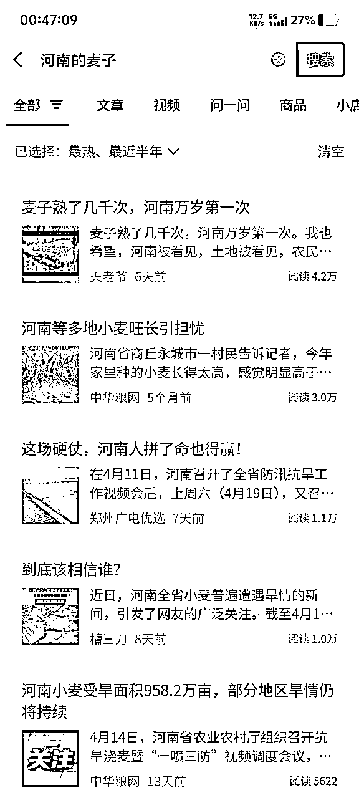

## 用豆包定标题

我用的选题是“麦子熟了几千回，河南万岁第一次”。打开豆包后我会说：你好，我是公众号写手，请帮我基于这个选题写一个爆款标题，要求有情感冲突。

第一次出来的标题太平淡，我让它重写。

第二次给出的“当千年麦香撞上第一次河南万岁，这声呐喊藏了多少委屈”我觉得可以，就用这个方向。

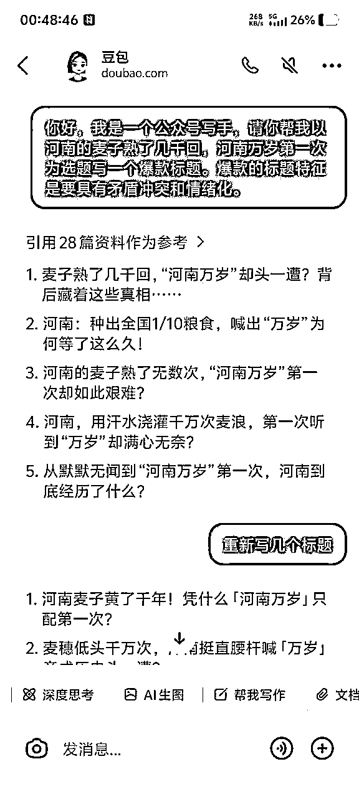

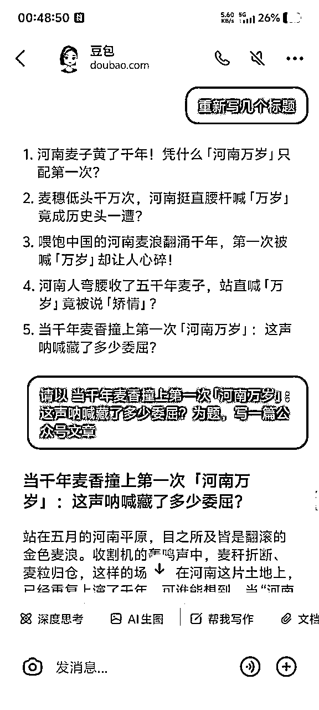

## 让豆包出初稿

接着对豆包说：请以当千年麦香撞上第一次河南万岁，这声呐喊藏了多少委屈为题，写一篇公众号文章。生成后直接复制到飞书，用飞书自带的公众号编辑器整理，不需要额外付费工具。

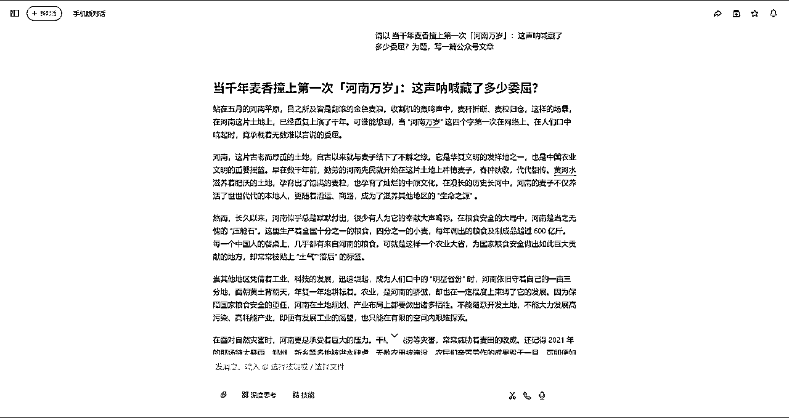

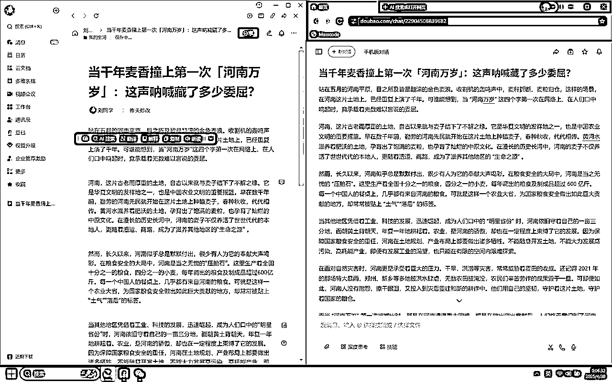

## 最后的精修环节

* 用飞书的文字排版助手先排版，再过一遍公众号排版器，最后复制到后台。
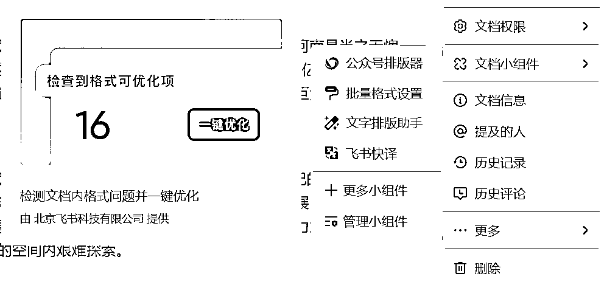

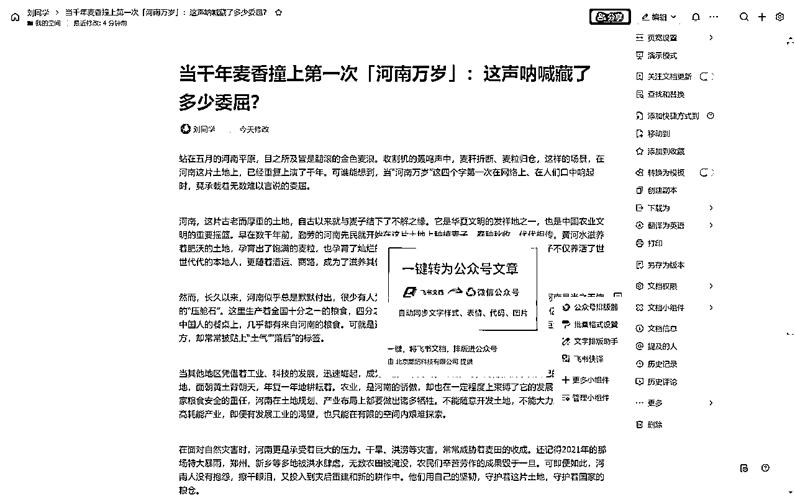

* 排版我只加3到4张图。图可以在小红书找素人博主的素材，优先选AI生成的，避免真人出镜，安全第一。
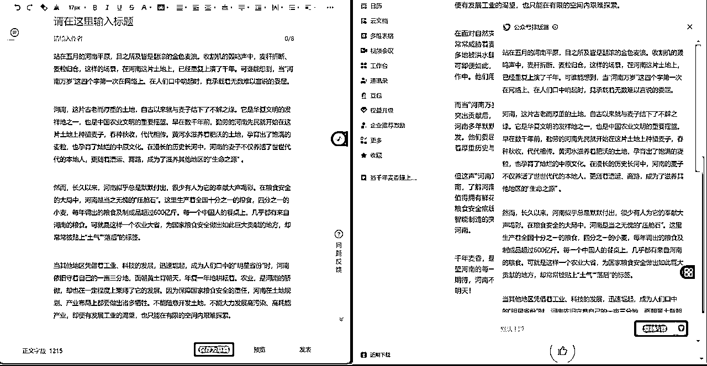

* 检查广告位，这篇1215字能放两条广告就可以直接发布了。
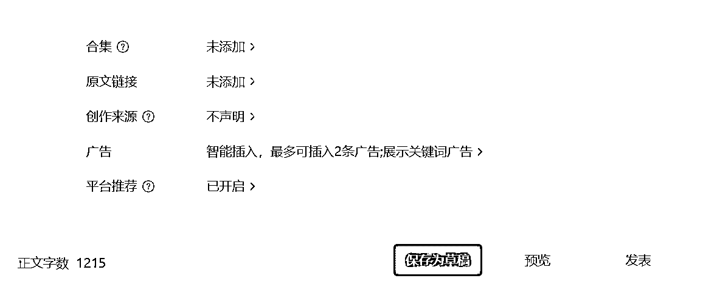

# 五、常见疑问解答

以下问题是我收到最多的，原话回复。

## Q：豆包直接生成就能发吗？
A：当然不行。文中也说了最后要精修，必须改完才能发。

## Q：精修具体怎么做？
A：第一步，核对字数，大于1500或小于800就增减。
第二步，把看起来不顺眼的地方改掉，比如markdown的大标题格式。
第三步，把文章里生僻的词换成大白话，让普通读者能看懂有代入感。
第四步，找几张符合主题的图，均匀分布在文章里，最好3、4张横图，注意广告会出现的段落别挡住。
第五步，结尾要改成能引发共鸣或者让人想评论的句子。
进阶做法，可以在文中埋几个数据或用词上的小槽点，让读者觉得作者不够专业，从而产生评论和讨论。

## Q：公众号的推荐机制是怎样的？
A：文章一旦起来，推荐周期会拉得很长；如果没爆，可能三四天就推完了一半甚至全部。之后随着账号整体权重提升，或者其他文章爆发，旧文章也可能迎来第二波流量，不过增幅不会特别夸张。

## 我想强调的几条核心建议

1、项目要早入局。时间成本比金钱成本更重要。我建议选时间。一天开流量主和十天开流量主，差距非常大。

2、次要环节快，关键环节慢。开流量主快、排版快、选图快。选题要慢、要抠；精修要认真，不能敷衍，这点很重要。

其实也没什么秘诀，就是多发多测。我总共发了十几篇就爆了。多发、多测试、多实操，总有一篇会中。一旦爆了，单篇收入一两千很正常，月入四五千、五六千并不是梦。这种生意为什么不做？记住，只有真正上手才有真实体感，才能拿到真实结果。

补充：公众号排版器飞书链接https://app.feishu.cn/app/cli_a782728235f1500c?from=share&visit_from=searchlz

# 六、账号与作品展示

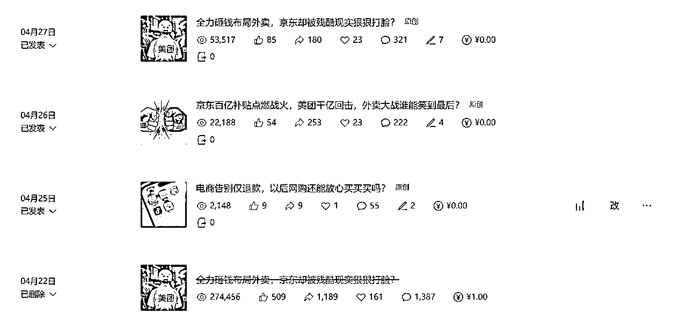

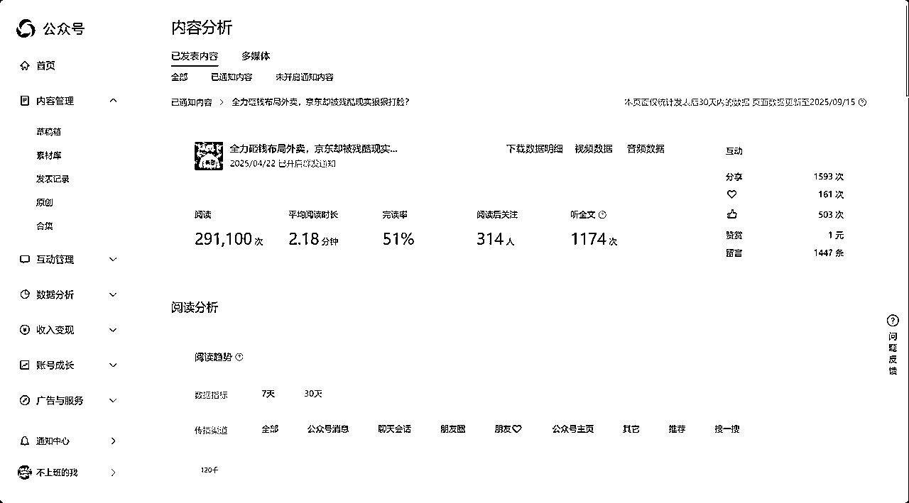

文章内容展示