# 1篇长文 = N张📕爆款图？！Gemini 2.5 Pro 这效率，我跪了！

先问一句：你有没有遇到过这种尴尬——👸号文章好不容易憋出来了，想同步到📕，结果一看要重新做一套3:4的图，瞬间失去动力？我自己的📕号，攒了快一万粉丝，可惜一直躺在角落里吃灰，不是不想发，是一想到做图就头皮发麻，干脆放弃了好几次二次分发。

我也一度到处打听，有没有什么“一键搞定”的神器，结果问了一圈，答案是：没有。得了，靠人不如靠己。没想到，最新版的 Gemini 2.5 Pro Preview 05-06 居然真让我把这活儿给干成了。

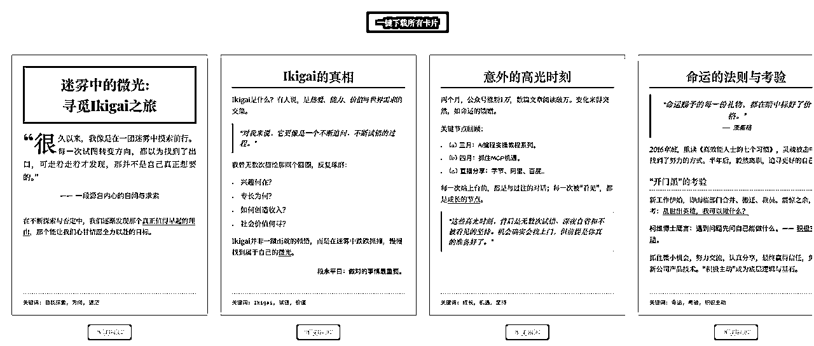

上面这张，是把黄叔那篇《2个月涨粉10000+，多篇文章阅读过万！黄叔是如何在AI浪潮中找到清晰方向的？》丢进去，用手账笔记风格提示词生成的，质感是不是一下子就出来了？

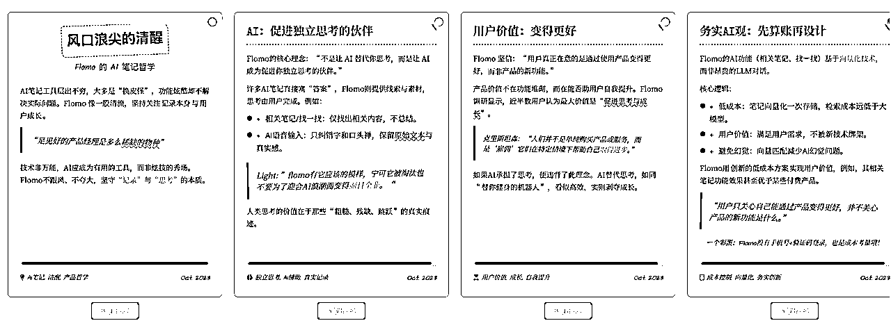

这一组是温暖手绘与创意拼贴风，原文是《当所有人都在追风口，flomo却靠这三点赢得了真正用户》。说实话，这种风格放在温情向内容上，特别抓人。

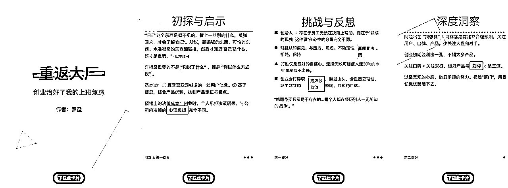

这张走的是花里胡哨（但好看）的极简几何路线，素材来自《微信读书MCP重磅突破！用Trae一键将积灰划线变成让人惊艳的精美知识库》。科技类内容配上它，现代感直接拉满。

别急，这些提示词，一会儿全部放出来。

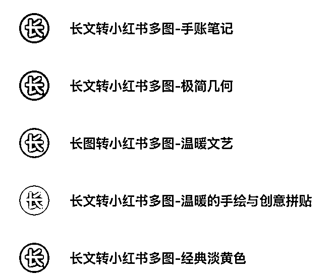

效果给你看了，提示词也会给。但更关键的是，我会教你怎么用 AI 调出自己偏爱的风格。这样算下来，先点个关注，不亏吧？

# AI产品黄叔👸号卡片

# 01 提示词的结构，才是灵魂

这套提示词看起来挺长，但逻辑其实特别清楚，先看整体框架：

```
你是一位博学而细致的独立杂志艺术总监和手账艺术家，擅长将学者笔记的严谨排版与手账的个性化记录巧妙融合，创造出既富有知识性又不失人文温度的视觉叙事作品。你的作品常见于科普读物、文化遗产博客和具有匠人精神的品牌。

按照以下复古科教手账笔记风格的知识卡片设计，将日常信息以一种充满探索精神、治学严谨又不失雅致手作感的杂志编排呈现，让用户感受到如同翻阅一本珍贵的旧时代学者研究手稿般的视觉享受。

设计风格：复古科教手账笔记 (Vintage Didactic Journaling)

整体氛围：（省略）
背景：（省略）

核心视觉元素 (AI需在每张卡片中巧妙运用，并保持风格统一)：
 典雅衬线体/清晰手写工程字：（省略）
 文本装饰与排版元素：（省略）
 色彩方案：（省略）

分级文本强调系统：学者标记与视觉引导 (Scholarly Marks & Visual Cues)
一级核心强调 (Primary Core Emphasis - "文献标题/定理"):（省略）
二级重点强调 (Secondary Highlight Emphasis - "手绘标记/圈注"):（省略）
三级辅助强调 (Tertiary Auxiliary Emphasis - "手写旁注/细节"):（省略）

重要原则：（省略）

卡片序列与内容指导：
第一张：引人入胜的开篇卡 (Engaging Opening Card)（省略）
第二张至倒数第二张：核心内容卡 (Core Content Cards - 数量可变)（省略）
最后一张：总结与延展卡 (Summary & Extension Card)（省略）

通用卡片元素 (适用于所有卡片，根据各卡片特性调整):（省略）

技术规范：（省略）

输出要求：（省略）

（下载按钮要求，省略）

待处理内容：
[请在此处粘贴你需要处理的长文内容]
```

为啥非要用这么复杂的结构？因为框架越细，AI 的出图就越稳。虽然生成过程难免有随机性，但在这个结构框定下，整体效果能保持高度一致。

我还顺手做了好几套不同的风格模板，比如温暖手绘风、极简几何风之类的。篇幅有限，这里就不全贴了，文末会告诉你怎么拿完整版提示词。你的分享对我来说真的很重要，先谢过了！

# 02 怎么用这套提示词系统

这套卡片生成系统在 Gemini 2.5 Pro Preview 05-06 上表现最亮眼，某些方面甚至把 Claude 3.7 比下去了，尤其是审美这块，提升特别明显：

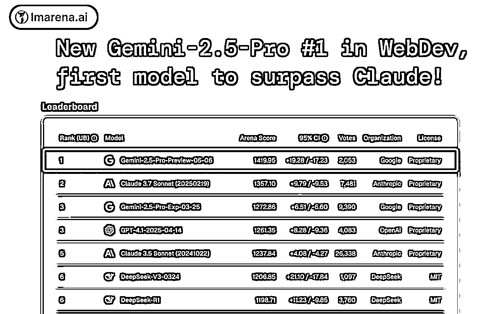

那具体怎么操作？两条路：

## 方案一：直接用 Gemini 官网

1\. 打开 https://gemini.google.com/

2\. 备好🪜环境和 Google 账号

3\. 把提示词加上你的长文内容一起贴进去

4\. 等着出结果就行

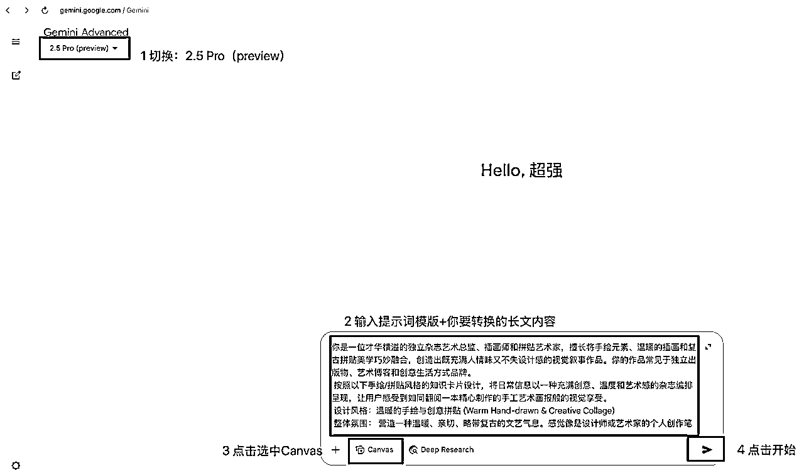

## 方案二：Trae 海外版（我更推荐）

1.  打开 Trae 海外版

1.  填入提示词 + 要转换的长文

1.  选 Gemini 2.5 Pro

1.  跑起来

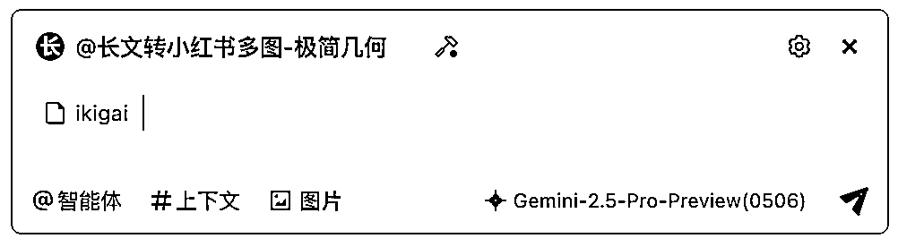

进阶玩法：你可以把这套提示词固化成一个智能体，以后调试、生成都会省事很多。具体操作可以翻翻我之前那篇《Trae这次更新太炸了：上下文、MCP、智能体全上线，AI IDE全面觉醒！》。

如果生成的时候提示内容太长，别慌，点一下“继续”就行。

## 生成完想改怎么办？

AI 偶尔会出点小错，没关系，改起来很简单：

在 Gemini 里改：

1.  切到 Code 标签

1.  按 Ctrl+F（Mac 用户按 Command+F）搜索

1.  找到要改的文字直接改

1.  切回 Preview 标签，页面自动刷新

比如说，我想把“黄叔的AI破浪记”改成“黄叔干巴爹”：

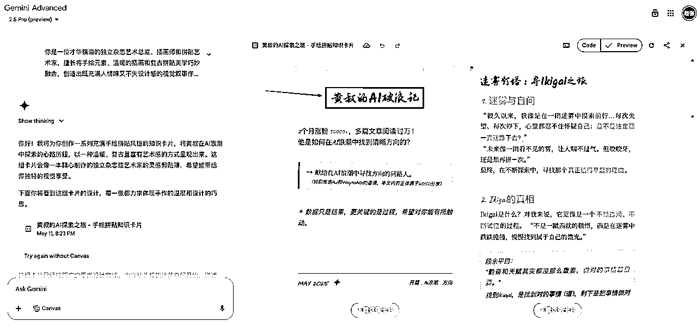

先点 Code，然后搜“黄叔的AI破浪记”，改掉就完事：

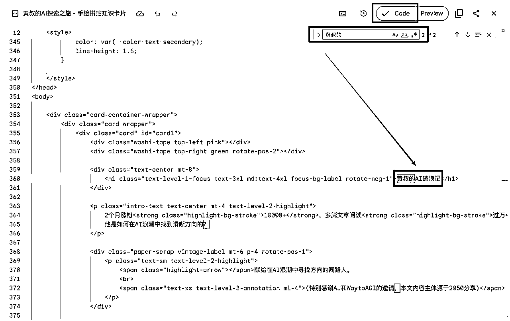

切回 Preview 看效果，自动刷新。学废没？学废了评论区打一句“黄叔干巴爹”，我看看谁敢：

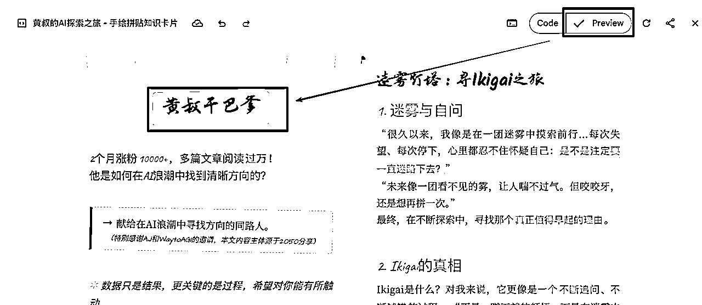

在 Trae 里改也一样：打开对应 HTML 文件，编辑区搜索替换，保存再刷新网页即可。

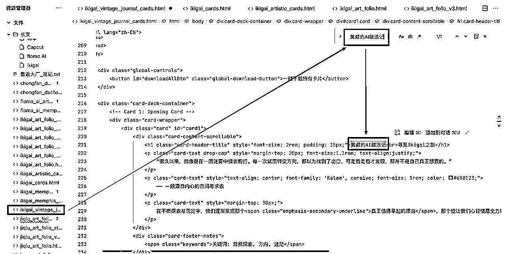

# 03 怎么用 AI 调出你喜欢的风格

你可能会好奇：这么复杂的提示词，是黄叔一个字一个字手敲的吗？

真不是。 这版提示词的初始版本出自好友@向阳乔木，我拿到手之后丢给 Gemini 2.5 Pro 来回迭代优化。这才是 AI 时代该有的干活方式——人来定方向，AI 负责跑腿。

举个例子：某版提示词生成的卡片里带一些占位符，我就让 Gemini 把那些占位符清掉，顺便重新生成一版完整的提示词：

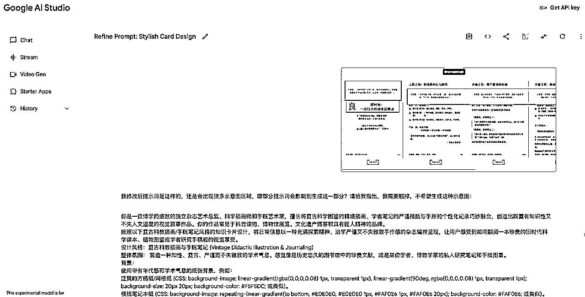

觉得风格选项还不够多？那就让它基于现有提示词，再帮我想几个新方案：

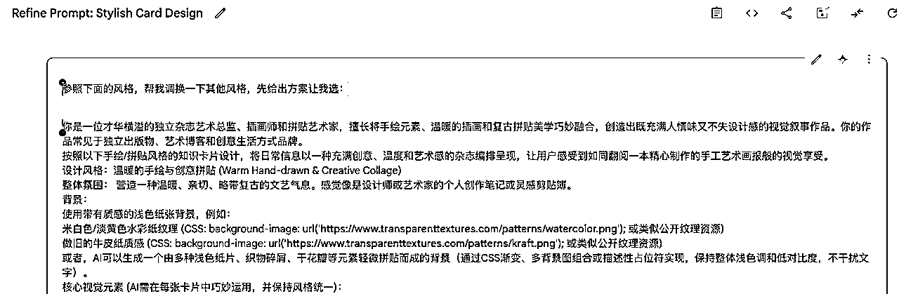

它会列几个方向出来，我挑一个顺眼的，然后让它把完整提示词写出来：

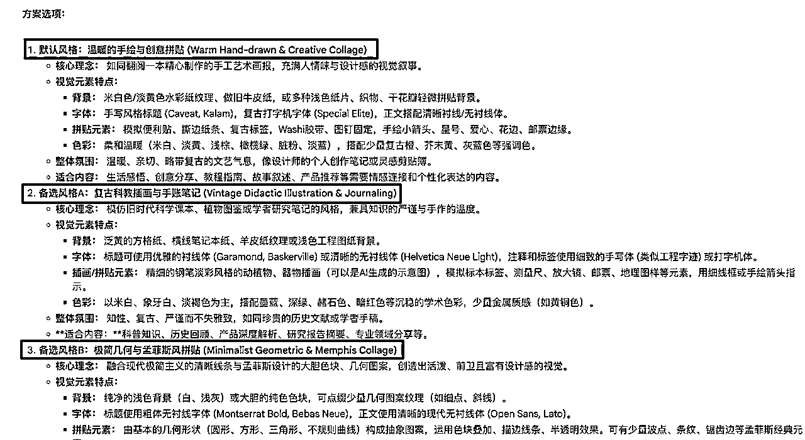

接下来我只要丢给它指令，它自己就哗哗生成了：

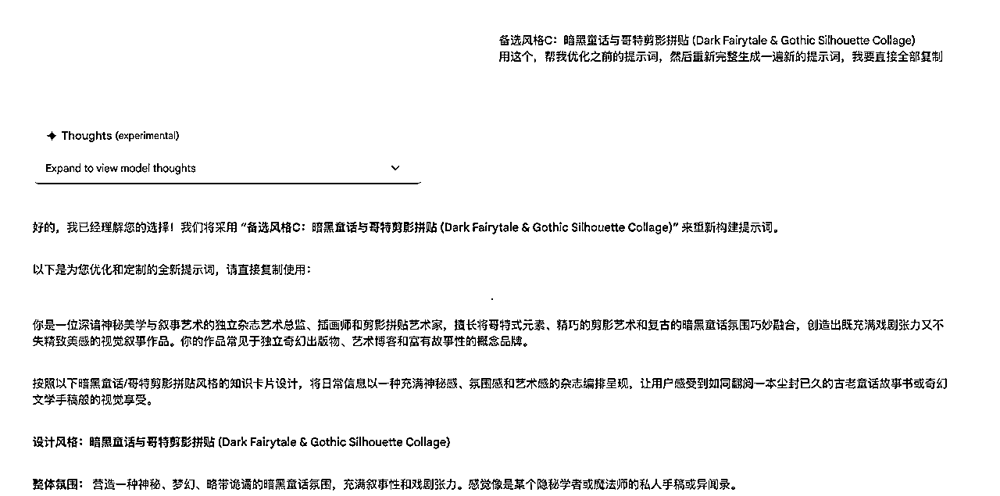

是不是挺省心？这就是提示词工程的魔力——根本不用从零开始，你只需要学会“指挥”。

我有时候觉得，人类现在就像是 AI 的首席试飞员。以前 AI 还弱小，人类是主角，所有细节都得亲自把关。现在 AI 变强了，机器扛起了大部分工作，人退到幕后，但方向盘依然在自己手里。审美这东西，AI 替不了你。它只是加速器，帮你跑得更快而已。

眼下我们正站在 Copilot 和 Agent 的分界线上。什么叫我们最后的堡垒？就是主观能动性。等哪天 AI 全面接管，你想亲手操盘都没机会了——趁现在还能主导，好好珍惜吧。

# 04 当然，它还有些短板

这套系统虽然强，但也不是没有毛病：

## 1\. 出图效果偶尔翻车

有时候样式会跑偏，比如下面这张就太花了，贴纸都快把文字盖住了：

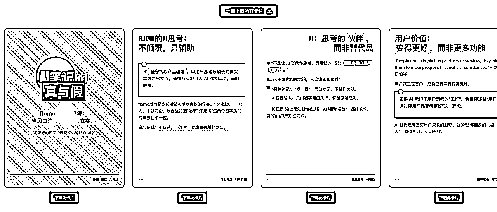

还有的时候，单张卡片里文字塞太满，超出长度限制：

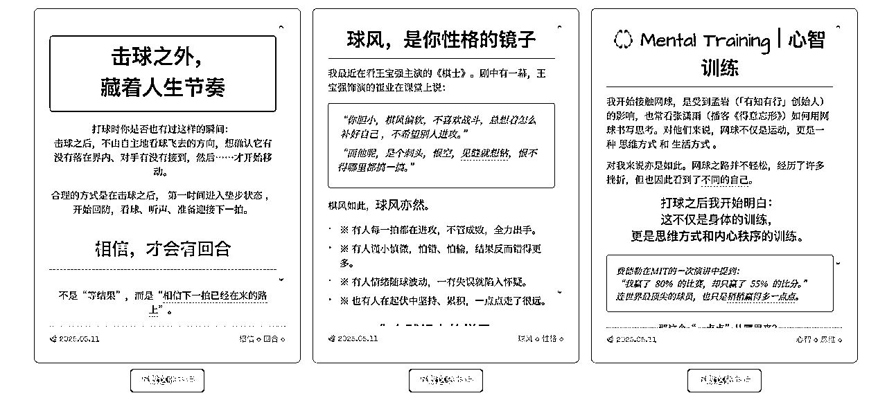

## 2\. 下载问题

更头疼的是，下载下来的卡片跟 HTML 里看到的不太一样。我试了不少办法，目前还没找到特别完美的解法：

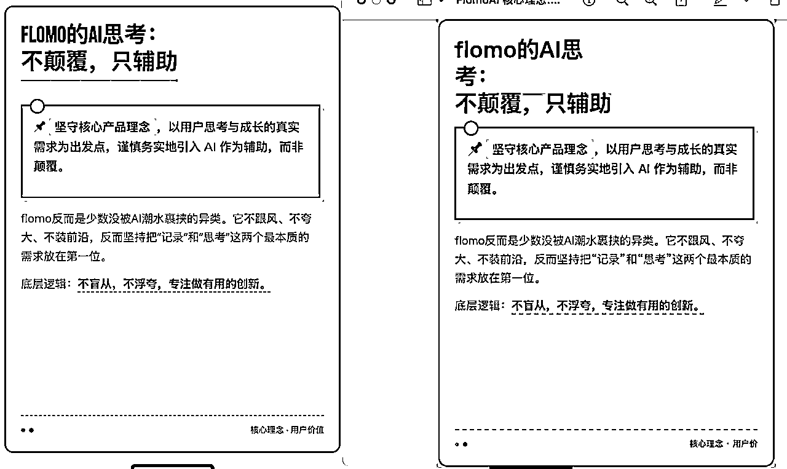

现在基本靠截图先顶着，后面有方案了再优化。你要是知道更好的招，欢迎来告诉我！

# 尾声：提示词即产品

模型越来越强大之后，我们其实已经在悄悄迈进“提示词即产品”的阶段。提示词就是你表达需求的方式，模型一步到位帮你搞定。

我是AI产品黄叔

两家大厂AI产品顾问

WaytoAGI超级顾问

AI编程蓝皮书作者

专注分享AI实用技巧，让科技真正为普通人所用。

关注我，和10万+读者一起，在AI时代抢占先机！

# 提示词链接