# 第九年418 伙伴裂变攻略全集

> 参考来源：龙哥盟官方公开资料整理，助你快速掌握本季裂变玩法、激励机制与资金结算。

## 前言

赚钱陪伴大家走过九个年头，期间大量伙伴自发把平台介绍给亲友、同事、粉丝。仅上一个自然年，就有逾千名老用户成功带进一名新成员，这份信任令人珍惜。

今年418，平台再次开启裂变窗口。本篇把规则、码获取、话术素材、提现流程串成一条线，方便直接上手。蓝色标题可点开查看详情。

## 一、裂变规则总览

### 活动窗口

🗓 2025年4月18日20:00 起至 4月25日20:00 止

* 窗口内拉新可享全年优惠价 2765元/年
* 窗口结束后价格回升至 3365元/年
* 裂变仅针对首次入圈的新人，旧成员续订不产生奖励，也不计入本次统计

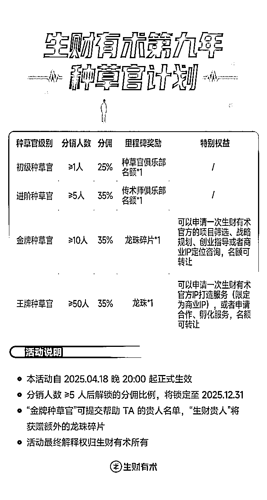

### 返佣梯度

* 累计带来 ≥1 人：基础返佣从日常20%升至25%，单笔预计约700元
* 累计带来 ≥5 人：返佣升至35%，单笔预计约1000元；该梯度将固定至2025年12月31日

### 伙伴身份权益

* 达标1人：获评第九年种草伙伴资质，可申请加入种草社群，与数百位同行交流运营方法，并对接平台顶级种草人
* 达标5人：可申请进入传道人社群，汇聚千余名核心共建者，包含头部作者、实战导师、风向标获得者等，深度碰撞
* 达标10人：可申请一次平台团队提供的个人IP定位或项目战略梳理，并获一枚龙珠碎片里程碑
* 达标50人：可申请一次官方IP打造或联合孵化服务，并获一枚完整龙珠里程碑

### 额外致谢

* 在📕、知乎等公开渠道自发输出真实使用感受的成员，可联系服务官鱼丸领取额外术值
* 累计达10人的金牌推广者，可为其指定的赚钱贵人申请一枚龙珠碎片

## 二、裂变码获取

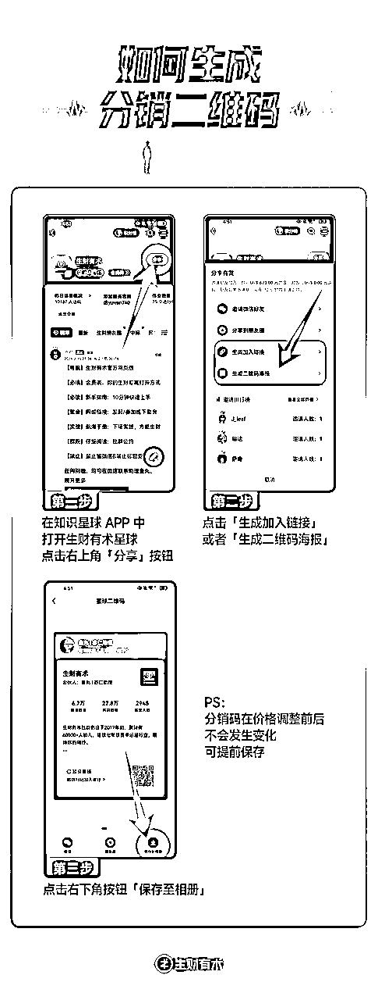

## 三、如何向潜在用户介绍平台

可直接复用下方素材，也可按自身人设与受众微调。

### 一张图看懂赚钱

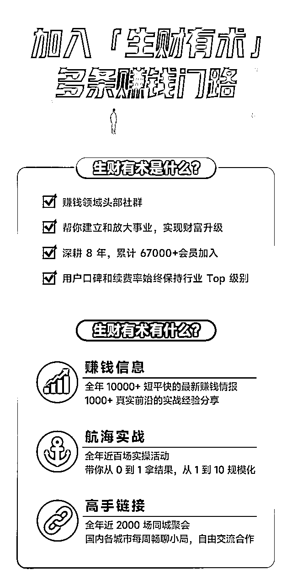

### 第九年权益主视觉

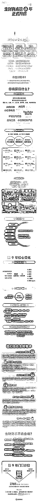

#### 赚钱资讯

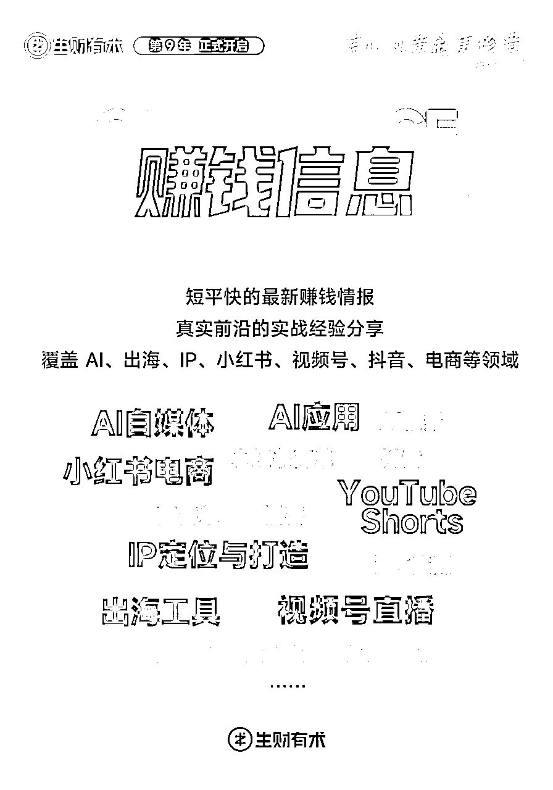

#### 实战航海

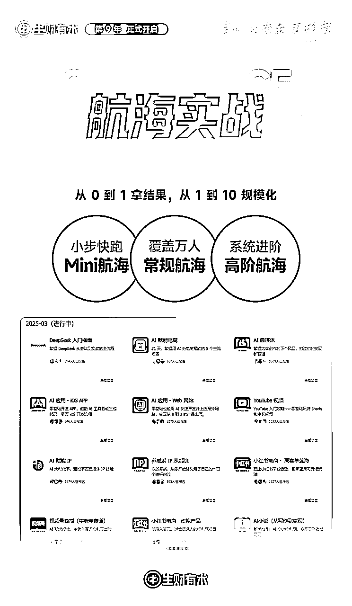

#### 资源对接

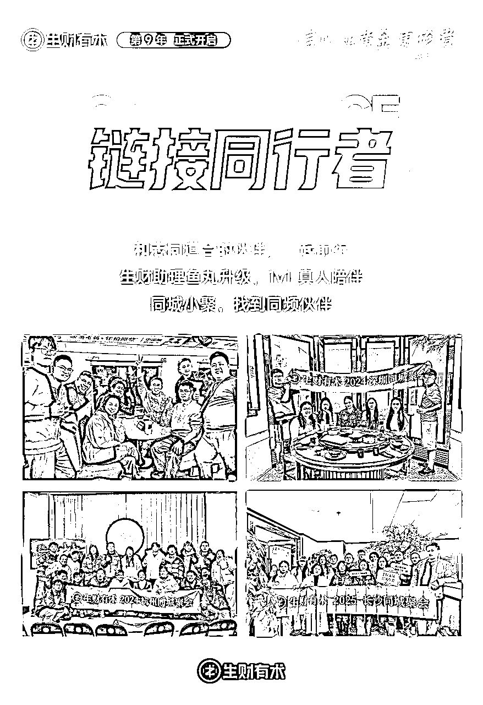

#### 社群生态

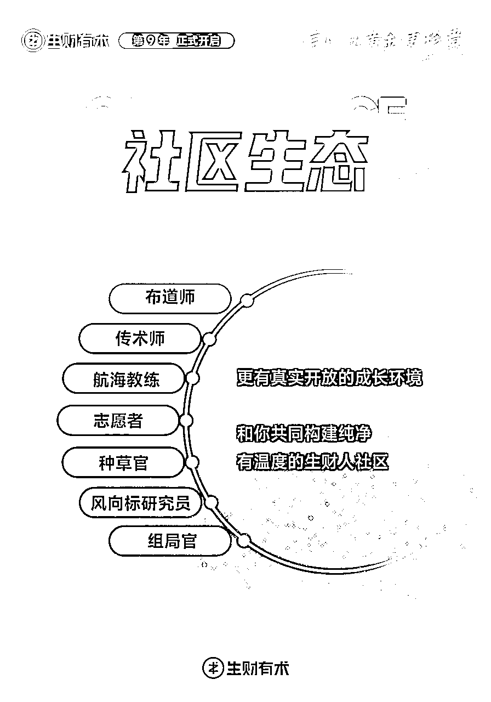

建议将上述内容直接推送给意向对象，或挑选适配的指引文档发送，帮助对方快速感知价值。

## 四、返佣提现

### 结算节奏

* 新人加入后若3日内未取消，奖励进入待结状态
* 7天后转为可提状态，25%部分可在知识星球App内自助提出
* 累计达5人后额外解锁的10%部分，预计5月由团队线下统一结算

### 提现路径

25%可自助操作：知识星球App → 我的 → 我的钱包 → 提现

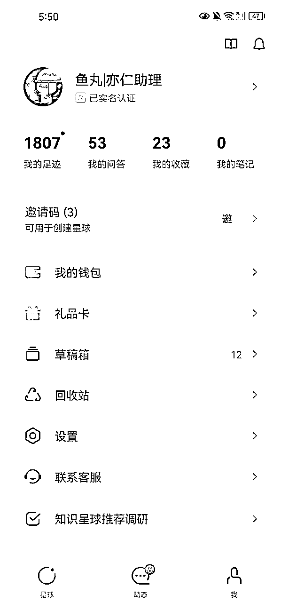
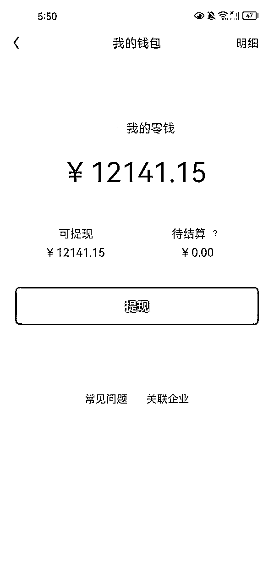
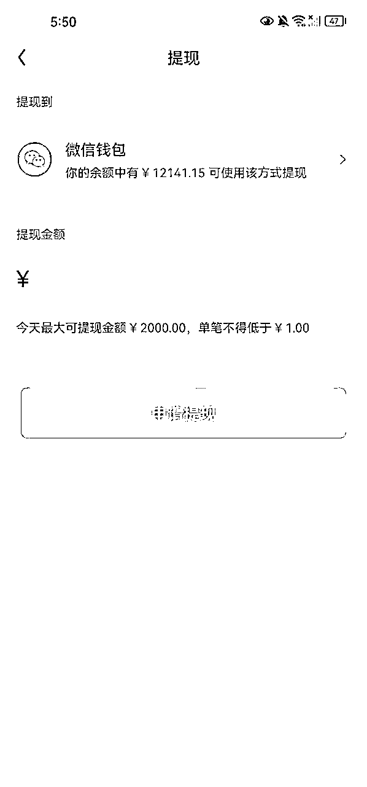

### 手续说明

* 2019年8月20日后产生的个人星球收益，平台收取20%服务费
* 到手示例：2765 × 25% × 0.8 ≈ 553元
* 细则见知识星球官方知识库

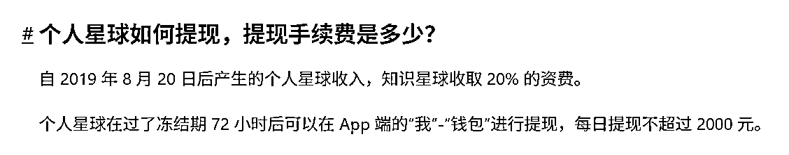

## 五、近期关键节点

| 日期 | 事项 |
|---|---|
| 4月15日 | 龙哥 & 坤汀答疑直播 |
| 4月16日 | 第九年福利《纳瓦尔宝典》赚钱版上线 |
| 4月17日 | 《如何使用龙哥盟指南》发布 |
| 4月18日 | 第八年年度榜单重磅公布 |
| 4月19日 | 优惠倒计时6天 |
| 4月20日 | 优惠倒计时5天 |
| 4月21日 | 优惠倒计时4天 |
| 4月22日 | 优惠倒计时3天 |
| 4月23日 | 优惠倒计时2天 |
| 4月24日 | 优惠倒计时1天 |
| 4月25日 | 20:00 起恢复原价 ¥3365/年 |

窗口期仅一周，时间紧任务重。若身边有人在探索副业、变现或商业认知提升，不妨把本篇转给他，共同把握第九年的裂变红利。