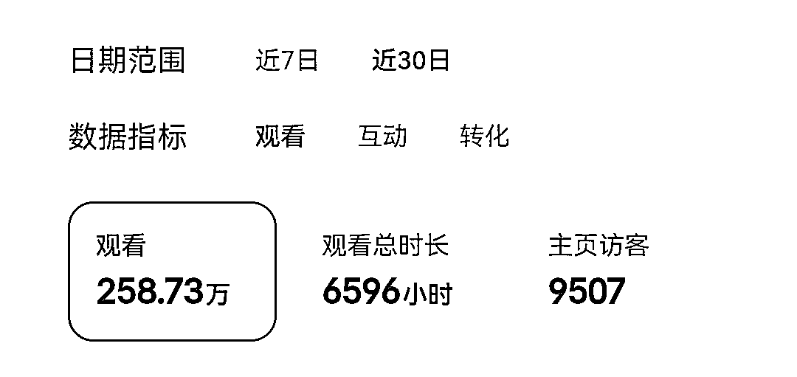
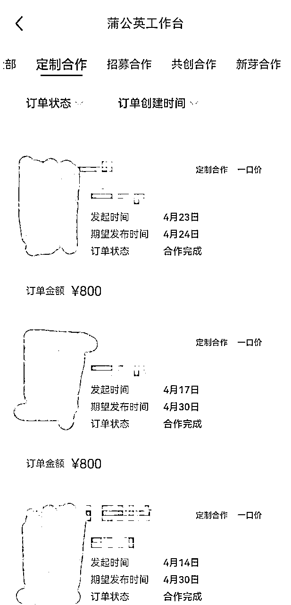
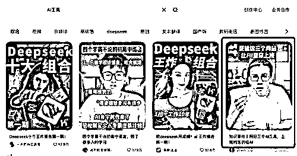
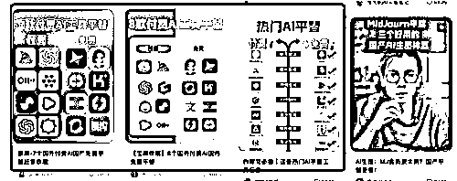
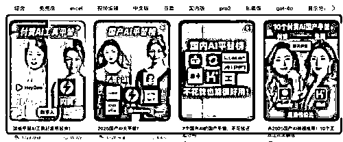
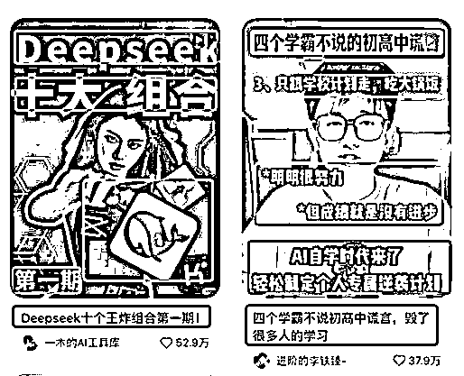
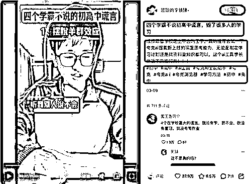

# 单枪匹马做 AI 自媒体航海，零基础起步，六天变现，我是这样跑通的

> 来源：[https://qq8alk00fg.feishu.cn/docx/WyGydQ4XroPMS2xgjaIcyT4wnWh](https://qq8alk00fg.feishu.cn/docx/WyGydQ4XroPMS2xgjaIcyT4wnWh)

# 🤖️ 起点

三月航海开启前，@亦仁 在直播里丢下一句话：现在新人进来，AI 自媒体是门槛最低、机会还在的赛道。这句话在我脑子里扎了根。后来星球里又刷到一条异常信号，有位同行说自己做了几天 AI 账号，粉还没几十个就已经在谈商单了。我立刻意识到窗口期到了。

彼时三月航海已经进行到一半，我对 AI 的认知几乎停留在当搜索引擎用。于是我先把生财里所有关于自媒体、AI 自媒体的干货帖子扫了一遍，顺手把航海手册也啃完了，当天就开干。

到现在为止的战绩：

✅ 空号起步 3 天就通过了蒲公英，20 多天粉丝冲到 9000+；
✅ 第 3 天就撞出了第一条百万播放，后续账号累计播放已破 258w，后面会说我在这块踩过的坑；
✅ 第 6 天拿到第一单，截至目前累计接了 4 单，筛选了单价相对靠谱的，这里面也有教训可讲。

在这里必须再谢一次 @亦仁 的点醒和信念打底。拿到第一单后，@婧婧 当场语音给我拆解怎么把价值吃满，一二三四条列得清清楚楚，账号运营的注意点也逐项提醒了，我当时没全做到位，后面都在逐条补上，真心感恩。

另外感谢 @小鱼 ，我把初稿发出来后，他从新手视角给了几条降门槛的修改建议，我全部吸收进去了。还有我的鱼丸 @李李 ，加班加点帮我改文、配图，让这篇变得更好读，也谢谢你。

下面我按我实操的顺序，把账号定位、找对标、挑爆款、复刻爆款、拿商单这几个环节摊开讲，尽量干、尽量能直接上手。

# 一、账号定位📍

航海手册里对定位的拆解已经很透了。结合我当时 AI 小白的水平、自己的兴趣点、想走的变现路线，以及希望尽快看到结果的诉求，我先锁定了两个大方向：AI 工具分享和热点趋势解读。

确定大方向后，还需要用 AI 快速评估两种定位的变现难度、天花板和上手成本。我让 AI 做了一次粗颗粒度的对标调研，得到一份分析报告。想入场的朋友可以直接参考这个思路，再结合自身情况锁定细分赛道。我最后选定的是 AI 工具分享 + 商单变现，这条路让我最快拿到反馈。

P.s. 这一步看起来费脑，但绝对不能省。

# 二、找对标 ✍️

把生财里小红书、自媒体、AI 自媒体的相关精华帖学完并上手后，我总结出找对标的几条实操原则：

1. 只跟会赚钱的账号学，尤其是变现方式和你目标一致的，越像越好，复制起来更快。
⚠️ 远离数据陷阱：笔记做得精美、播放很高、粉丝很多，但不赚钱的账号，完全不值得模仿。

2. 优先挑低粉但有爆款的。我的筛选口径是：1 万粉以上，近 2 个月内起号；1 万粉以下，近 1 个月内起号。
🌲 账号开播多久不重要，核心是找更优秀的老师，让起号路径更短。

3. 笔记量少但数据好的优先。比如 20~30 条笔记以内就已出成绩的，说明选题本身就很强，可以直接跟爆款走。

4. 制作成本要低。起号期别急着上重设备和布景，心理压力大、注意力分散。剪辑手法也别太花，否则光学剪辑就把时间吃完了。新手先求稳。

5. 至少锁定 1 个主对标 + 若干个副对标。主对标用来拆解选题、结构、封面、文案；副对标主要用来挖爆款选题。

我个人的具体筛选阈值供参考：

✅ 商单频率：最好一周 ≥1 条
✅ 起号变现周期：1~2 个月内实现变现
✅ 粉丝区间：主对标 5000~20000 粉，副对标看爆款即可
✅ 爆款体量：至少有 5 条千赞以上作品

按这个标准筛一次，对标做到位，成功率基本就能到七八成。

# 三、找爆款 📚

前两步做扎实了，选题库基本就出来了。

具体做法：先从主对标里挑万赞、千赞笔记，再从万粉内的副对标里挑万赞笔记，两周的选题量是绰绰有余的。

帮大家省点时间，直接上经过市场验证的类型：

工具合集类真人出镜或混剪，屡屡出圈

纯平铺直叙的工具大合集推荐

付费工具 vs 平替对比，图文、视频形式都吃香

类似的题材很多。把定位和对标定准，爆款选题自然会不断浮现。

# 四、复刻爆款 🔔

拆解主对标的画面构图、镜头调度、灯光、人物的神态、语速语调、动作细节，封面的排版、字体大小、配色、标题写法、话题选择，内容的框架、节奏、爆点全部学透。做出几条爆款、完成第一次变现后再慢慢注入个人风格做差异化。

⚠️ 必须做选题归因。爆款永远是重复的，要搞清楚它到底解决了什么问题、服务谁、切入点是什么，然后就能批量化复制。久而久之网感上来了，才能自己做出小爆款、大爆款。

⚠️ 像素级模仿时，内容要留一手。怕被对标账号投诉，最安全的做法是保留爆款的核心卖点，同时在信息量上做加法。比如他讲“DeepSeek 能聊天”，你就讲“DeepSeek 能聊天 + 豆包能生成图片 + 可灵能生成视频”。这样既保持差异，又降低被限流风险。

新号如果精力允许，建议一天三更，提升被推的概率。

# 五、接商单 💰

接到询盘后立刻确认需求：交付形式是图文还是视频、截止时间是什么时候，然后先出脚本给品牌方确认。脚本尽量一次性把逻辑、亮点、呈现方式说明白，减少反复沟通的成本。

我现在用的脚本模板基本一次就过，也分享出来。注意点如下：

1、沟通礼貌但不卑不亢，响应及时。合作顺畅，甲方复投的概率会高很多。

2、关于跨平台分发和作品授权。我的看法是：可以作为增值项给到，但如果报价本身偏低，你已经给了不少额外权益，对方还想白嫖、一步步压价，那就委婉拒绝。体量小的账号，人家也不会因为一次拒绝就记仇。我的经历就是，虽然拒绝了后续授权要求，对方仍然找我复投。

3、报价的坑我踩过。因为粉丝从 1000 涨到 5000，我怕涨价显得急功近利，就主动维持旧价。结果客户在原价基础上还要再砍，等于我自己先降了一波。复盘后两点教训：
第一，谈判不要先让步，让一步就让对方让一步，维护自己的议价空间。
第二，卖方要给对方留砍价空间，但每次报价都要基于最新数据重新谈，别怕麻烦，否则吃亏的是自己。

📝 最后补充一个关于播放量的提醒。开头我提到账号总播放 258w、赞藏几十万，这里也有个坑：别被漂亮数据迷惑。起号期需要爆款来被品牌看见，但不能一直做泛流量爆款。要同步做更精准的爆款，也就是“伪装广告”。围绕品牌想看到的使用场景和人群去做内容。

以 AI 工具为例，最好的精准爆款是：演示这个工具如何提升学习和工作效率，具体操作流程+效果展示。目标人群就是大学生和想提升的职场人。接下来就要思考这两类人现在在焦虑什么、痛点是什么，再围绕这些做内容，品牌方才会持续找上门。

以上就是我的实操路径，希望能帮到正在犹豫要不要下场的人。AI 赛道现在还不算晚，祝大家早日拿到结果～😉❤️