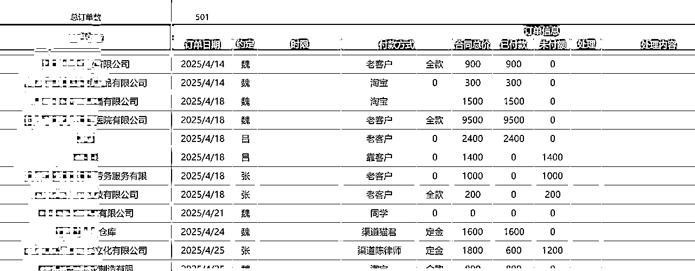
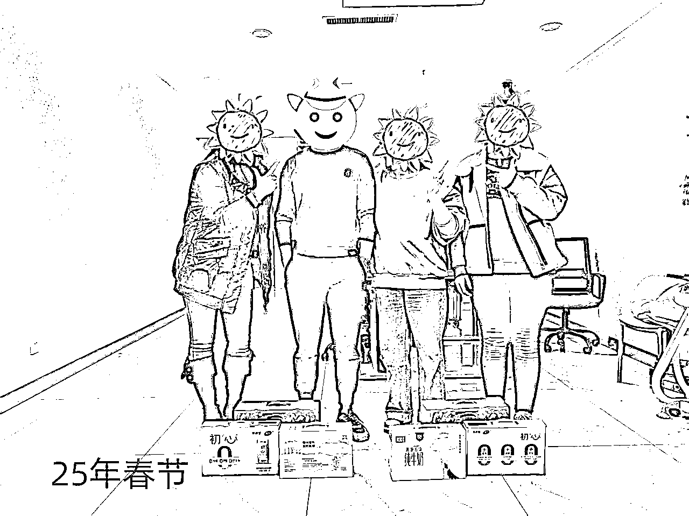
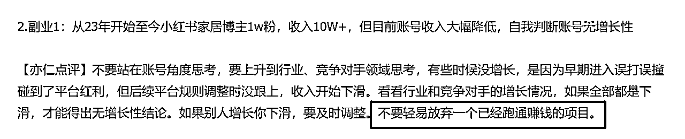
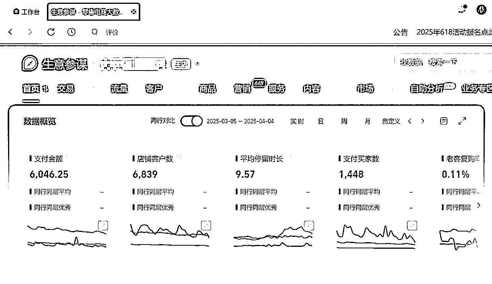

# 《花了两年时间才悟透：创业绕开这4个坑，才能从小作坊真正做起来》

> 来源：[https://ogsvnukdtf.feishu.cn/docx/XEqYdvZXMoG8QmxOHepcNxmVnng](https://ogsvnukdtf.feishu.cn/docx/XEqYdvZXMoG8QmxOHepcNxmVnng)

大家好，我是江天，生财有术的四年老会员，现在带着一家小微企业服务公司在跑。

回头看把企业信用业务和公司一起做起来的这近两年，太多地方没铺开、没执行到位，最后年收入始终卡在百万以内，痛惜得很。

“同样花在同一件事上的时间和精力，为何别人能做到年入五百万，我却只能守着一百多万？”

把这些遗憾和复盘写下来，既是给自己后面的路提个醒，也希望能给在场的朋友们一点参考。

### 一、流量放大这块儿，我彻底没抓住

一开始的客源主要靠淘宝和抖音来。本身有淘宝的背景，所以习惯用补单去撬免费流量，每天能进来十几个微信好友，本来就已经忙不过来，就一直把补单当成主线，从来没开过直通车。现在回想起来真心后悔。

原因很简单：

1. 如今想开直通车获客，成本比当年补单高出好几倍，一天也才两三个微信。
2. 2025年能成交的客户里，有一大半是2024年就已经加进来的私域。做企业服务，私域的复用价值极大，这些本身就是老板或者能触达老板资源的人脉，后续推单、带新业务都特别顺。

23年的客户，根本没有过小单子，都是新客户

最近的客户，大部分都是老客户介绍，客单价也明显下降

抖音这块我也犯同样的错。一直抱着免费流量的心态，投入为零。当时跟着做抖音SEO的导师学，发了一批图文、拍了一些视频，也确实能引来客户，每天都有加微信，于是更坚定了不投钱的想法，直接错过了最大的一池流量。

最火的时候，企业信用修复在抖音上投一个客户才七十多块钱，基本能回本，遇到大单就是净赚。如今听同行说获客成本涨到一百五十左右，修复价格又在往下走，我就更不敢投了。

总结下来，付费投流才是放大项目最省心、最直接的杠杆。以后碰到下一个蓝海，肯定第一时间拿出几万块的预算准备放大。

### 二、团队搭建只做了半步

业务量上来后，我第一反应是招了两个文员一起跟单。看起来是扩张了，但方向偏了，销售岗位始终没补上。

我去参访过三家做企业服务的公司，有两家已经做得比较成规模了。他们的修复师数量和我差不多，三到四个，但销售团队全是十几个人，而且保持正向盈利，给企业持续造血。

好产品必须立刻想办法放大，尤其是回本周期快的项目。回头看，我当时就是太保守，错过了最佳扩张窗口。

从23年底到25年5月份，团队一直是我们几个人

### 三、短视频IP做到一半就放弃了

现在无论做什么生意，抖音号是标配。23年蓝海期我注册了账号、开通蓝V，当时只是去小红书找同行素材，处理水印后直接发到抖音，就贡献了约五分之一的营收。后来我也尝试做个人IP短视频，但因为其他客源太多，账号常被限流见效慢，最后就没坚持下来。

当时只是随便搬运一些图片，就会有seo流量

现在看，同行里做起来的头部IP，粉丝也就七千左右，每天发老板日常的工作片段，不直接卖业务，也能稳定带来线索。这种账号迁移到任何企业服务品类上，都能零成本快速获客，真的很香。

我觉得个人IP永远不晚，关键看选没选对赛道。企业服务解决的是老板的刚需，服务属性强，前端做好IP，后端完全可以外包嫁接。一旦和客户完成首次成交，后续只要价格不过分离谱，信任度够了，复购和转介绍自然来。

所以这条路我会继续走下去，未来要把方法沉淀成简单可复制的SOP，用长期主义把它做起来。

### 四、我亲手放掉了那个能保底的现金流

我老本行是淘宝虚拟资料，连续两年每年稳定赚三十多万。为什么舍弃了？

1. 23年信用修复太猛，每个月的收入远超虚拟资料。
2. 虚拟资料偶尔会被判定售假，需要关店重开，流程有点烦。
3. 精力分散，最后直接把这个稳定收入丢掉了。

23年到24年信用修复简直跟捡钱一样，这只是走了公账的费用

等到今年修复客单价下行，人力成本慢慢抬头，压力感才出来。这时候才想起稳定的现金流有多香。尤其看到生财里亦仁回复的一条帖子，说千万别轻易放弃已经跑通的赚钱项目，特别有共鸣，于是我又把这个现金流业务重新捡回来了。

亦仁的给圈友的回复

重新操持起来的淘宝虚拟资料，都是真实成交，纯利润

### 复盘后的核心认知和下一步怎么做

1. 格局要先放大再收敛
这两年最大的体会就是做事要有做大的心。起初总想着先稳再说，结果就是错过了一次次放大的机会。市场永远偏爱敢投、敢放大的玩家。以后做任何项目，都要逼自己先想怎么放大，而不是怎么省。

2. 现金流是创业的定海神针
稳定的现金流业务就是创业旅途中的压舱石。无论是信用修复还是后续其他企业服务，只要能持续进钱，就能提供试错和创新的空间。以后追风口的同时，必留一条现金流主线。

3. 一切要留痕，变成SOP
过去很多事靠感觉做，流程和经验没沉淀，团队上手慢，自己也困在重复劳动里。现在明白了，做事必须留痕，把每一步拆解记录，形成标准化的SOP。这样才能复制、能扩张、能提效。未来短视频、转化、销售管理都要逐步标准化。

### 未来执行清单

*   蓝海即投流：新机会出现，先拿预算验证并快速放大。
*   人力杠杆先行：不再拖延，及时补齐销售和运营岗位。
*   个人IP深耕：持续产出内容，建立品牌，建立可复制的短视频SOP。
*   现金流保底：新项目再多，也保留一条稳定赚钱的现金流线。
*   流程沉淀：所有业务流程都要书面化、标准化。

创业路上遗憾不可避免，关键是能及时复盘、快速纠偏。希望我的这些踩坑经历，能帮到还在路上的人。一起加油。