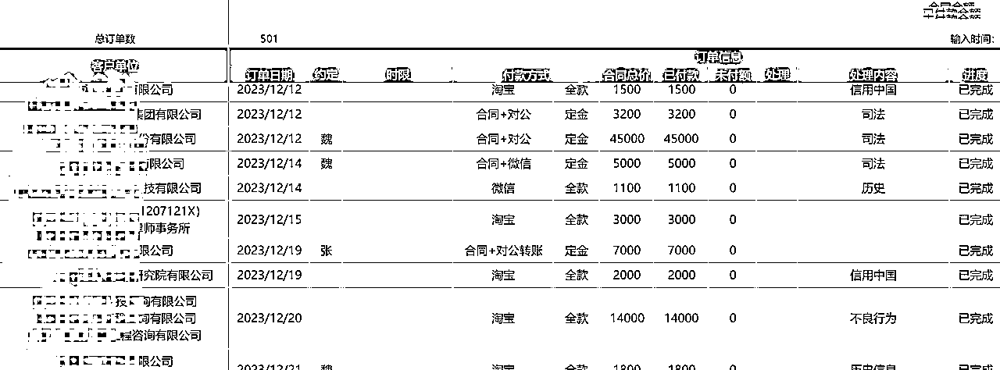
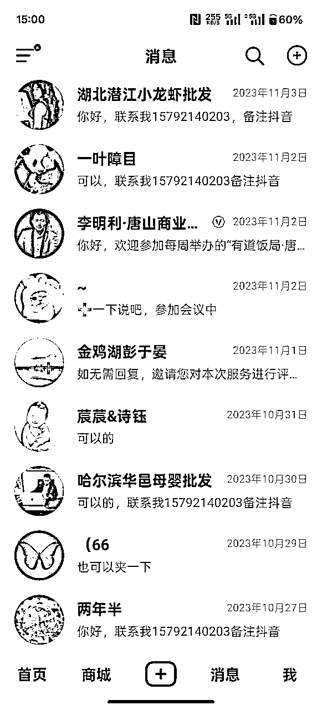
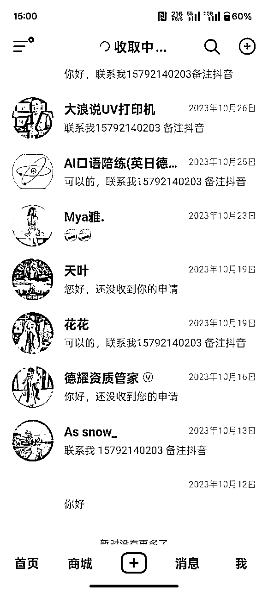
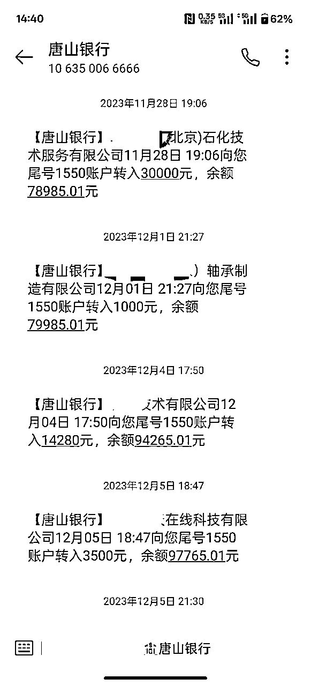
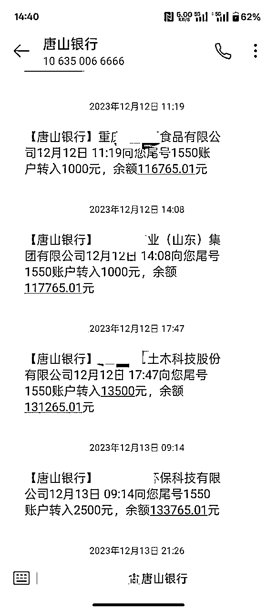
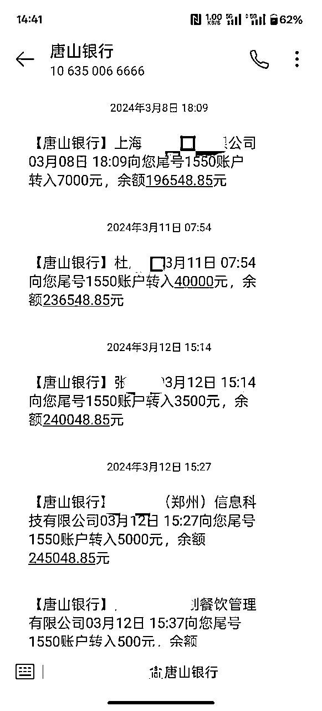

# 年入100万后的复盘：创业最容易踩中的4个增长陷阱

大家好，我是江天，在生财待了4年，目前经营一家企业服务公司，规模不大。

过去接近两年的经历，让我越来越清楚一件事：创业不是“有订单就行”，还要懂得把流量、团队、内容和现金流都接住。

我曾经有过不错的机会，却因为判断保守、执行中断，最后让年收益停在了100万以内。

同样投入两年时间，为什么别人能做到500万，我却只做到100万？下面这些复盘，是我给自己的提醒，也分享给正在创业的朋友。

## 一、流量来了，却没有顺势加速

最初，我的客源主要来自淘宝和抖音。

因为过去做淘宝，我比较熟悉补单带来的自然曝光。那段时间每天能新增十几个微信好友，客户多到自己都快应付不过来，于是我认为现有方式已经够用了，没有进一步测试直通车。

后来才发现，短期看似省钱，长期却可能错过更大的增量。

现在开直通车后，每天新增微信数量只有两三个，花费却比过去高出数倍。更关键的是，企业服务的客户决策周期往往很长，今天加上的人，可能隔了一年才真正成交。

过去一年成交的部分客户，其实早在前一年就进入了我的私域。很多企业老板，或者掌握老板资源的人，会持续转介绍客户。只要信任建立起来，后续拓展其他服务也会容易很多。

23年的客户，根本没有过小单子，都是新客户

最近的客户，大部分都是老客户介绍，客单价也明显下降

抖音这边，我当时也犯了类似的错误。

我习惯依靠免费渠道，所以始终没有给抖音投预算。那时跟着抖音SEO航海行动，陆续发布图文、拍摄视频，也确实获得了客户和微信新增，但因为免费流量能跑，就没有继续往付费方向测试。

事实上，企业信用修复刚开始火起来时，抖音获取一位客户的成本大约70元。只要转化正常，基本可以覆盖成本；如果遇到高价值客户，利润空间会更可观。

可惜当时我没有做这件事。如今听说同类客户的获取成本已经接近150元，而市场价格又在下降，自然更不敢轻易扩大投放。

这件事让我明白：一个项目验证出盈利模型后，付费流量往往是最快的加速器。未来再遇到早期竞争较小的项目，我会预留专门预算，边测试边放大，而不是只满足于眼前的自然流量。

## 二、只补执行人员，却没有补销售入口

订单增加后，我招聘了两名文员协助处理业务。

这只能解决交付端的拥堵，却没有真正扩大公司的收入来源。最关键的缺口，是我一直没有建立销售团队。

此前我曾到几家企业服务公司交流，其中有两家公司已经形成了一定规模。它们的修复人员数量和我这边差不多，都是三四人，但销售团队却有十多人，而且当时整体保持盈利，销售端持续为后端创造产出。

这让我意识到：产品本身能赚钱，只是第一步；能否把销售环节搭起来，决定了收入上限。

如果一个项目回款周期短、利润模型已经跑通，就不能只盯着自己还能处理多少单，而应该尽快增加获客和成交的人手。过去的我，把注意力全放在交付上，忽略了销售带来的放大作用。

从23年底到25年5月份，团队一直是我们几个人

## 三、内容账号开了，却没有坚持到产生复利

在今天的经营环境里，企业拥有一个抖音账号，几乎已经是基础配置。

2023年时，我注册账号、开通蓝V，甚至只是把小红书上同行的图片处理后发布到抖音，就带来了相当于全年营业收入五分之一的结果。

这说明平台确实有需求，也说明当时的内容门槛并不高。

后来我尝试打造短视频个人账号，但因为其他渠道已经能带来客户，再加上抖音审核频繁、内容见效较慢，我没有持续投入精力，最终没能把账号做成真正代表自己的专业品牌。

当时只是随便搬运一些图片，就会有seo流量

如今再看同行，有人已经把账号做出了个人特色。她的粉丝大约7000人，平时分享老板日常、工作状态和经营内容，却不直接推销业务，仍然每天有人咨询。

这种账号的价值，不只在于当下获客，更在于未来无论增加哪一类企业服务，都能直接复用已有的信任和关注，新增客户的成本会明显降低。

我现在的判断是：做个人品牌，任何阶段都不算晚，但必须选对场景。

企业服务解决的是经营者的实际问题，需求相对刚性；很多后端服务还可以通过外包、合作等方式完成。经营者只需要在前端建立专业形象，成为客户愿意信赖的顾问。

客户完成第一次交易后，只要后续报价没有明显偏离市场，通常更愿意继续找熟悉、可靠的人合作。

因此，个人账号这件事我会长期推进。接下来要做的，不是偶尔发几条内容，而是把选题、拍摄、发布、咨询承接等环节整理成一套能重复执行的流程，降低坚持的难度。

## 四、为了追逐高收益，放弃了原本稳定的收入来源

在做企业服务前，我主要经营淘宝虚拟资料，连续两年每年都有30万元以上的收益。

后来为什么停掉？主要有三点：

1. 2023年企业信用修复处于快速增长阶段，单月收入明显超过原来的资料业务；
2. 淘宝店铺偶尔会遇到售假问题，一旦被处罚，就要重新开店，维护成本不低；
3. 两条业务同时推进时，时间和精力很快就不够用了。

于是，我把原本稳定的资料业务放下了。

23年到24年信用修复简直跟捡钱一样，这只是走了公账的费用

当企业信用服务的客单价开始下滑，人员成本逐步上升后，我才重新感受到稳定收入的重要性。

后来我又看到亦仁在生财中提醒大家，不要轻易关掉已经验证过、能够持续赚钱的业务，这句话让我很受触动。

于是，我重新把淘宝虚拟资料做了起来。它虽然不像风口项目那样增长迅猛，但每一笔订单都是真实交易，也能带来相对干净的利润。

亦仁的给圈友的回复

重新操持起来的淘宝虚拟资料，都是真实成交，纯利润

## 复盘之后，我得出的3个结论

### 1. 不能永远用“小步试错”限制自己

创业初期谨慎没有错，但当产品已经证明能够赚钱，就不能始终停留在个人作坊的节奏里。

流量、销售、内容和人员，都需要围绕收入上限重新配置。想突破原有规模，必须接受投入增加、管理变复杂，并主动寻找放大的方法。

### 2. 稳定收入是创业时的安全垫

高增长项目可以带来机会，但稳定收入能让人保持耐心。

当手里有一条能够持续回款的业务线，就有更大的空间去测试新渠道、尝试新产品，也不至于因为短期波动而被迫做出仓促决定。

### 3. 经验必须转化成可交接的流程

过去很多事情都依赖个人记忆和临场判断，导致别人难以上手，自己也被大量重复工作牵制。

接下来，不管是内容发布、客户接待、销售跟进，还是交付管理，我都会把关键步骤记录下来，逐步整理成明确的操作手册。只有流程能够被复用，业务才具备扩张基础。

## 接下来的执行安排

- **为新项目预留测试预算**：先用小额投放验证数据，再根据回报决定是否扩大。
- **补齐销售与运营岗位**：不再只增加交付人员，把获客和成交端也搭建起来。
- **持续经营专业账号**：围绕企业经营者的真实问题输出内容，逐步建立个人品牌。
- **保留一条回款稳定的业务**：新项目再有吸引力，也不轻易砍掉成熟收入来源。
- **把核心环节文档化**：让新人能学、团队能接、业务能复制。

创业过程中，错过机会并不可怕，真正可怕的是经历过后仍然没有总结。

这次复盘让我明白：收入上限往往不是由努力程度决定，而是取决于有没有使用流量杠杆、人才杠杆、内容杠杆，以及有没有给自己留下稳定的现金流。

希望这些经历，也能给正在创业路上的你带来一点参考。