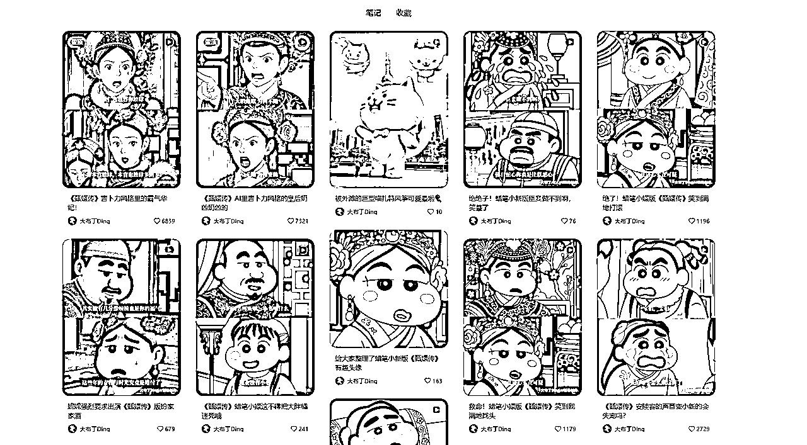

最近刷小红书和抖音，是不是总看到各种魔改版《甄嬛传》？3D动画的、吉卜力画风的、蜡笔小新模样的，五花八门，一个比一个吸睛。比如有位博主发的这条，点赞评论直接爆炸。

这种内容有多火，估计不用我多说。目前能想到的变现路子，无非是收徒卖课，或者挂个分成计划。我们社群也把这类视频当成了AI风向标。既然是风向标，那咱也得动手试试。周六下午我就花时间搞了一支3D动画版，下面把实操中总结的经验梳理一下，希望对想入局的朋友有帮助。

整个流程并不复杂：剪素材 → 生成Q版人物图 → 让图动起来 → 给人物对口型 → 重新剪辑拼接。

**第一步：整理剪辑素材**

甄嬛传的片源应该不难找，我是从网盘下了份4K版。建议优先挑名场面，而且镜头里人物尽量少，这样后期处理会轻松很多。我选的是第63集的滴血认亲。

拿到素材后，先导入剪映，把需要重制的片段单独剪出来，注意这个镜头最好不带字幕，方便后面生成Q版图片。剪辑好之后，导出静帧画面，同时把音频单独分离保存，留给后面对口型用。

**第二步：生成Q版人物图**

打开ChatGPT，用4o的生图能力把刚才的静帧转换成Q版造型。提示词写“将图片转换成3D Q版风格，比例16：9”。ChatGPT官网国内不好直接访问，我用的镜像站也能达到同样效果，注册直接用QQ邮箱就行。

**第三步：让静态图动起来**

这一步我拿同一张图和同一句描述词，先后试了可灵AI、即梦AI、海螺AI。对比下来，可灵生成的画面最稳定、动作也更生动，海螺其次，即梦虽然免费，但质感稍弱一点。如果要用即梦，在网页版生成视频后，用IDM下载工具就能把视频保存下来，无水印。

不过要提醒一句：可灵必须氪金，不然生成速度会让你怀疑人生。我充了45元月会员，然后上传Q版图，填入描述词，模型通常选1.6就行，2.0大师版太高级，用不起。等几分钟，一条5秒的小视频就出来了。如果是免费用户，可能要等上好几个小时。

**第四步：给人物对口型**

想让视频更逼真，对口型这步跑不掉。我试过即梦的对口型功能，但上传好几次都提示“未检测到可用角色”，估计是因为Q版卡通脸不太容易被识别。最后还是用可灵的口型工具：在生成好的视频左下角点“对口型”，然后选择“上传本地配音”，把第一步分离的音频传上去就行。这个环节比较费时间，一般要等5到7分钟。

费用方面也算一下账：可灵黄金会员会送660灵感值，生成一条5秒视频要35灵感值，对口型再扣5灵感值，也就是说做一个简单镜头就要消耗40灵感值，成本真不低。

**第五步：重新剪辑**

把不同场景的镜头都按上面流程生成好，再全部导入剪映，按剧情顺序重新拼接，加上字幕，最后导出，动画版《甄嬛传》就完成了。

我也就做了一小段，给大家感受下效果，完整视频制作其实不复杂，难的是跨出第一步。很多人习惯“看一遍以为会了”，但真要动手就拖延。记住，行动起来就成功了一半，共勉。

后续我又做了一个更长一点的冰雪奇缘风格版本，下次找机会再分享。