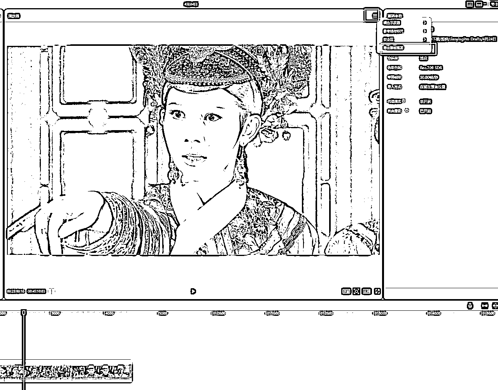
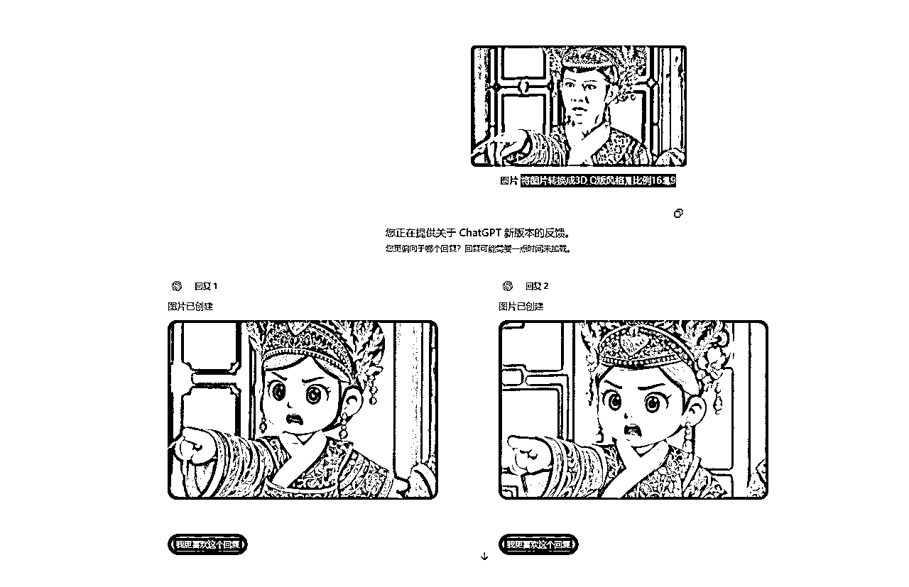
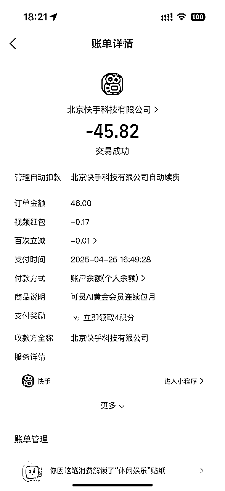
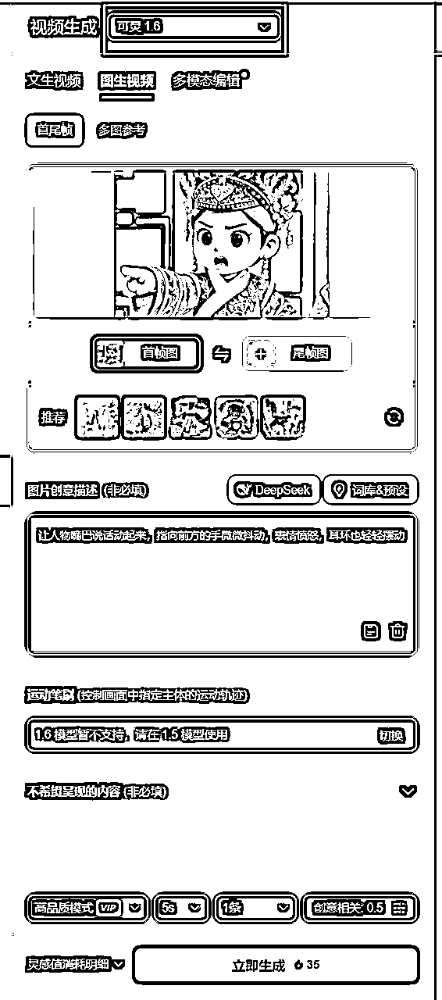
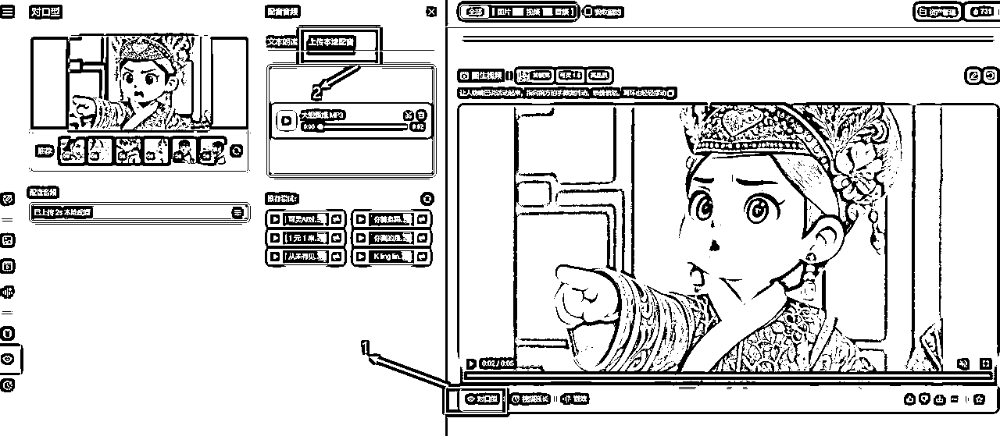

# 手把手拆解 | 用AI把《甄嬛传》做成3D动画短视频的完整实操
作者：龙哥

最近打开📕、抖音就能刷到一波魔改《甄嬛传》，3D动画版、吉卜力风、蜡笔小新风全都有。随便看一个博主的作品

点赞和评论都很炸，变现路径也很清晰，要么收徒卖课，要么走平台分成。

这类内容在我们圈子里算是AI内容的一个风向标了。既然是风向标，那就值得跟一波。我在周六下午也试着做了一版3D动画风的《甄嬛传》，把自己剪辑时的心得整理出来，给正在尝试这个赛道的小伙伴做个参考。

整套流程其实并不复杂，核心就五步：挑片剪素材、生成Q版人物图、把静态图动起来、让画面对口型、再回剪辑室拼接。

## 1️⃣ 挑片和预处理

《甄嬛传》的片源网上随便都能找，网站下、网盘搬都行，能保证清晰度就行。我是用夸克网盘存的4K资源，直接拉下来用。

建议优先挑名场面，而且镜头里人物别太多，单人或两人对戏最好上手。我的样例就选了第63集的滴血认亲。

把选好的片段丢进剪映，先把要复刻的那段镜头抠出来，尽量找没有字幕的片段，后面做Q版转换更干净。剪完记得导出一张关键静帧。

同时把原片的音轨剥离出来单独存档，后面对口型要用。

## 2️⃣ 生成Q版角色图

打开ChatGPT，用4o的生图功能把静帧转成Q版。注意控制一下构图比例，保持16:9。

提示词参考：把这张图片转换成3D Q版风格，比例16：9

ChatGPT官网：[https://chatgpt.com/](https://chatgpt.com/)

国内打不开的话，可以用镜像站，效果基本一样，我用的就是下面这个，🐧邮箱就能注册。

AI镜像站：[https://chendandan.ai1.bar/](https://chendandan.ai1.bar/)

## 3️⃣ 静态图转动态视频

这一步就是让Q版人物活过来。我测了好几个平台，最后结论是充费后的可灵AI更稳，画面流畅度更好。

提醒一下，务必先开会员，不然排队要等到天荒地老。

同一张图、同一个描述词，三个工具的效果对比：

1 可灵AI
2 即梦AI
3 海螺AI

单看一张差别不大，多做几组素材就能明显感觉到，可灵AI的稳定性最好，海螺AI其次，即梦AI的优势是免费。

小技巧：在网页版即梦AI生成完视频后，用IDM下载就能拿到无水印版本。

可灵AI：[https://app.klingai.com/cn/](https://app.klingai.com/cn/)
即梦AI：[https://jimeng.jianying.com/](https://jimeng.jianying.com/)
海螺AI: [https://hailuoai.com/](https://hailuoai.com/)

我当时充了45元的月卡。

进入视频生成，上传Q版图，填上动作描述，模型选1.6版就行，2.0大师版贵得离谱。

正常开会员后等几分钟就能出一条5秒视频，没开会员的话可能要排几个小时。

## 4️⃣ 人物对口型

想让成片更像真人，就得做口型同步。我用的还是可灵AI自带的对口型功能。

即梦AI也有这个功能，但我反复上传都提示【未检测到可用角色，请重新上传】，估计Q版卡通人脸识别不太友好。

在可灵AI生成好的视频右下角点【对口型】，选择【上传本地配音】，把第一步分离出来的原声传上去就行。

对口型耗时比较长，大概5-7分钟。

成本方面说一下，可灵AI黄金会员送660灵感值，生成5秒视频要35点，对口型要5点。也就是说一个简单镜头就要40点，烧钱是真的。

### 5️⃣ 终剪打包

按上面的流程把不同场景的镜头都生成出来，再导入剪映统一拼接，加字幕、调节奏，最后导出发布。这样一支动画版《甄嬛传》就完成了。

我也只做了个小片段，大家可以感受下效果

其实门槛不高，最难的是很多人看了教程就停在“会了”的幻觉里，缺的是执行力。先动手做出来，才算成功了一半。

之后我还用冰雪奇缘风格做了个更长的版本