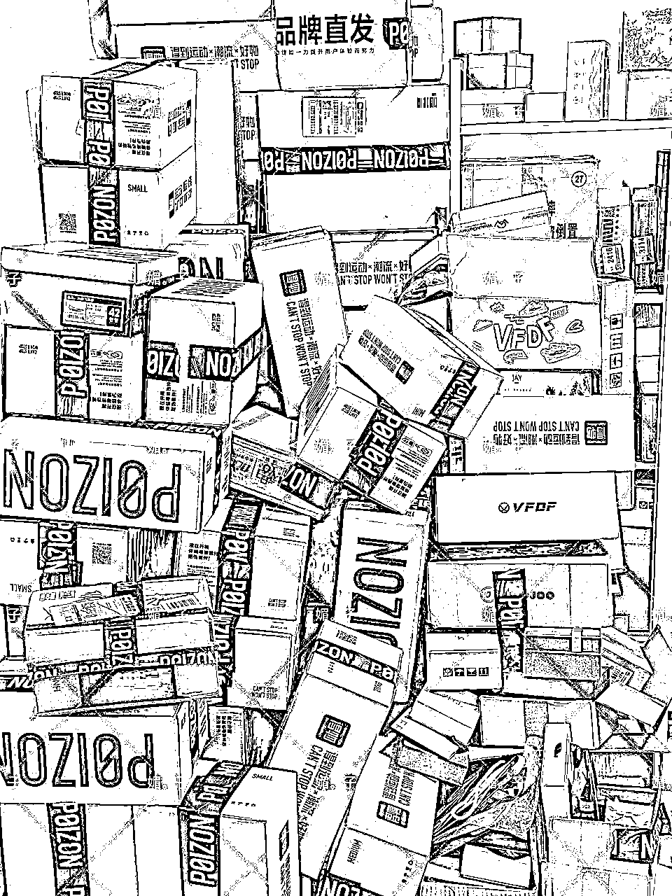
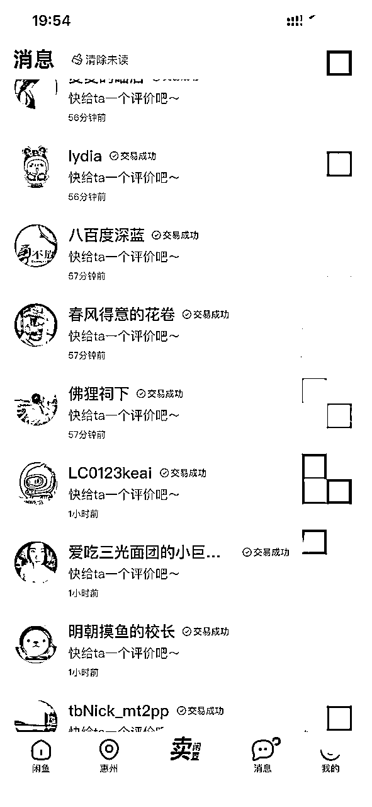
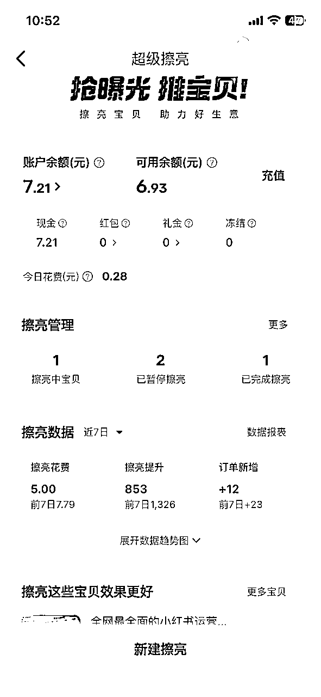
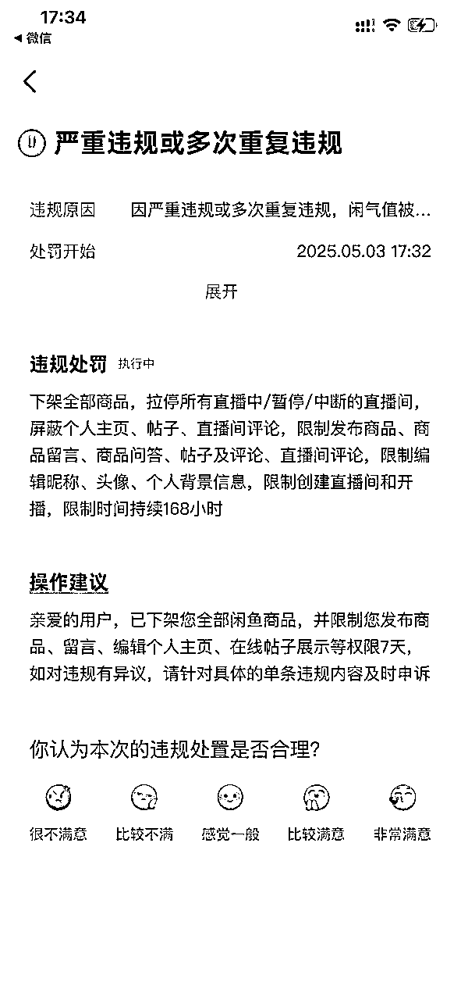
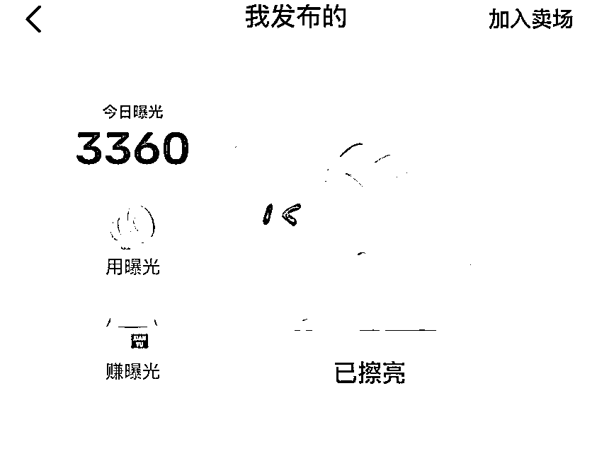
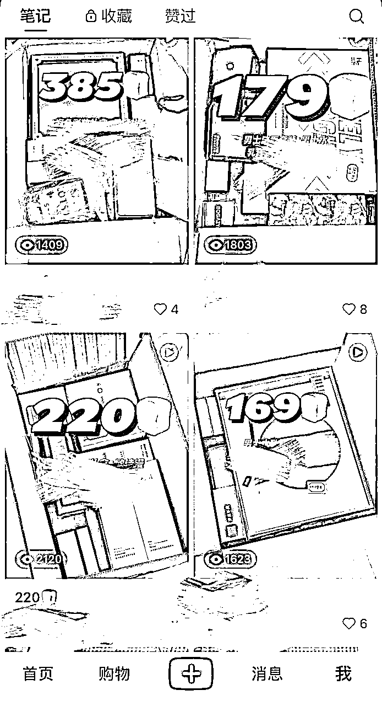
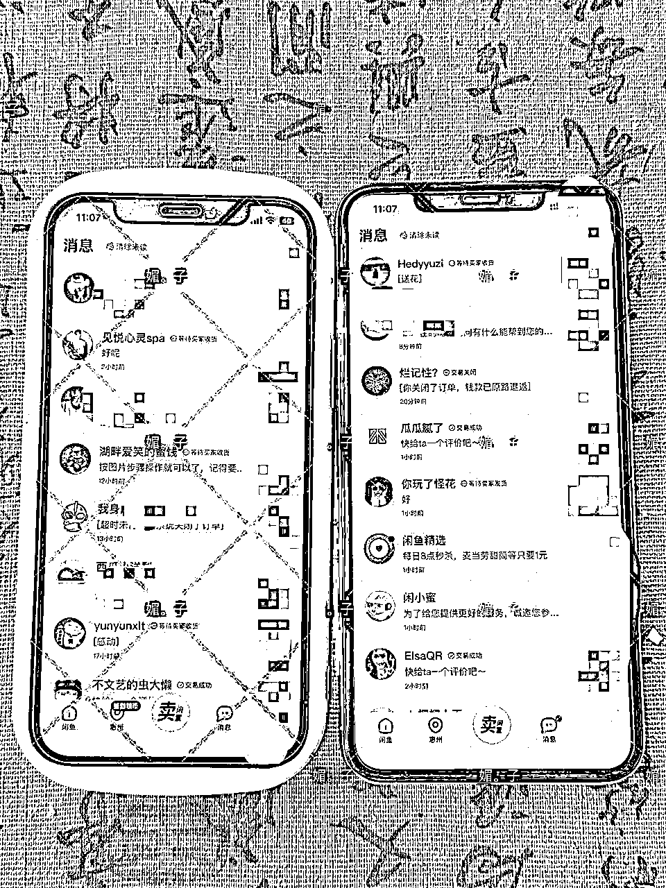
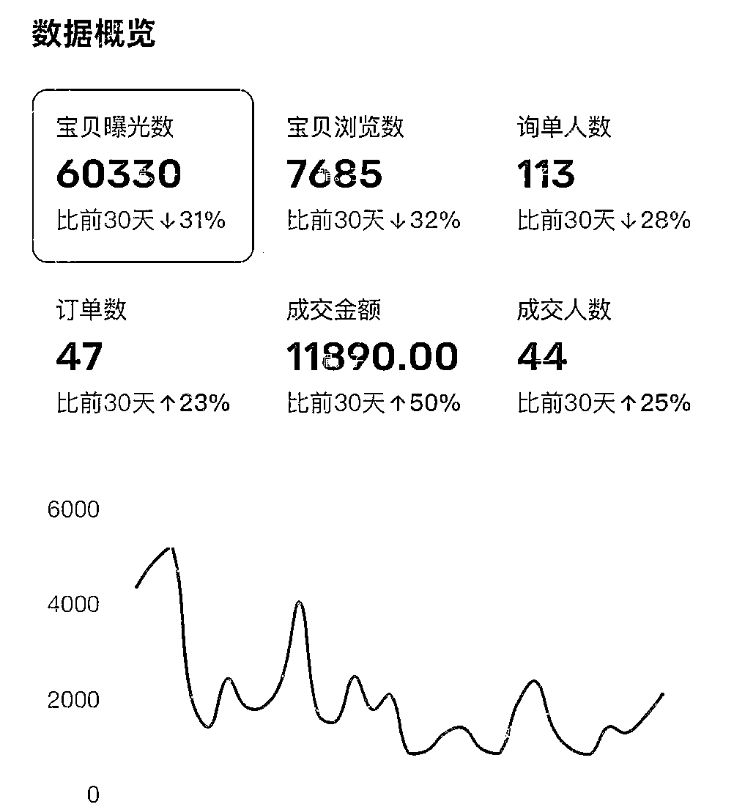
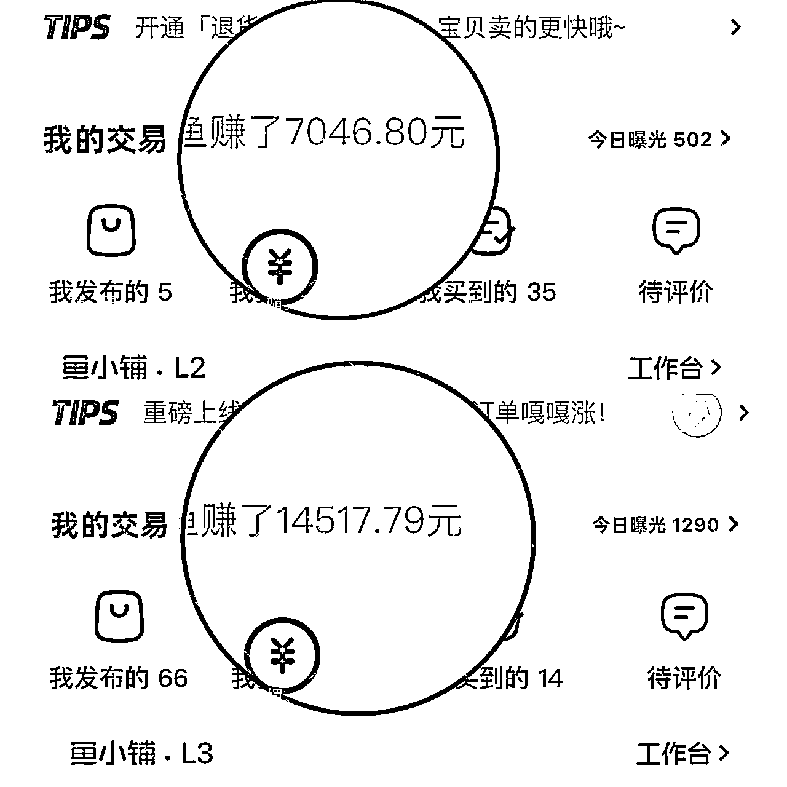

# 从0到月入过万：我的闲鱼虚拟产品实操复盘

大家好，我是媚子。

2024年4月经叁斤老师推荐入局赚钱，已经潜水学习一年多，这次把近期做闲鱼卖虚拟资料的心得整理出来，和大家聊聊。

本职我是在做得物好物分享的账号，品牌方合作的赠品源源不断往家寄，堆到我对象都嫌弃家里像仓库。

这些闲置堆着占地方，化妆品还会过期。与其放着积灰，不如变现。闲鱼上手门槛低，我就开始翻帖子研究怎么玩。

# 一、实体清仓到虚拟起量，一次意外爆单

起步阶段我只在闲鱼挂实体闲置，像护肤品、包包、首饰这类。

后来叁斤老师给我看了一份他自己整理的虚拟资料，内容很扎实。加上我已有闲鱼运营的基础，第一时间就想试着去卖。

拿到授权后，我就把资料挂上去了。因为对虚拟没底，我先用9.9元的试水价。

没料到刚上线就被盯上，短短时间就有好几个人来问，马上就成交了3单，信心一下子上来了。

叁斤老师提醒别卖太便宜，要按原价走。我于是把价格调回39元，没想到销量丝毫没受影响，反而持续在涨。

# 二、单量起来后暴露的运营痛点

订单多了麻烦也多了。早期详情写得太简略，买家对产品认知有偏差，下错单后申请退款的特别多，忙活半天钱没赚到。

问题出现了就得解决。

## 把详情和自动回复做扎实，错单退款大幅下降

我先是把商品页彻底重写，把资料的核心价值、适合谁用、能解决什么痛点、付款后怎么交付，这些关键点都写清楚，连买家常问的疑点一次性讲明白。

然后在闲鱼自动回复里设置了标准话术。买家还没找我，我就能先把信息推给他们，自己判断是否需要，避免无效沟通和误拍。

这个动作直接把咨询量和退款率都降下来了。

## 用输入法常用语提速客服

和客户聊多了发现，80%的问题都重复。我就把高频问答存进搜狗输入法的常用语里，一键发送。

回复效率明显提升，客户不用干等，也减少了我的重复劳动。

## 小额试水“超级擦亮”

闲鱼上线了超级擦亮推广，起充只要10块钱，我就拿来做测试。

我建了3个推广计划跑数据，几个小时后发现只有1个计划带来了曝光和咨询，就直接砍掉另外两个，把预算集中到有效的那个上。

结果证明投入产出很可观，带来了不小的自然流量。

# 三、主号被封的至暗时刻，以及自救

生意正顺的时候，我因为上架了违禁品，主账号被罚关小黑屋7天。

当时确实慌了，但很快冷静下来找Plan B。

我立刻启用了对象的闲鱼号，把爆款虚拟资料全部搬过去。因为号没怎么养过，当天自然曝光只有5个。

为了快速起量，我做了三件事：

*   直接投放：给新号充值20元开超级擦亮，立马建计划推。
*   做平台任务：把闲鱼的签到、逛逛、擦亮等日常任务全刷一遍，提升活跃度。
*   人为加权：借朋友帮忙在新号拍首单并好评，为冷号快速建立信任分。

一套组合拳下来，当天曝光直接冲到3000+，咨询6个，成交3单。

顺带说个小尝试：

叁斤老师建议我把📕也当成引流渠道，引到闲鱼成交。我就把手里的得物大牌实物也同步到📕试试，虚拟资料单独开了一个号测试。

目前来看，我的内容打法下，实体在📕的转化比虚拟更好。

# 总结

现在主号已解封，副号也跑稳了。两个号一起做，日均能稳定10多单，副业日收入基本在300元以上。

说实话这点收入比起真正的大佬差远了，但作为一份额外零花钱，我挺满意。后面还会继续深耕闲鱼，探索更多变现玩法。

从最初为了解库，到无意间捡到虚拟赛道，再到封号后快速切换账号自救，这段闲鱼副业经历挺曲折，也收获满满。

目前两个闲鱼账号累计收入已超2万元。

