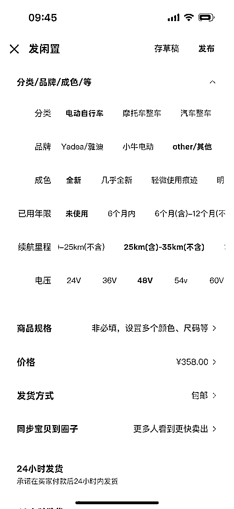

# 闲鱼卖电动车的实操赚钱法：从0到月入5k+的完整拆解

“杨老师别讲大道理了，直接给我123步骤，我照着做就能收款。”

这是上周一个圈友留给我的留言。

我放下手机，沉默了好一会儿。

太多人被概念绕晕了，听了一堆课，看了一堆干货，最后手上依旧空空。实话实说，我三年前就是这样，脑袋里的东西越来越多，账户余额却纹丝不动。

所以今天不讲方法论，只给干货。手把手教你我在闲鱼上怎么卖电动车做到月入五千以上。

下面这套打法，是我过去三年100多个账号实战、几千单成交积淀下来的经验。没有包装，全是踩坑换来的。

## 为什么我把小百货和图书全砍了，只做电动车

老朋友应该知道，我最早在闲鱼做的是小百货和图书。旺季的时候订单多到吓人，我和搭档轮流刷单号，经常干到凌晨两三点。

钱是赚到了，累也是真的累，坑更多：

* 单号手填到崩溃，售后消息爆炸，根本管不过来
* 财务对账老对不上，进货资金乱成一锅粥
* 闲鱼对小百货的审核越来越严
* 更致命的是，多号被同行举报，收入从上万跌到三四千，看不到头

痛定思痛，我决定换赛道。账号我有近100个，平台用惯了不能丢。调研一周后，我们锁定了一个方向：继续深耕闲鱼，只换品类。

我的判断很简单：闲鱼的根是二手交易。不管怎么升级，二手交易永远是核心。闲鱼在二手领域就是老大，其他平台根本不在一个级别。

## 电动车是怎么被我选中的

选品时我定了几条硬性标准：

1. 二手属性要强，符合闲鱼气质
2. 需求要大，天天有人在找
3. 客单价要够，一单赚一百多才值得投入时间
4. 体积大不方便带走，搬家只能卖
5. 损耗快，市场永远有供给和需求
6. 用户要对口，大学生和年轻白领是主力

筛下来就剩几个：山地车、电动车、洗衣机、小冰柜、空调。

最后选电动车，因为它有三个别人没有的优势：

* 使用频率高，场景多，上学通勤、外卖跑单都能用
* 损耗明显，二手卖的理由充足，买卖双方都有刚需
* 客单价在600-800元区间，决策不纠结，利润也够

## 真实数据，不吹牛

先看我团队一个普通号的日常表现：

咨询一天99+，客单600-900元，单利润100-200元。

没有神话，就是真实的数字。有人会问咨询这么多为什么转化低？

这就是电动车的特性，咨询量大但下单周期长。平均50个咨询才能成交1单，是行业正常水平。

关键是只要回复够快，总能转化。一个号一天出1-2单很正常，三个号跑起来，月入5000+很稳。

## 第一步：账号搭建，1人最多3个号

闲鱼有自己的潜规则，懂了就少走弯路。

一机一卡一号的原则：

* 一个人最多同时运营3个支付宝，对应3个闲鱼号
* 每个号绑定独立手机号
* 最理想是每号配一台手机，预算紧就用分身软件

现在闲鱼还能微信登录，小程序也能微信支付，操作更顺了。

实操避坑：

1. 优先用新号，新号流量扶持更强
2. 有黑记录的号别硬用，系统有记忆，建议注销重开
3. 分批注册，别一次性开多个号
4. IP保持稳定，频繁切换会被盯上

去年有个学员非要用一个被警告过的老号，养了一周流量起不来，最后注销重来才是正解。

## 第二步：养号加调研，先把权重养起来

上来就发商品是新手错误，养号是必修课。

新号养法：

* 资料完善，头像用成年女性照片更显信任，昵称带行业词如“XX电动车行”
* 前三天每天登录30分钟左右，浏览同类商品，时间错开
* 收藏5-10件同行商品，关注3-5个店铺
* 适度点赞评论，可以私信同行了解情况，别刷太猛

老号重启：

* 改密码重新登录，清理历史消息和无效收藏
* 按新号方式重新活跃

我重启过一个闲置8个月的号，两周后表现比新号还猛，月入轻松过万。

养号时同步做市场调研，我的打法是先当顾客去咨询同行：

* 摸清行业报价和话术
* 收集优质快捷回复
* 看对手回复速度和专业度
* 找到客户核心关注点

我连续假装顾客咨询了15家店，发现回复超过15分钟的，基本没戏。所以团队铁律是：3分钟内必须响应。

找同行有几个技巧：文案详细、图片清晰、昵称带车行关键词、宝贝数量10个以上、评价真实。至少研究20-40家，才能摸清行情。点进一个商品往下刷，也会不断推荐同类优质店铺。

## 第三步：上品破万法，内容是根本

这是整个项目的核心。

### 文案不用自己造
行业内详细专业的文案更易成交，但不需要从零写：

* 直接对标表现最好的同行文案
* 复制后用AI重组，避开完全抄袭
* 用成熟模板替换部分信息

记住，电动车文案越实在越好。我常说一个号坚持上架30-50个产品，总有几个会起量。

### 图片决定点击
好图带来的点击率提升非常明显：

素材来源：拼多多买家评价图、淘宝评价图、闲鱼同行图。可以用Fatkun批量下载，手机端可分享到QQ保存无水印。

图片要求：整车清晰、高清无水印、无马赛克、背景简洁、车身主体突出、多角度展示。准备200张以上备用，第一张放整车外观。

我实测过，同样商品发3-4张和发满9张，点击和咨询差了20%。图多图清就是优势。

### 发布细节
价格策略：标价300-600元吸睛，但实际要卖700+，这是经过大量测试的心理价位。太低转化差，太高失去对比优势。原价设1000-1500元显得让利，系统也更容易推流。库存设100个。

品牌注意：别用爱玛、雅迪等知名品牌名，避免纠纷。品牌栏选“其他”。

属性尽量填全。

发布时间：工作日10:00-11:30和14:00-16:00效果最好。没空看时间就随时发，别在深夜凌晨发。单号每天发3-5个，前期少点，后期稳定在5个。

### 起号关键48小时
冷启动阶段决定生死：

朋友助力法：上架后立刻分享给1-2个朋友，让他们点进、浏览、咨询、收藏，其中一位走完下单流程，3-4天后完成好评。

标题优化法：标题带“上班代步”“大学生电动车”等热词，发布后别改。尝试不同价格带，记录效果最好的组合。

限时优惠法：发布第3天小幅降价10-30元，系统会推送给收藏用户。

每日必做：每天上架3-5个新品，淘汰流量差的链接，重点维护有咨询的商品，保证10分钟内回复。坚持一周上架30+链接，流量会稳定。新号通常3-5天能拿到第一单自然成交。

### 后端维护，回复就是成交
电动车咨询多转化低，回复速度和话术是命脉。做不到快速回复，别碰这个类目。

5分钟内回复，成交概率是1小时后的5倍。

高效回复：设置快捷短语覆盖90%常见问题，首次回复直接说明“标价是电池价格，全新电车带电池包邮到家xxx元，质保一年，不满意包退包换”。主动引导客户提问“看中哪款？打算用多大的电池”。准备价格表节省时间，忙时开启自动回复。

转化话术：

“厂家正在打包发货，建议尽快下单排队”
“工厂直营，比实体店省300-500元”
“今天活动价，明天恢复原价”
“今天下单送头盔，价值20多元”

行业常态是50个咨询≈1单，别被转化率吓退。

矩阵运营：兼职的话2-3天出1单正常，小米双开方便操作，大规模可用群控软件管理5-100个账号，群控能抓取同行链接直接发布。回复方式可选手机、电脑投屏或闲鱼管家远程。

进货渠道：前期拼多多拿货，量上来后找线下商家合作。拼多多下单时电话填自己的，地址别写太细，派送时再告知快递员真实电话。预留出单号2天、发货3-4天的时间。

售后处理：客户问题先转问上游商家再回复。电动车退货难，尤其电池问题，能协商尽量不退。磕碰就补配件。续航别报太高虚标，避免后续纠纷。

## 第四步：风险防控

文案风险：别用“标价仅为定金”“价格为电池价格”这类误导话术，会被系统判定虚假定价删除链接。被删就重新上新。

站外交易风险：客户问线下自提或要手机号，别回“好的”“OK”。最佳做法是不回复或明确只支持闲鱼内沟通。

地域选择：北京、上海、浙江等一线城市上牌严格，建议避开发布。

运费承诺风险：别写“退货包运费”，物流成本高。

品牌核查：电动车外观相似，关键看Logo。上架时仔细核对图片和实际商品是否一致。

信息保护：从拼多多进货时注意保护手机号和地址，避免顾客收到上游电话影响体验。

封号问题：正常经营一般不会无故封号。常见原因是引导站外交易被禁言、违规操作触发风控。信息错误通常只删链接，不封号。

恢复方法：可注销重注册。应急可拨打12345政务热线投诉，有概率恢复。核心是建立合规习惯，定期关注平台规则。

## 最后的话

电动车项目门槛不高，核心是耐心和执行力。适合踏实肯干的人。

一个人3-5个号，每天坚持上架、及时回复，一单赚100-200元，一天1-2单，月入5000+非常保守，全职做破万很容易。

我带过很多人，最后赚钱的都是看完就动手的人。理论不值钱，行动才值钱。

动手吧，脏点手比空看文章强。

电动车实操有问题随时交流，我持续关注，尽量把经验分享到位，因为利他最终利己。